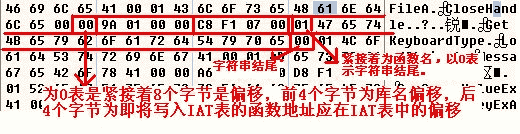

# 菜鸟啄硬壳(之三)——借壳自动修复 ITA 表和 IID 表

> 原文：[`www.pediy.com/kssd/pediy09/pediy09-463.htm`](https://www.pediy.com/kssd/pediy09/pediy09-463.htm)

## 摘要

1. 模拟壳的装载过程，自动修复 `ITA` 表和 `IID` 表，脱壳变得如此轻松愉快。
2. 在 `OD` 中修改 `PE` 头，脱壳后程序可以立即运行。

## 正文

现在市面上有很多脱壳工具，但大多功能有限，只能脱一些非常标准的已知壳。若壳稍加变化它们就无能为力了，正象杀毒软件一样，只能杀已知的病毒。壳是可以千变万化的，万能脱壳工具好象是没有的？有没有十分容易的脱壳方法呢？答案是看你有没有一个很好的脱壳思路。下面以脱 `Spy.exe` 的壳为例谈点体会。

我很喜欢窗口侦测的 `Spy.exe` 软件(见附件)，搞软件破解的没有人不知道它的。它用 `UPX` 加壳，我说过 `LoadLibrary` 和 `GetProcAddress` 函数是壳的软肋，这正好来验证一下这个结论是否管用？

### 1. 对 `Spy.exe` 壳的认识

用壳侦查软件测试 `Spy.exe`，都报告说它是 `UPX` 壳。但用 `UPX` 脱壳工具(一大堆)上阵，要么没反映，要么 `windows` 要发“错误报告”，`UpxShell` 更搞笑，说它是一个陈旧的版本不能解壳？没有一个能生成(那怕是不能运行的)脱壳文件，只有 `ProcDump` 稍好点，脱出了一个不能运行的 `Unpacked.exe`。`Spy.exe` 的壳肯定是一个老版本了，老版本尚且如此，新版本谈何容易？

我在《菜鸟啄硬壳(之一)》中有一句话说过头了。我说：“无论是 `windows` 或者自己调用 `GetProcAddress` 装载 `API` 函数，都必须要有 `IAT` 表”。这句话错了(资历太浅)！凡事都有例外！这个 `Spy.exe` 壳装载 `API` 函数就没有现存的 `IAT` 表！抢先抓取 `IAT` 表的思路受阻了。

### 2. 使用对付壳的杀手锏——拦截“`GetProcAddress`”函数

由于有了前面乱说的教训，我不敢说拦截 `LoadLibrary` 和 `GetProcAddress` 函数一定可以做到什么。拦截的目的是分析代码是如何装载 `API` 函数的？从分析中尽量做到下面四点。这四点是脱壳思路的源泉！

1. 获取 `API` 函数名(脱壳后)地址；
2. 抓取 `IAT` 表或获取 `IAT` 表地址(如果没有 `IAT` 表，那么装载第 1 个 `API` 的地址就是 `IAT` 表地址)；
3. 抓取 `IID` 表或获取 `IID` 表的地址(可能在 `LoadLibrary` 访问的地址附近，但不一定有 `IID` 表)；
4. 获取 `OEP` 地址。

如果你能做到以上 4 点(无论你用什么方法)，那么让程序自动修复 `ITA` 表和 `IID` 表且脱壳后可以立即运行的程序就离你不远了。下面说具体的对 `Spy.exe` 脱壳的操作方法：

#### （1）用 `OD` 打开 `Spy`，用右键打开弹出式菜单找“搜索—全部模块中的名称”找到 `LoadLibrary`，记下地址：`4B7154`

在 `OD` 命令栏键入 `HR 4B7154` 回车，运行。(按 `ctrl+F9`)来到下面代码：

```
004BA123     8B07................mov eax,dword ptr ds:[edi]
004BA125     09C0................or eax,eax
004BA127     743D................je short 004BA166
004BA129     8B5F04..............mov ebx,dword ptr ds:[edi+4]
004BA12C     8D8430 00600B00.....lea eax,dword ptr ds:[eax+esi+B6000]  ；获取了库函数名
004BA133     01F3................add ebx,esi                 ；取得了 IAT 表地址
004BA135     50..................push eax
004BA136     83C708..............add edi,8               ；指向了库中第 1 个 API
004BA139     FF96 54610B00.......call dword ptr ds:[esi+B6154]     ；调用 LoadLibrary
004BA13F     92..................xchg eax,edx
004BA140     8A07................mov al,byte ptr ds:[edi]      ；获取 API 函数名
004BA142     47..................inc edi
004BA143     08C0................or al,al
004BA145     74DC................je short 004BA123             ；是库函数返回，是 API 往下
004BA147     52..................push edx
004BA148     89F9................mov ecx,edi
004BA14A     7907................jns short 004BA153            ；必跳，14C—152 是花指令
004BA14C     0FB707..............movzx eax,word ptr ds:[edi]
004BA14F     47..................inc edi
004BA150     50..................push eax
004BA151     47..................inc edi
004BA152     B9 5748F2AE.........mov ecx,AEF24857              ；花指令,153 开始才是真指令
004BA157     52..................push edx
004BA158     FF96 58610B00.......call dword ptr ds:[esi+B6158]     ；调用 GetProcAddress
004BA15E     5A..................pop edx
004BA15F     8903................mov dword ptr ds:[ebx],eax      ；装载 IAT 表
004BA161     83C304..............add ebx,4
004BA164     EBDA................jmp short 004BA140
```

单步走几下，到 `4BA148`，状态栏显示一个函数名，地址是 `4B1009`。切换内存到 `4B1000` 一下就看到一连串的函数名，显然 `API` 函数名称表地址在 `4B1000`。继续走，在 `4BA158` 调用 `GetProcAddress`，`eax` 中返回了 `API` 地址，在 `4BA15F` 将把该值存入`[ebx]`，状态栏显示 `ebx=480140`，内存切换到这，发现是全空白，没有装载前的 `IAT` 表，但该地址就是装载后的 `IAT` 表的位置。`4BA139` 是调用 `LoadLibrary`，当某个 `.dll` 中的 `API` 装完后，自然就会来访问它。当我们来到 `4BA12C` 时，显示 `user32.dll`，地址是 `4B719A`，内存切换过去就发现了一堆 `.dll` 函数，原来 `Spy.exe` 将库函数和普通 `API` 是分开放置的。稍往回走就发现了 `IID` 表，地址是 `4B7000`。最后我们发现，程序开始的入口处就是一个 `pushad`，显然出口就在 `popad`（满足 `pushad`、`popad` 成对规律）。来到 `popad` 处立即发现 `jmp 47A6C0`，该地址为 `OEP` 无疑。这样，前面四个问题就圆满解决了。

#### （2）修复或创建 `IAT` 表，`IID` 表的思路

`ITA` 表的实质就是其值是指向 `API` 函数名字串地址的，当我们知道函数名表开始的地址，并在其中搜索到某函数时将其所在的“地址”依次填入 `IAT` 表，则该表就修复或创建好了。（`IID` 表的实质就自己去看有关书籍吧）弄懂后思路就清晰了。现在关键是搞清楚函数名表中函数排列的规律：我们发现每个函数名是以 `00 01` 开始的，每个库函数是以 `00 00` 开始的。有了这个就够了(其实在每个 `00 00` 后面的数字中暗藏着装载 `API` 的地址)。这样就有下面的方法了：

将 `4BA198` 的 `jmp 47A6C0`（出口），改为 `jmp 4B6B30`(跳到空白处)，`OD` 中键入下列代码：

```
004B6B30    BD 00004000...........mov ebp,400000
004B6B35    BF 3C010800...........mov edi,8013C        ；80140 是 IAT 表地址
004B6B3A    BE FE0F0B00...........mov esi,0B0FFE       ；B1000 是函数名表
004B6B3F    BB 24704B00...........mov ebx,4B7024       ；4B7014 是 IID 表地址
004B6B44    8A042E................mov al,byte ptr ds:[esi+ebp] ；搜索函数名
004B6B47    46....................inc esi
004B6B48    81FE 90280B00.........cmp esi,0B2890
004B6B4E    7202..................jb short 004B6B52
004B6B50    C3....................retn               ；此处设断
004B6B51    90....................nop
004B6B52    3C00..................cmp al,0
004B6B54    75EE..................jnz short 004B6B44
004B6B56    8A042E................mov al,byte ptr ds:[esi+ebp]
004B6B59    3C00..................cmp al,0
004B6B5B    740A..................je short 004B6B67
004B6B5D    4E....................dec esi
004B6B5E    89342F................mov dword ptr ds:[edi+ebp],esi  ;填写 IAT 表
004B6B61    83C704................add edi,4
004B6B64    46....................inc esi
004B6B65    EBDD..................jmp short 004B6B44
004B6B67    83C608................add esi,8
004B6B6A    83C704................add edi,4
004B6B6D    893B..................mov dword ptr ds:[ebx],edi    ；填写 IID 表
004B6B6F    83C314................add ebx,14
004B6B72    EBD0..................jmp short 004B6B44
```

运行在 `4B6B50` 断下后，因为 `PE` 头在运行中是禁止写入的，输入表，导入函数表的“登记”只能手工写入了：`OD` 中内存切换到 `400000`，修改 `400180`：为 `14700B00 40010000`；修改 `4001D8`：为 `40010800 64060000`。最后把第 2 块节表名由：`UPX1` 改名为：`.rsrc`（这样 `eXeScope` 才可以编辑资源）。一切就绪后，`dump` 当前进程，并将“重建输入表”选项去掉，入口依然是 `7A6C0`。怎么样，脱壳出来的程序是不是运行得很正常？

#### （3）摸拟壳写 `IAT` 表的过程，直接写入函数名地址

照你这么说，何苦先让壳把 `IAT` 表写成了 `API` 的调用地址，再自己来改成函数名地址，不如让壳直接写函数名地址？还省得我小心地去找函数名字串排列的规律，自编程序。这话有理，但可能难度较大，因为壳写 `IAT` 表的空间只有 `41h` 字节，且壳也没有写 `IID` 表。小心地设计程序，调整原可用代码的位置(因为空间太小了)也能实现，在 `OD` 中汇编如下代码(对照那些是原有的，那些是添加的)：

```
004BA123     BA 24704B00.........mov edx,4B7024        ；B7014 是 IID 表地址
004BA128     BD 00004000.........mov ebp,400000
004BA12D     8B07................mov eax,dword ptr ds:[edi]    ；edi 初值指向函数名表
004BA12F     09C0................or eax,eax
004BA131     7433................je short 004BA166
004BA133     8B5F04..............mov ebx,dword ptr ds:[edi+4]
004BA136     03DE................add ebx,esi
004BA138     33DD................xor ebx,ebp
004BA13A     891A................mov dword ptr ds:[edx],ebx    ；填写 IID 表
004BA13C     33DD................xor ebx,ebp
004BA13E     83C214..............add edx,14
004BA141     83C708..............add edi,8
004BA144     8A07................mov al,byte ptr ds:[edi]      ；查找函数名
004BA146     47..................inc edi
004BA147     08C0................or al,al
004BA149     74E2................je short 004BA12D
004BA14B     8BCF................mov ecx,edi
004BA14D     57..................push edi
004BA14E     48..................dec eax
004BA14F     F2:AE...............repne scas byte ptr es:[edi]  ；指向下个函数名
004BA151     58..................pop eax
004BA152     48..................dec eax
004BA153     48..................dec eax
```


### 汇编代码分析

```
004BA154     33C5................xor eax,ebp  
004BA156     8903................mov dword ptr ds:[ebx],eax   ；填写 IAT 表  
004BA158     83C304..............add ebx,4  
004BA15B     EBE7................jmp short 004BA144           
004BA15D     90..................nop  
```

在 `47A6C0` 设断（壳已经修复好了两个表了），断下后最后的操作同（2），得到的也是一个可以立即运行的程序。

### 后记

将脱壳后的程序用 `eXeScope` 打开，发现它是用 `Delhpi` 写成的，怪说不得装载了 6000 多个 API 函数（绝大多数是不参与运行的，也是垃圾代码，但不装载还不行！）若是用手工来修改 IAT 表，这几乎是不可能完成的！

因为 PE 头的禁止写入，使脱壳还不能实现全自动化。若另写一程序来打开它，并摸拟它的解压并修改 PE 头，这不就是脱壳机吗？我没有学习过任何脱壳机的写法，不知是不是这个原理，即便如此，写个脱壳机后，它的适应范围会有多宽多久呢？

谢谢你认真读完！请菜鸟共勉，请高手指教。

### 补充分析：壳解压 IAT 详解

嘿嘿，把壳解压 IAT 讲具体点!!!

```
004BA122   .  5F         pop     edi                     ;  edi 指向函数名区块  
004BA123   >  8B07      mov     eax, dword ptr [edi]    ;  共 8 个字节，前四个字节是库名的偏移，后四个字节为 IAT 表的偏移  
004BA125   .  09C0      or      eax, eax  
004BA127   .  74 3D     je      short 004BA166          ;  偏移为 0，表示结束，调处加载 IAT 表  
004BA129   .  8B5F 04   mov     ebx, dword ptr [edi+4]  ;  读后四个字节  
004BA12C   .  8D8430 00600B>lea  eax, dword ptr [eax+esi+B600>;  esi 为 00401000 加上 B6000 再加上偏移，得到函数名字符串地址  
004BA133   .  01F3      add     ebx, esi                ;  ebx 为后四个字节的偏移，加上 esi，即指向 IAT 表中的偏移！！！  
004BA135   .  50        push    eax                     ;  库名入栈  
004BA136   .  83C7 08   add     edi, 8                  ;  edi 加 8（跳过那 8 个字节）指向下一个地址  
004BA139   .  FF96 54610B00 call  dword ptr [esi+B6154] ;  调用 LoadLibrary 函数  
004BA13F   .  92        xchg    eax, edx                ;  将句柄保存入 edx  
004BA140   >  8A07      mov     al, byte ptr [edi]      ;  读取 1 个字节  
004BA142   .  47        inc     edi                     ;  指向下一个字节  
004BA143   .  08C0      or      al, al                  ;  判断是否为函数，如果为函数值为 1，0 就是库名  
004BA145   .^ 74 DC     je      short 004BA123          ;  为 0（库名）跳上去，  
004BA147   .  52        push    edx                     ;  kernel32.7C800000  
004BA148   .  89F9     mov     ecx, edi  
004BA14A   .  79 07    jns     short 004BA153  
004BA14C   .  0FB707    movzx   eax, word ptr [edi]  
004BA14F   .  47        inc     edi  
004BA150   .  50        push    eax  
004BA151   .  47        inc     edi  
004BA152     B9         db      B9  
004BA153   .  57        push    edi  
004BA154   .  48        dec     eax  
004BA155   .  F2:AE      repne   scas byte ptr es:[edi]    ;  将 edi 指向下一个函数名  
004BA157   .  52        push    edx  
004BA158   .  FF96 58610B00 call  dword ptr [esi+B6158]  
004BA15E   .  5A        pop     edx  
004BA15F   .  8903      mov     dword ptr [ebx], eax  
004BA161   .  83C3 04   add     ebx, 4  
004BA164   .^ EB DA     jmp     short 004BA140  
```

楼主方法不错值得敬仰，呵呵，基本上脱离了工具，全手工搞定!!!



### 关于 UPX 脱壳机的探讨

想仿照楼主的思路做个 `UPX` 的脱壳机

发现做出来的东西通用性不强，最后发现是有个地方弄错乐：

```
004BA14A     7907................jns short 004BA153        ；必跳，14C—152 是花指令  
004BA14C     0FB707..............movzx eax,word ptr ds:[edi]  
004BA14F     47..................inc edi  
004BA150     50..................push eax  
004BA151     47..................inc edi  
004BA152     B9 5748F2AE.........mov ecx,AEF24857          ；花指令,153 开始才是真指令  
```

`14c-152` 那段不是花指令，当导入是 by 序号的时候就会走这个分支，所以不能把它当作花指令（由于这个壳导入都是 by name,所以不走这个分支）。

`4dd466d0e1e0cc123afbe504da2462ca`
