# 浅谈程序脱壳后的优化

> 原文：`www.pediy.com/kssd/pediy08/pediy8-601.htm`

浅谈程序脱壳后的优化

作者：CCDebuger

写这篇文章的目的是想让大家了解如何利用现有的工具来优化脱壳后的程序。 因为要让脱壳优化过的程序可以用汉化工具正常汉化的话，要求要稍微高一些，我就基于优化后的文件可正常用汉化工具汉化这样的目标来讲解。这篇文章主要是为新手服务的，所以肯定比较罗唆，高手可以略过。

这篇文章中我采用 `dwing` 的 `WinUpack 0.39 final` 讲述。采用 `WinUpack` 来讲解的原因主要是这款壳把 `PE` 头搞得很让人郁闷，修复其它脱壳后的程序不需要修复 `PE` 文件头，而修复 `WinUpack` 却要考虑修复 `PE` 头的问题，而且这个壳加壳后把原程序的各个区段都合并了，修复的步骤要多一些，这样也方便大家了解的更详细一点。我准备分两部分来讲述，第一部分我采用 `WinUpack 0.39 final` 来给我自己用 `MASM` 写的一个示例程序加壳，然后来进行脱壳优化，第二部分直接讲解 `WinUpack 0.39 final` 中的那个中文版 `WinUpackC.exe` 的脱壳优化。其实本来直接写 `WinUpackC.exe` 的脱壳优化就可以了，不过我开始的时候没准备写 `WinUpack` 主程序的脱壳，写到后来才发现用自己写的示例程序加壳后再谈脱壳后的优化，有点自说自话的感觉，所以临时决定加一个 `WinUpack` 主程序的脱壳优化。因为文章已经写了一部分了，不想再重新抓图，就搞出两部分了（看见砖头、鸡蛋扔来，我躲！）。

本节实例：`test app.rar`

## 一、示例程序的脱壳优化

### 1、脱壳

这里的目标程序是我用 `MASM` 写的一个对话框的简单例子，我采用 `WinUpack` 的默认选项把原程序 `test.exe` 加壳，加壳后的程序名为 `test1.exe`，大小由原来的 `6.5K` 变为 `4.4K`。因为 `WinUpack` 给程序加壳时修改了 `PE` 头的缘故，普通 `OD` 可能加载不了用 `winUpack` 加壳后的程序，所以我们换用看雪兄修改的 `OllyICE` 载入加壳后的 `test1.exe`，会出现一个“32 位可执行文件格式错误或未知”的错误对话框，不用管，点确定，又出现一个“无法在内存中分配 `XXXXX` 字节”的错误对话框，继续点确定，我们停在这里：

```
00401018 > BE B0114000 MOV ESI,test1.004011B0

0040101D AD LODS DWORD PTR DS:[ESI]                 ; ESI 地址处的值就是 OEP

0040101E 50 PUSH EAX
```

`WinUpack` 的壳比较好脱，`F8` 到上面的第二条指令时，`ESI` 所显示的值就是存放 `OEP` 的地址。我这里在信息窗口中看到的是以下内容：

`DS:[ESI]=[004011B0]=00401000`

现在我在反汇编窗口中按 `CTR+G` 直接来到地址 `00401000` 处，按 `F4`，就停在 `OEP` 处了：

```
00401000 6A 00 PUSH 0

00401002 E8 79010000 CALL test1.00401180             ; JMP 到 kernel32.GetModuleHandleA

00401007 A3 1C304000 MOV DWORD PTR DS:[40301C],EAX
```

现在我们用 `LordPE` 完全转存 `test1.exe` 的进程，另存为 `dumped.exe`，现在可以看到这个 `dumped.exe` 大小有 `64K` 了。不要关 `OD`，打开 `ImportREC`，选择进程 `test1.exe`，`OEP` 填入 `1000`，选“自动查找 `IAT`”，会有一个“发现一些信息”的对话框，点确定，再点“获取输入表”，现在我们就得到了完整的输入表了。我们先来保存一下树文件，另存为 `test_tree.txt`。不要关 `OD` 和 `ImportREC`，让它们都暂时开在那，先复制一份我们刚才用 `LordPE` 完全转存出来的 `dumped.exe` 备份。

### 2、根据对齐值分析区段中的内容

在开始之前，我们先了解一下对齐的一些概念：文件区块有两种对齐值，一种是磁盘文件中的，另一种是内存中的。`PE` 文件被映射到内存时，区块总是至少以一个页边界为开始，在 `x86` 系统中，每个内存页的大小是 `4K`，也就是 `0x1000` 字节，所以在 `x86` 系统中，`PE` 文件区块的内存对齐值一般等于 `0x1000`，每个区块按 `0x1000` 之倍数内存偏移位置开始。另一种是磁盘对齐值，这个实例磁盘对齐值是 `0x1000`，每个区块按 `0x1000` 之倍数的文件偏移位置开始。有时为了使磁盘文件更小些，你可以用 `0x200` 对齐值。

有了上面的预备知识，我们现在用 `LordPE` 的 `PE` 编辑器打开 `dumped.exe` 来看看：

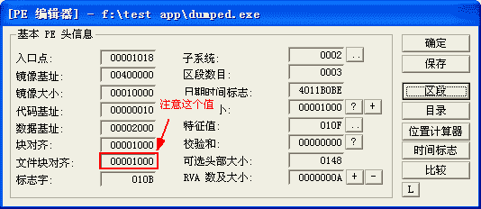

现在我们点击一下区段按钮，看看各个区段中有什么内容：

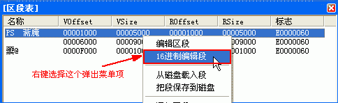

因为上面我们已经看到文件块对齐是 `1000H`，我们就按 `1000H` 大小的倍数来在 16 进制编辑器中选择块，分析数据中是否有区段。先在 16 进制编辑器中查看一下第一个区段：

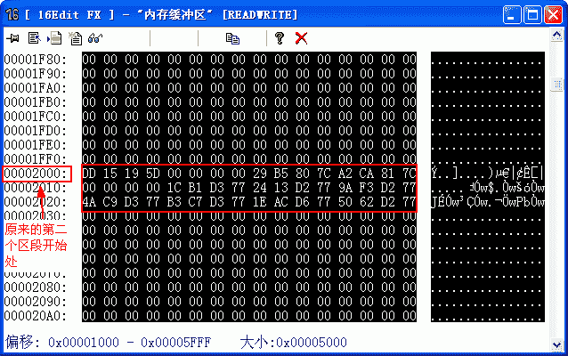

上图的偏移 `2000` 是第二个区段开始的地方。有人可能要问你怎么知道这是原来的第二个区段开始处？呵呵，因为我前面看到文件对齐粒度为 `1000`，所以我在 16 进制编辑器中主要注意与 `1000` 的倍数对应的偏移地址。当我翻到偏移地址为 `2000` 时，在这个地址的上面是由一大片 `0` 填充的，到这个地址后又开始有数据了，所以我确定偏移 `2000` 处应该是另一个区段的开始处。如果你在 16 进制编辑器中看到一大片 `0` 后突然看见有数据，你再根据文件对齐粒度注意一下数据的开始地址，一般就可以确定是否已到另一个区段了。由 16 进制窗口中查看到的信息，我们可以确定 `WinUpack` 把我们原来的区段都合并了，现在我们要把它们分离出来。

### 3、分离区段

要说明一下，分离区段和下面的一节修正 `PE` 头在其他脱壳文件的优化中并不是必须的，这里主要针对 `WinUpack` 的壳。现在关掉 `LordPE`，用 `WinHEX` 打开 `dumped.exe`，`ALT+G`，填入偏移 `1000`，转到相应位置，在偏移 `1000` 处点右键，选择定义选块，输入相应数据后点确定：

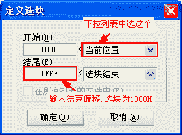

在选好的选块上右键选择复制选块->进入新文件，另存为 `text.bin`：

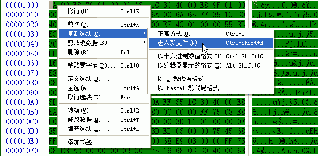

其实这个偏移 `1000H`，长度 `1000H` 的段不保存也无所谓，这里主要是让大家熟悉一下保存的方法。同样，我们把起始偏移为 `3000H`，大小为 `1000H` 的那个段也另存为 `data.bin`。有人可能要问了，你为什么不把起始偏移为 `2000H`，大小为 `1000H` 的那个区段也保存下来？呵呵，因为我知道这里是原来的放输入表信息的那个段，现在已经被破坏了，我就不要了。同样，偏移 `4000H` 以后的段我也不保存了，那里是资源段，因为在修正过程中我可能要用另外的 `RVA` 地址来重建资源，所以不保存了。现在我们在 `WinHEX` 中再定义一个选块，从偏移 `2000H` 直到文件尾，选中后删除这个选块。

### 4. 修正 PE 头

现在我们还要做一件事，因为 `WinUpack` 把 `PE` 头搞得太乱，我们要找个正常的替换一下。这里我选择 `XP_SP2` 下的记事本，用 `WinHEX` 打开记事本，从文件开始偏移为 `0` 的地方选择一个大小为 `1000H` 的选块，右键选择复制选块->以十六进制数值方式，现在转到我们正在 `WinHEX` 中编辑的 `dumped.exe`，定位到文件开始偏移处，右键选择剪贴板数据->写入(从当前位置覆写)，把记事本的文件头粘贴过来。

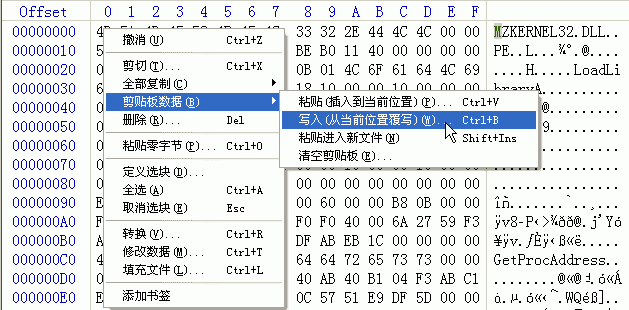

完成上述工作后保存 `dumped.exe`，现在文件大小变成 `8K` 了，用 `PETools` 的 `PE` 编辑器来打开这个文件，进行一些修改。先点击文件头按钮：

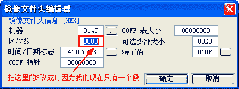

把区段数由 `3` 改成 `1` 后确定，再点击可选头按钮：

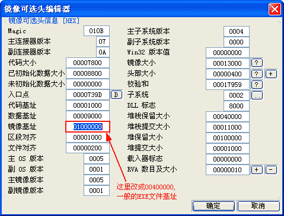

改一下上面的镜像基址为 `00400000`，点击确定。这里可以参考原来备份的 `dumped.exe` 文件来修改（我前面已经说过要备份原来的那个 `dumped.exe` 文件用作参考，你不会没备份吧？）。

### 5、修正及添加区段

现在点击区段按钮，修改一下区段的一些属性。因为前面我们已经把区段改为 `1` 了，现在打开区段后，只看到一个 `.text` 区段。在这个区段上右击，选择编辑区段头：

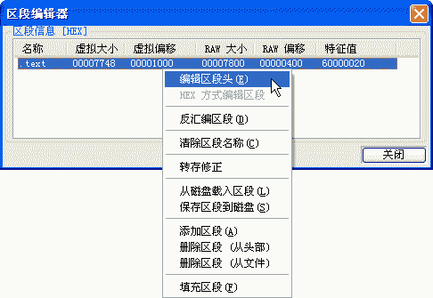

因为我们现在的 `.text` 段是从偏移 `1000H` 开始的，大小为 `1000H`，所以我们要把上面的虚拟偏移和 `RAW` 偏移都改成 `1000`，虚拟大小和 `RAW` 大小也要改成 `1000`。在弹出的对话框上进行设置：

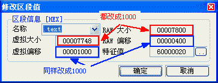

完成上述修改后点确定，回到区段编辑器中，现在我们要添加一个大小为 `1000H` 的段，用来存放输入表。这里可能大家也有疑问：你是知道原来的输入表段大小为 `1000H`，如果你不知道呢？你知道要添加多大的一个区段？其实我这里添加区段的大小是根据 `ImportREC` 的新建输入表信息中的大小来的：

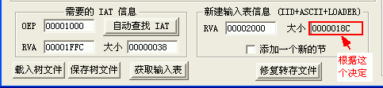

我们可以在 `ImportREC` 中看到新建输入表的大小是 `18CH`，根据区段的对齐粒度 `1000H`，我这里就选大小为 `1000H`，已经够用了。这里要留一点余量，有时脱一些壳修复时，余量留的过小则修复的输入表不完全，这时可以从文件中删除这个区段，再按 `1000H` 的对齐粒度新建一个大一点的区段，重新修复输入表。现在继续我们前面的话题，在区段编辑器中右键点击，选择添加区段菜单项，在弹出的对话框上进行设置：

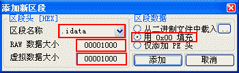

上面我打了红框的是要修改的地方。`PETools` 默认添加区段的名称是 `.NewSH`，为了便于识别这个段是用于存放输入表信息的，我们把名称选为 `idata`。其他的 `RAW` 数据及虚拟数据大小我们都填 `1000`，选择用 `0x00` 填充区段，现在点确定，一个新区段就添加进来了：

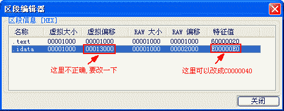

从上图中我们可以看出 `.idata` 段的虚拟偏移是 `13000`，这肯定不正确，我们应该保证各个段的虚拟地址都是连续的。以上图为例，`.text` 段的虚拟偏移是 `1000H`，虚拟大小是 `1000H`，这样虚拟偏移 ＋ 虚拟大小 ＝ `1000H` ＋ `1000H` ＝ `2000H`，可知下一个区段的虚拟偏移应该是 `2000H`。同样道理 `RAW` 偏移也应该是连续的，虽然有时候我们看到有类似这样的：第一个区段：`RAW` 偏移：`400H`，`RAW` 大小：`1D0`；第二个区段：`RAW` 偏移：`600H`，`RAW` 大小：`1B8`，这样看起来好像并不连续啊。因为 `400` ＋ `1D0` ＝ `5D0`，下一个区段应该从 `5D0` 开始才对。但如果你用 16 进制工具打开文件看一下就知道了。这种情况是文件粒度按 `200H` 对齐，区段中的实际数据没有 `200`，这里显示的只是实际的数据大小，剩下的按 `200H` 对齐的部分用 `0x00` 填充了。所以下一个区段还是按文件对齐粒度设置偏移的。同样，文件对齐粒度是其他数值时也存在这种情况。说了这么多，大家应该也明白了，编辑一下 `.idata` 的区段头，把虚拟偏移 `13000` 改成 `2000`。至于后面那个特征值为什么可以改成 `C0000040`，我就不多说了，在编辑区段的时候点一下特征值后面那个 `...` 按钮，上面应该可以看到详细的说明。

### 6、修正输入表

现在我们的前期工作暂告一个段落，保存好我们的修改退出 `PETools`，现在轮到 `ImportREC` 上场了。你的 `ImportREC` 应该没关吧？我们把添加一个新的节前面的勾去掉，在新建输入表信息中 `RVA` 填 `00002000`（就是我们新建的那个 `,idata` 段的偏移地址），点击修复转存文件，选择我们刚才修改的 `dumped.exe` 进行修复，得到 `dumped_.exe`。

### 7、修正资源

到这还有两个重要的事别忘了，一个是我们保存的那个数据段（`data.bin`）要放进程序里来，还有个就是资源还没有。现在我们先把资源弄出来。拿出 `dREAMtHEATER` 兄的 `FixRes`，选择我们原来备份的那个 `dumped.exe`，使用 `FixRes` 的 `Dump` 功能，把资源段按我们定义的 `RVA` Dump 出来：

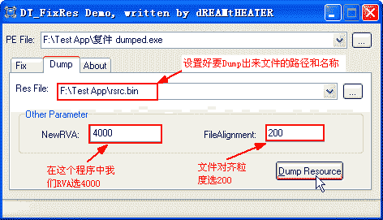

因为前面还有一个数据段 `RVA` 是 `3000`，大小是 `1000`，所以我们把新建资源段的 `RVA` 设为 `4000`。按上面那样设置好后我们就可以点击 `Dump Resource` 按钮来 Dump 资源了，文件被保存为 `rsrc.bin`。

### 8、装配文件

现在进入最后的装配工作了，用 `LordPE` 的 `PE` 编辑器打开 `dumped_.exe`，点击区段按钮，进入区段编辑功能中：

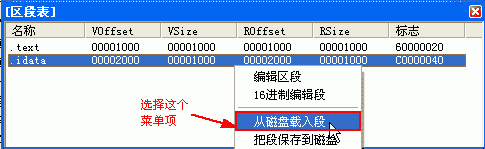

现在我们要把磁盘上的 `data.bin` 和 `rsrc.bin` 都添加到程序中来，右键选择从磁盘载入段，按顺序添加 `data.bin` 和 `rsrc.bin`，添加好后改一下区段名和标志，最终效果如下：

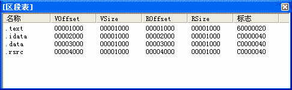

现在退出区段编辑，点目录按钮，修正一下资源及其他的目录。在这个程序中输入表目录已经不需要我们再改了，我们要改的就是资源目录的 `RVA` 及大小，把其他没用到的目录 `RVA` 和 大小清零。我们再用一个 `LordPE` 的 `PE` 编辑器打开备份的 `dumped.exe` 文件来做参考，最终修正效果如下：

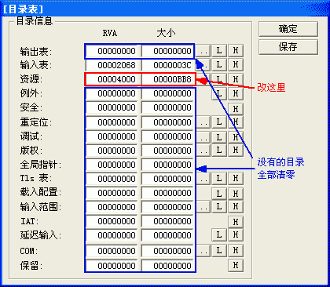

### 9、修正可选头及最终优化

保存以上工作后关掉 `LordPE`，我们可以看到 `dumped_.exe` 的图标已经出来了，说明资源已经修复。现在再用 `PETools` 的 `PE` 编辑器打开 `dumped_.exe`（这里换 `PETools` 的原因是因为 `PETools` 编辑 `PE` 头的功能比较强），点击可选头按钮，进入可选头编辑器。现在主要要修改的就是代码基址和数据基址，代码基址一般就是第一个区段（我们这里是 `.text` 段）的 `RVA`，所以这里应该填 `1000`，数据基址一般指除了代码外的部分开始的 `RVA`，我们这里代码部分 `RVA` 是 `1000`，大小是 `1000`，加起来就知道除了代码外的数据 `RVA` 是 `2000`，就是我们第二个段 `.idata` 的 `RVA`。修改完这些内容后最后要纠正一下镜像大小，否则程序还是不能运行。最终修改效果如下：

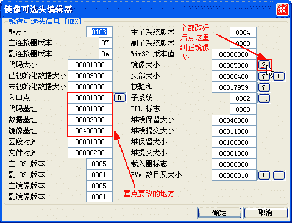

上图中的代码大小和已初始化数据大小改不改都无所谓，我是为了好看点把它改了。一般的代码大小就是指 `.text` 段的大小，`.text` 段后面所有段的大小加起来就可以作为已初始化数据大小。全部改完后点镜像大小后面的那个“?”按钮，纠正一下镜像大小，现在就可以保存退出 `PETools` 了。

到这基本工作已经完成了，修复后的 `dumped_.exe` 大小为 `20K`，运行一下，一切正常。不过这里的 `20K` 大小还和我们原来的 `6.5K` 有差距，如果手工修改的话我们可以先把文件对齐的粒度设为 `200`，再用 16 进制工具打开程序，把按照 `200H` 倍数对齐的各个区段的多余的全是 `0` 的部分删掉，再根据保留下来的部分调整一下区段的 `RAW` 偏移和大小。当然你可以用 `PETools` 或 `LordPE` 的重建功能来重建一下程序，也会完成上述功能。不过我们这里是希望能用汉化工具正常汉化的，所以我们不能用 `PETools` 或 `LordPE` 的重建功能来重建程序， 因为它们重建的程序虽然可以正常使用，也比较小，但若用来汉化是很容易出错的。这里还是不要手工来调整了，我们直接用一下 `PE Optimizer` 这个工具来优化程序一下，这个工具优化出来的程序基本上和手工修改的差不多。优化后我们再看一下大小：`20K->6.5K`，呵呵，和我们原来的程序一样大。

## 二、 WinUpack 主程序的脱壳及优化

如果文章写到这里收工的话，估计会有人说你自己编个程序，再加个壳来谈脱壳后的优化，你完全可以对照原程序来进行啊。`OK`，那我们就来个没有对照的，冒着被 `dwing` 狂扁的危险，我就拿 `WinUpack 0.39 final` 中的那个中文版 `WinUpackC.exe` 来开刀。不过 `dwing` 要来了，大家要掩护我逃跑啊，呵呵。


`WinUpackC.exe` 脱壳我就不多说了，OEP 是 `0040A4BE`，直接在 OD 中 `CTR+G` 转到地址 `0040A4BE`，`F4` 运行到这，就可以用 `LordPE` 完全转存了。我们还是把转存后的文件保存为 `dumped.exe`。现在不要关 OD，在 `ImportREC` 中选择 `WinUpackC.exe` 的进程，输入 OEP：`A4BE`，选自动查找 IAT，可以得到正确的输入表，大小是 `00000B18`。保存一下树文件备用。让 OD 和 `ImportREC` 都开在那，现在我们用 `LordPE` 的 16 进制编辑区段功能来观察一下第一个区段中的内容。具体怎么分析原来区段的起始地址我前面已经说过了，此处只谈结果。经分析可知偏移 `1000-AFFF` 应该是代码段，大小为 `A000`；`B000-DFFF` 应该是数据段，`E000-FFFF` 应该是另一个段；功能我不是很清楚，可能原来也用于存放输入表信息的。我就把它和前面的 `B000-DFFF` 一起当成数据段，这样数据段就大小就是 `10000` － `B000` ＝ `5000`；`10000-11FFF` 应该是资源段；`12000-12FFF` 包含了部分输入表的信息，应该是加壳后搞出来的。不过这个段对我们毫无作用，不作考虑。

现在对我们有用的就是偏移 `1000-FFFF` 的部分，这里有两个区段。根据 `ImportREC` 中所显示的输入表大小 `00000B18` 及前面两个段用到的偏移，我们只要在偏移 `10000` 处添加一个大小为 `1000` 的段用来存放输入表信息就可以了。因此资源段我们应该让它从 `11000` 开始。

分析完了就可以开工了，先把 `dumped.exe` 复制一份留作参考，`WinHEX` 上场，`ALT+G` 转到偏移 `10000` 处，从此处开始选择一个直到文件结尾的块，删除。我们还是借用一下 `XP_SP2` 记事本的文件头，把记事本偏移 `0-FFF`，大小为 `1000` 的内容复制过来，覆盖到 `dumped.exe` 的对应位置。全部完成后保存 `dumped.exe`。

现在由 `PETools` 上场，用其 PE 编辑器打开 `dumped.exe`，先把区段数改为 2，再修正一下镜像基址为 `00400000`，然后转到区段编辑器，根据我们上面分析的两个区段的偏移及大小调整区段的虚拟偏移、大小；RAW 偏移、大小。完成后再新建一个区段用来保存输入表信息，偏移是 `10000`，大小为 `1000`，再修改一下特征值，全部完成后效果如图：

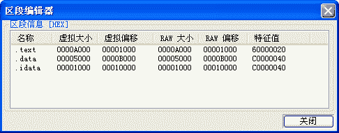

现在关掉 `PETools`，我们开始用 `ImportREC` 来修正输入表。去掉“添加一个新的节”前面的勾，在新建输入表信息中填入 RVA：`00010000`，点“修复转存文件”，选择我们修改过的 `dumped.exe` 来修复，完成后我们得到 `dumped_.exe`。到这就要开始把资源加进去了。`FixRes` 上，选我们原来备份的那个 `dumped.exe`，新建 RVA 为 `11000`，文件对齐为 `200`，Dump 资源为 `rsrc.bin`：

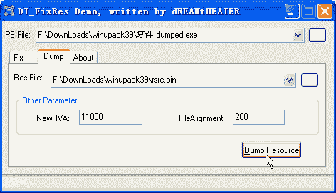

再让 `LordPE` 上场吧（有人要说了，这么多工具换来换去你也不嫌累？这个...是比较累，本来是打算自己写一个工具来减小工作量的。不过因为太懒，能将就就将就了）。用 `LordPE` 打开修正过输入表的那个 `dumped_.exe`，点区段按钮，在区段编辑窗口中右键选择“从磁盘载入段”，把我们前面 Dump 的那个 `rsrc.bin` 添加进来。编辑一下区段，最终效果如下：

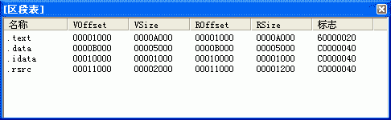

现在关掉区段编辑，点击目录按钮，再用 `LordPE` 打开备份的 `dumped.exe` 进行参考，我们来编辑一下 `dumped_.exe` 的目录，主要是调整一下资源目录的 RVA 和大小，把其他一些没用到的目录 RVA 和大小清零。最终效果如下：

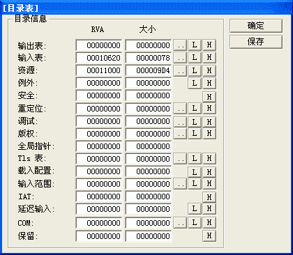

完成后退出 `LordPE`，再用 `PETools` 打开 `dumped_.exe`，编辑可选头中的一些内容及调整镜像大小，完成后效果如下：

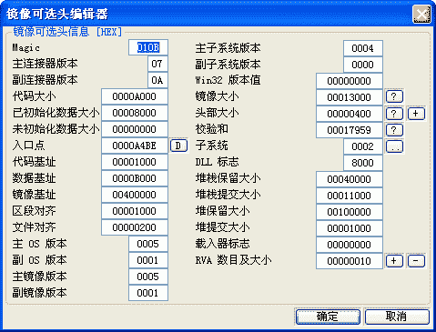

保存我们所做的工作，退出 `PETools`，现在 `dumped_.exe` 文件大小是 72.5K。运行一下 `dumped_.exe`，呵呵，正常运行了。把 `dumped_.exe` 复制一份保存为复件 `dumped_.exe`，用 `dumped_.exe` 给复件 `dumped_.exe` 用默认选项加个壳看看， 72.5K->27.3K，原版未脱壳前是 26.6K，看来还是有差距啊。不管了，用 PE Optimizer 来优化一下 `dumped_.exe`，72.5K->59.5K，收工。

`WinUpack` 加壳时合并了区段，而一些其他的壳给程序加壳时并没有合并区段，也没有破坏 PE 头，这样脱壳后的程序优化起来要简单一点，可以省掉前面的到脱壳后的第一个段中判断区段及修正 PE 头的步骤，只要把有用的段给保存下来，没用的去掉，选好位置重建输入表和资源，再装配起来就可以了。要想优化后的程序可以用汉化工具汉化的话，一般都要把资源放在最后一个区段，否则容易出错。而对应 DLL 这样的文件修复时要考虑重定位和输出表，重定位可以采用 `ReloX` 来修复，同样可以指定位置重建。输出表可以采用看雪兄的工具 `PeMove` 来挪移，同样这个工具也可以挪移重定位表。关于 DLL 这类文件的脱壳后优化我就不讲了，基本方法类似。

附件是用来测试的程序及 `WinUpackC.exe` 脱壳后文件。

**版权声明**：本文纯属技术交流，转载请注明作者并保持文章的完整，谢谢！

`4dd466d0e1e0cc123afbe504da2462ca`
