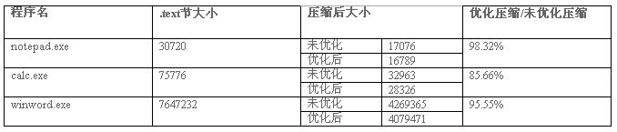

# AsPack2.12 分析及静态脱壳机的编写

> 原文：[`www.pediy.com/kssd/pediy10/91070.html`](https://www.pediy.com/kssd/pediy10/91070.html)

科锐第四阶段作业题 由于去科锐才开始学的 `c` `c++` 和 `asm`

所以分析得不是很好

脱壳机的代码写得也比较幼稚

不足之处请大家多多见谅

用 `asm` 写了个 `hello world` 然后用 `AsPack2.12` 加壳 直接 `IDA` 载入分析

```asm
; ========================================================
; 入口处
; ========================================================
.aspack:00405001              pusha
.aspack:00405002              call    loc_40500A
.aspack:00405002 ; ---------------------------------------------------------------------------
.aspack:00405007              db 0E9h ; ?
.aspack:00405008 ; ---------------------------------------------------------------------------
.aspack:00405008              jmp     short loc_40500E
.aspack:0040500A ; ---------------------------------------------------------------------------
.aspack:0040500A
.aspack:0040500A loc_40500A:                         ; CODE XREF: start+1j
.aspack:0040500A              pop     ebp
.aspack:0040500B              inc     ebp
.aspack:0040500C              push    ebp
.aspack:0040500D              retn

来到 `loc_40500E`

; =========================================================
; 准备解码需要的 API 函数 `VirtualAlloc` `VirtualFree` 等等
; =========================================================
.aspack:0040500E loc_40500E:                         ; CODE XREF: start+7j
.aspack:0040500E              call    loc_405014
.aspack:0040500E ; END OF FUNCTION CHUNK FOR start
.aspack:0040500E ; ---------------------------------------------------------------------------
.aspack:00405013              db 0EBh ; ?
.aspack:00405014 ; ---------------------------------------------------------------------------
.aspack:00405014 ; START OF FUNCTION CHUNK FOR start
.aspack:00405014
.aspack:00405014 loc_405014:                         ; CODE XREF: start:loc_40500Ej
.aspack:00405014              pop     ebp
.aspack:00405015              mov     ebx, 0FFFFFFEDh
.aspack:0040501A              add     ebx, ebp
.aspack:0040501C              sub     ebx, 5000h     ; 求出 ImageBase
.aspack:00405022              cmp     dword ptr [ebp+422h], 0
.aspack:00405029              mov     [ebp+422h], ebx ; 保存算出的 ImageBase
.aspack:0040502F              jnz     loc_40539A     ; ebp=ShellRva+0x13
.aspack:00405035              lea     eax, [ebp+42Eh] ; ShellRva+0x441  szKernel32
.aspack:0040503B              push    eax
.aspack:0040503C              call    dword ptr [ebp+0F4Dh] ; Shell.GetModuleHandle
.aspack:00405042              mov     [ebp+426h], eax ; ShellRva+0x439 == hKernel32
.aspack:00405048              mov     edi, eax
.aspack:0040504A              lea     ebx, [ebp+5Eh]  ; szVirtualAlloc
.aspack:0040504D              push    ebx
.aspack:0040504E              push    eax
.aspack:0040504F              call    dword ptr [ebp+0F49h] ; Shell.GetProcAddress
.aspack:00405055              mov     [ebp+54Dh], eax ; ShellRva+0x560 == FnVirtualAlloc
.aspack:0040505B              lea     ebx, [ebp+6Bh]  ; szVirtualFree
.aspack:0040505E              push    ebx
.aspack:0040505F              push    edi
.aspack:00405060              call    dword ptr [ebp+0F49h]
.aspack:00405066              mov     [ebp+551h], eax ; ShellRva+0x564 == FnVirtualFree
.aspack:0040506C              lea     eax, [ebp+77h]  ; 0040508A
.aspack:0040506F              jmp     eax

; =====================================================
; 以下为解压缩原 PE 文件节区数据
; =====================================================
.aspack:00405071 aVirtualalloc   db 'VirtualAlloc',0
.aspack:0040507E aVirtualfree    db 'VirtualFree',0
.aspack:0040508A ; ---------------------------------------------------------------------------
.aspack:0040508A              mov     ebx, [ebp+531h] ; ShellRva+0x544 初始为 0 作用暂时不知道
.aspack:00405090              or      ebx, ebx
.aspack:00405092              jz      short loc_40509E ; ShellRva+0x57C
.aspack:00405094              mov     eax, [ebx]
.aspack:00405096              xchg    eax, [ebp+535h]
.aspack:0040509C              mov     [ebx], eax
.aspack:0040509E
.aspack:0040509E loc_40509E:                         ; CODE XREF: .aspack:00405092j
.aspack:0040509E              lea     esi, [ebp+569h] ; ShellRva+0x57C
.aspack:004050A4              cmp     dword ptr [esi], 0 ; 该地方存放了压缩了节的 Rva+Size 结构的信息 以 0 结尾
.aspack:004050A7              jz      loc_4051CE
.aspack:004050AD              push    4
.aspack:004050AF              push    1000h
.aspack:004050B4              push    1800h
.aspack:004050B9              push    0
.aspack:004050BB              call    dword ptr [ebp+54Dh] ; VirtualAlloc 存放解码工作中需要的数据
.aspack:004050C1              mov     [ebp+156h], eax ; theFirstAlloc == ShellRva+0x169
.aspack:004050C7
.aspack:004050C7 loc_4050C7:                         ; CODE XREF: .aspack:004051A3j
.aspack:004050C7              mov     eax, [esi+4]    ; 获得原来节区的 VSize
.aspack:004050CA              add     eax, 10Eh
.aspack:004050CF              push    4
.aspack:004050D1              push    1000h
.aspack:004050D6              push    eax
.aspack:004050D7              push    0
.aspack:004050D9              call    dword ptr [ebp+54Dh] ; 第二次申请的内存用来存放解码后的节区数据
.aspack:004050DF              mov     [ebp+152h], eax ; the2ndAlloc == ShellRva+0x165
.aspack:004050E5              push    esi
.aspack:004050E6              mov     ebx, [esi]
.aspack:004050E8              add     ebx, [ebp+422h] ; 加上 ImageBase
.aspack:004050EE              push    dword ptr [ebp+156h] ; arg4=解码需要数据的内存堆地址
.aspack:004050F4              push    dword ptr [esi+4] ; arg3=待解码节的大小
.aspack:004050F7              push    eax             ; arg2=解码后存放数据的内存堆地址
.aspack:004050F8              push    ebx             ; arg1=待解码节区地址
.aspack:004050F9              call    DeCode         ; 函数功能:解码
.aspack:004050F9                             ; 函数函数返回值:解码的 Bytes 大小
.aspack:004050FE              mov     bl, 1
.aspack:00405100              cmp     bl, 0           ; 判断下是不是代码段的压缩
.aspack:00405103              jnz     short loc_405163 ; 该压缩算法对某些 call 和 jmp 指令后面的偏移地址进行了处理
.aspack:00405103                             ; 达到高压缩的效果 所以需要恢复
.aspack:00405105              inc     byte ptr [ebp+0ECh]
.aspack:0040510B              mov     edi, [esi]
.aspack:0040510D              add     edi, [ebp+422h]
.aspack:00405113              push    dword ptr [edi]
.aspack:00405115              mov     byte ptr [edi], 0C3h
.aspack:00405118              call    edi
.aspack:0040511A              pop     dword ptr [edi]
.aspack:0040511C              push    eax
.aspack:0040511D              push    ecx
.aspack:0040511E              push    esi
.aspack:0040511F              push    ebx
.aspack:00405120              mov     ecx, eax
.aspack:00405122              sub     ecx, 6
.aspack:00405125              mov     esi, [ebp+152h]
.aspack:0040512B              xor     ebx, ebx
.aspack:0040512D
.aspack:0040512D loc_40512D:                         ; CODE XREF: .aspack:00405140j
.aspack:0040512D                             ; .aspack:0040515Dj
.aspack:0040512D              or      ecx, ecx
.aspack:0040512F              jz      short loc_40515F
.aspack:00405131              js      short loc_40515F
.aspack:00405133              lodsb
```


```
.aspack:00405134             cmp     al, 0E8h        ; 判断是不是 call

.aspack:00405136             jz      short loc_405142

.aspack:00405138             jmp     short $+2

.aspack:0040513A             cmp     al, 0E9h        ; 判断是不是 jmp

.aspack:0040513C             jz      short loc_405142

.aspack:0040513E

.aspack:0040513E loc_40513E:                       ; CODE XREF: .aspack:00405149j

.aspack:0040513E             inc     ebx

.aspack:0040513F             dec     ecx

.aspack:00405140             jmp     short loc_40512D

.aspack:00405142 ; ---------------------------------------------------------------------------

.aspack:00405142

.aspack:00405142 loc_405142:                       ; CODE XREF: .aspack:00405136j

.aspack:00405142                                 ; .aspack:0040513Cj

.aspack:00405142             mov     eax, [esi]

.aspack:00405144             jmp     short $+2

.aspack:00405146             cmp     byte ptr [esi], 0

.aspack:00405149             jnz     short loc_40513E

.aspack:0040514B             and     al, 0

.aspack:0040514D             rol     eax, 18h

.aspack:00405150             sub     eax, ebx

.aspack:00405152             mov     [esi], eax

.aspack:00405154             add     ebx, 5

.aspack:00405157             add     esi, 4

.aspack:0040515A             sub     ecx, 5

.aspack:0040515D             jmp     short loc_40512D

.aspack:0040515F ; ---------------------------------------------------------------------------

.aspack:0040515F

.aspack:0040515F loc_40515F:                       ; CODE XREF: .aspack:0040512Fj

.aspack:0040515F                                 ; .aspack:00405131j

.aspack:0040515F             pop     ebx

.aspack:00405160             pop     esi

.aspack:00405161             pop     ecx

.aspack:00405162             pop     eax

.aspack:00405163

.aspack:00405163 loc_40405163:                       ; CODE XREF: .aspack:00405103j

.aspack:00405163             jmp     short loc_40516D

.aspack:00405163 ; ---------------------------------------------------------------------------

.aspack:00405165             db    0

.aspack:00405166             db    0

.aspack:00405167             db    0

.aspack:00405168             db    0

.aspack:00405169             db    0

.aspack:0040516A             db    0

.aspack:0040516B             db    0

.aspack:0040516C             db    0

.aspack:0040516D ; ---------------------------------------------------------------------------

.aspack:0040516D

.aspack:0040516D loc_40516D:                       ; CODE XREF: .aspack:loc_405163j

.aspack:0040516D             mov     ecx, eax

.aspack:0040516F             mov     edi, [esi]

.aspack:00405171             add     edi, [ebp+422h] ; 解码后要放入的地址

.aspack:00405177             mov     esi, [ebp+152h] ; 解码后的堆地址

.aspack:0040517D             sar     ecx, 2          ; Size / 4

.aspack:00405180             rep movsd

.aspack:00405182             mov     ecx, eax

.aspack:00405184             and     ecx, 3

.aspack:00405187             rep movsb               ; EQU memcpy

.aspack:00405189             pop     esi

.aspack:0040518A             push    8000h

.aspack:0040518F             push    0

.aspack:00405191             push    dword ptr [ebp+152h]

.aspack:00405197             call    dword ptr [ebp+551h] ; VirtualFree

.aspack:0040519D             add     esi, 8          ; 移到下一结构地址

.aspack:004051A0             cmp     dword ptr [esi], 0 ; 循环解码

.aspack:004051A3             jnz     loc_4050C7      ; 获得原来节区的 VSize

.aspack:004051A9             push    8000h

.aspack:004051AE             push    0

.aspack:004051B0             push    dword ptr [ebp+156h]

.aspack:004051B6             call    dword ptr [ebp+551h] ; 全部解压完毕 VitualFree 掉第一次申请的内存堆

.aspack:004051BC             mov     ebx, [ebp+531h]

.aspack:004051C2             or      ebx, ebx

.aspack:004051C4             jz      short loc_4051CE

.aspack:004051C6             mov     eax, [ebx]

.aspack:004051C8             xchg    eax, [ebp+535h]

\========================================================

以下为判断是否要对 pe 进行重定位

\========================================================

.aspack:004051CE                                 ; .aspack:004051C4j

.aspack:004051CE             mov     edx, [ebp+422h]

.aspack:004051D4             mov     eax, [ebp+52Dh]

.aspack:004051DA             sub     edx, eax        ; 判断下当前的 ImageBase 决定是否要进行重定位

.aspack:004051DC             jz      short loc_405257

.aspack:004051DE             mov     eax, edx        ; 以下为进行重定位操作

.aspack:004051E0             shr     eax, 10h

.aspack:004051E3             xor     ebx, ebx

.aspack:004051E5             mov     esi, [ebp+539h]

.aspack:004051EB             add     esi, [ebp+422h]

.aspack:004051F1

.aspack:004051F1 loc_4051F1:                       ; CODE XREF: .aspack:00405255j

.aspack:004051F1             cmp     dword ptr [esi], 0

.aspack:004051F4             jz      short loc_405257

.aspack:004051F6             mov     ecx, [esi+4]

.aspack:004051F9             sub     ecx, 8

.aspack:004051FC             shr     ecx, 1

.aspack:004051FE             mov     edi, [esi]

.aspack:00405200             add     edi, [ebp+422h]

.aspack:00405206             add     esi, 8

.aspack:00405209

.aspack:00405209 loc_405209:                       ; CODE XREF: .aspack:00405253j

.aspack:00405209             mov     bx, [esi]

.aspack:0040520C             shr     ebx, 0Ch

.aspack:0040520F             cmp     ebx, 1

.aspack:00405212             jz      short loc_405220

.aspack:00405214             cmp     ebx, 2

.aspack:00405217             jz      short loc_40522F

.aspack:00405219             cmp     ebx, 3

.aspack:0040521C             jz      short loc_40523E

.aspack:0040521E             jmp     short loc_40524C

.aspack:00405220 ; ---------------------------------------------------------------------------

.aspack:00405220

.aspack:00405220 loc_405220:                       ; CODE XREF: .aspack:00405212j

.aspack:00405220             mov     bx, [esi]

.aspack:00405223             and     ebx, 0FFFh

.aspack:00405229             add     [edi+ebx], ax

.aspack:0040522D             jmp     short loc_40524C

.aspack:0040522F ; ---------------------------------------------------------------------------

.aspack:0040522F

.aspack:0040522F loc_40522F:                       ; CODE XREF: .aspack:00405217j

.aspack:0040522F             mov     bx, [esi]

.aspack:00405232             and     ebx, 0FFFh

.aspack:00405238             add     [edi+ebx], dx

.aspack:0040523C             jmp     short loc_40524C

.aspack:0040523E ; ---------------------------------------------------------------------------

.aspack:0040523E

.aspack:0040523E loc_40523E:                       ; CODE XREF: .aspack:0040521Cj

.aspack:0040523E             mov     bx, [esi]

.aspack:00405241             and     ebx, 0FFFh

.aspack:00405247             add     [edi+ebx], edx

.aspack:0040524A             jmp     short $+2

.aspack:0040524C

.aspack:0040524C loc_40524C:                       ; CODE XREF: .aspack:0040521Ej

.aspack:0040524C                                 ; .aspack:0040522Dj ...
```


=========================================================

以下为为原 PE 导入原来的 IAT

=========================================================

```
.aspack:0040524C                 or      word ptr [esi], 0FFFFh  

.aspack:00405250                 add     esi, 2  

.aspack:00405253                 loop    loc_405209  

.aspack:00405255                 jmp     short loc_4051F1  

.aspack:00405257                 mov     edx, [ebp+422h]  

.aspack:0040525D                 mov     esi, [ebp+541h]  

.aspack:00405263                 or      esi, esi        ; 导入原 PE 的 IAT  

.aspack:00405265                 jz      short loc_405278 ; 获得原输入表 Rva  

.aspack:00405267                 add     esi, edx  

.aspack:00405269  

.aspack:00405269 loc_405269:                     ; CODE XREF: .aspack:00405276j  

.aspack:00405269                 lodsd  

.aspack:0040526A                 or      eax, eax  

.aspack:0040526C                 jz      short loc_405278 ; 获得原输入表 Rva  

.aspack:0040526E                 add     eax, edx  

.aspack:00405270                 mov     edi, eax  

.aspack:00405272                 lodsw  

.aspack:00405274                 stosw  

.aspack:00405276                 jmp     short loc_405269  

.aspack:00405278 ; ---------------------------------------------------------------------------  

.aspack:00405278  

.aspack:00405278 loc_405278:                     ; CODE XREF: .aspack:00405265j  

.aspack:00405278                                             ; .aspack:0040526Cj  

.aspack:00405278                 mov     esi, 2014h       ; 获得原输入表 Rva  

.aspack:0040527D                 mov     edx, [ebp+422h] ; GetImageBase  

.aspack:00405283                 add     esi, edx  

.aspack:00405285  

.aspack:00405285 loc_405285:                     ; CODE XREF: .aspack:00405395j  

.aspack:00405285                 mov     eax, [esi+0Ch]  

.aspack:00405288                 test    eax, eax  

.aspack:0040528A                 jz      loc_40539A  

.aspack:00405290                 add     eax, edx        ; 获得 Dll 名  

.aspack:00405292                 mov     ebx, eax  

.aspack:00405294                 push    eax  

.aspack:00405295                 call    dword ptr [ebp+0F4Dh] ; GetModuleHandle  

.aspack:0040529B                 test    eax, eax        ; 判断要加载的模块是不是已经被加载  

.aspack:0040529D                 jnz     short loc_4052A6  

.aspack:0040529F                 push    ebx             ; 如果没有加载 就 LoadLibrary  

.aspack:004052A0                 call    dword ptr [ebp+0F51h]  

.aspack:004052A6  

.aspack:004052A6 loc_4052A6:                     ; CODE XREF: .aspack:0040529Dj  

.aspack:004052A6                 mov     [ebp+545h], eax  

.aspack:004052AC                 mov     dword ptr [ebp+549h], 0  

.aspack:004052B6  

.aspack:004052B6 loc_4052B6:                     ; CODE XREF: .aspack:0040537Fj  

.aspack:004052B6                 mov     edx, [ebp+422h] ; 取出 ImageBase  

.aspack:004052BC                 mov     eax, [esi]      ; 取 OriginalFirstThunk  

.aspack:004052BE                 test    eax, eax  

.aspack:004052C0                 jnz     short loc_4052C5  

.aspack:004052C2                 mov     eax, [esi+10h]  ; 如果为 0 的话 那么就取 FirstThunk  

.aspack:004052C5  

.aspack:004052C5 loc_4052C5:                     ; CODE XREF: .aspack:004052C0j  

.aspack:004052C5                 add     eax, edx  

.aspack:004052C7                 add     eax, [ebp+549h] ; 加上重定位数据  

.aspack:004052CD                 mov     ebx, [eax]  

.aspack:004052CF                 mov     edi, [esi+10h]  

.aspack:004052D2                 add     edi, edx  

.aspack:004052D4                 add     edi, [ebp+549h]  

.aspack:004052DA                 test    ebx, ebx        ; 判断结束  

.aspack:004052DC                 jz      loc_405384  

.aspack:004052E2                 test    ebx, 80000000h  ; 判断是不是序号导入  

.aspack:004052E8                 jnz     short loc_4052EE ; 保存 ebx  

.aspack:004052EA                 add     ebx, edx        ; 此为函数名调用  

.aspack:004052EC                 inc     ebx  

.aspack:004052ED                 inc     ebx             ; 跳过 Hint 来到 Name  

.aspack:004052EE  

.aspack:004052EE loc_4052EE:                     ; CODE XREF: .aspack:004052E8j  

.aspack:004052EE                 push    ebx             ; 保存 ebx  

.aspack:004052EF                 and     ebx, 7FFFFFFFh  ; 去掉最高位  

.aspack:004052F5                 push    ebx  

.aspack:004052F6                 push    dword ptr [ebp+545h] ; 当前 Dll 的句柄  

.aspack:004052FC                 call    dword ptr [ebp+0F49h] ; GetProcAddress  

.aspack:00405302                 test    eax, eax  

.aspack:00405304                 pop     ebx  

.aspack:00405305                 jnz     short loc_405376 ; 成功就跳走  

.aspack:00405307                 test    ebx, 80000000h  ; 再次判断是不是序号导入  

.aspack:0040530D                 jnz     short loc_405328 ; 名字导入  

.aspack:0040530F                 push    edi  

.aspack:00405310                 mov     eax, [esi+0Ch]  

.aspack:00405313                 add     eax, [ebp+422h]  

.aspack:00405319                 push    eax  

.aspack:0040531A                 push    ebx  

.aspack:0040531B                 lea     eax, [ebp+475h]  

.aspack:00405321                 push    eax  

.aspack:00405322                 push    edi  

.aspack:00405323                 jmp     loc_4053C0  

.aspack:00405328 ; ---------------------------------------------------------------------------  

.aspack:00405328  

.aspack:00405328 loc_405328:                     ; CODE XREF: .aspack:0040530Dj  

.aspack:00405328                 and     ebx, 7FFFFFFFh  ; 名字导入  

.aspack:0040532E                 mov     eax, [ebp+426h]  

.aspack:00405334                 cmp     [ebp+545h], eax  

.aspack:0040533A                 jnz     short loc_405360  

.aspack:0040533C                 push    edi  

.aspack:0040533D                 mov     edx, ebx  

.aspack:0040533F                 dec     edx  

.aspack:00405340                 shl     edx, 2  

.aspack:00405343                 mov     ebx, [ebp+545h]  

.aspack:00405349                 mov     edi, [ebx+3Ch]  

.aspack:0040534C                 mov     edi, [ebx+edi+78h]  

.aspack:00405350                 add     ebx, [ebx+edi+1Ch]  

.aspack:00405354                 mov     eax, [ebx+edx]  

.aspack:00405357                 add     eax, [ebp+545h]  

.aspack:0040535D                 pop     edi  

.aspack:0040535E                 jmp     short loc_405376 ; 填 IAT  

.aspack:00405360 ; ---------------------------------------------------------------------------  

.aspack:00405360  

.aspack:00405360 loc_405360:                     ; CODE XREF: .aspack:0040533Aj  

.aspack:00405360                 push    edi  

.aspack:00405361                 mov     eax, [esi+0Ch]  

.aspack:00405364                 add     eax, [ebp+422h]  

.aspack:0040536A                 push    eax  

.aspack:0040536B                 push    ebx  

.aspack:0040536C                 lea     eax, [ebp+4C6h]  

.aspack:00405372                 push    eax  

.aspack:00405373                 push    edi  

.aspack:00405374                 jmp     short loc_4053C0  

.aspack:00405376 ; ---------------------------------------------------------------------------  

.aspack:00405376  

.aspack:00405376 loc_405376:                     ; CODE XREF: .aspack:00405305j  

.aspack:00405376                                             ; .aspack:0040535Ej  

.aspack:00405376                 mov     [edi], eax      ; 填 IAT  

.aspack:00405378                 add     dword ptr [ebp+549h], 4 ; 循环填 IAT  

.aspack:0040537F                 jmp     loc_4052B6      ; 取出 ImageBase  

.aspack:00405384 ; ---------------------------------------------------------------------------  

.aspack:00405384  
```


```
.aspack:00405384 loc_405384:                     ; CODE XREF: .aspack:004052DCj

.aspack:00405384                 mov     [esi], eax

.aspack:00405386                 mov     [esi+0Ch], eax

.aspack:00405389                 mov     [esi+10h], eax

.aspack:0040538C                 add     esi, 14h        ; 移到下一个 IID 地址

.aspack:0040538F                 mov     edx, [ebp+422h]

.aspack:00405395                 jmp     loc_405285
```

=========================================================

以下为动态修改 `OEP` 并跳到 `OEP` 处 此时 壳的工作已完毕

=========================================================

```
.aspack:0040539A loc_40539A:                     ; CODE XREF: start+2Ej

.aspack:0040539A                                 ; .aspack:0040528Aj

.aspack:0040539A                 mov     eax, 1000h

.aspack:0040539F                 push    eax

.aspack:004053A0                 add     eax, [ebp+422h]

.aspack:004053A6                 pop     ecx

.aspack:004053A7                 or      ecx, ecx

.aspack:004053A9                 mov     [ebp+3A8h], eax ; 将 OEP 写到 Ep+0x3BB

.aspack:004053AF                 popa

.aspack:004053B0                 jnz     short loc_4053BA ;

.aspack:004053B2                 mov     eax, 1

.aspack:004053B7                 retn    0Ch             ; 退出进程

.aspack:004053BA loc_4053BA:                     ; CODE XREF: start+3AFj

.aspack:004053BA                 push    0               ; 动态修改这里 push 的值 返回到 OEP

.aspack:004053BF                 retn

.aspack:004053BF ; END OF FUNCTION CHUNK FOR start
```

静态脱壳编写思路如下:

1.根据 `pe` 的 `SizeOfImage` 申请相对应的内存大小 根据各个节的 `VRa` 和 `VSize` 值读入内存,便于操作

2.定位 `shell` 中保存着要解码的节区的 `Rva` 和 `RSize` 并解码

3.解压后 由于没有修改原 `IAT` 和重定位表 直接定位 `shell` 中的保存位置 然后修改数据目录表中对应的值

4.如果 `shell` 抽取资源(图标.图标组.版本等等)到 `shell` 区区的话 就直接保留了 `shell` 节(对于资源的处理不是很熟悉)

5.修复 `OEP` 并删除掉 `shell` 所添加的导入表节

6.直接将内存中的 `pe` 文件写盘

附带源码如下

Ps:关于压缩壳中的 `E8`/`E9` 优化 参考下面:

`http://daishuo.bokee.com/1506808.html`

上传的附件

|  || `AsPack2_12.rar` | |

引用: *最初由 **子**发布*  Ps:关于压缩壳中的 `E8`/`E9` 优化 参考下面:

`http://daishuo.bokee.com/1506808.html` =... 

本地存档一份：

引用: 压缩壳中的 `E8`/`E9` 优化

来自：加糖苦咖啡

`http://daishuo.bokee.com/1506808.html`

### 1. 什么是 `E8`/`E9` 优化

目前压缩壳中使用的压缩算法都是普适算法，不是专门针对可执行程序的。对于这些算法，程序代码和其他任何数据没有区别。能否根据可执行代码的特征先进行某些优化处理，然后再用普适算法压缩，从而达到更好的压缩率呢？答案是肯定的，`E8`/`E9` 优化就是最常用的优化方法.

### 2. `E8`/`E9` 优化原理

`E8`/`E9` 优化是针对 `E8`（`call rel_off32`）和 `E9`（`jmp rel_off32`）2 条指令的。这两条指令在可执行代码中被大量使用，且具有相同的指令格式：1 字节 `Opcode` 接 4 字节相对跳转偏移。`E8`/`E9` 指令有个明显特征：指令条数大于跳转目的地个数。假设 `loc_A` 和 `loc_B` 两处的指令都是要跳转到 `loc_C`，代码如下：

```
loc_A:     e9    (loc_C - loc_A - 5)     jmp loc_C

loc_B:     e9     (loc_C - loc_B - 5)     jmp loc_C
```

如果把相对偏移加上当前指令位置，那么相对偏移就变成了跳转目的地的绝对地址：

```
loc_A:     e9    (loc_C - 5)           jmp loc_C

loc_B:     e9     (loc_C - 5)         jmp loc_C
```

`loc_A` 和 `loc_B` 两处的指令就完全相同了，从而增加了冗余度，压缩时可以获得更好的压缩率。

跳转目的地的绝对地址一般是在 `PE` `image` 中，地址数值比较小，高位字节相对固定，如：

```
e9 fe 23 40 00

e9 33 10 40 00

e9 20 ab 40 00

e9 65 c1 40 00
```

如果把绝对地址高低字节顺序翻转（`BSWAP` 操作），可以得到：

```
e9 00 40 23 fe

e9 00 40 10 33

e9 00 40 ab 20

e9 00 40 c1 65
```

上面几条跳转指令的前 3 个字节相同，冗余度进一步增大，压缩率将会更好。

### 3. `E8`/`E9` 优化效果

根据上述原理编写程序，对 `PE` 文件的`.text` 代码节数据进行优化，然后使用 `zip` 尺寸最优压缩，得到下面的结果：



注：`notepad.exe` 和 `calc.exe` 来自 `Windows` `XP`（版本 `5.1.2600.2180`）；`winword.exe` 来自 `Office2000`（版本 `9.0.2823`）

可见，优化效果与目标程序相关，可以期望节省 5%左右大小。

由于节省的空间绝大多数情况下足以低偿 `E8`/`E9` 地址还原代码所增加的额外字节（20 字节左右），这种优化处理自 `UPX` 等早期压缩壳至今一直被广泛采用。
