# ACProtect Professional 1.3C 主程序脱壳

> 原文：[`www.pediy.com/kssd/pediy12/acprotect.html`](https://www.pediy.com/kssd/pediy12/acprotect.html)

脱壳过程感觉与 Unpacking Saga 的那个 UnpackMe 没有太大的不同。最明显的一点是，其中的异常多了很多。大部分是固定模式的 `int 3` 解码。因为一开始打算全程跟，所以一边跟一边修改去除 junk code 的 IDC script，写 OllyScript 脚本，并用 WinHex 把解出的代码贴到 `ACProtect\_Fixed.exe`，在 IDA 中用 `Load File|Reload the input file` 加载后对照。

如果在 `OllyDbg110C` 下忽略所有异常，运行时报：

```
[image] 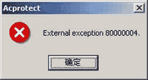
```

## 1. 关于 `int 3` 解码

壳中有大量的 `int 3` 解码，一边执行一边解。具有相同的调用模式：

```
[image] 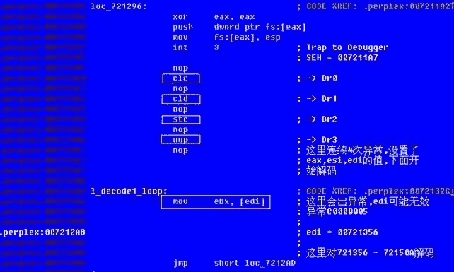
```

在 `int 3` 的 SHE 中（下面的 `div 0` 异常也是同一个 SEH），当 exception code 为 `0x80000003` 时，在 `Dr0-Dr3` 中设置了新的值，即设置了 4 个硬件执行断点，就在紧临 `int 3` 下面的位置。这样执行到这 4 句，会触发 4 次异常。如果在这里 `F7` 过，SHE 不会执行。

```
[image] 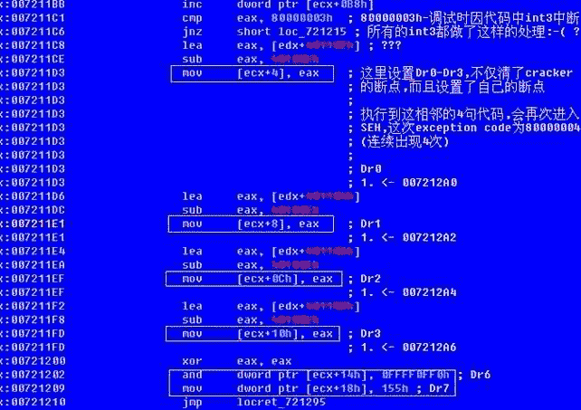
```

当由上面的 4 个断点引发异常时：

```
[image] 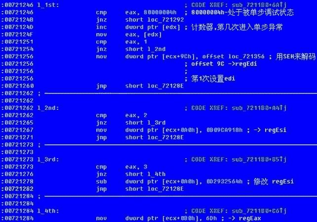
```

每次异常，会设置某个寄存器。4 次异常处理必须执行，否则寄存器中没有正确值，下面的解码会失败。这样又顺便清除 cracker 的断点，是个不错的主意 J。

```
[image] 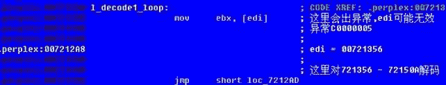
```

结束异常处理后，开始解码。格式是一样的，用的 register 不同。这里可以得到起始地址（`<-edi`）。

```
[image] 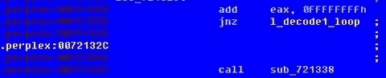
```

在 `jnz` 下面的地址 `F4`，然后查看前面用于寻址的寄存器的值，减 1 就是解码结束地址。

```
[image] 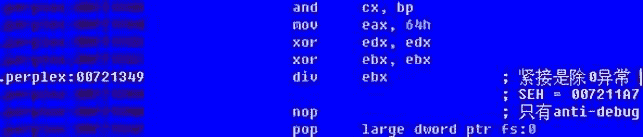
```

解完后跟着一个 `div 0` 异常。只有 anti-debug 作用，直接跳过即可。

## 2. 避开 IAT 加密

在第 16 个 `int 3` 的解码过程中，隐藏了 IAT 加密。其实在 OllyDbg 的状态栏可以看到这附近有不少 dll 被加载了。

```
[image] 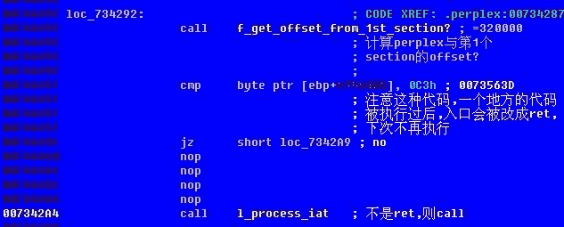
```

有 4 处检查，决定是否特殊处理。在用 `GetProcAddress` 得到 API 的地址后，开始检查。是否为特殊的 API？

```
[image] 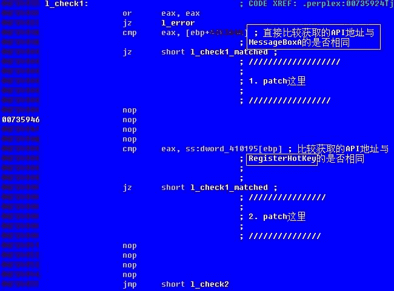
```

是否为 `MessageBoxA` 或 `RegisterHotKey`（这个比较少见 J）？是则替换 api 地址。

```
[image] 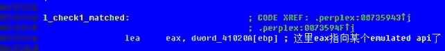
```

下面检查 dll 的映射地址是否为 `kernel32.dll` 或 `user32.dll`。

```
[image] 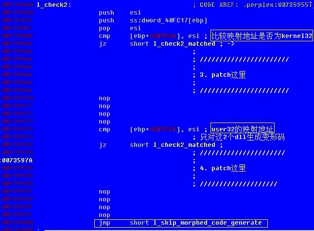
```

这里通不过检查，就不做处理，直接把 API 的地址保存到 IAT 了。否则：

```
[image] 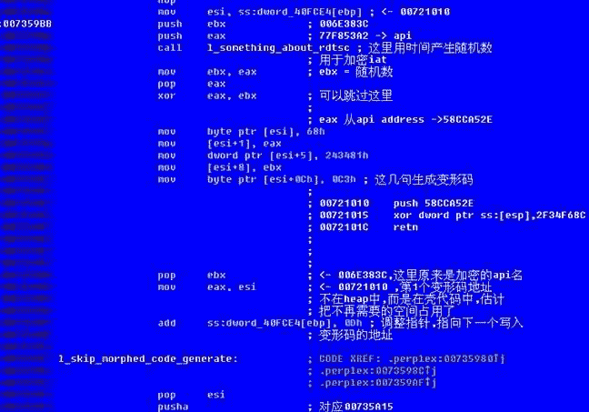
```

写 IAT：

```
[image] 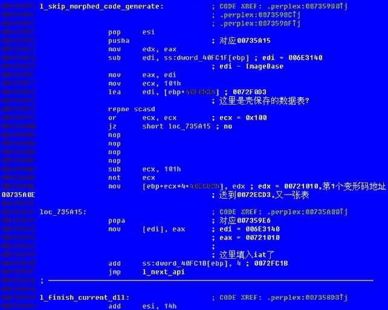
```

用脚本执行到这一段，patch 掉 4 处的跳转，在处理完全部 dll 的地方下断，用 `ImportRec` 得到完整的 IAT，全部有效。

```
[image] 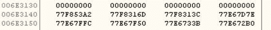
```

```
[image] 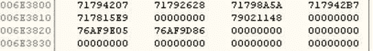
```

```
size = 6E3828 – 6E3140 = 6E8
```

```
[image] 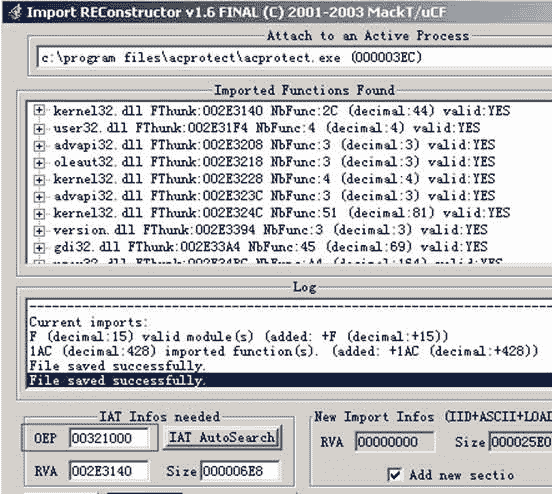
```

注意此时 OEP 不对。但 IAT 已经拿到了。先把 tree 保存起来。

## 3. 寻找 OEP

得到 IAT 后，试试忽略所有异常，到这里已经可以在 OllyDbg 下执行了。试了一下，关闭其它异常，只留下 `int 3`，还要 `shift-F9` 60 次才能运行 L。这样一步步跟不把人累死。算了，先换省力的办法吧。

干脆，在执行目前的 script 停下后，忽略所有异常。对 Code section 下内存访问断点。

```
[image] 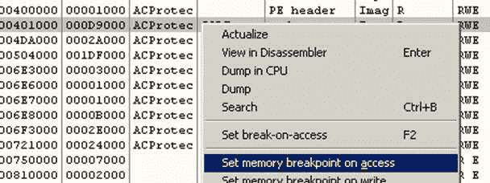
```

1) `406EDC`，返回到壳

```
[image] 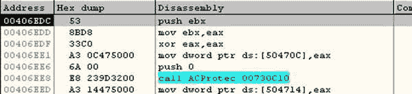
```

返回到壳代码，所以这是 stolen code 发出的 `call`。

```
[image] 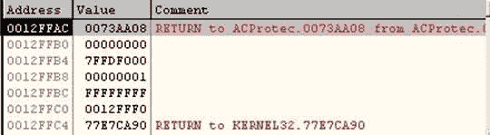
```

2) `46261C`，返回到壳

```
[image] 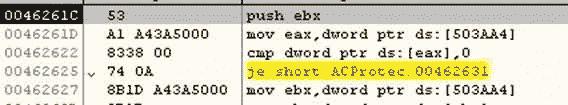
```

3) 读操作断下

```
[image] 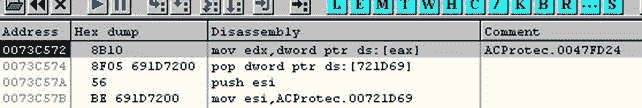
```

4) `462634`，返回到壳

```
[image] 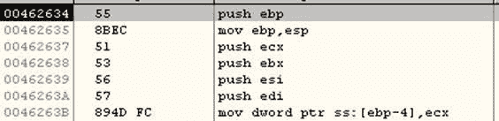
```

这里的代码也会引发异常。先 remove 内存访问断点，到 `73CEDD` 设断。断下后恢复内存访问断点。

5) 读操作断下

```
[image] 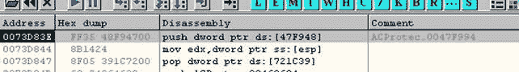
```

6) 又在 `462634`，是循环吗？按第 4 步的办法处理

```
[image] 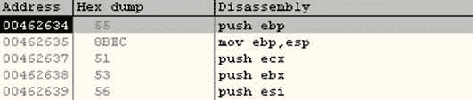
```


7) 到站了 J

这里是 `false OEP`。下面的空间有限。可以看到, `stolen codes` 中含有的 `call`: `406EDC`, `46261C`, `462634` (执行 2 次)。

在 `dump` 窗口中看:

`OEP` 应该在 `4D9DE4`。

**4. dump**

根据脱 `US UnpackMe` 的经验, 不能在 `false OEP` 处 `dump`, 此时 `BSS section` 中许多数据已经初始化了。最好在第一句 (`push ebp`) 就 `dump`。可是那个 `push ebp` 离 `false OEP` 很远。

`Packer EP` 的初始化环境:

先看看发出第 1 个 `call` 的壳代码:

可以看到(跟一下可以证实), 在 `call` 入原程序空间前, 最后的异常是 `div 0`。用现在的 `OllyDbg` 脚本(跟到 `737B63`), 停下后修改异常拦截选项:

试试能否拦截异常找到合适的 `dump` 位置。当前 `OllyScript` 脚本停下时的环境:

栈中为 `pushad` 的结果。

第 7 次 `div 0` 异常时:

注意 `ebp` 的值已经入栈了。`Pushad` 的结果, 对应寄存器值为:

`esp = 12FFC0` (原来为 `12FFC4`)
`ebp = 12FFC0 = esp` (原来为 `12FFF0`)

所以, 在这里已经执行过了:

```
Push ebp
Mov ebp,esp
```

看看 `BSS section`:

全为 0, 就在这里 `dump`。如果需要仔细跟 `stolen code`, 也可以从这里入手(可以从脚本停下的第 6 次 `div 0` 异常处理后开始)。

先用 `4D9DE4` 为 `OEP`。

用 `LoadPE` 查看节表:

先把 `CODE` 的 `Vsize` 和 `Rsize` 加大, 以避免修复 `stolen codes` 时空间不够。

重新跟到 `false OEP` (`4D9E37`)。重建输入表。

用了 `Add new section`, 会不会有问题(好象有篇脱文里提到过这个)? 先这样处理。

用 `IDA` 编译 `dumped_.exe`, 结果不错。

现在剩下 `stolen code` 和 `replaced code`。

**5. 修复 stolen code**

既然不打算仔细跟, 就只有猜了。对执行第 1 个 `call` 以前的 `stolen code` 进行猜测, 应该是安全的。后面的 4 次 `call` 需要仔细看看。

**1) call 406EDC**

在 `IDA` 中看 `dumped_.exe` 的结果:

先执行脚本, 停下后只勾选 `div 0` 异常。直到 `73A9AF`。经过一番遮遮掩掩的代码:

在 `call` 前的寄存器:

堆栈:

`call` 完后, 下面的 `pushad` 为分界线, 标识 `stolen code` 的结束。所以到这里的 `stolen code` 为(对于不确定的, 可以在 `Packer EP` 修改寄存器值, 到这里核对):

```
Push ebp
Mov ebp,esp
Push edx
Push edi
Push ebx
Push eax
Mov eax,4D9BCC  
call 406EDC
mov eax,dword ptr ds:[503B94]
```

`Call` 完后, `pushad` 前的环境:


1) 调用 `call 46261C`

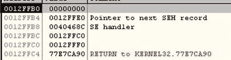

```
Push ebp
Mov ebp,esp
Push edx
Push edi
Push ebx
Push eax
Mov eax,4D9BCC
call 406EDC
mov eax,dword ptr ds:[503B94]
mov eax,dword ptr ds:[eax]
call 46261C
push edi
mov ecx,dword ptr ds:[503938]
```

到这里的 stolen code。

2) 地址 `0073BC47`

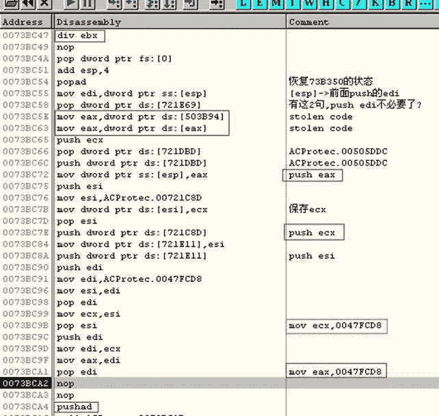

```
Push ebp
Mov ebp,esp
Push edx
Push edi
Push ebx
Push eax
Mov eax,4D9BCC
call 406EDC
mov eax,dword ptr ds:[503B94]
mov eax,dword ptr ds:[eax]
call 46261C
//这里去掉前面的 push edi
mov ecx,dword ptr ds:[503938]
mov eax,dword ptr ds:[503B94]
mov eax,dword ptr ds:[eax]
push eax
push ecx
mov ecx,47FCD8    //多余,前面 push ecx,后面还会 pop 的吧?
mov eax,47FCD8
```

从这里开始，不能图省事了。要追出全部的 stolen code，必须跟（必须确保上一次 `pushad` 和下一次 `popad` 时的环境一致，才不会丢代码）。先试直接拦截 `div 0` 异常，注意后面是否有 `popad`。如果两次的环境不一致，则必须单步跟 `L`。

另外，追 stolen code 不是一次完成的，所以有些图中寄存器和堆栈中的数据对不上，不必管它。

3) 地址 `0073C558`

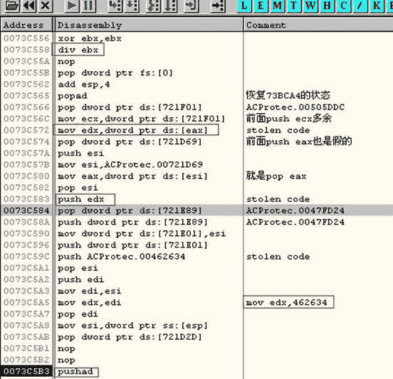

```
Push ebp
Mov ebp,esp
Push edx
Push edi
Push ebx
Push eax
Mov eax,4D9BCC
call 406EDC
mov eax,dword ptr ds:[503B94]
mov eax,dword ptr ds:[eax]
call 46261C
mov ecx,dword ptr ds:[503938]
mov eax,dword ptr ds:[503B94]
mov eax,dword ptr ds:[eax]
mov edx,dword ptr ds:[47FCD8]
push edx
mov edx, 462634     //注意这是下一次 call 的地址
```

4) 第 1 次 `call 462634`

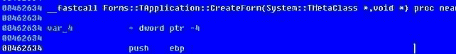

这个函数有 2 个参数 `L`。

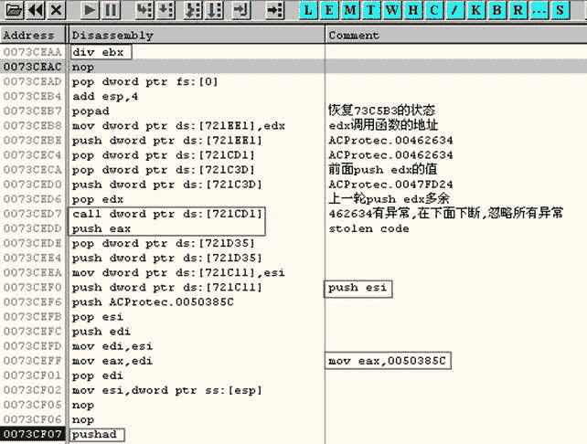

```
Push ebp
Mov ebp,esp
Push edx
Push edi
Push ebx
Push eax
Mov eax,4D9BCC
call 406EDC
mov eax,dword ptr ds:[503B94]
mov eax,dword ptr ds:[eax]
call 46261C
mov ecx,dword ptr ds:[503938]
mov eax,dword ptr ds:[503B94]
mov eax,dword ptr ds:[eax]
mov edx,dword ptr ds:[47FCD8]
call 462634
push eax
push esi
mov eax, 50385C
```

5) 第 2 次 `call 462634`

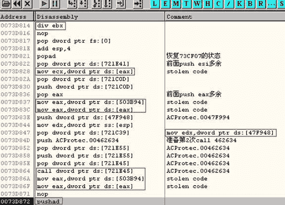

```
Push ebp
Mov ebp,esp
Push edx
Push edi
Push ebx
Push eax
Mov eax,4D9BCC
call 406EDC
mov eax,dword ptr ds:[503B94]
mov eax,dword ptr ds:[eax]
call 46261C
mov ecx,dword ptr ds:[503938]
mov eax,dword ptr ds:[503B94]
mov eax,dword ptr ds:[eax]
mov edx,dword ptr ds:[47FCD8]
call 462634
mov ecx,dword ptr ds:[50385C]
mov eax,dword ptr ds:[503B94]
mov eax,dword ptr ds:[eax]
mov edx,dword ptr ds:[47F948]
call 462634
mov eax,dword ptr ds:[503B94]
mov eax,dword ptr ds:[eax]
```

这是最后一次后面存在 `popad` 的 `div 0` 异常。看看是如何回到原程序的。

在 `73D872` 忽略所有异常，对 code section 下内存访问断点。中间在 `kernel32` 中有一次内存访问异常。

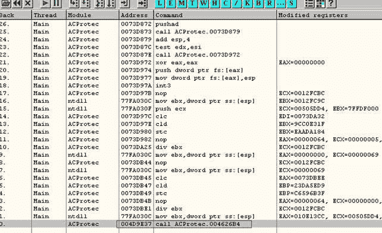

最后一次 `div ebx` 在 `73DBE1`。单步跟到这里：

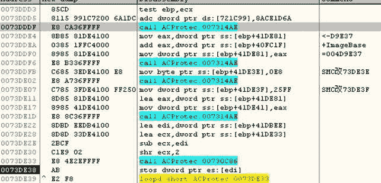

`73DE38` 破坏前面代码。

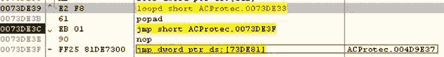

至此修复所有 stolen codes，将前面的 6 部分和 false OEP 的 2 个 call 合在一起。

```
Push ebp
Mov ebp,esp
Push edx
Push edi
Push ebx
Push eax
Mov eax,4D9BCC
call 406EDC
mov eax,dword ptr ds:[503B94]
mov eax,dword ptr ds:[eax]
call 46261C
mov ecx,dword ptr ds:[503938]
mov eax,dword ptr ds:[503B94]
mov eax,dword ptr ds:[eax]
mov edx,dword ptr ds:[47FCD8]
call 462634
mov ecx,dword ptr ds:[50385C]
mov eax,dword ptr ds:[503B94]
mov eax,dword ptr ds:[eax]
mov edx,dword ptr ds:[47F948]
call 462634
mov eax,dword ptr ds:[503B94]
mov eax,dword ptr ds:[eax]
call 4626B4
call 4049D8
lea eax, [eax+0]
```

## 6. 修复 IAT

运行程序，crashed `L`。直接用修复完 stolen code 的 `dumped_.exe` 看看。从 `EP` 的第 1 个 call 进去就有问题。


```
[if gte vml 1]>
<v:shapetype id="_x0000_t75" coordsize="21600,21600" o:spt="75" o:preferrelative="t" path="m@4@5l@4@11@9@11@9@5xe" filled="f" stroked="f">
<v:stroke joinstyle="miter"/>
<v:formulas>
<v:f eqn="if lineDrawn pixelLineWidth 0"/>
<v:f eqn="sum @0 1 0"/>
<v:f eqn="sum 0 0 @1"/>
<v:f eqn="prod @2 1 2"/>
<v:f eqn="prod @3 21600 pixelWidth"/>
<v:f eqn="prod @3 21600 pixelHeight"/>
<v:f eqn="sum @0 0 1"/>
<v:f eqn="prod @6 1 2"/>
<v:f eqn="prod @7 21600 pixelWidth"/>
<v:f eqn="sum @8 21600 0"/>
<v:f eqn="prod @7 21600 pixelHeight"/>
<v:f eqn="sum @10 21600 0"/>
</v:formulas>
<v:path o:extrusionok="f" gradientshapeok="t" o:connecttype="rect"/>
<o:lock v:ext="edit" aspectratio="t"/>
</v:shapetype>
<v:shape id="_x0000_i1025" type="#_x0000_t75" style='width:481.5pt; height:117.75pt'>
<v:imagedata src="paper-3.files/image001.jpg" o:title="1"/>
</v:shape>
[!endif]
```
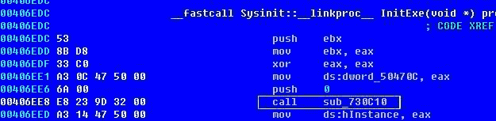

```
[if gte vml 1]>
<v:shape id="_x0000_i1026" type="#_x0000_t75" style='width:481.5pt;height:168pt'>
<v:imagedata src="paper-3.files/image002.jpg" o:title="1"/>
</v:shape>
[!endif]
```
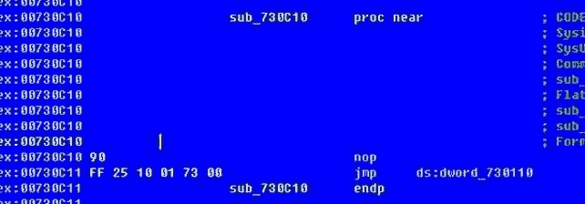

```
[if gte vml 1]>
<v:shape id="_x0000_i1027" type="#_x0000_t75" style='width:481.5pt;height:171pt'>
<v:imagedata src="paper-3.files/image004.jpg" o:title="1"/>
</v:shape>
[!endif]
```
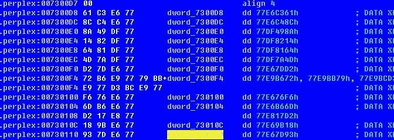

在`OllyDbg`中可以看到：

```
[if gte vml 1]>
<v:shape id="_x0000_i1028" type="#_x0000_t75" style='width:482.25pt; height:2in'>
<v:imagedata src="paper-3.files/image005.jpg" o:title="1"/>
</v:shape>
[!endif]
```
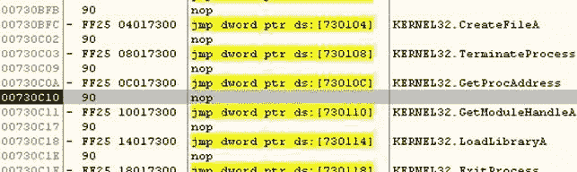

有部分`IAT`在壳中。这部分代码前面是跟到了的(在第`6`次`int 3`以后)，原来认为这只是`loader`自己需要的`API`。实际上正常的程序代码也使用了这个`IAT`。

如果用`ImportRec`把这部分也取出来，属于不同`dll`的`api`混排了，`ImportRec`不能处理。

这些地址是在`736643`处理的。

```
[if gte vml 1]>
<v:shape id="_x0000_i1029" type="#_x0000_t75" style='width:419.25pt;height:219.75pt'>
<v:imagedata src="paper-3.files/image007.jpg" o:title="1"/>
</v:shape>
[!endif]
```
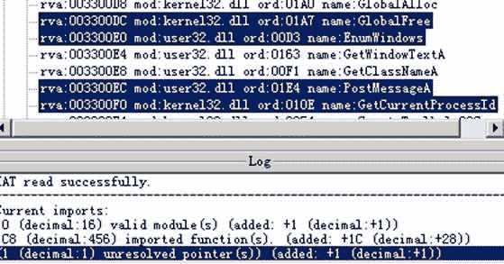

而且有一个不能识别(这个实际上是`Hooked MessageBoxA`)。

```
[if gte vml 1]>
<v:shape id="_x0000_i1030" type="#_x0000_t75" style='width:192pt;height:27pt'>
<v:imagedata src="paper-3.files/image009.jpg" o:title="1"/>
</v:shape>
[!endif]
```
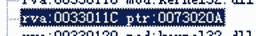

估计这是加壳时做的手脚。当发现主程序使用了与壳代码同样的`API`时，修改了对应的调用代码，使其调用到壳中的`IAT`。这样可以加强与壳的联系。反过来看，这里大部分`API`(除了只有壳使用的)，在前面避开`IAT`加密处理后，都已经`import`了。

在`ACProtect_Fixed`中已经有解好的`api`名。

```
[if gte vml 1]>
<v:shape id="_x0000_i1031" type="#_x0000_t75" style='width:481.5pt;height:309pt'>
<v:imagedata src="paper-3.files/image011.jpg" o:title="1"/>
</v:shape>
[!endif]
```
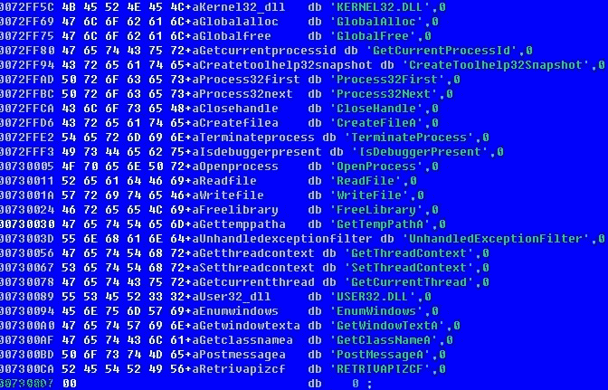

紧临的函数指针：

```
[if gte vml 1]>
<v:shape id="_x0000_i1032" type="#_x0000_t75" style='width:481.5pt;height:442.5pt'>
<v:imagedata src="paper-3.files/image012.jpg" o:title="1"/>
</v:shape>
[!endif]
```
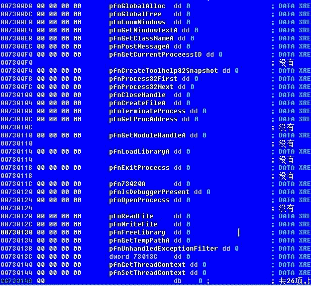

注意函数名及指针与`7339A9`附近的代码并不完全对应。有的函数名或指针在别处。

可以在程序入口自己调用`LoadLibrary`、`GetProcAddress`进行处理，填入相应的地址。或者把`Loader`的代码搬过来。也可以修改主程序的代码，使其调用前面得到的干净的`IAT`而不是壳中的`IAT`(这样要处理的地方太多，很麻烦)。

注意`ACProtected_Fixed`中，`import`了几个基本的`API`：

```
[if gte vml 1]>
<v:shape id="_x0000_i1033" type="#_x0000_t75" style='width:481.5pt; height:115.5pt'>
<v:imagedata src="paper-3.files/image013.jpg" o:title="1"/>
</v:shape>
[!endif]
```
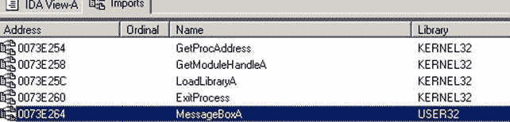

在加载`API`时壳代码会使用这些函数。这几个地址直接填入`007300D8`开始的`IAT`中了。修改`dumped_.exe`的`EP`，从壳代码开始(可以看到`dump`出来的代码，这部分已经解开了)，

```
[if gte vml 1]>
<v:shape id="_x0000_i1034" type="#_x0000_t75" style='width:481.5pt;height:243.75pt'>
<v:imagedata src="paper-3.files/image015.jpg" o:title="1"/>
</v:shape>
[!endif]
```
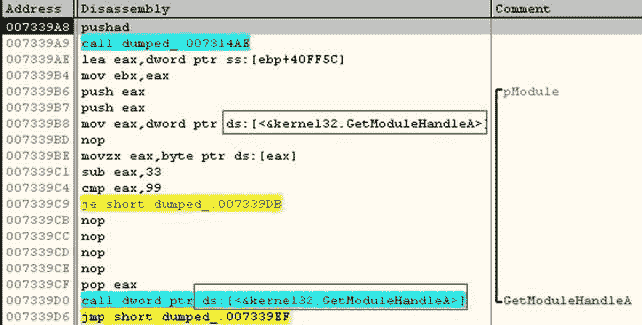

```
[if gte vml 1]>
<v:shape id="_x0000_i1035" type="#_x0000_t75" style='width:359.25pt;height:176.25pt'>
<v:imagedata src="paper-3.files/image017.jpg" o:title="1"/>
</v:shape>
[!endif]
```
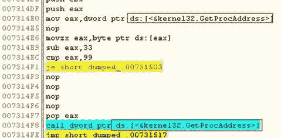

注意`Loader`代码中用的几个`API`(`GetModuleHandleA`、`GetProcAddress`)改为使用避开`IAT`加密后得到的主程序的`IAT`。

```
[if gte vml 1]>
<v:shape id="_x0000_i1036" type="#_x0000_t75" style='width:481.5pt;height:136.5pt'>
<v:imagedata src="paper-3.files/image019.jpg" o:title="1"/>
</v:shape>
[!endif]
```
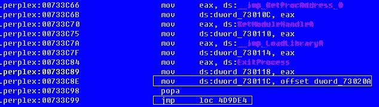

原来在壳代码`import`的`4`个`API`，从主程序的`IAT`直接取。结束处理后跳回前面的`OEP 409DE4`。用`pushad`、`pushad`保存寄存器值。

```
[if gte vml 1]>
<v:shape id="_x0000_i1037" type="#_x0000_t75" style='width:481.5pt;height:186.75pt'>
<v:imagedata src="paper-3.files/image020.jpg" o:title="1"/>
</v:shape>
[!endif]
```
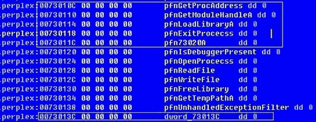

注意最后一项`7301CC`实际是`MessageBoxA`，被`ACProtect`用做`SDK`的接口。 不要填入`MessageBox`的真正地址。

下面的`73013C`在跟原程序的过程中始终为`0`，可能是注册版才有？

```
[if gte vml 1]>
<v:shape id="_x0000_i1038" type="#_x0000_t75" style='width:410.25pt;height:131.25pt'>
<v:imagedata src="paper-3.files/image022.jpg" o:title="1"/>
</v:shape>
[!endif]
```
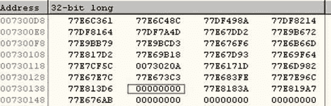

处理完后，位于壳空间的`IAT`已经赋上了正确值。

## 7. 修复 Replaced code (1)

用前面的`OllyScript`脚本，停下后对`Code section`设内存访问断点。忽略所有异常。断下后，在抽取代码的共同入口`722416`设断，运行。第`1`次调用在`004047E5`。

```
[if gte vml 1]>
<v:shape id="_x0000_i1039" type="#_x0000_t75" style='width:450pt;height:2in'>
<v:imagedata src="paper-3.files/image024.jpg" o:title="1"/>
</v:shape>
[!endif]
```
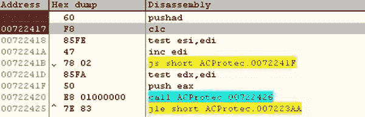

里面还有`SMC`，解出后贴到`ACProtect_Fixed`中对照跟踪。这部分的处理与低版本基本相同。

### 1) 查返回地址表

```
[if gte vml 1]>
<v:shape id="_x0000_i1040" type="#_x0000_t75" style='width:481.5pt;height:71.25pt'>
<v:imagedata src="paper-3.files/image026.jpg" o:title="1"/>
</v:shape>
[!endif]
```
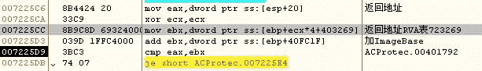

`7225CC`后`ebx`指向返回地址表，里面是`RVA`：

```
[if gte vml 1]>
<v:shape id="_x0000_i1041" type="#_x0000_t75" style='width:408.75pt; height:120.75pt'>
<v:imagedata src="paper-3.files/image027.jpg" o:title="1"/>
</v:shape>
[!endif]
```
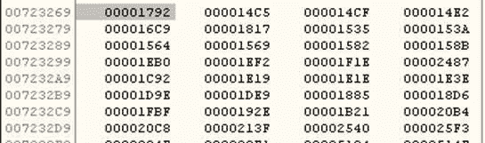

找到匹配地址后，`ecx`等于表项的`offset`，第`1`项为`0x2A`。

### 2) 查 opcode 表

用`1`中的到的`offset`查`opcode`数据表(`007262ED`)：

```
[if gte vml 1]>
<v:shape id="_x0000_i1042" type="#_x0000_t75" style='width:414pt;height:375.75pt'>
<v:imagedata src="paper-3.files/image029.jpg" o:title="1"/>
</v:shape>
[!endif]
```


密文`opcode`表：

```
[if gte vml 1]>
<v:shape id="_x0000_i1043" type="#_x0000_t75" style='width:401.25pt;height:84.75pt'>
<v:imagedata src="paper-3.files/image031.jpg" o:title="1"/>
</v:shape>
[!endif]
```


`counter`表(记录每个地址的调用次数，超出`0x20`次将使用新的地址解码)：

```
[if gte vml 1]>
<v:shape id="_x0000_i1044" type="#_x0000_t75" style='width:405pt;height:110.25pt'>
<v:imagedata src="paper-3.files/image033.jpg" o:title="1"/>
</v:shape>
[!endif]
```


第`1`次解出的变形码：

```
[if gte vml 1]>
<v:shape id="_x0000_i1045" type="#_x0000_t75" style='width:417pt;height:90pt'>
<v:imagedata src="paper-3.files/image035.jpg" o:title="1"/>
</v:shape>
[!endif]
```


### 3) 调整 stack 以便正确调用变形码及返回

```
[if gte vml 1]>
<v:shape id="_x0000_i1046" type="#_x0000_t75" style='width:481.5pt;height:114pt'>
<v:imagedata src="paper-3.files/image037.jpg" o:title="1"/>
</v:shape>
[!endif]
```


### 4) 破坏解出的代码, ret 到变形码

```
[if gte vml 1]>
<v:shape id="_x0000_i1047" type="#_x0000_t75" style='width:481.5pt;height:105pt'>
<v:imagedata src="paper-3.files/image039.jpg" o:title="1"/>
</v:shape>
[!endif]
```


### 5) 执行变形码, 返回到原程序

```
[if gte vml 1]>
<v:shape id="_x0000_i1048" type="#_x0000_t75" style='width:481.5pt;height:97.5pt'>
<v:imagedata src="paper-3.files/image041.jpg" o:title="1"/>
</v:shape>
[!endif]
```


### 6) Patch

先把解出的代码`binary copy`到`dumped_.exe`(直接`copy 722416 - 7226B0`的代码即可)。

关闭`722579`的解码(解出`7225C1 - 7226B0`)：


`[if gte vml 1]><v:shape id="_x0000_i1049" type="#_x0000_t75" style='width:481.5pt;height:48.75pt'> <v:imagedata src="paper-3.files/image043.jpg" o:title="1"/> </v:shape><![endif]!`


关闭 `7226A8` 处对前面代码的破坏:

`[if gte vml 1]><v:shape id="_x0000_i1050" type="#_x0000_t75" style='width:481.5pt;height:69.75pt'> <v:imagedata src="paper-3.files/image045.jpg" o:title="1"/> </v:shape><![endif]!`


`patch 72260C`: `jnz` -> `jmp`, 无论执行多少次都使用同一解码地址

`[if gte vml 1]><v:shape id="_x0000_i1051" type="#_x0000_t75" style='width:481.5pt;height:46.5pt'> <v:imagedata src="paper-3.files/image046.jpg" o:title="1"/> </v:shape><![endif]!`


`copy` 正确的 `ImageBase` 值, 这里为 `0`, 改 `72FC1F` 为 `400000`

`[if gte vml 1]><v:shape id="_x0000_i1052" type="#_x0000_t75" style='width:481.5pt;height:66pt'> <v:imagedata src="paper-3.files/image047.jpg" o:title="1"/> </v:shape><![endif]!`


`[if gte vml 1]><v:shape id="_x0000_i1053" type="#_x0000_t75" style='width:294.75pt;height:71.25pt'> <v:imagedata src="paper-3.files/image049.jpg" o:title="1"/> </v:shape><![endif]!`


`copy` 正确的 10 bytes key (第 1 byte 为 0)

`[if gte vml 1]><v:shape id="_x0000_i1054" type="#_x0000_t75" style='width:312pt;height:75.75pt'> <v:imagedata src="paper-3.files/image051.jpg" o:title="1"/> </v:shape><![endif]!`


执行, 仍然 crashed。

### 8. 修复 Replaced code (2)

还有 `replaced code`, 在这里出异常:

`[if gte vml 1]><v:shape id="_x0000_i1055" type="#_x0000_t75" style='width:481.5pt;height:60.75pt'> <v:imagedata src="paper-3.files/image053.jpg" o:title="1"/> </v:shape><![endif]!`


->

`[if gte vml 1]><v:shape id="_x0000_i1056" type="#_x0000_t75" style='width:422.25pt; height:129.75pt'> <v:imagedata src="paper-3.files/image055.jpg" o:title="1"/> </v:shape><![endif]!`


将解出的代码贴到 `ACProtect_Fixed.exe`。可以看到, 这些实际上是变形的 `call` 代码。第 1 次执行到这里, 在 `buffer` 中解出的变形码为:

`[if gte vml 1]><v:shape id="_x0000_i1057" type="#_x0000_t75" style='width:481.5pt;height:49.5pt'> <v:imagedata src="paper-3.files/image057.jpg" o:title="1"/> </v:shape><![endif]!`


`[if gte vml 1]><v:shape id="_x0000_i1058" type="#_x0000_t75" style='width:407.25pt;height:62.25pt'> <v:imagedata src="paper-3.files/image059.jpg" o:title="1"/> </v:shape><![endif]!`


`XOR` 的结果:

`[if gte vml 1]><v:shape id="_x0000_i1059" type="#_x0000_t75" style='width:383.25pt;height:45pt'> <v:imagedata src="paper-3.files/image061.jpg" o:title="1"/> </v:shape><![endif]!`


目前的 `dumped.exe`, 地址 `72ED83` 的值为 `0` (这些值是 `loader` 写入的)。

`406DF8` 的变形码原来是 `call GetKeyboardType`。原程序的 `call API` 全部被抽掉了。壳代码的动作与前面相似, 用返回地址查表, 获取相应的指针, 生成 `jmp dword ptr ds:[xxxxxxxx]` 指令, 该地址则指向类似 `72124C` 的变形码, 调用正确的 API。

变形 `call API` 的返回 `RVA` 地址表:

开始:

`[if gte vml 1]><v:shape id="_x0000_i1060" type="#_x0000_t75" style='width:413.25pt; height:72.75pt'> <v:imagedata src="paper-3.files/image063.jpg" o:title="1"/> </v:shape><![endif]!`


结束:

`[if gte vml 1]><v:shape id="_x0000_i1061" type="#_x0000_t75" style='width:417.75pt; height:74.25pt'> <v:imagedata src="paper-3.files/image065.jpg" o:title="1"/> </v:shape><![endif]!`


寻址变形码数组下标表 (每项 1 字节), 用于查变形码指针数组:

`[if gte vml 1]><v:shape id="_x0000_i1062" type="#_x0000_t75" style='width:399pt; height:62.25pt'> <v:imagedata src="paper-3.files/image067.jpg" o:title="1"/> </v:shape><![endif]!`


变形码地址表 (指向变形码的指针):

`[if gte vml 1]><v:shape id="_x0000_i1063" type="#_x0000_t75" style='width:420.75pt; height:102pt'> <v:imagedata src="paper-3.files/image069.jpg" o:title="1"/> </v:shape><![endif]!`


开始打算写个 `inline-patch`:

用同样的查表动作, 把对应的变形码 `copy` 出来, 得到对应的 API 地址, 与跳过加密而得到的干净 `IAT` 对比。查到匹配值后, 修改对应的 `opcode`, 使其直接 `call` 到 `IAT` 中的地址。

用 `OllyScript` 脚本跳过 `IAT` 加密, 得不到变形码 (此时从变形码地址表中得到的就是 API 的真正地址, 有 46 项指针无效, 为 `0xCCCCCCCC`)。

另一个问题却是难以解决的, `replaced code` 只有 5 字节:

`[if gte vml 1]><v:shape id="_x0000_i1064" type="#_x0000_t75" style='width:482.25pt;height:97.5pt'> <v:imagedata src="paper-3.files/image071.jpg" o:title="1"/> </v:shape><![endif]!`


这里的 `call` 是 `0xE8`, 调用壳中的绝对地址。`InlinePatch` 写到一定程度才发现, 如果要修复代码, 使其调用到 `IAT`, 需要相对地址调用 6 bytes。真是个低级错误。

现在 `patch` 的结果:

`[if gte vml 1]><v:shape id="_x0000_i1065" type="#_x0000_t75" style='width:401.25pt;height:96pt'> <v:imagedata src="paper-3.files/image073.jpg" o:title="1"/> </v:shape><![endif]!`


真正需要的是:

`[if gte vml 1]><v:shape id="_x0000_i1066" type="#_x0000_t75" style='width:481.5pt;height:26.25pt'> <v:imagedata src="paper-3.files/image075.jpg" o:title="1"/> </v:shape><![endif]!`


这样只有保留变形码。把壳中对应的代码 `copy` 过来, `OEP` 前生成正确的变形码。而且脱壳后的程序不能直接看到 API 名字, 很不舒服。

只好把壳的相应代码搬过来。再次修改 `dumped.exe` 入口处代码, 在把 `loader` 空间中的 `IAT` 填好后, 跳到处理变形码的位置:

`[if gte vml 1]><v:shape id="_x0000_i1067" type="#_x0000_t75" style='width:481.5pt; height:139.5pt'> <v:imagedata src="paper-3.files/image076.jpg" o:title="1"/> </v:shape><![endif]!`


`loader` 在处理 `IAT` 时需要调用几个 API, 及判断 `dll` 的映射地址、API 地址等, 先保存需要的数据 (我们有干净的 `IAT`):

`[if gte vml 1]><v:shape id="_x0000_i1068" type="#_x0000_t75" style='width:481.5pt;height:252.75pt'> <v:imagedata src="paper-3.files/image078.jpg" o:title="1"/> </v:shape><![endif]!`


由于在前面避开了 `IAT` 加密, 生成变形码需要的数据已经被正确的 API 地址覆盖了。用 `LoadPE` 把 `ACProtect` 的 `idata section` 存到文件, 然后加到 `dumped.exe`。

`[if gte vml 1]><v:shape id="_x0000_i1069" type="#_x0000_t75" style='width:473.25pt;height:149.25pt'> <v:imagedata src="paper-3.files/image079.jpg" o:title="1"/> </v:shape><![endif]!`


把这个 section 的密文数据 `copy` 到 `dumped.exe` 的 `idata section`, 覆盖掉干净的 `IAT`, 我们已经不需要它了。现在只要伪造好现场。

`[if gte vml 1]><v:shape id="_x0000_i1070" type="#_x0000_t75" style='width:417.75pt;height:147.75pt'> <v:imagedata src="paper-3.files/image081.jpg" o:title="1"/> </v:shape><![endif]!`


往下执行 `loader` 的 `IAT` 处理代码, 做几处小小的修改, 使其使用刚才保存的 API 地址等数据。

`[if gte vml 1]><v:shape id="_x0000_i1071" type="#_x0000_t75" style='width:481.5pt;height:120pt'> <v:imagedata src="paper-3.files/image083.jpg" o:title="1"/> </v:shape><![endif]!`


`IAT` 及变形码处理结束后回到 `OEP`。

`[if gte vml 1]><v:shape id="_x0000_i1072" type="#_x0000_t75" style='width:468.75pt;height:96pt'> <v:imagedata src="paper-3.files/image084.jpg" o:title="1"/> </v:shape><![endif]!`


执行。又挂了。这次是内存访问异常。跟一跟可以知道, 是在 `Hooked MessageBoxA` 中。这里面的代码还没有仔细看, 有几个 `switch-case` 分枝。第 1 次 `eax` 为 `5`。

`[if gte vml 1]><v:shape id="_x0000_i1073" type="#_x0000_t75" style='width:481.5pt;height:52.5pt'> <v:imagedata src="paper-3.files/image086.jpg" o:title="1"/> </v:shape><![endif]!`


进去后有几个查表动作:

`[if gte vml 1]><v:shape id="_x0000_i1074" type="#_x0000_t75" style='width:481.5pt;height:294.75pt'> <v:imagedata src="paper-3.files/image087.jpg" o:title="1"/> </v:shape><![endif]!`


用调用 `Hooked MessageBoxA` 的返回地址查表。这张表在 `721F25` 处, `dumped.exe` 中有, 共 21 项。

注意查表时不是找相等值, 而是找大于返回地址值且最接近的值。

`[if gte vml 1]><v:shape id="_x0000_i1075" type="#_x0000_t75" style='width:481.5pt;height:276pt'> <v:imagedata src="paper-3.files/image089.jpg" o:title="1"/> </v:shape><![endif]!`


继续 ->


这里出现了另外 2 张表。`7220B5` 的表中数据为 `size`。`Dumped_.exe` 中有：


问题出在第 3 张表：


`dump` 出的数据为 `0`。这段代码要把主程序中的一段数据 copy 到这张表中数据所指的地址。在 `loader` 中执行时，这里填入了指向动态分配内存的指针。


显然不能直接复制这些值。有个简单的办法可以骗过 `loader`。从那张 `size` 表中可以看到，最大的数据 `FD5D`。用 `LoadPE` 再次增加 1 个 `section`，`size` 为 `FFFFFF` 即可。


修改 `dumped_.exe`，设置 21 项数据，使其全部指向该地址。


在 `W2K` 下运行，显示窗口，但不能响应输入。在 `WinXP` 下运行什么也不显示。

下面该与主程序交手了，这需要把板凳坐穿的耐心 L。
