# ARMADILLO 和 NANOMITES

> 原文：[`www.pediy.com/kssd/pediy06/pediy6955.htm`](https://www.pediy.com/kssd/pediy06/pediy6955.htm)

## FTBirthday 的 Armadillo 全程教程--第二章 copy-mem II 加壳方式

### 第二章．copy-mem II 加壳方式

**实例解析四：牛壳 ARMADILLO 和 NANOMITES (第一部分)**

现在我们又开始了，我们将要去击败 `Armadillo` 的最后一道防线。我们知道这将是一场硬仗，但值得去打。 所以这回我们要专门解释一下 `nanomites` 保护和 `unpack` 的方法，那将会比我们在其它教程中见到的稍微难一点。所有 `nanomites` 和 `copymemII` 配合使用，所以为了成功地 `dump`，你需要遵照我在其它两篇教程中写的步骤。

这次我们选了一个比较容易 `dump` 的目标软件。这样做仅是为了避免重复我在上次教程中所写的步骤。无论如何，我们只有在 `dump` 之后才能对付 `nanomites`， 所以如果存在 `nanomites` 保护，那么在 `dump` 之后作为一项附加任务，我们必须击败 `nanomites` 保护。

### NANOMITES 到底是什么样的地狱般的阴险招数？

`Nanomites` 是 `Armadillo` 嵌入子进程的 `INT 3` 中断，虽然在 `GETRIGHT FINAL` 版本里没有使用 `nanomites` 保护，但是却在 `CRUSADER` 写的教程里的 beta 版本里用了。 可能有 50， 100 甚至 200 个 `INT 3`，它们被放入了子进程的第一个 `section`，以阻止子进程脱离父进程运行。`INT 3` 中断替代了原始文件的条件跳转。所以每当父进程接收到 `INT 3` 中断，它就到存放跳转类型的 `report` 中去，看一下标志以决定是否跳转，然后测算出新的 `EIP`，改变到子进程中去然后继续运行直到下一个 `INT 3`。

问题是我们不知道每个跳转和 `INT 3` 的对应关系，所以我们将要在本篇教程中学习如何 `patch` 它。 首先我们要学如何手动 `patch` 它，然后(在第二篇教程中) 我们将要学习如何让计算机自动逐行 `patch` 它。

### 我们将要用 eSTOP SE 3.21 做实验

下面是连接:

`http://www.nwpsw.com/estopmain.html`

在我的 `FTP` 里有一份拷贝。

我们 `dump` 这个程序的方法和以前的方法稍微有所不同。如果我们想尝试用一般的方法去 `dump` 它，它不会在 `WriteProcessMemory` 断点停下。我第一次遇到这种情况时，我怀疑这个程序是否用了 `CopyMemII` 保护，但是当我停下来去看 `attach window` 时我看到了父进程和子进程的进程。 那么它是如何做的呢?

这个程序只是用了 `nanomites` 保护，所以在这种情况下， 父进程在 `unpack` 过程中没有做任何事情。子进程自己 `unpack` 自己，修改它自己的 `IAT`，自己 `unpack` 第一个 `section` 然后最终跳向它的 `OEP`。

父进程仅在子进程开始运行时出现了一次，然后 `INT 3` 出现了。这回你要是想 `dump eSTOP`，你就必须得遵照 `GETRIGHT` 重建输入表的第二篇教程，找到 `magic jump` 最后在第一个 `section` 设一个 `BPM`，所以一旦输入表修复完毕它就停在它的 `OEP` 上了。一旦你到达这里 `dump` 这个进程然后用 `Import Reconstructor` 来修复这一进程的输入表。

在这里如果我们运行 `dump` 下来的程序，它将在这里崩溃。

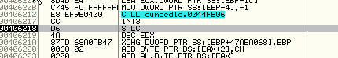

正如你看到的在 `406217` 出现了第一个 `INT 3`，让我们欢迎丛林男孩! 我想 `Rambo`（丛林男孩）可以帮助我解决这个问题，所以我打电话给他，但是他不在家，所以我读了 `CRUSADER`’s 的教程，这可帮了大忙了。读完后，我知道了在 `INT3` 所在之处我们需要插入一些跳转。所以现在我们需要知道要插入何种类型的跳转。

在 `OLLYDBG` 中重新启动程序 (是原始程序，不是 `dump` 下来的程序)。 现在我们去找在哪儿父进程开始和 `NANOMITES` 合作。在入口处停下，右击鼠标选择 `SEARCH FOR BINARY STRING` 然后输入这个十六进制的字符串 `03 00 00 80`

在我的机器里它停在了 `5C5BAF`

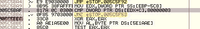

不用管内存地址，因为在其它 `Armadillo` 保护的软件中这个地址会变的。真正关键的是找到那些代码。第一次停下来时来到这一行:

```
005C5BAF   817A 0C 03000  CMP DWORD PTR DS:[EDX+C]，80000003
```

最重要的是 `80000003`，可以说那是开始子进程的地址， 因为这正是父进程从 `WaitForDebugEvent report` 中得到的。如果是其它任何值，那就不是 `nanomite` 保护。`BPX 5C5BBC` 然后把 `antidebuger byte` 置 0 或者 `bp IsDebuggerPresent` 然后把 `eax` 中的值改为 `0`。运行程序，跳过第一次异常，继续运行。

试用版提示对话框将会弹出，按 `OK`，然后通过 `shift+F9` 组合键跳过一切异常。 现在它将会停在我们下的断点 `BPX` 上。

你可以看到 `EDX` 指向 `WaitForDebugEvent report` 所以右击鼠标选择 `FOLLOW IN DUMP`。我们可以看到下面的 `report`。

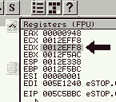 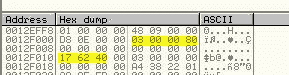

在图中我们可以看到 `API report`，`80000003` 也在其中。我们同样也可以看到 `report` 的产生出 `406217`（第一个 `INT 3` 的地址）。

看起来我们已经进入正轨了当父进程第一次接收到来自子进程的一个 `INT 3`，它解码了一张 `report`，这张 `report` 存储了所有 `INT 3` 需要的信息。这些信息可以被另存于任何一个安全的地方，以方便我们需要时直接查阅而不必重新启动父进程。

接下来的条件跳转，第二次来到这里时要留心，我们没有进入到 `decrypt routine`。

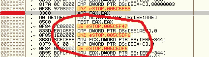

我并不关心 `Armadillo` 解码 `report` 的方法， 我只是想知道解码后的值， 所以我将要喘口气然后直接解释如何做。

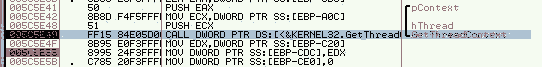

这是最有趣的一个 `section`。 它需要 `API GetThreadContext` 去读取子进程的 `EIP` 和标志寄存器的状态。在那儿 `BPX` 然后继续直到你来到 `API`。

用 `F8` 跟踪运行 `API`，然后你将会看到下一行存有关于此 `API` 的信息。

```
005C5E4F       8B95 E0F3FFFF MOV EDX，DWORD PTR SS:[EBP-C20]
```

在这一行右击鼠标选择 `FOLLOW IN DUMP-MEMORY ADDRESS` 你将会看到这个 `API` 数据信息。

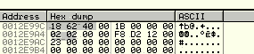

如果我们看一下 `dump` 下来的程序，在第一个 `INT 3` 发生时，我们可以看到 `EIP` 的值是 `406218`，标志寄存器 `EFL` 的值是 `00000202`。

下面这张图片来自子进程，停在了第一个 `INT 3` 上。

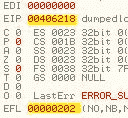

正如你看到的接下来几行代码就在处理这些值，在 `Table 1` 中查看这个 `INT 3`。 现在我们来看 `Table 1`。

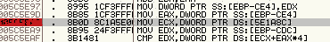

运行到 `ECX` 获得 `Table 1` 的起始值的那一行停下，`Table 1` 包含了每一个 `INT 3` 的内存地址。

如果我到了这一行，再运行一下， `ECX` 会获得 `table 1` 的起始值，在我的机器里如图：

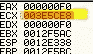

在 `ECX` 上右击鼠标选择 `FOLLOW IN DUMP` 到窗口去看 `Table 1`。

#### TABLE 1

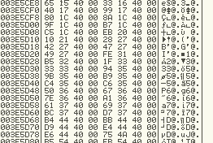

这张表将会非常有用。稍稍向下翻页我们将会看到我们当前所处的 `INT 3` 的地址值，但是在表中这个值是紧接着 `INT 3` 的下一个地址值。这对于我们通过 `patch` 或者使用工具修复 `nanomites` 非常有用。

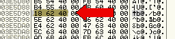

这儿你可以看到我所说的。这就是 `INT3` 的下一条指令地址。当父进程接收到 `INT 3` 时它就把子进程的 `EIP` 和这张表进行比较，以此获得子进程当前的地址以及从 `section` 开始的 `INT 3` 的数量。

这就是 `Table 1` 的一切。现在步进到指向 `Table 2` 的地方。

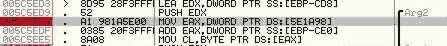

`EAX` 包含了 `Table 2` 的起始值。当我们运行到这一行时同样在 `EAX` 上右击鼠标并选择 `FOLLOW IN DUMP`，我们将会看到 `Table 2`。

#### TABLE 2

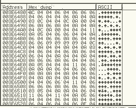

这张表包括了每一个 `INT 3` 的类型号。它们的顺序和 `Table 1` 是一样的，也就是取决于 `INT 3` 的地址，所以 `0C` 属于 `Table 1` 中的第一个 `INT 3` 以此类推。

我们使用变量 `X` 来描述在两张表中属于同一个 `INT 3` 值，可以表示为:

#### TABLE 1

`Table 1` 的起始值 + `X * 4`

#### TABLE 2

`Table 2` 的起始值 + `X`

所以如果 `X=0`

`Table1=3E5cE8 + 0 * 4= 3e5ce8`
`Table2= 3e6480 + 0 =3e6480`

这表明当 `X=0` 时，第一个 `INT 3` 在 `Table 1` 中属于它的值是 `[3e5ce8]=00401565` 在 `table 2` 中是 `[3e6480]=0c`。

`X=1` 将是第二个 `INT 3`

`Table 1=3E5cE8 + 1 * 4=[ 3e5cec]=00401633`
`Table 2= 3e6480 + 1 =[3e6481]=04`

我希望你能够明白这些，因为这对你有用。

这部分可能不易理解，所以需要仔细地阅读。 我们需要搞清楚 `Table 2` 那些值的含义。它们是一些取决于标志值的跳转。

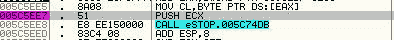

`PUSH ECX` 保存它从 `Table 2` 获得的将要被执行的属于 `INT 3` 的条件跳转。这里，它的值是 `04`，所以我们需要知道它是什么样的条件跳转，因为 `04` 代表相同的条件跳转。我们进入那个 `Call` 然后看到：

```
005C7507  |.  FF248D C8765C>   JMP DWORD PTR DS:[ECX*4+5C76C8]
```

这里我们看到了一个取决于 `ECX` 的值的跳转。取决于表中 `ECX` 的值和 4 的乘积 + `5C76C8` 的值，它将跳转到不同的地址。很容易通过改变 `ECX` 的值来看看它究竟 跳向何方，然后在 `OLLYDBG` 中加注解。

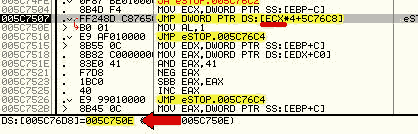

这回如果 `ECX=04` 它将跳向 `5C750E`。写下它，然后试着从 `00` 改到 `11`。

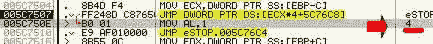

如果我们依次尝试其它的值，我们将的到列表如下：

`0` 前往

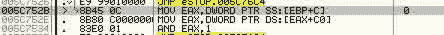

`1` 前往

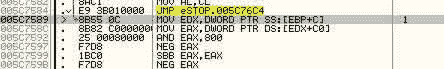

以此类推

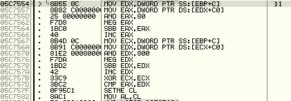

这是由从 `Table 2` 中获得的值产生的完整的一个跳转列表，它们和最终的那个跳转有关。这个列表将会非常有用，在其它 `Armadillo` 中从 `Table 2` 中获得的值产生的完整列表将有所不同。

改回 `ECX=04`; 在 `Crusader` 的帮助下，我们知道如果 `EAX` 的值是 `1`，那将是一个跳转，但是如果 `EAX` 的值是 `0`，将不是跳转，稍加跟踪你将会看到属于数字 `04` 的代码是：

```
005C750E  |> \B0 01        MOV AL，1
```

这里把 `AL` 的值改变为 `1`，所以无论标志的值是什么它都会跳转。然后属于 `04` 的跳转类型就是 `JMP`。

现在我们需要知道它将跳向哪里。答案在走出这个 `CALL` 之后。

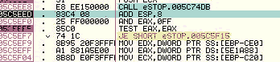

这里测试了 `EAX` 里的值，如果值是 `1`，就跳。它带领我们去 `Table 3`，在那儿父进程计算出新的 `EIP`，就是子进程将要跳向的地方。

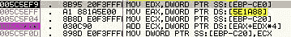

上图中的第二行是 `Table 3` 的起始值。这个表告诉我们所有的跳转将要跳向何方。

#### TABLE 3

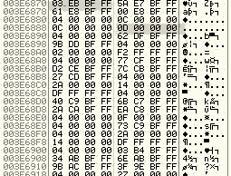

这就是 `Table 3`。它以四个字节为单位，所以你想在 `Table 3` 中定位任何一个值，

这样计算：`Table 3` 起始值 + `X * 4`

我们跟踪到这一行，它将位移值移入 `EDX`，`EDX` 在 `Table 3` 中所对应的值将和

`INT 3` 所在的地址值相加。

```
005C5EF9   .  8B95 20F3FFFF MOV EDX，DWORD PTR SS:[EBP-CE0]
```

当 `EDX= 2A`

在下一行 `EAX` 被赋予 `Table 3` 起始值

```
005C5EFF   .  A1 881A5E00   MOV EAX，DWORD PTR DS:[5E1A88]
```

在我的机器里 `3E6870` 就是 `Table 3` 的起始值

`INT 3` 的地址值是 `406218`，在第三行她被赋给 `ECX`，然后在第四行和 `EIP` 相加。

```
005C5F0A > .  030C90        ADD ECX，DWORD PTR DS:[EAX+EDX*4]
```

`Table 3` 起始值+位移 `2A x 4` 给出了这个 `INT 3` 在 `Table 3` 中对应的值。

新的 `EIP= 406218+[EAX+EDX*4]=40621C`

**如果我在子进程中写下 `JMP 40621C` 来代替 `INT3`，就搞定了。**

看子进程如图

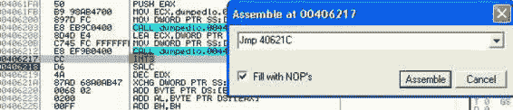

这里是我修复第一个 `INT 3`。

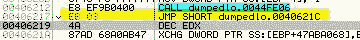

右击鼠标选择 `NEW ORIGIN HERE` 在 `406217` 然后运行。

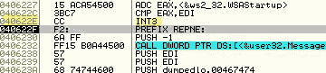

这是子进程中的第二个 `INT 3` (`40622E`)。

如果我们返回父进程，它通过这个 `API` 完成对第一个 `INT 3` 的处理

```
005C5F41       FF15 80E05D00 CALL DWORD PTR DS:<&KERNEL32.SetThreadContext>; \\**SetThreadContext**
```

**这是和 `GetThreadContext` 正好相反的 `API`，`GetThreadContext` 读取 `EIP`。现在通过 `SetThreadContext` 写入新的 `EIP`，改变子进程的 `EIP` 为 `40621C` 然后继续运行。**

这就是父进程的工作方式，运行父进程去研究第二个 `INT 3`。

停在数学运算的开始

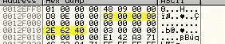

`EDX` 又一次指向了 `report`，让我们看看那儿有什么。

又是 `80000003` 这个值，然后是新的 `INT 3` 的地址值在 `40622E`。 这回下来那一行的跳转跳了，跳过了 `tables` 被解码的代码段。

当我们停在 `GetThreadContext` 我们看到它给子进程赋 `EIP` 值为 `40622F`，标志寄存器的值是 `246`。

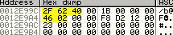

正如我们从 `PUSH ECX` 看到的，这次 `INT 3` 类型号是 `06`。

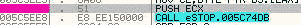

进入 `CALL` 去研究 `INT 3` 类型号为 `06` 的跳转的类型。

到达我们曾经标记过的地方。

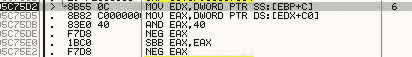


# ARMADILLO 与 NANOMITES 教程：Copy-Mem II 加壳方式解析

## 一、条件跳转与标志寄存器分析

在第二行付给 `EAX` 标志寄存器的值 `246`，所以这将是一个条件跳转。这一行暗示标志寄存器的值将被检测。

```asm
005C75DB | . 83E0 40          AND EAX, 40
```

让我们看看 `40` 对于标志寄存器的意义。这次父进程标志寄存器的值 `EFL` 为 `287`。我把它写下来，因为一会儿会用到的。

右击鼠标把它改为 `40`。我可以看到标志已经改变了。

`Z` 是唯一起作用的标志，所以如果我们把任何一个值和 `40` 相“与”，只有当两个操作数都为 `1` 时结果才为 `1`。`40` 的二进制如图，只有当另一个操作数对应位为 `1` 或者同样的 `Z` 标志时结果才不为 `0`，因为在 `40` 中其它位的值都为 `0`。

这样的解释很抽象，还是看图比较清楚一点。

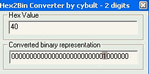 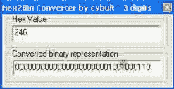

这个跳转只取决于标志的状态，如果跳则是 `JZ`，如果不跳则是 `JNZ`。如果我们稍加跟踪在最后一行 `EAX=1`，所以它一定是 `JZ` 或者 `JE`。我测试了所有的 `INT 3` 类型号对应的跳转类型，得出下表。

### INT 3 类型号对应的跳转类型表

| Value | Jump | Hex Value |
| :--- | :--- | :--- |
| 1 | `JO` | `70` |
| 2 | `JNS` | `79` |
| 3 | `JNL` | `7D` |
| 4 | `JMP` | `EB` |
| 5 | `JNC` | `73` |
| 6 | `JE`/`JZ` | `74` |
| 7 | `JNA` | `76` |
| 8 | `JS` | `78` |
| 9 | Unknown | |
| A | `JNE` | `75` |
| B | `JNO` | `71` |
| C | `JA` | `77` |
| D | `JP` | `7A` |
| E | `JNP` | `7B` |
| F | `JG` | `7F` |
| 10 | Unknown | |
| 11 | Special Case | |

漏掉了一些跳转，它们在这个软件中没有被使用。`11H` 号是一个很特殊的号，因为跳转与否取决于和 `11` 的比较，如果为真则跳向循环尾部，并修改 `EAX` 为 `0`，所以它变成了 `NOP`。

```asm
005C74FA | . 837D F4 11       CMP DWORD PTR SS:[EBP-C], 11
```

我们找到了 `Table 2` 和跳转类型的关系，我们可以很容易的扫清一切道路。把我们先前记下的值重新写入 `EFL`，我的机器里是 `287`，走出那个 `call` 然后我们到达 `test`。

```asm
005C5EF5 > . 85C0             TEST EAX, EAX
```

`EAX` 的值为 `1` 所以它跳了。在 `Table 3` 中找它跳向何方。我忘记提醒了，如果这里不跳，则它前往一个循环，在那里它读取 `Table 4` 获得它该跳向何方。

```asm
005C5EF9   . 8B95 20F3FFFF    MOV EDX, DWORD PTR SS:[EBP-CE0]
```

在第一行把位移 `2B` 赋给 `EDX`，在接下来的一行 `EAX` 指向 `Table 3` 的起始值。

```asm
005C5EFF   . A1 881A5E00      MOV EAX, DWORD PTR DS:[5E1A88]
```

这一行把子进程中 `INT 3` 的 `EIP` `40622F` 和 `Table 3` 对应于这个 `INT 3` 的值 `27` 相加。新的 `EIP` 是 `EIP=406256`

我们可以在子进程中写入 `JE 406256`。

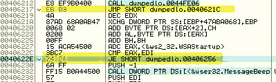

这些就是子进程中被修复的 `INT 3`。我们可以从 `Table 1` 中找到跳转的首字节，然后我们前往 `Table 2` 找对应的值，第二个字节是 `Table 3` 中的值减去 `1`。

如果你记住这一点，你将会看到对应于第一个 `INT 3` `Table 3` 中的值是 `0000004`，只取 `04` 然后减 `1`，所以变为 `03`，这就是第二个字节 `03`。

第二个 `INT 3`，`Table 3` 中对应值为 `00000027`，`27-1=26`，所以第二个字节是 `26`。

**修复 `INT 3` 的方法**：第一个字节到“INT 3 类型号对应的跳转类型表”中去找对应值，然后第二个字节到 `Table 3` 中去找对应值。我希望你看懂了这篇教程，因为在第二部分我们将打 patch 代码让它自动修复。

原著：Ricardo Narvaja  
翻译：FTBirthday  

译者注：  
一字一句翻译好累，还得理解，用准用好每一个词，希望对大家有帮助。

---

## 二、Copy-Mem II 加壳方式

### 实例解析五：牛壳 ARMADILLO 和 NANOMITES (补充部分)

本章讲的是对 `eSTOP SE 3.21` 的 patch 的改进。也会改进针对日志中长跳转的列表记录方式。

开始几步和第一部分教程类似，但是作如下补充：

```asm
0067A018    0FB6B9 90896700 MOVZX EDI, BYTE PTR DS:[ECX+678990]
```

这条指令将 `TABLE 4` 中的值赋给了 `EDI`。It shows the number of places it changes if it doesn't jump (FTBirthday：此句话理解不通，故保留原文，请读者自己斟酌)。

剩下的都一样，但是用和 `0FF` 以及 `-0FF` 的比较来代替结束它在日志中记录长跳转的值的过程。

对于短跳转的部分没有变化。

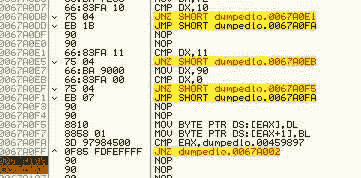

正如我们看到的：

```asm
0067A0FA    3D 97984500      CMP EAX, dumpedlo.00459897
```

这就是那个用来结束记录过程的比较。它和 `TABLE 1` 的最后一个值进行比较，最后一个 `INT 3` 的位置的最小值是 `1`。

你需要在 `67A105` 处下断点，在那儿截下那个过程。

再往下就是一个处理长跳转的新的过程。

首先，如果它跳转，就把跳转的位移值（这个值被放在 `EBX` 中）加到 `EAX` 中的地址值上去，然后进行比较，确定这个累加值是否在 `401000` `678000` 之间 (这是进程的地址空间)，如果超过了范围则退出这个长跳转的处理过程 (这种情况下说明不是一个长跳转)。

最后，它测试如果前面两个跳转都不跳其位移是否小于 `5`。对于长跳转这个条件不满足，所以当满足这个条件时也会退出这个长跳转的处理过程。

如果所有的条件都成立则是长跳转，那它就前往 `nop`。

这里我们设下几个 `BREAKPOINT CONDITIONAL LOG`，这将有助于记录长跳转的信息。

*   第一个是在 `67A12E`：这是个空的 `BREAKPOINT CONDITIONAL LOG` 用来判别不同的入口。
*   第二个是在 `67A12F`：它记录了存放在 `EAX` 中的长跳转的位置。
*   第三个是在 `67A130`：它记录了存放在 `EDX` 中的长跳转的类型。
*   第四个是在 `67A131`：它记录了存放在 `EBX` 中的长跳转将要跳往的地址。
*   最后一个是在 `67A132`：它记录了存放在 `EDI` 中的长跳转被调用的次数。

下图我们看到了修改 patch 之后在 `LOG` 中的结果。正如你看到的它修复了短跳转并显示了六个长跳转。

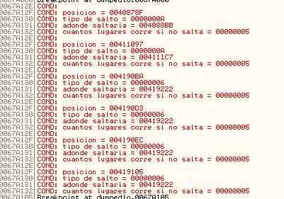

第一个就是我们手动修复的那个 `INT 3`: `40878F JNE 4088BB` (查看第一部分教程的那张表，从而判定属于 `0A` 的跳转类型是 `JNE`)。

以此类推：

*   `411097` 为 `jne 4111c7`
*   `4190BA` 为 `je 419222`
*   `4190d3` 为 `je 419222`
*   `4190ec` 为 `je 419222`
*   `419105` 为 `je 419222`

就是这么多了。

2003 年 5 月

原著：Ricardo Narvaja  
英文翻译：TeN$HiN  
中文翻译：FTBirthday  

译者注：  
本人才疏学浅，尽管一字一句翻译，加上自己的理解，尽量用准用好每一个词，难免有疏漏之处，敬请见谅。

`4dd466d0e1e0cc123afbe504da2462ca`
