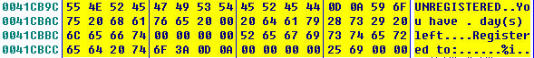

# `[Asprotect]`-Aston 1.92

> 原文：[`www.pediy.com/kssd/pediy08/pediy8-606.htm`](https://www.pediy.com/kssd/pediy08/pediy8-606.htm)

程序用`Asprotect`加密,有人提供了`key`,于是试了下有`key`与无`key`的脱壳,受益菲浅.

经过进一步的功能分析,发现功能部分还有暗桩:一个`CRC`验证,一个`key`解码及 1 处`Stolen code`.

*   软件名称： `Aston 1.92`
*   下载页面： `http://fzjd.hanzify.org/downfiles/Aston_192.zip`
*   软件大小： `3.53 MB`
*   软件语言： 英文
*   软件类别： 国外软件 / 特别版 / 系统模拟
*   应用平台： `Win2003`, `WinXp`, `Win2000`, `Nt`, `WinMe`, `Win9x`
*   推荐等级： \*\*\*\*\*
*   软件介绍： `Aston` 是一个容易使用、执行速度快的 Windows 外壳，他不需要高速的电脑硬件，执行起来也非常稳定，对于内存及系统资源的需求较少，让电脑系统能够有更好的性能表现。安装完后无需重新启动，只要注销一次即可更换你的桌面。

压缩包内附带`serial`信息。

`Version: ASProtect 1.35 build 04.25 Release [Extract]`

好几个程序都加了 `Asp` 壳,挑其中一个试试:`A-Master.exe`.

`A-Master.exe:`

### 1.未注册进行脱壳:

#### 1.1 Volx 脚本运行到 OEP:

```
00433154     55               push ebp
00433155     8BEC             mov ebp,esp
00433157     83C4 F4          add esp,-0C
0043315A     B8 24304300      mov eax,A-Master.00433024
0043315F     E8 ACDFFCFF      call A-Master.00401110
00433164     E8 27CAFDFF      call A-Master.0040FB90
00433169     E8 9EDEFCFF      call A-Master.0040100C
0043316E     8BC0             mov eax,eax
00433170     0000             add byte ptr ds:[eax],al
00433172     0000             add byte ptr ds:[eax],al
00433174     0000             add byte ptr ds:[eax],al
```

对比脚本发现:

`Aspr2.XX_IATfixer_v1.02.osc` // `F9` 后程序退出

`Asprotect 2.xx SKE OEP finder.txt` // `F9` 后程序正常启动

#### 1.2 CRC 验证

从 `OEP` 往下,第二个 `call` 进去后不久

```
00432D34     56               push esi
00432D35     53               push ebx
00432D36     E8 72000000      call A-Master.00432DAD
00432D3B     BE A64E4200      mov esi,A-Master.00424EA6
00432D40     037424 38        add esi,dword ptr ss:[esp+38]
00432D44     8D7424 04        lea esi,dword ptr ss:[esp+4]
00432D48     8D7426 F8        lea esi,dword ptr ds:[esi-8]
00432D4C     8B36             mov esi,dword ptr ds:[esi]
00432D4E     8DB40E 55E4FCFF  lea esi,dword ptr ds:[esi+ecx+FFFCE455]
00432D55     2BF1             sub esi,ecx
00432D57     8D5C11 17        lea ebx,dword ptr ds:[ecx+edx+17]
00432D5B     2BDA             sub ebx,edx
00432D5D     8B1E             mov ebx,dword ptr ds:[esi]
00432D5F     81E3 FF000000    and ebx,0FF
00432D65     BE 46504300      mov esi,A-Master.00435046
00432D6A     037424 38        add esi,dword ptr ss:[esp+38]
00432D6E     68 F2402834      push 342840F2
00432D73     8D7447 29        lea esi,dword ptr ds:[edi+eax*2+29]
00432D77     8D740E D7        lea esi,dword ptr ds:[esi+ecx-29]
00432D7B     2BF1             sub esi,ecx
00432D7D     5E               pop esi
00432D7E     8D9C0B 26BED7CB  lea ebx,dword ptr ds:[ebx+ecx+CBD7BE26]
00432D85     2BD9             sub ebx,ecx
00432D87     03DE             add ebx,esi
00432D89     0BDB             or ebx,ebx
00432D8B     0F84 24000000    je A-Master.00432DB5         ; CRC,jmp 00432DB5
00432D91     8D6C75 F3        lea ebp,dword ptr ss:[ebp+esi*2-D]
00432D95     8D740B 5A        lea esi,dword ptr ds:[ebx+ecx+5A]
00432D99     2BF1             sub esi,ecx
00432D9B     C1CF B7          ror edi,0B7
00432D9E     C1CF D3          ror edi,0D3
00432DA1     64:FF35 00000000 push dword ptr fs:[0]
00432DA8     E9 08000000      jmp A-Master.00432DB5
00432DAD     337424 08        xor esi,dword ptr ss:[esp+8]
00432DB1     C1D6 6D          rcl esi,6D
00432DB4     C3               retn
00432DB5     5B               pop ebx
00432DB6     5E               pop esi
00432DB7     E9 88000000      jmp A-Master.00432E44
```

#### 1.3 异常

步过 `00432E6F call A-Master.004328D8` 发生异常,地址 `00000000` 不易读取:

跟进后来到:

```
00432AAB     B8 482B4300      mov eax,A-Master.00432B48       ; ASCII "ColorClass"
00432AB0     8946 24          mov dword ptr ds:[esi+24],eax
00432AB3     56               push esi
00432AB4     E8 87EAFCFF      call <jmp.&user32.RegisterClassA>
00432AB9     66:85C0          test ax,ax
00432ABC     74 40            je short A-Master.00432AFE
00432ABE     E9 10000000      jmp A-Master.00432AD3            ; jmp 00432AFC
00432AC3   ^ 7C 97            jl short A-Master.00432A5C
00432AC5     E4 08            in al,8
00432AC7     33EE            xor ebp,esi
00432AC9     2E:0921          or dword ptr cs:[ecx],esp
00432ACC   - E9 A1B36FAA      jmp AAB2DE72
00432AD1     90              nop
00432AD2     90              nop
00432AD3     A1 68604300      mov eax,dword ptr ds:[436068]
00432AD8     8B00             mov eax,dword ptr ds:[eax]
00432ADA     50               push eax
00432ADB     A1 545A4300      mov eax,dword ptr ds:[435A54]
00432AE0     8B00             mov eax,dword ptr ds:[eax]
00432AE2     50               push eax
00432AE3     E8 30E7FCFF      call <jmp.&kernel32.GetProcAddress>
00432AE8     FFD0             call eax                     ; 这里 eax=0,异常
00432AEA     8B15 E05F4300    mov edx,dword ptr ds:[435FE0]  ; A-Master.004484D0
00432AF0     8902             mov dword ptr ds:[edx],eax
00432AF2     A1 E05F4300      mov eax,dword ptr ds:[435FE0]
00432AF7     8338 00          cmp dword ptr ds:[eax],0
00432AFA     74 02            je short A-Master.00432AFE
00432AFC     B3 01            mov bl,1
00432AFE     8BC3             mov eax,ebx
00432B00     5F               pop edi
00432B01     5E               pop esi
00432B02     5B               pop ebx
00432B03     C3               retn
```

跟踪发现原程序从 `00432AD3` 到 `00432AFA`,堆栈没有变化,寄存器只有 `eax` 与 `edx` 有变化,就是 `ds:[435FE0]`保存的地址=`004484D0`;整个过程对 `ds:[004484D0]`进行赋值并比较是否为 `0`,原程序在 `00432AFA` 跳转未实现.

而 `eax` 在 `00432AFE` 马上被 `ebx` 填充,跟踪 `edx`,发现在下面这行代码处被枪毙:

```
00432F8B     E8 F0A0FEFF      call A-Master.0041D080       ; 跟进
0041D08B     33D2             xor edx,edx                ; A-Master.004484D0
```

因此可以说,这一段从 `00432AD3` 到 `00432AFA` 无用处,于是修改 `00432ABE` 为:

```
00432ABE     E9 10000000      jmp A-Master.00432AD3        ; jmp 00432AFC
```

或者可以修改 `00432AD3` 为:

```
00432AD3     B8 01000000      mov eax,1D                  ; 原程序为 1D,保留
00432AD8     EB 10            jmp short A-Master.00432AEA
```

#### 1.4 Stolen code 1:

修改了上面 2 次,`F9`,异常,`0148042B` 不易读取:

```
0043009B     E8 3014FDFF      call <jmp.&user32.InvalidateRect>
004300A0   - E9 86030501      jmp 0148042B
```

跟踪原程序得到 code:

```
0043009B     E8 3014FDFF      call <jmp.&user32.InvalidateRect>
004300A0     8BC3             mov eax,ebx
004300A2     5B               pop ebx
004300A3     8BE5             mov esp,ebp
004300A5     5D               pop ebp
004300A6     C2 1000          retn 10
```

#### 1.5 程序退出:自校验?

`F9`,程序退出,从 `00432E6F` 往下继续跟踪:

```
00432F9A     A1 105D4300      mov eax,dword ptr ds:[435D10]
00432F9F     8038 00          cmp byte ptr ds:[eax],0
00432FA2     75 16            jnz short A-Master.00432FBA  ; 跳转实现,over
```

对 `ds:[435D10]`下硬件访问断点,重新加载:

第一次写入 `0`:

```
00432C75     A1 105D4300      mov eax,dword ptr ds:[435D10]
00432C7A     C600 00          mov byte ptr ds:[eax],0
```

第二次写入 `1`:

```
00432E44     E8 BFF9FCFF      call A-Master.00402808       ; 需要修改赋值
00432E49     84C0             test al,al
00432E4B     74 07            je short A-Master.00432E54   ; 或者修改这里
00432E4D     E8 F645FDFF      call A-Master.00407448
00432E52     EB 11            jmp short A-Master.00432E65  ; 要在这里跳转
00432E54     833E 00          cmp dword ptr ds:[esi],0
00432E57     74 04            je short A-Master.00432E5D
00432E59     33C0             xor eax,eax
00432E5B     8906             mov dword ptr ds:[esi],eax
00432E5D     A1 105D4300      mov eax,dword ptr ds:[435D10]
```


### 1.6 Stolen code 2

若要避开 `1` 的赋值，溯源，需要修改 `00432E4B` 的跳转，或者修改 `00432E44` 的 `call` 里面的值。

跟进: `00432E44 E8 BFF9FCFF call A-Master.00402808`

```
00432E62     C600 01           mov byte ptr ds:[eax],1          

00432E65     E8 1A3BFDFF      call A-Master.00406984  

00432E6A     E8 919FFEFF      call A-Master.0041CE00  

00432E6F     E8 64FAFFFF      call A-Master.004328D8  

00432E74     84C0             test al,al  

00432E76     0F84 48010000    je A-Master.00432FC4  
```

```
00402867     /0F85 31000000   jnz A-Master.0040289E           ; 这个 nop 掉  

0040286D     |035424 38        add edx,dword ptr ss:[esp+38]  

00402871     |BA F6CA4800      mov edx,A-Master.0048CAF6  

00402876     |33D2             xor edx,edx  

00402878     |8D4447 69        lea eax,dword ptr ds:[edi+eax*2+69]  

0040287C     |8D4408 97        lea eax,dword ptr ds:[eax+ecx-69]  

00402880     |2BC1             sub eax,ecx  

00402882     |2BC0             sub eax,eax  

00402884     |B8 B6C64600      mov eax,A-Master.0046C6B6  

00402889     |B8 6E584600      mov eax,A-Master.0046586E  

0040288E     |8D4422 52        lea eax,dword ptr ds:[edx+52]  

00402892     |8D4408 AE        lea eax,dword ptr ds:[eax+ecx-52]  

00402896     |2BC1             sub eax,ecx  

00402898     |40                inc eax                       ; 赋值的不同  

00402899     |E9 15000000       jmp A-Master.004028B3 

0040289E     \81C8 3A21A872     or eax,72A8213A  

004028A4      33C0              xor eax,eax                   ; 赋值的不同  

004028A6      E9 08000000       jmp A-Master.004028B3  

004028AB      83C9 43            or ecx,43  

004028AE      034C24 38          add ecx,dword ptr ss:[esp+38]  

004028B2      C3                 retn  

004028B3      5A                 pop edx  

004028B4      59                 pop ecx  

004028B5      EB 61              jmp short A-Master.00402918  
```

异常，`01480000` 不易读取：

```
0042FF61     /E9 01000000       jmp A-Master.0042FF67  

0042FF66     |90                nop  

0042FF67   -\E9 94000501       jmp 01480000  
```

跟踪原程序：

```
0042FF67      6A 00             push 0  

0042FF69      6A 00             push 0  

0042FF6B      6A 02             push 2  

0042FF6D      6A 00             push 0  

0042FF6F      6A 00             push 0  

0042FF71      6A 01             push 1  

0042FF73      6A 00             push 0  

0042FF75      6A 00             push 0  

0042FF77      6A 00             push 0  

0042FF79      68 BC020000      push 2BC  

0042FF7E      6A 00             push 0  

0042FF80      6A 00             push 0  

0042FF82      6A 06             push 6  

0042FF84      6A 0F             push 0F  

0042FF86      E8 4D13FDFF      call <jmp.&gdi32.CreateFontA>  

0042FF8B      8B15 585C4300    mov edx,dword ptr ds:[435C58]     ; A-Master.00448598  

0042FF91      8902              mov dword ptr ds:[edx],eax  

0042FF93      8D45 FC           lea eax,dword ptr ss:[ebp-4]  

0042FF96      50                push eax  

0042FF97      6A 04             push 4  

0042FF99      6A 00             push 0  

0042FF9B      68 E0C14100      push A-Master.0041C1E0  

0042FFA0      6A 00             push 0  

0042FFA2      6A 00             push 0  

0042FFA4      E8 0712FDFF      call <jmp.&kernel32.CreateThread>  

0042FFA9      8B15 6C5E4300    mov edx,dword ptr ds:[435E6C]     ; A-Master.00445A80  

0042FFAF      8902              mov dword ptr ds:[edx],eax  

0042FFB1      A1 4C5B4300      mov eax,dword ptr ds:[435B4C]    

0042FFB6      C600 01          mov byte ptr ds:[eax],1  

0042FFB9      68 CA000000      push 0CA  

0042FFBE      68 20010000      push 120  

0042FFC3      6A 05             push 5  

0042FFC5      6A 00             push 0  

0042FFC7      8D45 EC           lea eax,dword ptr ss:[ebp-14]  

0042FFCA      50                push eax  

0042FFCB      E8 C815FDFF      call <jmp.&user32.SetRect>  

0042FFD0      8D45 EC           lea eax,dword ptr ss:[ebp-14]  

0042FFD3      50                push eax  

0042FFD4      8B45 08          mov eax,dword ptr ss:[ebp+8]  

0042FFD7      50                push eax  

0042FFD8      E8 2B15FDFF      call <jmp.&user32.MapDialogRect>  

0042FFDD      6A 00             push 0  

0042FFDF      A1 08704300      mov eax,dword ptr ds:[437008]  

0042FFE4      50                push eax  

0042FFE5      6A 00             push 0  

0042FFE7      8B45 08          mov eax,dword ptr ss:[ebp+8]  

0042FFEA      50                push eax  

0042FFEB      8B45 F8          mov eax,dword ptr ss:[ebp-8]  

0042FFEE      50                push eax  

0042FFEF      8B45 F4          mov eax,dword ptr ss:[ebp-C]  

0042FFF2      50                push eax  

0042FFF3      8B45 F0          mov eax,dword ptr ss:[ebp-10]  

0042FFF6      50                push eax  

0042FFF7      8B45 EC          mov eax,dword ptr ss:[ebp-14]  

0042FFFA      50                push eax  

0042FFFB      68 00000040      push 40000000  

00430000      A1 F85E4300      mov eax,dword ptr ds:[435EF8]  

00430005      8B00              mov eax,dword ptr ds:[eax]  

00430007      50                push eax  

00430008      A1 F85E4300      mov eax,dword ptr ds:[435EF8]  

0043000D      8B00              mov eax,dword ptr ds:[eax]  

0043000F      50                push eax  

00430010      68 00020000      push 200  

00430015      E8 8613FDFF      call <jmp.&user32.CreateWindowExA>  

0043001A      8B15 44604300    mov edx,dword ptr ds:[436044]     ; A-Master.00448588  

00430020      8902              mov dword ptr ds:[edx],eax  

00430022      8D45 EC           lea eax,dword ptr ss:[ebp-14]  

00430025      50                push eax  

00430026      A1 44604300      mov eax,dword ptr ds:[436044]  

0043002B      8B00              mov eax,dword ptr ds:[eax]  

0043002D      50                push eax  

0043002E      E8 0D14FDFF      call <jmp.&user32.GetClientRect>  

00430033      8B55 F8          mov edx,dword ptr ss:[ebp-8]  

00430036      8B45 F4          mov eax,dword ptr ss:[ebp-C]  

00430039      E8 9ECBFEFF      call A-Master.0041CBDC  

0043003E      A1 6C5E4300      mov eax,dword ptr ds:[435E6C]  

00430043      8B00              mov eax,dword ptr ds:[eax]  

00430045      50                push eax  

00430046      E8 0512FDFF      call <jmp.&kernel32.ResumeThread>  

0043004B      6A 05             push 5  

0043004D      A1 44604300      mov eax,dword ptr ds:[436044]  

00430052      8B00              mov eax,dword ptr ds:[eax]  

00430054      50                push eax  

00430055      E8 9615FDFF      call <jmp.&user32.ShowWindow>  

0043005A      A1 44604300      mov eax,dword ptr ds:[436044]  

0043005F      8B00              mov eax,dword ptr ds:[eax]  

00430061      50                push eax  

00430062      E8 B915FDFF      call <jmp.&user32.UpdateWindow>  

00430067      EB 37              jmp short A-Master.004300A0  
```

`6A 00 6A 00 6A 02 6A 00 6A 00 6A 01 6A 00 6A 00 6A 00 68 BC 02 00 00 6A 00 6A 00 6A 06 6A 0F E8`
`4D 13 FD FF 8B 15 58 5C 43 00 89 02 8D 45 FC 50 6A 04 6A 00 68 E0 C1 41 00 6A 00 6A 00 E8 07 12`
`FD FF 8B 15 6C 5E 43 00 89 02 A1 4C 5B 43 00 C6 00 01 68 CA 00 00 00 68 20 01 00 00 6A 05 6A 00`
`8D 45 EC 50 E8 C8 15 FD FF 8D 45 EC 50 8B 45 08 50 E8 2B 15 FD FF 6A 00 A1 08 70 43 00 50 6A 00`
`8B 45 08 50 8B 45 F8 50 8B 45 F4 50 8B 45 F0 50 8B 45 EC 50 68 00 00 00 40 A1 F8 5E 43 00 8B 00`
`50 A1 F8 5E 43 00 8B 00 50 68 00 02 00 00 E8 86 13 FD FF 8B 15 44 60 43 00 89 02 8D 45 EC 50 A1`
`44 60 43 00 8B 00 50 E8 0D 14 FD FF 8B 55 F8 8B 45 F4 E8 9E CB FE FF A1 6C 5E 43 00 8B 00 50 E8`
`05 12 FD FF 6A 05 A1 44 60 43 00 8B 00 50 E8 96 15 FD FF A1 44 60 43 00 8B 00 50 E8 B9 15 FD FF`
`EB 37`

`Ctrl+B` 搜索 `E9 ?? ?? 05 01`，只搜索到 2 处：

```
004300A0   - E9 86030501       jmp 0148042B  

0042FF67   -\E9 94000501       jmp 01480000  
```

因此应该没有 Stolen code 了。

然后程序可以启动进入了。

### 1.7 About 注册标志

`Alt+M` 搜索：`UNREGISTERED:`




## 1. 对 `0041CB9C` 下硬件访问断点

```
77E7DF8D     F2:AE              repne scas byte ptr es:[edi]
```

**返回:**

```
0041CA17     E8 6C48FEFF       call <jmp.&kernel32.lstrcat>
0041CA1C     A1 E05F4300       mov eax,dword ptr ds:[435FE0]
```

**往上找:**

```
0041C8A3     BD 9CCB4100       mov ebp,A-Master.0041CB9C        ; ASCII "UNREGISTERED You have "
0041C8A8     B8 B4CB4100       mov eax,A-Master.0041CBB4         ; ASCII " day(s) left"
0041C8AD     890424           mov dword ptr ss:[esp],eax
0041C8B0     B8 C4CB4100       mov eax,A-Master.0041CBC4         ; ASCII "Registered to:"
```

**重新加载,F4 到 `0041C8A3` ,F8 步进跟踪:**

```
0041C9E9     A1 785C4300       mov eax,dword ptr ds:[435C78]     ; ds:[435C78]=004343B0

004343B0  00402DB0  ASCII "A S T O N   1.9.2 Shell &...    // About 的提示信息

0041CA1C     A1 E05F4300       mov eax,dword ptr ds:[435FE0]      ; ds:[00435FE0]=004484D0

004484D0  00000000                              // 剩余的试用时间
```

**然后来到:**

```
0041CA41     E8 4248FEFF       call <jmp.&kernel32.lstrcat>
0041CA46    /E9 A1000000       jmp A-Master.0041CAEC             ; 这里跳过一大段代码,估计需要 key 解密
0041CA4B    |EE                out dx,al
0041CA4C    |97                xchg eax,edi
0041CA4D    |E4 08             in al,8
0041CA4F    |33EE             xor ebp,esi
0041CA51    |100CD4           adc byte ptr ss:[esp+edx*8],cl
0041CA54    |53                push ebx
0041CA55    |1E                push ds
0041CA56    |93                xchg eax,ebx
0041CA57    |CA 8162          retf 6281
0041CA5A    |6D                ins dword ptr es:[edi],dx
0041CA5B    |2F                das
0041CA5C   -|E9 2BC81274       jmp 7454928C
0041CA61    |14 10             adc al,10
0041CA63    |58                pop eax
0041CA64    |44                inc esp
0041CA65    |46                inc esi
0041CA66    |55                push ebp
0041CA67    |5D                pop ebp
0041CA68    |3940 BE          cmp dword ptr ds:[eax-42],eax
0041CA6B    |1F                pop ds
0041CA6C    |E5 88             in eax,88
0041CA6E    |AA                stos byte ptr es:[edi]
0041CA6F    |3012              xor byte ptr ds:[edx],dl
0041CA71    |71 0F             jno short A-Master.0041CA82
0041CA73    |0A97 90D1251B     or dl,byte ptr ds:[edi+1B25D190]
0041CA79    |9D                popfd
0041CA7A    |05 DEC742E0      add eax,E042C7DE
0041CA7F    |D7                xlat byte ptr ds:[ebx+al]
0041CA80    |6F                outs dx,dword ptr es:[edi]
0041CA81    |EF                out dx,eax
0041CA82   ^|76 F6            jbe short A-Master.0041CA7A
0041CA84    |B5 16             mov ch,16
0041CA86    |ED                in eax,dx
0041CA87    |53                push ebx
0041CA88    |E6 50             out 50,al
0041CA8A    |07                pop es
0041CA8B    |84B8 F123B239     test byte ptr ds:[eax+39B223F1],bh
0041CA91    |06                push es
0041CA92    |8B8F E25A4F7D     mov ecx,dword ptr ds:[edi+7D4F5AE2]
0041CA98    |4B                dec ebx
0041CA99    |C6                ???                             ; 未知命令
0041CA9A    |F2:               prefix repne:
0041CA9B    |B0 C2             mov al,0C2
0041CA9D    |E5 7F             in eax,7F
0041CA9F    |34 40             xor al,40
0041CAA1    |E5 D3             in eax,0D3
0041CAA3    |286D 3C          sub byte ptr ss:[ebp+3C],ch
0041CAA6    |DAB4F4 EC536C4A  fidiv dword ptr ss:[esp+esi*8+4A6C53EC]
0041CAAD    |F4                hlt
0041CAAE    |A9 C470889A       test eax,9A8870C4
0041CAB3    |F5                cmc
0041CAB4    |56                push esi
0041CAB5    |2E:D6             salc
0041CAB7    |04 19             add al,19
0041CAB9    |24 2F             and al,2F
0041CABB    |3D EECAEDAD       cmp eax,ADEDCAEE
0041CAC0    |5C                pop esp
0041CAC1    |43                inc ebx
0041CAC2    |45                inc ebp
0041CAC3    |21EE              and esi,ebp
0041CAC5    |84DE              test dh,bl
0041CAC7    |DACA              fcmove st,st(2)
0041CAC9    |30CD              xor ch,cl
0041CACB    |41                inc ecx
0041CACC    |A4                movs byte ptr es:[edi],byte ptr ds:[esi]
0041CACD    |8F                ???                             ; 未知命令
0041CACE    |BA BD759301       mov edx,19375BD
0041CAD3    |8DCF              lea ecx,edi                     ; 非法使用寄存器
0041CAD5    |63DF              arpl di,bx
0041CAD7    |BA 0E62AC0A       mov edx,0AAC620E
0041CADC    |0010              add byte ptr ds:[eax],dl
0041CADE    |75 6A             jnz short A-Master.0041CB4A
0041CAE0    |5C                pop esp
0041CAE1    |1E                push ds
0041CAE2    |B5 68             mov ch,68
0041CAE4    |CB                retf
0041CAE5    |A6                cmps byte ptr ds:[esi],byte ptr es:[edi]
0041CAE6    |6B4D 38 52        imul ecx,dword ptr ss:[ebp+38],52
0041CAEA    |8832              mov byte ptr ds:[edx],dh
0041CAEC    \\68 110C0000      push 0C11
0041CAF1     8D4424 18          lea eax,dword ptr ss:[esp+18]
```

## 2. 注册后再进行脱壳

注册软件,`OD` 重新加载,`IAT` 修复脚本运行到 `OEP`,`dump＆refix`。

### 2.1 修复 CRC 验证

```
00432D8B    /0F84 24000000     je A-Master.00432DB5   ; 改 jmp
```

### 2.2 `Ctrl+G:00432ABE`

发现注册后就是不一样,这里变了,不用修复:

```
00432ABE    /E9 01000000       jmp A-Master.00432AC4        ; 变了
00432AC3    |58                pop eax
00432AC4    \\E9 00000000      jmp A-Master.00432AC9
00432AC9     B3 01            mov bl,1
00432ACB     EB 31            jmp short A-Master.00432AFE   ; 目的地一样
```

### 2.3 恢复 2 处 `Stolen code`

```
0043009B     E8 3014FDFF       call <jmp.&user32.InvalidateRect>
004300A0   - E9 86030501       jmp 0148042B
0042FF61    /E9 01000000       jmp A-Master.0042FF67
0042FF66    |90                nop
0042FF67   -\\E9 94000501      jmp 01480000
```

### 2.4 解决程序退出:自校验?

```
00402867    /0F85 31000000     jnz A-Master.0040289E           ; 这个 nop 掉
```

### 2.5 注册标志:`Ctrl+G:0041CA46` ,呵呵,全部出来了:

```
0041CA46    /E9 01000000       jmp A-Master.0041CA4C
0041CA4B    |90                nop
0041CA4C    \\E9 00000000      jmp A-Master.0041CA51
0041CA51     8D041E            lea eax,dword ptr ds:[esi+ebx]
0041CA54     8B5424 04         mov edx,dword ptr ss:[esp+4]
0041CA58     E8 8F4EFEFF       call A-Master.004018EC           ; jmp to starter.strcopy
0041CA5D     A1 885F4300       mov eax,dword ptr ds:[435F88]
0041CA62     8B00              mov eax,dword ptr ds:[eax]
0041CA64     50                push eax
0041CA65     E8 3E48FEFF       call A-Master.004012A8           ; jmp to kernel32.lstrlenA
0041CA6A     83C0 03           add eax,3
0041CA6D     50                push eax
0041CA6E     E8 614EFEFF       call A-Master.004018D4           ; jmp to starter.Amalloc
0041CA73     8BE8              mov ebp,eax
0041CA75     8B15 885F4300     mov edx,dword ptr ds:[435F88]    ; A-Master.00447384
0041CA7B     8B12              mov edx,dword ptr ds:[edx]
0041CA7D     8BC5              mov eax,ebp
0041CA7F     E8 684EFEFF       call A-Master.004018EC           ; jmp to starter.strcopy
0041CA84     B3 01             mov bl,1
0041CA86     A1 885F4300       mov eax,dword ptr ds:[435F88]
0041CA8B     8B00              mov eax,dword ptr ds:[eax]
0041CA8D     50                push eax
0041CA8E     E8 1548FEFF       call A-Master.004012A8           ; jmp to kernel32.lstrlenA
0041CA93     48                dec eax
0041CA94     83F8 00           cmp eax,0
0041CA97     7C 22             jl short A-Master.0041CABB
0041CA99     8B15 885F4300     mov edx,dword ptr ds:[435F88]    ; A-Master.00447384
0041CA9F     8B12              mov edx,dword ptr ds:[edx]
```


# 逆向分析笔记

## 1. 代码段与逻辑分析

### 1.1 循环与比较逻辑
```
0041CAA1     803C02 2C          cmp byte ptr ds:[edx+eax],2C  

0041CAA5     75 0E              jnz short A-Master.0041CAB5  

0041CAA7     8B15 885F4300      mov edx,dword ptr ds:[435F88]         ; A-Master.00447384  

0041CAAD     8B12               mov edx,dword ptr ds:[edx]  

0041CAAF     C60402 00          mov byte ptr ds:[edx+eax],0  

0041CAB3     33DB               xor ebx,ebx  

0041CAB5     48                 dec eax  

0041CAB6     83F8 FF            cmp eax,-1  

0041CAB9     75 DE              jnz short A-Master.0041CA99  

0041CABB     84DB               test bl,bl  

0041CABD     75 10              jnz short A-Master.0041CACF  

0041CABF     A1 885F4300        mov eax,dword ptr ds:[435F88]  

0041CAC4     8B00               mov eax,dword ptr ds:[eax]  

0041CAC6     50                 push eax  

0041CAC7     56                 push esi  

0041CAC8     E8 BB47FEFF        call A-Master.00401288                ; jmp to kernel32.lstrcatA  

0041CACD     EB 11              jmp short A-Master.0041CAE0  

0041CACF     55                 push ebp  

0041CAD0     E8 074EFEFF        call A-Master.004018DC                ; jmp to starter.Afree  

0041CAD5     8B4424 04          mov eax,dword ptr ss:[esp+4]  

0041CAD9     50                 push eax  

0041CADA     55                 push ebp  

0041CADB     E8 C047FEFF        call A-Master.004012A0                ; jmp to kernel32.lstrcpyA  

0041CAE0     55                 push ebp  

0041CAE1     E8 F64DFEFF        call A-Master.004018DC                ; jmp to starter.Afree  

0041CAE6     EB 04              jmp short A-Master.0041CAEC  

0041CAE8     32E2               xor ah,dl  

0041CAEA     27                 daa  

0041CAEB     47                 inc edi  

0041CAEC     68 110C0000        push 0C11  

0041CAF1     8D4424 18          lea eax,dword ptr ss:[esp+18]  
```

### 1.2 注册用户名地址定位

`0041CA5D`处：
```
0041CA5D     A1 885F4300        mov eax,dword ptr ds:[435F88]    // 这里就是  
```
地址 `ds:[00435F88]` 的值为 `00447384`。

### 1.3 写入注册用户名

内存地址 `00433FD0` 处数据：
```
00433FD0  63 79 74 6F 00 00 00 00  cyto....  
```

修改 `00447384` 处的指针：
```
00447384  00D92DCC                    // 修改前  
00447384  00433FD0  ASCII "cyto"     // 修改后  
```

### 1.4 分隔符逻辑追踪

运行发现问题，从 `0041CA5D` 继续跟踪，发现注册标志需要用 `2C`（即逗号 `,`）隔开。

相关代码段：
```
0041CA99     8B15 885F4300      mov edx,dword ptr ds:[435F88]         ; A-Master.00447384  

0041CA9F     8B12               mov edx,dword ptr ds:[edx]  

0041CAA1     803C02 2C          cmp byte ptr ds:[edx+eax],2C  

0041CAA5     75 0E              jnz short A-Master.0041CAB5  

0041CAA7     8B15 885F4300      mov edx,dword ptr ds:[435F88]         ; A-Master.00447384  

0041CAAD     8B12               mov edx,dword ptr ds:[edx]  

0041CAAF     C60402 00          mov byte ptr ds:[edx+eax],0  

0041CAB3     33DB               xor ebx,ebx  

0041CAB5     48                 dec eax  

0041CAB6     83F8 FF            cmp eax,-1  

0041CAB9     75 DE              jnz short A-Master.0041CA99  
```

### 1.5 追加用户名数据

在 `00433FD0` 后面追加数据：
```
00433FD0  63 79 74 6F 2C 77 77 77 2E 70 65 64 69 79 2E 63  cyto,www.pediy.c  
00433FE0  6F 6D 00 00 00 00 00 00 00 00 00 00 00 00 00 00  om..............  
```

结果：运行成功，提示 `Registered to : cyto`。

## 2. 善后处理与功能实现

### 2.1 另一处 Key 解码位置

载入无 Key 的脱壳文件，搜索 `E9 ?? 00 00 00`，寻找需要 Key 解码的地方。

只搜索到另一处：
```
004301D7    /E9 10000000         jmp A-Master.004301EC  

004301DC    |64:97               xchg eax,edi  

004301DE    |E4 08               in al,8  

004301E0    |33EE               xor ebp,esi  

004301E2    |6244EE DC          bound eax,qword ptr ds:[esi+ebp*8-24]  

004301E6    |A1 B3AC9548        mov eax,dword ptr ds:[4895ACB3]  

004301EB    |90                 nop  

004301EC    \\6A 60              push 60  

004301EE     8D4424 0C          lea eax,dword ptr ss:[esp+C]  

004301F2     50                 push eax  

004301F3     E8 DC18FDFF        call <jmp.&ntdll.RtlZeroMemory>  
```

有 Key 解码后：
```
004301D7    /E9 01000000         jmp A-Master.004301DD  

004301DC    |40                 inc eax  

004301DD    \\E9 00000000         jmp A-Master.004301E2  

004301E2     FF4C24 04          dec dword ptr ss:[esp+4]  

004301E6    /EB 04              jmp short A-Master.004301EC  

004301E8    |62FC               bound edi,esp                     ; 非法使用寄存器  

004301EA    |A5                 movs dword ptr es:[edi],dword ptr ds:[>  

004301EB    |90                 nop  

004301EC    \\6A 60              push 60  

004301EE     8D4424 0C          lea eax,dword ptr ss:[esp+C]  

004301F2     50                 push eax  

004301F3     E8 DC18FDFF        call <jmp.&ntdll.RtlZeroMemory>  
```

### 2.2 第二处 CRC 验证

OD 载入程序，启动后不忽略内存异常，功能菜单 `Desktop`，随便选择桌面的某个项目，点击 `Properties`，触发异常：
```
0040C94C     8B06               mov eax,dword ptr ds:[esi]    ; 停在此  
```

往上找到 CRC 验证处：
```
0040C818     E8 7F000000        call c.0040C89C  

0040C81D     BE 46BA4500        mov esi,c.0045BA46  

0040C822     BE FEFA4000        mov esi,c.0040FAFE  

0040C827     8D7424 10          lea esi,dword ptr ss:[esp+10]  

0040C82B     8D7426 EC          lea esi,dword ptr ds:[esi-14]  

0040C82F     8B36               mov esi,dword ptr ds:[esi]  

0040C831     8DB40E E348FFFF     lea esi,dword ptr ds:[esi+ecx+FFFF48E3>  

0040C838     2BF1               sub esi,ecx  

0040C83A     2BD9               sub ebx,ecx  

0040C83C     FF36               push dword ptr ds:[esi]  

0040C83E     BB BE724700        mov ebx,c.004772BE  

0040C843     C1C3 FB            rol ebx,0FB  

0040C846     5B                 pop ebx  

0040C847     81E3 FF000000      and ebx,0FF  

0040C84D     83EE 1D            sub esi,1D  

0040C850     337424 08          xor esi,dword ptr ss:[esp+8]  

0040C854     C1CE 11            ror esi,11  

0040C857     BE 1A2F4700        mov esi,c.00472F1A  

0040C85C     81EE 5ED466AA      sub esi,AA66D45E  

0040C862     8DB408 A132535A     lea esi,dword ptr ds:[eax+ecx+5A5332A1>  

0040C869     2BF1               sub esi,ecx  

0040C86B     2BF0               sub esi,eax  

0040C86D     8D9C0B 77CCACA5     lea ebx,dword ptr ds:[ebx+ecx+A5ACCC77>  

0040C874     2BD9               sub ebx,ecx  

0040C876     03DE               add ebx,esi  

0040C878     0BDB               or ebx,ebx  

0040C87A     0F84 26000000      je c.0040C8A6                     ; 就是这里,jmp  
```

### 2.3 Stolen Code 3

使用 `Ctrl+B` 搜索 `E9 ?? ?? ?? 01`，发现还有一处：
```
00422D6A    /E9 01000000         jmp A-Master.00422D70  

00422D6F    |90                 nop  

00422D70   -\\E9 8BD20401         jmp 01470000                  // 到壳里  
```

这个在程序启动过程中没能断下，应该是功能上的。点击所有功能，发现点击 `plug-ins` 菜单的 `setup plug-in` 功能按钮时断下。继续跟踪原程序获得代码：

```
00422D6A    /E9 01000000         jmp c.00422D70  

00422D6F    |90                 nop  

00422D70    \\54                 push esp  

00422D71     A1 285F4300          mov eax,dword ptr ds:[435F28]  

00422D76     50                 push eax  

00422D77     E8 10ECFDFF         call <jmp.&starter.OpenCFGr>  

00422D7C     54                 push esp  

00422D7D     6A 00              push 0  

00422D7F     A1 44624300         mov eax,dword ptr ds:[436244]  

00422D84     8B00               mov eax,dword ptr ds:[eax]  

00422D86     50                 push eax  

00422D87     E8 10ECFDFF         call <jmp.&starter.FindSection>  

00422D8C     54                 push esp  

00422D8D     6A 00              push 0  

00422D8F     A1 445D4300         mov eax,dword ptr ds:[435D44]  

00422D94     8B00               mov eax,dword ptr ds:[eax]  

00422D96     50                 push eax  

00422D97     E8 20ECFDFF         call <jmp.&starter.GetCFGBool>  

00422D9C     8B15 B45B4300      mov edx,dword ptr ds:[435BB4]           ; c.00437574  

00422DA2     8942 1C             mov dword ptr ds:[edx+1C],eax  

00422DA5     54                 push esp  

00422DA6     E8 E9EBFDFF         call <jmp.&starter.CloseCFGr>  

00422DAB     A1 A8594300         mov eax,dword ptr ds:[4359A8]  

00422DB0     33D2               xor edx,edx  

00422DB2     8910               mov dword ptr ds:[eax],edx  

00422DB4     C605 E4854400 00    mov byte ptr ds:[4485E4],0  

00422DBB     A1 445A4300         mov eax,dword ptr ds:[435A44]  
```


```
00422DC0     33D2              xor edx,edx  
00422DC2     8910              mov dword ptr ds:[eax],edx  
00422DC4     A1 BC5F4300       mov eax,dword ptr ds:[435FBC]  
00422DC9     50                push eax  
00422DCA     A1 845D4300       mov eax,dword ptr ds:[435D84]  
00422DCF     50                push eax  
00422DD0     E8 A7EBFDFF       call <jmp.&starter.OpenCFGw>           ; here  
00422DD5     A1 BC5F4300       mov eax,dword ptr ds:[435FBC]  
00422DDA     8B40 10           mov eax,dword ptr ds:[eax+10]  
00422DDD     8B15 00614300     mov edx,dword ptr ds:[436100]          ; c.00445E04  
00422DE3     8902              mov dword ptr ds:[edx],eax  
00422DE5     A1 00614300       mov eax,dword ptr ds:[436100]  
00422DEA     8B00              mov eax,dword ptr ds:[eax]  
00422DEC     50                push eax  
00422DED     E8 E2EAFDFF       call <jmp.&starter.Amalloc>  
00422DF2     8B15 105F4300     mov edx,dword ptr ds:[435F10]          ; c.00445DFC  
00422DF8     8902              mov dword ptr ds:[edx],eax  
00422DFA     A1 00614300       mov eax,dword ptr ds:[436100]  
00422DFF     8B00              mov eax,dword ptr ds:[eax]  
00422E01     50                push eax  
00422E02     A1 BC5F4300       mov eax,dword ptr ds:[435FBC]  
00422E07     8B40 08           mov eax,dword ptr ds:[eax+8]  
00422E0A     50                push eax  
00422E0B     A1 105F4300       mov eax,dword ptr ds:[435F10]  
00422E10     8B00              mov eax,dword ptr ds:[eax]  
00422E12     50                push eax  
00422E13     E8 CCECFDFF       call <jmp.&ntdll.RtlMoveMemory>  
00422E18     A1 D85A4300       mov eax,dword ptr ds:[435AD8]  
00422E1D     C600 00           mov byte ptr ds:[eax],0  
00422E20     A1 C85B4300       mov eax,dword ptr ds:[435BC8]  
00422E25     C700 5E010000     mov dword ptr ds:[eax],15E  
00422E2B     A1 A85B4300       mov eax,dword ptr ds:[435BA8]  
00422E30     33D2              xor edx,edx  
00422E32     8910              mov dword ptr ds:[eax],edx  
00422E34     6A 0C             push 0C  
00422E36     E8 D5E4FDFF       call <jmp.&gdi32.GetStockObject>  
00422E3B     8B15 A85D4300     mov edx,dword ptr ds:[435DA8]          ; c.00445D98  
00422E41     8902              mov dword ptr ds:[edx],eax  
00422E43     6A 00             push 0  
00422E45     6A 00             push 0  
00422E47     6A 00             push 0  
00422E49     6A 00             push 0  
00422E4B     6A 00             push 0  
00422E4D     6A 01             push 1  
00422E4F     6A 00             push 0  
00422E51     6A 00             push 0  
00422E53     6A 00             push 0  
00422E55     68 BC020000       push 2BC  
00422E5A     6A 00             push 0  
00422E5C     6A 00             push 0  
00422E5E     6A 07             push 7  
00422E60     6A 0E             push 0E  
00422E62     E8 71E4FDFF       call <jmp.&gdi32.CreateFontA>  
00422E67     8B15 385B4300     mov edx,dword ptr ds:[435B38]          ; c.00445D9C  
00422E6D     8902              mov dword ptr ds:[edx],eax  
00422E6F     53                push ebx  
00422E70     68 08274200       push c.00422708  
00422E75     A1 D0604300       mov eax,dword ptr ds:[4360D0]  
00422E7A     8B00              mov eax,dword ptr ds:[eax]  
00422E7C     50                push eax  
00422E7D     68 89030000       push 389  
00422E82     A1 08704300       mov eax,dword ptr ds:[437008]  
00422E87     50                push eax  
00422E88     E8 43E5FDFF       call <jmp.&user32.DialogBoxParamA>  
00422E8D     A1 385B4300       mov eax,dword ptr ds:[435B38]  
00422E92     8B00              mov eax,dword ptr ds:[eax]  
00422E94     50                push eax  
00422E95     E8 4EE4FDFF       call <jmp.&gdi32.DeleteObject>  
00422E9A     A1 BC5F4300       mov eax,dword ptr ds:[435FBC]  
00422E9F     50                push eax  
00422EA0     6A 00             push 0  
00422EA2     A1 845D4300       mov eax,dword ptr ds:[435D84]  
00422EA7     50                push eax  
00422EA8     E8 D7EAFDFF       call <jmp.&starter.CloseCFGw>  
00422EAD     A1 105F4300       mov eax,dword ptr ds:[435F10]  
00422EB2     8B00              mov eax,dword ptr ds:[eax]  
00422EB4     50                push eax  
00422EB5     E8 22EAFDFF       call <jmp.&starter.Afree>  
00422EBA     E8 EDDFFFFF       call c.00420EAC  
00422EBF     83C4 24           add esp,24  
00422EC2     5B                pop ebx  
00422EC3     C3                retn  
```

```
E9 01 00 00 00 90 54 A1 28 5F 43 00 50 E8 10 EC FD FF 54 6A 00 A1 44 62 43 00 8B 00 50 E8 10 EC
FD FF 54 6A 00 A1 44 5D 43 00 8B 00 50 E8 20 EC FD FF 8B 15 B4 5B 43 00 89 42 1C 54 E8 E9 EB FD
FF A1 A8 59 43 00 33 D2 89 10 C6 05 E4 85 44 00 00 A1 44 5A 43 00 33 D2 89 10 A1 BC 5F 43 00 50
A1 84 5D 43 00 50 E8 A7 EB FD FF A1 BC 5F 43 00 8B 40 10 8B 15 00 61 43 00 89 02 A1 00 61 43 00
8B 00 50 E8 E2 EA FD FF 8B 15 10 5F 43 00 89 02 A1 00 61 43 00 8B 00 50 A1 BC 5F 43 00 8B 40 08
50 A1 10 5F 43 00 8B 00 50 E8 CC EC FD FF A1 D8 5A 43 00 C6 00 00 A1 C8 5B 43 00 C7 00 5E 01 00
00 A1 A8 5B 43 00 33 D2 89 10 6A 0C E8 D5 E4 FD FF 8B 15 A8 5D 43 00 89 02 6A 00 6A 00 6A 00 6A
00 6A 00 6A 01 6A 00 6A 00 6A 00 68 BC 02 00 00 6A 00 6A 00 6A 07 6A 0E E8 71 E4 FD FF 8B 15 38
5B 43 00 89 02 53 68 08 27 42 00 A1 D0 60 43 00 8B 00 50 68 89 03 00 00 A1 08 70 43 00 50 E8 43
E5 FD FF A1 38 5B 43 00 8B 00 50 E8 4E E4 FD FF A1 BC 5F 43 00 50 6A 00 A1 84 5D 43 00 50 E8 D7
EA FD FF A1 10 5F 43 00 8B 00 50 E8 22 EA FD FF E8 ED DF FF FF 83 C4 24 5B C3
```

### 4. 补充: 恢复 `code` 用到的地方

变形 `call` 及变形跳转的分型处:

```
00D646B2     FFD2              call edx  
00D646B4     2C 02             sub al,2  
00D646B6     72 0B             jb short 00D646C3  
00D646B8     74 33             je short 00D646ED  
00D646BA     FEC8              dec al  
00D646BC     74 73             je short 00D64731  
00D646BE     E9 C2000000       jmp 00D64785  
```

下一行代码指向:

```
014A00AD     FF6424 FC         jmp dword ptr ss:[esp-4]  
```

附件是笔记.

`4dd466d0e1e0cc123afbe504da2462ca`
