# ASProtect.SKE.2.11.Build.03.13-RES-crk 对部分系统函数的处理

> 原文：[`www.pediy.com/kssd/pediy08/pediy8-533.htm`](https://www.pediy.com/kssd/pediy08/pediy8-533.htm)

`ASProtect.SKE.2.11.Build.03.13-RES-crk`（看雪工具下载）对部分系统函数的处理

外壳将部分系统函数的前几个字节放到用自己分配的空间，然后再转到系统函数运行

如：

```
003D0000    8BFF            mov     edi, edi
003D0002    55              push    ebp
003D0003    8BEC            mov     ebp, esp
003D0005    837D 08 00      cmp     dword ptr [ebp+8], 0
003D0009    53              push    ebx
003D000A    56              push    esi
003D000B    68 821D807C     push    7C801D82
003D0010    C3              retn
```

```
7C801D77 >  8BFF            mov     edi, edi
7C801D79    55              push    ebp
7C801D7A    8BEC            mov     ebp, esp
7C801D7C    837D 08 00      cmp     dword ptr [ebp+8], 0
7C801D80    53              push    ebx
7C801D81    56              push    esi
7C801D82    74 14           je      short 7C801D98
```

以上两段是不是很象呢？第二段是系统函数 `LoadLibraryA` 的代码，第一段是外壳分配的空间，并将 `LoadLibraryA` 的前 10 个字节搬了进去，在地址 `003D000B` 处 `push 7C801D82`，

`Retn` 后回到系统代码。

怎样找到所有被这样处理过的函数呢？

对 `VirtualAlloc` 设断，得到：

```
返回地址  Address  Size     分配地址

VirtualAlloc:  40A537      0       43000     A10000     
VirtualAlloc:  40A565      0       43000     A60000     
VirtualFree:   40A646      A10000     
VirtualAlloc:  AA10CA      0       546       3C0000     
VirtualFree:   AA1101      3C0000     
VirtualAlloc:  AA1349      0       31400     3C0000     
VirtualFree:   AA13E5      3C0000     
VirtualAlloc:  AA1349      0       A00       3C0000     
VirtualFree:   AA13E5      3C0000     
VirtualAlloc:  AA1349      0       1000      3C0000     
VirtualFree:   AA13E5      3C0000     
VirtualAlloc:  AA1349      0       2600      3C0000     
VirtualFree:   AA13E5      3C0000     
VirtualAlloc:  A61404      0       100000    AB0000     
VirtualAlloc:  A615D6      AB0000  4000      AB0000     
VirtualAlloc:  A615D6      AB4000  14000     AB4000     
VirtualFree:   A61657      AC4000     
VirtualAlloc:  A615D6      AC4000  8000      AC4000     
VirtualAlloc:  A615D6      ACC000  8000      ACC000     
VirtualFree:   A61657      AC4000     
VirtualAlloc:  A615D6      AD4000  8000      AD4000     
VirtualFree:   A61657      AD0000     
VirtualFree:   A61657      AC8000     
VirtualAlloc:  A7E7C2      0       1D        3C0000     
VirtualAlloc:  A7E7C2      0       15        3D0000     
VirtualAlloc:  A7E7C2      0       25        3E0000     
VirtualAlloc:  A7E7C2      0       16        3F0000     
VirtualAlloc:  A7E7C2      0       16        BB0000     
VirtualAlloc:  A7E7C2      0       22        BC0000     
VirtualAlloc:  A7E7C2      0       1E        BD0000     
VirtualAlloc:  A7E7C2      0       17        BE0000     
VirtualAlloc:  A7E7C2      0       17        BF0000     
VirtualAlloc:  A7E7C2      0       15        C00000     
VirtualAlloc:  A7E7C2      0       29        C10000     
VirtualAlloc:  A7E7C2      0       22        C20000     
```

看看最下面这几行，分配的空间不是很大，很可能是，事实确实这样。你可已找一两个地方看看嘛。。。

随便找一个，比如对 `3D0000` 设内存写入断点（要确定它已分配），为此可写个脚本：

```
var  VirtualAllocaddr

checkver:      
  //check ollyscript's version
  cmp  $VERSION,"0.9"
  ja  start
  msg  "version bad!"
  ret

start:
          gpa  "VirtualAlloc","kernel32.dll"
          mov  VirtualAllocaddr,$RESULT
          bp  VirtualAllocaddr    //在 VirtualAlloc 设断

continue:         
          run
          rtr
          cmp  eax,003D0000
          jne  continue   
          ret
```

虽然对 `3D0000` 设内存写入断点并断下，你不会知道它是哪个函数，只有在下一个 `VirtualAlloc` 调用前仔细跟踪。

`Olly` 的 `run` 跟踪到调用下一个 `VirtualAlloc` 前的代码为：

```
00A87337  主  cmp     ebx, 700  FL=CS
00A8733D  主  jbe     short 00A87349
00A87349  主  lea     eax, [ebp-10]  EAX=0012FDE4
00A8734C  主  mov     edx, ebx  EDX=00000016
00A8734E  主  call    00A7E7A8  ESP=0012FDC8    //call ,在上面最近的 ret 处设断，查看是否有熟悉的函数名字出现。。。。  
00A7E7A8  主  push    ebx  ESP=0012FDC4
00A7E7A9  主  push    esi  ESP=0012FDC0
00A7E7AA  主  mov     esi, edx  ESI=00000016
00A7E7AC  主  mov     ebx, eax  EBX=0012FDE4
00A7E7AE  主  push    40  ESP=0012FDBC
00A7E7B0  主  push    1000  ESP=0012FDB8
00A7E7B5  主  push    esi  ESP=0012FDB4
00A7E7B6  主  push    0  ESP=0012FDB0
00A7E7B8  主  mov     eax, [A937F0]  EAX=00A94748
00A7E7BD  主  mov     eax, [eax+2C]  EAX=00A65EC0  //[eax+2C]VirtualAlloc 的地址
00A7E7C0  主  call    eax  ESP=0012FDAC          //call VirtualAlloc 了
00A65EC0  主  jmp     [A9C260]
```

用这种方法跟踪。

很 `easy` 啊，上面不远就找到一个：

```
00A871EC    8D55 E8         lea     edx, [ebp-18]     
00A871EF    8BC7            mov     eax, edi
00A871F1    E8 FAB9FFFF     call    00A82BF0    //中断在此，EAX 中可得函数名
```

但按 `F9` 后又中段在此，`eax` 中不再看见函数名了，但 `VirtualAlloc` 还没调用，一直但按 `F9`，

在 `VirtualAlloc` 中断并返回后，对刚刚返回的地址设内存写入断点，执行后发现：写入的数据就是刚刚在 `00A871F1` 处 `eax` 中显示函数的前几个字节。这说明这样找是正确的，不过在 `00A871F1` 处你无法轻易得到函数名，因为 `00A871F1` 在写入之前中断不止一次，`eax` 中内容不稳定。再向前找找吧。。。。。

我找到了一处：

```
00A86695    8945 F4         mov     [ebp-C], eax
00A86698    8B45 F4         mov     eax, [ebp-C]
00A8669B    E8 C4FEFFFF     call    00A86564
00A866A0    3B45 FC         cmp     eax, [ebp-4]
00A866A3    75 40           jnz     short 00A866E5   +++++++++不是要处理的函数就跳，否则处理++++
00A866A5    53              push    ebx 
00A866A6    8B45 F8         mov     eax, [ebp-8]
00A866A9    50              push    eax
00A866AA    56              push    esi
00A866AB    E8 6CFFFFFF     call    00A8661C        +++++在此设断，ebp-c 中可看到函数名+++++
```

在 `00A866AB` 处设断可以得到所有的函数。。。。。。哈哈

这样你可以记录下哪个函数被处理在哪个空间了。

不过，不过。。。。。

问题出现了。。。

当我编了个脚本来得到所有这些函数时出现：

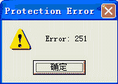

看看记录：

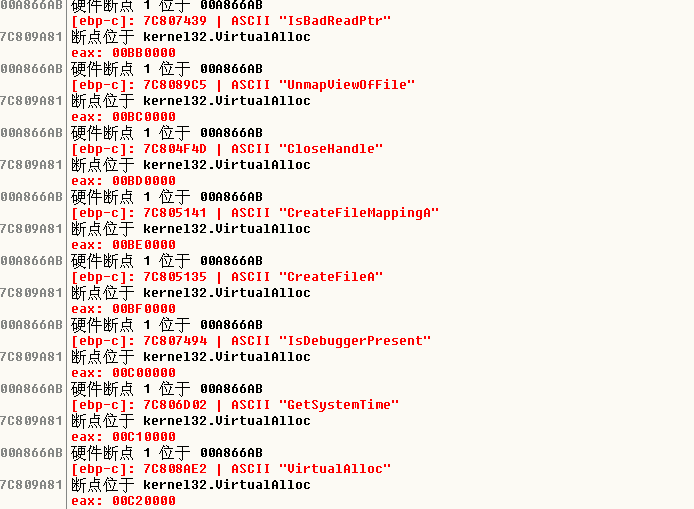

我发现在最后处理了 `VirtualAlloc` 后，其处理后的地址是 `00C20000`

`00C20000` 处为：

```
00C20000    CC              int3                   //可恶吧。。。。。
00C20001    FF55 8B         call    [ebp-75]
00C20004    EC              in      al, dx
00C20005    FF75 14         push    dword ptr [ebp+14]
00C20008    FF75 10         push    dword ptr [ebp+10]
00C2000B    FF75 0C         push    dword ptr [ebp+C]
00C2000E    FF75 08         push    dword ptr [ebp+8]
00C20011    6A FF           push    -1
00C20013    68 999A807C     push    7C809A99
00C20018    68 A29A807C     push    kernel32.VirtualAllocEx
00C2001D    C3              retn
```

我想，在处理了 `VirtualAlloc` 后，下面分配内存的任务就应该由 `00C20000` 处代码来执行了吧，再看一下调用 `VirtualAlloc` 前的那段代码：

```
00A7E7B6  主  push    0  ESP=0012FDB0
00A7E7B8  主  mov     eax, [A937F0]  EAX=00A94748
00A7E7BD  主  mov     eax, [eax+2C]  EAX=00A65EC0  //[eax+2C]VirtualAlloc 的地址
00A7E7C0  主  call    eax  ESP=0012FDAC          //call VirtualAlloc 了
00A65EC0  主  jmp     [A9C260]
```

我发现在处理了 `VirtualAlloc` 后，`00A7E7C0  call eax` 处的 `eax` 为 `00C20000` 了，看看 `00A7E7BD  mov eax, [eax+2C]`，`eax+2C` 处肯定是调用 `VirtualAlloc` 的地址，过去看看：我机器 `eax+2C=00A94748+2C`

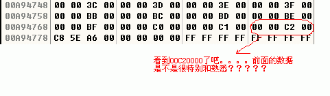

再看看处理前的：

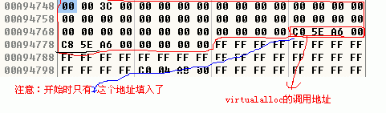

`00A65EC0` 处是什么呢？

开始时外壳会生成每个函数的调用表：

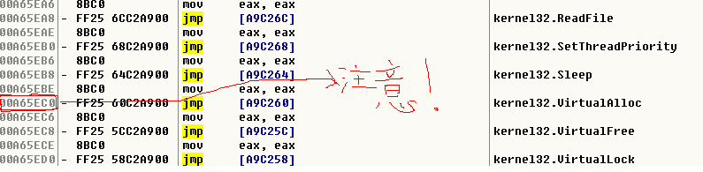

由上图可知 `A9C258~A9c26C` 这部分内存块应该是导入函数表。

这样啊。。。。。。

在处理了 `VirtualAlloc` 后将 `00A94748+2C` 处的数据改回去吧。

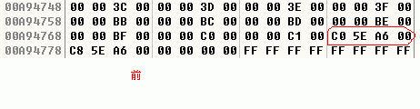

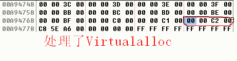

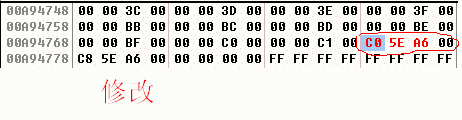

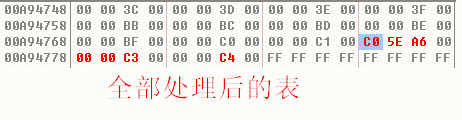

外壳共处理了从 `00A94748` 到 `00A9477C` 的 14 个特殊函数，它们是：

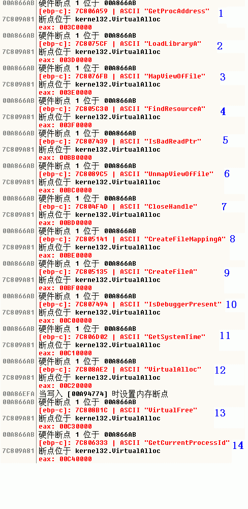

似乎又有问题了。。。。

在 `log` 中我发现后面还有好多的内存分配，且里面也是函数，可能是外壳函数，这个问题以后再探索。。。。。。。。。。。。。。。。。。。。。。。

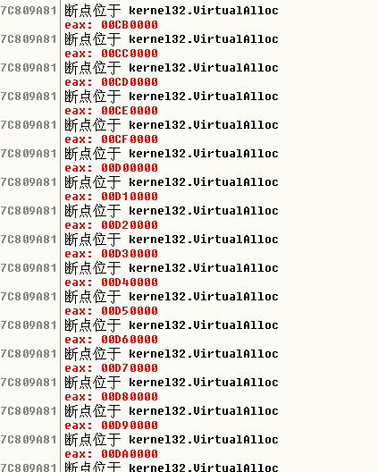

程序入口点！

`ASProtect.SKE.2.11.Build.03.13-RES-crk` 对入口点的保护只要找到关键 `call`,在最后一次 `seh` 后，找到关键 `call`：

```
00A8FB9F    B8 32000000     mov     eax, 32
00A8FBA4    E8 1B2DFDFF     call    00A628C4
00A8FBA9    2905 20B6A900   sub     [A9B620], eax
00A8FBAF    B8 64000000     mov     eax, 64
00A8FBB4    E8 0B2DFDFF     call    00A628C4
00A8FBB9    014424 04       add     [esp+4], eax
00A8FBBD    A1 20B6A900     mov     eax, [A9B620]
```


```
00A8FBC2    894424 0C       mov     [esp+C], eax  
00A8FBC6    8B4424 04       mov     eax, [esp+4]  
00A8FBCE    A1 0CB6A900     mov     eax, [A9B60C]  
00A8FBD3    E8 3C30FDFF     call    00A62C14  
00A8FBD8    A1 B837A900     mov     eax, [A937B8]  
00A8FBDD    C600 E3         mov     byte ptr [eax], 0E3  
00A8FBE0    8D5424 08       lea     edx, [esp+8]  
00A8FBE4    A1 2CB6A900     mov     eax, [A9B62C]  
00A8FBE9    E8 7695FFFF     call    00A89164  
00A8FBEE    E8 3160FFFF     call    00A85C24  
00A8FBF3    8BC6            mov     eax, esi  
00A8FBF5    E8 1A30FDFF     call    00A62C14  
00A8FBFA    E8 B5D0FFFF     call    00A8CCB4       //关键 call  
```

执行到返回后就是入口点。

Wak

2006.4.11[B]

[上篇文章](http://bbs.pediy.com/showthread.php?s=&threadid=24018)最后提到后面还有很多的内存分配，比如：

```
00CD0000  
00CE0000  
00CF0000  
00D00000  
00D10000  
00D20000
```

这些地方，经过仔细的观察：

```
00D10000    A1 F435887C     mov     eax, [7C8835F4]  
00D10005    C3              retn  
7C812C8D >  A1 F435887C     mov     eax, [7C8835F4]  
7C812C92    C3              retn  
```

下面一段是系统函数 `kernel32.GetCommandLineA` 的代码，由此可知这些空间也是为对系统函数处理而分配的。

看看加壳后程序对 `GetCommandLineA` 的调用变成了：

```
004013C4    E8 3BEC9100     call    00D20004  
00D20004    FF0424          inc     dword ptr [esp]           ;  
00D20007    36:EB 01        jmp     short 00D2000B  
00D2000A    F2:             prefix repne:  
00D2000B    68 0000D100     push    0D10000  
00D20010    C3              retn  
```

进去后可以看到 `00D20004` 行将返回地址加上了 1，这个与修改后的代码长度有关，如：

加壳前：

```
004013C4     FF15 5C504000  call    [<&KERNEL32.GetCommandLineA>]    
004013CA     A3 B88A4000    mov     [408AB8], eax  
```

`Call` 长度为 6

加壳后：

```
004013C4    E8 3BEC9100     call    00D20004  
004013C9    09A3 B88A4000   or      [ebx+408AB8], esp  
004013CF    E8 9F060000     call    00401A73  
```

`Call` 长度为 5

上面的代码可以看到，外壳为处理 `GetCommandLineA` 函数分配了两个空间：

`00D10000` 里面是系统代码

`00D20000` 里面处理长度问题，再跳到 `00D10000` 里。

这样看来对系统函数的处理远不止上篇文章提到的 14 处，外壳共处理了两次，是在两个不同的 `seh` 中处理的。

要得到所有第二批被处理过的函数，方法一样，对 `VirtualAlloc` 中断，找关键点如下：

```
00A8BAF1    03B3 E4000000   add     esi, [ebx+E4]  
00A8BAF7    833C24 00       cmp     dword ptr [esp], 0  //还有要处理的吗？  
00A8BAFB   ^ 0F87 55FEFFFF  ja      00A8B956  
00A8BA8A    0383 E0000000   add     eax, [ebx+E0]  
00A8BA90    EB 01           jmp     short 00A8BA93  //在该处设断，eax 中可得到函数。  
```

写个脚本将它们一网打尽：

```
var  VirtualAllocaddr  
var  temp  

checkver:     
  //check ollyscript's version  
  cmp  $VERSION,"0.9"  
  ja  start  
  msg  "version bad!"  
  ret  

start:  
      gpa  "VirtualAlloc","kernel32.dll"   
  mov  VirtualAllocaddr,$RESULT  
      bp  VirtualAllocaddr    //在 VirtualAlloc 设断  

continue:         
      run  
      //is virtualalloc?  
      cmp  eip,VirtualAllocaddr  
      je  isVirtualAlloc  
      //is 00A866AB?  
      cmp  eip,00A866AB  
      je  iskeycall1  
      //is 00A8BA90?  
      cmp  eip,00A8BA90  
      je  iskeycall2  
       //is 00A94774 write  
      sto  
      cmp  [00A94774],00A65EC0  
      jne  fix  
  jmp  continue   
    
isVirtualAlloc:  
      rtr  
      log  eax      
      //is 00A60000?   
      cmp  eax,00A60000  
      je  bp1   
      //is 00C20000?  
      cmp  eax,00C20000  
      je  bp2  
      jmp  continue  

   bp1:  
      bphws  00A866AB,"x"  
      bphws  00A8BA90,"x"  
      jmp  continue  

   bp2:  
      bpwm  00A94774,1  
      jmp  continue  

iskeycall1:  
      log  [ebp-c]  
      jmp  continue  

iskeycall2:  
      log  eax  
      jmp  continue  

fix:  
      mov  [00A94774],#C05EA6#  
      bpmc  
      jmp  continue  

return:     
      bc  VirtualAllocaddr      
  ret  
```

连同上篇的一起得到如下信息：

```
00A866AB   硬件断点 1 位于 00A866AB  
           [ebp-c]: 7C806A59 | ASCII "GetProcAddress"  
7C809A81   断点位于 kernel32.VirtualAlloc  
           eax: 003C0000  
00A866AB   硬件断点 1 位于 00A866AB  
           [ebp-c]: 7C8075CF | ASCII "LoadLibraryA"  
7C809A81   断点位于 kernel32.VirtualAlloc  
           eax: 003D0000  
00A866AB   硬件断点 1 位于 00A866AB  
           [ebp-c]: 7C8076FB | ASCII "MapViewOfFile"  
7C809A81   断点位于 kernel32.VirtualAlloc  
           eax: 003E0000  
00A866AB   硬件断点 1 位于 00A866AB  
           [ebp-c]: 7C805C30 | ASCII "FindResourceA"  
7C809A81   断点位于 kernel32.VirtualAlloc  
           eax: 003F0000  
00A866AB   硬件断点 1 位于 00A866AB  
           [ebp-c]: 7C807439 | ASCII "IsBadReadPtr"  
7C809A81   断点位于 kernel32.VirtualAlloc  
           eax: 00BB0000  
00A866AB   硬件断点 1 位于 00A866AB  
           [ebp-c]: 7C8089C5 | ASCII "UnmapViewOfFile"  
7C809A81   断点位于 kernel32.VirtualAlloc  
           eax: 00BC0000  
00A866AB   硬件断点 1 位于 00A866AB  
           [ebp-c]: 7C804F4D | ASCII "CloseHandle"  
7C809A81   断点位于 kernel32.VirtualAlloc  
           eax: 00BD0000  
00A866AB   硬件断点 1 位于 00A866AB  
           [ebp-c]: 7C805141 | ASCII "CreateFileMappingA"  
7C809A81   断点位于 kernel32.VirtualAlloc  
           eax: 00BE0000  
00A866AB   硬件断点 1 位于 00A866AB  
           [ebp-c]: 7C805135 | ASCII "CreateFileA"  
7C809A81   断点位于 kernel32.VirtualAlloc  
           eax: 00BF0000  
00A866AB   硬件断点 1 位于 00A866AB  
           [ebp-c]: 7C807494 | ASCII "IsDebuggerPresent"  
7C809A81   断点位于 kernel32.VirtualAlloc  
           eax: 00C00000  
00A866AB   硬件断点 1 位于 00A866AB  
           [ebp-c]: 7C806D02 | ASCII "GetSystemTime"  
7C809A81   断点位于 kernel32.VirtualAlloc  
           eax: 00C10000  
00A866AB   硬件断点 1 位于 00A866AB  
           [ebp-c]: 7C808AE2 | ASCII "VirtualAlloc"  
7C809A81   断点位于 kernel32.VirtualAlloc  
           eax: 00C20000  
00A86EFA   当写入 [00A94774] 时设置内存断点  
00A866AB   硬件断点 1 位于 00A866AB  
           [ebp-c]: 7C808B1C | ASCII "VirtualFree"  
7C809A81   断点位于 kernel32.VirtualAlloc  
           eax: 00C30000  
00A866AB   硬件断点 1 位于 00A866AB  
           [ebp-c]: 7C806333 | ASCII "GetCurrentProcessId"  

00A8BA90   硬件断点 2 位于 00A8BA90  
           eax: 77D24315 | user32.RegisterClassExA  
7C809A81   断点位于 kernel32.VirtualAlloc  
           eax: 00CD0000  
7C809A81   断点位于 kernel32.VirtualAlloc  
           eax: 00CE0000  

00A8BA90   硬件断点 2 位于 00A8BA90  
           eax: 77D288E1 | user32.DialogBoxParamA  
7C809A81   断点位于 kernel32.VirtualAlloc  
           eax: 00CF0000  
7C809A81   断点位于 kernel32.VirtualAlloc  
           eax: 00D00000  

00A8BA90   硬件断点 2 位于 00A8BA90  
           eax: 7C812C8D | kernel32.GetCommandLineA  
7C809A81   断点位于 kernel32.VirtualAlloc  
           eax: 00D10000  
7C809A81   断点位于 kernel32.VirtualAlloc  
           eax: 00D20000  

00A8BA90   硬件断点 2 位于 00A8BA90  
           eax: 7C801EEE | kernel32.GetStartupInfoA  
7C809A81   断点位于 kernel32.VirtualAlloc  
           eax: 00D30000  
7C809A81   断点位于 kernel32.VirtualAlloc  
           eax: 00D40000  

00A8BA90   硬件断点 2 位于 00A8BA90  
           eax: 7C80B529 | kernel32.GetModuleHandleA  
7C809A81   断点位于 kernel32.VirtualAlloc  
           eax: 00D50000  
7C809A81   断点位于 kernel32.VirtualAlloc  
           eax: 00D60000  

00A8BA90   硬件断点 2 位于 00A8BA90  
           eax: 7C80E00D | kernel32.GetCurrentProcess  
7C809A81   断点位于 kernel32.VirtualAlloc  
           eax: 00D70000  
7C809A81   断点位于 kernel32.VirtualAlloc  
           eax: 00D80000  

00A8BA90   硬件断点 2 位于 00A8BA90  
           eax: 7C801E16 | kernel32.TerminateProcess  
7C809A81   断点位于 kernel32.VirtualAlloc  
           eax: 00D90000  
7C809A81   断点位于 kernel32.VirtualAlloc  
           eax: 00DA0000  

00A8BA90   硬件断点 2 位于 00A8BA90  
           eax: 7C80B357 | kernel32.GetModuleFileNameA  
7C809A81   断点位于 kernel32.VirtualAlloc  
           eax: 00DB0000  
7C809A81   断点位于 kernel32.VirtualAlloc  
           eax: 00DC0000  
```


## 硬件断点日志

### 条目 1
- `00A8BA90` 硬件断点 2 位于 `00A8BA90`
  - `eax`: `7C81DC3F` | `kernel32.FreeEnvironmentStringsA`
- `7C809A81` 断点位于 `kernel32.VirtualAlloc`
  - `eax`: `00DD0000`

### 条目 2
- `7C809A81` 断点位于 `kernel32.VirtualAlloc`
  - `eax`: `00DE0000`
- `00A8BA90` 硬件断点 2 位于 `00A8BA90`
  - `eax`: `7C801EEE` | `kernel32.GetStartupInfoA`

### 条目 3
- `7C809A81` 断点位于 `kernel32.VirtualAlloc`
  - `eax`: `00DF0000`
- `7C809A81` 断点位于 `kernel32.VirtualAlloc`
  - `eax`: `00E00000`
- `00A8BA90` 硬件断点 2 位于 `00A8BA90`
  - `eax`: `7C811069` | `kernel32.GetFileType`

### 条目 4
- `7C809A81` 断点位于 `kernel32.VirtualAlloc`
  - `eax`: `00E10000`
- `7C809A81` 断点位于 `kernel32.VirtualAlloc`
  - `eax`: `00E20000`
- `00A8BA90` 硬件断点 2 位于 `00A8BA90`
  - `eax`: `7C812CA9` | `kernel32.GetStdHandle`

### 条目 5
- `7C809A81` 断点位于 `kernel32.VirtualAlloc`
  - `eax`: `00E30000`
- `7C809A81` 断点位于 `kernel32.VirtualAlloc`
  - `eax`: `00E40000`
- `00A8BA90` 硬件断点 2 位于 `00A8BA90`
  - `eax`: `7C811069` | `kernel32.GetFileType`

### 条目 6
- `7C809A81` 断点位于 `kernel32.VirtualAlloc`
  - `eax`: `00E50000`
- `7C809A81` 断点位于 `kernel32.VirtualAlloc`
  - `eax`: `00E60000`
- `00A8BA90` 硬件断点 2 位于 `00A8BA90`
  - `eax`: `7C80C6CF` | `kernel32.SetHandleCount`

### 条目 7
- `7C809A81` 断点位于 `kernel32.VirtualAlloc`
  - `eax`: `00E70000`
- `7C809A81` 断点位于 `kernel32.VirtualAlloc`
  - `eax`: `00E80000`
- `00A8BA90` 硬件断点 2 位于 `00A8BA90`
  - `eax`: `7C80B529` | `kernel32.GetModuleHandleA`

### 条目 8
- `7C809A81` 断点位于 `kernel32.VirtualAlloc`
  - `eax`: `00E90000`
- `7C809A81` 断点位于 `kernel32.VirtualAlloc`
  - `eax`: `00EA0000`
- `00A8BA90` 硬件断点 2 位于 `00A8BA90`
  - `eax`: `7C81486A` | `kernel32.GetEnvironmentVariableA`

### 条目 9
- `7C809A81` 断点位于 `kernel32.VirtualAlloc`
  - `eax`: `00EB0000`
- `7C809A81` 断点位于 `kernel32.VirtualAlloc`
  - `eax`: `00EC0000`
- `00A8BA90` 硬件断点 2 位于 `00A8BA90`
  - `eax`: `7C80B357` | `kernel32.GetModuleFileNameA`

### 条目 10
- `7C809A81` 断点位于 `kernel32.VirtualAlloc`
  - `eax`: `00ED0000`
- `7C809A81` 断点位于 `kernel32.VirtualAlloc`
  - `eax`: `00EE0000`
- `00A8BA90` 硬件断点 2 位于 `00A8BA90`
  - `eax`: `7C80B357` | `kernel32.GetModuleFileNameA`

### 条目 11
- `7C809A81` 断点位于 `kernel32.VirtualAlloc`
  - `eax`: `00EF0000`
- `7C809A81` 断点位于 `kernel32.VirtualAlloc`
  - `eax`: `00F00000`
- `00A8BA90` 硬件断点 2 位于 `00A8BA90`
  - `eax`: `7C812CA9` | `kernel32.GetStdHandle`

### 条目 12
- `7C809A81` 断点位于 `kernel32.VirtualAlloc`
  - `eax`: `00F10000`
- `7C809A81` 断点位于 `kernel32.VirtualAlloc`
  - `eax`: `00F20000`
- `00A8BA90` 硬件断点 2 位于 `00A8BA90`
  - `eax`: `7C810F9F` | `kernel32.WriteFile`

### 条目 13
- `7C809A81` 断点位于 `kernel32.VirtualAlloc`
  - `eax`: `00F30000`
- `7C809A81` 断点位于 `kernel32.VirtualAlloc`
  - `eax`: `00F40000`
- `00A8BA90` 硬件断点 2 位于 `00A8BA90`
  - `eax`: `7C812BE6` | `kernel32.GetCPInfo`

### 条目 14
- `7C809A81` 断点位于 `kernel32.VirtualAlloc`
  - `eax`: `00F50000`
- `7C809A81` 断点位于 `kernel32.VirtualAlloc`
  - `eax`: `00F60000`
- `00A8BA90` 硬件断点 2 位于 `00A8BA90`
  - `eax`: `7C81E82A` | `kernel32.GetOEMCP`

### 条目 15
- `7C809A81` 断点位于 `kernel32.VirtualAlloc`
  - `eax`: `00F70000`
- `7C809A81` 断点位于 `kernel32.VirtualAlloc`
  - `eax`: `00F80000`
- `00A8BA90` 硬件断点 2 位于 `00A8BA90`
  - `eax`: `7C809943` | `kernel32.GetACP`

### 条目 16
- `7C809A81` 断点位于 `kernel32.VirtualAlloc`
  - `eax`: `00F90000`
- `7C809A81` 断点位于 `kernel32.VirtualAlloc`
  - `eax`: `00FA0000`
- `00A8BA90` 硬件断点 2 位于 `00A8BA90`
  - `eax`: `7C812BE6` | `kernel32.GetCPInfo`

### 条目 17
- `7C809A81` 断点位于 `kernel32.VirtualAlloc`
  - `eax`: `00FB0000`
- `7C809A81` 断点位于 `kernel32.VirtualAlloc`
  - `eax`: `00FC0000`
- `00A8BA90` 硬件断点 2 位于 `00A8BA90`
  - `eax`: `7C832E2B` | `kernel32.LCMapStringA`

### 条目 18
- `7C809A81` 断点位于 `kernel32.VirtualAlloc`
  - `eax`: `00FD0000`
- `7C809A81` 断点位于 `kernel32.VirtualAlloc`
  - `eax`: `00FE0000`
- `00A8BA90` 硬件断点 2 位于 `00A8BA90`
  - `eax`: `7C832E2B` | `kernel32.LCMapStringA`

### 条目 19
- `7C809A81` 断点位于 `kernel32.VirtualAlloc`
  - `eax`: `00FF0000`
- `7C809A81` 断点位于 `kernel32.VirtualAlloc`
  - `eax`: `01000000`
- `00A8BA90` 硬件断点 2 位于 `00A8BA90`
  - `eax`: `7C838CB9` | `kernel32.GetStringTypeA`

### 条目 20
- `7C809A81` 断点位于 `kernel32.VirtualAlloc`
  - `eax`: `01010000`
- `7C809A81` 断点位于 `kernel32.VirtualAlloc`
  - `eax`: `01020000`
- `00A8BA90` 硬件断点 2 位于 `00A8BA90`
  - `eax`: `7C838CB9` | `kernel32.GetStringTypeA`

### 条目 21
- `7C809A81` 断点位于 `kernel32.VirtualAlloc`
  - `eax`: `01030000`
- `7C809A81` 断点位于 `kernel32.VirtualAlloc`
  - `eax`: `01040000`

[content]
</think>

[content]
## 硬件断点日志

### 条目 1
- `00A8BA90` 硬件断点 2 位于 `00A8BA90`
  - `eax`: `7C81DC3F` | `kernel32.FreeEnvironmentStringsA`
- `7C809A81` 断点位于 `kernel32.VirtualAlloc`
  - `eax`: `00DD0000`

### 条目 2
- `7C809A81` 断点位于 `kernel32.VirtualAlloc`
  - `eax`: `00DE0000`
- `00A8BA90` 硬件断点 2 位于 `00A8BA90`
  - `eax`: `7C801EEE` | `kernel32.GetStartupInfoA`

### 条目 3
- `7C809A81` 断点位于 `kernel32.VirtualAlloc`
  - `eax`: `00DF0000`
- `7C809A81` 断点位于 `kernel32.VirtualAlloc`
  - `eax`: `00E00000`
- `00A8BA90` 硬件断点 2 位于 `00A8BA90`
  - `eax`: `7C811069` | `kernel32.GetFileType`

### 条目 4
- `7C809A81` 断点位于 `kernel32.VirtualAlloc`
  - `eax`: `00E10000`
- `7C809A81` 断点位于 `kernel32.VirtualAlloc`
  - `eax`: `00E20000`
- `00A8BA90` 硬件断点 2 位于 `00A8BA90`
  - `eax`: `7C812CA9` | `kernel32.GetStdHandle`

### 条目 5
- `7C809A81` 断点位于 `kernel32.VirtualAlloc`
  - `eax`: `00E30000`
- `7C809A81` 断点位于 `kernel32.VirtualAlloc`
  - `eax`: `00E40000`
- `00A8BA90` 硬件断点 2 位于 `00A8BA90`
  - `eax`: `7C811069` | `kernel32.GetFileType`

### 条目 6
- `7C809A81` 断点位于 `kernel32.VirtualAlloc`
  - `eax`: `00E50000`
- `7C809A81` 断点位于 `kernel32.VirtualAlloc`
  - `eax`: `00E60000`
- `00A8BA90` 硬件断点 2 位于 `00A8BA90`
  - `eax`: `7C80C6CF` | `kernel32.SetHandleCount`

### 条目 7
- `7C809A81` 断点位于 `kernel32.VirtualAlloc`
  - `eax`: `00E70000`
- `7C809A81` 断点位于 `kernel32.VirtualAlloc`
  - `eax`: `00E80000`
- `00A8BA90` 硬件断点 2 位于 `00A8BA90`
  - `eax`: `7C80B529` | `kernel32.GetModuleHandleA`

### 条目 8
- `7C809A81` 断点位于 `kernel32.VirtualAlloc`
  - `eax`: `00E90000`
- `7C809A81` 断点位于 `kernel32.VirtualAlloc`
  - `eax`: `00EA0000`
- `00A8BA90` 硬件断点 2 位于 `00A8BA90`
  - `eax`: `7C81486A` | `kernel32.GetEnvironmentVariableA`

### 条目 9
- `7C809A81` 断点位于 `kernel32.VirtualAlloc`
  - `eax`: `00EB0000`
- `7C809A81` 断点位于 `kernel32.VirtualAlloc`
  - `eax`: `00EC0000`
- `00A8BA90` 硬件断点 2 位于 `00A8BA90`
  - `eax`: `7C80B357` | `kernel32.GetModuleFileNameA`

### 条目 10
- `7C809A81` 断点位于 `kernel32.VirtualAlloc`
  - `eax`: `00ED0000`
- `7C809A81` 断点位于 `kernel32.VirtualAlloc`
  - `eax`: `00EE0000`
- `00A8BA90` 硬件断点 2 位于 `00A8BA90`
  - `eax`: `7C80B357` | `kernel32.GetModuleFileNameA`

### 条目 11
- `7C809A81` 断点位于 `kernel32.VirtualAlloc`
  - `eax`: `00EF0000`
- `7C809A81` 断点位于 `kernel32.VirtualAlloc`
  - `eax`: `00F00000`
- `00A8BA90` 硬件断点 2 位于 `00A8BA90`
  - `eax`: `7C812CA9` | `kernel32.GetStdHandle`

### 条目 12
- `7C809A81` 断点位于 `kernel32.VirtualAlloc`
  - `eax`: `00F10000`
- `7C809A81` 断点位于 `kernel32.VirtualAlloc`
  - `eax`: `00F20000`
- `00A8BA90` 硬件断点 2 位于 `00A8BA90`
  - `eax`: `7C810F9F` | `kernel32.WriteFile`

### 条目 13
- `7C809A81` 断点位于 `kernel32.VirtualAlloc`
  - `eax`: `00F30000`
- `7C809A81` 断点位于 `kernel32.VirtualAlloc`
  - `eax`: `00F40000`
- `00A8BA90` 硬件断点 2 位于 `00A8BA90`
  - `eax`: `7C812BE6` | `kernel32.GetCPInfo`

### 条目 14
- `7C809A81` 断点位于 `kernel32.VirtualAlloc`
  - `eax`: `00F50000`
- `7C809A81` 断点位于 `kernel32.VirtualAlloc`
  - `eax`: `00F60000`
- `00A8BA90` 硬件断点 2 位于 `00A8BA90`
  - `eax`: `7C81E82A` | `kernel32.GetOEMCP`

### 条目 15
- `7C809A81` 断点位于 `kernel32.VirtualAlloc`
  - `eax`: `00F70000`
- `7C809A81` 断点位于 `kernel32.VirtualAlloc`
  - `eax`: `00F80000`
- `00A8BA90` 硬件断点 2 位于 `00A8BA90`
  - `eax`: `7C809943` | `kernel32.GetACP`

### 条目 16
- `7C809A81` 断点位于 `kernel32.VirtualAlloc`
  - `eax`: `00F90000`
- `7C809A81` 断点位于 `kernel32.VirtualAlloc`
  - `eax`: `00FA0000`
- `00A8BA90` 硬件断点 2 位于 `00A8BA90`
  - `eax`: `7C812BE6` | `kernel32.GetCPInfo`

### 条目 17
- `7C809A81` 断点位于 `kernel32.VirtualAlloc`
  - `eax`: `00FB0000`
- `7C809A81` 断点位于 `kernel32.VirtualAlloc`
  - `eax`: `00FC0000`
- `00A8BA90` 硬件断点 2 位于 `00A8BA90`
  - `eax`: `7C832E2B` | `kernel32.LCMapStringA`

### 条目 18
- `7C809A81` 断点位于 `kernel32.VirtualAlloc`
  - `eax`: `00FD0000`
- `7C809A81` 断点位于 `kernel32.VirtualAlloc`
  - `eax`: `00FE0000`
- `00A8BA90` 硬件断点 2 位于 `00A8BA90`
  - `eax`: `7C832E2B` | `kernel32.LCMapStringA`

### 条目 19
- `7C809A81` 断点位于 `kernel32.VirtualAlloc`
  - `eax`: `00FF0000`
- `7C809A81` 断点位于 `kernel32.VirtualAlloc`
  - `eax`: `01000000`
- `00A8BA90` 硬件断点 2 位于 `00A8BA90`
  - `eax`: `7C838CB9` | `kernel32.GetStringTypeA`

### 条目 20
- `7C809A81` 断点位于 `kernel32.VirtualAlloc`
  - `eax`: `01010000`
- `7C809A81` 断点位于 `kernel32.VirtualAlloc`
  - `eax`: `01020000`
- `00A8BA90` 硬件断点 2 位于 `00A8BA90`
  - `eax`: `7C838CB9` | `kernel32.GetStringTypeA`

### 条目 21
- `7C809A81` 断点位于 `kernel32.VirtualAlloc`
  - `eax`: `01030000`
- `7C809A81` 断点位于 `kernel32.VirtualAlloc`
  - `eax`: `01040000`

### 哈希值
`4dd466d0e1e0cc123afbe504da2462ca`
