# Attack on Asprotect SKE Activation Key

> 原文：[`www.pediy.com/kssd/pediy08/pediy8-563.htm`](https://www.pediy.com/kssd/pediy08/pediy8-563.htm)

Keywords: `Asprotect`, `RSA`, `EncryptionConst`, `MD5`, `RC4`

## 1 Abstract

`Asprotect SKE` provides function `CheckKeyAndDecrypt`. It verifies the registration key for all implemented modes and saves it to the external configuration file. If registration key is valid in a valid mode, `Asprotect SKE` will unlock encrypted sections which protected by Macro `REG_CRYPT_BEGIN` and `REG_CRYPT_END` pairs. This tutorial is divided into two parts. One is key replace and the other is attack on activation key.

Tools: `ollydbg 1.1`, `UltraEdit`

## 2 Key Replace

`Asprotect SKE` uses `RSA` public key cryptosystem in the key activation. Only author who has the private key can generate registration keys. For example, when we try to register `Asprotect 2.3 SKE build 03.19 Beta`, our registration keys are generated by `RSA Private Key` which only author has. The `Asprotect application` use `RSA Public Key` to verify the registration key. It's hard to forge a valid registration key because we don't have its `Private Key`.

If we have a valid registration key, that will results the correct output from `Public Key`. With that correct output we create our own `RSA Keys`, replace original `Public Key` with our own `Public Key` in `Asprotect application`. Then we can use our own private key to generate the 'valid registration key', which will work perfectly because the `Asprotect application` will calculate the same output from the keys.

Now, our target is `Asprotect 2.3 SKE build 03.19 Beta`. Assume we have got a valid registration key (of course it is invalid), let's go ^\_^

Name: `shoooo`

Key: `HGV8K-TVKCW-28L5K-2TZMT-LZNT3-GPJDM-NQG3D-N7QMT-VXVEE-FHK7K`

### 2.1 Get the EncryptionConst

Launch `ollydbg` start here.

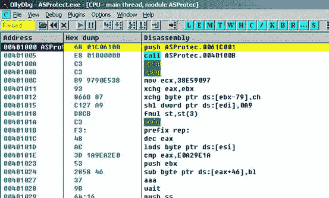

Ignore all exceptions and don't forget to turn on `IsDebuggerPresent` plugin. It is an unregistered mode so we press `SHIFT+F9` to run.

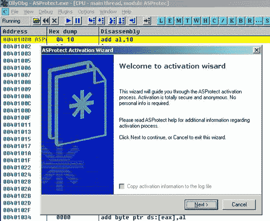

Find the `Asprotect dll` `ImageBase`, Mine is `1090000h`. Set breakpoint on `RVA 1B320h` of the `dll ImageBase`. This call is the validation of registration key.

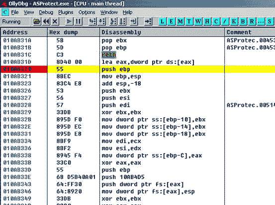

Press 'Next' at activation wizard, select 'Offline Activation', press 'Next' again, input 'ASP' and press 'Next'.

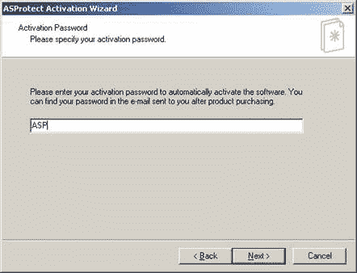

Input name and registration key then Press 'Next'.

Name: `shoooo`

Key: `HGV8K-TVKCW-28L5K-2TZMT-LZNT3-GPJDM-NQG3D-N7QMT-VXVEE-FHK7K`

It will break on `10AB320h`. Yes, it starts to verify the registration key. Please watch the Registers Window :

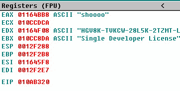

`EAX` points to the Name

`EDX` points to the registration key

`EBX` points to the current mode name

`ECX` points to a structure about registration, we names it structure `T`

We follow in dump `ECX`, watch the structure `T` in `Data Window`

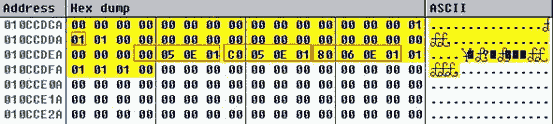

I use 4 markers in red. The first one `01` indicates current registration key is `HardwareLocking`, we should modify it to `00`. `HardwareLocking` doesn't participate in registration key computation. I will mention it later.

`010E0500h` point to `RSA Public Key P5`

`010E05C0h` point to `RSA Public Key P6`

`010E0680h` point to `RSA Public Key P7`

I will mention `P5`, `P6` and `P7` later too.

`Asprotect 2.3 SKE build 03.19 Beta` has two registration modes. Mode 1 names 'Single Developer License' while mode 2 names 'Company Developer License'. So it will call `010AB320h` twice. Either Mode 1 or Mode 2 has been verified to be successful, application will be activated.

```
010AB320 push ebp
010AB321 mov ebp,esp
010AB323 add esp,-18
010AB326 push ebx
010AB327 push esi
010AB328 push edi
010AB329 xor ebx,ebx
010AB32B mov dword ptr ss:[ebp-10],ebx
010AB32E mov dword ptr ss:[ebp-14],ebx
010AB331 mov dword ptr ss:[ebp-18],ebx
010AB334 mov edi,ecx
010AB336 mov esi,edx
010AB338 mov dword ptr ss:[ebp-C],eax
010AB33B xor eax,eax
010AB33D push ebp
010AB33E push 10AB4D5
010AB343 push dword ptr fs:[eax]
010AB346 mov dword ptr fs:[eax],esp
010AB349 xor ebx,ebx
010AB34B xor eax,eax
010AB34D push ebp
010AB34E push 10AB4AE
010AB353 push dword ptr fs:[eax]
010AB356 mov dword ptr fs:[eax],esp
010AB359 lea edx,dword ptr ss:[ebp-10]
010AB35C mov eax,esi
010AB35E call 010AB0D4
```

`010AB35Eh call 010AB0D4h` to transform the registration key to Hex value. This transform happens after looking up the table and combination of 5 bits.

Key: `HGV8K-TVKCW-28L5K-2TZMT-LZNT3-GPJDM-NQG3D-N7QMT-VXVEE-FHK7K`

After transform

Hex: `E6 9F 93 19 A4 54 C7 95 B4 E2 37 5C 55 76 47 26 6A 06 B6 38 D9 1B 3A E5 C6 75 99 08 53 A7 A9`

```
010AB363 test al,al
010AB365 jnz short 010AB374
010AB367 xor eax,eax
010AB369 pop edx
010AB36A pop ecx
010AB36B pop ecx
010AB36C mov dword ptr fs:[eax],edx
010AB36F jmp 010AB4BA
010AB374 mov eax,edi
010AB376 call 010AB29C
010AB37B mov esi,eax
010AB37D mov eax,dword ptr ss:[ebp-10]
010AB380 call 01093954
010AB385 mov ebx,eax
010AB387 sub ebx,esi
010AB389 lea eax,dword ptr ss:[ebp-14]
010AB38C push eax
010AB38D mov ecx,esi
010AB38F mov edx,1
010AB394 mov eax,dword ptr ss:[ebp-10]
010AB397 call 01093B5C
010AB39C lea eax,dword ptr ss:[ebp-18]
010AB39F mov ecx,dword ptr ss:[ebp-C]
010AB3A2 mov edx,dword ptr ss:[ebp-14]
010AB3A5 call 010939A0
010AB3AA lea eax,dword ptr ss:[ebp-10]
010AB3AD call 01093B24
010AB3B2 add eax,esi
010AB3B4 push eax
010AB3B5 push ebx
010AB3B6 mov eax,dword ptr ss:[ebp-18]
010AB3B9 call 01093954
010AB3BE push eax
010AB3BF lea eax,dword ptr ss:[ebp-18]
010AB3C2 call 01093B24
010AB3C7 mov edx,eax
010AB3C9 lea eax,dword ptr ds:[edi+23]
010AB3CC pop ecx
010AB3CD call 010AABA8
```

Here Hex registration key is divided into two parts.

First 7 bytes: `E6 9F 93 19 A4 54 C7`

Rest 24 bytes: `95 B4 E2 37 5C 55 76 47 26 6A 06 B6 38 D9 1B 3A E5 C6 75 99 08 53 A7 A9`

`010AB3CDh call 010AABA8h` to check the Rest 24 bytes with `Public Key P5`, `P6` and `P7`. If verified right, it will return `1`. The output of `call 010AABA8h` is only used as parallel. So the Rest 24 bytes of Hex are useless data.

```
010AB3D2 mov ebx,eax
010AB3D4 test bl,bl
010AB3D6 je 010AB4A4
010AB3DC mov eax,dword ptr ss:[ebp-C]
010AB3DF call 01093954
010AB3E4 push eax
010AB3E5 lea eax,dword ptr ss:[ebp-14]
010AB3E8 call 01093B24
010AB3ED push eax
010AB3EE mov eax,dword ptr ss:[ebp-C]
010AB3F1 call 01093B18
010AB3F6 mov ecx,eax
010AB3F8 mov edx,esi
010AB3FA pop eax
010AB3FB call 0109BE0C
```

`010AB3FBh call 0109BE0Ch` to decrypt the First 7 bytes of Hex Key. The decryption algorithm is `RC4`. The `RC4` init key is just the name: `shoooo`. Only name and the First 7 bytes of Hex are useful.

```
010AB400 lea eax,dword ptr ss:[ebp-14]
010AB403 call 01093B24
010AB408 mov dword ptr ss:[ebp-4],eax
010AB40B mov byte ptr ss:[ebp-5],1
010AB40F push ebp
010AB410 mov eax,4
010AB415 call 010AB2DC
010AB41A pop ecx
010AB41B mov byte ptr ds:[edi+1],al
```

Here `al` represents current `ModeID`, it comes from the decrypted First 7 bytes of Hex. If you want to register successfully in 'Single Developer License', it must be equal to `1`. Because Mode 1 names 'Single Developer License'.

```
010AB41E push ebp
010AB41F mov eax,4
010AB424 call 010AB2DC
010AB429 pop ecx
010AB42A mov byte ptr ds:[edi],al
010AB42C push ebp
010AB42D mov eax,0C
010AB432 call 010AB2DC
010AB437 pop ecx
010AB438 mov word ptr ds:[edi+2],ax
010AB43C cmp byte ptr ds:[edi+E],0
010AB440 jnz short 010AB448
010AB442 cmp byte ptr ds:[edi+11],0
010AB446 jnz short 010AB45A
010AB448 push ebp
010AB449 mov eax,0C
010AB44E call 010AB2DC
010AB453 pop ecx
```


`010AB454 mov word ptr ds:[edi+4],ax`

`010AB458 jmp short 010AB460`

`010AB45A mov word ptr ds:[edi+4],0`

`010AB460 cmp byte ptr ds:[edi+F],0`

`010AB464 jnz short 010AB46C`

`010AB466 cmp byte ptr ds:[edi+11],0`

`010AB46A jnz short 010AB47D`

`010AB46C push ebp`

`010AB46D mov eax,20`

`010AB472 call 010AB2DC`

`010AB472h call 010AB2DCh to get a DWORD. This significant DWORD is also from the decrypted First 7 bytes of Hex. If this data decrypted properly, application will unlock encrypted sections. That means whether application is activated or not depends on this DWORD. We call this significant data 'EncryptionConst'.`

`010AB4BE pop ecx`

`010AB4BF mov dword ptr fs:[eax],edx`

`010AB4C2 push 10AB4DC`

`010AB4C7 lea eax,dword ptr ss:[ebp-18]`

`010AB4CA mov edx,3`

`010AB4CF call 0109371C`

`010AB4D4 retn`

`010AB4D5 jmp 0109311C`

`010AB4DA jmp short 010AB4C7`

`010AB4DC mov eax,ebx`

`010AB4DE pop edi`

`010AB4DF pop esi`

`010AB4E0 pop ebx`

`010AB4E1 mov esp,ebp`

`010AB4E3 pop ebp`

`010AB4E4 retn`

`010AB4E4h end this call. If verified right, it will return 1. We watch structure T again in Data Window.`

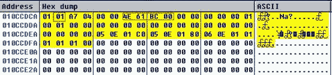

I use 2 markers in red. The first one `01` indicates current `Mode ID = 01`;

`00BC614Eh`: '`EncryptionConst`' for unlock encrypted sections.

Here we assume that the '`EncryptionConst`' `00BC614Eh` is correct. What we should do next is to create a project, make a RSA key pair, and then patch Public Key into Asprotect 2.3 SKE build 03.19 Beta.

### 2.2 Create a new project

Launch Asprotect SKE (such as Asprotect SKE 2.11 build 03.13 Release). `Project -> New project -> set as the following figure -> Save project to file 'test.aspr2'`.

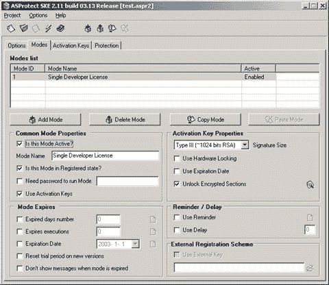

Open '`test.aspr2`' with `UltraEdit`. We are concerned about the following issues.

`[Activation Keys 1]`

`p1=E3F23E039A49EF1B3A3F6ED2B1008BC5`

`p3=F9909CC20901EEE1F11951AB62512123`

`p5=E013BB36B2659FC3EE22DBDD30F4E838AF1EE6910E35F7E880C72AF02E1339604D5F8C30394A8D734ED6D29EE94FAF03E0C90D2FE8C54437DEAAAF1D77954DC5F312BEC881AF845686858756795EC1F233FD1EEF2DA2E0EB68B579A2109C1C3A5FA3F609F1FC7FBE8C0F008DF32C604711466AE11D02F43D47D68C6B2A70CC98`

`p6=10DF36C37A45990F17DE3C2BDDAF020A0140EA68AE0E570997A991F2B947F712599B6F1CA42315D94BFFC5E990B544FB898E9E9108E5A71869A2E145F32042EDA713383FAA51483038A535C05B441782C48CB44085E8130E9A3A74EA8516E7D93D00464A918B6B4E8FE1D301511CE19FA57D0E485D1ED3821D907A19AE8A3FE64`

`p7=12D9DA3EA116EDB35C5723EBF30A9932FC27EE3CF73C4905C2016FFFF3177F7E3C1A17C0E4DBEEE2E73CC260A495A00AAC9202213BB401D6A7540B095290429227F9BF41E57A889AB62FF81391651A99A29CA709DCF3ECC8A912B44D6C30DFF82EE385144C9E31F63ED0F5D0CE7F991109A840F2A18F1F50B53346C67FAAFB005`

`SignatureSize=192`

`ModeID=1`

`UseHardwareLocking=0`

`EncryptionConst=2383683100` // change it to `12345678` (`00BC614Eh`)

`P1` can be regarded as our own RSA Private Key.

`P3` can be regarded as our own RSA Private Key.

`P5` can be regarded as our own RSA Public Key.

`P6` can be regarded as our own RSA Public Key

`P7` can be regarded as our own RSA Public Key

`EncryptionConst` is not `00BC614Eh`, so we modify it to `12345678` (`00BC614Eh`) and update the '`test.aspr2`' file.

We emphasize it again here. In Asprotect 2.3 SKE build 03.19 Beta application. We can only find its `P5`, `P6` and `P7`. There are no `P1`, `P3`, and `EncryptionConst`. With a valid registration key, we could calculate the `EncryptionConst` and activate the application. But we are still short of `P1`, `P3`.

Now we have created our own RSA Key pairs and obtained the correct `EncryptionConst`, the only thing left is to replace application's Public Key with our own Public Key. Of course, we shouldn't publish our own Private Key `P1` and `P3`.

### 2.3 Replace P5 P6 P7

`P5`, `P6` and `P7` are in the form of cipher in Asprotect application. To complete replacement, we must decrypt them, modify them, and encrypt them again.

Launch `ollydbg` again. Press `CTRL+S` to find sequence of commands in Asprotect dll section.

```
push ebp
mov ebp, esp
add esp, -200
```

mmm… if you don't know how to find Asprotect dll section. Follow this:

Break on the end of API `GetModuleHandleA` twice, `F8 retn`, break on the end of the aspack, `F8 retn`. Then you will see this

```
010CA14C push ebp
010CA14D mov ebp,esp
010CA14F add esp,-4C
010CA152 mov eax,10C9E7C
010CA157 call 01095D64
010CA15C call 010935C0
```

`010CA14Ch` is the `EntryPoint` of the Asprotect dll

We have found the sequence of commands.

```
0109BE0C push ebp
0109BE0D mov ebp,esp
0109BE0F add esp,-200
0109BE15 push ebx
0109BE16 push esi
0109BE17 mov esi,edx
0109BE19 mov ebx,eax
0109BE1B lea eax,dword ptr ss:[ebp-200]
0109BE21 mov edx,ecx
0109BE23 mov ecx,dword ptr ss:[ebp+8]
0109BE26 call 0109BE50
0109BE2B push esi
0109BE2C lea eax,dword ptr ss:[ebp-200]
0109BE32 mov ecx,ebx
0109BE34 mov edx,ebx
0109BE36 call 0109BEE8 //set breakpoint
0109BE3B lea eax,dword ptr ss:[ebp-200]
0109BE41 call 0109BED8
0109BE46 pop esi
0109BE47 pop ebx
0109BE48 mov esp,ebp
0109BE4A pop ebp
0109BE4B retn 4
```

Set breakpoint on `0109BE36h`. Press `F9` run. We break on `0109BE36h`.

`0109BE36h call 0109BEE8h to decrypt a block of data which include Public Keys.`

`EAX` points to RC4 subkeys which are `100h` length

`EDX` points to a block of encrypted data

Under the same RC4 subkeys, RC4 Encrypt is equivalent to Decrypt. So we must save `100h` RC4 subkeys first. Follow in dump `EAX`, save `100h` Hex to somewhere.

```
B2 20 D7 58 3E 3C 48 18 7F F6 89 CD E3 4E 9D D8
69 9B 05 1E E9 BD 2D 98 A1 AF EE DA 31 FF CF 0E
88 DE 67 1D 40 60 13 D0 A6 4A 6A 54 57 50 BE 9C
5E 72 83 6E CA 3A 4B 35 70 B4 2C B0 2B 7B AC 14
7C 64 7D 5B D3 66 B7 5C 7A C0 5F 0C 39 C5 0F 4F
E1 F2 D6 75 10 B6 29 F9 5D 92 FE CB 52 32 04 CC
74 D9 C9 0D 49 95 AE F0 91 36 09 76 8C B9 BC 0B
84 38 77 73 90 D2 BF E8 79 6B 8F BA 63 E2 6F 24
41 9F 94 47 A2 15 0A 6D AB A3 9A 82 E0 97 EF 8D
30 1A 59 12 03 65 F1 3B F4 B1 2F E6 A4 CE 11 B8
34 46 27 EC AA D1 28 42 33 22 96 DD 71 87 3F C1
A9 AD F7 1F 4C A7 80 23 7E 86 51 45 DF 44 08 56
3D 1B EB 00 4D 93 21 B5 99 F5 C3 85 DB 5A 16 E5
A8 E4 FC A5 C2 C4 53 2A 43 55 2E 25 1C 8E 61 FB
FA 01 6C 78 06 F8 81 B3 D5 BB FD 8B D4 F3 8A 68
C7 C8 26 DC 19 07 C6 EA 02 A0 9E E7 62 ED 17 37
```

`100h` RC4 subkeys

Follow in dump `EDX` and watch Data Window, `F8` run to `0109BE3Bh`. Locate original `P5` `P6` `P7` from decrypted data.

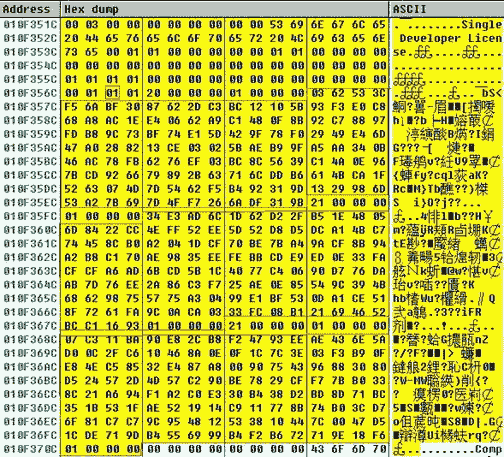

I use 4 markers in red. The first one `01` indicates the current mode is `HardwareLocking`. The second one is original `P5`. The third one is original `P6`. The last one is original `P7`.

From the '`test.aspr2`' file, we get our own `P5`, `P6` and `P7`

`p5=E013BB36B2659FC3EE22DBDD30F4E838AF1EE6910E35F7E880C72AF02E1339604D5F8C30394A8D734ED6D29EE94FAF03E0C90D2FE8C54437DEAAAF1D77954DC5F312BEC881AF845686858756795EC1F233FD1EEF2DA2E0EB68B579A2109C1C3A5FA3F609F1FC7FBE8C0F008DF32C604711466AE11D02F43D47D68C6B2A70CC98`

`p6=10DF36C37A45990F17DE3C2BDDAF020A0140EA68AE0E570997A991F2B947F712599B6F1CA42315D94BFFC5E990B544FB898E9E9108E5A71869A2E145F32042EDA713383FAA51483038A535C05B441782C48CB44085E8130E9A3A74EA8516E7D93D00464A918B6B4E8FE1D301511CE19FA57D0E485D1ED3821D907A19AE8A3FE64`

`p7=12D9DA3EA116EDB35C5723EBF30A9932FC27EE3CF73C4905C2016FFFF3177F7E3C1A17C0E4DBEEE2E73CC260A495A00AAC9202213BB401D6A7540B095290429227F9BF41E57A889AB62FF81391651A99A29CA709DCF3ECC8A912B44D6C30DFF82EE385144C9E31F63ED0F5D0CE7F991109A840F2A18F1F50B53346C67FAAFB005`

Reverse each of them

`p5=98CC702A6B8CD6473DF4021DE16A461147602CF38D000F8CBE7FFCF109F6A35F3A1C9C10A279B568EBE0A22DEF1EFD33F2C15E79568785865684AF81C8BE12F3C54D95771DAFAADE3744C5E82F0DC9E003AF4FE99ED2D64E738D4A39308C5F4D6039132EF02AC780E8F7350E91E61EAF38E8F430DDDB22EEC39F65B236BB13E0`


`p6=64FEA3E89AA107D92138EDD185E4D057FA19CE1115301DFEE8B4B618A96404D0937D6E51A84EA7A3E930815E0844CB482C7841B4055C538A038314A5FA833371DA2E04325F142E9A86715A8E10E9E998B84F540B995EFCBF945D3142CAF1B69925717F942B1F997A9970E5E08AA60E14A020F0DABDC2E37DF19059A4376CF30D01000000`

`p7=05B0AFFA676C34530BF5F1182A0F849A1091F9E70C5D0FED631FE3C9445138EE82FF0DC3D6442B918ACC3ECF9D70CA299AA951163981FF62AB89A8571EF49B7F2229042995B040756A1D40BB132220C9AA005A490A26CC732EEEBE4D0E7CA1C1E3F77731FFFF16205C90C473CFE37EC22F93A930BF3E72C535DB6E11EAA39D2D01000000`

Paste them into memory

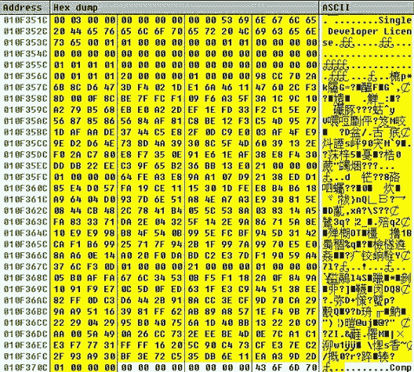

Set new origin on `0109BE2Bh`.

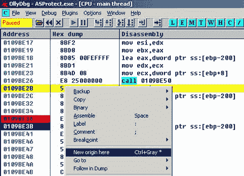

Run to `109BE36h`. We find that the `RC4` subkeys which `EAX` points to have been changed. Load previous saved subkeys in memory. `F8` to `0109BE3Bh`. Complete encryption.

Thus, we have got the new encrypted data. We should cover them to old encrypted data in `Asprotect.exe` file. It's quite easy because we can easily locate them in `Asprotect.exe` file.

### 2.4 Patch CRC check.

After changing the `Asprotect.exe` file. The `CRC` check of encrypted data is also changed. Launch `ollydbg` with new modified `Asprotect.exe`. Let's patch it.

Press `CTRL+S` to find sequence of commands in `Asprotect` dll section

```
mov ebx, [eax]
mov eax, esi
```

We have found the sequence of commands

```
010C8786 mov ebx,dword ptr ds:[eax]
010C8788 mov eax,esi
010C878A call 010ABA88
010C878F add eax,dword ptr ds:[10D4188]
010C8795 call 010C859C
010C879A mov dword ptr ds:[10D4180],eax
010C879F xor ebx,dword ptr ds:[10D4184]
010C87A5 cmp ebx,dword ptr ds:[10D4180]
010C87AB je short 010C87B1
```

Set breakpoint on `010C879Fh`, Press `SHIFT+F9`, we break on `010C879Fh`.

`EBX` is a `CRC` Value which can be located in `Asprotect.exe` file.

The new `CRC` value is `[10D4184h]` XOR `[10D4180h]`, replace old value with new value in `Asprotect.exe` file.

Now everything is OK! HOHO, we are able to make keygen for our 'new Asprotect application'.

## 3 Attack on Activation Key

If we don't have any valid registration key, what could we do? Well, perhaps factoring `RSA N` is terrible. It is correct `EncryptionConst` that activates the application. So we must understand clearly the role of `EncryptionConst` firstly.

Our idea is brute force attack on `EncryptionConst`.

### 3.1 Role of the EncryptionConst

We still debug `Asprotect 2.3 SKE build 03.19 Beta`. As mentioned above, `010AB320h` call is the validation of registration key. If it is verified to be successful, we can set breakpoint and break on `010AB594h`

```
010AB594 push ebx
010AB595 push esi
010AB596 push edi
010AB597 push ebp
010AB598 add esp,-14
010AB59B mov edi,ecx
010AB59D mov esi,edx
010AB59F mov dword ptr ss:[esp],eax
010AB5A2 mov bl,1
010AB5A4 push 4
010AB5A6 lea eax,dword ptr ss:[esp+4]
010AB5AA push eax
010AB5AB lea eax,dword ptr ss:[esp+C]
010AB5AF push eax
010AB5B0 call 010A3FE8
```

`010AB5B0h` call `010A3FE8h` to get `MD5` of `EncryptionConst`. Just like

```
MD5Init(&MD5_ctx);
MD5Update(&MD5_ctx, (char *)&EncryptionConst, 4);
MD5Final(outbuffer, &MD5_ctx);
```

```
010AB5B5 push esi
010AB5B6 push edi
010AB5B7 mov edi,esi
010AB5B9 lea esi,dword ptr ss:[esp+C]
010AB5BD mov ecx,4
010AB5C2 rep movsd
010AB5C4 pop edi
010AB5C5 pop esi
010AB5C6 mov ebp,7530
010AB5CB push 10
010AB5CD push esi
010AB5CE lea eax,dword ptr ss:[esp+C]
010AB5D2 push eax
010AB5D3 call 010A3FE8
010AB5D8 push esi
010AB5D9 push edi
010AB5DA mov edi,esi
010AB5DC lea esi,dword ptr ss:[esp+C]
010AB5E0 mov ecx,4
010AB5E5 rep movsd
010AB5E7 pop edi
010AB5E8 pop esi
010AB5E9 dec ebp
010AB5EA jnz short 010AB5CB
010AB5EC mov dword ptr ds:[edi],10
010AB5F2 mov eax,ebx
010AB5F4 add esp,14
010AB5F7 pop ebp
010AB5F8 pop edi
010AB5F9 pop esi
010AB5FA pop ebx
010AB5FB retn
```

Get the 30000 times `MD5`. Just like

```
for (int i=0; i<30000; i++)
{
    MD5Init(&MD5_ctx);
    MD5Update(&MD5_ctx, outbuffer, 16);
    MD5Final(outbuffer, &MD5_ctx);
}
```

If `EncryptionConst` is correct, `010AB594h` call get 30001 times `MD5` of the `EncryptionConst`. We continue to set breakpoint and break on `010A49A7h`. It starts to decode encrypted section finally.

```
010A49A2 mov eax,dword ptr ss:[ebp-4]
010A49A5 mov edx,dword ptr ds:[eax]
010A49A7 call dword ptr ds:[edx+8]
```

`010A49A7h` call `[edx+8]` to get `MD5` again, so it's 30002 times `MD5` of `EncryptionConst`.

```
010A49AA mov eax,dword ptr ss:[ebp-4]
010A49AD mov eax,dword ptr ds:[eax]
010A49AF call dword ptr ds:[eax+10]
010A49B2 push eax
010A49B3 mov eax,dword ptr ss:[ebp-4]
010A49B6 mov edx,dword ptr ds:[eax]
010A49B8 call dword ptr ds:[edx+C]
010A49BB mov ecx,eax
010A49BD mov edx,esi
010A49BF mov eax,ebx
010A49C1 call 0109BE0C
```

`010A49C1h` call `0109BE0Ch` to `RC4` decrypt a table which include encrypted section information.

`EAX` points to the encrypted table

`ECX` points to 16 bytes `RC4` init key which is 30002 times `MD5` of `EncryptionConst`.

Let's look at the encrypted table

```
11 80 DC 56 AE A7 30 1C F4 09 7E 90
95 82 DC 56 2A A5 30 1C 04 09 7E 90
A4 9F DC 56 25 B8 30 1C 4C 09 7E 90
96 5E DF 56 17 79 33 1C 79 09 7E 90
AE 6F DF 56 2F 48 33 1C 30 09 7E 90
CB 69 DF 56 40 4E 33 1C D7 09 7E 90
59 7C DF 56 D6 5B 33 1C A6 09 7E 90
9C 7F DF 56 1D 58 33 1C 2F 09 7E 90
18 1F DF 56 91 38 33 1C 77 08 7E 90
56 62 DE 56 D7 45 32 1C F2 09 7E 90
9F 33 12 00 A4 33 12 00 61 00 00 00
1B 31 12 00 20 31 12 00 91 00 00 00
2A 2C 12 00 2F 2C 12 00 D9 00 00 00
18 ED 11 00 1D ED 11 00 EC 00 00 00
20 DC 11 00 25 DC 11 00 A5 00 00 00
45 DA 11 00 4A DA 11 00 42 00 00 00
D7 CF 11 00 DC CF 11 00 33 00 00 00
12 CC 11 00 17 CC 11 00 BA 00 00 00
96 AC 11 00 9B AC 11 00 E2 01 00 00
D8 D1 10 00 DD D1 10 00 67 00 00 00
```

The rule is obvious!

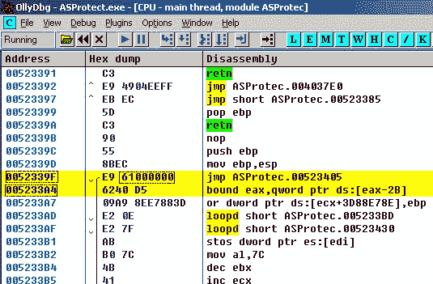

For example, `52339Fh` is an encrypted part. We can easily yield `61h` and `5233A4h` from `52339Fh`. Seeing From `5233A4h` To `5233A4h` + `61h` the `ASM` code is jumbled. So searching `"E9 ?? 00 00 00"` in code section can help us to locate some encrypted part. Fortunately, one address is just enough, we can decrypt the whole table with only one address. What could I say that? Because `RC4` subkeys are just `XOR` operation.

### 3.2 Brute Force Attack on EncryptionConst

Thus we have understood clearly the role of `EncryptionConst`. Let's form a conclusion: If `Asprotect` obtained a correct `EncryptionConst`, it will make 30002 times `MD5` of it. Then the `MD5` output will be used as `RC4` init Key and decrypt a table to get encrypted section's information.

But if we don't have a valid registration key, that means we can't obtained correct `EncryptionConst`. We can also find that table and the decrypted information can be guessed. In this condition, we can write a simple brute force code like this

```
BOOL Check(BYTE key[4])
{
    ……
    MD5Init(&ctx);
    MD5Update(&ctx, key, 4);
    MD5Final(md5key, &ctx);

    for (i=0; i<30001; i++)
    {
        MD5Init(&ctx);
        MD5Update(&ctx, md5key, 16);
        MD5Final(md5key, &ctx);
    }

    rc4_initkey(md5key, 16, &rc4ctx);
    rc4_crypt(data1, 12, &rc4ctx);

    if (memcmp(data1, "….", 12) == 0)
    {
        return TRUE;
    }
    return FALSE;
}

void main()
{
    for (DWORD start = 0; start < 0xFFFFFFFF; start++)
    {
        Check(&(LPBYTE)start);
    }
}
```

It looks less efficient.

### 3.3 Another Example

Another target is `Asprotect 1.35 Release 03.24`. It seems protected by `Asprotect SKE`. Launch `ollydbg` with `Asprotect 1.35 Release 03.24`. `SHIFT+F9` run.

Find the `Asprotect` dll `ImageBase`. Mine is `1020000h`. Set breakpoint on `RVA 1B320h` of the dll `ImageBase(same as above)`. Input name and any invalid registration key (it can be created from any `Asprotect` project). It will break on `103B320h`.

Patch `HardwareLocking` Bytes


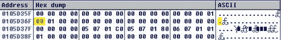

### `Patch return value`

```
0103B3CD call 0103ABA8
0103B3D2 mov ebx, eax
0103B3D4 test bl, bl
0103B3D6 je 0103B4A4
```

`Patch Mode ID = 2` at the end of `103B320h` `call`

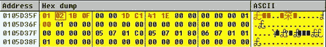

Then `break` on `010349C1h`

```
010349BB mov ecx, eax
010349BD mov edx, esi
010349BF mov eax, ebx
010349C1 call 0102BE0C
```

`Get the encrypted table from EAX`

```
C5 12 4E 26 86 F5 91 4B 15 50 94 4C
78 1A 4E 26 2D FD 91 4B 17 50 94 4C
FD 35 4E 26 AE D2 91 4B 34 50 94 4C
FC 20 4E 26 B1 C7 91 4B BC 51 94 4C
35 78 4E 26 76 9F 91 4B 23 50 94 4C
FA 8D 4F 26 AF 6A 90 4B 11 50 94 4C
```

`Searching for encrypted part with "E9 ?? 00 00 00" in code section.`

`I found one here`

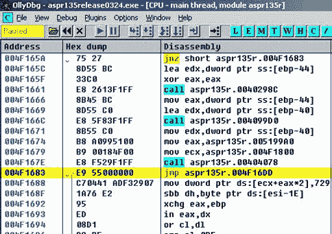

`Guess and decrypt the table`

```
73 7C 0F 00 78 7C 0F 00 63 00 00 00
CE 74 0F 00 D3 74 0F 00 61 00 00 00
4B 5B 0F 00 50 5B 0F 00 42 00 00 00
```

`Write a program and start brute force attack!`

`I have no idea about the EncryptionConst of Asprotect 1.35 Release 03.24. So I am now attacking it. If any one can tell me the correct EncryptionConst or offer me a valid registration key, I will be very grateful to you. My PC is not so strong that it will take about 3 months to get the result 9. Had I got one hundred stronger computer, it would be finished in one day.`

### 4 About Algorthm

`Both MD5 algorthm and RC4 algorthm in Asprotect application is the standard. You can get them from google.`

`Here is the RC4 source code from Asprotect application.`

```c
typedef struct rc4_key
{
    unsigned char state[256];
    unsigned char x;
    unsigned char y;
} rc4_key;

#define swap_byte(x,y) t = *(x); *(x) = *(y); *(y) = t

void init_key(unsigned char *key_data_ptr, int key_data_len, rc4_key *key)
{
    int i;
    unsigned char t;
    unsigned char swapByte;
    unsigned char index1;
    unsigned char index2;
    unsigned char* state;
    unsigned char subkey[256];
    short counter;

    state = &key->state[0];
    for(counter = 0; counter < 256; counter++)
    {
        state[counter] = counter;
        subkey[counter] = key_data_ptr[counter % key_data_len];
    }

    key->x = 0;
    key->y = 0;
    index1 = 0;
    index2 = 0;

    for(counter = 0; counter < 256; counter++)
    {
        index2 = (subkey [index1] + state[counter] + index2) % 256;
        swap_byte(&state[counter], &state[index2]);
        index1 = (index1 + 1) % 256;
    }
}
```

### 5 Conclusion

`Although Asprotect SKE uses RSA public key, but the 32 bits EncryptionConst is so short that it can be force attacked. Most parts of registration key are not well used. With a valid registration key or the correct EncryptionConst, anyone can patch the application protected by Asprotect SKE and make his own keygen.`

`Note that this tutorial is only for research purpose.`

### 6 Greetings

`CoDe_Inject`, `Cnbragon`, `kanxue`

`shoooo314@hotmail.com`

`2006-4-19`

`4dd466d0e1e0cc123afbe504da2462ca`
