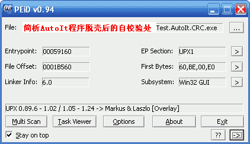
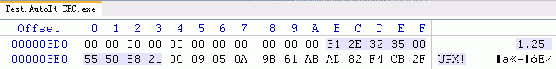
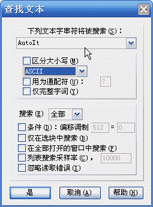
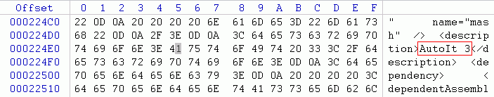
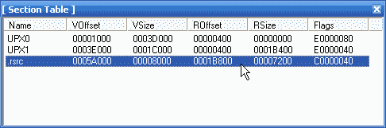
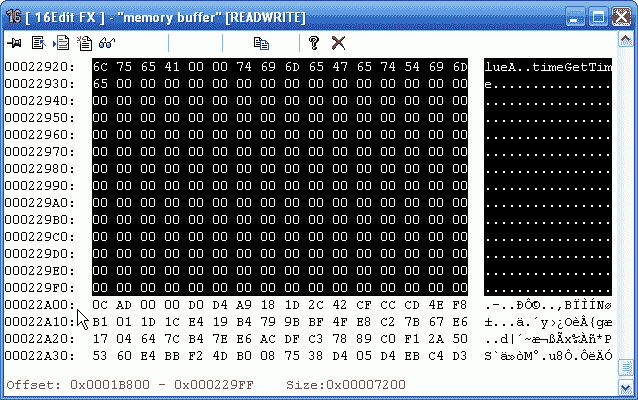
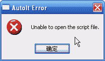
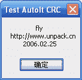

# 简析 AutoIt 程序脱壳后的自校验处理

> 原文：[`www.pediy.com/kssd/pediy08/pediy8-566.htm`](https://www.pediy.com/kssd/pediy08/pediy8-566.htm)

软件大小： `1739 KB`

软件语言： 英文

软件类别： 国外软件 / 免费版 / 系统增强

应用平台： `Win9x/NT/2000/XP`

加入时间： `2005-02-13 15:41:45`

下载次数： `5596`

开 发 商： `http://www.hiddensoft.com/AutoIt/index.html`

软件介绍： 允许您使用宏来自动执行一些操作，可以将宏编译成 `EXE` 来运行。

**【作者声明】：** 只是感兴趣，没有其他目的。失误之处敬请诸位大侠赐教

**【调试环境】：** `WinXP`、`OllyDBD`、`PEiD`、`LordPE`、`WinHex`

---

**【调试过程】：**

`AutoIt` 是一款功能强大的程序。下面来简单分析一下 `AutoIt` 程序脱壳后的自校验处理。

---

## 一、如何确定是 AutoIt 编译的文件

先下载 `AutoIt` 主程序，用其自带的 `Examples` 文件编译一个例子。

```
;Test AutoIt CRC
; AutoIt Version: 3.10
; Language: English
; Platform: WinALL
; Author: fly
; Use the @CRLF macro to do a newline in a MsgBox - it is similar to the \\n in v2.64
MsgBox(0, "Test AutoIt CRC", " fly" & @CRLF & "http://www.unpack.cn" & @CRLF & " 2006.02.25")
```

使用 `Aut2Exe.exe` 编译 `Test.AutoIt.CRC.au3` 脚本，得到 `Test.AutoIt.CRC.exe`

### 1、AutoIt 目前使用 UPX V1.25 压缩，脚本数据以 Overlay 保存

`PEiD V0.94` 显示如下：



用 `WinHex` 打开 `Test.AutoIt.CRC.exe`，可以看到 `UPX` 版本：



### 2、在 WinHex 里面搜索 ASCII 文本字符串：AutoIt



找到 `"<description>AutoIt 3</description>"` 字样



基本可以确定是 `AutoIt` 编译的文件了

---

## 二、脱壳

`UPX` 用 `UPX` 相应版本自脱是最完美的

使用 `UPX V1.25 -d` 对 `Test.AutoIt.CRC.exe` 脱壳，附加数据自动保留下来

也可以用 `UPX-Ripper` 脱壳

如果手动脱壳的话，则需要手工处理 `Overlay`

脱壳文件重命名为：`UnPacKed.exe`

---

## 三、附加数据

由于脚本数据以 `Overlay` 保存在程序中，所以先说一下如何简单识别附加数据吧。

### 1、看上面的图片，PEiD 侦壳时已经显示“[Overlay]”字样

### 2、用 LordPE 打开 Test.AutoIt.CRC.exe 的区段，可以看到最后一个区段的信息：



`RawOffset=0001B800`

`RawSize=00007200`

`0001B800+00007200＝22A00`

最后一个区段数据至 `0X229FF` 处为止。

如果偏移 `0X22A00` 处及其后还有数据，就是 `Overlay` 了

### 3、可以用 LordPE 来快速确定 Overlay

在最后区段上点右键->`Hex Edit Secton`，向下拉动滚动条察看



一直拉到“黑白”交界处，`0X22A00` 下面就是附加数据了。

---

## 四、分析校验

如果现在运行脱壳文件，会提示错误的



那么开始调试吧。用 `OllyDBG` 载入 `Test.AutoIt.CRC.exe` 原版

```
00459160     60                   pushad
//暂停在 UPX 外壳入口
00459161     BE 00E04300          mov esi,43E000
00459166     8DBE 0030FCFF        lea edi,dword ptr ds:[esi+FFFC3000]
0045916C     57                   push edi
0045916D     83CD FF              or ebp,FFFFFFFF
00459170     EB 10                jmp short 00459182
```

不必管 `UPX`

`BP SetFilePointer`

`F9` 运行，中断后取消断点

```
0011EB10   0042C552  /CALL 到 SetFilePointer 来自 Test_Aut.0042C54C
0011EB14   000000D8  |hFile = 000000D8 (window)
0011EB18   FFFFFFFF4  |OffsetLo = FFFFFF4 (-12.)
0011EB1C   00000000  |pOffsetHi = NULL
0011EB20   00000002  \Origin = FILE_END
```

文件指针移动至文件末尾，从末尾再向上移动 `12` 字节

再 `BP ReadFile`，中断后取消断点

```
0011EACC   0042C98E  /CALL 到 ReadFile 来自 Test_Aut.0042C988
0011EAD0   000000D8  |hFile = 000000D8 (window)
0011EAD4   003F9D28  |Buffer = 003F9D28
0011EAD8   00001000  |BytesToRead = 1000 (4096.)
0011EADC   0011EAF0  |pBytesRead = 0011EAF0
0011EAE0   00000000  \pOverlapped = NULL
```

数据窗口中定位到 `003F9D28` 处，`Ctrl+F9` 执行完 `ReadFile`

`003F9D28  22 87 A8 AA AA 80 A8 AA 3C FC 95 58`

可以看到 `003F9D28` 处是读取的 `12` 个字节数据

用 `WinHex` 打开 `Test.AutoIt.CRC.exe`，到末尾看看

```
Offset      0  1  2  3  4  5  6  7   8  9  A  B  C  D  E  F
00022D80                 22 87 A8 AA AA 80 A8 AA
00022D90   3C FC 95 58
```

正是这些数据。

这些数据有何用处？呵呵，`3` 个 `Dword` 数据就是 `AutoIt` 需要校验的三个值了

**抓住这个线索吧**

数据窗口 `003F9D28` 处选择这 `12` 个字节，点击右键->断点->内存访问

`F9` 运行，中断在 `0042C88F`

```
0042C88B     0FB601             movzx eax,byte ptr ds:[ecx]
0042C88E     41                 inc ecx
0042C88F     890E               mov dword ptr ds:[esi],ecx
0042C891     5E                 pop esi
0042C892     C3                 retn
//返回 00429747
00429742     E8 86300000        call 0042C7CD
00429747     83F8 FF            cmp eax,-1
0042974A     59                 pop ecx
0042974B     74 28              je short 00429775
0042974D     8803               mov byte ptr ds:[ebx],al
//EBX=0012ECAD   每个处理取 4 个字节至[EBX]
0042974F     8B46 18            mov eax,dword ptr ds:[esi+18]
00429752     43                 inc ebx
00429753     FF4D 08            dec dword ptr ss:[ebp+8]
00429756     8945 14            mov dword ptr ss:[ebp+14],eax
00429759     837D 08 00         cmp dword ptr ss:[ebp+8],0
0042975D     0F85 76FFFFFF      jnz 004296D9
00429763     8B45 10            mov eax,dword ptr ss:[ebp+10]
00429766     5F                 pop edi
00429767     5E                 pop esi
00429768     5B                 pop ebx
00429769     C9                 leave
0042976A     C3                 retn
```

取消内存断点，在数据窗口定位至 `0012ECAD` 处，选择那 `4` 个字节，右键->断点->内存写入

`F9` 运行，中断在 `00427F07` 处

```
00427EFD     FF36               push dword ptr ds:[esi]
00427EFF     8D5E 04            lea ebx,dword ptr ds:[esi+4]
00427F02     BF AAAAAAAAA        mov edi,AAAAAAAA
00427F07     317D F8            xor dword ptr ss:[ebp-8],edi
//[ebp-8]＝AAA88722 XOR AAAAAAAA=00022D88
//第一个校验值
//这个是计算 CRC 的代码长度
//可以记住 0X00022D88 处数据，然后在脱壳文件中搜索，就可以得到新的长度=00043B88
```

取消内存断点，下面就是其他 `2` 组校验值的处理了

```
00427F0A     6A 01              push 1
00427F0C     6A 04              push 4
00427F0E     53                 push ebx
00427F0F     E8 56170000        call 0042966A
00427F14     FF36               push dword ptr ds:[esi]
00427F16     313B               xor dword ptr ds:[ebx],edi
//[ebx]=[0012FCD0]=AAA880AA XOR AAAAAAAA=00022A00
//第二个校验值
//WinHex 中去偏移 00022A00 处看看，发现是附加数据开始的地址
00427F18     8D45 F0            lea eax,dword ptr ss:[ebp-10]
00427F1B     6A 01              push 1
00427F1D     6A 04              push 4
00427F1F     50                 push eax
00427F20     E8 45170000        call 0042966A
00427F25     317D F0            xor dword ptr ss:[ebp-10],edi
//[ebp-10]=[0012ECA4]=5895FC3C XOR AAAAAAAA=F23F5696
//第三个校验值
//这个运算后的值是文件校验值
00427F28     33FF               xor edi,edi
00427F2A     57                 push edi
00427F2B     57                 push edi
00427F2C     FF36               push dword ptr ds:[esi]
00427F2E     E8 3A160000        call 0042956D
00427F33     8B45 F8            mov eax,dword ptr ss:[ebp-8]
00427F36     83C4 48            add esp,48
00427F39     85C0               test eax,eax
00427F3B     7E 4A              jle short 00427F87
00427F3D     8D8F 00000100      lea ecx,dword ptr ds:[edi+10000]
00427F43     3BC8               cmp ecx,eax
00427F45     7E 07              jle short 00427F4E
00427F47     2BC7               sub eax,edi
00427F49     8945 0C            mov dword ptr ss:[ebp+C],eax
00427F4C     EB 07              jmp short 00427F55
00427F4E     C745 0C 00000100   mov dword ptr ss:[ebp+C],10000
00427F55     FF36               push dword ptr ds:[esi]
00427F57     037D 0C            add edi,dword ptr ss:[ebp+C]
00427F5A     8D85 E4FEFEFF      lea eax,dword ptr ss:[ebp+FFFEFEE4]
00427F60     FF75 0C            push dword ptr ss:[ebp+C]
00427F63     6A 01              push 1
00427F65     50                 push eax
00427F66     E8 FF160000        call 0042966A
00427F6B     83C4 10            add esp,10
00427F6E     8D85 E4FEFEFF      lea eax,dword ptr ss:[ebp+FFFEFEE4]
00427F74     8D4D EC            lea ecx,dword ptr ss:[ebp-14]
00427F77     FF75 0C            push dword ptr ss:[ebp+C]
00427F7A     50                 push eax
00427F7B     E8 25060000        call 004285A5
//计算校验值
```


# 00427F80
```
00427F80     8B45 F8            mov eax,dword ptr ss:[ebp-8]
00427F83     3BF8             cmp edi,eax
//EAX=计算 CRC 的代码长度
00427F85     7C B6            jl short 00427F3D
00427F87     8B45 F0          mov eax,dword ptr ss:[ebp-10]
00427F8A     3B45 EC          cmp eax,dword ptr ss:[ebp-14]
//[ebp-14]中是计算出的校验值     比较校验值
00427F8D     74 05            je short 00427F94
//不跳就挂了
00427F8F     6A 03            push 3
00427F91     5F               pop edi
00427F92     EB 45            jmp short 00427FD9
```

## 五、修复校验

分析清楚了

`AutoIt` 取 `Overlay` 的最后 12 个字节异或 `AAAAAAAA` 得到校验值或者数据地址

1. 第一个校验数据 `XOR AAAAAAAA＝` 计算 CRC 的代码长度
2. 第二个校验数据 `XOR AAAAAAAA＝` 附加数据开始的地址
3. 第三个校验数据 `XOR AAAAAAAA＝` 文件校验值

看看我们用 `UPX` 对 `Test.AutoIt.CRC.exe` 脱壳得到的 `UnPacKed.exe` 文件信息：

1. 计算 CRC 的代码长度＝`00043B88`
2. 附加数据开始的地址＝`00043800`
3. 文件校验值＝需要跟踪－> `F928C0C3`

修复校验：

1. 第一个校验数据＝`00043B88 XOR AAAAAAAA＝AAAE9122`
2. 第二个校验数据＝`00043800 XOR AAAAAAAA＝AAAE92AA`

在 `UnPacKed.exe` 的校验数据开始的地址处修正这 2 个值，再看文件校验

载入 `UnPacKed.exe` 调试，`BP 00427F8A`，运行、中断，`[ebp-14]＝[0012ECA0]=F928C0C3`

3. 第三个校验数据＝`F928C0C3 XOR AAAAAAAA＝53826A69`

当然，第三个校验可以修改 `00427F8D jmp 00427F94` 直接去除，但是不推荐这样做

```
Offset      0  1  2  3  4  5  6  7   8  9  A  B  C  D  E  F
00043B80                    22 91 AE AA AA 92 AE AA
00043B90   69 6A 82 53
```



修正这 12 个字节后，脱壳文件就可以正常运行了。

## 六、例子演示

论坛有个 `SW.exe` 也是 `AutoIt` 编译的文件

用 `UPX-Ripper` 脱壳得到 `SW.UnPacKed.exe`

载入 `SW.exe` 原版调试

```
00476760     60               pushad
//暂停在 UPX 外壳入口
00476761     BE 00E04400      mov esi,44E000
00476766     8DBE 0030FBFF    lea edi,dword ptr ds:[esi+FFFB3000]
0047676C     57               push edi
0047676D     83CD FF          or ebp,FFFFFFFF
00476770     EB 10            jmp short 00476782
004768CB     61               popad
004768CC     E9 17A9FCFF      jmp 004411E8
//F4 到这里
004411E8     55               push ebp
//OEP
004411E9     8BEC             mov ebp,esp
004411EB     6A FF            push -1
004411ED     68 28E44400      push 44E428
004411F2     68 50254400      push 442550
004411F7     64:A1 00000000   mov eax,dword ptr fs:[0]
004411FD     50               push eax
004411FE     64:8925 00000000 mov dword ptr fs:[0],esp
00441205     83EC 58          sub esp,58
00441208     53               push ebx
00441209     56               push esi
0044120A     57               push edi
0044120B     8965 E8          mov dword ptr ss:[ebp-18],esp
0044120E     FF15 A4D94600    call dword ptr ds:[46D9A4]     ; kernel32.GetVersion
```

正常的分析途径如上面所操作的。不过这里用个简便的方法来到检验值处理的地方

`Ctrl+F` 在整个段块搜索命令：`mov edi,0AAAAAAAA`

找到 `0043D50A` 处，下断，`F9` 运行后中断

```
0043D50A     BF AAAAAAAAA     mov edi,AAAAAAAA
0043D50F     317D FC          xor dword ptr ss:[ebp-4],edi
//[ebp-4]=[0012E844]=AAA81120  XOR AAAAAAAA=0002BB8A
//第一个校验值
//计算 CRC 的代码长度
//看看 0X0002BB8A 处数据，然后去 SW.UnPacKed.exe 里搜索，得到新的长度＝0005F58A
0043D512     6A 01            push 1
0043D514     6A 04            push 4
0043D516     53               push ebx
0043D517     E8 55230000      call 0043F871
0043D51C     FF36             push dword ptr ds:[esi]
0043D51E     313B             xor dword ptr ds:[ebx],edi
//[ebx]=[0012F864]=AAA80CAA XOR AAAAAAAA=0002A600
//第二个校验值
//附加数据开始的地址,UnPacKed.exe 里的附加数据开始地址＝0005E000
0043D520     8D45 F4          lea eax,dword ptr ss:[ebp-C]
0043D523     6A 01            push 1
0043D525     6A 04            push 4
0043D527     50               push eax
0043D528     E8 44230000      call 0043F871
0043D52D     317D F4          xor dword ptr ss:[ebp-C],edi
//[ebp-C]=[0012E83C]=5BC7EF2F XOR AAAAAAAA=F16D4585
//第三个校验值
//这个运算后的值是文件校验值
0043D530     33FF             xor edi,edi
0043D532     57               push edi
0043D533     57               push edi
0043D534     FF36             push dword ptr ds:[esi]
0043D536     E8 39220000      call 0043F774
0043D53B     8B45 FC          mov eax,dword ptr ss:[ebp-4]
0043D53E     83C4 48          add esp,48
0043D541     85C0             test eax,eax
0043D543     7E 4A            jle short 0043D58F
0043D545     8D8F 00000100    lea ecx,dword ptr ds:[edi+10000]
0043D54B     3BC8             cmp ecx,eax
0043D54D     7E 07            jle short 0043D556
0043D54F     2BC7             sub eax,edi
0043D551     8945 0C          mov dword ptr ss:[ebp+C],eax
0043D554     EB 07            jmp short 0043D55D
0043D556     C745 0C 00000100 mov dword ptr ss:[ebp+C],10000
0043D55D     FF36             push dword ptr ds:[esi]
0043D55F     037D 0C          add edi,dword ptr ss:[ebp+C]
0043D562     8D85 E8FEFEFF    lea eax,dword ptr ss:[ebp+FFFEFEE8]
0043D568     FF75 0C          push dword ptr ss:[ebp+C]
0043D56B     6A 01            push 1
0043D56D     50               push eax
0043D56E     E8 FE220000      call 0043F871
0043D573     83C4 10          add esp,10
0043D576     8D85 E8FEFEFF    lea eax,dword ptr ss:[ebp+FFFEFEE8]
0043D57C     8D4D F0          lea ecx,dword ptr ss:[ebp-10]
0043D57F     FF75 0C          push dword ptr ss:[ebp+C]
0043D582     50               push eax
0043D583     E8 25060000      call 0043DBAD
0043D588     8B45 FC          mov eax,dword ptr ss:[ebp-4]
0043D58B     3BF8             cmp edi,eax
0043D58D     7C B6            jl short 0043D545
0043D58F     8B45 F4          mov eax,dword ptr ss:[ebp-C]
0043D592     3B45 F0          cmp eax,dword ptr ss:[ebp-10]
//比较校验值
0043D595     74 05            je short 0043D59C
0043D597     6A 03            push 3
0043D599     5F               pop edi
0043D59A     EB 45            jmp short 0043D5E1
```

修复 `SW.UnPacKed.exe` 的校验：

1. 第一个校验数据＝`0005F58A XOR AAAAAAAA＝AAAF5F20`
2. 第二个校验数据＝`0005E000 XOR AAAAAAAA＝AAAF4AAA`

在 `SW.UnPacKed.exe` 的校验数据开始的地址处修正这 2 个值，再看文件校验

载入 `SW.UnPacKed.exe` 调试，`BP 0043D592`，运行、中断，`[ebp-10]＝[0012E838]=6C93F7B3`

3. 第三个校验数据＝`6C93F7B3 XOR AAAAAAAA＝C6395D19`

再修正最后一个校验值，可以运行了。

`Game Over`

```
             ,     \_/
           /| \_.-~/            \\\ ,        青春都一晌
          ( /~   /             \~-.\ |\\
          \`\\\\  /_/                  \\   ~\\ )          忍把浮名
      _-~~~-.)  )\__/;;,.              \\'  //'
  /'_,\\   --~   \\ ~~~-  ,;;\_\_\_(  (.-~~~-.        换了脱壳轻狂
 \`~ \_( ,_..--\\ (     ,;'' /    ~--   /.`\
  /~~//'   ' `~\\           ) /--..\_, ) \`~
  "  \`~"  "       `"       /~'\`\\    \`\\\\~~\
                   "     "   "~'  ""
             CracKed By :  fly
             2006-02-25 24:00
```

`4dd466d0e1e0cc123afbe504da2462ca`
