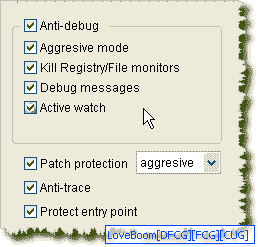
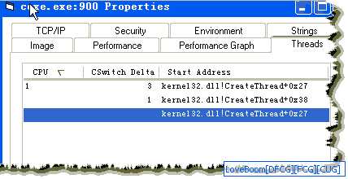
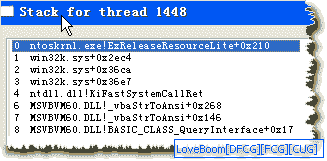
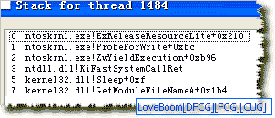
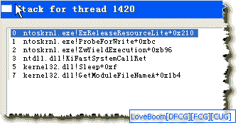
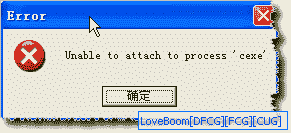
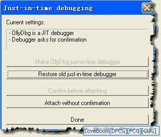
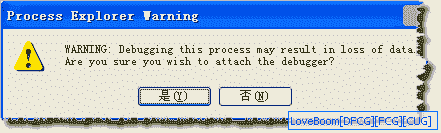
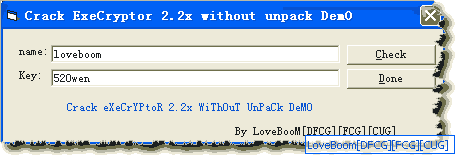
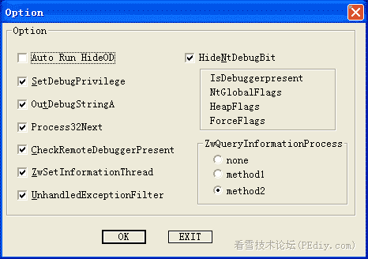

# 穿透 eXeCryptor 2.2x 保护体系(年终篇)

> 原文：[`www.pediy.com/kssd/pediy07/pediy7-771.htm`](https://www.pediy.com/kssd/pediy07/pediy7-771.htm)

## 信息概览

*   **【目标】**: 自己写的一个小程序
*   **【工具】**: `OllyDbg v1.1` (diy 版), `Process Explorer v9.25`
*   **【任务】**: 穿透 `ExeCryptor 2.2x` 保护体系
*   **【操作平台】**: `Windows xp sp2`
*   **【作者】**: `LOVEBOOM[DFCG][FCG][CUG]`
*   **【相关链接】**: [`www.pediy.com/bbs/pediy7/pediy7-771.rar`](http://www.pediy.com/bbs/pediy7/pediy7-771.rar)

## 简要说明

这东西困了我很久了，早就狠狠的玩它一把。外壳的保护体系和其它很多外壳相比确实强了不少、狠了不少，针对 `OD` 更是火上加油，使得很多用 `OD` 的朋友倍感不便。让 `OD` 不方便调试，并不表示我们没有好办法来对付它。

今次，我们就来小小试身解除 `ExeCryptor` 的保护体系，让你的 `OD` 可以不脱壳也同样操作和分析加密保护的程序。今天 `yock` 问了，自己找了下，找到这东西，因此整理下，放出来和大家共享，也算是 2005 年的年终作品，祝大家有个开心的圣诞，2006 活得更精彩!

## 详细过程

我们先来看看 `ExeCryptor` 软件本身的说明。

### ExeCryptor 原软件说明

`EXECryptor` - is a powerful tool used for an application code protection from reverse engineering, analysis and modifications, based on a brand new metamorphing code transformation technology, that allows to significantly increase software security. With `EXECryptor` the code block to protect is disassembling and becomes a subject of nondeterminate transformations, which destroys the visible logical code structure. After the code transformation it remains executable and working as it is supposed to but it cannot be neither analysed nor modificated. There is no concept of the code decryption with `EXECryptor` unlike the others. Protected code blocks are always in the executable state and they are executed as a transformed code. Code restoration becomes an NP-hard problem.

`EXECryptor` has the innovative very powerful antidebug, antitrace and import protection features. `EXECryptor` allows to work with the short registration keys of 12/16 characters long. It is based on new generation of `HardKey` algorithm - cryptographically strong ultrashort digital signature. Algorithm is based on NP-hard problem of finding solution of low degree equation system in Galua field. The algorithm has good resistance and allows to get digital signature 60bits long. In addition to advanced protection features `EXECryptor` allows to compress code and resources of your application.

后面还有一大堆就不全部 copy 下来了，跟过这个外壳的朋友也应该知道这个外壳的保护体系就非常强悍的，如果用 `ollydbg` 进行脱壳或分析将会出非常困难并且费时间的事。

### 软件反调试选项

看看软件本身的关于反调试方面的选项:



关于 `Execryptor 2.2x` 的具体反调试手段，建议看看 `simonzh2000` 的《ExeCryptor 2.2.X 的 Anti Ollydbg 小结》，作者已经很详细了，摘自他文章里的:

1.  `OEP` 处的 `CC` 检查
2.  `AntiDump`
3.  `IsDebuggerPresent`
4.  `[Heap+10h]`
5.  `PEB.NtGlobalFlag`
6.  `GetTickCount`
7.  `FindWindow`
8.  `OutputDebugString`
9.  `ReadProcessMemory(004B1C86, 004C91A0)`
10. 对 `API` 的检查很严格, 几乎每一句都不能下 `CC` 断点, 不能修改
11. 对 `Softice` 也有一些检查.
12. 利用 `OpenProcess("CSRSS.EXE")` 来检测 `OD`

看到十几种保护方式是不是有点想退的感觉，那么有没有什么方法可以比较简单的跳过反 `od` 保护体系，进行动态代码分析呢? 当然有，这篇文章就是知道你怎么去穿透 `ExeCryptor` 保护体系，从而进行动态代码分析。下面我们来一步一步的穿透它的保护体系。

### 准备工作与思路

要穿透它的保护体系，我们都需要些什么呢？首先，得有个目标; 再者对软件保护体系有个了解，知道对方是什么样子，再想可能的办法，想到可能的方法，再去找相关的武器，收集好了全部所需的东西后，就可以进行实战了。

先设置一个目标：

我自己写个了简单的 `Crackme` (作为教学演示，我写的程序没有用 `SDK`。)，然后加上 `Execryptor`，既然要想穿过 `Execryptor` 的保护系统，我也就加上壳所提供的尽可能强的保护方式。

保护体系上面都已经讲过了，既然外壳启动的时候那么多保护来防止 `OD` 调试加载过程，那有没有办法跳过他的启动时的保护来跟踪程序呢？对 `DEBUG` 有所了解的朋友应该很容易想到让程序先运行然后 `Attatch process` (关于 `Attatch` 的文章可以见我以前写的不脱壳也破解 `Acprotect` 的文章)，嗯，我当时也是这么想的，来试试看:

先运行目标程序，然后打开 `OD`，你会发现，外壳很快就会告诉你，`od` 被发现了，打开立刻出现以下错误信息“`[288]Debugger detected -please disable it and restart the application`”。

既然 `OD` 一运行就会检测到，那么可以推断出外壳在实时检测调试器，外壳又要让原程序在没有调试器的情况下正确工作，又要保证有调试器时能够发现的话，只有可能两种方法：

1.  设置几个进程，一个进程进行反调试之类的，一个进程进行原程序的正常工作。
2.  通过在加载程序的时候，增加外壳自己的线程进行检测调试器。

嗯，想到了可能有这两种情况后，先看下是不是第一种情况，怎么看，当然是用进程工具进行查看，说到进程工具，也许你会说，直接用 `Windows` 的进程管理工具不就行了。没错，是可以，但是，我想说的就是 `M$` 做出来的很多东西很鸡肋，看起来功能是有，但往往功能方面少之又少(当然这也是件好事，要是他什么都做的很好，那很多做软件朋友不就难过了:-0)。既然 `M$` 的不好用，就随便去网上下个功能强大一点的不就行了，说到功能强大点的，我想很多朋友也应该知道 `Mark Russin..` 出品的 `process explorer` 吧，也许会说不知道是谁，但如果说是 `FILEMON`，我想搞 `pj` 的很多朋友应该知道。没错了就是 `process explorer`。这也是本文的重要武器之一，并不单是简单的看看进程。后面会讲这个工具在这篇文章里的其它重要用途，好了，`process explorer` 就介绍到这里。回到上面的话题，用 `proc explorer` 查看下，发现程序是单进程的，这样就可以把第一种想法给枪 B 掉。

### 线程分析与处理

现在可以确定是第二种方式，那么外壳创建了几个线程呢？用 `process explorer` 看看线程信息:



通过上面的图可以看出有三线程，因为原程序最少要一主线程，因此可以推测外壳创建了一或两个线程，我自己用 `VB` 写的程序，其中并没有用到多线程，因此可以判断其中有两个线程是外壳创建的，那么哪两个线程是外壳创建的呢，再试双击可以发现:



**(主线程)**



**(外壳线程 1)**



**(外壳线程 2)**

对比一下几个图就可以很容易的发现哪两个线程是外壳所创建的了。

现在线程已经知道了，那么这两个线程哪个检测调试器的呢？还是两个都是检测调试器的？杀了线程会不会影响主线程的运行呢？这么多问题只能一个一个试了，经过试尝发现外壳的两个线程随便杀一个都不会检测调试器了，两个线程都杀掉都不会影响主线程的运行。

那好办，我们把线程都杀掉，再打开 `OD` 进行附加。选择好目标进程后，点附加试试，出现什么信息了??，点附加出来如下出错信息了:



提示不能附加进程，这样直接用 `OD` 里的 `attatch` 就失败了，那么我们就没有办法调试吗？难道就不能附加了??，当然不是了，细心的你就应该会发现，`process explorer` 右键还有一个 `DEBUG` 菜单，那么那个 `Debug` 又是什么呢？想想就知道了，对了就是 `JIT Debugger`，快快打开 `OD` 看看，`OD` 里是不是有相关设置把 `od` 设置为 `Jit Debugger` 呢，对了，在 `OD` 里选择 `Options――＞Just-in-time-debuging`，设置一下，设置为 `JIT Debugger`：



设置好了，然后在 `process explorer` 里 `Debug` 一下试试，选择时会有提示:



选择“是”就可以附加成功了，到这里就基本上把 `Execryptor` 的保护体系给击破了。

### 动态分析演示

我的测试程序里，载入后出现异常，`Shift+f9` 继续。怎么样，现在是不是可以动态分析这个软件了，到这里 `Execryptor` 的保护体系就这样给穿透了。下面以演示软件为例，继续说说。

已经可以动态调试器了，下面简单的说说这个演示软件的分析，随便输入几位用户名，点注册没有反应，因此可以推断有可能是程序判断用户名长度是否合法。重来输入注册名，重来输入注册名，我输入的信息:



然后下断 `bp __vbaLenBstr`，再点 `Check`，断下后，执行到返回，看看代码:

```
004040F8    8B55 E0         MOV EDX,DWORD PTR SS:[EBP-20]
004040FB    52              PUSH EDX
004040FC    FF15 14104000   CALL DWORD PTR DS:[401014]               ; MSVBVM60.__vbaLenBstr
00404102    33C9            XOR ECX,ECX                               ; 返回到这里
00404104    83F8 08         CMP EAX,8                                 ; 这里判断用户名长度是否够 8 位
00404107    0F9CC1          SETL CL
0040410A    F7D9            NEG ECX                                     ; ntdll.7C93056D
0040410C    8BF1            MOV ESI,ECX                                 ; ntdll.7C93056D
0040410E    8D4D E0         LEA ECX,DWORD PTR SS:[EBP-20]
00404111    FF15 58114000   CALL DWORD PTR DS:[401158]                ; MSVBVM60.__vbaFreeStr
00404117    8D4D D0         LEA ECX,DWORD PTR SS:[EBP-30]
0040411A    FF15 5C114000   CALL DWORD PTR DS:[40115C]                ; MSVBVM60.__vbaFreeObj
00404120    66:3BF3         CMP SI,BX
00404123    0F85 CA020000   JNZ <Over>                                 ; 如果不够 8 位就 over 了
00404129    8B17            MOV EDX,DWORD PTR DS:[EDI]
0040412B    57              PUSH EDI
0040412C    FF92 FC020000   CALL DWORD PTR DS:[EDX+2FC]
00404132    50              PUSH EAX
00404133    8D45 D0         LEA EAX,DWORD PTR SS:[EBP-30]
00404136    50              PUSH EAX
00404137    FF15 58104000   CALL DWORD PTR DS:[401058]                ; MSVBVM60.__vbaObjSet
0040413D    8BF0            MOV ESI,EAX
0040413F    8D55 E0         LEA EDX,DWORD PTR SS:[EBP-20]
00404142    52              PUSH EDX
00404143    56              PUSH ESI
00404144    8B0E            MOV ECX,DWORD PTR DS:[ESI]
00404146    FF91 A0000000   CALL DWORD PTR DS:[ECX+A0]
0040414C    3BC3            CMP EAX,EBX
0040414E    DBE2            FCLEX
00404150    7D 12           JGE SHORT 00404164
00404152    68 A0000000     PUSH 0A0
00404157    68 1C354000     PUSH 40351C
0040415C    56              PUSH ESI
0040415D    50              PUSH EAX
0040415E    FF15 3C104000   CALL DWORD PTR DS:[40103C]                ; MSVBVM60.__vbaHresultCheckObj
00404164    8B45 E0         MOV EAX,DWORD PTR SS:[EBP-20]
00404167    50              PUSH EAX
00404168    FF15 14104000   CALL DWORD PTR DS:[401014]                ; MSVBVM60.__vbaLenBstr
0040416E    33C9            XOR ECX,ECX                               ; ntdll.7C93056D
00404170    83F8 0A         CMP EAX,0A                                ; 判断用户名长度是大于 10 位大于也 over 了
```


```
00404173    0F9FC1           SETG CL  

00404176    F7D9            NEG ECX                       ; ntdll.7C93056D  

00404178    8BF1            MOV ESI,ECX                   ; ntdll.7C93056D  

0040417A    8D4D E0         LEA ECX,DWORD PTR SS:[EBP-20]  

0040417D    FF15 58114000  CALL DWORD PTR DS:[401158]         ; MSVBVM60.__vbaFreeStr  

00404183    8D4D D0         LEA ECX,DWORD PTR SS:[EBP-30]  

00404186    FF15 5C114000  CALL DWORD PTR DS:[40115C]         ; MSVBVM60.__vbaFreeObj  

0040418C    66:3BF3         CMP SI,BX  

0040418F    0F85 5E020000  JNZ <Over>  

00404195    8B17            MOV EDX,DWORD PTR DS:[EDI]  

到这里可以判断出用户名长度为 8-10 位  

00404195    8B17            MOV EDX,DWORD PTR DS:[EDI]  

00404197    57              PUSH EDI  

00404198    FF92 FC020000  CALL DWORD PTR DS:[EDX+2FC]  

0040419E    50              PUSH EAX  

0040419F    8D45 D0         LEA EAX,DWORD PTR SS:[EBP-30]  

004041A2    50              PUSH EAX  

004041A3    FF15 58104000  CALL DWORD PTR DS:[401058]     ; MSVBVM60.__vbaObjSet  

004041A9    8BF0            MOV ESI,EAX  

004041AB    8D55 E0         LEA EDX,DWORD PTR SS:[EBP-20]  

004041AE    52              PUSH EDX  

004041AF    56              PUSH ESI  

004041B0    8B0E            MOV ECX,DWORD PTR DS:[ESI]  

004041B2    FF91 A0000000  CALL DWORD PTR DS:[ECX+A0]  

004041B8    3BC3            CMP EAX,EBX  

004041BA    DBE2            FCLEX  

004041BC    7D 12           JGE SHORT 004041D0  

004041BE    68 A0000000     PUSH 0A0  

004041C3    68 1C354000     PUSH 40351C  

004041C8    56              PUSH ESI  

004041C9    50              PUSH EAX  

004041CA    FF15 3C104000  CALL DWORD PTR DS:[40103C]     ; MSVBVM60.__vbaHresultCheckObj  

004041D0    8D55 80         LEA EDX,DWORD PTR SS:[EBP-80]  

004041D3    8D4D C0         LEA ECX,DWORD PTR SS:[EBP-40]   ; 传入参数  

004041D6    C745 88 3835400>MOV DWORD PTR SS:[EBP-78],403538   ; UNICODE "LOVEBOOM"  

004041DD    C745 80 0800000>MOV DWORD PTR SS:[EBP-80],8  

004041E4    FF15 34114000  CALL DWORD PTR DS:[401134]     ; MSVBVM60.__vbaVarDup  

004041EA    53              PUSH EBX  

004041EB    8D45 C0         LEA EAX,DWORD PTR SS:[EBP-40]  

004041EE    68 80000000     PUSH 80  

004041F3    8D4D B0         LEA ECX,DWORD PTR SS:[EBP-50]  

004041F6    50              PUSH EAX  

004041F7    51              PUSH ECX                   ; 把固定字符串转为 ascii  

004041F8    FF15 D4104000  CALL DWORD PTR DS:[4010D4]     ; MSVBVM60.rtcStrConvVar2  

004041FE    395D E4         CMP DWORD PTR SS:[EBP-1C],EBX  

00404201    75 0F           JNZ SHORT 00404212  

00404203    8D55 E4         LEA EDX,DWORD PTR SS:[EBP-1C]  

00404206    52              PUSH EDX  

00404207    68 E0284000     PUSH 4028E0                  ; 引用 COM 对象,可以简单的判断程序可能是用的 Cls 类模块  

0040420C    FF15 00114000  CALL DWORD PTR DS:[401100]     ; MSVBVM60.__vbaNew2  

00404212    8B75 E4         MOV ESI,DWORD PTR SS:[EBP-1C]   ; 上面进去会有异常，忽略异常继续分析  

00404215    8D45 B0         LEA EAX,DWORD PTR SS:[EBP-50]  

00404218    50              PUSH EAX  

00404219    C785 4CFFFFFF F>MOV DWORD PTR SS:[EBP-B4],-1       ; mov string 'LOVEBOOM'  

00404223    FF15 18104000  CALL DWORD PTR DS:[401018]     ; MSVBVM60.__vbaStrVarMove  

00404229    8BD0            MOV EDX,EAX  

0040422B    8D4D D8         LEA ECX,DWORD PTR SS:[EBP-28]  

0040422E    FF15 40114000  CALL DWORD PTR DS:[401140]     ; MSVBVM60.__vbaStrMove  

00404234    8B55 E0         MOV EDX,DWORD PTR SS:[EBP-20]   ; 准备传入注册名'loveboom'  

00404237    8D4D DC         LEA ECX,DWORD PTR SS:[EBP-24]  

0040423A    895D E0         MOV DWORD PTR SS:[EBP-20],EBX  

0040423D    FF15 40114000  CALL DWORD PTR DS:[401140]     ; MSVBVM60.__vbaStrMove  

00404243    8B0E            MOV ECX,DWORD PTR DS:[ESI]  

00404245    8D55 D4         LEA EDX,DWORD PTR SS:[EBP-2C]  

00404248    8D85 4CFFFFFF  LEA EAX,DWORD PTR SS:[EBP-B4]  

0040424E    52              PUSH EDX  

0040424F    50              PUSH EAX  

00404250    8D55 D8         LEA EDX,DWORD PTR SS:[EBP-28]  

00404253    8D45 DC         LEA EAX,DWORD PTR SS:[EBP-24]  

00404256    52              PUSH EDX  

00404257    50              PUSH EAX  

00404258    56              PUSH ESI  

00404259    FF51 20         CALL DWORD PTR DS:[ECX+20]     ; COM 对象进行算法运算,跟踪过的朋友就知道是什么算法了:-),不信你试试  

0040425C    3BC3            CMP EAX,EBX  

0040425E    DBE2            FCLEX  

00404260    7D 0F           JGE SHORT 00404271  

00404262    6A 20           PUSH 20  

00404264    68 7C354000     PUSH 40357C  

00404269    56              PUSH ESI  

0040426A    50              PUSH EAX  

0040426B    FF15 3C104000  CALL DWORD PTR DS:[40103C]     ; MSVBVM60.__vbaHresultCheckObj  

00404271    8B55 D4         MOV EDX,DWORD PTR SS:[EBP-2C]   ; [EBP-2C]处就是正确的注册码了.'3F436E403F9DA3793F3FB3E34DD7C6D9FC3F00'  

00404274    8D4D E8         LEA ECX,DWORD PTR SS:[EBP-18]  

00404277    895D D4         MOV DWORD PTR SS:[EBP-2C],EBX  

0040427A    FF15 40114000  CALL DWORD PTR DS:[401140]     ; MSVBVM60.__vbaStrMove  

00404280    8D4D D8         LEA ECX,DWORD PTR SS:[EBP-28]  

00404283    8D55 DC         LEA EDX,DWORD PTR SS:[EBP-24]  

00404286    51              PUSH ECX                   ; ntdll.7C93056D  

00404287    52              PUSH EDX  

00404288    6A 02           PUSH 2  

0040428A    FF15 14114000  CALL DWORD PTR DS:[401114]     ; MSVBVM60.__vbaFreeStrList  

00404290    83C4 0C         ADD ESP,0C  

00404293    8D4D D0         LEA ECX,DWORD PTR SS:[EBP-30]  

00404296    FF15 5C114000  CALL DWORD PTR DS:[40115C]     ; MSVBVM60.__vbaFreeObj  

0040429C    8D45 B0         LEA EAX,DWORD PTR SS:[EBP-50]  

0040429F    8D4D C0         LEA ECX,DWORD PTR SS:[EBP-40]  

004042A2    50              PUSH EAX  

004042A3    51              PUSH ECX                   ; ntdll.7C93056D  

004042A4    6A 02           PUSH 2  

004042A6    FF15 1C104000  CALL DWORD PTR DS:[40101C]     ; MSVBVM60.__vbaFreeVarList  

004042AC    8B17            MOV EDX,DWORD PTR DS:[EDI]  

004042AE    83C4 0C         ADD ESP,0C  

004042B1    57              PUSH EDI  

004042B2    FF92 08030000  CALL DWORD PTR DS:[EDX+308]  

004042B8    50              PUSH EAX  

004042B9    8D45 D0         LEA EAX,DWORD PTR SS:[EBP-30]  

004042BC    50              PUSH EAX  

004042BD    FF15 58104000  CALL DWORD PTR DS:[401058]     ; MSVBVM60.__vbaObjSet  

004042C3    8BF0            MOV ESI,EAX  

004042C5    8D55 E0         LEA EDX,DWORD PTR SS:[EBP-20]  

004042C8    52              PUSH EDX  

004042C9    56              PUSH ESI  

004042CA    8B0E            MOV ECX,DWORD PTR DS:[ESI]  

004042CC    FF91 A0000000  CALL DWORD PTR DS:[ECX+A0]     ; 释放 COM 对象  

004042D2    3BC3            CMP EAX,EBX  

004042D4    DBE2            FCLEX  

004042D6    7D 12           JGE SHORT 004042EA  

004042D8    68 A0000000     PUSH 0A0  

004042DD    68 1C354000     PUSH 40351C  

004042E2    56              PUSH ESI  

004042E3    50              PUSH EAX  

004042E4    FF15 3C104000  CALL DWORD PTR DS:[40103C]     ; MSVBVM60.__vbaHresultCheckObj  

004042EA    8B45 E0         MOV EAX,DWORD PTR SS:[EBP-20]   ; 这里就是输入的注册码  

004042ED    8B4D E8         MOV ECX,DWORD PTR SS:[EBP-18]   ; 这里便是正确的注册码  

004042F0    50              PUSH EAX  

004042F1    51              PUSH ECX                   ; ntdll.7C93056D  

004042F2    FF15 90104000  CALL DWORD PTR DS:[401090]     ; MSVBVM60.__vbaStrCmp  

004042F8    8BF0            MOV ESI,EAX  

004042FA    8D4D E0         LEA ECX,DWORD PTR SS:[EBP-20]  

004042FD    F7DE            NEG ESI  

004042FF    1BF6            SBB ESI,ESI  
```


## 汇编代码片段

```
00404301    46              INC ESI
00404302    F7DE            NEG ESI
00404304    FF15 58114000   CALL DWORD PTR DS:[401158]      ; MSVBVM60.__vbaFreeStr
0040430A    8D4D D0         LEA ECX,DWORD PTR SS:[EBP-30]
0040430D    FF15 5C114000   CALL DWORD PTR DS:[40115C]      ; MSVBVM60.__vbaFreeObj
00404313    66:3BF3         CMP SI,BX                       ; 这里进行比较
00404316    BA 30354000     MOV EDX,403530
0040431B    8D4D E8         LEA ECX,DWORD PTR SS:[EBP-18]
0040431E    74 65           JE SHORT 00404385               ; 如果注册码不对则跳
00404320    FF15 10114000   CALL DWORD PTR DS:[401110]      ; MSVBVM60.__vbaStrCopy
00404326    B9 0A000000     MOV ECX,0A                      ; 显示信息框
0040432B    B8 0400280      MOV EAX,80020004
00404330    894D 90         MOV DWORD PTR SS:[EBP-70],ECX   ; ntdll.7C93056D
00404333    894D A0         MOV DWORD PTR SS:[EBP-60],ECX   ; ntdll.7C93056D
00404336    894D B0         MOV DWORD PTR SS:[EBP-50],ECX   ; ntdll.7C93056D
00404339    8D55 80         LEA EDX,DWORD PTR SS:[EBP-80]
0040433C    8D4D C0         LEA ECX,DWORD PTR SS:[EBP-40]
0040433F    8945 98         MOV DWORD PTR SS:[EBP-68],EAX
00404342    8945 A8         MOV DWORD PTR SS:[EBP-58],EAX
00404345    8945 B8         MOV DWORD PTR SS:[EBP-48],EAX
00404348    C745 88 5037400>MOV DWORD PTR SS:[EBP-78],403750  ; UNICODE "pass"
0040434F    C745 80 0800000>MOV DWORD PTR SS:[EBP-80],8
00404356    FF15 34114000   CALL DWORD PTR DS:[401134]      ; MSVBVM60.__vbaVarDup
0040435C    8D55 90         LEA EDX,DWORD PTR SS:[EBP-70]
0040435F    8D45 A0         LEA EAX,DWORD PTR SS:[EBP-60]
00404362    52              PUSH EDX
00404363    8D4D B0         LEA ECX,DWORD PTR SS:[EBP-50]
00404366    50              PUSH EAX
00404367    51              PUSH ECX                      ; ntdll.7C93056D
00404368    8D55 C0         LEA EDX,DWORD PTR SS:[EBP-40]
0040436B    53              PUSH EBX
0040436C    52              PUSH EDX
0040436D    FF15 5C104000   CALL DWORD PTR DS:[40105C]      ; MSVBVM60.rtcMsgBox
00404373    8D45 90         LEA EAX,DWORD PTR SS:[EBP-70]
00404376    8D4D A0         LEA ECX,DWORD PTR SS:[EBP-60]
00404379    50              PUSH EAX
0040437A    8D55 B0         LEA EDX,DWORD PTR SS:[EBP-50]
0040437D    51              PUSH ECX                      ; ntdll.7C93056D
0040437E    8D45 C0         LEA EAX,DWORD PTR SS:[EBP-40]
00404381    52              PUSH EDX
00404382    50              PUSH EAX
00404383    EB 63           JMP SHORT 004043E8
00404385    FF15 10114000   CALL DWORD PTR DS:[401110]      ; 错误提示的信息框
0040438B    B9 0A000000     MOV ECX,0A
00404390    B8 0400280      MOV EAX,80020004
00404395    894D 90         MOV DWORD PTR SS:[EBP-70],ECX   ; ntdll.7C93056D
00404398    894D A0         MOV DWORD PTR SS:[EBP-60],ECX   ; ntdll.7C93056D
0040439B    894D B0         MOV DWORD PTR SS:[EBP-50],ECX   ; ntdll.7C93056D
0040439E    8D55 80         LEA EDX,DWORD PTR SS:[EBP-80]
004043A1    8D4D C0         LEA ECX,DWORD PTR SS:[EBP-40]
004043A4    8945 98         MOV DWORD PTR SS:[EBP-68],EAX
004043A7    8945 A8         MOV DWORD PTR SS:[EBP-58],EAX
004043AA    8945 B8         MOV DWORD PTR SS:[EBP-48],EAX
004043AD    C745 88 6037400>MOV DWORD PTR SS:[EBP-78],403760  ; UNICODE "sorry"
004043B4    C745 80 0800000>MOV DWORD PTR SS:[EBP-80],8
004043BB    FF15 34114000   CALL DWORD PTR DS:[401134]      ; MSVBVM60.__vbaVarDup
004043C1    8D4D 90         LEA ECX,DWORD PTR SS:[EBP-70]
```

## 算法分析

通过动态分析下就知道算法应该为:`SN=F(name,key['LOVEBOOM'])`

判断部分为:

```vb
If inkey=sn then
    Msgbox "pass"
Else
    Msgbox "sorry"
Endif
```

OK,是不是比较简单，没错了，现在你也可以和别人说，你穿透 `Execryptor` 的保护体系，你也可以不脱壳直接动态分析 `Execryptor` 了。

BTW:这篇文章对某些外挂用 `Execryptor` 加密的朋友产生的影响表示歉意。当然对想破解 `Execryptor` 加密的外挂而又不会脱壳的朋友来说，也许算是一件好消息:-p。

## 致谢

**LoVe Wen**

**Greets:**

Fly.Jingulong,yock,tDasm.David.hexer,hmimys,ahao.UFO(brother).alan(sister).all of my friends and you!

By loveboom[DFCG][FCG][US]

[`blog.csdn.net/bmd2chen`](http://blog.csdn.net/bmd2chen)

Email:loveboom#163.com

Date:12/22/2005 3:31:00 AM

## 脱壳实战：脱 loveboom 的 execryptor 的文章里的那个例子

学习了 `loveboom` 的文章收获不小

其实像 `VB` 这样的程序,就算 `execryptor`,利用现有的条件是可以轻松脱掉的

`flyodbg` + `hideod` 插件 (看雪老师的)

`OD` 载入 `cexe.exe` 停在系统断点

忽略所有异常, 清除所有断点(包括 `OEP` 的只一次的那个, `alt-b`, 所有的统统的删掉)

打上 `hideod` 插件, `option` 可以这样选



然后 `shift + F9` 运行

实际上是跑不起来的, 左下角显示被调试的程序无法处理异常

但是不要紧, 看看 `401000` 的段, 已经解码了

这时可以用 `OD dump`, 得到 `1.exe`

`dump` 后 `cexe.exe` 不要关, 到 `401000` 段, `ctrl-b` 搜索 `ff 25`

找到这些

```
00402350    - FF25 74104000    jmp dword ptr ds:[401074]                ; MSVBVM60.__vbaChkstk
00402356    - FF25 BC104000    jmp dword ptr ds:[4010BC]                ; MSVBVM60.__vbaExceptHandler
0040235C    - FF25 D0104000    jmp dword ptr ds:[4010D0]                ; MSVBVM60.__vbaFPException
00402362    - FF25 60104000    jmp dword ptr ds:[401060]                ; MSVBVM60._adj_fdiv_m16i
00402368    - FF25 40104000    jmp dword ptr ds:[401040]                ; MSVBVM60._adj_fdiv_m32
0040236E    - FF25 04114000    jmp dword ptr ds:[401104]                ; MSVBVM60._adj_fdiv_m32i
00402374    - FF25 24104000    jmp dword ptr ds:[401024]                ; MSVBVM60._adj_fdiv_m64
0040237A    - FF25 1C114000    jmp dword ptr ds:[40111C]                ; MSVBVM60._adj_fdiv_r
00402380    - FF25 68104000    jmp dword ptr ds:[401068]                ; MSVBVM60._adj_fdivr_m16i
00402386    - FF25 18114000    jmp dword ptr ds:[401118]                ; MSVBVM60._adj_fdivr_m32
0040238C    - FF25 0C114000    jmp dword ptr ds:[40110C]                ; MSVBVM60._adj_fdivr_m32i
00402392    - FF25 C8104000    jmp dword ptr ds:[4010C8]                ; MSVBVM60._adj_fdivr_m64
00402398    - FF25 A4104000    jmp dword ptr ds:[4010A4]                ; MSVBVM60._adj_fpatan
0040239E    - FF25 C4104000    jmp dword ptr ds:[4010C4]                ; MSVBVM60._adj_fprem
004023A4    - FF25 30104000    jmp dword ptr ds:[401030]                ; MSVBVM60._adj_fprem1
004023AA    - FF25 08104000    jmp dword ptr ds:[401008]                ; MSVBVM60._adj_fptan
004023B0    - FF25 3C114000    jmp dword ptr ds:[40113C]                ; MSVBVM60._CIatan
004023B6    - FF25 04104000    jmp dword ptr ds:[401004]                ; MSVBVM60._CIcos
004023BC    - FF25 54114000    jmp dword ptr ds:[401154]                ; MSVBVM60._CIexp
004023C2    - FF25 E8104000    jmp dword ptr ds:[4010E8]                ; MSVBVM60._CIlog
004023C8    - FF25 6C104000    jmp dword ptr ds:[40106C]                ; MSVBVM60._CIsin
004023CE    - FF25 B0104000    jmp dword ptr ds:[4010B0]                ; MSVBVM60._CIsqrt
004023D4    - FF25 4C114000    jmp dword ptr ds:[40114C]                ; MSVBVM60._CItan
004023DA    - FF25 48114000    jmp dword ptr ds:[401148]                ; MSVBVM60._allmul
004023E0    - FF25 9C104000    jmp dword ptr ds:[40109C]                ; MSVBVM60.DllFunctionCall
004023E6    - FF25 20104000    jmp dword ptr ds:[401020]                ; MSVBVM60.__vbaEnd
004023EC    - FF25 64104000    jmp dword ptr ds:[401064]                ; MSVBVM60.__vbaObjSetAddref
004023F2    - FF25 5C104000    jmp dword ptr ds:[40105C]                ; MSVBVM60.rtcMsgBox
```


## MSVBVM60 导入地址表

```
004023F8        - FF25 10114000    jmp dword ptr ds:[401110]                   ; MSVBVM60.__vbaStrCopy

004023FE        - FF25 1C104000    jmp dword ptr ds:[40101C]                   ; MSVBVM60.__vbaFreeVarList

00402404        - FF25 14114000    jmp dword ptr ds:[401114]                   ; MSVBVM60.__vbaFreeStrList

0040240A        - FF25 18104000    jmp dword ptr ds:[401018]                   ; MSVBVM60.__vbaStrVarMove

00402410        - FF25 00114000    jmp dword ptr ds:[401100]                   ; MSVBVM60.__vbaNew2

00402416        - FF25 40114000    jmp dword ptr ds:[401140]                   ; MSVBVM60.__vbaStrMove

0040241C        - FF25 34114000    jmp dword ptr ds:[401134]                   ; MSVBVM60.__vbaVarDup

00402422        - FF25 D4104000    jmp dword ptr ds:[4010D4]                   ; MSVBVM60.rtcStrConvVar2

00402428        - FF25 14104000    jmp dword ptr ds:[401014]                   ; MSVBVM60.__vbaLenBstr

0040242E        - FF25 5C114000    jmp dword ptr ds:[40115C]                   ; MSVBVM60.__vbaFreeObj

00402434        - FF25 58114000    jmp dword ptr ds:[401158]                   ; MSVBVM60.__vbaFreeStr

0040243A        - FF25 3C104000    jmp dword ptr ds:[40103C]                   ; MSVBVM60.__vbaHresultCheckObj

00402440        - FF25 58104000    jmp dword ptr ds:[401058]                   ; MSVBVM60.__vbaObjSet

00402446        - FF25 90104000    jmp dword ptr ds:[401090]                   ; MSVBVM60.__vbaStrCmp

0040244C        - FF25 80104000    jmp dword ptr ds:[401080]                   ; MSVBVM60.__vbaFileClose

00402452        - FF25 DC104000    jmp dword ptr ds:[4010DC]                   ; MSVBVM60.__vbaGetOwner3

00402458        - FF25 24114000    jmp dword ptr ds:[401124]                   ; MSVBVM60.rtcFileLen

0040245E        - FF25 98104000    jmp dword ptr ds:[401098]                   ; MSVBVM60.__vbaPutOwner3

00402464        - FF25 8C104000    jmp dword ptr ds:[40108C]                   ; MSVBVM60.rtcKillFiles

0040246A        - FF25 FC104000    jmp dword ptr ds:[4010FC]                   ; MSVBVM60.rtcFileLength

00402470        - FF25 F0104000    jmp dword ptr ds:[4010F0]                   ; MSVBVM60.__vbaFileOpen

00402476        - FF25 F8104000    jmp dword ptr ds:[4010F8]                   ; MSVBVM60.rtcFreeFile

0040247C        - FF25 94104000    jmp dword ptr ds:[401094]                   ; MSVBVM60.__vbaAryConstruct2

00402482        - FF25 B8104000    jmp dword ptr ds:[4010B8]                   ; MSVBVM60.__vbaUI1I4

00402488        - FF25 7C104000    jmp dword ptr ds:[40107C]                   ; MSVBVM60.__vbaGosubFree

0040248E        - FF25 4C104000    jmp dword ptr ds:[40104C]                   ; MSVBVM60.__vbaExitProc

00402494        - FF25 20114000    jmp dword ptr ds:[401120]                   ; MSVBVM60.rtcErrObj

0040249A        - FF25 CC104000    jmp dword ptr ds:[4010CC]                   ; MSVBVM60.__vbaGosub

004024A0        - FF25 54104000    jmp dword ptr ds:[401054]                   ; MSVBVM60.__vbaOnError

004024A6        - FF25 60114000    jmp dword ptr ds:[401160]                   ; MSVBVM60.rtcR8ValFromBstr

004024AC        - FF25 E4104000    jmp dword ptr ds:[4010E4]                   ; MSVBVM60.rtcBstrFromAnsi

004024B2        - FF25 00104000    jmp dword ptr ds:[401000]                   ; MSVBVM60.__vbaR8ForNextCheck

004024B8        - FF25 34104000    jmp dword ptr ds:[401034]                   ; MSVBVM60.__vbaStrCat

004024BE        - FF25 70104000    jmp dword ptr ds:[401070]                   ; MSVBVM60.rtcMidCharBstr

004024C4        - FF25 2C104000    jmp dword ptr ds:[40102C]                   ; MSVBVM60.rtcAnsiValueBstr

004024CA        - FF25 08114000    jmp dword ptr ds:[401108]                   ; MSVBVM60.rtcHexBstrFromVar

004024D0        - FF25 44104000    jmp dword ptr ds:[401044]                   ; MSVBVM60.__vbaAryDestruct

004024D6        - FF25 F4104000    jmp dword ptr ds:[4010F4]                   ; MSVBVM60.__vbaVar2Vec

004024DC        - FF25 10104000    jmp dword ptr ds:[401010]                   ; MSVBVM60.__vbaAryMove

004024E2        - FF25 28104000    jmp dword ptr ds:[401028]                   ; MSVBVM60.__vbaRaiseEvent

004024E8        - FF25 44114000    jmp dword ptr ds:[401144]                   ; MSVBVM60.__vbaR8IntI4

004024EE        - FF25 38114000    jmp dword ptr ds:[401138]                   ; MSVBVM60.__vbaFpI4

004024F4        - FF25 48104000    jmp dword ptr ds:[401048]                   ; MSVBVM60.rtcRandomNext

004024FA        - FF25 50104000    jmp dword ptr ds:[401050]                   ; MSVBVM60.rtcRandomize

00402500        - FF25 D8104000    jmp dword ptr ds:[4010D8]                   ; MSVBVM60.__vbaUbound

00402506        - FF25 A8104000    jmp dword ptr ds:[4010A8]                   ; MSVBVM60.__vbaRedim

0040250C        - FF25 0C104000    jmp dword ptr ds:[40100C]                   ; MSVBVM60.__vbaFreeVar

00402512        - FF25 78104000    jmp dword ptr ds:[401078]                   ; MSVBVM60.rtcSpaceVar

00402518        - FF25 EC104000    jmp dword ptr ds:[4010EC]                   ; MSVBVM60.__vbaErrorOverflow

0040251E        - FF25 C0104000    jmp dword ptr ds:[4010C0]                   ; MSVBVM60.__vbaStrToUnicode

00402524        - FF25 38104000    jmp dword ptr ds:[401038]                   ; MSVBVM60.__vbaSetSystemError

0040252A        - FF25 30114000    jmp dword ptr ds:[401130]                   ; MSVBVM60.__vbaStrToAnsi

00402530        - FF25 50114000    jmp dword ptr ds:[401150]                   ; MSVBVM60.__vbaAryUnlock

00402536        - FF25 88104000    jmp dword ptr ds:[401088]                   ; MSVBVM60.__vbaGenerateBoundsError

0040253C        - FF25 2C114000    jmp dword ptr ds:[40112C]                   ; MSVBVM60.__vbaAryLock

00402542        - FF25 E0104000    jmp dword ptr ds:[4010E0]                   ; MSVBVM60.VarPtr

00402548        - FF25 A0104000    jmp dword ptr ds:[4010A0]                   ; MSVBVM60.__vbaRedimPreserve

0040254E        - FF25 B4104000    jmp dword ptr ds:[4010B4]                   ; MSVBVM60.EVENT_SINK_QueryInterface

00402554        - FF25 84104000    jmp dword ptr ds:[401084]                   ; MSVBVM60.EVENT_SINK_AddRef

0040255A        - FF25 AC104000    jmp dword ptr ds:[4010AC]                   ; MSVBVM60.EVENT_SINK_Release

00402560        - FF25 28114000    jmp dword ptr ds:[401128]                   ; MSVBVM60.ThunRTMain
```

## 修复步骤

### 1. 获取输入表
到了这里，知道输入表在哪里了。

打开 `ImportREC`，`oep` 可以先不输，`RVA` 填 `1000`，`size` 也先 `1000`，点获得输入表，只有第一个是真的，后面的全 `cut` 掉。

### 2. 修复可执行文件
用 `importREC` 修复刚刚的 `1.exe`，得到 `1_.exe`，可以把这次调试关掉了。

### 3. 修改 OEP 和 TLS
用 `LordPE` 打开 `1_.exe`，`oep` 填入 `22FF0`。`22FF0` 是 `401000` 段末尾的空白处，将 TLS 表的 `53110` 和 `18` 全都清 `0`，保存退出。

### 4. 验证 OEP
用 `OD` 载入后停在我们改的 `oep` `422FF0`，现在是空的：

```
00422FF0 1_.<Mo>  0000             add byte ptr ds:[eax],al

00422FF2          0000             add byte ptr ds:[eax],al

00422FF4          0000             add byte ptr ds:[eax],al

00422FF6          0000             add byte ptr ds:[eax],al

00422FF8          0000             add byte ptr ds:[eax],al

00422FFA          0000             add byte ptr ds:[eax],al

00422FFC          0000             add byte ptr ds:[eax],al

00422FFE          0000             add byte ptr ds:[eax],al
```

### 5. 修改指令
在第一个区段搜索 `vb5` 这个字符串，结果是在 `402854`。

所以我们这样改 `oep`：

```
00422FF0 1_.<Mo>  68 54284000      push 1_.00402854                    ; ASCII "VB5!6&vb6chs.dll"
```


`00422FF5  E8 66F5FDFF` `call <jmp.&msvbvm60.ThunRTMain>` //这个是上面 `jmp [输入表]` 的最后一个, `VB` 的入口

`00422FFA  0000` `add byte ptr ds:[eax],al`

`00422FFC  0000` `add byte ptr ds:[eax],al`

`00422FFE  0000` `add byte ptr ds:[eax],al`

然后保存退出, 脱壳。

`4dd466d0e1e0cc123afbe504da2462ca`
