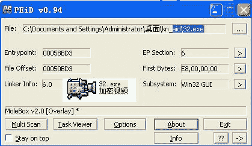
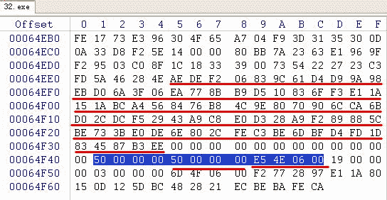
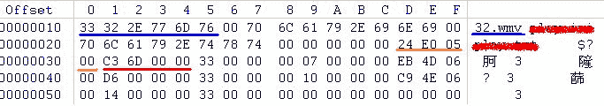
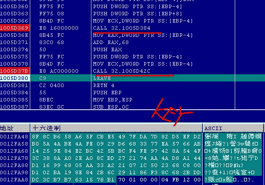

# MoleBox Pro 2.6.5 捆绑的强加密数据文件提取方法

> 原文：[`www.pediy.com/kssd/pediy11/124956.html`](https://www.pediy.com/kssd/pediy11/124956.html)

有一些东西是用这款软件捆绑的，所以有必要探究一下其中的奥秘。通过这几天的探索，终于实现了提取的方法，不敢独自享用，写出来和大家分享一下，以证明在 2010 年没有虚度光阴。研究的重点是捆绑数据的提取。大概原理如下：在用 `MoleBox Pro 2.6.5` 加壳后的文件如果捆绑了加强密的数据，那么在文件尾部有些数据解密后会知道捆绑了哪些文件，并且在文件内的什么位置，有多大，这时候提取出来的数据是加了密的，必须解密方可还原原始数据。主要难点在于：

1. 这个解密密钥是什么，在哪里？
2. 解密算法是什么？
3. 如何定位捆绑文件在加壳程序中的位置？







下面具体分析：

## 一、解决文件的定位问题

随便用狂牛视频加密 `v0.7.5.7` 加密一段视频生成的可执行文件就是一个很好的例子。在它的尾部这里是“`50000000 E54E0600`”，前面一个双字是大小，后面一个是文件内偏移，也就是上面画横线的 `50h` 个字节。这部分解密后会是上面的样子：划短线的分别是文件名和其对应的文件内偏移及大小。

用 `od` 载入 `32.exe`

```
1005F33E    89440A 04       MOV DWORD PTR DS:[EDX+ECX+4],EAX  //在此处下硬件执行断点
1005F342    E9 08FFFFFF     JMP 32.1005F24F
```

运行后断下，`edx` 所指向的地方就是这样，此时刚填充完 `88 31 8C 00`，也就是被捆绑的第一个文件名的地址

```
008C31A1  88 31 8C 00 24 E0 05 00 C3 6D 00 00 33 00 00 00  ??$?...3...
008C31B1  07 00 00 00 EB 4D 06 00 D6 00 00 00 33 00 00 00  ....?..3...
008C31C1  10 00 00 00 C9 4E 06 00 14 00 00 00 33 00 00 00  .......3...
```

这里要连续断下 3 次，因为捆绑了 3 个文件需要填充 3 次，除了文件名地址没有填其他数据都是刚才从尾部那个 `50h` 字节数据解密而来。现在你可以根据这里的一段数据提取出来所有捆绑的文件，但是其数据还需解密。

## 二、解决密钥来源的问题

大致先读取文件内某处的数据，而后经过若干次解密运算得到，比较复杂。

通过调试发现来最初之于代码段 `57000` 的偏移 `1c3c` 处，也就是文件内偏移 `4f000+1c3c=50C3C` 的地方。

```
10058C3C  43 0A 0B 1A 01 72 7B 04 54 5B 3A 74 F1 32 45 1D  C.r{T[...t?E
10058C4C  F0 07 10 D3 C9 D2 8F 1E 2E C9 E8 EB 43 AF A7 6F  ?由.设 o
10058C5C  74 8F 78 68 A0 51 8F 7B A0 2E 72 6F 97 65 AA 05  th?ro?
10058C6C  3C 84 A0 E9 59 CF 36 68 A1 DC 3E F7 DA D4 90 23  <?h≤>髭#
10058C7C  A6 EC F0 3B DF AF 32 65 7D 3B CF 7E FB FA FF 7B  ?忒 2e};{
10058C8C  B9 E8 FD D4 EB 5B AA CA F5 0C 8B 52 13 EC 4A CC  硅?
10058C9C  5F 3A 86 4A 01 3A 4F 27 C0 E0 98 D7 9B E3 F1 C7  \_::O'类袂
10058CAC  CE D9 ED 93 0F 89 0A F2 2E 37 49 7A A6 9D 45 3F  钨??7IzE?
```

从该处读取 `80h` 字节的数据然后通过以下代码段 1 进行第一次解密：

### 代码段 1

```
1005861E    8B55 9C         MOV EDX,DWORD PTR SS:[EBP-64]
10058621    3B55 AC         CMP EDX,DWORD PTR SS:[EBP-54]
10058624    73 20           JNB SHORT 32.10058646
10058626    8B45 B4         MOV EAX,DWORD PTR SS:[EBP-4C]
10058629    69C0 0D661900   IMUL EAX,EAX,19660D
1005862F    05 75F36E3C     ADD EAX,3C6EF375
10058634    8945 B4         MOV DWORD PTR SS:[EBP-4C],EAX
10058637    8B4D 9C         MOV ECX,DWORD PTR SS:[EBP-64]
1005863A    8B11            MOV EDX,DWORD PTR DS:[ECX]
1005863C    3355 B4         XOR EDX,DWORD PTR SS:[EBP-4C]
1005863F    8B45 9C         MOV EAX,DWORD PTR SS:[EBP-64]
10058642    8910            MOV DWORD PTR DS:[EAX],EDX
10058644  ^ EB CF           JMP SHORT 32.10058615
```

解密后得到：

```
10058C3C  BC F7 7F E9 69 01 01 00 E9 64 F0 F1 FF 4C CB CB  槛.瘃 L 怂
10058C4C  DB E9 52 E4 6D FF 62 E9 E7 55 45 23 E9 50 FF 86  坶 Rb 殓 UE#
10058C5C  63 24 13 EB 00 9C DF FF 35 0A 65 54 91 48 16 02  c$?5.eT
10058C6C  FF 24 23 E9 05 00 00 00 80 FF EC 6A F8 36 C2 4B  $#?...?
10058C7C  89 17 FF 9F 07 C1 D8 13 10 9F 57 FF 05 40 A8 CA  ??霖@ㄊ
10058C8C  E2 4E CF A1 FF F3 86 57 8C 78 14 3E 89 FF 8B 64  稀 W>?
10058C9C  18 74 90 EC 11 0D FF 14 85 FF 7A A5 6D E4 EC FF  t.?z 潇
10058CAC  3D 87 F7 FD C3 1E 5F 69 FF C7 67 77 B4 E9 68 1F  =\_iw 撮 h
```

从其中提取出以下 3 行数据（去除掉 `ff`）：

```
80 EC 6A F8 36 C2 4B 89 17 9F 07 C1 D8 13 10 9F
57 05 40 A8 CA E2 4E CF A1 F3 86 57 8C 78 14 3E
89 8B 64 18 74 90 EC 11 0D 14 85 FF 7A A5 6D E4
```

在 `100592d6` 处的代码段 2 将上面的数据继续处理：

### 代码段 2

```
100592D6    8B8D 08FFFFFF   MOV ECX,DWORD PTR SS:[EBP-F8]  //下硬件断点
100592DC    83C1 01         ADD ECX,1
100592DF    898D 08FFFFFF   MOV DWORD PTR SS:[EBP-F8],ECX
100592E5    81BD 08FFFFFF 8>CMP DWORD PTR SS:[EBP-F8],80
100592EF    7D 3E           JGE SHORT 32.1005932F
100592F1    8B95 04FFFFFF   MOV EDX,DWORD PTR SS:[EBP-FC]
100592F7    69D2 0D661900   IMUL EDX,EDX,19660D
100592FD    81C2 5FF36E3C   ADD EDX,3C6EF35F
10059303    8995 04FFFFFF   MOV DWORD PTR SS:[EBP-FC],EDX
10059309    8B85 08FFFFFF   MOV EAX,DWORD PTR SS:[EBP-F8]
1005930F    8B8D 0CFFFFFF   MOV ECX,DWORD PTR SS:[EBP-F4]
10059315    8B1481          MOV EDX,DWORD PTR DS:[ECX+EAX*4]
10059318    3395 04FFFFFF   XOR EDX,DWORD PTR SS:[EBP-FC]
1005931E    8B85 08FFFFFF   MOV EAX,DWORD PTR SS:[EBP-F8]
10059324    8B8D 0CFFFFFF   MOV ECX,DWORD PTR SS:[EBP-F4]
1005932A    891481          MOV DWORD PTR DS:[ECX+EAX*4],EDX     //修改 10058C68 处数据
1005932D    EB A7           JMP SHORT 32.100592D6
```

`10058C68` 处数据处理完变这样：

```
10058C68  00 05 06 02 0A 0A 00 00 00 00 00 00 00 00 00 00  ...........
10058C78  00 00 00 00 00 00 00 00 00 00 00 00 F2 51 48 49  ............HI
10058C88  EA 9D 2A 81 68 8C DD 2B FA 4B EE D7 33 32 2E 42  \*+钭 32.B
10058C98  4F 58 00 00 00 00 00 00 00 00 00 00 00 00 00 00  OX..............
```

其中这段数据 `F2 51 48 49 EA 9D 2A 81 68 8C DD 2B FA 4B EE D7` 比较重要。

再用下面函数处理一下：

```
1005D360  PUSH DWORD PTR SS:[EBP-4]   //Arg2 输出 68h 字节数据
1005D363  PUSH DWORD PTR SS:[EBP+8]   //Arg1 F2 51 48 49 EA 9D 2A 81 68 8C DD 2B FA 4B EE D7
1005D366  MOV ECX,DWORD PTR SS:[EBP-4]
1005D369  CALL MsgBoxes.1005D384
```

将上面的返回的 `68h` 字节进一步处理就得到最终的 `68h` 字节解密密钥：

```
1005D374   PUSH EAX
1005D375   PUSH DWORD PTR SS:[EBP-4]
1005D378   MOV ECX,DWORD PTR SS:[EBP-4]
1005D37B   CALL MsgBoxes.1005D42C
```



## 三、解决解密算法的问题

有了密钥，下面就是解密算法了，这里直接给出解密 `call` 的位置 `1005D868`。

```
1005D868    55               PUSH EBP
1005D869    8BEC             MOV EBP,ESP
1005D86B    83EC 48          SUB ESP,48
1005D86E    53               PUSH EBX
1005D86F    894D D0          MOV DWORD PTR SS:[EBP-30],ECX
1005D872    C745 FC 0800000>MOV DWORD PTR SS:[EBP-4],8
1005D879    8B45 08          MOV EAX,DWORD PTR SS:[EBP+8]
1005D87C    8945 E8          MOV DWORD PTR SS:[EBP-18],EAX
1005D87F    8B45 E8          MOV EAX,DWORD PTR SS:[EBP-18]
1005D882    66:8B00         MOV AX,WORD PTR DS:[EAX]
1005D885    66:8945 E4      MOV WORD PTR SS:[EBP-1C],AX
1005D889    8B45 E8          MOV EAX,DWORD PTR SS:[EBP-18]
1005D88C    40               INC EAX
1005D88D    40               INC EAX
1005D88E    8945 E8          MOV DWORD PTR SS:[EBP-18],EAX

.....................................  省略大段代码

1005DE57    8945 F8          MOV DWORD PTR SS:[EBP-8],EAX
1005DE5A    0FB745 E0       MOVZX EAX,WORD PTR SS:[EBP-20]
1005DE5E    C1F8 08         SAR EAX,8
1005DE61    0FB74D E0       MOVZX ECX,WORD PTR SS:[EBP-20]
1005DE65    C1E1 08         SHL ECX,8
1005DE68    0BC1            OR EAX,ECX
1005DE6A    8B4D F8         MOV ECX,DWORD PTR SS:[EBP-8]
1005DE6D    66:8901        MOV WORD PTR DS:[ECX],AX
1005DE70    8B45 F8         MOV EAX,DWORD PTR SS:[EBP-8]
1005DE73    40               INC EAX
1005DE74    40               INC EAX
1005DE75    8945 F8         MOV DWORD PTR SS:[EBP-8],EAX
1005DE78    0FB745 D4       MOVZX EAX,WORD PTR SS:[EBP-2C]
1005DE7C    C1F8 08         SAR EAX,8
1005DE7F    0FB74D D4       MOVZX ECX,WORD PTR SS:[EBP-2C]
1005DE83    C1E1 08         SHL ECX,8
1005DE86    0BC1            OR EAX,ECX
1005DE88    8B4D F8         MOV ECX,DWORD PTR SS:[EBP-8]
1005DE8B    66:8901        MOV WORD PTR DS:[ECX],AX
1005DE8E    5B               POP EBX
1005DE8F    C9               LEAVE
1005DE90    C2 0C00          RETN 0C
```

解密算法：从算法看应该是对称密钥分组加解密算法，每个分组为 8 个字节，密钥一共有 `68h` 个字节。

解密一个分组的步骤如下：

步骤一：取 8 个字节待解密分组，分成 4 个 `word`，并交换每个 `word` 的高 4 位与低 4 位位置；

步骤二：进行 8 轮运算：

`//op` 是一种自定义的运算，先相乘再将结果的低 4 位减去高 4 位，如果高 4 位大的话差值还要加上 1

```
data[0] op key[0]=b600
data[1] + key[1]=4abc
data[2] + key[2]=E342
data[3] op key[3]=df4d
```


`e342 xor b600 =5542`

`5542 op key[4] =e36f`

`4abc xor df4d =95f1`

`95f1+e36f=7960`

`7960 op key[5]=0015`

`e36f+0015=e384`

`b600 xor 0015=b615->data[0]`

`e384 xor df4d=3cc9->data[3]`

`0015 xor e342=e357->data[1]`

`e384 xor 4abc=a938->data[2]`

以上为第一轮的运算，每轮使用 `12` 个字节密钥，一共 `8` 轮用去 `60h` 个字节密钥。

### 步骤三：

将 `8` 轮运算的结果 `data[0]~data[3]` 再运算一次后，并交换每个 `word` 的高 `4` 位与低 `4` 位位置保存到原分组的位置上，完成一个分组的解密操作。

`data[0] op key[48]=3332`

`data[2] + key[49]=2e77`

`data[1] + key[50]=6d76`

`data[3] op key[51]=0070`

到这里你就可以从 `MoleBox Pro 2.6.5` 中提取所有尾部捆绑的加密数据，由于工具非常具有杀伤力，就不给出代码了，见谅！

天易 love 2010 年 11 月 17 日

#### 上传的附件

| `` || `32.rar` |
|---|---|
