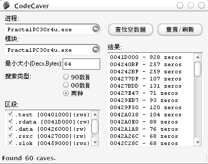
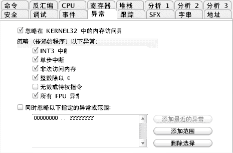
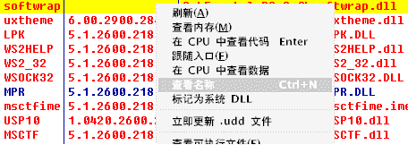
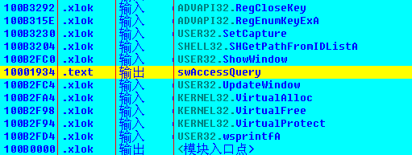
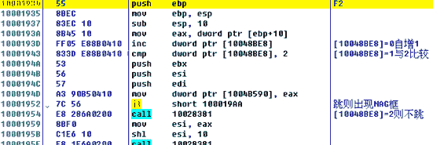
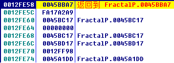
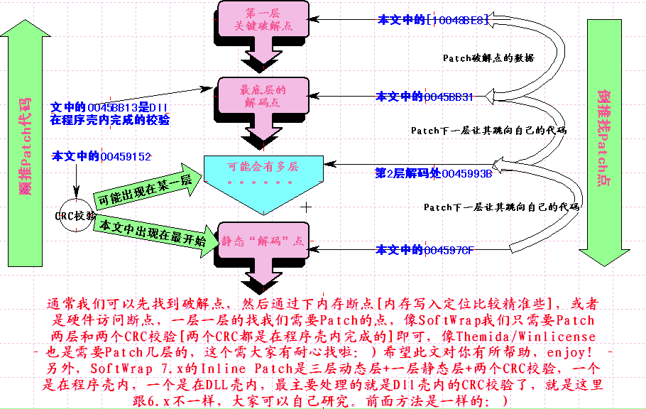

# SoftWrap 6.x 之二：Inline Patch SoftWrap 壳的方法

> 原文：[`www.pediy.com/kssd/pediy09/pediy09-503.htm`](https://www.pediy.com/kssd/pediy09/pediy09-503.htm)

> 【文章标题】: `SoftWrap` 6.x 之二：Inline Patch `SoftWrap` 壳的方法  
> 【文章作者】: `wynney`  
> 【软件名称】: `Fractal PC` 3.01  
> 【下载地址】: `http://www.fractalpc.com/resources/SetupFractalPC30.exe`  
> 【使用工具】: `OD`、`CodeCaver`  

> 【详细过程】  

### 一、前言

像这种猛壳的 Inline Patch 无非就是找到 Patch 点后，一层一层的 Patch，另外还需要 Patch 壳的 CRC 校验之类的。废话就不多说了。

我们来看如何 Inline Patch `SoftWrap` 壳吧

### 二、Pass NAG

#### 0、准备工作，我们先找一块空白地址吧，Patch 的数据长度是 95 字节



我在这里选择 `004277DF` 作为存放代码的地址

#### 1、设置忽略除了特权指令和指定异常之外的所有异常



#### 2、F9 运行，停在异常之后，Alt+E，找到 Softwrap.dll 路径，Ctrl+N



#### 3、找到 swAccessQuery



双击来到代码处



几次 `Shift+F9` 通过异常，中断在 `10001934`，看堆栈



`Ctrl+G`：`0045BBA7`

```asm
 引用:
 0045BAF3    53                push    ebx
 0045BAF4    8BDC              mov     ebx, esp
 0045BAF6    81EC 04010000     sub     esp, 104
 0045BAFC    60                pushad
 0045BAFD    8DBB FCFEFFFF     lea     edi, dword ptr [ebx-104]
 0045BB03    C707 736F6674     mov     dword ptr [edi], 74666F73
 0045BB09    C747 04 7772617>  mov     dword ptr [edi+4], 70617277
 0045BB10    C747 08 2E646C6>  mov     dword ptr [edi+8], 6C6C642E
 0045BB17    8367 0C 00        and     dword ptr [edi+C], 0
 0045BB1B    57                push    edi
 0045BB1C    53                push    ebx
 0045BB1D    57                push    edi
 0045BB1E    FF95 8E2F0000     call    dword ptr [ebp+2F8E]          ; 加载 Softwrap.dll
 0045BB24    5B                pop     ebx
 0045BB25    5F                pop     edi
 0045BB26    8943 FC           mov     dword ptr [ebx-4], eax
 0045BB29    50                push    eax
 0045BB2A    E8 48030000       call    0045BE77                      ; Softwrap.dll 的 CRC 校验
 0045BB2F    85C0              test    eax, eax
 0045BB31    0F84 A6E6FFFF     je      0045A1DD                      ; 如果跳则错误，Patch 点①
 0045BB37    66:8985 ED22000>  mov     word ptr [ebp+22ED], ax
 0045BB3E    C707 73774163     mov     dword ptr [edi], 63417773
 0045BB44    C747 04 6365737>  mov     dword ptr [edi+4], 73736563
 0045BB4B    C747 08 5175657>  mov     dword ptr [edi+8], 72657551
 0045BB52    C747 0C 7900000>  mov     dword ptr [edi+C], 79
 0045BB59    56                push    esi
 0045BB5A    57                push    edi
 0045BB5B    53                push    ebx
 0045BB5C    51                push    ecx
 0045BB5D    52                push    edx
 0045BB5E    57                push    edi
 0045BB5F    FF73 FC           push    dword ptr [ebx-4]
 0045BB62    FF95 862F0000     call    dword ptr [ebp+2F86]
 0045BB68    5A                pop     edx
 0045BB69    59                pop     ecx
 0045BB6A    5B                pop     ebx
 0045BB6B    5F                pop     edi
 0045BB6C    5E                pop     esi
 0045BB6D    85C0              test    eax, eax
 0045BB6F    0F84 68E6FFFF     je      0045A1DD
 0045BB75    8BD0              mov     edx, eax
 0045BB77    8B85 F30C0000     mov     eax, dword ptr [ebp+CF3]
 0045BB7D    35 159D17FA       xor     eax, FA179D15
 0045BB82    0385 F30C0000     add     eax, dword ptr [ebp+CF3]
 0045BB88    8985 F1220000     mov     dword ptr [ebp+22F1], eax
 0045BB8E    8DB5 FD220000     lea     esi, dword ptr [ebp+22FD]
 0045BB94    8BFE              mov     edi, esi
 0045BB96    B9 40000000       mov     ecx, 40
 0045BB9B    F3:AB             rep     stos dword ptr es:[edi]
 0045BB9D    53                push    ebx
 0045BB9E    57                push    edi
 0045BB9F    56                push    esi
 0045BBA0    FF73 08           push    dword ptr [ebx+8]
 0045BBA3    56                push    esi
 0045BBA4    50                push    eax
 0045BBA5    FFD2              call    edx                             ; EDX=10001934
 0045BBA7    83C4 0C           add     esp, 0C
```

★（1）、

```asm
 0045BB31    0F84 A6E6FFFF     je      0045A1DD                      
 0045BB37    66:8985 ED22000>  mov     word ptr [ebp+22ED], ax
```

Change to

```asm
 0045BB31    E9 F9BCFCFF       jmp     0042782F  ◆                    
 0045BB36    90                nop
 0045BB37    66:8985 ED22000>  mov     word ptr [ebp+22ED], ax
```

```asm
 0042782F    C705 E88B0410 0>  mov     dword ptr [10048BE8], 1
 00427839    E9 F8420300       jmp     0045BB36
```

### 三、循环解码

`Ctrl+F2`，重新加载，可以设置忽略所有异常了  
`DD` `0045BB31`，下内存写入断点，`F9`

```asm
 引用:
 00459933    BA 42CD9CDB      mov     edx, DB9CCD42           ; 选 5 个字节的行来 Patch 代码
 00459938    AD                lods    dword ptr [esi]
 00459939    33C2              xor     eax, edx
 0045993B    05 40FDC304       add     eax, 4C3FD40            ; 我选的是这，Patch 点②
 00459940    33C1              xor     eax, ecx
 00459942    C1C2 05           rol     edx, 5
 00459945    69D2 53307040     imul    edx, edx, 40703053
 0045994B    33D1              xor     edx, ecx
 0045994D    AB                stos    dword ptr es:[edi]      ; 中断在这
```

我们可以看看，刚加载程序的时候，这个地方并没有解码，所以，我们需要找到他的上一层解码点  
不需要特殊的操作，往上翻下代码吧

```asm
 引用:
 004597C7    FFD6              call    esi                   ; 解码 call，刚加载程序这里是解码的
 004597C9    68 14EBECC8      push    C8ECEB14              ; 运行到这后，Patch 点 2 就解码开了
 004597CE    5B                pop     ebx
 004597CF    BF 761CCDAB       mov     edi, ABCD1C76         ; 这就是我选择的第 3 个 Patch 点③
 004597D4    0FACFB 15         shrd    ebx, edi, 15
```

★（2）、

```asm
 0045993B    05 40FDC304       add     eax, 4C3FD40  
 00459940    33C1              xor     eax, ecx
 00459942    C1C2 05           rol     edx, 5
```

Change to

```asm
 0045993B    E9 CADEFCFF       jmp     0042780A ◆
 00459940    33C1              xor     eax, ecx
 00459942    C1C2 05           rol     edx, 5
```

```asm
 引用:
 0042780A    05 40FDC304       add     eax, 4C3FD40
 0042780F    81FE 54BB4500     cmp     esi, 0045BB54
 00427815    75 13             jnz     short 0042782A
 00427817    C705 31BB4500 E>  mov     dword ptr [45BB31], FCBCF9E9
 00427821    66:C705 35BB450>  mov     word ptr [45BB35], 90FF
 0042782A    E9 11210300       jmp     00459940
```

★（3）、

```asm
 004597CF    BF 761CCDAB       mov     edi, ABCD1C76  
 004597D4    0FACFB 15         shrd    ebx, edi, 15
 004597D8    68 F049C551       push    51C549F0
```

Change to

```asm
 004597CF    E9 1BE0FCFF       jmp     004277EF ◆
 004597D4    0FACFB 15         shrd    ebx, edi, 15
 004597D8    68 F049C551       push    51C549F0
```

```asm
 引用:
 004277EF    BF 761CCDAB       mov     edi, ABCD1C76
```


# SoftWrap 6.x 之二：Inline Patch SoftWrap 壳的方法

## 代码补丁分析

> 004277F4    C705 3B994500 E9 CA DE FC   mov     dword ptr [45993B], FCDECAE9  
> 004277FE    C605 3F994500 FF            mov     byte  ptr [45993F], 0FF  
> 00427805    E9 CA 1F 03 00             jmp     004597D4  
> 
> 
> 
> 
> 
> 引用:  
> 004277EF    BF 761CCDAB    mov     edi, ABCD1C76                    ; 原代码挪移  
> 004277F4    C705 3B994500 E9 CA DE FC   mov     dword ptr [45993B], FCDECAE9  ; 把 0045993B Patch  
> 004277FE    C605 3F994500 FF            mov     byte  ptr [45993F], 0FF        ; 成 jmp 0042780A  
> 00427805    E9 CA 1F 03 00             jmp     004597D4                      ; 跳回原流程  
> 0042780A    05 40FDC304    add     eax, 4C3FD40                  ; 原代码挪移  
> 0042780F    81FE 54BB4500  cmp     esi, 0045BB54                 ; esi=45BB54 的时候 0045BB31 才解码开  
> 00427815    75 13            jnz     short 0042782A                ; 0045BB31 没解码就跳回原流程  
> 00427817    C705 31BB4500 E9 F9 BC FC   mov     dword ptr [45BB31], FCBCF9E9  ; 0045BB31 解码就 Patch 0045BB31  
> 00427821    66:C705 35BB45 00 90 FF      mov     word  ptr [45BB35], 90FF      ; 成 jmp 0042782F  
> 0042782A    E9 11 21 03 00             jmp     00459940                      ; 跳回原流程  
> 0042782F    C705 E88B0410 01 00 00 00  mov     dword ptr [10048BE8], 1       ; 赋 1 给 [10048BE8], INC 后 [10048BE8]=2  
> 00427839    E9 F8 42 03 00             jmp     0045BB36                      ; 跳回原流程  
> 
> 
> 
> 十六进制机器码：
> ```
> BF 76 1C CD AB C7 05 3B 99 45 00 E9 CA DE FC C6 05 3F 99 45 00 FF E9 CA 1F 03 00 05 40 FD C3 04 81 FE 54 BB 45 00
> 75 13 C7 05 31 BB 45 00 E9 F9 BC FC 66 C7 05 35 BB 45 00 FF 90 E9 11 21 03 00 C7 05 E8 8B 04 10 01 00 00 00 E9 F8 42 03 00
> ```

## CRC 校验处理

复制上述几处修改，保存为别的文件名，运行看看，没反映，又不提示错误，这就是 `CRC` 校验的问题了。

### 重新加载程序

在 `DD` `0045993B`，下硬件访问断点 -> `Byte`，`F9` 运行。

引用:  
```
00459132    03D0            add     edx, eax                  ; 中断在这，删除断点
00459134    49              dec     ecx
00459135  ^ 75 FA          jnz     short 00459131              ; 第一轮 CRC 校验
00459137    5E              pop     esi
00459138    52              push    edx
00459139    81C6 A0380000   add     esi, 38A0
0045913F    B9 54030000     mov     ecx, 354
00459144    33D2            xor     edx, edx
00459146    33C0            xor     eax, eax
00459148    AC              lods    byte ptr [esi]
00459149    03D0            add     edx, eax
0045914B    49              dec     ecx
0045914C  ^ 75 FA          jnz     short 00459148              ; 第一轮 CRC 校验
0045914E    58              pop     eax
0045914F    2BC2            sub     eax, edx
00459151    92              xchg    eax, edx
00459152    8DB5 BF030000   lea     esi, dword ptr [ebp+3BF]    ; F4, edx 里面的值就是 CRC 校验值④
00459158    33C0            xor     eax, eax                  ; edx=003067D2
0045915A    B9 04000000     mov     ecx, 4
```

### 修改 CRC 校验逻辑

引用:  
★（4）、
```
00459152    8DB5 BF030000   lea     esi, dword ptr [ebp+3BF]
00459158    33C0            xor     eax, eax
```

修改为：
```
00459152    E9 88E6FCFF      jmp     004277DF 
00459157    90              nop
00459158    33C0            xor     eax, eax
```

新插入的代码：
```
004277DF    BA D2673000      mov     edx, 3067D2
004277E4    8DB5 BF030000    lea     esi, dword ptr [ebp+3BF]
004277EA    E9 69190300      jmp     00459158
```

## 代码集合

引用:  
```
004277DF    BA D2673000     mov     edx, 3067D2                   ; 第一轮 CRC 值
004277E4    8DB5 BF030000   lea     esi, dword ptr [ebp+3BF]      ; 原代码挪移
004277EA    E9 69190300     jmp     00459158                      ; 跳回原流程
004277EF    BF 761CCDAB     mov     edi, ABCD1C76                 ; 原代码挪移
004277F4    C705 3B994500 E9 CA DE FC   mov     dword ptr [45993B], FCDECAE9  ; 把 0045993B Patch
004277FE    C605 3F994500 FF            mov     byte  ptr [45993F], 0FF        ; 成 jmp 0042780A
00427805    E9 CA 1F 03 00             jmp     004597D4                      ; 跳回原流程
0042780A    05 40FDC304     add     eax, 4C3FD40                  ; 原代码挪移
0042780F    81FE 54BB4500   cmp     esi, 0045BB54                 ; esi=45BB54 的时候 0045BB31 才解码开
00427815    75 13           jnz     short 0042782A                ; 0045BB31 没解码就跳回原流程
00427817    C705 31BB4500 E9 F9 BC FC   mov     dword ptr [45BB31], FCBCF9E9  ; 0045BB31 解码就 Patch 0045BB31
00427821    66:C705 35BB45 00 90 FF      mov     word  ptr [45BB35], 90FF      ; 成 jmp 0042782F
0042782A    E9 11 21 03 00             jmp     00459940                      ; 跳回原流程
0042782F    C705 E88B0410 01 00 00 00  mov     dword ptr [10048BE8], 1       ; 赋 1 给 [10048BE8], INC 后 [10048BE8]=2
00427839    E9 F8 42 03 00             jmp     0045BB36                      ; 跳回原流程
```

十六进制机器码：
```
BA D2 67 30 00 8D B5 BF 03 00 00 E9 69 19 03 00 BF 76 1C CD AB C7 05 3B 99 45 00 E9 CA DE FC C6 05 3F 99 45 00 FF
E9 CA 1F 03 00 05 40 FD C3 04 81 FE 54 BB 45 00 75 13 C7 05 31 BB 45 00 E9 F9 BC FC 66 C7 05 35 BB 45 00 FF 90 E9 11
21 03 00 C7 05 E8 8B 04 10 01 00 00 00 E9 F8 42 03 00
```

## 资源下载

**图文版 PDF 下载**

[SoftWrap 6.x 之二：Inline Patch SoftWrap 壳的方法.pdf](http://bbs.pediy.com/attachment.php?attachmentid=5390&d=1177392740)

---

## 经验总结

`Inline Patch` 的大致流程就在下面，但是需要大家有足够的耐心和一定的汇编基础，Enjoy！



**下篇：SoftWrap 6.x 之三：IAT 修复之 `Jmp dword ptr ds:[API]`**

---

## 版权声明

本文原创于看雪技术论坛, 转载请注明作者并保持文章的完整, 谢谢!

2007 年 04 月 23

## 讨论区

引用: *最初由 **wangshq397** 发布*

这个壳的 `iat` 处理，首先需要跳开抽函数的地方，然后自己手动把正确的 `iat` 填充到程序里，然后在找到计算的地方，直接利用计算的次序修复，或者在到达 `oep` 后写一段代码修复，只要 `patch` 的代码写好了，这个壳基本上就完了，主要是比较麻烦。难度不是很大。本人的一点肤浅的理解。

欢迎你的文章：）

如果你觉得难度不是很大

那么你在刚接触 `ASProtect` 的 `Stolen Code` 的时候一定觉得 `ASPr` 不难了：）

因为它们两个很类似，写的修复代码也很类似

只是 `SoftW` 分的类型比 `ASPr` 多而已

你是否知道处理它的 `IAT` 要分好几种呢？

1. `Jmp [API]` 6 字节 ---> `Call [addr]` 6 字节
2. `Call [API]` 6 字节 ---> `Call [addr]` 6 字节
3. `mov eax,[API]` 5 字节 ---> `Call addr` 5 字节
4. `mov REG,[API]` 6 字节 ---> `Call addr` 5 字节 + 1 字节寄存器识别码 `[eax 之外的寄存器]`

4dd466d0e1e0cc123afbe504da2462ca
