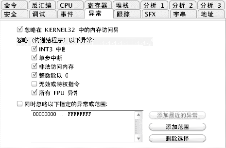
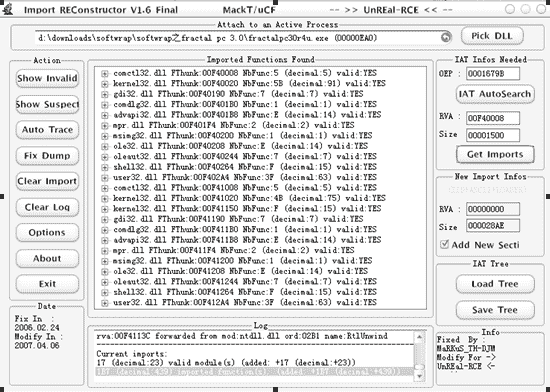
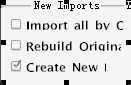

# SoftWrap 6.x 之四：IAT 修复之 VC 类

> 原文：[`www.pediy.com/kssd/pediy09/pediy09-505.htm`](https://www.pediy.com/kssd/pediy09/pediy09-505.htm)

> 【文章标题】: SoftWrap 6.x 之四：IAT 修复之 VC 类
> 【文章作者】: wynney
> 【软件名称】: Fractal PC 3.01
> 【下载地址】: `http://www.fractalpc.com/resources/SetupFractalPC30.exe`
> 【使用工具】: OD、CodeCaver
> 【详细过程】

## 一、 前言

在前面一章中，已经有提到，一般程序有以下几种 IAT 格式：

1. `Jmp Dword ptr ds:[API]` -> 6 字节
2. `Call Dword ptr ds:[API]` -> 6 字节
3. `mov eax, Dword ptr ds:[API]` -> 5 字节
4. `mov REG,Dword ptr ds:[API]` -> 6 字节 `[eax 外的寄存器,且 esp、edx 基本不被使用]`

而 SoftWrap 加密之后分别被改成这种形式：

1. `Call DWORD PTR DS:[addr]` -> 6 字节
2. `Call DWORD PTR DS:[addr]` -> 6 字节
3. `Call addr` -> 5 字节
4. `Call addr` -> 5 字节 + 1 个字节的寄存器类型识别指令

上面最难修复的就是第 4 种，同时需要指出的是第 3 种形式有时候不会有，4 种全用上才是最强加密。

## 二、 Patch IAT 代码需要的数据

1. `Jmp dword ptr ds:[API]` -> `Call dword ptr ds:[Addr]`
2. `Call dword ptr ds:[API]` -> `Call dword ptr ds:[Addr]`
3. `Mov eax, dword ptr ds:[API]` -> `Call Addr`
4. `Mov REG, dword ptr ds:[API]` -> `Call Addr`

我们需要的就是 4 个 `Addr` 以及判定 `REG` 类型的数据。

去 `OEP` 溜达吧，获取上面需要的数据，忽略除了特权指令和指定异常之外的所有异常。4 次 `Shift+F9`，出现试用框，点 `Try Now`，中断后继续 `Shift+F9` 两次，在 `Code` 段下内存访问断点 `[不可以 F2]`，`Shift+F9`，两次，即可到达 `OEP` 了。

```assembly
0041679B    6A 60           push    60                           ; OEP
0041679D    68 103E4200     push    00423E10
004167A2    E8 AD030000     call    00416B54
004167A7    BF 94000000     mov     edi, 94
004167AC    8BC7            mov     eax, edi
004167AE    E8 4D3A0000     call    0041A200
004167B3    8965 E8         mov     dword ptr [ebp-18], esp
004167B6    8BF4            mov     esi, esp
004167B8    893E            mov     dword ptr [esi], edi
004167BA    56              push    esi
004167BB    FF15 40924500   call    dword ptr [459240]          ; Enter
```

```assembly
0045C013    6A 00           push    0
0045C015    9C              pushfd
0045C016    50              push    eax
0045C017    53              push    ebx
0045C018    8B5C24 10       mov     ebx, dword ptr [esp+10]
0045C01C    53              push    ebx
0045C01D    83EB 06         sub     ebx, 6
0045C020    68 E9260000     push    26E9
0045C025    68 00004801     push    1480000
0045C02A    C3              retn
```

查找 `'所有命令'` `push 1480000`

Found commands

| Address | Disassembly | Comment |
| :--- | :--- | :--- |
| `0045B962` | `push 1480000` | |
| `0045B97A` | `push 1480000` | |
| `0045BA61` | `push 1480000` | |
| `0045BFFD` | `push 1480000` | |
| `0045C025` | `push 1480000` | (Initial CPU selection) |

全部设断，`Shift+F9`，第一次中断

```assembly
0045C013    6A 00           push    0
0045C015    9C              pushfd
0045C016    50              push    eax
0045C017    53              push    ebx
0045C018    8B5C24 10       mov     ebx, dword ptr [esp+10]
0045C01C    53              push    ebx
0045C01D    83EB 06         sub     ebx, 6
0045C020    68 E9260000     push    26E9
0045C025    68 00004801     push    1480000             ; 中断在这，删除断点，看堆栈
0045C02A    C3              retn
```

堆栈信息：
```text
0012FE90   000026E9  ?..
0012FE94   004167C1  羐 A.   RETURN to FractalP.004167C1 from FractalP.0045C013
0012FE98   7FFD6000  .`?
```

```assembly
004167BB    FF15 40924500   call    dword ptr [459240]    ; Call 类的，要改成 Call 类
004167C1    8B4E 10         mov     ecx, dword ptr [esi+10] ; 反汇编中跟随到这
```

① `459240` 就是要获取的 `Call dword ptr ds:[API]-> Call dword ptr ds:[Addr]` 中的 `Addr`

继续 `Shift+F9`，第 2 次中断

```assembly
0045B968    9C              pushfd
0045B969    60              pushad
0045B96A    8B5C24 24       mov     ebx, dword ptr [esp+24]
0045B96E    43              inc     ebx
0045B96F    53              push    ebx
0045B970    83EB 06         sub     ebx, 6
0045B973    8BD3            mov     edx, ebx
0045B975    68 76200000     push    2076
0045B97A    68 00004801     push    1480000             ; 中断在这，删除断点，看堆栈
0045B97F    C3              retn
```

堆栈信息：
```text
0012FEA4   00000246  F ..
0012FEA8   0041680D  .hA.  RETURN to FractalP.0041680D from FractalP.0045924A
0012FEAC   00000000  ....
```

```assembly
00416808    E8 3D2A0400     call    0045924A             ; 这里是 Mov REG 或者 eax 类的   
0041680D    1AFF            sbb     bh,bh                 ; 反汇编中跟随到这
0041680F    D7              xlat    byte ptr [ebx+al]      ; 具体是那一类我们来分析
```

下面两条指令比较奇怪，我们把 `1A` 给 `nop` 掉 `[就 nop 掉这一个字节]`，看看

```assembly
00416808    E8 3D2A0400     call    0045924A
0041680D    90              nop
0041680E    FFD7            call    edi
```

看到效果了吧，那么上 6 个字节 `[包括 90]` 应该是 `mov edi,dword ptr ds:[API]` 了
那么上面被我们 `nop` 掉的 `1A` 就是壳用来识别到底是那个寄存器的指令了，接下来看看别的

```assembly
00410C54    E8 F1850400     call    0045924A
00410C59    1E              push    ds
00410C5A    8D9B 00000000   lea     ebx, dword ptr [ebx]
00410C60    03C5            add     eax, ebp
00410C62    50              push    eax
00410C63    8D5424 30       lea     edx, dword ptr [esp+30]
00410C67    52              push    edx
00410C68    51              push    ecx
00410C69    FFD3            call    ebx
```

这个我们不需要 `nop` 掉 `1E` 就知道，`1E` 是 `ebx` 的识别指令
其他的大家可以自己看看，我们有简单的方法来辨别
下第 2 次中断的 `push 1480000` 下面就有辨别代码


```
 0045B97A    68 00004801      push    1480000                 ; 中断在这，删除断点，看堆栈
 0045B97F    C3               retn
 0045B980   ^ 71 98          jno     short 0045B91A
 0045B982    E7 B9           out     0B9, eax
 0045B984    A3 8004E933     mov     dword ptr [33E90480], eax
 0045B989    C0FF 4C         sar     bh, 4C
 0045B98C    24 24           and     al, 24
 0045B98E    EB 0E           jmp     short 0045B99E
 0045B990    5D              pop     ebp
 0045B991    91              xchg    eax, ecx
 0045B992    99              cdq
 0045B993    B9 84A709A5     mov     ecx, A509A784
 0045B998    0FB642 05       movzx   eax, byte ptr [edx+5]     ; [edx+5]的值就是识别代码,F2
 0045B99C    34 1D           xor     al, 1D
 0045B99E    B9 06000000     mov     ecx, 6
 0045B9A3    33D2            xor     edx, edx
 0045B9A5    F7E1            mul     ecx
 0045B9A7    E8 00000000     call    0045B9AC
 0045B9AC    5A              pop     edx
 0045B9AD    8D9402 0A000000 lea     edx, dword ptr [edx+eax+A]
 0045B9B4    FFE2            jmp     edx
 0045B9B6    895C24 1C       mov     dword ptr [esp+1C], ebx   ; eax,F2
 0045B9BA    EB 27           jmp     short 0045B9E3
 0045B9BC    895C24 18       mov     dword ptr [esp+18], ebx   ; ecx,F2
 0045B9C0    EB 21           jmp     short 0045B9E3
 0045B9C2    895C24 14       mov     dword ptr [esp+14], ebx   ; edx,F2
 0045B9C6    EB 1B           jmp     short 0045B9E3
 0045B9C8    895C24 10       mov     dword ptr [esp+10], ebx   ; ebx,F2
 0045B9CC    EB 15           jmp     short 0045B9E3
 0045B9CE    895C24 0C       mov     dword ptr [esp+C], ebx    ; esp,F2
 0045B9D2    EB 0F           jmp     short 0045B9E3
 0045B9D4    895C24 08       mov     dword ptr [esp+8], ebx    ; ebp,F2
 0045B9D8    EB 09           jmp     short 0045B9E3
 0045B9DA    895C24 04       mov     dword ptr [esp+4], ebx    ; esi,F2
 0045B9DE    EB 03           jmp     short 0045B9E3
 0045B9E0    891C24          mov     dword ptr [esp], ebx      ; edi,F2
 0045B9E3    61              popad
 0045B9E4    FF4424 04       inc     dword ptr [esp+4]         ; 上面寄存器的顺序是按右边寄存器的顺序
```

**?**

**?**

引用:

`F9` 运行，得到这样的一个对应表

`[edx+5] = 1A` 中断在 `0045B9E0`，取消 `0045B9E0` 处的断点---'`1A EDI`

`[edx+5] = 1E` 中断在 `0045B9C8`，取消 `0045B9C8` 处的断点---'`1E EBX`

`[edx+5] = 18` 中断在 `0045B9D4`，取消 `0045B9D4` 处的断点---'`18 EBP`

`[edx+5] = 1B` 中断在 `0045B9DA`，取消 `0045B9DA` 处的断点---'`1B ESI`

直到程序运行，只有这 4 种情况

② `0045924A` 就是 `Mov REG, dword ptr ds:[API]` -> `Call Addr` 中的 `Addr`

且识别指令是

`1A---' EDI`

`1E---' EBX`

`18---' EBP`

`1B---' ESI`

这个对应表的值即使是同一个程序在不同的机器上也会不一样

`Eax` 没有被使用，也就是说没有 `Mov eax,dword ptr ds:[API]-'Call Addr` 类型的加密

另外，`Mov ERG,dword ptr ds:[API]-'Call Addr` 的加密中本程序 `ECX` 没有被使用到，最后 `edx` 和 `esp` 基本不被使用，`OK` 了，接下来是该获取 `Jmp dword ptr ds:[API]--' Call dword ptr ds:[Addr]` 类型中的 `Addr`

**?**

```
 0041679B    6A 60           push    60                        ; OEP
 0041679D    68 103E4200     push    00423E10
 004167A2    E8 AD030000     call    00416B54
 004167A7    BF 94000000     mov     edi, 94
 004167AC    8BC7            mov     eax, edi
 004167AE    E8 4D3A0000     call    0041A200
 004167B3    8965 E8         mov     dword ptr [ebp-18], esp
 004167B6    8BF4            mov     esi, esp
 004167B8    893E            mov     dword ptr [esi], edi
 004167BA    56              push    esi
 004167BB    FF15 40924500   call    dword ptr [459240]        ; 搜索-->所有模块间的调用
```

……………….

```
 004152A4  call    dword ptr [45923C]        FractalP.0045BFED
 004152AA  call    dword ptr [45923C]        FractalP.0045BFED
 004152B0  call    dword ptr [45923C]        FractalP.0045BFED
 004152B6  call    dword ptr [45923C]        FractalP.0045BFED
 004152BC  call    dword ptr [45923C]        FractalP.0045BFED
 004152C2  call    dword ptr [45923C]        FractalP.0045BFED
 004152C8  call    dword ptr [45923C]        FractalP.0045BFED
 004152CE  call    dword ptr [45923C]        FractalP.0045BFED
 004152D4  call    dword ptr [45923C]        FractalP.0045BFED
 00415304  call    dword ptr [459240]        FractalP.0045C013
 004154EE  call    dword ptr [459240]        FractalP.0045C013
 00415564  call    dword ptr [459240]        FractalP.0045C013
 00415717  call    00459246                 FractalP.00459246
```

………………………….

双击 `call    dword ptr [45923C]`处来到代码

………………………….

```
 00414EB1    5F              pop     edi
 00414EB2    E8 54040000     call    0041530B
 00414EB7    81C4 14010000   add     esp, 114
 00414EBD    C2 0800         retn    8
 00414EC0    FF15 3C924500   call    dword ptr [45923C]        ; FractalP.0045BFED
 00414EC6    FF15 3C924500   call    dword ptr [45923C]        ; FractalP.0045BFED
 00414ECC    FF15 3C924500   call    dword ptr [45923C]        ; FractalP.0045BFED
 00414ED2    FF15 3C924500   call    dword ptr [45923C]        ; FractalP.0045BFED
 00414ED8    FF15 3C924500   call    dword ptr [45923C]        ; FractalP.0045BFED
 00414EDE    FF15 3C924500   call    dword ptr [45923C]        ; FractalP.0045BFED
 00414EE4    FF15 3C924500   call    dword ptr [45923C]        ; FractalP.0045BFED
```

………………………….

③这里原本应该是 `Jmp` 类型，`45923C` 就是我们需要获取的 `Jmp dword ptr ds:[API]- ->Call dword ptr ds:[Addr]` 中的 `Addr`

`OK` 了，`Patch` 代码需要的数据，我们已经搜集到了。下面开始脱壳

### 三、 获取一张输入表

忽略除了特权指令和指定异常之外的所有异常



`Ctrl+G`：`VirtualAlloc`，在段尾 `F2`[`直接 bp VirtualAlloc 会被检测到`]，`shift+F9`，中断后返回

`Ctrl+B`：`85 C0 0F 84 ?? ?? ?? ?? F6 C3 02 74 21 FF B5 ?? ?? ?? ?? 6A 10 50 FF B5 ?? ?? ?? ?? FF B5 ?? ?? ?? ??`

```
 0045B7F6    F6C3 02         test    bl, 2                   ; 找到这，F2，运行到这
 0045B7F9    74 21           je      short 0045B81C
 0045B7FB    FFB5 DF1C0000   push    dword ptr [ebp+1CDF]
 0045B801    6A 10           push    10
 0045B803    50              push    eax
 0045B804    FFB5 DF1C0000   push    dword ptr [ebp+1CDF]
```

跟上一篇一样，我申请的是 `1340000`，`2000` 大小的空间来存放输入表，事先设置两个值

`[1340000]=ECX` 当前的值

`[1340004]=1340008`

`1340008` 作为 `IAT` 的起始地址

```
 01340000  00 00 00 00 08 00 34 01  .... .4
 01340008  00 00 00 00 00 00 00 00  ........
 01340010  00 00 00 00 00 00 00 00  ........
```

设置完了，`Patch` 代码。

代码:

```
 0045B7F6    3A0D 00003401   cmp     cl, byte ptr [1340000]
 0045B7FC    74 0E           je      short 0045B80C
 0045B7FE    FE05 00003401   inc     byte ptr [1340000]
 0045B804    66:8305 0400340>add     word ptr [1340004], 4
 0045B80C    8B1D 04003401   mov     ebx, dword ptr [1340004]
 0045B812    8903            mov     dword ptr [ebx], eax
 0045B814    66:8305 0400340>add     word ptr [1340004], 4
```

**?**

`Shift+F9` 运行，中断在第一次特权异常，输入表全部存起来了

```
 01340000  0A 00 00 00 A0 03 34 01  ....?4
 01340008  ED 7E 18 77 D5 92 19 77  韣 w 諕 w
 01340010  CD 53 19 77 8D 51 19 77  蚐 w 峇 w
 01340018  C2 CF 18 77 00 00 00 00  孪 w....
 01340020  77 9B 80 7C BD E4 81 7C  w 泙|戒亅
 01340028  24 1A 80 7C 3F EB 80 7C  $ €|?雬|
 01340030  2F 08 81 7C 5C E8 81 7C  / 亅\鑱|
 01340038  A2 CA 81 7C C7 27 82 7C  ⑹亅?倈
 01340040  B1 C7 80 7C 3F DC 81 7C  鼻€|?軄|
```


#### 01340048 
`5F 48 81 7C 66 AA 80 7C` ` H 亅 f 獉|`

#### 01340050 
`43 99 80 7C E6 2B 81 7C` ` C 檧|?亅`

#### 01340058 
`8D 2C 81 7C 0D E0 80 7C` `?亅.鄝|`

#### 01340060 
`4E 99 80 7C 37 97 80 7C` `N 檧|7 梹|`

#### 01340068 
`FB 2C 82 7C 23 CC 81 7C` `?倈#虂|`

#### 01340070 
`78 2C 81 7C 4C 17 81 7C` `x,亅 L 亅`

#### 01340078 
`31 35 81 7C 69 10 81 7C` `15 亅 i 亅`

#### 四、Patch IAT Code

到达 `OEP`

```
004167BB    FF15 40924500   call    dword ptr [459240]        ; Enter 进去

0045C013    6A 00           push    0
0045C015    9C              pushfd
0045C016    50              push    eax
0045C017    53              push    ebx
0045C018    8B5C24 10       mov     ebx, dword ptr [esp+10]
0045C01C    53              push    ebx
0045C01D    83EB 06         sub     ebx, 6
0045C020    68 E9260000     push    26E9
0045C025    68 00004901     push    1490000           ; 看看，我们之前看到是 1480000
0045C02A    C3              ret
```

`Ctrl+G`：`1490000`，运行到这

```
01490082    35 67B6BDD0     xor     eax, D0BDB667                   ; 在下一行开始 Patch 代码
01490087    50              push    eax
01490088    8A00            mov     al, byte ptr [eax]
```

#### 1、Jmp 类

★设置 `[13400004]=00401000` 作为搜索的开始地址

代码:

```
01490087    B9 08003401     mov     ecx, 1340008                 ; IAT 的起始位置
0149008C    3901            cmp     dword ptr [ecx], eax
0149008E    74 05           je      short 01490095
01490090    83C1 04         add     ecx, 4
01490093  ^ EB F7          jmp     short 0149008C
01490095    8BD1            mov     edx, ecx
01490097    81C2 00100000   add     edx, 1000
0149009D    8902            mov     dword ptr [edx], eax
0149009F    83C4 1C         add     esp, 1C
014900A2    3E:8B0424       mov     eax, dword ptr ds:[esp]
014900A6    83E8 06         sub     eax, 6
014900A9    66:C700 FF25    mov     word ptr [eax], 25FF          ; 改成 jmp 类型
014900AE    83C0 02         add     eax, 2
014900B1    8910            mov     dword ptr [eax], edx
014900B3    90              nop
014900B4    90              nop
014900B5    813D 04003401 0>cmp     dword ptr [1340004], 41D000   ; ★写完代码，在这新建 EIP，Code 段尾
014900BF    74 2C           je      short 014900ED
014900C1    8B0D 04003401   mov     ecx, dword ptr [1340004]       ; FractalP.00401000
014900C7    66:8139 FF15    cmp     word ptr [ecx], 15FF          ; 查找是否是 Call 类型
014900CC    75 17           jnz     short 014900E5
014900CE    8BC1            mov     eax, ecx
014900D0    83C0 02         add     eax, 2
014900D3    8138 3C924500   cmp     dword ptr [eax], 45923C       ; 得到的 Addr
014900D9    75 0A           jnz     short 014900E5
014900DB    83C0 04         add     eax, 4
014900DE    A3 04003401     mov     dword ptr [1340004], eax
014900E3    FFE1            jmp     ecx                           ; 跳回下一个循环
014900E5    FF05 04003401   inc     dword ptr [1340004]           ; FractalP.00401000
014900EB  ^ EB C8          jmp     short 014900B5
014900ED  - EB FE          jmp     short 014900ED                ; ★写完代码这里设断
014900EF    90              nop
014900F0    90              nop
014900F1    90              nop
014900F2    90              nop

B9 08 00 34 01 39 01 74 05 83 C1 04 EB F7 8B D1 81 C2 00 10 00 00 89 02 83 C4 1C 3E 8B 04 24 83 E8 06 66 C7 00 FF 25 83 C0 02 89 10 90 90 81 3D 04 00 34 01 00 D0 41 00 74 2C 8B 0D 04 00 34 01 66 81 39 FF 15 75 17 8B C1 83 C0 02 81 38 3C 92 45 00 75 0A 83 C0 04 A3 04 00 34 01 FF E1 FF 05 04 00 34 01 EB C8 EB FE 90 90 90 90
```

`F9` 中断在 `014900ED`，可以去看看原先的 `Call dword ptr ds:[45923C]` 是否被恢复

#### 2、Call 类

撤消修改的代码，在同样的地方写第新代码

★设置 `[13400004]=00401000` 作为搜索的开始地址

代码:

```
01490087    B9 08003401     mov     ecx, 1340008                 ; IAT 的起始位置
0149008C    3901            cmp     dword ptr [ecx], eax
0149008E    74 05           je      short 01490095
01490090    83C1 04         add     ecx, 4
01490093  ^ EB F7          jmp     short 0149008C
01490095    8BD1            mov     edx, ecx
01490097    81C2 00100000   add     edx, 1000
0149009D    8902            mov     dword ptr [edx], eax
0149009F    83C4 1C         add     esp, 1C
014900A2    3E:8B0424       mov     eax, dword ptr ds:[esp]
014900A6    83E8 04         sub     eax, 4
014900A9    8910            mov     dword ptr [eax], edx
014900AB    90              nop
014900AC    90              nop
014900AD    813D 04003401 0>cmp     dword ptr [1340004], 41D000   ; ★写完代码，在这新建 EIP，地址为 Code 段尾
014900B7    74 2C           je      short 014900E5
014900B9    8B0D 04003401   mov     ecx, dword ptr [1340004]       ; FractalP.0041D000
014900BF    66:8139 FF15    cmp     word ptr [ecx], 15FF
014900C4    75 17           jnz     short 014900DD
014900C6    8BC1            mov     eax, ecx
014900C8    83C0 02         add     eax, 2
014900CB    8138 40924500   cmp     dword ptr [eax], 459240       ; 得到的 Addr
014900D1    75 0A           jnz     short 014900DD
014900D3    83C0 04         add     eax, 4
014900D6    A3 04003401     mov     dword ptr [1340004], eax
014900DB    FFE1            jmp     ecx                           ; 跳回下一个循环
014900DD    FF05 04003401   inc     dword ptr [1340004]           ; FractalP.0041D000
014900E3  ^ EB C8          jmp     short 014900AD
014900E5  - EB FE          jmp     short 014900E5                ; ★写完代码这里设断
014900E7    90              nop
014900E8    90              nop
014900E9    90              nop
014900EA    90              nop
014900EB    90              nop
014900EC    90              nop
014900ED    90              nop
014900EE    90              nop
014900EF    90              nop
014900F0    90              nop
014900F1    90              nop
014900F2    90              nop

B9 08 00 34 01 39 01 74 05 83 C1 04 EB F7 8B D1 81 C2 00 10 00 00 89 02 83 C4 1C 3E 8B 04 24 83 E8 04 89 10 90 90 81 3D 04 00 34 01 00 D0 41 00 74 2C 8B 0D 04 00 34 01 66 81 39 FF 15 75 17 8B C1 83 C0 02 81 38 40 92 45 00 75 0A 83 C0 04 A3 04 00 34 01 FF E1 FF 05 04 00 34 01 EB C8 EB FE 90 90 90 90 90 90 90 90 90 90 90 90
```

`F9` 运行，中断在 `014900E5`

#### 3、Mov REG 类

撤消修改的代码，在同样的地方写第新代码

★设置 `[13400004]=00401000` 作为搜索的开始地址

代码:


```
01490087    B9 08003401      mov     ecx, 1340008                 ; IAT 的起始位置
0149008C    3901             cmp     dword ptr [ecx], eax
0149008E    74 05            je      short 01490095
01490090    83C1 04          add     ecx, 4
01490093    ^ EB F7          jmp     short 0149008C
01490095    8BD1             mov     edx, ecx
01490097    81C2 00100000    add     edx, 1000
0149009D    8902             mov     dword ptr [edx], eax
0149009F    83C4 1C          add     esp, 1C
014900A2    3E:8B0424        mov     eax, dword ptr ds:[esp]
014900A6    83E8 06          sub     eax, 6
014900A9    66:8B0D 0000340>mov     cx, word ptr [1340000]
014900B0    66:8908          mov     word ptr [eax], cx
014900B3    83C0 02          add     eax, 2
014900B6    8910             mov     dword ptr [eax], edx
014900B8    90               nop
014900B9    90               nop
014900BA    813D 04003401 0>cmp     dword ptr [1340004], 41D000    ; ★写完代码，在这新建 EIP，地址为 Code 段尾
014900C4    0F84 AD000000    je      01490177
014900CA    8B0D 04003401    mov     ecx, dword ptr [1340004]      ; FractalP.00401000
014900D0    8039 E8          cmp     byte ptr [ecx], 0E8
014900D3    0F85 93000000    jnz     0149016C
014900D9    8B15 04003401    mov     edx, dword ptr [1340004]      ; FractalP.00401000
014900DF    83C2 05          add     edx, 5
014900E2    8A1A             mov     bl, byte ptr [edx]
014900E4    BE 4A924500      mov     esi, 45924A                  ; REG 类中的 Addr
014900E9    2BF2             sub     esi, edx
014900EB    8B15 04003401    mov     edx, dword ptr [1340004]      ; FractalP.00401000
014900F1    42               inc     edx
014900F2    3932             cmp     dword ptr [edx], esi
014900F4    75 76            jnz     short 0149016C
014900F6    8B0D 04003401    mov     ecx, dword ptr [1340004]      ; FractalP.00401000
014900FC    FF05 04003401    inc     dword ptr [1340004]           ; FractalP.00401000
01490102    51               push    ecx
01490103    80FB 1B          cmp     bl, 1B                       ; 本程序中的识别指令对应表
01490106    75 0A            jnz     short 01490112
01490108    66:C705 0000340>mov     word ptr [1340000], 358B      ; ESI
01490111    C3               retn
01490112    80FB 18          cmp     bl, 18                       ; 本程序中的识别指令对应表
01490115    75 0A            jnz     short 01490121
01490117    66:C705 0000340>mov     word ptr [1340000], 2D8B      ; EBP
01490120    C3               retn
01490121    80FB 1E          cmp     bl, 1E                       ; 本程序中的识别指令对应表
01490124    75 0A            jnz     short 01490130
01490126    66:C705 0000340>mov     word ptr [1340000], 1D8B      ; EBX
0149012F    C3               retn
01490130    80FB 1A          cmp     bl, 1A                       ; 本程序中的识别指令对应表
01490133    75 0A            jnz     short 0149013F
01490135    66:C705 0000340>mov     word ptr [1340000], 3D8B      ; EDI
0149013E    C3               retn
0149013F    80FB 00          cmp     bl, 0
01490142    75 0A            jnz     short 0149014E
01490144    66:C705 0000340>mov     word ptr [1340000], 0D8B      ; ECX，为了代码完整，全部写出来
0149014D    C3               retn
0149014E    80FB 00          cmp     bl, 0
01490151    75 0A            jnz     short 0149015D
01490153    66:C705 0000340>mov     word ptr [1340000], 258B      ; ESP，因为没用到
0149015C    C3               retn
0149015D    80FB 00          cmp     bl, 0
01490160    75 0A            jnz     short 0149016C
01490162    66:C705 0000340>mov     word ptr [1340000], 158B      ; EDX，所以设置比较值为 0
0149016B    C3               retn
0149016C    FF05 04003401    inc     dword ptr [1340004]           ; FractalP.00401000
01490172    ^ E9 43FFFFFF     jmp     014900BA
01490177    - EB FE          jmp     short 01490177               ; ★写完代码这里设断
01490179    90               nop
0149017A    90               nop
0149017B    90               nop
0149017C    90               nop
0149017D    D6               salc                              ; ★防止出现异常，这也设断
0149017E    90               nop
0149017F    90               nop
01490180    90               nop

B9 08 00 34 01 39 01 74 05 83 C1 04 EB F7 8B D1 81 C2 00 10 00 00 89 02 83 C4 1C 3E 8B 04 24 83 E8 06 66 8B 0D 00 00 34 01 66 89 08 83 C0 02 89 10 90 90 81 3D 04 00 34 01 00 D0 41 00 0F 84 AD 00 00 00 8B 0D 04 00 34 01 80 39 E8 0F 85 93 00 00 00 8B 15 04 00 34 01 83 C2 05 8A 1A BE 4A 92 45 00 2B F2 8B 15 04 00 34 01 42 39 32 75 76 8B 0D 04 00 34 01 FF 05 04 00 34 01 51 80 FB 1B 75 0A 66 C7 05 00 00 34 01 8B 35 C3 80 FB 18 75 0A 66 C7 05 00 00 34 01 8B 2D C3 80 FB 1E 75 0A 66 C7 05 00 00 34 01 8B 1D C3 80 FB 1A 75 0A 66 C7 05 00 00 34 01 8B 3D C3 80 FB 00 75 0A 66 C7 05 00 00 34 01 8B 0D C3 80 FB 00 75 0A 66 C7 05 00 00 34 01 8B 25 C3 80 FB 00 75 0A 66 C7 05 00 0034 01 8B 15 C3 FF 05 04 00 34 01 E9 43 FF FF FF EB FE 90 90 90 90 D6 90 90 90
```

`F9` 运行，中断在 `01490177`，全部都还原了，删除所有断点，到 `OEP` 处新建 `EIP`

## 4. `mov eax` 类

这个目标程序没有，本人在脚本里加入了 `mov eax` 的修复代码

## 五. 脱壳





`LordPE` 脱壳，拿出 `ImportREC`

注意上面的 `RVA` 和 `SIZE`

全部有效，需要注意的是，`Fix Dump` 之前，设置

这样修复后，脱壳程序就可以运行了。

## 六. 脚本

1. 使用脚本前，设置忽略除了特权指令和指定异常外的所有异常
2. 这只是一个辅助脚本，使用前，先获取脚本需要的几个数据，相信这不会是难事，另外，关于修复 `mov eax` 类加密的代码在脚本中也有写

```
/*
Script written by wynney

Date:   2007-04-21
Script: SoftWrap 6.x Fixer for VC
Environment : OllyDbg 1.1, ODBGScript 1.52,Winxp Sp2
Debugging options: Ignore all outside of "Invalid or privileged" and "Custom" exception

Thanks :
         kanxue     - author of HideOD
         hnhuqiong  - author of ODbgScript 1.52
*/

var fix
var OEPS
var temp
var CBase
var CSize
var SrEnd
var IATNew
var SrStart
var Pointer
var DllBase
var ImagBase
var ImagSize
var 2ndPoint

GetBase:
        cmt eip,"请先修改脚本的 REG 值再运行^\_^"
        dbh
        BPHWCALL
        GMI eip, ModuleBase
        cmp $RESULT,0
        je error
        mov ImagBase,$RESULT
        GMI eip,ModuleSize
        cmp $RESULT,0
        je error
        mov ImagSize,$RESULT
        GMI eip,CodeBase

        cmp $RESULT,0
        je error
        mov CBase,$RESULT
        GMI eip, CodeSize
        cmp $RESULT,0
        je error
        mov CSize,$RESULT

WorkFor:
        mov SrStart,CBase
        mov temp,CBase
        add temp,CSize
        mov SrEnd,temp
        Alloc 2000
        //ask "请输入程序中的空白地址，大小在 2000 字节左右"
        cmp $RESULT,0
        je error
        mov DllBase,$RESULT
        mov temp,$RESULT
        add temp,4
        mov Pointer,temp
        add temp,4
        mov IATNEW,temp

GetTable:
        GPA "VirtualAlloc","kernel32.Dll"
        cmp $RESULT,0
        je error
        find $RESULT,#C21000#
        cmp $RESULT,0
        je error
        mov temp,$RESULT
        bp temp
        esto
        bc temp
        sto
        find eip,#85C00F84????????F6C3027421FFB5????????6A1050FFB5????????FFB5????????#
        cmp $RESULT,0
        je error
```


```
$RESULT,8

temp,$RESULT

bp temp

esto

bc temp

mov [DllBase],ecx

mov [Pointer],IATNEW 

mov temp,eip

mov [temp],#3A0D90909090#

add temp,2

mov [temp],DllBase

add temp,4

mov [temp],#740E#

add temp,2

mov [temp],#FE0590909090#

add temp,2

mov [temp],DllBase

add temp,4

mov [temp],#6683059090909004# 

add temp,3

mov [temp],Pointer

add temp,5

mov [temp],#8B1D90909090#

add temp,2

mov [temp],Pointer

add temp,4

mov [temp],#89036683059090909004#

add temp,5

mov [temp],Pointer

GoToOEP:

esto

esto

esto

esto //中间会出现试用框，点试用脚本会继续执行

esto

esto

BPRM CBase,CSize

esto

esto

BPMC

ASKSt:

MSGYN "是否到达 OEP？" 

cmp $RESULT,0

je Manuly

jmp JmpAPI

Manuly:

msg "请手动到达 OEP，再继续！"

pause

jmp JmpAPI

JmpAPI:

mov OEPS,eip

mov fix,$RESULT

find eip,#FF15????????#

cmp $RESULT,0

je error

bp $RESULT

esto

bc $RESULT

sti

find eip,#68????????C3#

cmp $RESULT,0

je error

mov temp,$RESULT

bp temp

esto

bc temp

sti

sti

find eip,#8B????35????????508A00040F#

cmp $RESULT,0

je error

bp $RESULT

esto

bc $RESULT

add $RESULT,8

mov temp,$RESULT

mov 2ndPoint,temp

ask "请输入 Jmp 类型-Call Dword PTR DS:\[Addr\]中的 Addr" 

cmp $RESULT,0

je error

mov fix,$RESULT

mov [Pointer],CBase

mov [temp],#B990909090#

add temp,1

mov [temp],IATNEW

add temp,4

mov [temp],#3901740583C104EBF78BD181C200100000890283C41C3E8B042483E80666C700FF2583C00289109090#

add temp,29

mov eip,temp

mov [temp],#813D9090909090909090#

add temp,2

mov [temp],Pointer

add temp,4

mov [temp],SrEnd

add temp,4

mov [temp],#742C8B0D90909090#

add temp,4

mov [temp],Pointer

add temp,4

mov [temp],#668139FF1575178BC183C002813890909090#

add temp,0E

mov [temp],fix

add temp,4

mov [temp],#750A83C004A390909090FFE1FF0590909090EBC8EBFE90909090#

add temp,6

mov [temp],Pointer

add temp,8

mov [temp],Pointer

add temp,6

bp temp

esto

bc temp

CallAPI:

mov eip,2ndPoint

mov temp,2ndPoint

mov [Pointer],CBase

ask "请输入 Call 类型-Call Dword PTR DS:\[Addr\]中的 Addr" 

cmp $RESULT,0

je error

mov fix,$RESULT

mov [temp],#B9909090903901740583C104EBF78BD181C200100000890283C41C3E8B042483E80489109090#

add temp,1

mov [temp],IATNEW

add temp,25

mov eip,temp

mov [temp],#813D9090909090909090742C#

add temp,2

mov [temp],Pointer

add temp,4

mov [temp],SrEnd

add temp,6

mov [temp],#8B0D90909090#

add temp,2

mov [temp],Pointer

add temp,4

mov [temp],#668139FF1575178BC183C002813890909090#

add temp,0E

mov [temp],fix

add temp,4

mov [temp],#750A83C004A390909090#

add temp,6

mov [temp],Pointer

add temp,4

mov [temp],#FFE1FF0590909090#

add temp,4

mov [temp],Pointer

add temp,4

mov [temp],#EBC8EBFE9090909090909090#

add temp,2

bp temp

esto

bc temp

EaxAPI:

MSGYN "是否需要修复 Mov EAX 类型？" 

cmp $RESULT,1

jne REGAPI

mov eip,2ndPoint

mov temp,2ndPoint

mov [Pointer],CBase

ask "请输入 Mov eax 类型-Call Addr 中的 Addr" 

cmp $RESULT,0

je error

mov fix,$RESULT

mov [temp],#B9909090903901740583C104EBF78BD181C200100000890283C41C3E8B042483E805C600A183C00189109090#

add temp,1

mov [temp],IATNEW

add temp,2B

mov eip,temp

mov [temp],#813D9090909090909090743C8B0D909090908039E87529#

add temp,2

mov [temp],Pointer

add temp,4

mov [temp],SrEnd

add temp,8

mov [temp],Pointer

add temp,9

mov [temp],#8B159090909083C205BE909090902BF28B1590909090423932750E#

add temp,2

mov [temp],Pointer

add temp,8

mov [temp],fix

add temp,8

mov [temp],Pointer

add temp,9

mov [temp],#8B0D90909090FF0590909090FFE1FF0590909090EBB8EBFE9090# 

add temp,2

mov [temp],Pointer

add temp,6

mov [temp],Pointer

add temp,8

mov [temp],Pointer

add temp,6

bp temp

esto

bc temp

REGAPI:

mov eip,2ndPoint

mov temp,2ndPoint

mov [Pointer],CBase

ask "请输入 Mov REG 类型-Call Addr 中的 Addr" 

cmp $RESULT,0

je error

mov fix,$RESULT

mov [temp],#B9909090903901740583C104EBF78BD181C200100000890283C41C3E8B042483E806#

add temp,1

mov [temp],IATNEW

add temp,21

mov [temp],#668B0D9090909066890883C00289109090#

add temp,3

mov [temp],DllBase

add temp,0E

mov eip,temp

mov [temp],#813D9090909090909090#

add temp,2

mov [temp],Pointer

add temp,4

mov [temp],SrEnd

add temp,4

mov [temp],#0F84AD0000008B0D909090908039E80F8593000000#

add temp,8

mov [temp],Pointer

add temp,0D

mov [temp],#8B159090909083C2058A1A#

add temp,2

mov [temp],Pointer

add temp,9

mov [temp],#BE909090902BF28B15909090904239327576#

add temp,1

mov [temp],fix

add temp,8

mov [temp],Pointer

add temp,9

mov [temp],#8B0D90909090FF059090909051#

add temp,2

mov [temp],Pointer

add temp,6

mov [temp],Pointer

add temp,5

asm temp,"cmp bl,1B"   //ESI，即使是同一个程序，每台机器上都会不一样，请自行更改成自己机器上的值

add temp,3

mov [temp],#750A66C705909090908B35C3#

add temp,5
```


```asm
        mov [temp],DllBase  
        add temp,7  
        asm temp,"cmp bl,18"   //EBP，即使是同一个程序，每台机器上都会不一样，请自行更改成自己机器上的值  
        add temp,3  
        mov [temp],#750A66C705909090908B2DC3#  
        add temp,5  
        mov [temp],DllBase  
        add temp,7  
        asm temp,"cmp bl,1E"   //EBX，即使是同一个程序，每台机器上都会不一样，请自行更改成自己机器上的值  
        add temp,3  
        mov [temp],#750A66C705909090908B1DC3#  
        add temp,5  
        mov [temp],DllBase  
        add temp,7  
        asm temp,"cmp bl,1A"   //EDI，即使是同一个程序，每台机器上都会不一样，请自行更改成自己机器上的值  
        add temp,3  
        mov [temp],#750A66C705909090908B3DC3#  
        add temp,5  
        mov [temp],DllBase  
        add temp,7  
        asm temp,"cmp bl,0"   //ECX，如果不用到，设置与 0 比较，用到请设置成自己的值  
        add temp,3  
        mov [temp],#750A66C705909090908B0DC3#  
        add temp,5  
        mov [temp],DllBase  
        add temp,7  
        asm temp,"cmp bl,0"   //ESP，一般不用到，设置与 0 比较，脚本不会执行到这  
        add temp,3  
        mov [temp],#750A66C705909090908B25C3#  
        add temp,5  
        mov [temp],DllBase  
        add temp,7  
        asm temp,"cmp bl,0"   //EDX，一般不用到，设置与 0 比较，脚本不会执行到这  
        add temp,3  
        mov [temp],#750A66C705909090908B15C3#  
        add temp,5  
        mov [temp],DllBase  
        add temp,7  
        mov [temp],#FF0590909090E943FFFFFFEBFE90909090D6909090#  
        add temp,2  
        mov [temp],Pointer  
        add temp,9  
        bp temp  
        add temp,6  
        bp temp  
        esto  
        bc temp  
        sub temp,6  
        bc temp  
        cmp eip,temp  
        jne Excep              

Done:
        mov eip,OEPS  
        mov temp,DllBase  
        sub temp,ImagBase  
        add temp,8  
        eval "IAT RVA: {temp}"  
        msg $RESULT  
        msg "ImportREC 修复时请选上创建新的 IAT！"  
        ret

Excep:
        msg "异常错误"  
        ret

error:
        msg "非支持版本"  
        ret
```

??  

最后放上另外一个同样处理方法的程序[为了减小附件大小，只放上主要文件]  

--------------------------------------------------------------------------------  

【版权声明】: 本文原创于看雪技术论坛, 转载请注明作者并保持文章的完整, 谢谢!  

2007 年 04 月 23 日

4dd466d0e1e0cc123afbe504da2462ca
