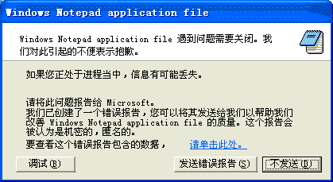
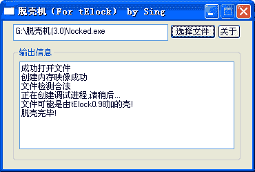

# tElock0.98 脱壳--<<软件加密技术内幕>>读后感二篇

> 原文：[`www.pediy.com/kssd/pediy10/61419.html`](https://www.pediy.com/kssd/pediy10/61419.html)

tElock0.98 脱壳----<<软件加密技术内幕>>读后感二篇

软件加密技术内幕一书的确不错,阅读它使我获益匪浅,让我学到了以前没有接触过的东西,软件加解密是如此的神奇和有趣啊!所以注册了个看雪论坛的 ID,来这里学习下,希望肯有高手指点啊.我这里指出一下书中不太完善的地方,如果是我认识有误,还请见谅啊(附件地址:`http://www.live-share.com/files/313592/tElock0.98\_\_.rar.html`).

书中第三章:”利用调试 API 编写脱壳机”,讲述 `tElock0.98` 特征数据的表 3-3 貌似有误(我是针对附书源码中的 `locked.exe` 文件分析的).按照书中的讲解,编写出的脱壳程序不能成功地将 `locked.exe` 文件脱壳,下图就是 DUMP 出的文件 `dumped.exe` 点击运行时的效果.



书中讲述编号为 3,14,17 的 SHE 发生地址是固定的,我测试的数据如下:

| 编号 | 异常地址 |
| :--- | :--- |
| 1 | `0x0040DA1D` |
| 2 | `0x0040DA74` |
| **3** | `0x0040C08C` |
| 4 | `0x0040C090` |
| 5 | `0x0040C099` |
| 6 | `0x0040C09E` |
| 7 | `0x0040C0A3` |
| 8 | `0x0040C0A7` |
| 9 | `0x0040C6A8` |
| 10 | `0x0040CAA1` |
| 11 | `0x0040CAE4` |
| 12 | `0x0040CB27` |
| 13 | `0x0040CB67` |
| 14 | `0x0040CBA6` |
| **15** | `0x0040CBF0` |
| 16 | `0x0040CE0D` |
| 17 | `0x0040CE49` |
| **18** | `0x0040D6F1` |
| 19 | `0x0040D7E1` |
| 20 | `0x0040D817` |

发现应该是编号为:3,15,18 的 SHE 发生地址是固定的,因为只有这样才能解释清楚.

于是尝试编写代码验证一下,程序采用汇编语言编写,利用书中所讲的思路完成的.如下是程序主界面:



脱壳后的文件保存为: `locked(OK).exe`(即原文件名后面追加”(OK)”),可以成功运行,使用 `PEID` 检测信息为: `Microsoft Visual C++ 6.0 SPx Method 1`,说明脱壳成功.下面看看程序是如何实现的,资源的创建就不说了,附件里有完整的文件.

## 1. 首先是头文件: 脱壳机.Inc, 主要是一些常量定义.

```asm
include   windows.inc
include   kernel32.inc
include   user32.inc
include   Comctl32.inc
include   shell32.inc
includelib  comdlg32.lib
includelib  kernel32.lib
includelib   user32.lib
includelib   Comctl32.lib
includelib   shell32.lib

DlgProc       PROTO  :HWND,:UINT,:WPARAM,:LPARAM
_ProcDlgAbout    PROTO  :HWND,:UINT,:WPARAM,:LPARAM
_OpenFile    PROTO  :DWORD,:DWORD,:DWORD
_UnPackFileForTelock  PROTO  :DWORD
_SetBpx      PROTO  :DWORD,:DWORD,:DWORD
_ClsBpx      PROTO  :DWORD,:DWORD,:DWORD
_Align      PROTO  :DWORD,:DWORD
;===========================================================================

     .data?
;===========================================================================

align dword
ThreadContext  CONTEXT<>
hInstance      dd ?
hWinMain       dd  ?
hEditInfo      dd  ?
hFile         dd  ?
hFileMap      dd  ?
pMem         dd  ?
NumOfSec      dd  ?
ImageSize      dd  ?
ImageBase      dd  ?
IatRVA        dd  ?
szfilename      db  MAX_PATH dup(?)
szDumpedFileName    db  MAX_PATH dup(?)
pi    PROCESS_INFORMATION  <>
DebugEvent  DEBUG_EVENT <>
ProcessID  DD  ?
hProcess  DD  ?
hThread    DD  ?
DebugStep  DD  ?
CodeBuffer  DD  ?
dwBytesRW  DD  ?
EntryPoint  dd  ?  ;带壳的入口点
OEP    DD  ?  ;壳运行完后的程序入口
ExitCode  dd  ?
pTempMem  dd  ?
pDstMem    dd  ?
dwFileSize  dd  ?
;===========================================================================

                 .const
;===========================================================================

IDD_DIALOG_MAIN   equ 101
IDC_EDT_FILENAME   equ 1001
IDC_BTN_SEL_FILE   equ 1002
IDC_GRP1     equ 1004
IDC_EDT_INFO     equ 1003
IDC_ABOUPTBTN     equ 1005
IDD_ABOUTBOX     equ 1000
IDC_BTN_OK     equ 1004
;===========================================================================

szfilefilter    db  'exe 可执行文件(\*.exe)',0,'\*.exe',0
     db  'dll 动态链接库(\*.dll)',0,'\*.dll',0
     db  '所有文件(\*.\*)'     ,0,'\*.\*'  ,0
szfileext    db  'exe',0
szOpenFileFailed  db  '开文件失败！',0Dh,0Ah,0
szOpenFileReady    db  '成功打开文件',0Dh,0Ah,0
szCreateMapReady  db  '创建内存映像成功',0Dh,0Ah,0
szValidFile    db  '文件检测合法',0Dh,0Ah,0
szCreateDebugProcessing db  '正在创建调试进程,请稍后...',0Dh,0Ah,0
szNotValidPeFile  db   '文件不是合法的 PE 文件！',0Dh,0Ah,0
szCreateProcessFailed  db  '创建调试进程失败！',0Dh,0Ah,0
szWaitForDebugEventFailed db  '没有等到调试事件!',0Dh,0Ah,0
szNotPackedByTelock098  db  '文件可能不是由 tElock0.98 加的壳!',0Dh,0Ah,0
szMayTelock098    db  '文件可能是由 tElock0.98 加的壳!',0Dh,0Ah,0
szUnPackedOK    db  '脱壳完毕!',0Dh,0Ah,0
;===========================================================================
```

## 2. 主程序文件: 脱壳机.Asm ,后面有详细的解释.

```asm
     .386
     .model flat, stdcall  ;32 bit memory model
     option casemap :none  ;case sensitive
;===========================================================================
     include 脱壳机.inc
     .code
;===========================================================================
;-------------------------------------------------
;打开 PE 文件,参数:hWinMain 为主窗体句柄
;lpfilebuff 为文件名缓冲区
;lpext 文件默认扩展名
;lpfilter 过滤器
_OpenFile  proc lpfilebuff,lpfilter,lpext
local   @stOF:OPENFILENAME
invoke  RtlZeroMemory,addr @stOF,sizeof @stOF
mov     @stOF.lStructSize,sizeof @stOF
push    hWinMain
pop     @stOF.hwndOwner
push  lpfilter
pop     @stOF.lpstrFilter
push  lpfilebuff
pop     @stOF.lpstrFile
mov     @stOF.nMaxFile,MAX_PATH
mov     @stOF.Flags,OFN_FILEMUSTEXIST or OFN_PATHMUSTEXIST
push  lpext
pop     @stOF.lpstrDefExt
invoke  GetOpenFileName,addr @stOF
ret
_OpenFile  endp
;-------------------------------------------------
;关于对话框回调过程
_ProcDlgAbout  proc       uses ebx edi esi hWnd,wMsg,wParam,lParam
mov  eax,wMsg
.if  eax == WM_CLOSE
  invoke EndDialog, hWnd,NULL
.elseif eax == WM_COMMAND
  mov      eax,wParam
  .if ax==IDC_BTN_OK
    invoke EndDialog, hWnd,NULL
  .endif
.else
  mov      eax,FALSE
  ret
.endif          
mov  eax,TRUE
ret
_ProcDlgAbout  endp
_AddLine  proc  lpMsg
  push  eax
  invoke  SendMessage,hEditInfo,EM_SETSEL,-1,0
  invoke  SendMessage,hEditInfo,EM_REPLACESSEL,0,lpMsg
  pop  eax
  ret
_AddLine endp
_Align  proc  dwOffset,dwAlignment
LOCAL  @return
  pushad
  xor  edx,edx
  mov  eax,dwOffset
  mov  ecx,dwAlignment
  div  ecx
  inc  eax
  xor  edx,edx
  mul  ecx
  mov  @return,eax
  popad
  mov  eax,@return
  ret
_Align endp
;-------------------------------------------------
;hProc 为欲设置断点的进程句柄
;BpxAddr 是欲设置断点的地址
;lpBpxBuffer 返回先前代码
;调用举例:如 buffer 为 DWORD 类型,则 invoke  _SetBpx,hProcess,403402,buffer
_SetBpx    proc  hProc,BpxAddr,BpxBuffer
LOCAL  @dwBytesRW
  pushad
  invoke  ReadProcessMemory,hProc,BpxAddr,addr BpxBuffer,1,addr @dwBytesRW
  mov  esi,BpxBuffer
  mov  dword ptr BpxBuffer,0CCH  ;int 3
  invoke  WriteProcessMemory,hProc,BpxAddr,addr BpxBuffer,1,addr @dwBytesRW
  mov  dword ptr BpxBuffer,esi
  popad
  ret
_SetBpx    endp
;-------------------------------------------------
;hProc 欲恢复的进程句柄
;BpxAddr 是欲清除断点的地址
;lpBpxBuffer 为恢复的代码
;调用举例: invoke _ClsBpx,hProc,403402,buffer
_ClsBpx  proc  hProc,BpxAddr,BpxBuffer
LOCAL  @dwBytesRW
  invoke  WriteProcessMemory,hProc,BpxAddr,addr BpxBuffer,1,addr @dwBytesRW   
  ret
_ClsBpx endp
;-------------------------------------------------
_UnPackFileForTelock  proc  lpFileName
LOCAL  @StartInfo:STARTUPINFO
  ;---------------------------------------------
  ;打开文件
  invoke  CreateFile,lpFileName, GENERIC_READ, 0, 0, 3, FILE_ATTRIBUTE_NORMAL,NULL
  .if  eax==INVALID_HANDLE_VALUE
    invoke   _AddLine,addr szOpenFileFailed
    ret
  .endif
  mov  hFile,eax
  invoke  _AddLine,addr szOpenFileReady
  ;---------------------------------------------
  ;创建内存映像文件
  invoke  CreateFileMapping,hFile,NULL,PAGE_READONLY,0,0,NULL
  mov  hFileMap,eax
  invoke  MapViewOfFile,hFileMap,FILE_MAP_READ,0,0,0
  mov  pMem,eax
  invoke  _AddLine,addr szCreateMapReady
  ;---------------------------------------------
  ;检测文件是否是合法的 PE 文件
  mov  esi,eax
  assume  esi:ptr IMAGE_DOS_HEADER
  .if  [esi].e_magic!=IMAGE_DOS_SIGNATURE
    invoke   _AddLine,addr szNotValidPeFile
    ret
  .endif
  add  esi,dword ptr [esi].e_lfanew
```


```
  assume  esi:ptr IMAGE_NT_HEADERS  

  .if  [esi].Signature!=IMAGE_NT_SIGNATURE  

    invoke   _AddLine,addr szNotValidPeFile  

    ret  

  .endif  

  invoke  _AddLine,addr szValidFile  

  ;---------------------------------------------  

  ;获取文件基本信息  

  movzx  eax,word ptr [esi].FileHeader.NumberOfSections  

  mov  NumOfSec,eax  ;保存区块数  

  mov  eax,dword ptr [esi].OptionalHeader.SizeOfImage  

  mov  ImageSize,eax  ;保存映像大小  

  mov  eax,dword ptr [esi].OptionalHeader.DataDirectory[8].VirtualAddress  

  mov  IatRVA,eax  ;保存加壳后的输入表地址  

  mov  eax,dword ptr [esi].OptionalHeader.AddressOfEntryPoint  

  mov  EntryPoint,eax  ;保存 OEP  

  ;---------------------------------------------  

  assume  esi:nothing  

  ;---------------------------------------------  

  ;取消映像,关闭文件  

  invoke  UnmapViewOfFile,pMem  

  invoke  CloseHandle,hFileMap  

  invoke  CloseHandle,hFile  

  ;---------------------------------------------  

  ;创建调试进程  

  invoke  GetStartupInfo,addr @StartInfo  

  invoke  CreateProcess, lpFileName, NULL, NULL, NULL, FALSE, DEBUG_PROCESS+ DEBUG_ONLY_THIS_PROCESS, NULL, NULL, addr @StartInfo, addr pi  

  .if  eax == FALSE  

    invoke  _AddLine,addr szCreateProcessFailed  

    ret  

  .endif  

  ;---------------------------------------------  

  invoke  _AddLine,addr szCreateDebugProcessing  

  ;================================================================================  

  ;进入调试循环体  

  .while TRUE  

    invoke  WaitForDebugEvent, offset DebugEvent, 4000  

    .if  eax == 0  

      invoke  _AddLine,addr szWaitForDebugEventFailed  

      ret  

    .endif  

    .if  DebugEvent.dwDebugEventCode == CREATE_PROCESS_DEBUG_EVENT;被调试进程刚被创建  

      mov  eax,DebugEvent.dwProcessId  

      mov  ProcessID,eax  ;保存进程 ID  

      mov  eax,DebugEvent.u.CreateProcessInfo.lpBaseOfImage  

      mov  ImageBase,eax  ;映像基址  

      mov  eax,DebugEvent.u.CreateProcessInfo.hProcess  

      mov  hProcess,eax  ;进程句柄  

      mov  eax,DebugEvent.u.CreateProcessInfo.hThread  

      mov  hThread,eax  ;主线程 ID  

      and  DebugStep,0  ;单步异常次数清零(初始化)  

      invoke  ContinueDebugEvent, DebugEvent.dwProcessId, DebugEvent.dwThreadId, DBG_CONTINUE  

    .elseif  DebugEvent.dwDebugEventCode == EXIT_PROCESS_DEBUG_EVENT  ;调试结束  

      .break  

    .elseif  DebugEvent.dwDebugEventCode == EXCEPTION_DEBUG_EVENT  

      .if  DebugStep == 0    ;以调试方式创建进程时,系统会先执行一次 DebugBreak 函数引发第一次异常  

        push  DBG_CONTINUE  ;以 DBG_CONTINUE 标志继续进行调试  

      .elseif  DebugStep == 3    ;第三次异常地址固定,以此确定是不是 tElock0.98 版本的壳  

        mov  eax,EntryPoint  

        add  eax,ImageBase  

        sub  eax,DebugEvent.u.Exception.pExceptionRecord.ExceptionAddress  

        .if  eax == 1b4ah  

          push  DBG_EXCEPTION_NOT_HANDLED  

        .else  

          invoke  _AddLine,addr szNotPackedByTelock098  

          ret  

        .endif  

      .elseif  DebugStep == 15   

        mov  eax,EntryPoint  

        add  eax,ImageBase  

        sub  eax,DebugEvent.u.Exception.pExceptionRecord.ExceptionAddress  

        .if  eax != 0fe6h  ;第 15 次异常地址固定,以此确定是不是 tElock0.98 版本的壳  

          invoke  _AddLine,addr szNotPackedByTelock098  

          ret  

        .endif  

        push  DBG_EXCEPTION_NOT_HANDLED  

      .elseif  DebugStep == 17    ;书中讲的 16 号 SEH  

        mov  ebx,EntryPoint  

        add  ebx,ImageBase  

        sub  ebx,9bah  ;地址 40d21c 处是测试输入表是否存在的指令:test esi,esi  

        invoke  _SetBpx,hProcess,ebx,CodeBuffer  ;设置 int 3 断点         

        push  DBG_EXCEPTION_NOT_HANDLED  

      .elseif  DebugStep == 18    ;我们下的断点异常  

        mov  ebx,DebugEvent.u.Exception.pExceptionRecord.ExceptionAddress  

        invoke  _ClsBpx,hProcess,ebx,CodeBuffer  ;清除断点,恢复先前代码  

        mov  ThreadContext.ContextFlags,CONTEXT_CONTROL or CONTEXT_INTEGER or CONTEXT_SEGMENTS  

        invoke  GetThreadContext,hThread,addr ThreadContext  ;获取线程环境  

        ;mov  ebx,DebugEvent.u.Exception.pExceptionRecord.ExceptionAddress  

        mov  ThreadContext.regEip,ebx      ;回到异常处重新执行本条指令  

        mov  eax,ThreadContext.regEsi  

        mov  IatRVA,eax        ;此时 esi 的值就是输入表地址,保存  

        mov  ThreadContext.regEsi,0      ;置为 0,欺骗壳没有了输入表,这样壳便不会破坏了  

        invoke  SetThreadContext,hThread,addr ThreadContext  

        invoke  FlushInstructionCache,hProcess,ThreadContext.regEip,5  

        push  DBG_CONTINUE  

      .elseif  DebugStep == 21  

        invoke  _AddLine,addr szMayTelock098  

        mov  ebx,EntryPoint  

        add  ebx,ImageBase  

        add  ebx,10ah  ;40DCE0 处保存了 OEP   

        invoke  ReadProcessMemory,hProcess,ebx,addr OEP,4,addr dwBytesRW  

        not  OEP  ;取出,取反即得到 OEP  

        ;分配内存,准备 dump 空间  

        invoke  VirtualAlloc, NULL, ImageSize, MEM_COMMIT, PAGE_READWRITE  

        mov  esi,eax  

        mov  pTempMem,eax  

        invoke  ReadProcessMemory,hProcess,ImageBase,esi,ImageSize,addr dwBytesRW  

        ;关联到 NT 头  

        add  esi,dword ptr [esi+3ch]  

        assume  esi:ptr IMAGE_NT_HEADERS  

        mov  eax,NumOfSec  

        mov  word ptr [esi].FileHeader.NumberOfSections,ax  ;写入区块数  

        mov  eax,IatRVA  

        mov  dword ptr [esi].OptionalHeader.DataDirectory[8].VirtualAddress,eax;写入输入表地址  

        mov  eax,OEP  

        mov  dword ptr [esi].OptionalHeader.AddressOfEntryPoint,eax  ;写入 OEP  

        ;add  esi,word ptr [esi].FileHeader.SizeOfOptionalHeader  

        ;关联到区块表  

        add  esi,sizeof IMAGE_NT_HEADERS  

        assume  esi:ptr IMAGE_SECTION_HEADER  

        xor  ecx,ecx  

            .while  ecx<NumOfSec  

              inc  ecx  

              .if  ecx==1  ;第一个区块,定位其[文件偏移]  

                push  ecx  

                mov  eax,sizeof IMAGE_NT_HEADERS  

                mov  ecx,NumOfSec  

                mov  edi,sizeof IMAGE_DOS_HEADER  

                add  edi,sizeof IMAGE_NT_HEADERS  

                add  edi,eax  ;按 200h 对齐后就是第一区块的[文件偏移]了  

                invoke  _Align,edi,200H  

                mov  dword ptr [esi].PointerToRawData,eax  

                mov  eax,dword ptr [esi].Misc.VirtualSize  

            mov  dword ptr [esi].SizeOfRawData,eax  

                pop  ecx  

              .else  

                lea  edi,[esi-sizeof IMAGE_SECTION_HEADER]  ;定位至上个区块表  

                assume  edi:ptr IMAGE_SECTION_HEADER  

            mov  eax,dword ptr [edi].PointerToRawData  

            add  eax,dword ptr [edi].SizeOfRawData  

            mov  dword ptr [esi].PointerToRawData,eax  

            mov  eax,dword ptr [esi].Misc.VirtualSize  

            mov  dword ptr [esi].SizeOfRawData,eax  

          .endif  

          add  esi,sizeof IMAGE_SECTION_HEADER    ;定位到下个区块表         

        .endw  

        ;---------------------------------------------------  

        ;重新组织文件结构  

        lea  edi,[esi-sizeof IMAGE_SECTION_HEADER]  ;定位至最后一个区块表  

        mov  eax,dword ptr[edi].PointerToRawData  

        add  eax,dword ptr[edi].SizeOfRawData  ;得到文件大小  

        mov  dwFileSize,eax  

        ;分配内存,准备 dump 空间  

        invoke  VirtualAlloc, NULL, eax, MEM_COMMIT, PAGE_READWRITE  

        mov  pDstMem,eax  

        assume  edi:nothing  

        mov  edi,eax  

        sub  esi,pTempMem  

        invoke  RtlMoveMemory,edi,pTempMem,esi  ;DOS 头,NT 头,区块表都复制过去  

        add  edi,esi  

        ;下面重新组织区块  

        mov  esi,pTempMem  

        ;关联到 NT 头  

        add  esi,dword ptr [esi+3ch]  

        add  esi,sizeof IMAGE_NT_HEADERS  

        assume  esi:ptr IMAGE_SECTION_HEADER  

        xor  ecx,ecx  

            .while  ecx<NumOfSec  

              inc  ecx  

              push  ecx  

              mov  eax,dword ptr[esi].VirtualAddress  

              add  eax,pTempMem  

              mov  edi,pDstMem  

              add  edi,dword ptr[esi].PointerToRawData  
```


# Telock 脱壳程序代码与说明

```asm
invoke RtlMoveMemory, edi, eax, dword ptr[esi].SizeOfRawData
add esi, sizeof IMAGE_SECTION_HEADER ; 定位到下个区块表
pop ecx
.endw
assume esi:nothing
invoke VirtualFree, pTempMem, 0, MEM_RELEASE

;---------------------------------------------------
; 创建一个文件名:原文件名(OK).exe
invoke lstrcpy, offset szDumpedFileName, offset szfilename
invoke lstrlen, offset szDumpedFileName
lea esi, szDumpedFileName
add esi, eax
sub esi, 4
mov eax, dword ptr[esi]
mov dword ptr [esi], "KO("
add esi, 4
mov dword ptr [esi], eax
add esi, 4
and byte ptr[esi], 0

;---------------------------------------------------
invoke CreateFile, ADDR szDumpedFileName, GENERIC_READ+GENERIC_WRITE, FILE_SHARE_READ+FILE_SHARE_WRITE, 0, CREATE_ALWAYS, FILE_ATTRIBUTE_NORMAL, NULL
mov edi, eax
invoke WriteFile, edi, pDstMem, dwFileSize, addr dwBytesRW, NULL
invoke CloseHandle, edi
invoke VirtualFree, pDstMem, 0, MEM_RELEASE
invoke _AddLine, addr szUnPackedOK
invoke GetExitCodeProcess, hProcess, addr ExitCode
invoke TerminateProcess, hProcess, ExitCode
ret
.else
push DBG_EXCEPTION_NOT_HANDLED
.endif
inc DebugStep ; 增加异常计数
; 继续调试
push DebugEvent.dwThreadId
push DebugEvent.dwProcessId
call ContinueDebugEvent
.else ; 其他消息
invoke ContinueDebugEvent, DebugEvent.dwProcessId, DebugEvent.dwThreadId, DBG_CONTINUE
.endif
.endw
; 循环体结束
; ================================================================================
ret

_UnPackFileForTelock endp

;------------------------------------------------------------
DlgProc proc hWin:HWND, uMsg:UINT, wParam:WPARAM, lParam:LPARAM
mov eax, uMsg
.if eax == WM_INITDIALOG
push hWin
pop hWinMain
invoke GetDlgItem, hWin, IDC_EDT_INFO
mov hEditInfo, eax
invoke SendMessage, hEditInfo, WM_CLEAR, 0, 0
.elseif eax == WM_COMMAND
mov eax, wParam
.if ax == IDC_BTN_SEL_FILE ; 打开并加载 PE 文件
invoke _OpenFile, addr szfilename, offset szfilefilter, offset szfileext
invoke SendDlgItemMessage, hWin, IDC_EDT_FILENAME, WM_SETTEXT, MAX_PATH, addr szfilename
invoke SendMessage, hEditInfo, WM_CLEAR, 0, 0
invoke _UnPackFileForTelock, addr szfilename
.elseif ax == IDC_ABOUTBTN ; 关于 dlg
invoke DialogBoxParam, hInstance, IDD_ABOUTBOX, hWin, offset _ProcDlgAbout, NULL
.endif
.elseif eax == WM_CLOSE
invoke EndDialog, hWin, 0
.else
mov eax, FALSE
ret
.endif
mov eax, TRUE
ret
DlgProc endp

;===========================================================================
start:
invoke GetModuleHandle, NULL
mov hInstance, eax
invoke InitCommonControls
invoke DialogBoxParam, hInstance, IDD_DIALOG_MAIN, NULL, addr DlgProc, NULL
invoke ExitProcess, 0
end start
```

## 程序逻辑说明

程序开始创建一个对话框，在对话框回调函数里重要的是处理 `[打开文件]` 按钮的单击事件。子过程 `_OpenFile` 负责打开文件，`_UnPackFileForTelock` 是核心的函数，负责对打开的文件脱壳处理。`_SetBpx` 与 `_ClsBpx` 分别是设置断点和取消断点的，`_AddLine` 将信息添加到文本框里显示。下面主要看 `UnPackFileForTelock` 函数。

1.  打开文件，创建内存映像
2.  检测文件是否是 PE 文件
3.  获取文件基本信息，如区块数，映像大小，OEP 等。
4.  以 `DEBUG_PROCESS+DEBUG_ONLY_THIS_PROCESS` 标志创建调试进程，进入调试循环体
5.  调试事件的 `dwDebugEventCode` 为 `CREATE_PROCESS_DEBUG_EVENT`，也即调试进程刚被创建，保存相关信息，如进程 ID，映像基址，进程句柄，主线程 ID。然后初始化单步异常次数计数器 `DebugStep` 为 0。
6.  主要处理调试事件的 `dwDebugEventCode` 为 `EXCEPTION_DEBUG_EVENT` 的情况，根据上表的分析，应该关注 `DebugStep` 为 3, 15, 17, 18 (18 号是我们认为设定的断点), 21 时的情况。因为 3 号与 15 号异常地址固定，可以作为判断 `tElock` 是否为 0.98 版本的依据；原 18 号异常地址固定，但在此之前的地址 `40D21CH` 处要破坏输入表，所以要在 17 号异常时要在 `40D21CH` 处设断，到 18 号异常时(所以说这时 18 号异常就是我们人为设定的了)取消断点。由于我们多设了一个断点，因此程序里的异常次数要多 1，我们在最后一个异常处(21 号)可以 DUMP 程序了。因此便是：3, 15, 17, 18, 21。这一点我搞了好久才弄清。
7.  3, 15, 17, 18 号处的代码处理情况就不详细说了，主要是 21 号时 DUMP 程序的处理，比较繁琐。因为 PE 文件的 `FileAlignment` 是 `200h`，而在内存里的 `SectionAlignment` 是 `1000h`，因此如果将处于内存里的程序 DUMP 出来并保存为文件的话，必须要考虑对齐粒度的转换，否则 DUMP 出的文件会较大，因为区块之间会存在较大的空隙。因此我想到要“重新组织一下文件结构”，这一点书中也没有讲，我感觉还是有必要的。思路是这样：“通常区块是连续存放的，上个区块的 `[文件偏移]` 加上上个区块的 `[文件大小]` 就是下个区块的 `[文件偏移]`。而第一个区块的 `[文件偏移]` 便是区块表后按 `200h` 对齐后的大小。”，按照这个方法 DUMP 出的程序就比较紧凑了：57KB，而附书程序 DUMP 出的是 60KB。

至此，代码讲解完毕，其实我也是得益于《软件加密技术内幕》一书，只不过将自己的心得写出来而已，程序写得不完善之处，还请指正啊。永远支持看雪！

另外我是一个新兵，本来想发在“外壳技术”板块呢，结果：

`帖子数不到 20 的会员，『软件调试论坛』与『软件保护与分析』 不能发主题帖，但可跟帖（如有精华帖则无此限制）。你可以将问题发到『新兵论坛』，一些简单入门问题，都可在这版块交流。如果问题有深度，版主会将帖子转到相应版块。O(∩_∩)o…`

By Sing
`asmcvc@163.com`
2008-03-17
