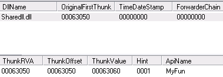
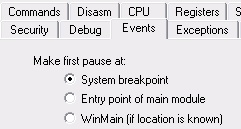
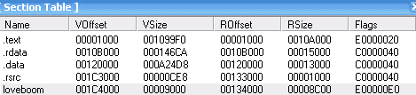
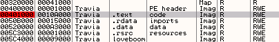
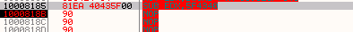
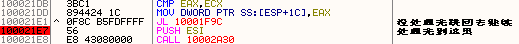

# 比泰软件防盗版战士脱壳实例(英雄王座 v0.001.014)

> 原文：[`www.pediy.com/kssd/pediy07/pediy7-500.htm`](https://www.pediy.com/kssd/pediy07/pediy7-500.htm)

## 基本信息

- 【目标】: 英雄王座 `v0.001.014`
- 【工具】: `Olydbg1.1`(diy 版)、`LORDPE`、`ImportREC1.6F`
- 【任务】: 脱马甲
- 【操作平台】: `Windows Xp sp2`
- 【作者】: `loveboom` `[DFCG]` `[FCG]` `[US]`

## 简要说明

这里一个比较奇怪的外壳，在外面看不到关于这个壳的任何说明，壳通过一个 `DLL` 对原程序进行解压，解压完毕执行原程序，是一个比较有新意的加壳方式。

## 详细过程

`OD` 没什么特别的设置, 打开所有异常项就行了。

先直接用 `Lordpe` 看看这个壳的一点信息：



比较有意思，程序只用一个 `DLL` 来解压并运行程序。

因为壳是通过 `DLL` 解压后，再运行，所以我们不能直接让 `OD` 停在 `OEP` 处，因为 `OD` 一般是在程序的 `oep` 处下个 `cc` 断，这样才会中断在程序入口处。改一下 `OD` 的设置：



让 `OD` 中断在系统 `DLL` 中。

这样就可以加载程序了，因为壳后面会改 `IAT` 到壳里，所以我们先要在程序里新增一个段。我的做法是用 `winhex` 新键一个大小为 `35KB`(这个因 `IAT` 大小而定)的空白文件，然后用 `LORDPE` 载入程序文件并新增一个段，选择从磁盘载入段就行了。



最下面那个段就是我新加的.

现在再次用 `OD` 载入目标程序，现在中断在系统中：

```
7C921231    C3              RETN                                ; 中断在系统 dll 中
7C921232    8BFF            MOV EDI,EDI
```

断下后在程序的 `CODE` 段下 `F2` 断点:



然后按 `F9` 运行程序，运行后，程序中断在 `ShellDll.dll` 中，也就是 `DLL` 解码程序文件处：

```
100025A2    8BCE            MOV ECX,ESI                           ; 如果没有解压完跳到这里继续
100025A4    6A 01          PUSH 1
100025A6    8B11            MOV EDX,DWORD PTR DS:[ECX]            ; 中断在这里
100025A8    895424 18      MOV DWORD PTR SS:[ESP+18],EDX         ; 这里的代码对原程序进行解码.
100025AC    8B41 04        MOV EAX,DWORD PTR DS:[ECX+4]
100025AF    894424 1C      MOV DWORD PTR SS:[ESP+1C],EAX
100025B3    8B51 08        MOV EDX,DWORD PTR DS:[ECX+8]
100025B6    895424 20      MOV DWORD PTR SS:[ESP+20],EDX
100025BA    8D5424 18      LEA EDX,DWORD PTR SS:[ESP+18]
100025BE    8B41 0C        MOV EAX,DWORD PTR DS:[ECX+C]
100025C1    8D4C24 28      LEA ECX,DWORD PTR SS:[ESP+28]
100025C5    51             PUSH ECX
100025C6    55             PUSH EBP
100025C7    52             PUSH EDX
100025C8    8D4C24 20      LEA ECX,DWORD PTR SS:[ESP+20]
100025CC    894424 30      MOV DWORD PTR SS:[ESP+30],EAX
100025D0    E8 5BEBFFFF    CALL 10001130
100025D5    8B4C24 24      MOV ECX,DWORD PTR SS:[ESP+24]
100025D9    8B5424 28      MOV EDX,DWORD PTR SS:[ESP+28]
100025DD    8BC6            MOV EAX,ESI
100025DF    83C6 10        ADD ESI,10
100025E2    4B             DEC EBX
100025E3    8908            MOV DWORD PTR DS:[EAX],ECX
100025E5    8B4C24 2C      MOV ECX,DWORD PTR SS:[ESP+2C]
100025E9    8950 04        MOV DWORD PTR DS:[EAX+4],EDX
100025EC    8B5424 30      MOV EDX,DWORD PTR SS:[ESP+30]
100025F0    8948 08        MOV DWORD PTR DS:[EAX+8],ECX
100025F3    8950 0C        MOV DWORD PTR DS:[EAX+C],EDX
100025F6   ^ 75 AA        JNZ SHORT 100025A2                      ; 没解压完跳回去
100025F8    5D             POP EBP
100025F9    5B             POP EBX
100025FA    8D4C24 08      LEA ECX,DWORD PTR SS:[ESP+8]
100025FE    C74424 34 FFFFF>MOV DWORD PTR SS:[ESP+34],-1
10002606    C1E7 04        SHL EDI,4
10002609    E8 22EAFFFF    CALL 10001030
1000260E    8B4C24 2C      MOV ECX,DWORD PTR SS:[ESP+2C]
10002612    8BC7            MOV EAX,EDI
10002614    5F             POP EDI
10002615    5E             POP ESI
10002616    64:890D 0000000>MOV DWORD PTR FS:[0],ECX
1000261D    83C4 30        ADD ESP,30
10002620    C2 1000        RETN 10                               ; 我们可以直接在这里按 F4，执行到这里
```

断下后，直接 `F4` 执行到 `10002620` 处，注意因为 `OD` 在程序 `OEP` 处下了 `cc`，这里解码后的 `OEP` 部分代码错误，所以我们要在这时改一个 `OEP` 代码，然后再改回去就行了。操作完毕后再一次 `CODE` 段断点，这样就到了 `IAT` 处理块，我们来分析一下 `IAT` 的处理：

```
1000236B    8B4424 0C      MOV EAX,DWORD PTR SS:[ESP+C]
1000236F    C606 E9        MOV BYTE PTR DS:[ESI],0E9             ; 再一次下段后中断在这里,这里填入远程跳，让 IAT 的部分去壳里
10002372    2BC6            SUB EAX,ESI                           ; 计算跳转的距离
10002374    83C0 FB        ADD EAX,-5
10002377    8946 01        MOV DWORD PTR DS:[ESI+1],EAX          ; 填入跳去远程地址
1000237A    8B5424 14      MOV EDX,DWORD PTR SS:[ESP+14]         ; 取要保存输入表的地址
1000237E    8B4424 20      MOV EAX,DWORD PTR SS:[ESP+20]         ; 取出跳去 IAT 的代码,用于然后比较，跳去 API 一般是 ff25,ff15 之类的等
10002382    3D 2D8B0000    CMP EAX,8B2D                           ; 比较是不是 mov ebp,ds:[xxxxxxxx]的样式
10002387    893A            MOV DWORD PTR DS:[EDX],EDI            ; 把 IAT 填入壳里面
10002389    0F8F 9C000000  JG 1000242B                           ; 如果大于 8b2d 就跳
1000238F    0F84 86000000  JE 1000241B                           ; 如果等于就跳去 8b2d 情况的处理
10002395    3D 158B0000    CMP EAX,8B15                           ; 这里比较是不是 MOV EDX, DS:[XXXXXXXX]的样式
1000239A    7F 68          JG SHORT 10002404                     ; 如果大于就跳
1000239C    74 38          JE SHORT 100023D6                     ; 等于就跳去处理 8b15 的情况
1000239E    3D A1000000    CMP EAX,0A1                            ; 比较是不是 MOV EAX,DS:[xxxxxxxx]的情况
100023A3    74 1B          JE SHORT 100023C0                     ; 如果是则跳去处理
100023A5    3D 0D8B0000    CMP EAX,8B0D                           ; 判断是否为 MOV ECX,DS:[xxxxxxxx]
100023AA    0F85 D9000000  JNZ 10002489                          ; 如果不是则跳
100023B0    8B4C24 10      MOV ECX,DWORD PTR SS:[ESP+10]         ; 处理 MOV ECX,DS:[xxxxxxxx]的情况
100023B4    8D46 06        LEA EAX,DWORD PTR DS:[ESI+6]
100023B7    C601 8B        MOV BYTE PTR DS:[ECX],8B
100023BA    C641 01 0D    MOV BYTE PTR DS:[ECX+1],0D
100023BE    EB 24          JMP SHORT 100023E4
100023C0    8B4C24 10      MOV ECX,DWORD PTR SS:[ESP+10]         ; 处理 MOV EAX,DS:[xxxxxxxx]的情况
100023C4    8D46 05        LEA EAX,DWORD PTR DS:[ESI+5]
100023C7    C601 A1        MOV BYTE PTR DS:[ECX],0A1
100023CA    8B5424 14      MOV EDX,DWORD PTR SS:[ESP+14]
100023CE    8951 01        MOV DWORD PTR DS:[ECX+1],EDX
100023D1    83C1 05        ADD ECX,5                              ; 因为 MOV EAX,DS:[xxxxxxxx]机器码只有五位，所以处理有一点不同
100023D4    EB 18          JMP SHORT 100023EE
100023D6    8B4C24 10      MOV ECX,DWORD PTR SS:[ESP+10]         ; 处理 MOV EDX, DS:[XXXXXXXX]的情况
100023DA    8D46 06        LEA EAX,DWORD PTR DS:[ESI+6]
100023DD    C601 8B        MOV BYTE PTR DS:[ECX],8B
100023E0    C641 01 15    MOV BYTE PTR DS:[ECX+1],15
100023E4    8B5424 14      MOV EDX,DWORD PTR SS:[ESP+14]         ; 处理完那个跳之里类的，就写出 DS:[xxxxxxxx]中的地址,地址就是 eip 的前一句的地址
100023E8    8951 02        MOV DWORD PTR DS:[ECX+2],EDX
100023EB    83C1 06        ADD ECX,6
100023EE    2BC1            SUB EAX,ECX                           ; 计算距离
100023F0    C601 E9        MOV BYTE PTR DS:[ECX],0E9             ; 在壳里增加完跳去 API 的代码后，填入要 jmp 返回程序的代码
100023F3    83E8 05        SUB EAX,5
100023F6    5F             POP EDI
100023F7    8941 01        MOV DWORD PTR DS:[ECX+1],EAX          ; 填入返回地址
100023FA    5E             POP ESI
100023FB    33C0            XOR EAX,EAX
100023FD    5B             POP EBX
100023FE    83C4 10        ADD ESP,10
10002401    C2 0C00        RETN 0C
10002404    3D 1D8B0000    CMP EAX,8B1D                           ; 判断是否为 MOV EBX,DS:[xxxxxxxx]
10002409    75 7E          JNZ SHORT 10002489                    ; 如果不是则跳
1000240B    8B4C24 10      MOV ECX,DWORD PTR SS:[ESP+10]         ; 处理 MOV EBX,DS:[xxxxxxxx]的情况
1000240F    8D46 06        LEA EAX,DWORD PTR DS:[ESI+6]
10002412    C601 8B        MOV BYTE PTR DS:[ECX],8B
10002415    C641 01 1D    MOV BYTE PTR DS:[ECX+1],1D
10002419   ^ EB C9        JMP SHORT 100023E4
1000241B    8B4C24 10      MOV ECX,DWORD PTR SS:[ESP+10]         ; 处理 mov ebp,ds:[xxxxxxxx]的情况
1000241F    8D46 06        LEA EAX,DWORD PTR DS:[ESI+6]
```


### 原始汇编代码段

```
10002422    C601 8B         MOV BYTE PTR DS:[ECX],8B  

10002425    C641 01 2D      MOV BYTE PTR DS:[ECX+1],2D  

10002429  ^ EB B9          JMP SHORT 100023E4  

1000242B    3D 15FF0000     CMP EAX,0FF15                          ; 判断是否为 CALL　DS：[xxxxxxxx]  

10002430    7F 3D          JG SHORT 1000246F                      ; 如果大于则跳  

10002432    74 2C          JE SHORT 10002460                      ; 等于就跳去处理 CALL DS:[xxxxxxxx]  

10002434    2D 358B0000     SUB EAX,8B35                           ; 这里处理否为 MOV ESI,DS:[xxxxxxxx]  

10002439    74 15          JE SHORT 10002450                      ; 相等则跳  

1000243B    83E8 08        SUB EAX,8                              ; 这里用另一种方式判断是否为 MOV EDI,DS:[xxxxxxxx]  

1000243E    75 49          JNZ SHORT 10002489                     ; 如果不是则跳  

10002440    8B4C24 10      MOV ECX,DWORD PTR SS:[ESP+10]          ; 处理 MOV EDI,DS:[xxxxxxxx]的情况  

10002444    8D46 06        LEA EAX,DWORD PTR DS:[ESI+6]  

10002447    C601 8B        MOV BYTE PTR DS:[ECX],8B  

1000244A    C641 01 3D     MOV BYTE PTR DS:[ECX+1],3D  

1000244E  ^ EB 94         JMP SHORT 100023E4  

10002450    8B4C24 10      MOV ECX,DWORD PTR SS:[ESP+10]          ; 处理 MOV ESI,DS:[xxxxxxxx]的情况  

10002454    8D46 06        LEA EAX,DWORD PTR DS:[ESI+6]  

10002457    C601 8B        MOV BYTE PTR DS:[ECX],8B  

1000245A    C641 01 35     MOV BYTE PTR DS:[ECX+1],35  

1000245E  ^ EB 84         JMP SHORT 100023E4  

10002460    8B4C24 10      MOV ECX,DWORD PTR SS:[ESP+10]          ; 处理 CALL DS:[xxxxxxxx]的情况  

10002464    8D46 06        LEA EAX,DWORD PTR DS:[ESI+6]  

10002467    C601 FF        MOV BYTE PTR DS:[ECX],0FF  

1000246A  ^ E9 71FFFFFF    JMP 100023E0  

1000246F    3D 25FF0000     CMP EAX,0FF25                          ; 判断是否为 JMP　DS：[xxxxxxxx]  

10002474    75 13          JNZ SHORT 10002489                     ; 如果不是则跳  

10002476    8B4C24 10      MOV ECX,DWORD PTR SS:[ESP+10]          ; 处理 JMP DS:[XXXXXXXX]的情况  

1000247A    8D46 06        LEA EAX,DWORD PTR DS:[ESI+6]  

1000247D    C601 FF        MOV BYTE PTR DS:[ECX],0FF  

10002480    C641 01 25     MOV BYTE PTR DS:[ECX+1],25  

10002484  ^ E9 5BFFFFFF    JMP 100023E4  

10002489    5F             POP EDI  

1000248A    C743 04 1527000>MOV DWORD PTR DS:[EBX+4],2715  

10002491    5E             POP ESI  

10002492    83C8 FF        OR EAX,FFFFFFFF  

10002495    5B             POP EBX  

10002496    83C4 10        ADD ESP,10  

10002499    C2 0C00        RETN 0C  
```

### 分析与总结

看完后总结一下，先把 `JMP API` 的代码跳到壳里去，`IAT` 的处理除了 `mov eax,ds:[xxxxxxxx]` 有点不同之外，其它的都是先填入 `EAX` 的值（也就是 `jmp mov ebp` 之类的），然后写入要跳的地址，地址就是当前 `EIP` 的前一句的地址也就是 `eip-4`，处理完就填入要返回的地址。

分析完毕我们写上自己的代码;

### 新写入的汇编代码段

```
1000237A   /E9 025E0000      JMP 10008181  

1000237F   |90             NOP  

10002380   |90             NOP  

10002381   |90             NOP  

10002382   |3D 2D8B0000     CMP EAX,8B2D  

10002387   |893A            MOV DWORD PTR DS:[EDX],EDI  

10002389   |0F8F 9C000000   JG 1000242B  

1000238F   |0F84 86000000   JE 1000241B  

10002395   |3D 158B0000     CMP EAX,8B15  

1000239A   |7F 68           JG SHORT 10002404  

1000239C   |74 38           JE SHORT 100023D6  

1000239E   |3D A1000000     CMP EAX,0A1  

100023A3   |74 1B           JE SHORT 100023C0  

100023A5   |3D 0D8B0000     CMP EAX,8B0D  

100023AA   |0F85 D9000000   JNZ 10002489  

100023B0   |E9 5C5D0000     JMP 10008111  

100023B5   |90             NOP  

100023B6   |90             NOP  

100023B7   |C601 8B         MOV BYTE PTR DS:[ECX],8B  

100023BA   |C641 01 0D      MOV BYTE PTR DS:[ECX+1],0D  

100023BE   |EB 24           JMP SHORT 100023E4  

100023C0   |E9 4C5D0000     JMP 10008111  

100023C5   |90             NOP  

100023C6   |90             NOP  

100023C7   |C601 A1         MOV BYTE PTR DS:[ECX],0A1  

100023CA   |8B5424 14       MOV EDX,DWORD PTR SS:[ESP+14]  

100023CE   |8951 01         MOV DWORD PTR DS:[ECX+1],EDX  

100023D1   |83C1 05         ADD ECX,5  

100023D4   |EB 18           JMP SHORT 100023EE  

100023D6   |E9 365D0000     JMP 10008111  

100023DB   |90             NOP  

100023DC   |90             NOP  

100023DD   |C601 8B         MOV BYTE PTR DS:[ECX],8B  

100023E0   |C641 01 15      MOV BYTE PTR DS:[ECX+1],15  

100023E4   |8B5424 14       MOV EDX,DWORD PTR SS:[ESP+14]  

100023E8   |8951 02         MOV DWORD PTR DS:[ECX+2],EDX  

100023EB   |83C1 06         ADD ECX,6  

100023EE   |2BC1            SUB EAX,ECX  

100023F0   |C601 00         MOV BYTE PTR DS:[ECX],0  

100023F3   |33C0            XOR EAX,EAX  

100023F5   |90             NOP  

100023F6   |5F             POP EDI  

100023F7   |8941 01         MOV DWORD PTR DS:[ECX+1],EAX  

100023FA   |5E             POP ESI  

100023FB   |33C0            XOR EAX,EAX  

100023FD   |5B             POP EBX  

100023FE   |83C4 10         ADD ESP,10  

10002401   |C2 0C00         RETN 0C  

10002404   |3D 1D8B0000     CMP EAX,8B1D  

10002409   |75 7E           JNZ SHORT 10002489  

1000240B   |E9 015D0000     JMP 10008111  

10002410   |90             NOP  

10002411   |90             NOP  

10002412   |90             NOP  

10002413   |90             NOP  

10002414   |90             NOP  

10002415   |90             NOP  

10002416   |90             NOP  

10002417   |90             NOP  

10002418   |90             NOP  

10002419   |90             NOP  

1000241A   |90             NOP  

1000241B   |E9 F15C0000     JMP 10008111  

10002420   |90             NOP  

10002421   |90             NOP  

10002422   |90             NOP  

10002423   |90             NOP  

10002424   |90             NOP  

10002425   |90             NOP  

10002426   |90             NOP  

10002427   |90             NOP  

10002428   |90             NOP  

10002429   |90             NOP  

1000242A   |90             NOP  

1000242B   |3D 15FF0000     CMP EAX,0FF15  

10002430   |7F 3D           JG SHORT 1000246F  

10002432   |74 2C           JE SHORT 10002460  

10002434   |2D 358B0000     SUB EAX,8B35  

10002439   |74 15           JE SHORT 10002450  

1000243B   |83E8 08        SUB EAX,8  

1000243E   |75 49           JNZ SHORT 10002489  

10002440   |B8 3D8B0000     MOV EAX,8B3D  

10002445   |E9 C75C0000     JMP 10008111  

1000244A   |90             NOP  

1000244B   |90             NOP  

1000244C   |90             NOP  

1000244D   |90             NOP  

1000244E   |90             NOP  

1000244F   |90             NOP  

10002450   |B8 358B0000     MOV EAX,8B35  

10002455   |E9 B75C0000     JMP 10008111  

1000245A   |90             NOP  

1000245B   |90             NOP  

1000245C   |90             NOP  

1000245D   |90             NOP  

1000245E   |90             NOP  

1000245F   |90             NOP  

10002460   |E9 AC5C0000     JMP 10008111  

10002465   |90             NOP  

10002466   |90             NOP  

10002467   |90             NOP  

10002468   |90             NOP  

10002469   |90             NOP  

1000246A   |90             NOP  

1000246B   |90             NOP  

1000246C   |90             NOP  

1000246D   |90             NOP  

1000246E   |90             NOP  

1000246F   |3D 25FF0000     CMP EAX,0FF25  

10002474   |75 13           JNZ SHORT 10002489  

10002476   |E9 965C0000     JMP 10008111  

1000247B   |90             NOP  

1000247C   |90             NOP  

1000247D   |90             NOP  

1000247E   |90             NOP  

1000247F   |90             NOP  

10002480   |90             NOP  

10002481   |90             NOP  

10002482   |90             NOP  

10002483   |90             NOP  

10002484   |90             NOP  

10002485   |90             NOP  

10002486   |90             NOP  

10002487   |90             NOP  

10002488   |90             NOP  

10002489   |5F             POP EDI  

1000248A   |C743 04 1527000>MOV DWORD PTR DS:[EBX+4],2715  
```


```asm
10002491   |5E                 POP ESI  
10002492   |83C8 FF            OR EAX,FFFFFFFF  
10002495   |5B                 POP EBX  
10002496   |83C4 10            ADD ESP,10  
10002499   |C2 0C00            RETN 0C  
```

然后在空地上再写一段:

```asm
10008111     8B4C24 10        MOV ECX,DWORD PTR SS:[ESP+10]  
10008115     51               PUSH ECX  
10008116     8BCE             MOV ECX,ESI                                 ; 填入代码到程序中  
10008118     3C A1            CMP AL,0A1  
1000811A     74 34            JE SHORT 10008150                           ; 对 eax=a1 的情况进行处理  
1000811C     90               NOP  
1000811D     9C               PUSHFD  
1000811E     66:8BD0          MOV DX,AX  
10008121     66:C1E0 08       SHL AX,8  
10008125     8AC6             MOV AL,DH  
10008127     9D               POPFD  
10008128     66:8901          MOV WORD PTR DS:[ECX],AX                   ; 写入 EAX 的值  
1000812B     8D46 06          LEA EAX,DWORD PTR DS:[ESI+6]  
1000812E     8B5424 18        MOV EDX,DWORD PTR SS:[ESP+18]             ; 因为前面 ECX 入栈了，所以这里是 esp+18  
10008132     90               NOP  
10008133     90               NOP  
10008134     90               NOP  
10008135     90               NOP  
10008136     90               NOP  
10008137     90               NOP  
10008138     8951 02          MOV DWORD PTR DS:[ECX+2],EDX              ; 填入 DS：[XXXXXXXX]中的值  
1000813B     59               POP ECX  
1000813C     66:C701 0000     MOV WORD PTR DS:[ECX],0                   ; 把原来填入代码给清空掉  
10008141     C741 02 0000000>MOV DWORD PTR DS:[ECX+2],0  
10008148   ^ E9 9EA2FFFF      JMP 100023EB                               ; 处理完跳回去  
1000814D     90               NOP  
1000814E     90               NOP  
1000814F     90               NOP  
10008150     8801             MOV BYTE PTR DS:[ECX],AL                   ; 对 0A1 进行处理  
10008152     8D46 05          LEA EAX,DWORD PTR DS:[ESI+5]  
10008155     8B5424 18        MOV EDX,DWORD PTR SS:[ESP+18]  
10008159     8951 01          MOV DWORD PTR DS:[ECX+1],EDX  
1000815C     59               POP ECX  
1000815D     C601 00          MOV BYTE PTR DS:[ECX],0  
10008160     90               NOP  
10008161     90               NOP  
10008162     C741 01 0000000>MOV DWORD PTR DS:[ECX+1],0  
10008169     83E9 01          SUB ECX,1  
1000816C   ^ E9 7AA2FFFF      JMP 100023EB                               ; 处理完毕跳回去  
10008171     90               NOP  
10008172     90               NOP  
10008173     90               NOP  
10008174     90               NOP  
10008175     90               NOP  
10008176     90               NOP  
10008177     90               NOP  
10008178     90               NOP  
10008179     90               NOP  
1000817A     90               NOP  
1000817B     90               NOP  
1000817C     90               NOP  
1000817D     90               NOP  
1000817E     90               NOP  
1000817F     90               NOP  
10008180     90               NOP  
10008181     8B5424 14        MOV EDX,DWORD PTR SS:[ESP+14]             ; 这里把 IAT 部分放到程序里  
10008185     81EA 40435F00    SUB EDX,5F4340                            ; 这里就是把壳的 IAT 地址放到我们前面新加的段里,注意，这里的值，可能每次载入后有所不同  
1000818B     90               NOP                                       ; 第二次我们要手工处理一下，每二次正常过的话这里是 5c4010,我们改成 5C4004,并在这里下断  
1000818C     90               NOP                                       ; 后面的我就用脚本来处理  
1000818D     90               NOP  
1000818E     895424 14        MOV DWORD PTR SS:[ESP+14],EDX  
10008192     90               NOP  
10008193     90               NOP  
10008194     90               NOP  
10008195     90               NOP  
10008196     90               NOP  
10008197     8B4424 20        MOV EAX,DWORD PTR SS:[ESP+20]  
1000819B   ^ E9 E2A1FFFF      JMP 10002382  
100081A0     90               NOP  
```



向下可以找到处理完 `IAT` 的跳:



在上面也下个断，然后写脚本:

```asm
var value  
var edivalue  
var sedi  

mov value,c  
mov edivalue,edi  
and edivalue,ff000000  
mov sedi,edivalue  
run  

lbl1:  
   eoe lbl2  
   cmp eip,100021E7                       //判断有没有处理完 IAT  
   je lbl2  
   mov edivalue,edi                        //这里粗略的处理分界线  
   and edivalue,ff000000  
   cmp edivalue,sedi  
   jne lbl3                                //如果地址的前两位不同就认为是不同  
   add value,c                            

lblsub:  
   sub edx,value  
   cmp edx,5C479C                          //这里对上面的粗略后留下的部分处理完  
   je lbl4  
   cmp edx,5C4B0C                          //找到的地址+8  
   je lbl4  
   cmp edx,5c4c40                          //找到的地址+8  
   je lbl4  

lblsub1:  
   run  
   jmp lbl1  

lbl2:  
   ret  

lbl3:  
   mov sedi,edivalue                       //发现有所不同就设定一个分界线  
   add value,8  
   jmp lblsub  

lbl4:  
   add edx,4                               //这里也用于设定分界线  
   sub value,4  
   jmp lblsub1  
```

写完运行一下脚本，这样就可以得到很完整的程序，然后 `DUMP` 和 `FIXDUMP` 一下程序就可以运行了。

好了，脱壳完毕！

注意一下：程序最好不要在 `xp` 下脱，因为那样，脱了后的文件在其它平台上可能会有问题.

第二，这个壳处理 `IAT` 不是很好，所以当获取 `IAT` 失败里也不会有什么提示，这一点要我们自己去注意

Greetz:

Fly.Jingulong,yock,tDasm.David.ahao.UFO(brother).alan(sister).all of my friends and you!

By loveboom[DFCG][FCG]

Email:bmd2chen@tom.com

4dd466d0e1e0cc123afbe504da2462ca
