# .NET 逆向学习总结系列 [2.24 更新：.NET 逆向学习总结 002(1)]

> 原文：[`www.pediy.com/kssd/pediy11/104845.html`](https://www.pediy.com/kssd/pediy11/104845.html)

## .NET 逆向学习总结 000

**本节学习目的**：使用 `VB.NET` 创建三个工程：`HelloWorld_VB_Console`， `HelloWorld_VB_WIN` 和 `HelloWorld_VB_WEB`

**学习成果**：三个程序集，

`HelloWorld_VB_Console.exe`,`HelloWorld_VB_WIN.exe` 和 `HelloWorld_VB_WEB.dll`

**使用到的工具**：`VS 2008`

**学习难度**：★☆☆☆☆

## .NET 逆向学习总结 001

**本节学习目的**：逆向 `000` 节得到的三个程序集

**学习成果**：得到三个可编译，可运行的 `VB.NET` 工程

`HelloWorld_VB_Console`,`HelloWorld_Win_Reverse`, `Hello_Web_Reverse`

**使用到的工具**：`VS2008`,`Reflector`,`PEID`

**学习难度**：★☆☆☆☆

## .NET 逆向学习总结 002

**本节学习目的**：使用 `VC#.NET` 创建三个工程：`HelloWorld_C_Console`， `HelloWorld_C_WIN` 和 `HelloWorld_C_WEB`

**学习成果**：三个程序集，

`HelloWorld_C_Console.exe`,`HelloWorld_C_WIN.exe` 和 `HelloWorld_C_WEB.dll`

**使用到的工具**：`VS 2008`

**学习难度**：★☆☆☆☆

## .NET 逆向学习总结 003

**本节学习目的**：逆向 `000` 节得到的三个程序集

**学习成果**：得到三个可编译，可运行的 `VC#.NET` 工程

**使用到的工具**：`VS2008`,`Reflector`,`PEID`

**学习难度**：★☆☆☆☆

## .NET 逆向学习总结 004

**本节学习目的**：将 .NET 程序集反编译成 `IL`,然后再将反编译出来的 `IL` 编译成原始程序集

**使用到的工具**：

**学习难度**：★☆☆☆☆

## .NET 逆向学习总结 005

**本节学习目的**：修改 `IL` 文件以破解 .NET 程序

**使用到的工具**：

**学习难度**：★☆☆☆☆

## .NET 逆向学习总结 006

**本节学习目的**：如何保护自己的 .NET 开发的程序

**使用到的工具**：

**学习难度**：★☆☆☆☆

## .NET 逆向学习总结 007

**本节学习目的**：逆向中小型系统实例

**使用到的工具**：

**学习难度**：★☆☆☆☆

最近在学习 .NET 软件的逆向，偶有小得，不敢独享，于是产生了写以上几篇文章的欲望，写出来给我等菜鸟阅读，本教程仅用于扫盲，高手和老鸟可飘过。框架基本定了，不过还是有可能发生改变的。另外，有时间的话，我会完成的。有兴趣的，也可以加入进来，替哥分担一下。做 .NET 逆向，简单点说就是一点技巧加上体力活。如果有什么写得不对，刚好又被您看到的，欢迎批评指出，哥会虚心接受的。在本系列文章中，哥假设读者仅有一点高级语言的编程经验，当然有低级语言的编译经验更好了，因此文章可能会显得有点嗦，这是为了不要漏过什么细节，而让初学者花费大量时间去解决，如果这样就划不来了。本文章强调自己动手，丰衣足食，因此可能不会给出现成的工程或者程序集，相信跟着步骤来做任何人都是可以做得来的。如果读者没有 `VS2008`，用 `VS2005` 或者 `2010` 都可以。

## .NET 逆向学习总结 000

**本节学习目的**：使用 `VB.NET` 创建三个工程：`HelloWorld_VB_Console`， `HelloWorld_VB_WIN` 和 `HelloWorld_VB_WEB`

**学习成果**：三个程序集，

`HelloWorld_VB_Console.exe`,`HelloWorld_VB_WIN.exe` 和 `HelloWorld_VB_WEB.dll`

**使用到的工具**：`VS 2008`

**学习难度**：★☆☆☆☆

**第一步**：用 `VB.NET` 创建一个 `Console` 版的工程，工程名为： `HelloWorld_VB_Console` .

**第二步**：添加用户过程 `Test()`，完整源码如下：

```
Module Module1
    Sub Main()
        Test()
    End Sub
    Sub Test()
        MsgBox("Hello World!")
    End Sub
End Module
```

**第三**：编译，链接，生成 `HelloWorld_VB_Console.exe`

运行结果截图如下：

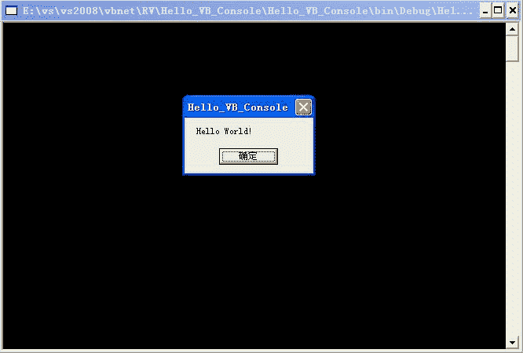

**第四步**：用 `VB.NET` 创建一个 `Windows` 版的工程，工程名为： `HelloWorld_VB_WIN`

**第五步**：在主窗体 `Form1` 上添加一个按钮，然后把属性 `Text` 改为 `Hello`，属性 `Name` 改为 `btnHello`，如下所示：

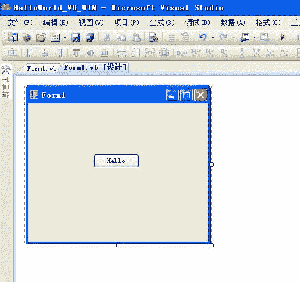

**第六步**：为按钮 `btnHello` 添加单击事件，添加一个用户过程 `Test()`，完整代码如下所示：

```
Public Class Form1
    Private Sub btnHello_Click(ByVal sender As System.Object, ByVal e As System.EventArgs) Handles btnHello.Click
        Test()
    End Sub
    Private Sub Test()
        MsgBox("Hello World!")
    End Sub
End Class
```

**第七步**：编译，链接，生成可运行的程序 `HelloWorld_VB_WIN.exe`

运行结果截图如下：

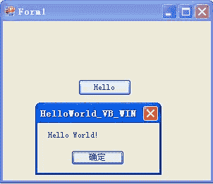

**第八步**：创建一个 `VB.NET` 版的网站，名称为： `HelloWorld_VB_WEB`

**第九步**：在 `Default.aspx` 上创建一个按钮，同样的把属性 `Text` 改为 `Hello`，把属性 `ID` 改为 `btnHello`，结果如图所示：

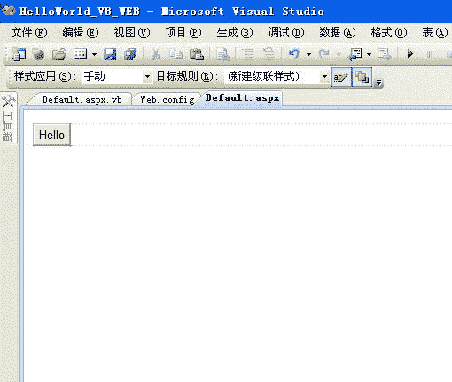

**第十步**：添加用户过程 `Test()`，功能也仅是弹出个消息框而已，为 `btnHello` 添加一单击事件处理函数，完整源码如下所示：

```
Partial Public Class _Default
    Inherits System.Web.UI.Page
    Protected Sub Page_Load(ByVal sender As Object, ByVal e As System.EventArgs) Handles Me.Load
    End Sub
    Protected Sub btnHello_Click(ByVal sender As Object, ByVal e As EventArgs) Handles btnHello.Click
        Test()
    End Sub
    Private Sub Test()
        Response.Write("<script language=javascript>alert('Hello World!')</script>")
    End Sub
End Class
```

**第十一步**：编译，链接，生成程序集 `HelloWorld_VB_WEB.dll`

运行结果截图如下所示：


**总结**：不会总结的人就是不会学习的人，这是我写这篇文章的宗旨和出发点，虽然它实在是很简单，不过到了后面还是用得着的。以上程序仅作演示用，相信如此简单的程序，对于任何一个有过编程经验的人都能够理解。那三个工程我就不发上来了，因为实在太简单了。

## .NET 逆向学习总结 001(1)

**本节学习目的**：逆向 `000` 节得到的三个程序集

**学习成果**：得到三个可编译，可运行的 `VB.NET` 工程

`HelloWorld_VB_Console`,`HelloWorld_Win_Reverse`, `HelloWorld_VB_WEB`

**使用到的工具**：`VS2008`,`Reflector`,`PEID`

**学习难度**：★☆☆☆☆

在这一节里，要做的事情就是把 `000` 节里得到的三个程序集，要做的事情似乎多的，但都是些重复性的活儿，稍微有点耐心就很容易做完的了，记住，想学逆向，就一定要经过自己亲自动手做才行。

`HelloWorld_VB_Console.exe`,`HelloWorld_VB_WIN.exe` 和 `HelloWorld_VB_WEB.dll` 分别恢复成三个可以编译，可以运行的工程。

因为程序分三种，控制台（`Console`），图形界面（`GUI`）和网站（`WEB`），因此需要区别对待。如果对控制台这个概念不是很了解，那么你把它想像成带黑色窗口的 `DOS` 程序就行了，图形界面的程序和网站这两个概念都很好理解的，就不多作介绍了。

如果是控制台程序，那么我们可以完全不用考虑界面问题，也就是程序上面有什么菜单，按钮，文本框等窗体对象，我们只需要关心反编译的源码就行了，但是如果是图形界面的程序或者，那么我们就需要同时关心反编译出来的源码和程序界面了。

什么是逆向呢？（好像这样问，有点污辱了各位童鞋的智商了，不要误会，哥没有这个意思的）其实逆向就是正向的反向。那什么是正向呢？简单点说，正向就是从工程项目到程序集，逆向就是根据程序集还原出它原本的工程项目。就好像编译和反编译，汇编和反汇编一样，都是成对出现的。

大概来说，逆向主要分七步来做：
1. 第一步是查看我们要逆向的程序集的数量及大小，粗略估计我们的工作量的大小；
2. 第二步是用 `PEID` 查看程序是用什么语言开发的，这样才能对症下药，选用相应的工具反编译它的源码；
3. 第三步是运行程序查看要逆向的程序的界面，然后自己照着画一个界面出来，并且把所有窗体对象的属性值改成和原来的程序一模一样；
4. 第四步是用合适的反编译器反编译程序集的源码；
5. 第五步是阅读源码，找到所有的窗体对象变量，然后根据这些变量名来设置自己重建的工程里的窗体对象的变量名，因为仅通过看程序界面是无法知道窗体对象的名称的；
6. 第六步是运行要逆向的程序并且找出它的所有事件处理过程（函数），然后在自己的工程里也添加一模一样的事件处理过程（函数）；
7. 第七步是阅读源码，把里面的非事件处理函数逐个全部复制到我们建立的工程里面，至于事件处理过程，则只要把它的过程体复制到我们重建的工程的相应的对象事件里就行了。

对于想学习逆向的童鞋来说，就暂时这么理解逆向是怎么一回事先吧，等你的经验和能力逐步提升的时候，自然就会对什么是逆向以及怎么逆向有更深层次的理解的了。

下面，请看我具体是如何重建工程的。

**第一步**：这里首先我们要逆向的程序是 `HelloWorld_VB_Console.exe`，仅仅有一个程序集而已，大小为 `15KB` 左右，很小的一个 `DEMO`，要逆向它是很简单的，不过对于我们学习 .NET 逆向已经足够的了。对于大的软件，也不过是一个大一点的 `DEMO` 罢了。

**第一步**：用 `PEID` 查一下 `HelloWorld_VB_Console.exe`，显示结果如下：

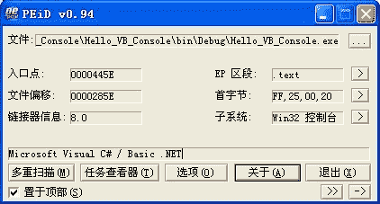

图 1

显示开发语言是 `Microsoft Visual C# / Basic .NET`，因此我们可以用 `Reflector` 来反编译它的源码。

**第二步**：运行 `HelloWorld_VB_Console.exe`，出来如下的界面。

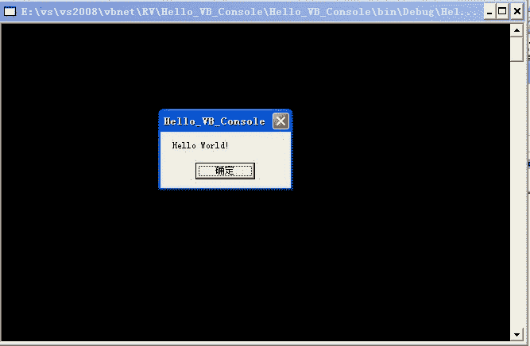

图 2

看起来是一个控制台程序，因此我们需要用 `VB.NET` 或者 `VC#.NET` 重建一个控制台的工程，而不需要画任何的窗体，而功能初步估计似乎也就弹出一个消息框而已。

**第三步**：用 `Reflector` 打开 `HelloWorld_VB_Console.exe`，界面大概如下所示。

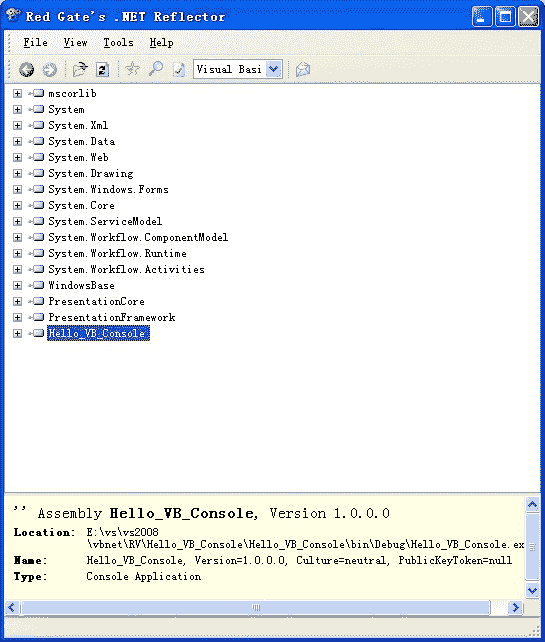

图 3

看到了吗？`Hello_VB_Console`，看起来很很正常，说明被 `Reflector` 识别出来了，如果识别不出来程序集，它就会在程序集名称前面显示一个红色的感叹号。然后单击 `View->Options…`把里面的 `Disassembler` 选项设置得如下所示：

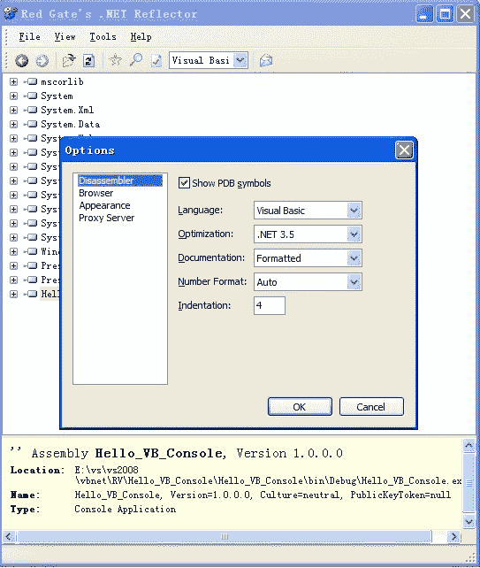

图 4

**第四步**：查看 `Hello_VB_Console` 的源码，如图所示：

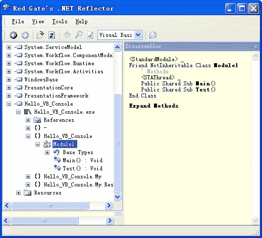

图 5

由图可见，`Hello_VB_Console.My` 和 `Hello_VB.Resource` 这两个东西我们可以不用管它，因为它对编译器自动生成的，对我们也没多大用处，`Module1` 才是我们要关注的，而它里面包含有两个方法，一个是 `Main()`，看名字就知道是程序的入口了，一个是 `Test()`方法，很明显它是一个由程序员自定义的方法。

**第五步**：把 `Reflector` 的反编译语言更换为 `IL`,显示如下：

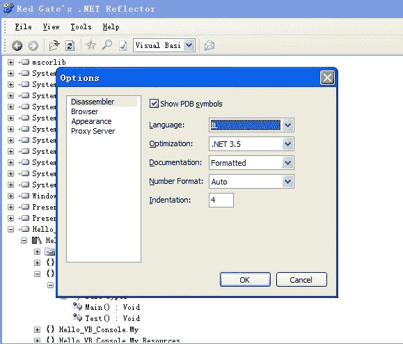

图 6

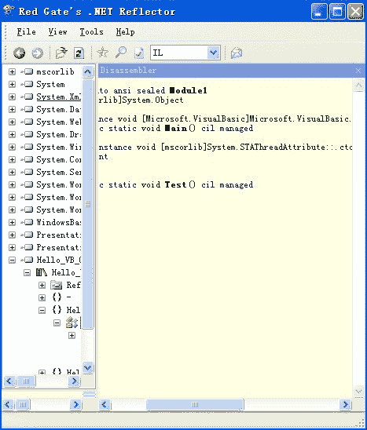

图 7

这时再看 `Module1` 的源码时，我们在里面发现了 `Microsoft.VisualBasic` 这个字符串，如果发现出现 `VisualBasic` 这些 `VB.NET` 编写的程序才会出现的字符串，那么可以百分之百的肯定它是用 `VB.NET` 开发的程序了，反之如果没发现有，就应该是 `VC#.NET` 开发的了。

**第六步**：打开您的 `VS2008`,选择新建一个 `VB.NET` 的 `Console` 工程，名称跟所要逆向的一模一样，也是 `Hello_VB_Console`，说句题外话，大家有没有发现这一步和 `000` 里正向工程的第一步很像？是就对了，逆向要的就是这种感觉，这种感觉越是强烈清晰，说明逆向的路子走得越对，逆向的成功概率就越高。

**第七步**：接下来，把 `Test()`方法整个不顾一切的全部复制到新建的工程里面，如下所示。

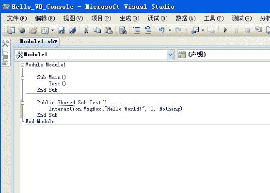

图 8

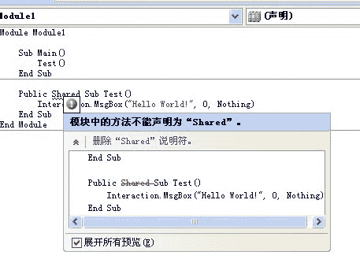

图 9

看到了一个错误，似乎是由于 `Shared` 关键它引起了，它是编译器自动生成的，把它删掉就行了。

再把 `Main()`方法体里的代码复制到我们建立的工程里，如图。

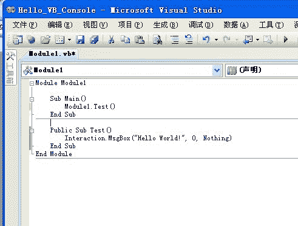

图 10

**第八步**：编译，链接，运行程序，出来界面如下：

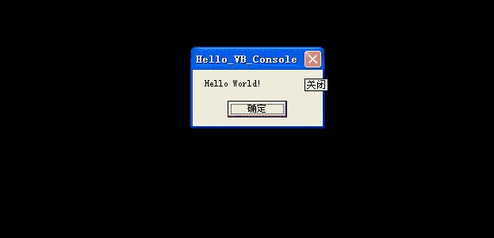

图 11

怎么样？拿来跟 `000` 节中生成的程序相比，是不是完全一样？一个可编译，可运行的工程就这样诞生了。做到这一步的童鞋麻烦出来吼吼，让哥也分享一下你的成就感。简单吧，只需要一点技巧，加上一点体力活，我们就把 `Hello_VB_Console.exe` 程序集逆向出来了。只要跟着哥这么一路做下去，肯定觉得很简单容易的了，另外，后面两个程序集，如果也已经逆向出来的，也请出来吼吼，让哥也分享一下你们的成就感。

## .NET 逆向学习总结 001(2)

**本节学习目的**：逆向 `000` 节得到的三个程序集

**学习成果**：得到三个可编译，可运行的 `VB.NET` 工程

`HelloWorld_VB_Console`, `HelloWorld_Win_Reverse`, `HelloWorld_VB_WEB`

**使用到的工具**：`VS2008`,`Reflector`,`PEID`

**学习难度**：★☆☆☆☆

由于前面已经得到了控制台工程的可编译，可运行的源码，因为非常简单，我们前面要还原的工程只有一个函数而已，并且不带任何界面。本节要做的要比前一节稍稍复杂一点，不过也还是非常简单的，本节要做的是要把 `HelloWorld_VB_WIN.exe` 还原，得到一个可编译的工程 `HelloWorld_Win_Reverse`。注意，在这里工程名称改变了，这并不要紧，我们只要拥有程序集的源码就足够了，其它的为次要。以下详细介绍还原的各个步骤。

**第一步**：拿出 `PEID` 检查一下 `HelloWorld_VB_WIN.exe` 是用何种语言所开发的。如下图：

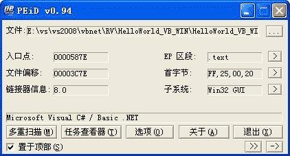

很显明，是用 `VC#.NET` 或者 `VB.NET` 开发的，具体是哪一种语言开发的，请继续看我操作。

**第二步**：拿出 `Reflector`,把 `HelloWorld_VB_WIN.exe` 拖到 `Reflector` 的窗口中，选择反编译的语言为 `IL`,然后再展开 `HelloWorld_VB_WIN>HelloWorld_VB_WIN.exe>Form1`，如下图所示：

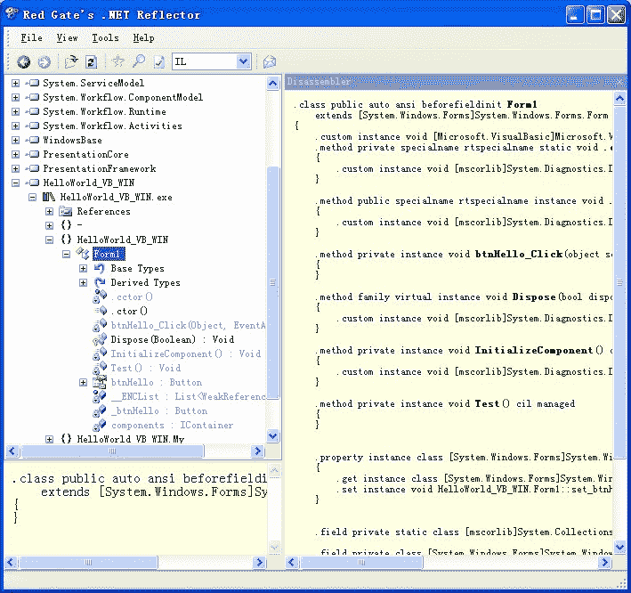


在右边反编译的源码里找到了 `Microsoft.VisualBasic` 这个关键字，可以肯定它是用 VB.NET 开发的了，很好，这下我们明白了要重建一个什么类型的工程了，GUI&VB.NET 工程。至于为什么是 GUI，看看左边的 `Form1` 就应该猜到了，而且运行程序的时候，弹出的 WINDOW 也不用多想就是 GUI 程序了。

### 第三步

把反编译的语言选择为 VB.NET，然后观察左边展开的 `Form1` 节点下面的子项目。

如下图所示：

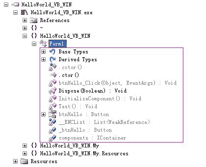

可以看出有很多项目，如基类，派生类，构造函数，初始化组件函数，注销函数，用户过程，事件处理函数，还有其它的对象定义。其中很多是我们所不需要关注的，我们只要把焦点停留在以下几项就够了：(1) 事件处理函数 (2) 用户定义的过程或函数 (3) 用户创建的变量（包括窗体对象）。

从这里可以看到，程序员定义了一个按钮 `btnHello`，一个自定义过程 `Test()`，还有就是按钮的单击事件处理 `btnHello_Click()`，至于为什么一眼就能看出来，很简单，看命名就知道了，呵呵呵。如果还是想知道得更清楚一点的话，可以展开节 `btnHello:Button`，如图所示：

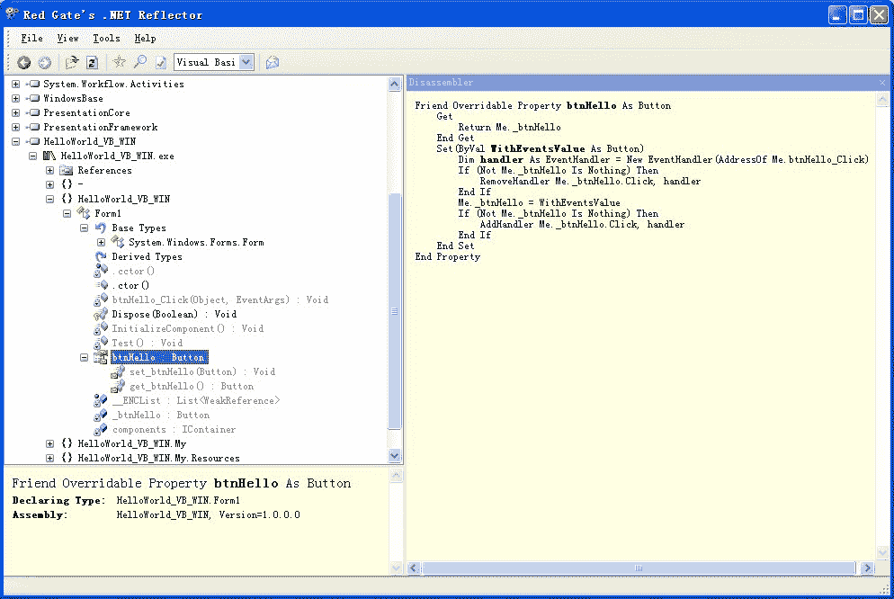

我在这里截的图看起来不是很清楚，各位也将就着看吧，或者对照自己的 `Reflector` 看也行的了。在右边窗口反编译的源码为：

代码：

```vbnet
Friend Overridable Property btnHello As Button
    Get
        Return Me._btnHello
    End Get
    Set(ByVal WithEventsValue As Button)
        Dim handler As EventHandler = New EventHandler(AddressOf Me.btnHello_Click)
        If (Not Me._btnHello Is Nothing) Then
            RemoveHandler Me._btnHello.Click, handler
        End If
        Me._btnHello = WithEventsValue
        If (Not Me._btnHello Is Nothing) Then
            AddHandler Me._btnHello.Click, handler
        End If
    End Set
End Property
```

`Dim handler As EventHandler = New EventHandler(AddressOf Me.btnHello_Click)`

这一条语句就是指定它的事件处理过程的，稍微学过点 JAVA 的同学都应该能够联想起来，用 JAVA 编写 GUI 程序的时候，是不是也会出现类似的语句??

另外，也顺便说一下其它的节点的意义吧。如 `InitializeComponent`，还是如图所示：

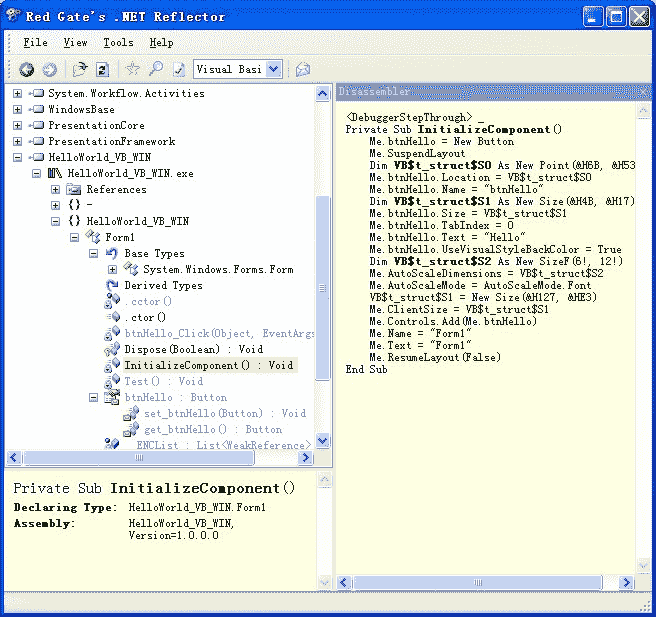

可以看得出，主要就是完成对自身窗体的一些属性的初始化，以及窗体上各个控件的创建并初始化，不过在我们还原工程时，如果需要自己画控件，那么它自然就会生成类似的语句了，因此，我们完全不用关心它。源码在手，也无秘密。我们只需要得到了程序员编写的自定义过程/函数，以及各个对象的事件处理过程的源码，这就足够了，没有界面，我们自己画，然后把源码填进去让工程跑起来就 OK 了。期间需要花费过多的脑力可能是调试排除可能出现的各种各样的语法错误，在这里要还原的程序集如此简单，相信只要按步骤来做，不会出现什么严重的错误的，可能出现的小错也应该能很快的排除。

### 第四步

新建一个工程，这次工程名称为 `HelloWorld_Win_Reverse`，根据观察，要还原的工程，应该有一个 `Form`，这个 `Form` 上面只有一个按钮，当点击这个按钮时，会触发一个单击事件，随后会弹出一个消息框来。我们就先把按钮画上来先吧，如图所示：

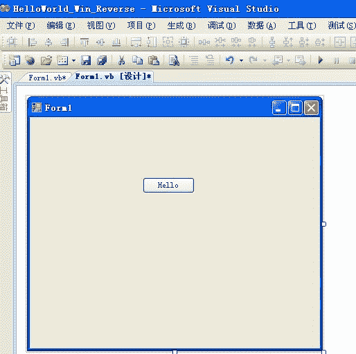

另外，为了达到最真实还原工程的效果，至少我们还得把按钮的 `Name` 属性改为 `btnHello`，以与原来的工程响应，对于按钮上的 `Text`，我们可以改为和原来一样，也可以不改，看情况了，有时候程序需要用到控件的 `Text` 属性作为程序逻辑的一部分的时候，我们就最好把它的 `Text` 属性改为和原来的程序一模一样，为了培养这个看起来没有坏处的习惯，我们还是把按钮的 `Text` 属性也改一下吧，改为"Hello"，如上图所示。

### 第五步

很多时候，在我们运行这种 GUI 程序的时候，因为窗体上面的一切都尽收眼底，如各个控件，以及人为有意触发各个控件可能的事件处理过程的时候，我们就应该做得心中有数，还原这个项目大概需要多少的脑力和体力了。在这里，因为点击按钮的时候，会弹出一个消息框，因此不用过多考虑，它应该有一个单击事件处理过程，我们先双击 `btnHello`，然后得到一个自动生成的单击事件处理过程，如下图所示：

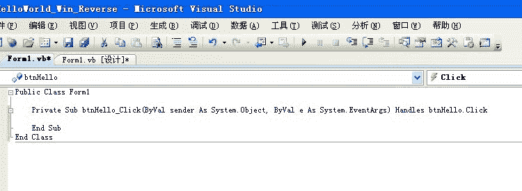

然后，我们再从 `Reflector` 里，把这个处理过程的源码拷贝进来，这是重点中的重点，逆向 .NET 的程序是不是非常简单，只要我们能够熟悉的操作 `CTRL+C` & `CTRL+V`，看起来就已经足够了，呵呵呵…

拷贝完毕，看图：

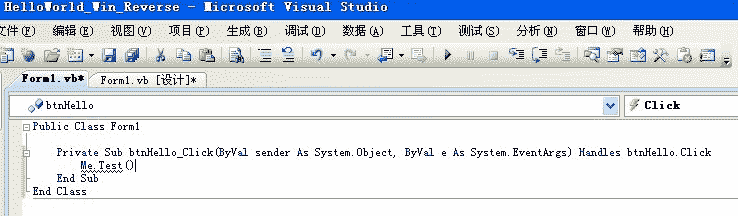

貌似只有一行代码，而且 IDE 还自动给它加了一条波浪线，这是因为我们还有一个过程 `Test()` 没有加进来，这是用户自定义的过程，要想避免出现这种找不到过程定义的情况，最好就是把过程先加进来，然后才加事件处理过程，因为我们可以在事件处理过程中调用自定义过程/函数，而不会在自定义过程/函数中调用事件处理过程，最好也就触发一模拟事件而已。这里我说得相当仔细了，如果还有不明白的，请跟帖说明一下，让我给各位排除疑问。把 `Test()` 加进来后，错误提示没有了，如图所示：

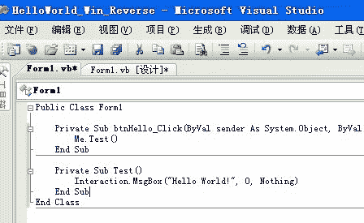

这时候，我们保存一下工程，运行它试一下，看我们成功了没有。

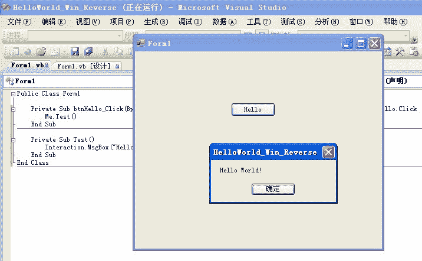

如上图所示，我们的还原相当成功。也许各位会有疑问，这么简单的一个程序，还原出来也没什么稀奇的，没错，对于一个如此简单的程序集，我们用的是这样的方法，对于一个复杂一点的甚至是商业化的系统，如果没有作好加密保护，那也是用的完全相同的方法来还原，只是要注意的事项可能会更多，中途让我们排除的错误更多，要花费的脑力和体力更多，不过最终目的还是不变的，就是从一个个程序集得到一个可编译，可运行的工程。在这里，我还是坚持，自给自足，丰衣足食这个道理，而且自己动手会大加深自己对这个事件的印象。另外程序也是非常的简单，因此要还原的程序集以及还原好的工程，我就都不上传了。逆向过程中遇到的困难一定要克服才行，各位一定要养成这样的一种习惯，就是不管遇到什么样的困难，都不能气馁，不要怀疑自己的能力!! 还有就是如果是初学 .NET 逆向，你只要跟着一步一步来，你应该可以得到非常多乐趣的，其实它就是这么简单，所以请不要对自己现在还觉得陌生的 .NET 逆向感到任何的压力和恐惧，我敢说连我都能学得会的技术，在坛子里应该没有一个人是学不会的，只要保持强烈的学习欲望和兴趣，就没有什么是学不会的。最后，如果各位遇到困难，如果实在是没办法了，也可以在坛子里跟帖求救，相信坛子里的热情服务的人还是大大的有的。

这节课就先说到这里了，下节我们继续讲如何还原 VB.NET 开发的网站，网站也能还原?是的，事实就是这么神奇。

## .NET 逆向学习总结 001(3)

本节学习目的：逆向 000 节得到的三个程序集

学习成果：得到三个可编译，可运行的 VB.NET 工程

`HelloWorld_VB_Console`, `HelloWorld_Win_Reverse`, `HelloWeb_Reverse`

使用到的工具：`VS2008`, `Reflector`, `PEID`, `IIS 5.x` or `IIS 6.x`

学习难度：★★☆☆☆

本节主要目标是逆向 000 节的 `HelloWorld_VB_WEB.dll`，并根据网站相应的页面文件，重新建立起整个网站项目 `HelloWeb_Reverse`，这个名称是随意的，各位看官喜欢用什么就用什么。本节使用到的原理主要就是，使用 `Reflector` 反编译程序集获得源码，这是最根本的东西，少了它，只能靠自己的理解去还原网站了，只是这样子逆向的难度可能就大大的增加了，还好我们有强大的 `Reflector` 这个神兵利器。

因为本教程完全是面向新手，因而有很多细节都会详细地说出来，这主要是为了避免因为在某些人眼中的简单的问题而跳过不讲，很有可能让别的初学者折腾一两天才能解决，这就太不划算了，因而如果我说话显得有些唐僧，还请各位看官见谅。

现在的网站，简单点可以认为是分前台和后台两个部分，前面也就是我们看到的页面，后台也就是负责处理前台各种请求的程序源码，当用户点击一个按钮，发出一个请求时，服务器接收到用户的请求后，根据用户请求的网页地址以及参数，动态生成一张新的网页，并返回给浏览器，这样就完成了一个请求了。MS 的 .NET 把前面和后台分得非常非常的清楚，.NET 的网站发布后，得到两类文件，一类文件后缀是 `aspx`，另一类文件是 `dll`。其中 `aspx` 就是前台，`dll` 就是后台，用户看到的永远都是前台，在服务器上工作的是则是后台，用户通过前台前服务器发送请求，服务器接收到请求后，调用相应的 DLL 中的函数，动态生成一张纯 HTML 网页发送回给浏览器，由浏览器解析网页上的 HTML 标签，绘制出相应的页面来。

发布方法为，

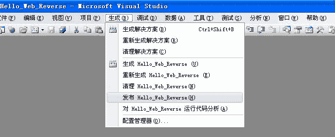

图（1）

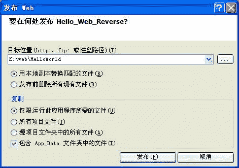

图（2）

点击发布，即可。

以下图为我将 `HelloWorld_VB_WEB` 这个网站发布之后得到的

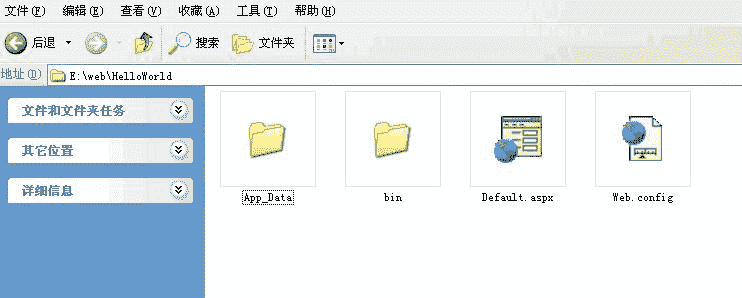

图（3）

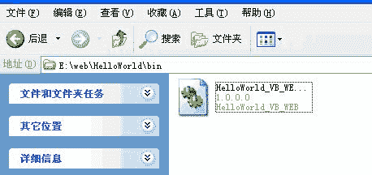

图（4）

注意，在 VS 下调试网站时，需要 .NET 运动时环境的支撑，如下图所示：

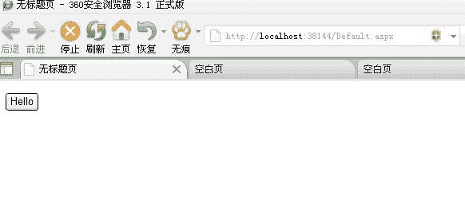

图（5）

支持它运行的服务器程序如图下所示，把它关了，网页就再也打不开了。

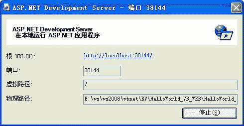

图（6）

而如果要 VS 下发布网站，也就是得到上面图 1，图 2 所示的东西，它们和开发的工程比较区别是，页面文件和源码被抽离出来，源码集中放到一个 DLL 里面去，页面文件 `aspx` 基本保持不变，这些页面文件就相当于模板，当用户请求时，服务器根据地址和参数，地址就是模板的编号，参数就是如何改选模板，然后调用所请求的页面文件的后台，也就是 DLL 里的函数，生成一张可认为是纯 HTML 的网页，并将它发送给用户，用户通过浏览器便可实时，动态的浏览网站的内容。

此时，如果要让发布后的网站能完全脱离 VS 而运行，就需要 1) ASP.NET 服务器， 2) IIS (Internet Information Server)，然后才有可能让我们发布的网站可以直接通过浏览器来运行。

因此，如果各位同学电脑上还没有装有 IIS 的，那就赶紧去安装一个吧。这里 IIS 如何安装，我就不仔细讲了，唯一值得一讲的就是，如果没有 WINDOWS 安装盘，那就直接到网上下载一个 IIS5.1 就可以了 (貌似我用的是 XP，因而系统不自带有，如果是 WIN7，那系统已经自带有的一个 IIS 了)，然后在安装的过程中，安装程序会多次提示错误，此时你需要每次都填一下 IIS5.1 的目录，也就是你下载解压后的 IIS 所在的目录，千万不要以为程序运行出错就放弃了，切记!

装好了 IIS 之后，你还需要在 .NET 下面注册一下才能让 IIS 和 .NET 配合运行你的网站。

我这边网站 ASP 服务器用的是 .NET2.0，因而可以根据下面这张图，找到

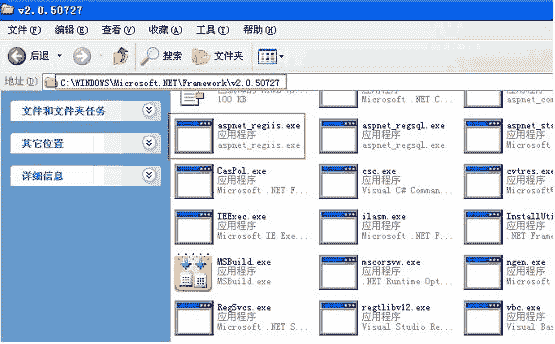

图（7）

然后，再打开你的命令行，进入上面图示的目录，如图所示：

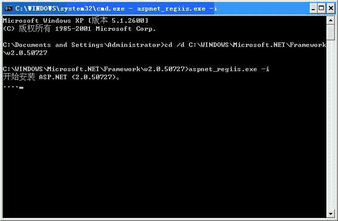

图（8）

运行完 `aspnet_regiis.exe i` 这条指令后，你的 ASP.NET 就可以和 IIS 一起正常工作了。

看着上面的操作也许觉得繁的，实际上能耐心看完应该是会觉得很简单的。下面一步操作是，到 IIS 里面，把 IIS 支持的 ASP 服务器选择一下，看下图操作

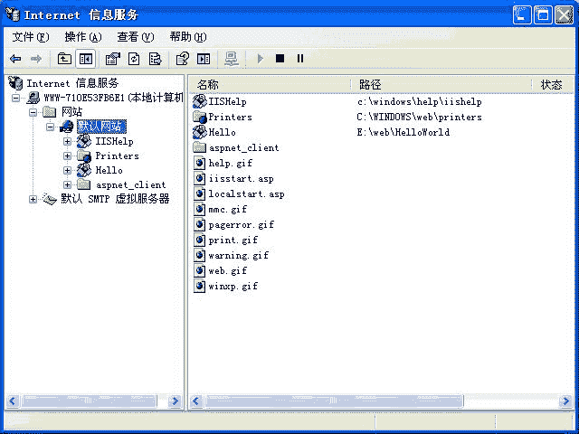

图（9）

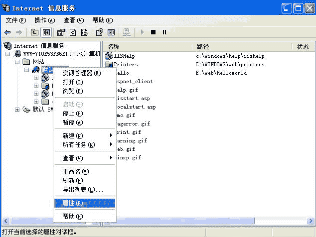

图（10）

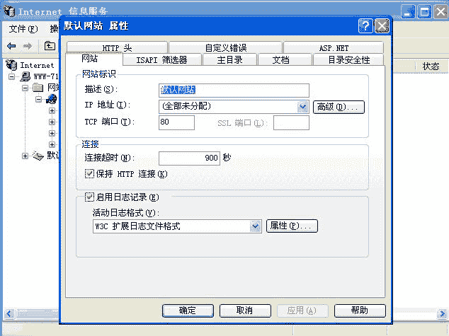

图（11）

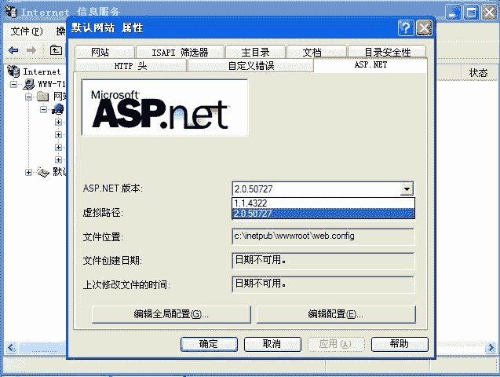

图（12）

在 ASP.NET 版本里选择好 2.0.50727，点击‘确定’就 OK 了。

看着我们为搭建环境费了这么多功夫，但是想到后面所有的网站开发或者逆向都需要在这个基础之上来展开，心里也就安慰许多了。

环境搭建好了，下面开始正式进入逆向的操作，再重复一次，我们此节的真正目的是要将 VS 生成的网站，包括的程序集也就只有一个，`HelloWorld_VB_WEB.dll`，因此破解逆向难度应该不会太大。另外，再看下图，可以发现，也就只有一个页面文件 `Default.aspx` 而已，心想要还原出可编译可运行的工程应该是很简单的一件事情了，我们要做的仅仅是将 `HelloWorld_VB_WEB.dll` 和 `Default.aspx` 合并成一块而已。

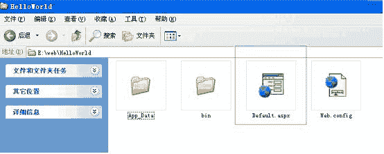

图（13）

如果是从前面一篇篇往下看的话，那应该对下面的操作基本上都是心里有数的了，所以我就尽量少说了。

### 步骤一

用 `PEID` 查 `HelloWorld_VB_WEB.dll`，显示为图所示：

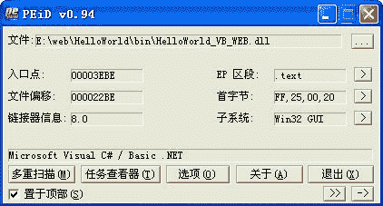

图（14）

### 步骤二

用 `Reflector` 打开 `HelloWorld_VB_WEB.dll`

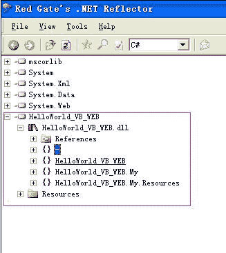

图（15）

可以看到，展开程序集之后，有好几个节点，其实可以看到 `HelloWorld_VB_WEB`，

`HelloWorld_VB_WEB.My` 和 `HelloWorld_VB_WEB.My.Resources` 都是命令空间，而其中只有 `HelloWorld_VB_WEB` 这个命令空间是值得我们关注的，其它的全部都可以忽略。

### 步骤三

取出源码。

选择好我们的反编译语言 VB.NET 后，右击 `HelloWorld_VB_WEB` 这个节点，如图所示，选中 `Export…`，这个导出接口，准备将源码导出到指定的文件夹里。

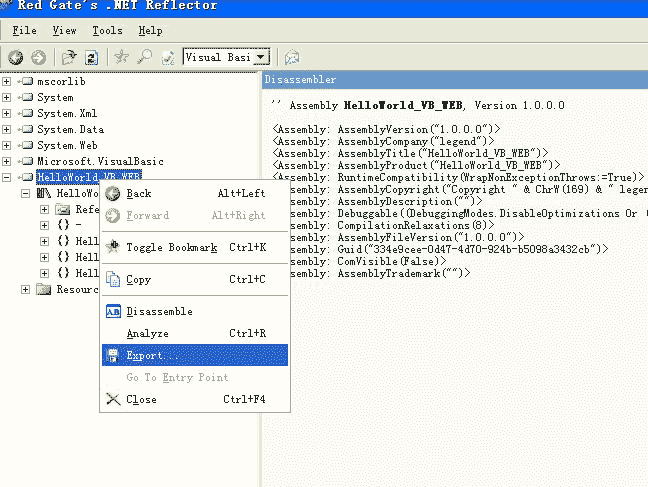

图（16）

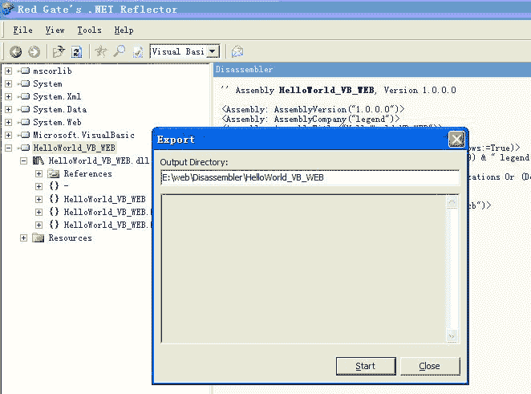

图（17）

选择好要备份到的目录后，点击 `Start` 开始导出源码。

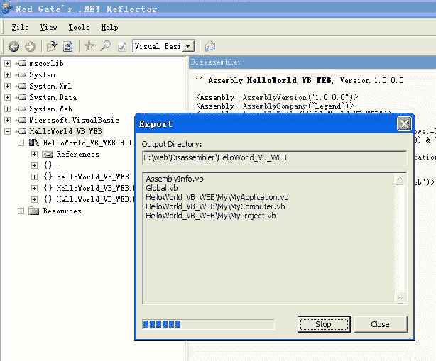

图（18）

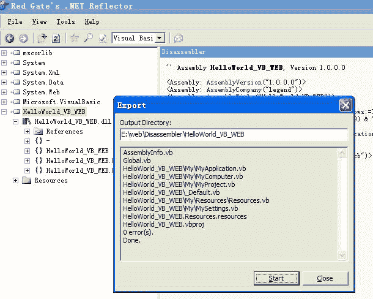

图（19）

点击 `Close`，完成导出动作。

下面我们来看一下，我们导出的是什么东东。

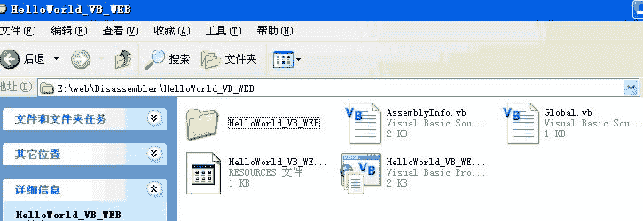

图（20）

上面显示的文件可以全部忽略。

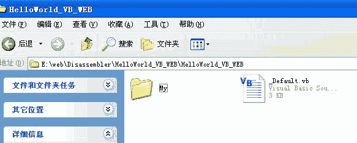

图（21）

上面显示的 `_Default.vb` 很重要，因为里面包含了我们所需要的全部源代码，其它的那些由编译器自动生成的代码我们并不需要，因为在我们还原工程的过程中，编译器会再次为我们自动生成，因此我们只需要它一个就足够了。另外，为什么说它就是我们所需要的源文件呢? 因为其它都是显而易见的我们不需要的文件，而且，我们需要的不仅仅是源码而已，我们还需要页面文件，我们可以看一下，我们发布的网站里，有一个页面文件 `Default.aspx`，也是唯一的一个页面文件，这个页面文件从命名上看就知道和 `_Default.vb` 是一家子的了，所以 `_Default.vb` 怎么说不是我们要的源码呢? 呵呵呵…也就是说，一个页面文件和一个 vb 后缀的源文件的关系是一一对应的。

现在来总结一下，我们现在已经拥有了整个网站的唯一的一个页面文件 `Default.aspx`，和相应的源文件 `_Default.vb`。现在我们要做的就是怎么将它们合并在一起，让它们看起来和原来程序员开发的时候是完全一模一样的。


### 步骤四: 新建一个 VB.NET 网站

工程名称为 `Hello_Web_Reverse`。

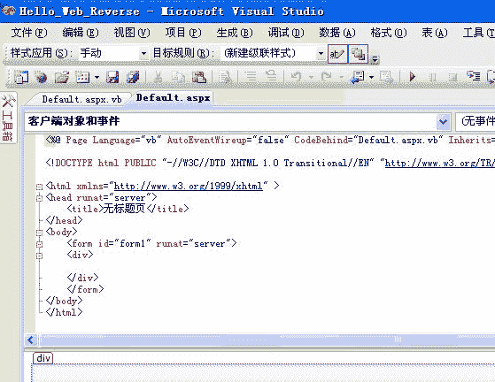

图（22）

### 步骤五: 还原 UI

这一步很简单，仅仅是把发布的网站里的页面一个个的还原到我们新建的工程里去就可以了。这里的还原，指的是自己用 `VS` 打开发布的网站后的 `.aspx` 页面文件，是可以看得到它上面的所有控件的。这时，我们先 `CTRL+A`，再来一个 `CTRL+C`，我们就可以把要还原的页面上的所有对象都复制到剪贴板里去了。然后来到自己新建的页面文件里，选择视图设计器或者拆分，在空白页面上选中一个合适的地方，来一个 `CTRL+V`，这样，我们就把要还原的页面整个复制到了我们的新工程里去了。

注意，如果直接把两个页以添加现在项目的方式引进到我们的新工程中来，可能会出现各种各样的问题的。因为没人敢肯定现在不出一点问题，或者以后出问题了，担心起来会不会是出现在这些直接导入到工程里的页面文件上。如果我们手动一个个页面还原，那么在出现什么错误的时候，我们就有十足的把握判断它是否是由我们还原的页面产生的。

这里，我们要还原的页面只有一个，`Default.aspx` 看名字似乎是 `VS` 自动生成的页面。由于 `VS` 已经为我们自动生成了一个 `Default.aspx` 页面文件了，因而我们不需要手动添加它进来到我们的工程里去了，我们只需要把 `HelloWorld_VB_WEB` 里的 `Default.aspx` 上面的所有控件全部复制到我们的新工程里来就可以了。

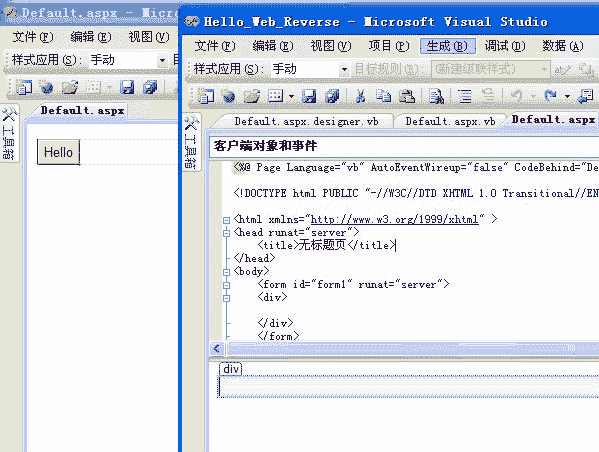

图（23）

最好用另一个 `VS` 打开要还原的页面文件，如上图所示，我们只要用 `CTRL+C` & `CTRL+V`，就可以将左边要还原的页面文件还原到我们的工程中来了。

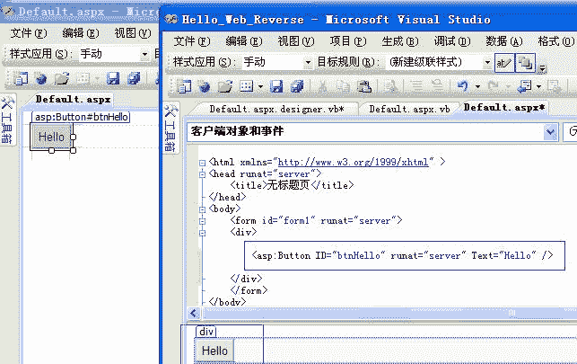

图（24）

图上用红线圈起来的按钮就是我们复制过来的，而用蓝线圈起来的页面代码，就是 `VS` 自动为我们生成的了，非常方便吧，充分利用各种合适的工具，逆向竟变得如此轻松。

如果这个时候，要还原的页面文件里还有其它的东西，如 `JSP` 脚本，各种各样的样式单，那么我们还应该手动把它们复制到文件中去，它们一般出现在页面文件的头部或者尾部，而我们要做的也仅是复制粘贴而已。待弄完之后，还要仔细检查一下，有没有什么遗漏的内容没有弄过来的，继续弄过来就可以了。这样做看起来可能有点多余，其实不危在旦夕，因为，不同版本的 `VS` 为页面文件自动生成的内容是不完全相同的。如果是手动把控件复制过来的话，它生成的内容肯定是适用于当前所开发的工程的；而直接在页面文件里复制则不会自动生成其它的东西了。这样做，或多或少都会出现一些莫名其妙的错误的。

### 步骤六：还原代码

这里要还原的代码有两大类，一类是事件处理代码，一类是用户自定义代码。如果是事件处理代码，那我们首先要在新建的工程里，添加相应的事件处理代码，过程体留空。如果是用户自定义代码，在考虑到调用别的未引进的过程或函数的前提下，把它们引进到工程中来。若出现错误，应立即查找原因并尽最大努力排除错误。

这里我们要还原的工程里，只有一个按钮 `btnHello`，而且似乎有一个事件处理过程。

粗略看一下我们提取出来的源文件 `_Default.vb` 里的代码，如图所示:

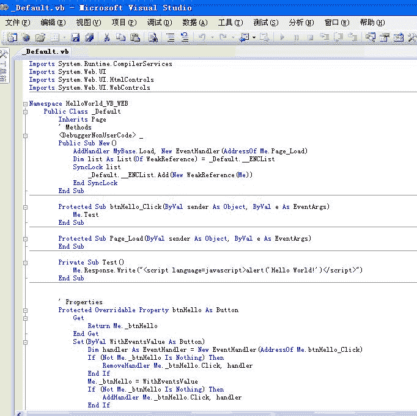

图（25）

我们需要的最多也就三个方法 `Page_Load`、`btnHello_Click` 和 `Test`。其余的由编译器自动生成，我们可以无视它们。

首先，我们要还原的是引用的程序集，这样能保证再添加别的代码到我们新建的工程的时候，不会出现类似引用错误的现象。看下面两图:


图(26)

代码由左边的红线圈住的代码移到右边去，并用蓝线圈出以显区别。

然后就是把各个事件处理过程用用户自定义过程全部搞过来了。这个工程要还原的代码非常之少，所以几乎不会出现什么错误。对于一个大点的工程来说，可能就要不断的调试以排除各种各样的错误了。还原后，如下图所示:


图(27)

注意，如果是直接把事件处理过程复制过来的话，你就会把我用粗红线圈起来的东西给弄没了的。这也就是为什么事件处理过程要单独添加，然后只把要还原的源码里相应的过程的过程体复制过来的原因所在了。而对于用户自定义过程则不会有这种过滤，直接全部复制过来就可以了。

大功告成，现在可以运行查看效果如何了。


图（28）


图（29）

一个网站，从页面到源码，我们没有编写一行代码，就这样子被我们还原了。本例子只是个小实验，对于一些中型或者大型的网站系统来说，还原的方法，过程，原理也是基本一样的。对于可能文中没有提及的问题，如果在还原的过程中遇到，我想聪明的你也是可以很快解决的。另外，请不要迷恋哥，哥只是个传说。如果您有什么更好的逆向的点子的话，可以随时跟帖说出来或者悄悄的告诉我听也可以。

由于网站的逆向比较特殊一点，我这里就将网站的工程以及生成发布版本的网站都一起发上来了吧，逆向出来的就靠各位同学自己的努力了。

网站源码

`HelloWorld_VB_WEB.rar`

发布网站

`HelloWorld.rar`

### .net 逆向学习总结 002(1)

本节学习目的：使用 `VC#.NET` 创建一个控制台工程 `HelloWorld_C_Console` 并还原之

学习成果：一个程序集 `HelloWorld_C_Console.exe` 以及一个还原的工程 `HelloWorld_C_Con_R`

使用到的工具：`vs 2008`, `Reflector`, `PEID`

学习难度：★☆☆☆☆

这一节，我准备改变一下策略，直接正向创建一个工程，然后再直接还原它。至于中间的细枝末节，可能我会省略掉一些，不过用心体会就能感觉得到了。本节目标还是非常简单，就是完全复制前面的工作而已。本节主要内容就是使用 `VC#` 创建一个控制台工程，然后得到一个程序集，再然后根据这个程序集还原出它的原始项目。

#### 一) 正向创建项目


图 1 创建工程 `HelloWorld_C_Console`


图 2 查看主类 `Program`


图 3 添加打印”Hello World!”代码


图 4 运行程序


图 5 查看最终生成的程序集 `HelloWorld_C_Console.exe`，这个也是后面我们要还原的程序集

#### 二) 反向还原项目

这一小节目标是根据上一小节得到的 `HelloWorld_C_Console.exe`，还原出一个可以编译以及可以运行的项目 `HelloWorld_C_Con_R`。

首先，我们在这里假设我们并不知道我们要还原的程序是一个什么类型的程序，所以需要作些感性的研究，直接运行 `HelloWorld_C_Console.exe`


图 6 运行结果

可想而知这是一个控制台程序，因此我们在还原的时候就需要建立一个控制台项目。

然后，我们用 `PEID` 查看程序是用什么工具开发的。


图 7 显示是用 `.net` 开发的

第三，知道是 `.net` 开发的后，拿出我们的 `Reflector` 这个神兵利器，直接打开 `HelloWorld_C_Console.exe` 后阅读源代码。


图 8 阅读反编译出来源码

经观察得知，此程序集只有一个主类 `Program`，并且不包含窗体 `Form` 类，所以通过这个也可以判断这是一个控制台程序。

程序集非常简单，只包含一个主方法，没有任何属性，方法体里面只有两行代码。所以我们还原项目的思路就是先创建一个 `.cs` 控制台项目，然后再把上面出现的代码拷贝到自动生成的主方法里面去就算是完成这个任务了。怎么样？是不是非常简单啊？如果这个类里面有很多方法的话，那也就照着搬进去就可以了。如果还有其它的方法可以先导出整个程序集的源码，然后再直接导入新创建的工程里面去，编译一下，把一些引起错误的多余的代码删掉就可以了。提醒一下这些代码往往是编译器自动生成的，然后用 `Reflector` 反编译的时候，它也就是照着反编译出来而已。有些代码我们在还原项目的时候可要可不要，如果它引起了编译错误，就只能把它给删掉了。只要自己脑子里有这些概念，拿几个程序来实践几次就算是入门了。

第四，以下为根据上面分析及源码还原项目的过程。


图 9 创建要还原的项目 `HelloWorld_C_Con_R`


图 10 打开 `Program` 类，这里包含主方法，我们需要把上面反编译出来的源码放进这里


图 11 还原主方法后，也就还原了整个项目了


图 12 编译-运行结果，出来界面跟原来的程序一模一样，至此还原成功!

最后，这节内容和前面还原 `HelloWorld_VB_Console` 有很大相似性，几乎就完全相同了，仅仅是创建的工程所使用到的开发语言不同，使用 `Reflector` 反编译源码时使用到的语言不同而已。请各位忍耐一下这简单的教程，以及原谅我现在的更新速度，到后面我会有意识加快速度的，而且文章也将会越来越精彩。
