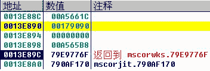
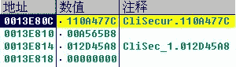
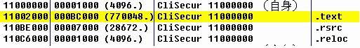
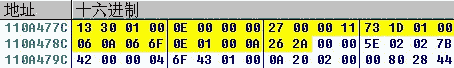
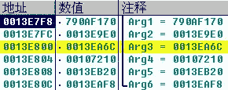
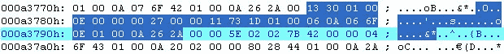

# .NET 加壳软件 CLISecure 调试笔记

> 原文：[`www.pediy.com/kssd/pediy09/pediy09-460.htm`](https://www.pediy.com/kssd/pediy09/pediy09-460.htm)

共两篇，第一篇和壳本身的过程关系不大，主要是涉及了虚方法的内容，第二篇则详细调试了 `CLISecure` 的保护原理。在我的 blog 上名为 `CLR` 内核调试随记，因为是随记，所以文章中可能有不全面甚至错误的地方。找到错误的朋友请与偶联系。性急的兄弟请直接看第二篇。

本文章所调试壳为 `CLISecure`，下载地址为 `http://www.secureteam.net/`，最新版本为 3.0，而我所调试的版本为 2.5，所以可能与最新的壳有所不同。

## CLR 内核随记 (1)

把平时看到的一些东西记下来，没准以后用的上。

本文利用调试跟踪 `CLR` 中接口 `virtual` 方法的定位。为什么呢？好玩儿而已。

这是在某壳挂钩 `JIT` 的代码，有些东西还是很有意思（总是觉得这些壳作者知道很多 `CLR` 的内部结构，估计微软对他们部分开源了）：

```
.text:10002A4C mov eax, [ebp+ICorJitInfo]
.text:10002A4F mov ecx, [eax+4]
```

此时 `ecx == .text:79E97C14 const CEEJitInfo::'vbtable'{for 'ICorJitInfo'}`，第一个双字是什么？第一个双字指向

```
.text:79E97B14 dd offset [thunk]:CEEInfo::getHelperName'vtordisp{4294967292,52}' (CorInfoHelpFunc)
```

到这里，来看看 `CEEJitInfo::'vbtable'` 在内存中的表示：

```
79E97C14 >FC FF FF FF 34 00 00 00 3C 00 00 00 44 00 00 00
79E97C24 4C 00 00 00 54 00 00 00 5C 00 00 00 64 00 00 00
79E97C34 6C 00 00 00 74 00 00 00 80 00 00 00 FC FF FF FF
```

其实这些值是在编译时确定的，因为 `CLR` 本身部分用 `C++` 写成，也就是 `C++` 中的 `vtable` 在编译时确定，`mscorwks.dll` 中的代码如下：

```
.text:79E97C14 const CEEJitInfo::'vbtable'{for 'ICorJitInfo'} dd 0FFFFFFFCh, 34h, 3Ch, 44h, 4Ch, 54h, 5Ch, 64h, 6Ch
.text:79E97C14 dd 74h, 80h
```

`FCFFFFFF` 是 what？谁知道，也许是一个 `vtable` 的开始标志，因为在第三行最后又见到一个同样的双字。计算两个 `FCFFFFFF` 之间的双字值，可以先猜测这个 `vtable` 含有 10 个方法。不过 `sscli` 中对应的代码却多出了一两个方法，这里暂且不管，下面主要看怎么定位这些 `vtable` 的。

```
.text:10002A52 mov edx, [ecx+4]
.text:10002A55 mov eax, [ebp+ICorJitInfo]
.text:10002A58 mov ecx, [eax+4]
.text:10002A5B mov eax, [ecx+4]
.text:10002A5E mov ecx, [ebp+ICorJitInfo]
.text:10002A61 lea eax, [ecx+eax+4]
.text:10002A65 mov ecx, [ebp+ICorJitInfo]
.text:10002A68 mov edx, [ecx+edx+4]
```

在 `lea eax` 这句执行完后，`eax` 指向内存如下

```
0013EA18 78 7B E9 79 00 00 00 00 4C 7B E9 79 00 00 00 00
0013EA28 A8 7A E9 79 00 00 00 00 84 7A E9 79 00 00 00 00
```

总觉得后面那句 `mov edx,[ecx+edx+4]` 重复了，直接 `mov edx,[eax]` 不就可以了吗？这时 `[eax]` 的值是 `79E97B78` 指向什么？它指向了下面一个方法：`.text:79E97B78 const CEEJitInfo::'vftable'{for 'ICorMethodInfo'} dd offset [thunk]:CEEInfo::getMethodName'vtordisp{4294967292,52}' (CORINFO_METHOD_STRUCT_ *,char const * *)`

也就是说，在 `ICorJitInfo` 的 `vtable` 表里有 `getMethodName` 方法。可 `sscli` 的代码中并没有 `getMethodName` 方法啊。如果说，`vtable` 是按顺序生成的，那么 `eax+ecx+4` 这个指令代表 `getMethodName` 方法排名应该还较靠前，而 `sscli` 中的代码为。

```
class ICorJitInfo : public virtual ICorDynamicInfo
{
public:
// return memory manager that the JIT can use to allocate a regular memory
virtual IEEMemoryManager* __stdcall getMemoryManager() = 0;

// get a block of memory for the code, readonly data, and read-write data
virtual void __stdcall allocMem (

…

}
```

这时，我们想到了继承。`ICorJitInfo` 继承了 `ICorDynamicInfo`，于是来到后者的代码处：

```
class ICorDynamicInfo : public virtual ICorStaticInfo
```

这里，`ICorDynamicInfo` 中仍然没有 `getMethodName` 的方法，于是再次顺着继承走下去：

```
class ICorStaticInfo : public virtual ICorMethodInfo, public virtual ICorModuleInfo,
public virtual ICorClassInfo, public virtual ICorFieldInfo,
public virtual ICorDebugInfo, public virtual ICorArgInfo,
public virtual ICorLinkInfo, public virtual ICorErrorInfo
```

这里，`ICorStaticInfo` 第一个继承的就是 `ICorMethodInfo`，终于，我们找到了 `getMethodName` 方法：

```
class ICorMethodInfo
{
public:
// this function is for debugging only. It returns the method name
// and if ‘moduleName' is non-null, it sets it to something that will
// says which method (a class name, or a module name)
virtual const char* __stdcall getMethodName (
CORINFO_METHOD_HANDLE ftn, /* IN */
const char **moduleName /* OUT */
) = 0;

// this function is for debugging only. It returns a value that
// is will always be the same for a given method. It is used
// to implement the ‘jitRange' functionality
virtual unsigned __stdcall getMethodHash (
CORINFO_METHOD_HANDLE ftn /* IN */
) = 0;
```

到这里，一个简单的 `virtual` 方法定位才算跟完。其实，这和 `CLR` 已经没有多大关系了，更多的是 `C++` 编译器的工作，它是怎么分配类和虚方法的内存空间，当然，还要结合在运行时的动态填充。

`CLR` 中提供了多少个这种 `vtable` 呢？至少有以下这么多：

```
.text:79E977EC mov dword ptr [esi+4], offset const CEEJitInfo::'vbtable'{for 'CEEInfo'}
.text:79E977F3 mov dword ptr [esi+10h], offset const CEEJitInfo::'vbtable'{for 'ICorJitInfo'}
.text:79E977FA mov dword ptr [esi+88h], offset const CEEInfo::'vbtable'{for 'ICorStaticInfo'}
.text:79E97804 mov dword ptr [esi+94h], offset const CEEJitInfo::'vbtable'{for 'ICorDynamicInfo'}
.text:79E9780E mov dword ptr [esi+44h], offset const ICorStaticInfo::'vftable'{for 'ICorMethodInfo'}
.text:79E97815 mov dword ptr [esi+4Ch], offset const ICorModuleInfo::'vftable'
.text:79E9781C mov dword ptr [esi+54h], offset const ICorCompileInfo::'vftable'{for 'ICorClassInfo'}
.text:79E97823 mov dword ptr [esi+5Ch], offset const ICorJitInfo::'vftable'{for 'ICorFieldInfo'}
.text:79E9782A mov dword ptr [esi+64h], offset const ICorDebugInfo::'vftable'
.text:79E97831 mov dword ptr [esi+6Ch], offset const ICorCompileInfo::'vftable'{for 'ICorArgInfo'}
.text:79E97838 mov dword ptr [esi+74h], offset const CHashTableAndData::'vftable'
```

回到文章最初的 `ICorJitInfo`，那个表中第一个值是 `0x34`，最终定位到 `getMethodName`，第二个 `0x3C` 又指向什么方法呢？你自己跟一下吧，呵呵。

下次，会真正跟一些 `CLR` 内部的东西，那些被标记上 `for internal use` 的玩意儿。以上分析基于 `xp sp2 + .net framework 2.0` 简体中文版。

## CLI 内核随记（2）

今天有空，继续调试上次的壳。该壳下载地址 `http://www.secureteam.net`。上一次并没有深入壳的解密流程，而是看了下虚方法的定位。今天的重点是壳解密流程。壳安装后有一个 `GUI` 主程序，一个本地 `dll`。调试的重点就是这个本地 `dll`。

这次仍然下断点在它挂钩 `JIT` 的地方。怎样激活这个断点？只要运行一个还没有 `JIT` 的方法既可。便于重复，这里固定为显示关于窗口。`F9` 运行后，我们中断在 `hook` 方法的入口处：


再看一下椎栈，椎顶的值 `0x79E9776F` 指向了 `mscorwks.dll` 中调用 `JIT` 的地方，而第二个 `0x790AF170` 则指向了 `JIT` 中调用 `compileMethod` 的地方，自然，一调用 `compileMethod` 就跳转到 `hook` 的代码中来了。


下面的一段代码是调用 `CEEInfo::getMethodModule` 判断是否是当前 `Module` 需要 `JIT`。如果是，继续执行解密过程，如果不是，自然不需要解密了。

```
012B2A4C |. 8B45 0C mov eax,dword ptr ss:[ebp+C]
012B2A4F |. 8B48 04 mov ecx,dword ptr ds:[eax+4]
012B2A52 |. 8B51 04 mov edx,dword ptr ds:[ecx+4]
012B2A55 |. 8B45 0C mov eax,dword ptr ss:[ebp+C]
012B2A58 |. 8B48 04 mov ecx,dword ptr ds:[eax+4]
012B2A5B |. 8B41 04 mov eax,dword ptr ds:[ecx+4]
012B2A5E |. 8B4D 0C mov ecx,dword ptr ss:[ebp+C]
012B2A61 |. 8D4401 04 lea eax,dword ptr ds:[ecx+eax+>
012B2A65 |. 8B4D 0C mov ecx,dword ptr ss:[ebp+C]
012B2A68 |. 8B5411 04 mov edx,dword ptr ds:[ecx+edx+>
012B2A6C |. 50 push eax
012B2A6D |. 8B42 30 mov eax,dword ptr ds:[edx+30]
012B2A70 |. FFD0 call eax;调用 getMethodModule
012B2A72 |. 8945 F0 mov dword ptr ss:[ebp-10],eax
012B2A75 |. 8D4D F0 lea ecx,dword ptr ss:[ebp-10]
012B2A78 |. 51 push ecx
012B2A79 |. 8D55 F8 lea edx,dword ptr ss:[ebp-8]
012B2A7C |. 52 push edx
012B2A7D |. 8B8D 7CFFF>mov ecx,dword ptr ss:[ebp-84]
012B2A83 |. E8 88FEFFF>call CliSec_1.012B2910
012B2A88 |. 8D45 98 lea eax,dword ptr ss:[ebp-68]
012B2A8B |. 50 push eax
012B2A8C |. 8B8D 7CFFF>mov ecx,dword ptr ss:[ebp-84]
012B2A92 |. E8 89FAFFF>call CliSec_1.012B2520
012B2A97 |. 50 push eax
012B2A98 |. 8D4D F8 lea ecx,dword ptr ss:[ebp-8]
012B2A9B |. E8 80F7FFF>call CliSec_1.012B2220
012B2AA0 |. 0FB6C8 movzx ecx,al
012B2AA3 |. 85C9 test ecx,ecx
```


012B2AA5  |.  0F84  35020>je  CliSec_1.012B2CE0;正常（需要解密）时这里不会跳

紧接着代码取方法的名称：

```
012B2AAB  |.  8D55  B4    lea  edx,dword ptr ss:[ebp-4C]
012B2AAE  |.  52         push edx
012B2AAF  |.  8B45 10    mov  eax,dword ptr ss:[ebp+10]
012B2AB2  |.  8B08       mov  ecx,dword ptr ds:[eax]
012B2AB4  |.  51         push ecx
012B2AB5  |.  8B55 0C    mov  edx,dword ptr ss:[ebp+C]
012B2AB8  |.  8B42 04    mov  eax,dword ptr ds:[edx+4]
012B2ABB  |.  8B48 04    mov  ecx,dword ptr ds:[eax+4]
012B2ABE  |.  8B55 0C    mov  edx,dword ptr ss:[ebp+C]
012B2AC1  |.  8B42 04    mov  eax,dword ptr ds:[edx+4]
012B2AC4  |.  8B50 04    mov  edx,dword ptr ds:[eax+4]
012B2AC7  |.  8B45 0C    mov  eax,dword ptr ss:[ebp+C]
012B2ACA  |.  8D5410 04  lea  edx,dword ptr ds:[eax+edx+>
012B2ACE  |.  8B45 0C    mov  eax,dword ptr ss:[ebp+C]
012B2AD1  |.  8B4C08 04  mov  ecx,dword ptr ds:[eax+ecx+>
012B2AD5  |.  52         push edx
012B2AD6  |.  8B11       mov  edx,dword ptr ds:[ecx]
012B2AD8  |.  FFD2       call edx    ;这里调用.text:7A0A2503 CEEInfo::getMethodName
```

这两大段代码其实就是我在上一篇调试随记中讲的取 `vtable` 的过程，这里略过。最后一句 `call edx` 后，看一下 `eax` 的值：`EAX 11095453 ASCII "UxQ="`。这说明了显示关于窗口的方法名称是`UxQ=`，显示，这是混淆过的。下面的代码调用 `getMethodDefFormMethod`：

```
012B2ADA  |.  8945  B0    mov  dword ptr ss:[ebp-50],eax
012B2ADD  |.  8B45 10    mov  eax,dword ptr ss:[ebp+10]
012B2AE0  |.  8B08       mov  ecx,dword ptr ds:[eax]
012B2AE2  |.  51         push ecx
012B2AE3  |.  8B55 0C    mov  edx,dword ptr ss:[ebp+C]
012B2AE6  |.  8B42 04    mov  eax,dword ptr ds:[edx+4]
012B2AE9  |.  8B48 0C    mov  ecx,dword ptr ds:[eax+C]
012B2AEC  |.  8B55 0C    mov  edx,dword ptr ss:[ebp+C]
012B2AEF  |.  8B42 04    mov  eax,dword ptr ds:[edx+4]
012B2AF2  |.  8B50 0C    mov  edx,dword ptr ds:[eax+C]
012B2AF5  |.  8B45 0C    mov  eax,dword ptr ss:[ebp+C]
012B2AF8  |.  8D5410 04  lea  edx,dword ptr ds:[eax+edx+>
012B2AFC  |.  8B45 0C    mov  eax,dword ptr ss:[ebp+C]
012B2AFF  |.  8B4C08 04  mov  ecx,dword ptr ds:[eax+ecx+>
012B2B03  |.  52         push edx
012B2B04  |.  8B51 38    mov  edx,dword ptr ds:[ecx+38]
012B2B07  |.  FFD2       call edx;调用.text:7A0A27FB CEEInfo::getMethodDefFromMethod
```

`CEEInfo::getMethodDefFromMethod` 是没有见过的函数，在遇到这种情况时，对于 `.net 2.0` 我们可以参考 `sscli` 的源代码或直接看反汇编代码。这里直接看返回值，答案就明了了。`EAX 060000B0`，这个函数返回的就是方法的 `token`。

紧接着的代码比较是否是有效的 `token` 值，如果是，则继续运行。代码如下：

```
012B2B09  |.  8945  B8    mov  dword ptr ss:[ebp-48],eax
012B2B0C  |.  8B45  B8    mov  eax,dword ptr ss:[ebp-48]
012B2B0F  |.  25 FFFFFF0>and  eax,0FFFFFF
012B2B14  |.  0F84 C6010>je  CliSec_1.012B2CE0
```

紧接着代码如下：

```
012B2B1A  |.  8B4D  B8    mov  ecx,dword ptr ss:[ebp-48]
012B2B1D  |.  81E1 FFFFF>and  ecx,0FFFFFF
012B2B23  |.  894D  A4    mov  dword ptr ss:[ebp-5C],ecx
012B2B26  |.  8D4D  F8    lea  ecx,dword ptr ss:[ebp-8]
012B2B29  |.  E8 72F9FFF>call  CliSec_1.012B24A0
```

这里 `012B2B26` 处的 `ecx=0013E890`，指向了椎栈。调试到现在，我们并没有跟踪这个椎栈值的变化，更不可能知道它的作用。因此，重新调试（这就是选择一个固定方法的好处，可重复性），并观察该处值的改变。

首先记下此时的椎栈值：

```
0013E890   012D45AC  CliSec_1.012D45AC
0013E894   012F2178
```

重新运行后再次中断在 `hook` 方法的入口处，注意这时观察椎栈的值，特别是 `0013E890` 处的变化。



入口处的值与刚才第一次调试过程中的值不一样，因此直接在 `0013E890` 及 `0013E894` 两处下硬件写中断。从中断后返回地址可以知道，改变这两处值的是我们忽略的一个函数：

```
012B2A83  |.  E8 88FEFFF>call  CliSec_1.012B2910
```

这个调用的具体过程，是下一篇的内容，呵呵。这里，我们先放过它。接着向下走：

```
012B2B2E  |.  8B50  04    mov  edx,dword ptr ds:[eax+4]
012B2B31  |.  8955  AC    mov  dword ptr ss:[ebp-54],edx
012B2B34  |.  8B45  AC    mov  eax,dword ptr ss:[ebp-54]
012B2B37  |.  8B48  04    mov  ecx,dword ptr ds:[eax+4]
012B2B3A  |.  8B55  A4    mov  edx,dword ptr ss:[ebp-5C]
012B2B3D  |.  8B4491  FC  mov  eax,dword ptr ds:[ecx+edx*4>
012B2B41  |.  8945  A8    mov  dword ptr ss:[ebp-58],eax
012B2B44  |.  8B4D  F0    mov  ecx,dword ptr ss:[ebp-10]
012B2B47  |.  51         push ecx                      ; /Arg1
012B2B48  |.  8B8D 7CFFF>mov  ecx,dword ptr ss:[ebp-84]   ; |
012B2B4E  |.  E8 8DF4FFF>call  CliSec_1.012B1FE0           ; \\CliSec_1.012B1FE0
```

如果跟进 `012B2B4E` 处的调用，你会发现这里取得了主程序的基址 `0x11000000`。再向下走，就是分配空间，填充解密过的方法体：

```
012B2B60  |.  8B55  A0    mov  edx,dword ptr ss:[ebp-60]
012B2B63  |.  0355  A8    add  edx,dword ptr ss:[ebp-58]
012B2B66  |.  8B85 7CFFF>mov  eax,dword ptr ss:[ebp-84]
012B2B6C  |.  8950  38    mov  dword ptr ds:[eax+38],edx
012B2B6F  |.  6A  1C      push 1C
012B2B71  |.  E8 F950000>call  CliSec_1.012B7C6F           ;  new
012B2B76  |.  83C4  04    add  esp,4
012B2B79  |.  8945  90    mov  dword ptr ss:[ebp-70],eax
012B2B7C  |.  837D 90 00  cmp  dword ptr ss:[ebp-70],0
012B2B80  |.  74  1A      je  short  CliSec_1.012B2B9C
012B2B82  |.  8B8D 7CFFF>mov  ecx,dword ptr ss:[ebp-84]
012B2B88  |.  8B51  38    mov  edx,dword ptr ds:[ecx+38]
012B2B8B  |.  52         push edx
012B2B8C  |.  8B4D 90    mov  ecx,dword ptr ss:[ebp-70]
012B2B8F  |.  E8 2CF4FFF>call  CliSec_1.012B1FC0
012B2B94  |.  8985 78FFF>mov  dword ptr ss:[ebp-88],eax
```

因此，`012B2B8F` 也是一处关键代码，可以跟进去看是怎么解密代码的。（真正有没有解密呢，跟进去就知道了 ）不过在跟进去之前，先看一下椎栈。



注意栈顶的第一个值 `110A477C`，细心的话会发现这个数值指向了哪里：



Yes，它指向了 `.text` 节。而所有的 `IL` 方法都是存在 `.text` 节中的。不妨看一下该处的数据：



经常调试 `.net` 程序的可以一眼看出，图中高亮的数据，不正是一个方法体吗。接下来不用说了，改变参数后，调用真正的 `JIT` 的 `compileMethod`：

```
012B2CD6  |.  8B55 10    mov  edx,dword ptr ss:[ebp+10]
012B2CD9  |.  C742 14 10>mov  dword ptr ds:[edx+14],10
012B2CE0  |>  8B45 1C    mov  eax,dword ptr ss:[ebp+1C]
012B2CE3  |.  50         push eax                      ; /Arg6
012B2CE4  |.  8B4D 18    mov  ecx,dword ptr ss:[ebp+18]   ; |
012B2CE7  |.  51         push ecx                      ; |Arg5
012B2CE8  |.  8B55 14    mov  edx,dword ptr ss:[ebp+14]   ; |
012B2CEB  |.  52         push edx                      ; |Arg4
012B2CEC  |.  8B45 10    mov  eax,dword ptr ss:[ebp+10]   ; |
012B2CEF  |.  50         push eax                      ; |Arg3
012B2CF0  |.  8B4D 0C    mov  ecx,dword ptr ss:[ebp+C]    ; |
012B2CF3  |.  51         push ecx                      ; |Arg2
012B2CF4  |.  8B55 08    mov  edx,dword ptr ss:[ebp+8]    ; |
012B2CF7  |.  52         push edx                      ; |Arg1
012B2CF8  |.  FF15 E4452>call  dword ptr ds:[12D45E4]      ; \\mscorjit.7906E7F4
```

中断在最后 `012B2CF8` 处，看一下传给真正的 `JIT` 的参数：



要注意 `Arg3`，因为它指向了修改后的 `IL` 体。跟进去看一下：

```
0013EA6C  B8  65 A5 00 14 2C A5 00 88 47 0A 11 0E 00 00 00
```

`IL` 方法体为 `110A4788`，代码大小 `0x0E`，这正是刚才我们说的 `110A477C` 处的方法，指向啊原文件的 `.text` 节。这里，又有一个想法：这段代码倒底有没有被解密呢？

我们用 `UltraEdit` 直接打开原文件，搜索字符串 `133001000E00000027000011731D0100060A066F0E01000A`，可以找到两处。根据 `110A477C` 对应的文件偏移，我们可以确定如下：



到这里，可以下初步结论了：该壳并没有加密原代码，只是新建了方法体。在 `JIT` 时，将原代码的正确偏移传给 `JIT`。

很懒的一个壳啊，如果要写脱壳机，只需要直接在原文件中改偏移就行了。（没有实践，也许还需要更多工作。）小组谁有空来写一个？

`4dd466d0e1e0cc123afbe504da2462ca`
