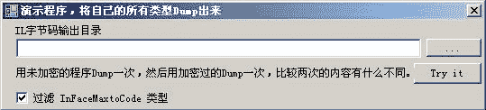

# MaxtoCode 对.Net 程序加密的原理及解密探讨一

> 原文：[`www.pediy.com/kssd/pediy08/pediy8-623.htm`](https://www.pediy.com/kssd/pediy08/pediy8-623.htm)

本文最早于 2006-7-17 发布在我的 blog 中。

`http://www.cnblogs.com/rick/archive/2006/07/17/453150.html`

这里研究的对象是 `MaxtoCode` 3.1 试用版。这里只探讨程序代码的加密。

对 `.Net` 程序代码的加密过程如下：

1. 运行 `ildasm` 将程序集反编译成 il 代码文件。
2. 对 IL 代码文件进行处理。(*)
3. 运行 `ilasm` 将 IL 代码文件编译成程序文件。
4. 直接对程序文件中的 il 字节码加密。(**)

粗体表示的 2 , 4 是关键步骤。

我们先来看看第四步。这一步就是加密的关键步骤，这里就是使用 `MaxtoCode` 的加密算法对程序代码进行加密。

显然，对于破解来说最直接直观的方法就是对其第四步的逆向解密。

如果从这个方向去破解解密加密过的程序，那就像 `MaxtoCode` 号称的那样 `MAXTOCODE` 的强度建立在加密算法之上。

理论上方法是可行的，但是工作量是非常大的。

那么我们还有其它的路可行呢？

现在来看看第二步 `MaxtoCode` 都做了什么。

用 `vs2003` 建一个最简单的 `winform` 程序，然后用 `MaxtoCode` 加密试试。我们将第三步之后，第四步之前的 `exe` 文件拿来研究。这个时候的 `exe` 程序代码是还没有被加密的。可以 `reflector`。

看看 这个 `exe` 和我们直接的 `exe` 有什么区别：

1. 增加了一个类 `InFaceMaxtoCode`。
2. 类都被增加了一个静态构造函数，在这个函数里面调用了 `InFaceMaxtoCode` 的一个静态函数 `Startup`。
3. 类的原有构造函数里面也增加了调用 `InFaceMaxtoCode.Startup` 的语句。

从这些来看，`MaxtoCode` 的目的是要确保 `InFaceMaxtoCode.Startup` 在程序中能够最早的运行。

这个行为和 `win32` 程序加壳很像，一般壳都是加密程序代码，然后修改程序的启动入口，首先执行壳的代码，完成程序的解密，然后再执行程序。一般壳有一个特点：加密是对整个程序，启动时也是整个程序完全解密，然后再执行。(我也见到过一个很特别的壳，程序是部分解密的，软件注册算法的那一块， 是执行一部分解密一部分，然后之前解密的又被垃圾信息填充了。)

对于壳只要我们找对了时间和地点，就能从内存中得到我们需要的东西。

那么 `MaxtoCode` 加密后的。Net 程序呢？

先来看看 `MaxtoCode` 的加密方式。用 `ildasm` 反编译 加密后的程序，会报很多错误，这是正常的，从生产的 IL 文件看，各个类，函数都还在，只是函数体里面是只有 `ildasm` 的错误信息。显然是加密后的代码无法反编译。`MaxtoCode` 对。Net 程序的加密不是对程序整体的，而只是对函数体加密，程序类结构不变。有一点我们是很清楚的，加密后的程序要能够正常运行，在运行时肯定是需要解密的。而解密的关键就在 `InFaceMaxtoCode.Startup` 里面。

现在我们来看看 `InFaceMaxtoCode.Startup` 里面究竟做了什么。`InFaceMaxtoCode` 类的代码如下：

```csharp
using System;
using System.IO;
using System.Reflection;
using System.Runtime.InteropServices;
using System.Text;

public class InFaceMaxtoCode
{
    static InFaceMaxtoCode()
    {
        InFaceMaxtoCode.started = false;
    }

    [DllImport("MRuntime3.dll", EntryPoint="CheckRuntime", CharSet=CharSet.Unicode, SetLastError=true, ExactSpelling=true)]
    private static extern int A_______();

    [DllImport("KERNEL32.DLL", EntryPoint="GetModuleHandleA", CharSet=CharSet.Ansi, SetLastError=true, ExactSpelling=true)]
    private static extern int B_______(string x13d52f7d8e232e61);

    private static string ByteToString(byte[] x5fc6100148519126)
    {
        return Encoding.ASCII.GetString(x5fc6100148519126);
    }

    [DllImport("MRuntime3.dll", EntryPoint="MainDLL", CharSet=CharSet.Ansi, SetLastError=true, ExactSpelling=true)]
    private static extern bool C_______(int x19218ffab70283ef, int xe7ebe10fa44d8d49);

    [DllImport("KERNEL32.DLL", EntryPoint="SetEnvironmentVariableA", CharSet=CharSet.Ansi, SetLastError=true, ExactSpelling=true)]
    private static extern bool D_______(string x427bb0e14ed9e9b1, string x84ee6c5b88919f4c);

    public static void Startup()
    {
        if (!InFaceMaxtoCode.started)
        {
            string text1 = "";
            string text2 = "MRuntime3.dll";
            if (AppDomain.CurrentDomain.RelativeSearchPath != null)
            {
                if (AppDomain.CurrentDomain.RelativeSearchPath.IndexOf(@":\\") != -1)
                {
                    text1 = AppDomain.CurrentDomain.RelativeSearchPath;
                }
                else
                {
                    text1 = AppDomain.CurrentDomain.BaseDirectory + AppDomain.CurrentDomain.RelativeSearchPath;
                }
            }
            else
            {
                text1 = AppDomain.CurrentDomain.BaseDirectory;
            }
            string text3 = Environment.GetEnvironmentVariable("path");
            if (text3.IndexOf(text1) == -1)
            {
                InFaceMaxtoCode.D_______("path", text3 + ";" + text1.Replace("/", @"\\"));
            }
            if (text1.Substring(text1.Length - 1, 1) == @"\\")
            {
                text1 = text1;
            }
            else
            {
                text1 = text1 + @"\\";
            }
            if (File.Exists(text1 + text2) && !File.Exists(Path.GetTempPath() + text2))
            {
                File.Copy(text1 + text2, Path.GetTempPath() + text2);
            }
            if (text3.IndexOf(Path.GetTempPath()) == -1)
            {
                InFaceMaxtoCode.D_______("path", text3 + ";" + Path.GetTempPath().Replace("/", @"\\"));
            }
            int num1 = 5;
            num1 = InFaceMaxtoCode.A_______();
            if (num1 == 0)
            {
                int num2 = InFaceMaxtoCode.B_______(text2);
                int num3 = InFaceMaxtoCode.B_______(Assembly.GetExecutingAssembly().Location);
                InFaceMaxtoCode.started = InFaceMaxtoCode.C_______(num2, num3);
            }
            else
            {
                //一堆垃圾代码，报告启动错误信息的。
            }
        }
    }
    private static bool started;
}
```

`Startup` 精简后的代码如下：

```csharp
public static void Startup()
{
    if (!InFaceMaxtoCode.started)
    {
        //准备运行库；
        int num1 = 5;
        num1 = InFaceMaxtoCode.A_______();
        if (num1 == 0)
        {
            int num2 = InFaceMaxtoCode.B_______(text2);
            int num3 = InFaceMaxtoCode.B_______(Assembly.GetExecutingAssembly().Location);
            InFaceMaxtoCode.started = InFaceMaxtoCode.C_______(num2, num3);
        }
        else
        {
            //一堆垃圾代码，报告启动错误信息的。
        }
    }
}
```

从代码里面我们看得到 `InFaceMaxtoCode.Startup` 正常启动后，在整个程序集中只会运行一次。

关键函数是 运行库的 `MainDLL`，这个函数有两个参数，一个是运行库的句柄，一个是程序集的句柄。这个句柄实际上就是程序在内存中加载的位置。`MaxtoCode` 加密后的程序都是对齐到 `0x1000` 的。

今天就到这里吧。

## MaxtoCode 对.Net 程序加密的原理及解密探讨二

自上次写第一篇文章到现在不知不觉两个月过去了，这篇文章我们将介绍怎么获取解密后的 IL 字节代码。

我们先回顾一下前文，在上一回我们提到“`InFaceMaxtoCode.Startup` 正常启动后，在整个程序集中只会运行一次。”。

当时这种说法是很武断的，如果 “`InFaceMaxtoCode.C_______(num2, num3)`” 的返回值总是 false 的话，该函数就会被执行多次，

不过根据后来动态调试的结果，我们证实了“`InFaceMaxtoCode.C_______(num2, num3)`” 的返回值为 true，因此上次的说法是正确的。

现在言归正传，怎么取得解密后的代码呢？大概两个方向，

1. 正面交锋，直接攻破 `maxtocode` 的运行库。

这就将问题直接回到了传统的 `win32` 层面，不过这个东西是业内人士写的在这方面的保护工作做得很好，像我这样的菜鸟就很难直接攻破了。

我曾有一个设想，就是通过分析运行库找到解密函数的入口，然后弄一个 `stub` dll，hook 这个地方，把解密后的 il 代码 dump 出来。

实际跟踪几次后我就放弃了。从跟踪到的信息来看，我猜测，运行库是通过 `mscorwks.dll` 挂接到 `jit`，在 `jit` 的前面实时解密代码。

理论上我们也可以挂一个到 `jit` 前面，在那里 dump 解密的 il 代码，不过这个实现的方式，还不清楚，如果弄明白了，也就能写一个同样原理的加密软件了。

这个难度比较大，所以我最终放弃了这个方案。

2. 避开运行库，我们直接利用 `dotNet` 2.0 的特性获取 IL 代码。

如是我就试着用 2.0 写了一个 `winform` 程序，加密，运行，发现报错。

`maxtocode3.1` 不支持 2.0 的 `winform` 程序，这就使我的这个方案实验夭折了。

两个月过去了，发现 `maxtocode` 升级到 3.11 了修正了这个 bug，今天终于可以继续实验了。

我们来建一个简单的 `winform` 程序。一个窗体，然后一个按钮。

代码如下：

```csharp
 1 using System;
 2 using System.Collections.Generic;
 3 using System.ComponentModel;
 4 using System.Data;
 5 using System.Drawing;
 6 using System.Text;
 7 using System.Windows.Forms;
 8 using System.Reflection;
 9 using Spaces;
10 namespace Test5
11 {
12     public partial class Form1 : Form
13     {
14         public Form1()
15         {
16             InitializeComponent();
17         }
18
19         private void TestMethod()
20         {
21             //  [7/17/2006]
22             int i = 0;
23             i = 1;
24             i++;
25             if(i>0)
26             {
27                 MessageBox.Show("OK");
28             }
29         }
30
31         private void button1_Click(object sender, EventArgs e)
32         {
33             Type tp = this.GetType();
34
35             MethodInfo mi = tp.GetMethod("TestMethod",
36                 BindingFlags.NonPublic|BindingFlags.DeclaredOnly|
37                 BindingFlags.Public|BindingFlags.Static
```


```csharp
38                 BindingFlags.Instance);  

39             if (mi == null)  

40             {  

41                 MessageBox.Show("err");  

42                 return;  

43             }  

44             MethodBody mb = mi.GetMethodBody();  

45             byte[] bt = mb.GetILAsByteArray();  

46             StringBuilder sb = new StringBuilder();  

47             for (int i = 0; i < bt.Length; i++)  

48             {  

49                 sb.Append(bt[i].ToString("X2"));  

50                 sb.Append(" ");  

51             }  

52             string stxt = sb.ToString();  

53             MessageBox.Show(stxt);  

54                   

55         }  

56    

57     }  

58 }  
```

编译运行，我们点击按钮就能看到`TestMethod`的IL字节码。

然后用`maxtocode`加密在运行，同样能看到`TestMethod`的IL字节码。

两次看到的结果一样的，这个是当然了，如果不一样，`maxtocode`就破坏了程序的正确性了。

好了，我们的实验成功了。

看到这里大家应该知道怎么获取解密后的IL代码了吧。

这种方式比在内存里面找代码或者`hook`到`maxtocode`解密后`dump`代码的方式要优越很多，

因为内存`dump`的方式你还要担心运行时的函数覆盖率，没有运行到的就`dump`不到。

这种方式我们利用`DotNet`的反射机制，可以枚举出程序集中的所有类型，以及每个类型的所有方法，成员，字段，构造函数等。

初步实验了一下，对于加了密的`dll`文件还是比较好弄的，`2.0`的、`1.1`的都能弄出`IL`代码来。

对于`exe`文件还有一关需要解决，那就是如何将我们的`DotNet` dll程序集插入到`exe`的运行空间中去。

今回就先到这里了，下回再实际写程序演练获取解密后的`IL`字节代码。

ps:不知道大家手上是否有破解到的`Reflector`的源代码，如果有丢一份给我，感激不尽。

上一回我们试验了通过反射的方式获取`method`的源代码。

这次我们就用一个实例来演示`dump`一个程序集中的所有类型和方法的`IL`源代码。

首先打开`VS2005`新建一个`C#`的`windows`程序：

在窗体添加添加一个`2`个`button`，`2`个`label`，一个`textbox`，一个`checkbox`，一个`savefiledialog`。

界面如下：



事件代码如下：

```csharp
  1  public class Form1 : Form  
  2      {  
  3          // Methods  
  4          //选择 IL 字节码保存文件  
  5          private void button1_Click(object sender, EventArgs e)  
  6 {  
  7      if (this.saveFileDialog1.ShowDialog() == DialogResult.OK)  
  8      {  
  9          this.textBox1.Text = this.saveFileDialog1.FileName;  
 10      }  
 11 }  
 12           //点击开始 dump。  
 13           private void button3_Click(object sender, EventArgs e)  
 14 {  
 15      this.button3.Enabled = false;  
 16      this.DumpAssembly(Assembly.GetExecutingAssembly(), this.textBox1.Text);  
 17      MessageBox.Show("dump ok");  
 18      this.button3.Enabled = true;  
 19 }  
 20          //这个函数将一个 Assembly 全部 dump 到 path 中。  
 21          private void DumpAssembly(Assembly ass, string path)  
 22 {  
 23      StreamWriter writer1 = new StreamWriter(path, false);  
 24      Type[] typeArray1 = ass.GetTypes();  
 25      for (int num1 = 0; num1 < typeArray1.Length; num1++)  
 26      {  
 27          this.DumpType(typeArray1[num1], writer1);  
 28      }  
 29      writer1.Flush();  
 30      writer1.Close();  
 31 }  
 32  
 33          //dump 单个类型，由 dumpassembly 调用  
 34           private void DumpType(Type tp, StreamWriter sw)  
 35 {  
 36      BindingFlags flags1 = BindingFlags.NonPublic | BindingFlags.Public | BindingFlags.Static | BindingFlags.Instance | BindingFlags.DeclaredOnly;  
 37      string text1 = tp.ToString();  
 38      sw.Write("TYPE: " + text1 + "\\r\\n");  
 39      if (tp.IsEnum)  
 40      {  
 41          sw.Write("IsEnum ");  
 42      }  
 43      if (tp.IsImport)  
 44      {  
 45          sw.Write("IsImport ");  
 46      }  
 47      if (tp.IsNested)  
 48      {  
 49          sw.Write("IsNested ");  
 50      }  
 51      if (tp.IsClass)  
 52      {  
 53          sw.Write("IsClass");  
 54      }  
 55      sw.Write("\\r\\n");  
 56      if ((text1 != "InFaceMaxtoCode") || !this.checkBox1.Checked)  
 57      {  
 58          sw.Write("**********Begin MemberInfo**********\\r\\n");  
 59          MemberInfo[] infoArray1 = tp.GetMembers(flags1);  
 60          for (int num1 = 0; num1 < infoArray1.Length; num1++)  
 61          {  
 62              MemberInfo info1 = infoArray1[num1];  
 63              sw.Write(info1.MemberType.ToString() + "\\t" + infoArray1[num1].ToString() + "\\r\\n");  
 64              if ((info1.MemberType == MemberTypes.Method) || (info1.MemberType == MemberTypes.Constructor))  
 65              {  
 66                  this.DumpMethod((MethodBase) info1, sw);  
 67              }  
 68          }  
 69          sw.Write("**********  End MemberInfo**********\\r\\n");  
 70          sw.Write("\\r\\n\\r\\n");  
 71      }  
 72 }  
 73  
 74   
 75   
 76      //dump 单个方法，由 dumptype 调用  
 77       private void DumpMethod(MethodBase mb, StreamWriter sw)  
 78 {  
 79      MethodBody body1 = mb.GetMethodBody();  
 80      if (body1 != null)  
 81      {  
 82          byte[] buffer1 = body1.GetILAsByteArray();  
 83          try  
 84          {  
 85              sw.Write("\\tMaxStackSize: " + body1.MaxStackSize.ToString());  
 86              sw.Write("\\tCodeSize: " + buffer1.Length.ToString());  
 87              sw.Write("\\r\\n");  
 88          }  
 89          catch (Exception exception1)  
 90          {  
 91              MessageBox.Show("1:" + mb.ToString() + "\\r\\n" + exception1.ToString());  
 92          }  
 93          foreach (LocalVariableInfo info1 in body1.LocalVariables)  
 94          {  
 95              sw.Write("LocalVar: " + info1.ToString());  
 96              sw.Write("\\r\\n");  
 97          }  
 98          sw.Write("\\r\\n\\r\\n");  
 99          StringBuilder builder1 = new StringBuilder();  
100          foreach (byte num1 in buffer1)  
101          {  
102              builder1.Append(num1.ToString("X2"));  
103          }  
104          sw.Write(builder1.ToString());  
105          sw.Write("\\r\\n\\r\\n");  
106          foreach (ExceptionHandlingClause clause1 in body1.ExceptionHandlingClauses)  
107          {  
108              sw.Write(clause1.ToString());  
109              sw.Write("\\r\\n");  
110          }  
111          sw.Write("\\r\\n");  
112      }  
113 }  
114  
115   
116  
117          
118      
119      }  
120  
121  
```

编译这个程序，运行，`dump`出`il`字节码，

然后拿`maxtocode`加密。再运行，`dump`出`il`字节码，然后找一个`method`如`button1_click`，比较一下他们的`IL`字节码是否一样。

当然结果应该是一样的。

这里主要有三个关键函数

```csharp
            private void DumpAssembly(Assembly ass, string path);  
            private void DumpMethod(MethodBase mb, StreamWriter sw);  
            private void DumpType(Type tp, StreamWriter sw);  
```

这三个就是一个例子演示如何`dump`整个程序集。

如要`dump`一个加密的`dll`，我们就可以直接用这个程序来改，

首先添加引用，引用那个`dll`，然后随便实例话一个该`dll`中的`type`。

然后获取该`dll`的`Assembly`对象，再调用`DumpAssembly`函数即可

`4dd466d0e1e0cc123afbe504da2462ca`
