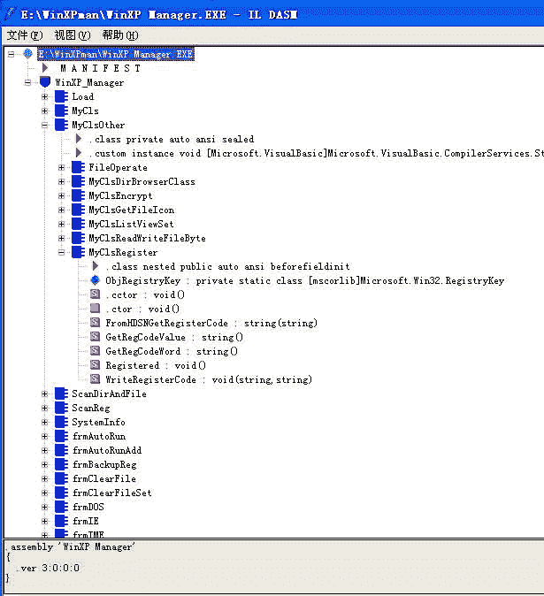

# winxp 总管

> 原文：[`www.pediy.com/kssd/pediy05/pediy50312.htm`](https://www.pediy.com/kssd/pediy05/pediy50312.htm)

好久没写东西了，找不到好的题材，现在有了，一个.NET 的程序----WINXP 总管，让我们有幸目睹微软的杰作.NET 框架程序的破解：）

目标软件：WINXP 总管

编程语言：`VB.NET`

破解工具：`ILDASM`，`WINHEX`

作者：`GREENLEMON`（菩提！）\[FCG\]

## 背景知识介绍

首先，我们遇到的是一个全新的东西，.NET 框架，这个东西是什么呢，他怎么工作的，如果你用 `WIN32DASM` 反汇编一下这个程序，你会看到莫名其妙的代码，因为它不再是我们传统意义上的汇编代码了，它是.NET 的核心也就是 `MSIL` 语言，`IL` 全称是 `INTERMEDIATE LANGUAGE`，也就是一种中间语言，类似 `PCODE`，但这回所有的编程语言包括 `VB`，`VC`，`C#` 全都编译成 `MSIL` 然后再利用.NET 框架的 `JIT` 实时转译成本地机的可执行代码，从而实现了平台无关性，于是我们要破解这类程序就要找到一种类似 `PCODE` 反编译器的东西，很幸运的是微软大叔为我们提供了全套超强绿色套装：）对我们最有用的就是 `ILDASM`（这些东西在.NET `FRAMEWORK` `SDK` 中提供）

好了基本的东西知道了一点，现在开始就要了解这种语言了，当然微软的 `MSDN` 有所有你想知道的东西，所以我这里就不罗索了，你可以去看看他的教程，我就来讲讲具体的破解，这才是我等感兴趣的：）

首先用 `ILDASM` 把源程序载入，很快我们得到了反编译的代码，你看到的是一种树状的结构图：



很清晰的结构，完全采用类的结构，通过名字我们判断 `MyClsRegister` 这个类就是关键所在，而他的几个方法也是一看就明白做什么用的，关键就在它们里面代码的含义，就是 `msil` 语言究竟是怎么样的。我们从 `Registered` 入手，这个最象那么回事：）

所有的 `misl` 语言都基于 `CLR`（公共语言运行库），`CLR` 是.NET 框架应用程序的执行引擎，它有别于传统的 `CPU` 结构，传统的 `CPU` 执行依赖于寄存器和堆栈，而 `CLR` 只使用堆栈，所以你所看到的 `MSIL` 语言都是下面的形式：

```
ld....
ld....
语句（call,比较。。）
实际上类似于
push
push
call
```

也就是说全都是这样的函数，方法调用

```
.method public static void Registered() cil managed //方法的名称
{
 // Code size 90 (0x5a) //代码的大小
 .maxstack 4 //最大的堆栈数
 .locals init (string V_0, //参数
 string V_1)

 IL_0000: nop
 IL_0001: call string WinXP_Manager.MyClsOther/MyClsRegister::GetRegCodeValue()//这个方法在前面有描述是注册表"date"键值
 IL_0006: stloc.0 //st=store 这句是要保存上面返回值到 loc.0，loc.0 是本地的一个参数
 IL_0007: call string WinXP_Manager.MyClsOther/MyClsRegister::GetRegCodeWord()//这个方法在前面有描述是注册表"name"键值
 IL_000c: stloc.1 //类似上面，存到 loc.1 里面
 IL_000d: ldloc.0 //取出 loc.0，推到堆栈里
 IL_000e: ldstr "" //取字符串，这里是空串
 IL_0013: ldc.i4.0 //取一个 0，推入堆栈
 IL_0014: call int32 [Microsoft.VisualBasic]Microsoft.VisualBasic.CompilerServices.StringType::StrCmp(string,
 string,
 bool)//可以看出上面三个参数是用来给这个比较 call 的，目的显然是判断是不是空串，返回值入栈
 IL_0019: ldc.i4.0 //推一个 0 入栈
 IL_001a: ceq //比较看是不是空的啦，是推送 1，否则推送 0
 IL_001c: ldloc.1 //和上面类似来判断另一个是不是空
 IL_001d: ldstr ""
 IL_0022: ldc.i4.0
 IL_0023: call int32 [Microsoft.VisualBasic]Microsoft.VisualBasic.CompilerServices.StringType::StrCmp(string,
 string,
 bool)
 IL_0028: ldc.i4.0
 IL_0029: ceq
 IL_002b: or //把 ceq 后的两个堆栈的值或一下
 IL_002c: brfalse.s IL_0036 //如果是 0，则跳到 36 行继续
 IL_002e: ldc.i4.0 //否则推一个 0 <----------将来修改这里推 1 进去
 IL_002f: stsfld bool WinXP_Manager.publicVarFun::IsRegistered//存到这个参数里（这个参数就是用来判断注册与否的）
 IL_0034: br.s IL_0057//跳出去
 IL_0036: nop
 IL_0037: ldloc.0 //取出 date
 IL_0038: ldloc.1 //取出 name
 IL_0039: call string WinXP_Manager.MyClsOther/MyClsRegister::FromHDSNGetRegisterCode(string)//另一方法里用于算注册码
 IL_003e: ldc.i4.0
 IL_003f: call int32 [Microsoft.VisualBasic]Microsoft.VisualBasic.CompilerServices.StringType::StrCmp(string,
 string,
 bool)//比较拉
 IL_0044: ldc.i4.0
 IL_0045: beq.s IL_004f //判断相等就说明注册了
 IL_0047: ldc.i4.0 //不等就推 0 <-----------------这里改成 1：）
 IL_0048: stsfld bool WinXP_Manager.publicVarFun::IsRegistered
 IL_004d: br.s IL_0056
 IL_004f: nop
 IL_0050: ldc.i4.1 //相等推 1
 IL_0051: stsfld bool WinXP_Manager.publicVarFun::IsRegistered
 IL_0056: nop
 IL_0057: nop
 IL_0058: nop
 IL_0059: ret
} // end of method MyClsRegister::Registered
```

很简单把，接下来我们就要改了，怎么做，首先要知道这些代码怎么用 16 进制表示在文件里的，把显示字节打开，再来看看这段代码

```
.method public static void Registered() cil managed
// SIG: 00 00 01
{
 // Method begins at RVA 0x9370c
 // Code size 90 (0x5a)
 .maxstack 4
 .locals init (string V_0,
 string V_1)

 IL_0000: /* 00 | */ nop
 IL_0001: /* 28 | (06)000056 */ call string WinXP_Manager.MyClsOther/MyClsRegister::GetRegCodeValue()
 IL_0006: /* 0A | */ stloc.0
 IL_0007: /* 28 | (06)000057 */ call string WinXP_Manager.MyClsOther/MyClsRegister::GetRegCodeWord()
 IL_000c: /* 0B | */ stloc.1
 IL_000d: /* 06 | */ ldloc.0
 IL_000e: /* 72 | (70)000B80 */ ldstr ""
 IL_0013: /* 16 | */ ldc.i4.0
 IL_0014: /* 28 | (0A)000083 */ call
```

来看看这段，他的 16 进制表示是这样的

```
00 28 56 00 00 06 0a 28 57 00 00 06 0b 06 72 80 0b 00 70 16 28 83 00 00 0a
```

看出来了吧：）

```
 IL_0019: /* 16 | */ ldc.i4.0
 IL_001a: /* FE01 | */ ceq
 IL_001c: /* 07 | */ ldloc.1
 IL_001d: /* 72 | (70)000B80 */ ldstr ""
 IL_0022: /* 16 | */ ldc.i4.0
 IL_0023: /* 28 | (0A)000083 */ call int32 [Microsoft.VisualBasic]Microsoft.VisualBasic.CompilerServices.StringType::StrCmp(string,
 string,
 bool)
 IL_0028: /* 16 | */ ldc.i4.0
 IL_0029: /* FE01 | */ ceq
 IL_002b: /* 60 | */ or
 IL_002c: /* 2C | 08 */ brfalse.s IL_0036
 IL_002e: /* 16 | */ ldc.i4.0 //这里改成 17
 IL_002f: /* 80 | (04)000007 */ stsfld bool WinXP_Manager.publicVarFun::IsRegistered
 IL_0034: /* 2B | 21 */ br.s IL_0057
 IL_0036: /* 00 | */ nop
 IL_0037: /* 06 | */ ldloc.0
 IL_0038: /* 07 | */ ldloc.1
 IL_0039: /* 28 | (06)000059 */ call string WinXP_Manager.MyClsOther/MyClsRegister::FromHDSNGetRegisterCode(string)
 IL_003e: /* 16 | */ ldc.i4.0
 IL_003f: /* 28 | (0A)000083 */ call int32 [Microsoft.VisualBasic]Microsoft.VisualBasic.CompilerServices.StringType::StrCmp(string,
 string,
 bool)
 IL_0044: /* 16 | */ ldc.i4.0
 IL_0045: /* 2E | 08 */ beq.s IL_004f
 IL_0047: /* 16 | */ ldc.i4.0 //这里改成 17
 IL_0048: /* 80 | (04)000007 */ stsfld bool WinXP_Manager.publicVarFun::IsRegistered
 IL_004d: /* 2B | 07 */ br.s IL_0056
 IL_004f: /* 00 | */ nop
```


`IL_0050: /* 17 | */ ldc.i4.1`

`IL_0051: /* 80 | (04)000007 */ stsfld bool WinXP_Manager.publicVarFun::IsRegistered`

`IL_0056: /* 00 | */ nop`

`IL_0057: /* 00 | */ nop`

`IL_0058: /* 00 | */ nop`

`IL_0059: /* 2A | */ ret`

```
} // end of method MyClsRegister::Registered
```

完成了，等我的下一篇文章研究一下注册算法：）

上一次我们对 `.net` 框架的程序有了初步的认识，并且爆破了注册验证，但是研究的路是无止境的，不能只局限于爆破亚，这次我们将深入研究它的算法（后面你会看到虽然算法不难，但由于缺乏动态调试工具，从而难度增加了）。并且由于我的疏忽，做出注册机后一个细节的问题使得注册码仍然不对，于是由此引发 diy msil 使它显示正确注册码，已修正我们的注册机（如果有好用的动态工具，这些将很简单，可惜呀：）。

所以在这篇文章里我将谈到两个问题，一是算法，二是如何 diy msil。

先讲算法吧，这是我们最终的目的。

还记得上次我们看到爆破的那个 `Registered()` 方法吗，我们将从那里开始来找寻算法的根源。

调出来可以看到这个：

```
IL_0037: ldloc.0
IL_0038: ldloc.1
IL_0039: call string WinXP_Manager.MyClsOther/MyClsRegister::FromHDSNGetRegisterCode(string)
IL_003e: ldc.i4.0
IL_003f: call int32 [Microsoft.VisualBasic]Microsoft.VisualBasic.CompilerServices.StringType::StrCmp(string, string, bool)
IL_0044: ldc.i4.0
IL_0045: beq.s IL_004f
```

`FromHDSNGetRegisterCode(string)` 这个就是关键，他生成了用来比较的 string，也就是说算法应该是这样：

`FromHDSNGetRegisterCode(用户名)=注册码；`

那么这个方法是哪里来的呢，就在这个 `MyClsRegister` 类中有他的描述，再调出来看看：

```
.method public static string FromHDSNGetRegisterCode(string strCodeWord) cil managed
{
// Code size 24 (0x18)
.maxstack 2
.locals init (string V_0,
        class WinXP_Manager.MyClsOther/MyClsEncrypt V_1)

IL_0000: nop
IL_0001: ldarg.0
IL_0002: newobj instance void WinXP_Manager.MyClsOther/MyClsEncrypt::.ctor(string)//newobj 用来初始化一个类的对象
IL_0007: stloc.1
IL_0008: ldloc.1
IL_0009: call string WinXP_Manager.MyCls/MyClsSysInfo::GetPySerialNum()//这个我们可以在 MyCls 中找到，是获得硬盘序列号并作了一些处理（也就是加密转化了）变成了机器码
IL_000e: callvirt instance string WinXP_Manager.MyClsOther/MyClsEncrypt::Encrypt(string)
IL_0013: stloc.0
IL_0014: br.s IL_0016
IL_0016: ldloc.0
IL_0017: ret
} // end of method MyClsRegister::FromHDSNGetRegisterCode
```

很好，我们看到了 `MyClsEncrypt` 这个类的两个方法，我们再来总结一下：

他先用 `.ctor(strCodeWord)` （这个方法所有的类中都有，是用来初始化类的成员的），然后 `Encrypt(机器码)`。

现在我们的目标就是 `MyClsEncrypt`

先来看初始化的方法：

```
.method public specialname rtspecialname
        instance void .ctor(string strCodeWord) cil managed//这里可以看到初始化需要传递一个参数进来，strcodeword 就是用户名
{
// Code size 172 (0xac)
.maxstack 4
.locals init (int32 V_0,
        int32 V_1,
        int32 V_2)

IL_0000: nop
IL_0001: ldarg.0
IL_0002: call instance void [mscorlib]System.Object::.ctor()
IL_0007: nop
IL_0008: ldarg.0
IL_0009: ldc.i4.s 98
IL_000b: newarr [mscorlib]System.String//这里初始化一个大小为 98 的字符数组
IL_0010: stfld string[] WinXP_Manager.MyClsOther/MyClsEncrypt::strCryptMatrix//存到这里
IL_0015: ldarg.0
IL_0016: ldarg.1 //把参数推栈
IL_0017: stfld string WinXP_Manager.MyClsOther/MyClsEncrypt::CodeWord//存到 CodeWord 这个变量里
IL_001c: ldarg.0
IL_001d: ldstr "8x3p5BeabcdfghijklmnoqrstuvwyzACDEFGHIJKLMNOPQRSTU"
+ "VWXYZ1246790"
IL_0022: stfld string WinXP_Manager.MyClsOther/MyClsEncrypt::Matrix//把上面的字符串存到这个变量里
IL_0027: ldc.i4.1
IL_0028: stloc.0 //loc.0=1
IL_0029: ldarg.0
IL_002a: ldarg.0
IL_002b: ldfld string WinXP_Manager.MyClsOther/MyClsEncrypt::Matrix
IL_0030: call int32 [Microsoft.VisualBasic]Microsoft.VisualBasic.Strings::Len(string)//算一下长度这里=62
IL_0035: stfld int32 WinXP_Manager.MyClsOther/MyClsEncrypt::LAM//存进来，也就是 LAM=62
IL_003a: ldarg.0
IL_003b: ldfld string[] WinXP_Manager.MyClsOther/MyClsEncrypt::strCryptMatrix
IL_0040: ldc.i4.1
IL_0041: ldarg.0
IL_0042: ldfld string WinXP_Manager.MyClsOther/MyClsEncrypt::Matrix
IL_0047: stelem.ref //这个用表达式写就是 strCryptMatrix[1]=Matrix，具体可以查手册
IL_0048: nop
IL_0049: ldc.i4.2
IL_004a: ldarg.0
IL_004b: ldfld int32 WinXP_Manager.MyClsOther/MyClsEncrypt::LAM
IL_0050: stloc.2 //loc.2=62
IL_0051: stloc.1 //loc.1=2
IL_0052: br.s IL_00a6 //下去看看，发现是一个循环，表达是应该是：while loc.1<loc.2 do
IL_0054: ldarg.0
IL_0055: ldarg.0
IL_0056: ldfld string[] WinXP_Manager.MyClsOther/MyClsEncrypt::strCryptMatrix
IL_005b: ldloc.0
IL_005c: ldelem.ref //推 strCryptMatrix[loc.0]
IL_005d: ldc.i4.1
IL_005e: call string [Microsoft.VisualBasic]Microsoft.VisualBasic.Strings::Left(string, int32) //从左边取一个
IL_0063: stfld string WinXP_Manager.MyClsOther/MyClsEncrypt::mov1 //存到 mov1
IL_0068: ldarg.0
IL_0069: ldarg.0
IL_006a: ldfld string[] WinXP_Manager.MyClsOther/MyClsEncrypt::strCryptMatrix
IL_006f: ldloc.0
IL_0070: ldelem.ref //推 strCryptMatrix[loc.0]
IL_0071: ldarg.0
IL_0072: ldfld int32 WinXP_Manager.MyClsOther/MyClsEncrypt::LAM
IL_0077: ldc.i4.1
IL_0078: sub.ovf
IL_0079: call string [Microsoft.VisualBasic]Microsoft.VisualBasic.Strings::Right(string, int32) //从右边取 61 个
IL_007e: stfld string WinXP_Manager.MyClsOther/MyClsEncrypt::mov2 //存到 mov2
IL_0083: ldarg.0
IL_0084: ldfld string[] WinXP_Manager.MyClsOther/MyClsEncrypt::strCryptMatrix
IL_0089: ldloc.1
IL_008a: ldarg.0
IL_008b: ldfld string WinXP_Manager.MyClsOther/MyClsEncrypt::mov2
IL_0090: ldarg.0
IL_0091: ldfld string WinXP_Manager.MyClsOther/MyClsEncrypt::mov1
IL_0096: call string [mscorlib]System.String::Concat(string, string) //连接字符串
IL_009b: stelem.ref //存入表达式应该是：strCryptMatrix[loc.1]=mov2+mov1
IL_009c: nop
IL_009d: ldloc.0
IL_009e: ldc.i4.1
IL_009f: add.ovf
IL_00a0: stloc.0 //loc.0=loc.0+1
IL_00a1: nop
IL_00a2: ldloc.1
IL_00a3: ldc.i4.1
IL_00a4: add.ovf
IL_00a5: stloc.1 //loc.1=loc.1+1
IL_00a6: ldloc.1
IL_00a7: ldloc.2
IL_00a8: ble.s IL_0054//循环
IL_00aa: nop
IL_00ab: ret
} // end of method MyClsEncrypt::.ctor
```

来总结一下，初始化就是对几个成员赋值：

`CodeWord`=用户名

`LAM`=62

`Matrix`=8x3p5BeabcdfghijklmnoqrstuvwyzACDEFGHIJKLMNOPQRSTUVWXYZ1246790

`strCryptMatrix[1]`=8x3p5BeabcdfghijklmnoqrstuvwyzACDEFGHIJKLMNOPQRSTUVWXYZ1246790

`strCryptMatrix[2]`=x3p5BeabcdfghijklmnoqrstuvwyzACDEFGHIJKLMNOPQRSTUVWXYZ12467908

`strCryptMatrix[3]`=3p5BeabcdfghijklmnoqrstuvwyzACDEFGHIJKLMNOPQRSTUVWXYZ12467908x

`strCryptMatrix[4]`=p5BeabcdfghijklmnoqrstuvwyzACDEFGHIJKLMNOPQRSTUVWXYZ12467908x3

`strCryptMatrix[5]`=5BeabcdfghijklmnoqrstuvwyzACDEFGHIJKLMNOPQRSTUVWXYZ12467908x3p

.
.
.

`strCryptMatrix[62]`=08x3p5BeabcdfghijklmnoqrstuvwyzACDEFGHIJKLMNOPQRSTUVWXYZ124679

现在来看看另一个方法：

```
.method public instance string Encrypt(string strEncrypted) cil managed //他也要一个参数，strEncrypted=机器码
{
// Code size 289 (0x121)
.maxstack 5
.locals init (string V_0,
        string V_1,
        string V_2,
        int32 V_3,
        int32 V_4,
        int32 V_5,
```


```
int32 V_6,
int32 V_7)
IL_0000: nop
IL_0001: nop
.try
{
  IL_0002: ldarg.1
  IL_0003: stloc.2    //loc.2=机器码
  IL_0004: ldarg.0
  IL_0005: ldarg.1    //参数推栈
  IL_0006: callvirt  instance int32 [mscorlib]System.String::get_Length()      //取长度
  IL_000b: stfld       int32 WinXP_Manager.MyClsOther/MyClsEncrypt::LS2E         //保存
  IL_0010: ldarg.0
  IL_0011: ldarg.0
  IL_0012: ldfld       string WinXP_Manager.MyClsOther/MyClsEncrypt::CodeWord    //取用户名
  IL_0017: callvirt  instance int32 [mscorlib]System.String::get_Length()      //长度
  IL_001c: stfld       int32 WinXP_Manager.MyClsOther/MyClsEncrypt::LCW           //保存
  IL_0021: ldarg.0
  IL_0022: ldstr       ""
  IL_0027: stfld       string WinXP_Manager.MyClsOther/MyClsEncrypt::EncryptedLetter  //初始化
  IL_002c: ldarg.0
  IL_002d: ldstr       ""
  IL_0032: stfld       string WinXP_Manager.MyClsOther/MyClsEncrypt::EncryptedString  //初始化
  IL_0037: ldc.i4.1
  IL_0038: stloc.s     V_4  //V_4=1
  IL_003a: ldc.i4.1
  IL_003b: ldarg.0
  IL_003c: ldfld       int32 WinXP_Manager.MyClsOther/MyClsEncrypt::LS2E
  IL_0041: stloc.s     V_7  //V_7=LS2E=机器码长度
  IL_0043: stloc.3            //loc.3=1
  IL_0044: br          IL_0100  //while loc.3<V_7 do
  IL_0049: ldloc.2
  IL_004a: ldloc.3
  IL_004b: ldc.i4.1
  IL_004c: call        string [Microsoft.VisualBasic]Microsoft.VisualBasic.Strings::Mid(string,
                                                                                      int32,
                                                                                      int32)//取机器码的第 loc.3 位
  IL_0051: stloc.0    //存进来
  IL_0052: ldarg.0
  IL_0053: ldc.i4.1
  IL_0054: ldarg.0
  IL_0055: ldfld       string WinXP_Manager.MyClsOther/MyClsEncrypt::Matrix
  IL_005a: ldloc.0
  IL_005b: ldc.i4.0
  IL_005c: call        int32 [Microsoft.VisualBasic]Microsoft.VisualBasic.Strings::InStr(int32,
                                                                                        string,
                                                                                        string,
                                                                                        valuetype [Microsoft.VisualBasic]Microsoft.VisualBasic.CompareMethod)//判断机器码的第 loc.3 位在 Matrix 字符串的哪个位置
  IL_0061: stfld       int32 WinXP_Manager.MyClsOther/MyClsEncrypt::MP      //MP=位置值
  IL_0066: ldarg.0
  IL_0067: ldarg.0
  IL_0068: ldfld       string WinXP_Manager.MyClsOther/MyClsEncrypt::CodeWord
  IL_006d: ldloc.s     V_4
  IL_006f: ldc.i4.1
  IL_0070: call        string [Microsoft.VisualBasic]Microsoft.VisualBasic.Strings::Mid(string,
                                                                                      int32,
                                                                                      int32)//取用户名的第 V_4 位
  IL_0075: stfld       string WinXP_Manager.MyClsOther/MyClsEncrypt::CWL   //存到 CWL 里
  IL_007a: ldc.i4.1
  IL_007b: ldarg.0
  IL_007c: ldfld       int32 WinXP_Manager.MyClsOther/MyClsEncrypt::LAM
  IL_0081: stloc.s     V_6  //V_6=LAM=62
  IL_0083: stloc.s     V_5  //V_5=1
  IL_0085: br.s        IL_00e2  //while V_5<V_6 do
  IL_0087: ldarg.0
  IL_0088: ldfld       string[] WinXP_Manager.MyClsOther/MyClsEncrypt::strCryptMatrix
  IL_008d: ldloc.s     V_5
  IL_008f: ldelem.ref  //推 strCryptMatrix[V_5]
  IL_0090: ldarg.0
  IL_0091: ldfld       int32 WinXP_Manager.MyClsOther/MyClsEncrypt::MP
  IL_0096: ldc.i4.1
  IL_0097: call        string [Microsoft.VisualBasic]Microsoft.VisualBasic.Strings::Mid(string,
                                                                                      int32,
                                                                                      int32)//取 strCryptMatrix[V_5]的第 MP 位
  IL_009c: ldarg.0
  IL_009d: ldfld       string WinXP_Manager.MyClsOther/MyClsEncrypt::CWL   //CWL=用户名的第 V_4 位
  IL_00a2: ldc.i4.0
  IL_00a3: call        int32 [Microsoft.VisualBasic]Microsoft.VisualBasic.CompilerServices.StringType::StrCmp(string,
                                                                                                             string,
                                                                                                             bool)  //比较上面两个字符
  IL_00a8: ldc.i4.0
  IL_00a9: bne.un.s    IL_00da  //不等就 V_5=V_5+1，循环取 strCryptMatrix[V_5]的第 MP 位与 CWL 比较直到相等
  IL_00ab: ldarg.0
  IL_00ac: ldarg.0
  IL_00ad: ldfld       string[] WinXP_Manager.MyClsOther/MyClsEncrypt::strCryptMatrix
  IL_00b2: ldloc.s     V_5
  IL_00b4: ldelem.ref
  IL_00b5: ldc.i4.1
  IL_00b6: call        string [Microsoft.VisualBasic]Microsoft.VisualBasic.Strings::Left(string,
                                                                                        int32)//取 strCryptMatrix[V_5]的左边第一个字符作为机器码的加密后的编码
  IL_00bb: stfld       string WinXP_Manager.MyClsOther/MyClsEncrypt::EncryptedLetter
  IL_00c0: ldarg.0
  IL_00c1: ldarg.0
  IL_00c2: ldfld       string WinXP_Manager.MyClsOther/MyClsEncrypt::EncryptedString
  IL_00c7: ldarg.0
  IL_00c8: ldfld       string WinXP_Manager.MyClsOther/MyClsEncrypt::EncryptedLetter
  IL_00cd: call        string [mscorlib]System.String::Concat(string,
                                                              string)
  IL_00d2: stfld       string WinXP_Manager.MyClsOther/MyClsEncrypt::EncryptedString  //将编码循环连接起来
  IL_00d7: nop
  IL_00d8: br.s        IL_00e8
  IL_00da: nop
  IL_00db: nop
  IL_00dc: ldloc.s     V_5
  IL_00de: ldc.i4.1
  IL_00df: add.ovf
  IL_00e0: stloc.s     V_5
  IL_00e2: ldloc.s     V_5
  IL_00e4: ldloc.s     V_6
  IL_00e6: ble.s       IL_0087
  IL_00e8: ldloc.s     V_4
  IL_00ea: ldc.i4.1
  IL_00eb: add.ovf
  IL_00ec: stloc.s     V_4
  IL_00ee: ldloc.s     V_4
  IL_00f0: ldarg.0
  IL_00f1: ldfld       int32 WinXP_Manager.MyClsOther/MyClsEncrypt::LCW
  IL_00f6: ble.s       IL_00fb
  IL_00f8: ldc.i4.1
  IL_00f9: stloc.s     V_4
  IL_00fb: nop
  IL_00fc: ldloc.3
  IL_00fd: ldc.i4.1
  IL_00fe: add.ovf
  IL_00ff: stloc.3
  IL_0100: ldloc.3
  IL_0101: ldloc.s     V_7
  IL_0103: ble          IL_0049
  IL_0108: ldarg.0
  IL_0109: ldfld       string WinXP_Manager.MyClsOther/MyClsEncrypt::EncryptedString
  IL_010e: stloc.1
  IL_010f: leave.s     IL_011e
}  // end .try
catch [mscorlib]System.Exception
{
  IL_0111: call        void [Microsoft.VisualBasic]Microsoft.VisualBasic.CompilerServices.ProjectData::SetProjectError(class [mscorlib]System.Exception)
  IL_0116: nop
  IL_0117: call        void [Microsoft.VisualBasic]Microsoft.VisualBasic.CompilerServices.ProjectData::ClearProjectError()
  IL_011c: leave.s     IL_011e
}  // end handler
IL_011e: nop
IL_011f: ldloc.1
IL_0120: ret
} // end of method MyClsEncrypt::Encrypt
```

总结一下用 `Delphi` 源码描述如下：（有点不同，因为他的方法很笨，稍微计算一下就变成下面简单的算法）

```
var
machinecode, key, resultstr, matrix: string;
lm, lk, i, t, m, resultpos: integer;
begin
```


### 代码部分

```
matrix:='8x3p5BeabcdfghijklmnoqrstuvwyzACDEFGHIJKLMNOPQRSTUVWXYZ1246790';   

machinecode:=Form1.FlatEdit1.Text;   

key:= Form1.FlatEdit2.Text;   

lm:=strlen(pchar(machinecode));   

lk:=strlen(pchar(key));   

i:=1;   

resultstr:='';   

while i<=lm do   

    begin   

      if i<=lk then t:=i   

      else t:=i-lk\*((i-1) div lk);   

      m:=pos(key\[t\],matrix)-pos(machinecode\[i\],matrix);   

      if m<=0 then   

        resultpos:=m+63   

      else   

        resultpos:=m+1;   

      resultstr:=resultstr+copy(matrix,resultpos,1);   

      i:=i+1;   

    end;   

Form1.FlatEdit3.Text:=resultstr;   

end;   
```

### 分析与调试思路

算法完成了，但是我原先的程序里是错位的，也就是算出的注册码都比正确的前移了一个，我一直没找到原因，如果有个能动态调试的工具可以让我看到推栈里的一个值，我就可以纠正这个错误，但是没有（有个 `cordbg` 不会用，也不知道能不能达到目的：），所以我有了个想法，点注册的时候你会发现他弹出一个错误提示框，能不能利用他把正确的注册码弹出来，我不就可以知道错在哪了吗（如果我没出错，就不会有下面的 `diy msil` 了：）

### 第二部分：`diy msil`

我们现在要找到那个注册按钮事件，这样我们才能加入自己的处理，来看看在哪里：就在 `frmRegistry::BtnRegistry_Click`，

```
.method private instance void  BtnRegistry_Click(object sender,   
                                                class [mscorlib]System.EventArgs e) cil managed   

{   

  // Code size   247 (0xf7)   

  .maxstack  4   

  IL_0000:  nop   

  IL_0001:  ldarg.0   

  IL_0002:  callvirt  instance class [System.Windows.Forms]System.Windows.Forms.TextBox WinXP_Manager.frmRegistry::get_txtSN()   

  IL_0007:  callvirt  instance string [System.Windows.Forms]System.Windows.Forms.TextBox::get_Text()//得到你输入的注册码   

  IL_000c:  ldstr      ""   

  IL_0011:  ldc.i4.0   

  IL_0012:  call       int32 [Microsoft.VisualBasic]Microsoft.VisualBasic.CompilerServices.StringType::StrCmp(string,   

                                                                                                          string,   

                                                                                                          bool)   

  IL_0017:  ldc.i4.0   

  IL_0018:  bne.un.s  IL_0033  //比较是不是空，不是就跳，是就输出错误信息   

  IL_001a:  ldstr      bytearray (A8 60 D8 8F A1 6C 09 67 93 8F 65 51 E8 6C 8C 51  // .`...l.g..eQ.l.Q   

                                  01 78 62 54 21 00 )                           // .xbT!.   

  IL_001f:  ldstr      bytearray (19 95 EF 8B )   

  IL_0024:  ldc.i4.0   

  IL_0025:  ldc.i4.s  16   

  IL_0027:  call       valuetype [System.Windows.Forms]System.Windows.Forms.DialogResult [System.Windows.Forms]System.Windows.Forms.MessageBox::Show(string,   

                                                                                                                  string,   

                                                                                                          valuetype [System.Windows.Forms]System.Windows.Forms.MessageBoxButtons,   

                                                                                                          valuetype [System.Windows.Forms]System.Windows.Forms.MessageBoxIcon)   

  IL_002c:  pop   

  IL_002d:  nop   

  IL_002e:  br        IL_00f5   

  IL_0033:  nop   

  IL_0034:  ldarg.0   

  IL_0035:  callvirt  instance class [System.Windows.Forms]System.Windows.Forms.TextBox WinXP_Manager.frmRegistry::get_txtUserName()   

  IL_003a:  callvirt  instance string [System.Windows.Forms]System.Windows.Forms.TextBox::get_Text() //得到用户名   

  IL_003f:  ldstr      ""   

  IL_0044:  ldc.i4.0   

  IL_0045:  call       int32 [Microsoft.VisualBasic]Microsoft.VisualBasic.CompilerServices.StringType::StrCmp(string,   

                                                                                                          string,   

                                                                                                          bool)   

  IL_004a:  ldc.i4.0   

  IL_004b:  bne.un.s  IL_0066  //比较是不是空，不是就跳，是就输出错误信息   

  IL_004d:  ldstr      bytearray (F7 8B 28 75 57 5B CD 6B FB 6D 99 51 A8 60 84 76  // ..(uW[.k.m.Q.`.v   

                                  28 75 37 62 0D 54 21 00 )                       // (u7b.T!.   

  IL_0052:  ldstr      bytearray (19 95 EF 8B )   

  IL_0057:  ldc.i4.0   

  IL_0058:  ldc.i4.s  16   

  IL_005a:  call       valuetype [System.Windows.Forms]System.Windows.Forms.DialogResult [System.Windows.Forms]System.Windows.Forms.MessageBox::Show(string,   

                                                                                                                  string,   

                                                                                                          valuetype [System.Windows.Forms]System.Windows.Forms.MessageBoxButtons,   

                                                                                                          valuetype [System.Windows.Forms]System.Windows.Forms.MessageBoxIcon)   

  IL_005f:  pop   

  IL_0060:  nop   

  IL_0061:  br        IL_00f5   

  IL_0066:  nop   

  IL_0067:  ldarg.0   

  IL_0068:  callvirt  instance class [System.Windows.Forms]System.Windows.Forms.TextBox WinXP_Manager.frmRegistry::get_txtSN()   

  IL_006d:  callvirt  instance string [System.Windows.Forms]System.Windows.Forms.TextBox::get_Text()   

  IL_0072:  ldarg.0   

  IL_0073:  callvirt  instance class [System.Windows.Forms]System.Windows.Forms.TextBox WinXP_Manager.frmRegistry::get_txtUserName()   

  IL_0078:  callvirt  instance string [System.Windows.Forms]System.Windows.Forms.TextBox::get_Text()   

  IL_007d:  call       string WinXP_Manager.MyClsOther/MyClsRegister::FromHDSNGetRegisterCode(string)  //这里会得到这确的注册码然后与我们输入的作比较   

  IL_0082:  ldc.i4.0   

  IL_0083:  call       int32 [Microsoft.VisualBasic]Microsoft.VisualBasic.CompilerServices.StringType::StrCmp(string,   

                                                                                                          string,   

                                                                                                          bool)   

  IL_0088:  ldc.i4.0   

  IL_0089:  bne.un.s  IL_00c3  //不等就跳去显示出错框   

  IL_008b:  ldarg.0   

  IL_008c:  callvirt  instance class [System.Windows.Forms]System.Windows.Forms.TextBox WinXP_Manager.frmRegistry::get_txtSN()   

  IL_0091:  callvirt  instance string [System.Windows.Forms]System.Windows.Forms.TextBox::get_Text()   

  IL_0096:  ldarg.0   

  IL_0097:  callvirt  instance class [System.Windows.Forms]System.Windows.Forms.TextBox WinXP_Manager.frmRegistry::get_txtUserName()   

  IL_009c:  callvirt  instance string [System.Windows.Forms]System.Windows.Forms.TextBox::get_Text()   

  IL_00a1:  call       void WinXP_Manager.MyClsOther/MyClsRegister::WriteRegisterCode(string,   

                                                                                  string)   

  IL_00a6:  nop   

  IL_00a7:  ldstr      bytearray (A8 60 F2 5D CF 7E 10 62 9F 52 E8 6C 8C 51 21 00  // .`.\].~.b.R.l.Q!.   

                                  F7 8B CD 91 B0 65 2F 54 A8 52 2C 67 6F 8F F6 4E  // .....e/T.R,go..N   

                                  2E 00 )                                        // ..   

  IL_00ac:  ldstr      bytearray (E8 6C 8C 51 8C 5B 10 62 )                       // .l.Q.[.b   

  IL_00b1:  ldc.i4.0   

  IL_00b2:  ldc.i4.s  64   

  IL_00b4:  call       valuetype [System.Windows.Forms]System.Windows.Forms.DialogResult [System.Windows.Forms]System.Windows.Forms.MessageBox::Show(string,   

                                                                                                                  string,   
```


```
valuetype [System.Windows.Forms]System.Windows.Forms.MessageBoxButtons,
valuetype [System.Windows.Forms]System.Windows.Forms.MessageBoxIcon)
IL_00b9:  pop
IL_00ba:  ldarg.0
IL_00bb:  callvirt  instance void [System.Windows.Forms]System.Windows.Forms.Form::Close()
IL_00c0:  nop
IL_00c1:  br.s      IL_00f4
IL_00c3:  nop       //这里开始是来显示出错信息
IL_00c4:  ldstr     bytearray (A8 60 93 8F 65 51 84 76 E8 6C 8C 51 01 78 0D 4E  // .\`.eQ.v.l.Q.x.N
                     63 6B 6E 78 21 00 )                                           // cknx!. //这个是框里显示的字符串，我们就把它改成显示正确注册码
IL_00c9:  ldstr     bytearray (19 95 EF 8B )
IL_00ce:  ldc.i4.0
IL_00cf:  ldc.i4.s  16
IL_00d1:  call      valuetype [System.Windows.Forms]System.Windows.Forms.DialogResult [System.Windows.Forms]System.Windows.Forms.MessageBox::Show(string,
                     string,
                     valuetype [System.Windows.Forms]System.Windows.Forms.MessageBoxButtons,
                     valuetype [System.Windows.Forms]System.Windows.Forms.MessageBoxIcon)
IL_00d6:  pop
IL_00d7:  ldarg.0
IL_00d8:  callvirt  instance class [System.Windows.Forms]System.Windows.Forms.TextBox WinXP_Manager.frmRegistry::get_txtSN()
IL_00dd:  ldstr     ""
IL_00e2:  callvirt  instance void [System.Windows.Forms]System.Windows.Forms.TextBox::set_Text(string)
IL_00e7:  nop
IL_00e8:  ldarg.0
IL_00e9:  callvirt  instance class [System.Windows.Forms]System.Windows.Forms.TextBox WinXP_Manager.frmRegistry::get_txtSN()
IL_00ee:  callvirt  instance bool [System.Windows.Forms]System.Windows.Forms.Control::Focus()
IL_00f3:  pop
IL_00f4:  nop
IL_00f5:  nop
IL_00f6:  ret

} // end of method frmRegistry::BtnRegistry_Click
```

来看看我改的：（改法很多，主要就是注意尽量不要破坏源程序的东西，而且 `msil` 增加字节我还不会，所以只有修改掉队我们的目的无用的东西）

```
IL_0089:  bne.un.s  IL_00b8  //这个跳传要注意修正，要不肯定出错
IL_008b:  ldarg.0
IL_008c:  callvirt  instance class [System.Windows.Forms]System.Windows.Forms.TextBox WinXP_Manager.frmRegistry::get_txtSN()
IL_0091:  callvirt  instance string [System.Windows.Forms]System.Windows.Forms.TextBox::get_Text()
IL_0096:  ldarg.0
IL_0097:  callvirt  instance class [System.Windows.Forms]System.Windows.Forms.TextBox WinXP_Manager.frmRegistry::get_txtUserName()
IL_009c:  callvirt  instance string [System.Windows.Forms]System.Windows.Forms.TextBox::get_Text()
IL_00a1:  call      void WinXP_Manager.MyClsOther/MyClsRegister::WriteRegisterCode(string,
                     string)
IL_00a6:  nop       为了避免 jit 的错误翻译，把会引起混乱的东西全都 nop
IL_00a7:  nop
IL_00a8:  nop
IL_00a9:  nop
IL_00aa:  nop
IL_00ab:  nop
IL_00ac:  nop
IL_00ad:  nop
IL_00ae:  nop
IL_00af:  nop
IL_00b0:  nop
IL_00b1:  nop
IL_00b2:  nop
IL_00b3:  nop
IL_00b4:  nop
IL_00b5:  nop
IL_00b6:  nop
IL_00b7:  nop
IL_00b8:  nop       //从这里开始
IL_00b9:  ldarg.0   //这个都有，具体原因还不大清楚，照猫画虎把！
IL_00ba:  callvirt  instance class [System.Windows.Forms]System.Windows.Forms.TextBox WinXP_Manager.frmRegistry::get_txtUserName()
IL_00bf:  callvirt  instance string [System.Windows.Forms]System.Windows.Forms.TextBox::get_Text()
IL_00c4:  call      string WinXP_Manager.MyClsOther/MyClsRegister::FromHDSNGetRegisterCode(string)//用这 3 个 call 就得到了要显示的正确注册码
IL_00c9:  ldstr     bytearray (19 95 EF 8B )
IL_00ce:  ldc.i4.0
IL_00cf:  ldc.i4.s  16
IL_00d1:  call      valuetype [System.Windows.Forms]System.Windows.Forms.DialogResult [System.Windows.Forms]System.Windows.Forms.MessageBox::Show(string,
                     string,
                     valuetype [System.Windows.Forms]System.Windows.Forms.MessageBoxButtons,
                     valuetype [System.Windows.Forms]System.Windows.Forms.MessageBoxIcon)
IL_00d6:  pop
```

其他不变，用 `16` 进制编辑器改，对应的机器码一样照搬，跳传命令的第二个字节是从跳传语句开始到目的的偏移，至于 `call` 不象传统的汇编使用偏移量，而是都固定的，原因应该是 `msil` 在 `pe` 头部有完整的表来描述所有方法把。

终于完成，休息一下：）

`4dd466d0e1e0cc123afbe504da2462ca`
