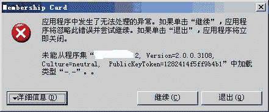
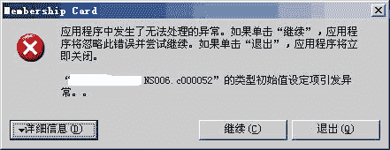

# 国外一款串口通信控件破解（.net Attribute 深入剖析）

> 原文：[`www.pediy.com/kssd/pediy10/63081.html`](https://www.pediy.com/kssd/pediy10/63081.html)

近日破解了一个国外的串口通信控件，`.net` 写的，中间破费周折，写下来希望能给大火一点启示帮助。具体名字就不写了，用`xx.2.dll` 替代。

1、`ILDASM` 进行反汇编，结果提示

受保护的模块 -- 无法进行反汇编

看来需要改造版本的 `ILDASM`

下载 `ILDASM` 修改版 V2.0

可以成功进行反编译了。

```
ildasm xx.2.dll /out=xx.2.il
```

2、大量的名称被混淆，需要仔细分析相关代码

反编译后，`il` 大量的 `name` 被混淆，

直接尝试 `ilasm`

```
ilasm /dll /res:xx.2.res /key:xx.2.snk xx.2.il /out:xx.2.dll /quiet
```

结果发现根本不能编译反汇编出来的 `il` 文件

看来要进行 名称反混淆后 ，再进行处理才可以。

3、名称反混淆

使用在 `pediy` 下载的 `Simple Assembly Explorer` 进行名称反混淆，之前使用过一个 `DeObfuscator` 反混淆，反混淆后有问题，很多能读的类都给修改了，导致暴露给外界调用的类名找不到。使用 `Simple Assembly Explorer` 的没有问题。

使用 `Simple Assembly Explorer` 进行名称反混淆后。`Ildasm` 成 `IL`，再 `ilasm` 后 可以正常组装成 `dll` 了

但是运行例子的时候出现了

未能加载文件或程序集“`xx.2`, Version=2.0.0.3108, Culture=neutral, PublicKeyToken=98fd87b7d0f115c7”或它的某一个依赖项。强名称验证失败。 (异常来自 HRESULT:0x8013141A)

因为自己生成一个 `SNK`，编译后导致 `PublicKeyToken` 改变了。重新编译例子程序，`ok`，这个错误消失，但是出现了新错误

4、测试

运行例子程序，基本代码如下

```
Pdf417 pdf = new Pdf417();

pdf.Render(text.ToString(), g, rect);
```

发现



查看混淆过后的 `dll`，使用 `reflector` 查看

`[LicenseProvider(typeof( . ))]` //！！！type 后面的类型，是混淆前的类型，混淆后这个类型被改名字了，自然是加载不到此类，运行失败了

```
public class Pdf417 : MarshalByRefObject, IDisposable
```

使用 `Editplus` 查看 反编译后的 `IL` 代码，查找 `LicenseProviderAttribute` 定位代码的位置

```
.custom instance void [System]System.ComponentModel.LicenseProviderAttribute::.ctor(class [mscorlib]System.Type) = ( 01 00 03 06 2E 06 )
```

查看带有 `LicenseProviderAttribute` 的没有混淆的 `dll` 反编译后 `IL` 代码生成规则

`Reflector` 下看

```
LicenseProvider(typeof(LicFileLicenseProvider)

public class xxx : DataBoundControl, ICallbackEventHandler, IPostBackEventHandler
```

`IL` 代码，可以看到其实就是完整类名的 `ascii` 码。

```
.custom instance void [System]System.ComponentModel.LicenseProviderAttribute::.ctor(class [mscorlib]System.Type) = (
 01 00 77 53 79 73 74 65 6D 2E 43 6F 6D 70 6F 6E   // ..wSystem.Compon
65 6E 74 4D 6F 64 65 6C 2E 4C 69 63 46 69 6C 65   // entModel.LicFile
4C 69 63 65 6E 73 65 50 72 6F 76 69 64 65 72 2C   // LicenseProvider,
20 53 79 73 74 65 6D 2C 20 56 65 72 73 69 6F 6E   //  System, Version
3D 32 2E 30 2E 30 2E 30 2C 20 43 75 6C 74 75 72   // =2.0.0.0, Cultur
 65 3D 6E 65 75 74 72 61 6C 2C 20 50 75 62 6C 69   // e=neutral, Publi
 63 4B 65 79 54 6F 6B 65 6E 3D 62 37 37 61 35 63   // cKeyToken=b77a5c
35 36 31 39 33 34 65 30 38 39 00 00 )             // 561934e089..
```

可见 `IL` 十六进制代码 一大串，其实表示的就是某个类的完整名字。

这么看来，`[LicenseProvider(typeof( . ))]` 后面的 `typeof` 需要换成 `xx.2.dll` 自己的相关类的名字

查看混淆后的 `xx.2.dll`，找到混淆后的用户 `license` 验证的类的名字

查找名称混淆后的 `.class private auto ansi beforefieldinit xx.2.NS006'.c000055`

```
       extends [System]System.ComponentModel.LicenseProvider

{
  .method public hidebysig specialname rtspecialname
          instance void  .ctor() cil managed
  {
    // Code size       7 (0x7)
    .maxstack  8
    IL_0000:  ldarg.0
    IL_0001:  call       instance void [System]System.ComponentModel.LicenseProvider::.ctor()
    IL_0006:  ret
  } // end of method c000055::.ctor
```

说明此处的类名是 `xx.2.NS006.c000055` ，经这个类名完全转换成 16 进制表示的。

```
78 78 2e 32 2e 4e 53 30 30 36 2e 63 30 30 30 30 35 35
```

将 `.custom instance void [System]System.ComponentModel.LicenseProviderAttribute::.ctor(class [mscorlib]System.Type) = ( 01 00 03 06 2E 06 )`

替换为

`.custom instance void [System]System.ComponentModel.LicenseProviderAttribute::.ctor(class [mscorlib]System.Type) = (**01 00 12 78 78 2e 32 2e 4e 53 30 30 36 2e 63 30 30 30 30 35 35 00 00)**`

注意 替换格式，前面加 `01 00` 表示开始，最后一个 `00 00` 表示结束，同时，`01 00` 后面跟着一个字符长度 `12`（十进制 18）**替换了五处，分别对应了五个组件。

这么修改后，不再出现上述错误提示。

继续测试组件，基本正常，但是出现了错误



看来已经正常运行，是其他的问题导致的

```
System.TypeInitializationException: “xx.2.NS006.c000052”的类型初始值设定项引发异常。 ---> System.FormatException: Base-64 字符串中的无效字符。

   在 System.Convert.FromBase64String(String s)

   在 xx.2.NS001.c000002.m000001(Int32 p0)

   在 xx.2.NS006.c000052..cctor()

   --- 内部异常堆栈跟踪的结尾 ---

   在 xx.2.NS006.c000052.m000002()

   在 xx.2.NS006.c000055.GetLicense(LicenseContext context, Type type, Object instance, Boolean allowExceptions)

   在 System.ComponentModel.LicenseManager.ValidateInternalRecursive(LicenseContext context, Type type, Object instance, Boolean allowExceptions, License& license, String& licenseKey)

   在 System.ComponentModel.LicenseManager.ValidateInternal(Type type, Object instance, Boolean allowExceptions, License& license)

   在 System.ComponentModel.LicenseManager.Validate(Type type, Object instance)

   在 xx.Barcodes.Pdf417..ctor()
```

看来是读取 `license` 出错的，把这部分去掉就行了

找到 `xx.2.NS006.c000055.GetLicense(LicenseContext context, Type type, Object instance, Boolean allowExceptions)`

只要让他直接返回 `license` 就可以了

经过分析

```
  L_0056: newobj instance void  xx.2.NS006.c000054::.ctor()
    L_005b: stloc.s license
    L_005d: leave L_01ba

    L_0062: ldarg.1

    L_0063: ldarg.2

    L_0064: ldloc.0

    L_0065: callvirt instance void [System]System.ComponentModel.LicenseContext::SetSavedLicenseKey(class [mscorlib]System.Type, string)
    L_006a: newobj instance void  xx.2.NS006.c000053::.ctor()
    L_006f: stloc.s license
```

经过分析 `xx.2.NS006.c000054:`

`xx.2.NS006.c000053:` 两个类一样

将 `GetLicense` 函数此部分 `IL` 修改为

```
.method public hidebysig virtual instance class [System]System.ComponentModel.License
          GetLicense(class [System]System.ComponentModel.LicenseContext context,
                    class [mscorlib]System.Type 'type',
                    object 'instance',
                    bool allowExceptions) cil managed
  {
    // Code size       451 (0x1c3)
    .maxstack  48
    .locals init (string V_0,
             string V_1,
             string V_2,
             class [System]System.ComponentModel.LicenseException V_3,
             class [System]System.ComponentModel.License V_4,
             valuetype xx.2.NS006'.enum000051 V_5,
             valuetype xx.2.NS006'.enum000051 V_6)

     IL_0001:  newobj     instance void xx.2.NS006'.c000054::.ctor()
     IL_0002:  stloc.s    V_4
    IL_0003:  ldloc.s    V_4
    IL_0004:  ret
  } // end of method c000055::GetLicense
```

出现了新的异常

```
System.FormatException: Base-64 字符串中的无效字符。

   在 System.Convert.FromBase64String(String s)

   在 xx.2.NS001.c000002.m000001(Int32 p0)

   在 xx.2.NS006.c000054.get_LicenseKey()

   在 System.ComponentModel.LicenseManager.ValidateInternalRecursive(LicenseContext context, Type type, Object instance, Boolean allowExceptions, License& license, String& licenseKey)

   在 System.ComponentModel.LicenseManager.ValidateInternal(Type type, Object instance, Boolean allowExceptions, License& license)

   在 System.ComponentModel.LicenseManager.Validate(Type type, Object instance)

   在 xx.Barcodes.Pdf417..ctor()
```

找到  `c000054`

```
.method public hidebysig specialname virtual instance string get_LicenseKey() cil managed

{
    .maxstack 8
    L_0000: ldc.i4 0x1079e
    L_0005: br.s L_0008
    L_0007: ret

    L_0008: br.s L_000c
    L_000a: br.s L_0007
    L_000c: br.s L_0010
    L_000e: br.s L_000a
    L_0010: call string xx.2.NS001.c000002::m000001(int32)
    L_0015: br.s L_000e
}
```

修改 `IL` 代码为

```
 .maxstack 8
    .locals init (
        [0] string CS$1$0000)
    L_0000: nop

    L_0001: ldstr "Jetboy"
    L_0006: stloc.0

    L_0007: br.s L_0009
    L_0009: ldloc.0

    L_000a: ret
```

同时 `C0053` 也有一个

```
.method public hidebysig specialname virtual instance string get_LicenseKey() cil managed

{
    .maxstack 6
    .locals init (
        [0] object obj2)
    L_0000: br.s L_0018
    L_0002: ldc.i4 0x10828
    L_0007: br.s L_001f
    L_0009: br.s L_0026
    L_000b: stloc.0

    L_000c: ldloc.0
```


`L_000d: brfalse.s L_0016`  
`L_000f: ldloc.0`  
`L_0010: callvirt instance string [mscorlib]System.Object::ToString()`  
`L_0015: ret`  
`L_0016: ldnull`  
`L_0017: ret`  
`L_0018: call class [mscorlib]Microsoft.Win32.RegistryKey xx.2.NS006.c000052::m000001()`  
`L_001d: br.s L_0002`  
`L_001f: call string xx.2.NS001.c000002::m000001(int32)`  
`L_0024: br.s L_0009`  
`L_0026: callvirt instance object [mscorlib]Microsoft.Win32.RegistryKey::GetValue(string)`  
`L_002b: br.s L_000b`  

```
}
```

修改为

修改为

```
.maxstack 8
.locals init (
    [0] string CS$1$0000)
L_0000: nop
L_0001: ldstr "Jetboy"
L_0006: stloc.0
L_0007: br.s L_0009
L_0009: ldloc.0
L_000a: ret
```

直接全部返回 `jetboy` 字符串。

至此，条形码的程序搞定，可以运行，运行的条形码显示和 试用版本的一致

继续运行其他的例子程序，又发现新问题

`HelloPort` 以及其他的几个例子中 关于设置端口的属性的时候

`HelloPort`

`System.FormatException`: `Base-64` 字符串中的无效字符。

```
   在 System.Convert.FromBase64String(String s)
   在 xx.2.NS001.c000002.m000001(Int32 p0)
   在 xx.Connections.SerialPortInfo.get_Ports()
   在 xx.2.NS005.c000048.m00000e(Object sender, EventArgs e)
   在 System.Windows.Forms.Form.OnLoad(EventArgs e)
```

`DeviceChat`

`**************** 异常文本 ****************`

`System.FormatException`: `Base-64` 字符串中的无效字符。

```
   在 System.Convert.FromBase64String(String s)
   在 xx.2.NS001.c000002.m000001(Int32 p0)
   在 ss.Connections.SerialPortInfo.get_Ports()
   在 ss.2.NS005.c000048.m00000e(Object sender, EventArgs e)
   在 System.Windows.Forms.Form.OnLoad(EventArgs e)
```

点继续后可以出来界面

但是界面显示不正常

再进行分析 以 `helloport` 为例

```
private void cmdProperties_Click(object sender, System.EventArgs e)
{
    this.serialConnection1.ShowPropertiesDialog();
    this.txtPortName.Text = this.serialConnection1.Options.PortName.ToString();
    this.lblSettings.Text = this.serialConnection1.Options.ToString();
}
```

```
public override DialogResult ShowPropertiesDialog(IWin32Window owner)
{
    c000048 c = new c000048(this);
    return ((owner == null) ? c.ShowDialog() : c.ShowDialog(owner));
}
```

```
.method public hidebysig specialname rtspecialname instance void .ctor(class xx.Connections.SerialConnection connection) cil managed
{
    .maxstack 8
    L_0000: ldarg.0
    L_0001: call instance void [System.Windows.Forms]System.Windows.Forms.Form::.ctor()
    L_0006: br.s L_0013
    L_0008: br.s L_0016
    L_000a: br.s L_001d
    L_000c: ldarg.1
    L_000d: stfld class xx.Connections.SerialConnection xx.2.NS005.c000048::f000011
    L_0012: ret
    L_0013: ldarg.0
    L_0014: br.s L_0008
    L_0016: call instance void xx.2.NS005.c000048::m000001()
    L_001b: br.s L_000a
    L_001d: ldarg.0
    L_001e: br.s L_000c
}
```

```
.method public hidebysig specialname static class xx.Connections.SerialPortInfo[] get_Ports() cil managed
{
    .maxstack 14
    .locals init (
        [0] class [mscorlib]Microsoft.Win32.RegistryKey key,
        [1] string[] strArray,
        [2] int32 num,
        [3] string str)
    L_0000: ldsfld class [mscorlib]Microsoft.Win32.RegistryKey [mscorlib]Microsoft.Win32.Registry::LocalMachine
    L_0005: ldc.i4 0x1033c
    L_000a: br.s L_0068
    L_000c: br.s L_006f
    L_000e: br.s L_0076
    L_0010: ldloc.0
    L_0011: callvirt instance string[] [mscorlib]Microsoft.Win32.RegistryKey::GetValueNames()
    L_0016: stloc.1
    L_0017: ldloc.1
    L_0018: ldlen
    L_0019: conv.i4
    L_001a: newarr xx.Connections.SerialPortInfo
    L_001f: stsfld class xx.Connections.SerialPortInfo[] xx.Connections.SerialPortInfo::f00000a
    L_0024: ldc.i4.0
    L_0025: stloc.2
    L_0026: br.s L_004d
    L_0028: ldloc.0
    L_0029: ldloc.1
    L_002a: ldloc.2
    L_002b: ldelem.ref
    L_002c: callvirt instance object [mscorlib]Microsoft.Win32.RegistryKey::GetValue(string)
    L_0031: callvirt instance string [mscorlib]System.Object::ToString()
    L_0036: callvirt instance string [mscorlib]System.String::ToUpper()
    L_003b: stloc.3
    L_003c: ldsfld class xx.Connections.SerialPortInfo[] xx.Connections.SerialPortInfo::f00000a
    L_0041: ldloc.2
    L_0042: ldloc.3
    L_0043: newobj instance void xx.Connections.SerialPortInfo::.ctor(string)
    L_0048: stelem.ref
    L_0049: ldloc.2
    L_004a: ldc.i4.1
    L_004b: add
    L_004c: stloc.2
    L_004d: ldloc.2
    L_004e: ldloc.1
    L_004f: ldlen
    L_0050: conv.i4
    L_0051: blt.s L_0028
    L_0053: call void xx.Connections.SerialPortInfo::m000001()
    L_0058: ldsfld class xx.Connections.SerialPortInfo[] xx.Connections.SerialPortInfo::f00000a
    L_005d: call void [mscorlib]System.Array::Sort<class xx.Connections.SerialPortInfo>(!!0[])
    L_0062: ldsfld class xx.Connections.SerialPortInfo[] xx.Connections.SerialPortInfo::f00000a
    L_0067: ret
    L_0068: call string xx.2.NS001.c000002::m000001(int32)
    L_006d: br.s L_000c
    L_006f: callvirt instance class [mscorlib]Microsoft.Win32.RegistryKey [mscorlib]Microsoft.Win32.RegistryKey::OpenSubKey(string)
    L_0074: br.s L_000e
    L_0076: stloc.0
    L_0077: br.s L_0010
}
```

`m000001` 函数比较复杂，使用 `IDA` 反汇编 `dll` 使用流程图方式查看，

发现 居然是 读取资源文件，然后使用 `Assembly` 的 `publickey` 进行运算，狂晕！

`L_0023: ldstr "{3bb6587d-6d4f-422f-8bad-7c2976ba6ac3}"` 加载资源
`L_0028: callvirt instance class [mscorlib]System.IO.Stream [mscorlib]System.Reflection.Assembly::GetManifestResourceStream(string)`
`L_002d: stsfld class [mscorlib]System.IO.Stream xx.2.c000002::f000001`
`L_0032: ldloc.1`
`L_0033: callvirt instance class [mscorlib]System.Reflection.AssemblyName [mscorlib]System.Reflection.Assembly::GetName()`
`L_0038: callvirt instance uint8[] [mscorlib]System.Reflection.AssemblyName::GetPublicKeyToken()`
`L_003d: stloc.2`

下面是一大堆解密函数..........................................

没办法，因为我对 `il` 重新编译的时候使用了自己生成的 `SNK` 文件，这里 `GetPublicKeyToken` 自然不一样了，

这是导致是数据解密失败的原因。

官方的 `dll` 的 `publicToken` 就是 `98fd87b7d0f115c7`

使用我自己的 `SNK` 文件后 `publicToken` 就是 `1282414f5ff9b4b1`

这个 `3bb6587d-6d4f-422f-8bad-7c2976ba6ac3` 资源文件的内容基本上应该不可逆的了

需要的应该是把 `L_0038: callvirt instance uint8[] [mscorlib]System.Reflection.AssemblyName::GetPublicKeyToken()` 替换成自己的函数，它返回的是原始的官方的 `dll` 的 `publicToken` 就是 `98fd87b7d0f115c7`

自己构造函数

```
.method public hidebysig static uint8[]
          GetPublicTokenBytes() cil managed
{
    // 代码大小      63 (0x3f)
    .maxstack  3
    .locals init ([0] uint8[] 'ret',
              [1] uint8[] CS$1$0000)
    IL_0000:  nop
    IL_0001:  ldc.i4.8
    IL_0002:  newarr     [mscorlib]System.Byte
    IL_0007:  stloc.0
    IL_0008:  ldloc.0
    IL_0009:  ldc.i4.0
    IL_000a:  ldc.i4     0x98
    IL_000f:  stelem.i1
    IL_0010:  ldloc.0
    IL_0011:  ldc.i4.1
    IL_0012:  ldc.i4.s   0xfd
    IL_0014:  stelem.i1
    IL_0015:  ldloc.0
    IL_0016:  ldc.i4.2
    IL_0017:  ldc.i4.s   0x87
    IL_0019:  stelem.i1
    IL_001a:  ldloc.0
    IL_001b:  ldc.i4.3
    IL_001c:  ldc.i4     0xb7
    IL_0021:  stelem.i1
    IL_0022:  ldloc.0
    IL_0023:  ldc.i4.4
    IL_0024:  ldc.i4.s   0xd0
    IL_0026:  stelem.i1
    IL_0027:  ldloc.0
    IL_0028:  ldc.i4.5
    IL_0029:  ldc.i4.s   0xf1
    IL_002b:  stelem.i1
    IL_002c:  ldloc.0
    IL_002d:  ldc.i4.6
    IL_002e:  ldc.i4     0x15
    IL_0033:  stelem.i1
    IL_0034:  ldloc.0
    IL_0035:  ldc.i4.7
    IL_0036:  ldc.i4.s   0xc7
    IL_0038:  stelem.i1
    IL_0039:  ldloc.0
    IL_003a:  stloc.1
}
```


`IL_003b: br.s IL_003d`

`IL_003d: ldloc.1`

`IL_003e: ret`

`}` // end of method `c000002::GetPublicTokenBytes`

将原来程序读取 `PublicToken` 的修改为：

`L_0023: ldstr "{3bb6587d-6d4f-422f-8bad-7c2976ba6ac3}"`

`L_0028: callvirt instance class [mscorlib]System.IO.Stream [mscorlib]System.Reflection.Assembly::GetManifestResourceStream(string)`

`L_002d: stsfld class [mscorlib]System.IO.Stream Demo.c000002::f000001`

`L_0032: nop //jetboy ldloc.1`

`L_0033: nop //jetboy callvirt instance class [mscorlib]System.Reflection.AssemblyName [mscorlib]System.Reflection.Assembly::GetName()`

`L_0038: call uint8[] xx.2.c000002::GetPublicTokenBytes() // jetboy callvirt instance uint8[] [mscorlib]System.Reflection.AssemblyName::GetPublicKeyToken()`

`L_003d: stloc.2`

重新 `ilasm` 组装 `il` 文件，ok，再测试没有发现任何问题。
