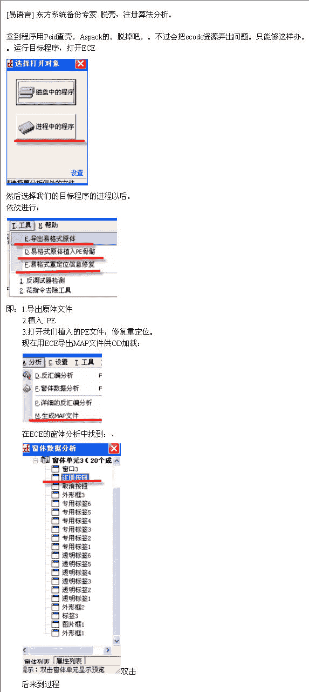

# 东方系统备份专家

> 原文：[`www.pediy.com/kssd/pediy08/pediy8-228.htm`](https://www.pediy.com/kssd/pediy08/pediy8-228.htm)

[易语言] 东方系统备份专家 脱壳，注册算法分析



```
00423633     68 A4529500           push 9552A4
00423638     E8 50BDFFFF          call 脱壳 1111.0041F38D
0042363D     8945 F4              mov dword ptr ss:[ebp-C],eax
00423640     837D F4 01           cmp dword ptr ss:[ebp-C],1
00423644     0F85 07000000        jnz 脱壳 1111.00423651
0042364A     B8 01000000          mov eax,1
0042364F     EB 02                jmp short 脱壳 1111.00423653
00423651     33C0                 xor eax,eax
00423653     85C0                 test eax,eax
00423655     0F84 15010000        je <脱壳 1111.文本型（基本数据类型）>
00423638     E8 50BDFFFF          call 脱壳 1111.0041F38D
```

核心比较过程

跟入：

```
0041F38D     55                   push ebp
0041F38E     8BEC                 mov ebp,esp
0041F390     81EC 38000000        sub esp,38
0041F396     68 18000000          push 18
0041F39B     E8 296B0000          call 脱壳 1111.00425EC9                  ; 从堆上分配内存空间（调用 6 号服务）
0041F3A0     83C4 04              add esp,4                                ; 结构
0041F3A3     8945 FC              mov dword ptr ss:[ebp-4],eax
0041F3A6     8BF8                 mov edi,eax
0041F3A8     BE 305E4000          mov esi,脱壳 1111.00405E30               ; （常量）
0041F3AD     AD                   lods dword ptr ds:[esi]
0041F3AE     AB                   stos dword ptr es:[edi]
0041F3AF     AD                   lods dword ptr ds:[esi]
0041F3B0     AB                   stos dword ptr es:[edi]
0041F3B1     33C0                 xor eax,eax
0041F3B3     B9 04000000          mov ecx,4
0041F3B8     F3:AB                rep stos dword ptr es:[edi]
0041F3BA     E8 AD020000          call 脱壳 1111.0041F66C                  ; 得到变换后的机器吗
```

跟入。

```
0041F66C     55                   push ebp
0041F66D     8BEC                 mov ebp,esp
0041F66F     81EC 10000000        sub esp,10
0041F675     8B1D 78529500        mov ebx,dword ptr ds:[955278]
0041F67B     E8 97C6FFFF          call 脱壳 1111.0041BD17
0041F680     B8 00000000          mov eax,0
0041F685     3BC1                 cmp eax,ecx
0041F687     7C 0D                jl short 脱壳 1111.0041F696
0041F689     68 01000000          push 1
0041F68E     E8 42680000          call 脱壳 1111.00425ED5                  ; 调用 Runtime 内部异常处理（调用 0 号服务）
0041F693     83C4 04              add esp,4
0041F696     C1E0 02              shl eax,2
0041F699     03D8                 add ebx,eax
0041F69B     895D FC              mov dword ptr ss:[ebp-4],ebx
0041F69E     68 01030080          push 80000301                             ; 整数型（基本数据类型）
0041F6A3     6A 00                push 0
0041F6A5     68 55C22B15          push 152BC255
0041F6AA     68 01030080          push 80000301                             ; 整数型（基本数据类型）
0041F6AF     6A 00                push 0
0041F6B1     FF35 7C529500        push dword ptr ds:[95527C]
0041F6B7     68 02000000          push 2
0041F6BC     BB CC000000          mov ebx,0CC                               ; 位异或（系统核心支持库）
0041F6C1     E8 09680000          call 脱壳 1111.00425ECF                   ; 调用核心支持库命令（调用 3 号服务）
0041F6C6     83C4 1C              add esp,1C
0041F6C9     68 01030080          push 80000301                             ; 整数型（基本数据类型）
0041F6CE     6A 00                push 0
0041F6D0     50                   push eax
0041F6D1     68 01000000          push 1
0041F6D6     BB D4010000          mov ebx,1D4                               ; 取十六进制文本（系统核心支持库）
0041F6DB     E8 EF670000          call 脱壳 1111.00425ECF                   ; 调用核心支持库命令（调用 3 号服务）
0041F6E0     83C4 10              add esp,10
0041F6E3     8945 F4              mov dword ptr ss:[ebp-C],eax
0041F6E6     68 01030080          push 80000301                             ; 整数型（基本数据类型）
0041F6EB     6A 00                push 0
0041F6ED     68 04000000          push 4
0041F6F2     68 01030080          push 80000301                             ; 整数型（基本数据类型）
0041F6F7     6A 00                push 0
0041F6F9     68 02000000          push 2
0041F6FE     68 04000080          push 80000004                             ; 文本型（基本数据类型）
0041F703     6A 00                push 0
0041F705     8B45 F4              mov eax,dword ptr ss:[ebp-C]
0041F708     85C0                 test eax,eax
0041F70A     75 05                jnz short 脱壳 1111.0041F711
0041F70C     B8 09564000          mov eax,脱壳 1111.00405609                ; （常量）
0041F711     50                   push eax
0041F712     68 03000000          push 3
0041F717     BB 3C010000          mov ebx,13C                               ; 取文本中间（系统核心支持库）
0041F71C     E8 AE670000          call 脱壳 1111.00425ECF                   ; 调用核心支持库命令（调用 3 号服务）
0041F721     83C4 28              add esp,28
0041F724     8945 F0              mov dword ptr ss:[ebp-10],eax
0041F727     8B5D F4              mov ebx,dword ptr ss:[ebp-C]
0041F72A     85DB                 test ebx,ebx
0041F72C     74 09                je short 脱壳 1111.0041F737
0041F72E     53                   push ebx
0041F72F     E8 8F670000          call 脱壳 1111.00425EC3                   ; 销毁从堆上分配到的内存（调用 8 号服务）
0041F734     83C4 04              add esp,4
0041F737     8B45 F0              mov eax,dword ptr ss:[ebp-10]
0041F73A     50                   push eax
0041F73B     8B5D FC              mov ebx,dword ptr ss:[ebp-4]
0041F73E     8B1B                 mov ebx,dword ptr ds:[ebx]
0041F740     85DB                 test ebx,ebx
0041F742     74 09                je short 脱壳 1111.0041F74D
0041F744     53                   push ebx
0041F745     E8 79670000          call 脱壳 1111.00425EC3                   ; 销毁从堆上分配到的内存（调用 8 号服务）
0041F74A     83C4 04              add esp,4
0041F74D     58                   pop eax
0041F74E     8B5D FC              mov ebx,dword ptr ss:[ebp-4]
0041F751     8903                 mov dword ptr ds:[ebx],eax
0041F753     8B1D 78529500        mov ebx,dword ptr ds:[955278]
0041F759     E8 B9C5FFFF          call 脱壳 1111.0041BD17
0041F75E     B8 01000000          mov eax,1
0041F763     3BC1                 cmp eax,ecx
0041F765     7C 0D                jl short 脱壳 1111.0041F774
0041F767     68 01000000          push 1
0041F76C     E8 64670000          call 脱壳 1111.00425ED5                  ; 调用 Runtime 内部异常处理（调用 0 号服务）
0041F771     83C4 04              add esp,4
0041F774     C1E0 02              shl eax,2
0041F777     03D8                 add ebx,eax
0041F779     895D FC              mov dword ptr ss:[ebp-4],ebx
0041F77C     68 01030080          push 80000301                             ; 整数型（基本数据类型）
0041F781     6A 00                push 0
0041F783     68 FDF9BA3A          push 3ABAF9FD
0041F788     68 01030080          push 80000301                             ; 整数型（基本数据类型）
0041F78D     6A 00                push 0
0041F78F     FF35 7C529500        push dword ptr ds:[95527C]
0041F795     68 02000000          push 2
0041F79A     BB CC000000          mov ebx,0CC                               ; 位异或（系统核心支持库）
0041F79F     E8 2B670000          call 脱壳 1111.00425ECF                   ; 调用核心支持库命令（调用 3 号服务）
0041F7A4     83C4 1C              add esp,1C
0041F7A7     68 01030080          push 80000301                             ; 整数型（基本数据类型）
0041F7AC     6A 00                push 0
```


```
0041F7AE     50                  push eax  

0041F7AF     68 01000000         push 1  

0041F7B4 <>  BB D4010000         mov ebx,1D4                                 ; 取十六进制文本（系统核心支持库）  

0041F7B9 <>  E8 11670000         call 脱壳 1111.00425ECF                     ; 调用核心支持库命令（调用 3 号服务）  

0041F7BE     83C4 10            add esp,10  

0041F7C1     8945 F4            mov dword ptr ss:\[ebp\-C\],eax  

0041F7C4 <>  68 01030080        push 80000301                                ; 整数型（基本数据类型）  

0041F7C9     6A 00              push 0  

0041F7CB     68 06000000        push 6  

0041F7D0 <>  68 01030080        push 80000301                                ; 整数型（基本数据类型）  

0041F7D5     6A 00              push 0  

0041F7D7     68 02000000        push 2  

0041F7DC <>  68 04000080        push 80000004                                ; 文本型（基本数据类型）  

0041F7E1     6A 00              push 0  

0041F7E3     8B45 F4            mov eax,dword ptr ss:\[ebp\-C\]  

0041F7E6     85C0               test eax,eax  

0041F7E8     75 05              jnz short 脱壳 1111.0041F7EF  

0041F7EA <>  B8 09564000        mov eax,脱壳 1111.00405609                   ; （常量）  

0041F7EF     50                 push eax  

0041F7F0     68 03000000        push 3  

0041F7F5 <>  BB 3C010000        mov ebx,13C                                  ; 取文本中间（系统核心支持库）  

0041F7FA <>  E8 D0660000        call 脱壳 1111.00425ECF                     ; 调用核心支持库命令（调用 3 号服务）  

0041F7FF     83C4 28            add esp,28  

0041F802     8945 F0            mov dword ptr ss:\[ebp\-10\],eax  

0041F805     8B5D F4            mov ebx,dword ptr ss:\[ebp\-C\]  

0041F808     85DB               test ebx,ebx  

0041F80A     74 09              je short 脱壳 1111.0041F815  

0041F80C     53                 push ebx  

0041F80D <>  E8 B1660000        call 脱壳 1111.00425EC3                     ; 销毁从堆上分配到的内存（调用 8 号服务）  

0041F812     83C4 04            add esp,4  

0041F815     8B45 F0            mov eax,dword ptr ss:\[ebp\-10\]  

0041F818     50                 push eax  

0041F819     8B5D FC            mov ebx,dword ptr ss:\[ebp\-4\]  

0041F81C     8B1B               mov ebx,dword ptr ds:\[ebx\]  

0041F81E     85DB               test ebx,ebx  

0041F820     74 09              je short 脱壳 1111.0041F82B  

0041F822     53                 push ebx  

0041F823 <>  E8 9B660000        call 脱壳 1111.00425EC3                     ; 销毁从堆上分配到的内存（调用 8 号服务）  

0041F828     83C4 04            add esp,4  

0041F82B     58                 pop eax  

0041F82C     8B5D FC            mov ebx,dword ptr ss:\[ebp\-4\]  

0041F82F     8903               mov dword ptr ds:\[ebx\],eax  

0041F831     8B1D 78529500      mov ebx,dword ptr ds:\[955278\]  

0041F837     E8 DBC4FFFF        call 脱壳 1111.0041BD17                     ; 字节集相加  

0041F83C     B8 02000000        mov eax,2  

0041F841     3BC1               cmp eax,ecx  

0041F843     7C 0D              jl short 脱壳 1111.0041F852  

0041F845     68 01000000        push 1  

0041F84A <>  E8 86660000        call 脱壳 1111.00425ED5                     ; 调用 Runtime 内部异常处理（调用 0 号服务）  

0041F84F     83C4 04            add esp,4  

0041F852     C1E0 02            shl eax,2  

0041F855     03D8               add ebx,eax  

0041F857     895D FC            mov dword ptr ss:\[ebp\-4\],ebx  

0041F85A <>  68 01030080        push 80000301                                ; 整数型（基本数据类型）  

0041F85F     6A 00              push 0  

0041F861     68 608A0733        push 33078A60  

0041F866 <>  68 01030080        push 80000301                                ; 整数型（基本数据类型）  

0041F86B     6A 00              push 0  

0041F86D     FF35 7C529500      push dword ptr ds:\[95527C\]  

0041F873     68 02000000        push 2  

0041F878 <>  BB CC000000        mov ebx,0CC                                  ; 位异或（系统核心支持库）  

0041F87D <>  E8 4D660000        call 脱壳 1111.00425ECF                     ; 调用核心支持库命令（调用 3 号服务）  

0041F882     83C4 1C            add esp,1C  

0041F885 <>  68 01030080        push 80000301                                ; 整数型（基本数据类型）  

0041F88A     6A 00              push 0  

0041F88C     50                 push eax  

0041F88D     68 01000000        push 1  

0041F892 <>  BB D4010000        mov ebx,1D4                                  ; 取十六进制文本（系统核心支持库）  

0041F897 <>  E8 33660000        call 脱壳 1111.00425ECF                     ; 调用核心支持库命令（调用 3 号服务）  

0041F89C     83C4 10            add esp,10  

0041F89F     8945 F4            mov dword ptr ss:\[ebp\-C\],eax  

0041F8A2 <>  68 01030080        push 80000301                                ; 整数型（基本数据类型）  

0041F8A7     6A 00              push 0  

0041F8A9     68 05000000        push 5  

0041F8AE <>  68 01030080        push 80000301                                ; 整数型（基本数据类型）  

0041F8B3     6A 00              push 0  

0041F8B5     68 02000000        push 2  

0041F8BA <>  68 04000080        push 80000004                                ; 文本型（基本数据类型）  

0041F8BF     6A 00              push 0  

0041F8C1     8B45 F4            mov eax,dword ptr ss:\[ebp\-C\]  

0041F8C4     85C0               test eax,eax  

0041F8C6     75 05              jnz short 脱壳 1111.0041F8CD  

0041F8C8 <>  B8 09564000        mov eax,脱壳 1111.00405609                   ; （常量）  

0041F8CD     50                 push eax  

0041F8CE     68 03000000        push 3  

0041F8D3 <>  BB 3C010000        mov ebx,13C                                  ; 取文本中间（系统核心支持库）  

0041F8D8 <>  E8 F2650000        call 脱壳 1111.00425ECF                     ; 调用核心支持库命令（调用 3 号服务）  

0041F8DD     83C4 28            add esp,28  

0041F8E0     8945 F0            mov dword ptr ss:\[ebp\-10\],eax  

0041F8E3     8B5D F4            mov ebx,dword ptr ss:\[ebp\-C\]  

0041F8E6     85DB               test ebx,ebx  

0041F8E8     74 09              je short 脱壳 1111.0041F8F3  

0041F8EA     53                 push ebx  

0041F8EB <>  E8 D3650000        call 脱壳 1111.00425EC3                     ; 销毁从堆上分配到的内存（调用 8 号服务）  

0041F8F0     83C4 04            add esp,4  

0041F8F3     8B45 F0            mov eax,dword ptr ss:\[ebp\-10\]  

0041F8F6     50                 push eax  

0041F8F7     8B5D FC            mov ebx,dword ptr ss:\[ebp\-4\]  

0041F8FA     8B1B               mov ebx,dword ptr ds:\[ebx\]  

0041F8FC     85DB               test ebx,ebx  

0041F8FE     74 09              je short 脱壳 1111.0041F909  

0041F900     53                 push ebx  

0041F901 <>  E8 BD650000        call 脱壳 1111.00425EC3                     ; 销毁从堆上分配到的内存（调用 8 号服务）  

0041F906     83C4 04            add esp,4  

0041F909     58                 pop eax  

0041F90A     8B5D FC            mov ebx,dword ptr ss:\[ebp\-4\]  

0041F90D     8903               mov dword ptr ds:\[ebx\],eax  

0041F90F     8B1D 78529500      mov ebx,dword ptr ds:\[955278\]  

0041F915     E8 FDC3FFFF        call 脱壳 1111.0041BD17  

0041F91A     B8 03000000        mov eax,3  

0041F91F     3BC1               cmp eax,ecx  

0041F921     7C 0D              jl short 脱壳 1111.0041F930  

0041F923     68 01000000        push 1  

0041F928 <>  E8 A8650000        call 脱壳 1111.00425ED5                     ; 调用 Runtime 内部异常处理（调用 0 号服务）  

0041F92D     83C4 04            add esp,4  

0041F930     C1E0 02            shl eax,2  

0041F933     03D8               add ebx,eax  

0041F935     895D FC            mov dword ptr ss:\[ebp\-4\],ebx  

0041F938 <>  68 01030080        push 80000301                                ; 整数型（基本数据类型）  

0041F93D     6A 00              push 0
```


```
0041F93F     68 50477D30          push 307D4750  

0041F944 <> 68 01030080          push 80000301                            ; 整数型（基本数据类型）  

0041F949     6A 00               push 0  

0041F94B     FF35 7C529500       push dword ptr ds:\[95527C\]  

0041F951     68 02000000        push 2  

0041F956 <> BB CC000000        mov ebx,0CC                              ; 位异或（系统核心支持库）  

0041F95B <> E8 6F650000        call 脱壳 1111.00425ECF                  ; 调用核心支持库命令（调用 3 号服务）  

0041F960     83C4 1C           add esp,1C  

0041F963 <> 68 01030080        push 80000301                            ; 整数型（基本数据类型）  

0041F968     6A 00            push 0  

0041F96A     50               push eax  

0041F96B     68 01000000      push 1  

0041F970 <> BB D4010000      mov ebx,1D4                              ; 取十六进制文本（系统核心支持库）  

0041F975 <> E8 55650000      call 脱壳 1111.00425ECF                  ; 调用核心支持库命令（调用 3 号服务）  

0041F97A     83C4 10          add esp,10  

0041F97D     8945 F4          mov dword ptr ss:\[ebp\-C\],eax  

0041F980 <> 68 01030080      push 80000301                            ; 整数型（基本数据类型）  

0041F985     6A 00            push 0  

0041F987     68 06000000      push 6  

0041F98C <> 68 01030080      push 80000301                            ; 整数型（基本数据类型）  

0041F991     6A 00            push 0  

0041F993     68 02000000      push 2  

0041F998 <> 68 04000080      push 80000004                            ; 文本型（基本数据类型）  

0041F99D     6A 00            push 0  

0041F99F     8B45 F4          mov eax,dword ptr ss:\[ebp\-C\]  

0041F9A2     85C0             test eax,eax  

0041F9A4     75 05            jnz short 脱壳 1111.0041F9AB  

0041F9A6 <> B8 09564000      mov eax,脱壳 1111.00405609               ; （常量）  

0041F9AB     50               push eax  

0041F9AC     68 03000000      push 3  

0041F9B1 <> BB 3C010000      mov ebx,13C                              ; 取文本中间（系统核心支持库）  

0041F9B6 <> E8 14650000      call 脱壳 1111.00425ECF                  ; 调用核心支持库命令（调用 3 号服务）  

0041F9BB     83C4 28          add esp,28  

0041F9BE     8945 F0          mov dword ptr ss:\[ebp\-10\],eax  

0041F9C1     8B5D F4          mov ebx,dword ptr ss:\[ebp\-C\]  

0041F9C4     85DB             test ebx,ebx  

0041F9C6     74 09            je short 脱壳 1111.0041F9D1  

0041F9C8     53               push ebx  

0041F9C9 <> E8 F5640000      call 脱壳 1111.00425EC3                  ; 销毁从堆上分配到的内存（调用 8 号服务）  

0041F9CE     83C4 04          add esp,4  

0041F9D1     8B45 F0          mov eax,dword ptr ss:\[ebp\-10\]  

0041F9D4     50               push eax  

0041F9D5     8B5D FC          mov ebx,dword ptr ss:\[ebp\-4\]  

0041F9D8     8B1B             mov ebx,dword ptr ds:\[ebx\]  

0041F9DA     85DB             test ebx,ebx  

0041F9DC     74 09            je short 脱壳 1111.0041F9E7  

0041F9DE     53               push ebx  

0041F9DF <> E8 DF640000      call 脱壳 1111.00425EC3                  ; 销毁从堆上分配到的内存（调用 8 号服务）  

0041F9E4     83C4 04          add esp,4  

0041F9E7     58               pop eax  

0041F9E8     8B5D FC          mov ebx,dword ptr ss:\[ebp\-4\]  

0041F9EB     8903             mov dword ptr ds:\[ebx\],eax  

0041F9ED     8BE5             mov esp,ebp  

0041F9EF     5D               pop ebp  

0041F9F0     C3               retn  
```

分别机器码与常量 `XOR` 然后取其中的一部分参与运算

并把结果放到一个数组（结构）里面。即：

`.版本 2`

`注册码.a ＝ 取文本中间 (取十六进制文本 (位异或 (355189333, 机器码)), 2, 4)`

`注册码.b ＝ 取文本中间 (取十六进制文本 (位异或 (985332221, 机器码)), 2, 6)`

`注册码.c ＝ 取文本中间 (取十六进制文本 (位异或 (856132192, 机器码)), 2, 5)`

`注册码.d ＝ 取文本中间 (取十六进制文本 (位异或 (813516624, 机器码)), 2, 6)`

代码就是这样

继续：

```
0041F3BA     E8 AD020000      call 脱壳 1111.0041F66C                  ; 得到变换后的机器吗  

0041F3BF     6A 00            push 0  

0041F3C1     6A 00            push 0  

0041F3C3     6A 00            push 0  

0041F3C5 <> 68 04000080      push 80000004                            ; 文本型（基本数据类型）  

0041F3CA     6A 00            push 0  

0041F3CC <> 68 B35B4000      push 脱壳 1111.00405BB3                 ; -（常量）  

0041F3D1 <> 68 04000080      push 80000004                            ; 文本型（基本数据类型）  

0041F3D6     6A 00            push 0  

0041F3D8     8B5D 08          mov ebx,dword ptr ss:\[ebp+8\]  

0041F3DB     8B03             mov eax,dword ptr ds:\[ebx\]  

0041F3DD     85C0             test eax,eax  

0041F3DF     75 05            jnz short 脱壳 1111.0041F3E6  

0041F3E1 <> B8 09564000      mov eax,脱壳 1111.00405609               ; （常量）  

0041F3E6     50               push eax  

0041F3E7     68 03000000      push 3  

0041F3EC <> BB 90010000      mov ebx,190                              ; 分割文本（系统核心支持库）  

0041F3F1 <> E8 D96A0000      call 脱壳 1111.00425ECF                  ; 调用核心支持库命令（调用 3 号服务）  

0041F3F6     83C4 28          add esp,28  

0041F3F9     8945 F8          mov dword ptr ss:\[ebp\-8\],eax  

0041F3FC     8B45 F8          mov eax,dword ptr ss:\[ebp\-8\]  

0041F3FF     50               push eax  

0041F400     8B5D FC          mov ebx,dword ptr ss:\[ebp\-4\]  

0041F403     53               push ebx  

0041F404     8B0B             mov ecx,dword ptr ds:\[ebx\]  

0041F406     83C3 04          add ebx,4  

0041F409     85C9             test ecx,ecx  

0041F40B     74 11            je short 脱壳 1111.0041F41E  

0041F40D     8B03             mov eax,dword ptr ds:\[ebx\]  

0041F40F     83C3 04          add ebx,4  

0041F412     49               dec ecx  

0041F413     74 05            je short 脱壳 1111.0041F41A  

0041F415     0FAF03           imul eax,dword ptr ds:\[ebx\]  

0041F418   ^ EB F5            jmp short 脱壳 1111.0041F40F  

0041F41A     8BC8             mov ecx,eax  

0041F41C     85C9             test ecx,ecx  

0041F41E     0F84 19000000    je <脱壳 1111.销毁从堆上分配到的内存（调用 8 号服务）>  

0041F424     51               push ecx  

0041F425     8B03             mov eax,dword ptr ds:\[ebx\]  

0041F427     85C0             test eax,eax  
```

必须将注册码写成 `XXXX-XXXX-XXXX-XXXX` 的形式：

```
0041F451     B8 00000000      mov eax,0                                ; 数组成员为 0 就 Jmp 死  

0041F456     3BC1             cmp eax,ecx  

0041F458     7C 0D            jl short 脱壳 1111.0041F467  

0041F45A     68 01000000      push 1  

0041F45F <> E8 716A0000      call 脱壳 1111.00425ED5                  ; 调用 Runtime 内部异常处理（调用 0 号服务）  

0041F464     83C4 04          add esp,4  

0041F467     C1E0 02          shl eax,2  

0041F46A     03D8             add ebx,eax  

0041F46C     895D F8          mov dword ptr ss:\[ebp\-8\],ebx  

0041F46F     8B1D 78529500    mov ebx,dword ptr ds:\[955278\]  

0041F475     E8 9DC8FFFF      call 脱壳 1111.0041BD17  

0041F47A     B8 00000000      mov eax,0  

0041F47F     3BC1             cmp eax,ecx  

0041F481     7C 0D            jl short 脱壳 1111.0041F490  

0041F483     68 01000000      push 1  

0041F488 <> E8 486A0000      call 脱壳 1111.00425ED5                  ; 调用 Runtime 内部异常处理（调用 0 号服务）  

0041F48D     83C4 04          add esp,4  

0041F490     C1E0 02          shl eax,2  

0041F493     03D8             add ebx,eax  

0041F495     895D F4          mov dword ptr ss:\[ebp\-C\],ebx  

0041F498     8B5D F4          mov ebx,dword ptr ss:\[ebp\-C\]  

0041F49B     8B03             mov eax,dword ptr ds:\[ebx\]  

0041F49D     50               push eax  
```


0041F49E     8B5D F8                    mov ebx,dword ptr ss:\[ebp\-8\]

0041F4A1     FF33                       push dword ptr ds:\[ebx\]

0041F4A3     E8 07D6FFFF                call 脱壳 1111.0041CAAF

0041F4A8     83C4 08                    add esp,8

0041F4AB     83F8 00                    cmp eax,0

0041F4AE     0F85 48010000              jnz 脱壳 1111.0041F5FC

0041F4B4     8B5D FC                    mov ebx,dword ptr ss:\[ebp\-4\]

0041F4B7     E8 5BC8FFFF                call 脱壳 1111.0041BD17

0041F4BC     B8 01000000                mov eax,1

0041F4C1     3BC1                       cmp eax,ecx

0041F4C3     7C 0D                      jl short 脱壳 1111.0041F4D2

0041F4C5     68 01000000                push 1

0041F4CA <>  E8 066A0000                call 脱壳 1111.00425ED5                            ; 调用 Runtime 内部异常处理（调用 0 号服务）

0041F4CF     83C4 04                    add esp,4

0041F4D2     C1E0 02                    shl eax,2

0041F4D5     03D8                       add ebx,eax

0041F4D7     895D EC                    mov dword ptr ss:\[ebp\-14\],ebx

0041F4DA     8B1D 78529500              mov ebx,dword ptr ds:\[955278\]

0041F4E0     E8 32C8FFFF                call 脱壳 1111.0041BD17

0041F4E5     B8 01000000                mov eax,1

0041F4EA     3BC1                       cmp eax,ecx

0041F4EC     7C 0D                      jl short 脱壳 1111.0041F4FB

0041F4EE     68 01000000                push 1

0041F4F3 <>  E8 DD690000                call 脱壳 1111.00425ED5                            ; 调用 Runtime 内部异常处理（调用 0 号服务）

0041F4F8     83C4 04                    add esp,4

0041F4FB     C1E0 02                    shl eax,2

0041F4FE     03D8                       add ebx,eax

0041F500     895D E8                    mov dword ptr ss:\[ebp\-18\],ebx

0041F503     8B5D E8                    mov ebx,dword ptr ss:\[ebp\-18\]

0041F506     8B03                       mov eax,dword ptr ds:\[ebx\]

0041F508     50                         push eax

0041F509     8B5D EC                    mov ebx,dword ptr ss:\[ebp\-14\]

0041F50C     FF33                       push dword ptr ds:\[ebx\]

0041F50E     E8 9CD5FFFF                call 脱壳 1111.0041CAAF

0041F513     83C4 08                    add esp,8

0041F516     83F8 00                    cmp eax,0

0041F519     0F85 DD000000              jnz 脱壳 1111.0041F5FC

0041F51F     8B5D FC                    mov ebx,dword ptr ss:\[ebp\-4\]

0041F522     E8 F0C7FFFF                call 脱壳 1111.0041BD17

0041F527     B8 02000000                mov eax,2

0041F52C     3BC1                       cmp eax,ecx

0041F52E     7C 0D                      jl short 脱壳 1111.0041F53D

0041F530     68 01000000                push 1

0041F535 <>  E8 9B690000                call 脱壳 1111.00425ED5                            ; 调用 Runtime 内部异常处理（调用 0 号服务）

0041F53A     83C4 04                    add esp,4

0041F53D     C1E0 02                    shl eax,2

0041F540     03D8                       add ebx,eax

0041F542     895D E0                    mov dword ptr ss:\[ebp\-20\],ebx

0041F545     8B1D 78529500              mov ebx,dword ptr ds:\[955278\]

0041F54B     E8 C7C7FFFF                call 脱壳 1111.0041BD17

0041F550     B8 02000000                mov eax,2

0041F555     3BC1                       cmp eax,ecx

0041F557     7C 0D                      jl short 脱壳 1111.0041F566

0041F559     68 01000000                push 1

0041F55E <>  E8 72690000                call 脱壳 1111.00425ED5                            ; 调用 Runtime 内部异常处理（调用 0 号服务）

0041F563     83C4 04                    add esp,4

0041F566     C1E0 02                    shl eax,2

0041F569     03D8                       add ebx,eax

0041F56B     895D DC                    mov dword ptr ss:\[ebp\-24\],ebx

0041F56E     8B5D DC                    mov ebx,dword ptr ss:\[ebp\-24\]

0041F571     8B03                       mov eax,dword ptr ds:\[ebx\]

0041F573     50                         push eax

0041F574     8B5D E0                    mov ebx,dword ptr ss:\[ebp\-20\]

0041F577     FF33                       push dword ptr ds:\[ebx\]

0041F579     E8 31D5FFFF                call 脱壳 1111.0041CAAF

0041F57E     83C4 08                    add esp,8

0041F581     83F8 00                    cmp eax,0

0041F584     0F85 72000000              jnz 脱壳 1111.0041F5FC

0041F58A     8B5D FC                    mov ebx,dword ptr ss:\[ebp\-4\]

0041F58D     E8 85C7FFFF                call 脱壳 1111.0041BD17

0041F592     B8 03000000                mov eax,3

0041F597     3BC1                       cmp eax,ecx

0041F599     7C 0D                      jl short 脱壳 1111.0041F5A8

0041F59B     68 01000000                push 1

0041F5A0 <>  E8 30690000                call 脱壳 1111.00425ED5                            ; 调用 Runtime 内部异常处理（调用 0 号服务）

0041F5A5     83C4 04                    add esp,4

0041F5A8     C1E0 02                    shl eax,2

0041F5AB     03D8                       add ebx,eax

0041F5AD     895D D4                    mov dword ptr ss:\[ebp\-2C\],ebx

0041F5B0     8B1D 78529500              mov ebx,dword ptr ds:\[955278\]

0041F5B6     E8 5CC7FFFF                call 脱壳 1111.0041BD17

0041F5BB     B8 03000000                mov eax,3

0041F5C0     3BC1                       cmp eax,ecx

0041F5C2     7C 0D                      jl short 脱壳 1111.0041F5D1

0041F5C4     68 01000000                push 1

0041F5C9 <>  E8 07690000                call 脱壳 1111.00425ED5                            ; 调用 Runtime 内部异常处理（调用 0 号服务）

0041F5CE     83C4 04                    add esp,4

0041F5D1     C1E0 02                    shl eax,2

0041F5D4     03D8                       add ebx,eax

0041F5D6     895D D0                    mov dword ptr ss:\[ebp\-30\],ebx

0041F5D9     8B5D D0                    mov ebx,dword ptr ss:\[ebp\-30\]

0041F5DC     8B03                       mov eax,dword ptr ds:\[ebx\]

0041F5DE     50                         push eax

0041F5DF     8B5D D4                    mov ebx,dword ptr ss:\[ebp\-2C\]

0041F5E2     FF33                       push dword ptr ds:\[ebx\]

0041F5E4     E8 C6D4FFFF                call 脱壳 1111.0041CAAF

```
每一个计算出来的注册码与分割文本比较

call 脱壳 1111.0041CAAF 其实就是文本数组比较的编译器过程
```

大家看注册机源代码就明白了。。非常简单。不过要熟悉易语言对结构和数组的一些处理

```
.版本 2

.子程序 _ 按钮 1_ 被单击

.局部变量 输出文本, 文本型

机器码 ＝ 到数值 (编辑框 1.内容)

.如果真 (机器码 ＝ 0)

    信息框 (“无效的数据”, 0, )

    返回 ()

.如果真结束

变化机器码 ()

输出文本 ＝ 注册码.a ＋ “-” ＋ 注册码.b ＋ “-” ＋ 注册码.c ＋ “-” ＋ 注册码.d

编辑框 2.内容 ＝ 输出文本

.子程序 变化机器码

.局部变量 输出, 文本型

注册码.a ＝ 取文本中间 (取十六进制文本 (位异或 (355189333, 机器码)), 2, 4)

注册码.b ＝ 取文本中间 (取十六进制文本 (位异或 (985332221, 机器码)), 2, 6)

注册码.c ＝ 取文本中间 (取十六进制文本 (位异或 (856132192, 机器码)), 2, 5)

注册码.d ＝ 取文本中间 (取十六进制文本 (位异或 (813516624, 机器码)), 2, 6)

 4dd466d0e1e0cc123afbe504da2462ca
```
