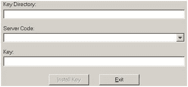
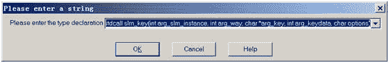
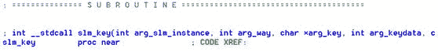
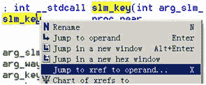
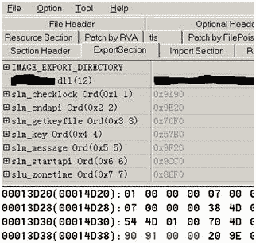
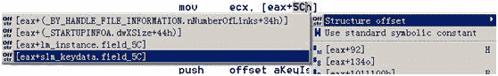

# 将要绝种的 ELANLM 分析

> 原文：[`www.pediy.com/kssd/pediy12/132755.html`](https://www.pediy.com/kssd/pediy12/132755.html)

05 年注册看雪，一直没有发表过任何有意义的东西，这次分析了 ELANLM 的算法，发现能找到的资源很少，毕竟这个东西已经是古董了，这次补个课吧，将基本的东西总结一下，发出来供大家参考。

`Elanlm` 是一款老掉牙的 license 管理工具，在 2011 年的今天已经很少被商业软件使用，不过我还是碰到一个，于是进行分析。

一阵搜索，得到的信息非常有限，但也有很大帮助。

[`www.woodmann.com/fravia/pilgrim\_elanlm\_spps.htm`](http://www.woodmann.com/fravia/pilgrim_elanlm_spps.htm)

[`www.woodmann.com/crackz/Tools...es/Elanapi.zip`](http://www.woodmann.com/crackz/Tools/Dongles/Elanapi.zip)

我分析的应用程序提供了一个 license 文件产生工具，可以通过 `Server Code` 和 `Key` 产生 license 文件。`Server Code` 由这个程序自动生成，`Key` 需要购买后根据 `Server Code` 申请，首先从这个工具入手，分析 `Key` 是如何验证的。下图是 license 文件产生工具的界面截图，知道的也请不要说出来这是哪个公司的产品。



用 IDA 进行跟踪，定位到验证 `Key` 和产生 license 文件的代码在这个函数里(有多种方法可以定位到这段代码，比如在 `GetDlgItemTextA` 设断点；或者用 `Find crypt` 插件找到 `DES` 的代码设断点)。下面是从 IDA 里粘出的代码，其中 `slm` 开头的函数都是通过对照 `Elanapi` 中函数的说明定位的 `Elanlm SDK` 中的函数名，`Do` 开头的函数是我自己分析后命名的，意思不一定准确。另外为避免不必要的麻烦，尽量去掉了和该商业程序直接相关的信息，比如代码的绝对地址；明显的字符串等等。下面代码中的各类名称如 `sKey`、`p_lm_hinst` 等都是我在 IDA 中分析后标注的，并非是直接反汇编得到的。

代码:

```
                 sub     esp, 288h
                 push    ebx
                 push    ebp
                 mov     ebp, [esp+290h+arg_C] ; localhost
                 push    esi
                 mov     esi, [esp+294h+arg_a] ; 0x61
                 push    edi
                 mov     edi, [esp+298h+sKey] ; 
                 mov     [esp+298h+var_284], 0

lbLoop:                             
                 push    edi         ; skey
                 mov     dword ptr dwLicInstallOkSign, 0FFFFFFFFh
                 call    DoTrimSpace
                 mov     cl, [edi]
                 add     esp, 4
                 test    cl, cl
                 mov     eax, esi
                 jz      short loc_40ZZZZ
                 mov     edx, edi
                 sub     edx, esi

lbLoopCopy:                         
                 mov     [eax], cl
                 mov     cl, [eax+edx+1]
                 inc     eax
                 test    cl, cl
                 jnz     short lbLoopCopy

                 push    esi         ; 
                 mov     byte ptr [eax], 0
                 call    DoKeyStringChk
                 add     esp, 4
                 test    eax, eax
                 jl      lbStringChkError
                 mov     eax, p_lm_hinst
                 push    esi         ; sKey
                 push    eax
                 call    DoSumKey
                 test    eax, eax
                 jz      short lbSumKeyOk
                 push    offset aNotAValidKey
                 push    1         
                 call    DoMessage
                 mov     ecx, p_lm_hinst
                 add     esp, 8
                 push    ecx         ; lm_instance
                 call    slm_getversion
                 push    esi
                 mov     bl, al
                 call    sub_40????
                 add     esp, 4
                 test    eax, eax
                 jz      lbStringChkError
                 cmp     bl, enum_slm_v1
                 jl      short lbforget_n
                 cmp     bl, enum_slm_v5
                 jle     lbStringChkError

lbforget_n:                         ; CODE XREF: DoInstallLic+A6 j
                 push    offset aDidYouForgetTh ;
                 push    1         
                 call    DoMessage
                 add     esp, 8
                 jmp     lbStringChkError
lbSumKeyOk:                         
                 mov     edx, dword ptr pKeyData
                 mov     eax, p_lm_hinst
                 push    0           ; options
                 push    edx         ; arg_keydata
                 push    esi         ; key 
                 push    1           ; arg_way =1 decode
                 push    eax         ; arg_slm_instance
                 call    slm_key
                 test    eax, eax
                 jz      short loc_40XXXX
                 mov     ecx, p_lm_hinst
                 push    eax         ; code
                 push    0           ; feature
                 push    0           ; server
                 push    ecx         ; lm_instance
                 call    slm_message
                 push    eax         ; Args
                 push    offset aInvalidKeyS
                 push    1           ; int
                 call    DoMessage
                 add     esp, 0Ch

```

上段代码逻辑大致如下，流程较简单：

1、 用 `DoTrimSpace` 去掉输入的 key 的空格。

2、 用 `DoKeyStringChk` 检查 key 的每个字符是否合法。

3、 用 `DoSumKey` 检查输入的 Key 是否合法。

4、 用 `slm_key` 解码 Key 得到 keydata 数据结构，这里是关键。

5、 最后对解码的 Key 数据进行校验，并生成 license 文件（这段代码没有包含在上面）。

我在分析时走了点弯路，一开始将注意力集中到 `DoSumKey`，后来仔细阅读 `Elanapi` 和 `pilgrim` 的分析，知道 Key 生成算法在 `slm_key` 中。但是分析 `DoSumKey` 也使我对 `elanlm` 整个加密机制了解得更清晰了。

看看 `Elanapi.hlp` 中对 `slm_key` 的描述：

代码:

```
slm_key() - Generate or decode a license key
SYNTAX
int slm_key(instance, way, key, keydata, options)
SLM_INSTANCE instance; 
int way; 
char *key; 
struct slm_keydata *keydata; 
unsigned long options;

```

呵呵，这是很古老的 C 的函数定义了，这里 `way`、`keydata`、`options` 是关键的参数，由于没有 `Elanlm` 的 SDK，所以不知道 `keydata` 的结构定义，而 `Elanapi` 是 `ELANLM V4` 的帮助，其中描述的 `slm_keydata` 结构感觉与 `V5` 版本比有很多不同。所以只好从代码中分析 `way`、`options` 和 `keydata` 的意义和结构了。

首先用’Y’（edit->function->set function type）命令将 `slm_key` 的原型写好,如图：



完成后 IDA 显示如下：



再按’X’，查看对 `slm_key` 的所有调用，操作如下图：



得到三处对 `slm_key` 的调用，调用的代码如下：

代码:

```
第一处调用：
push    0            ; options
mov     ecx, [esp+1570h+arg_slm_instance]
push    eax          ; arg_keydata
push    ebp          ; arg_key
push    1            ; arg_way
push    ecx          ; arg_slm_instance
call    slm_key
test    eax, eax
jnz     loc_XXXX

第二处调用：
mov     edx, dword ptr pKeyData
mov     eax, p_lm_hinst
push    0            ; options
push    edx          ; arg_keydata
push    esi          ; key 
push    1            ; arg_way =1 decode
push    eax          ; arg_slm_instance
call    slm_key
test    eax, eax
jz      short loc_40XXXX

第三处调用：
push    2            ; options
lea     ecx, [esp+29Ch+arg_key]
push    eax          ; arg_keydata
push    ecx          ; arg_key
push    0            ; arg_way
push    edx          ; arg_slm_instance
call    slm_key
test    eax, eax
jnz     loc_40xxxx

```

分析这三处调用，可以知道第一、第二处是一样的，为解密 key 得到 keydata 结构，语句为：`slm_key(instance,1,key,keydata,0)` 第三处是由 keydata 结构生成 key,

语句为 `slm_key(instance,0,key,keydata,2)`

这样我们就知道 `way` 和 `option` 这两个参数在编写注册机时如何使用了，应该用第三种方式。

接下来需要分析 `keydata` 的结构了，这时我想到应该看看这个商业软件的主程序是怎样使用 license 文件的，用 IDA 一分析，发现有个独立的 DLL（`elanlm.dll`），封装了 `slm` 开头的几个函数，如下图：



早知如此，就不用花那么多时间分析这几个函数的原型了。但是既然已经花了时间就还是在原来的基础上进行吧。为了分析 `keydata` 结构，先确定 `keydata` 的长度，没有 SDK 就只好自己分析了。根据上述三处 `slm_key` 的第二处调用的代码的第一行 ‘mov edx, dword ptr pKeyData’

知道 `pKeyData` 是 `keydata` 的指针，那么只要查看 `pKeyData` 是怎样被赋值的就可以知道 `keydata` 的内存是怎样分配的了，自然就知道结构体的长度了。用’x’命令看哪些地方引用了 `pKeyData` 或用内存写断点，很容易定位下面代码：

代码:

```
 push    1220h         ; Size
call    _malloc
add     esp, 4
mov     dword ptr pKeyData, eax

```

这样就知道 `keydata` 结构长度是 `0x1220`，知道这个长度就能确定写注册机时需要分配多少内存给 `keydata` 结构。在 IDA 中按 `shift+F9` 打开“Structures”窗口，用‘Ins’键创建一个结构体，命名为 `slm_keydata`，再增加一个 `0x1220` 长度的字节数组成员，最后任意增加一个成员，结果如下：

> 00000000 `slm_keydata`     struc  ; (sizeof=0x1221)  

> 00000000 `field_0`         db 4640 dup(?)           ; string(C)  

> 00001220 `field_1220`      db ?  

> 00001221 `slm_keydata`     ends  


再将 `field_0` 数组用‘U’删除，然后在 `121F` 处用‘D’命令定义一个成员，最后在 `1220` 处用‘U’删除 `field_1220`，这样就得到了一个长度是 `0x1220` 的结构体。这是我自己用的定义长结构的笨办法，不知道是否还有更好的方法？好，我们再回到产生 license 文件的流程，第 4 步调用完 `slm_key` 得到解密后的 `keydata` 数据后，进入第 5 步：“根据 `keydata` 中的信息判断 `key` 是否是本机的 `key`？”。看下面代码：

代码:

```
mov     eax, dword ptr pKeyData
        mov     edx, [esp+298h+arg_bIsDefaultHostName]
        mov     ecx, [eax+5Ch]    // slm_keydata.dwAboutServer
        cmp     ecx, edx
        jz      short loc_xxxx
        …….
loc_xxxx mov     edx, [eax+68h]     // slm_keydata.dwAboutServer1
        add     eax, 0B9h
        push    edx
        mov     edx, [esp+29Ch+arg_10] ; server code
        push    ecx
        mov     ecx, [eax-2Dh]  ; slm_keydata.field(0xb9-0x2d)
        push    ecx             ; arg_slm_instance_8c
        push    ebp             ; localhost
        push    eax             ; 0403
        mov     eax, [esp+2ACh+arg_serial]
        push    edx
        push    eax
call    DoChkServerID
```

这里 `mov     ecx, [eax+5Ch]` 实际上就是取 `keydata` 偏移 `0x5C` 位置的四字节整数，在‘Structures’窗口中用‘D’在 `slm_keydata` 结构体偏移 `0x5C` 处（可以用‘G’命令）定义一个 `DWORD` 成员，结果如下：

> `0000005A`               `db ? ; undefined`
> `0000005B`               `db ? ; undefined`
> `0000005C field_5C`     `dd ?`
> `00000060`               `db ? ; undefined`
> `00000061`               `db ? ; undefined`

定义好后切换到汇编窗口，在‘`mov     ecx, [eax+5Ch]`’的 `5Ch` 上点鼠标右键用‘Structure offset’功能将 `5Ch` 转换成结构成员名，如下图：



得到下面效果：

代码:

```
mov     eax, dword ptr pKeyData
mov     edx, [esp+298h+arg_bIsDefaultHostName]
mov     ecx, [eax+slm_keydata.field_5C]
cmp     ecx, edx
```

如果分析出了 `keydata.field_5C` 这个成员的意义，就可以将成员名改为有意义的名字，我将它改成了‘`dwAboutServer`’，得到下面效果：

代码:

```
mov     eax, dword ptr pKeyData
mov     edx, [esp+298h+arg_bIsDefaultHostName]
mov     ecx, [eax+slm_keydata.dwAboutServer]
cmp     ecx, edx
```

不断重复上面工作，将能够标注出的成员全部标出，这是个体力活，好在实际上用到的成员不算很多，再此就不多说了。

下面来看 `ELANLM` 是如何验证 `key` 和 `Server Code` 是否匹配的?

上面的代码再往后走几步就到了下面的代码：

代码:

```
mov   edx, [eax+slm_keydata.dwAboutServer1]
add   eax, 0B9h
push  edx
mov   edx, [esp+29Ch+arg_10] ;  server code
push  ecx             ; 和是否绑定服务器相关
mov   ecx, [eax-2Dh]  ; slm_keydata.field(0xb9-0x2d)
push  ecx             ; arg_slm_instance_8c
push  ebp
push  eax             ;Server Code Sum
mov   eax, [esp+2ACh+arg_serial]
push  edx
push  eax
call  DoChkServerID
```

注意‘`add     eax, 0B9h`’是将 `keydata` 指针偏移到 `0xb9` 处，然后作为 `DoChkServerID` 的第三个参数传入 `DoChkServerID`。看看它的原型：

`int __cdecl DoChkServerID(int arg1, int arg2, int arg_ServerSum, int arg4, int arg5, int arg6)`

我们可以单步跟进 `DoChkServerID` 函数，盯住 `arg_ServerSum` 是怎么被使用的，可以用硬件断点，也可以一步步跟，对于这样没有保护的代码，我更喜欢一步步跟，最后到下面代码：

代码:

```
mov     eax, [edx+ebp]  ; server code
mov     edx, p_lm_hinst
push    eax             ; server code
lea     ecx, [esp+144h+Var_MAscServerCode]
push    1               ; arg_way
push    ecx             ; arg_out
push    edx             ; lm_instance
call    DoEnCodeOrCode
lea     eax, [esp+140h+var_MAscServerCodeSum]
lea     ecx, [esp+140h+Var_MAscServerCode]
push    eax             ; arg_out
push    ecx             ; arg_in
call    DoGetSumInAsc4  ; Get MAscServerCodeSum = 0403
lea     edx, [esp+140h+var_MAscServerCodeSum1]
eax, [esp+140h+Var_MAscServerCode]
push    edx
push    eax
call    DoGetSumInAsc4_0
mov     ecx, p_lm_hinst
xor     ebx, ebx
push    ecx             ; lm_instance
call    slm_getversion
cmp     al, enum_slm_v1
jl      short loc_40OOOO
cmp     al, enum_slm_v5
jg      short loc_40 OOOO
test    edi, edi
jz      loc_40xxxx
lea     edx, [esp+140h+var_MAscServerCodeSum]
test    edx, edx
jz      loc_40xxxx
mov     al, [edi]       ;  开始  比较 MAscServerCodeSum
mov     cl, [esp+140h+var_MAscServerCodeSum]
cmp     al, cl
jnz     loc_40xxxx
```

上面这段的逻辑很简单：

> 1. `DoEnCodeOrCode` 将 `Server Code` 解码为另外一个字符串暂时叫做 `ServerCodeDecodeStr`。
> 2. `DoGetSumInAsc4` 计算 `ServerCodeDecodeStr` 的校验码，这个校验码是 4 字节的字符串，暂时叫做：`ServerCodeDecodeSumStr`。
> 3. 最后比较 `arg_ServerSum` 和 `ServerCodeDecodeSumStr` 是否相等。

所以我们可以确定 `keydata` 结构的 `0x B9` 偏移存放的是 `ServerCodeDecodeSumStr`，占了 4 字节。到此，我们掌握了写注册机的全部逻辑，通常我会在 delphi 中用嵌入汇编实现涉及的全部代码，无非是从 ida 中拷贝到 delphi，再进行调试，多数是体力活。但是这次不同，需要的代码在那个 DLL 中都有，所以没有必要再写一遍了，只需加载 DLL，调用对应的函数就可以了。

以下是 delphi 的代码片段,演示一下 `KeyData` 结构的定义以及 `slm_key`、`DoEnCodeOrCode` 、`DoGetSumInAsc4` 函数的调用，特别是 `elanlm.dll` 没有引出 `DoEnCodeOrCode` 、`DoGetSumInAsc4` 函数，我是用它们相对于 `slm_key` 函数的偏移得到它们的入口的。

代码:


```delphi
T_SLM_KEYDATA = packed record
    ...;
    acFeature:array[0..3] of char;
    acbyUmknown:array[0..28] of char;
    acServerCodeSum:array[0..3] of char;
    ...
end;

PT_SLM_KEYDATA = ^T_SLM_KEYDATA;
PT_SLM_INSTANCE = ^DWORD;
T_slm_startapi = function(var pSlm_instance:PT_SLM_INSTANCE):integer; stdcall;
T_slm_endapi = function(pSlm_instance:PT_SLM_INSTANCE):integer; stdcall;
T_slm_key = function(pSlm_instance:PT_SLM_INSTANCE;
way:integer;key:pchar;keydata:PT_SLM_KEYDATA;options:integer):integer; stdcall;
T_DoEnCodeOrCode = function(pSlm_instance:PT_SLM_INSTANCE;arg_out:pchar;
    arg_way:integer;arg_in:pchar):integer;stdcall; 
T_DoGetSumInAsc4 = function(pcIn,pcOut:pchar):integer;stdcall; 


function CalcServerCodeSum(sServerCode:string):string;
var
  acDeCode:array[0..1024] of char;
  acSum:array[0..1024] of char;
begin
  fillchar(acDeCode,sizeof(acDeCode),#0);
  fillchar(acSum,sizeof(acDeCode),#0);
  slm_DoEnCodeOrCode(p_slm_instance,@acDeCode,1,pchar(sServerCode));
  slm_DoGetSumInAsc4(@acDeCode,@acSum);
  result := result + acSum[0];
  result := result + acSum[1];
  result := result + acSum[2];
  result := result + acSum[3];
end;


function InitElanlmApi:integer;
begin
 result :=-1;
 if LibHandle = 0 then
  begin
    LibHandle := LoadLibrary('elanlm.dll');
    if LibHandle = 0 then
    begin
      ShowMessage('load Elanlm error!');
      result := -1;
      exit;
    end;
    @slm_startapi := GetProcAddress(LibHandle,'slm_startapi');
    @slm_endapi := GetProcAddress(LibHandle,'slm_endapi');
    @slm_key := GetProcAddress(LibHandle,'slm_key');
//下面 XXXX 和 ZZZZ 分别是 slm_DoEnCodeOrCode 和 slm_DoGetSumInAsc4
//相对于 slm_key 的偏移。
    DWORD(@slm_DoEnCodeOrCode):= DWORD(@slm_key)+XXXX;
    DWORD(@slm_DoGetSumInAsc4) := DWORD(@slm_key)+ ZZZZ;

    if ((@slm_startapi = nil) or (@slm_endapi = nil) or (@slm_key = nil))  then
    begin
      FreeLibrary(LibHandle);
      ShowMessage('Get Elanlm Api error!');
      result := -1;
      exit;
    end;
    p_slm_instance := nil;
    result := slm_startapi(p_slm_instance);
  end;
end;

// 调用这个函数前必须先调 InitElanlmApi
function elamlmCreateKey(sFeature:string;sServerCode:string):string;
var
  pKeydata:PT_SLM_KEYDATA;
  iResult,i:integer;
  s,sSum:string;
  acMyKey:array[0..100] of char;
  dw:DWORD;
begin
  GetMem(pKeydata,sizeof(T_SLM_KEYDATA));
  fillchar(pKeydata^,sizeof(T_SLM_KEYDATA),#0);
  ...
  pKeydata^.acFeature[0] := sFeature[1];
  pKeydata^.acFeature[1] := sFeature[2];;
  pKeydata^.acFeature[2] := sFeature[3];;
  pKeydata^.acFeature[3] := sFeature[4];;

  sSum := CalcServerCodeSum(sServerCode);
  pKeydata^.acServerCodeSum[0] := sSum[1];
  pKeydata^.acServerCodeSum[1] := sSum[2]';
  pKeydata^.acServerCodeSum[2] := sSum[3];
  pKeydata^.acServerCodeSum[3] := sSum[4];
  ...
 try
    iResult := slm_key(p_slm_instance,0,pchar(@acMyKey),pKeydata,2);
    if (iResult = 0) then
     begin
      s:='';
      for i := 0 to sizeof(acMyKey) - 1 do
        begin
          if acMyKey[i] = #0 then
              break;
          s := s + acMyKey[i];
        end;
      result := result + format('%s',[s]);
      end
    else
     begin
       result := format('slm_key return error:%x,%d',[iResult,iResult]);
      end;
  finally
    FreeMem(pKeydata);
  end;
end;
```

写这么点东西的时间超过了编写上面的 Delphi 代码花的时间，希望能对需要的人有点帮助。

对这个编辑器用得不熟，感觉排版很不方便，另附上 PDF 版。

> hfade 2011 04 22

上传的附件

|  || elanlmCrk.pdf  
|

```c
/*-------------------------------------------------------------*/

/*  修改号   日期         修改人     修改描述                 */

/*-------------------------------------------------------------*/

/*  初始版本 2004-09-04   HZH        初始版本                 */

/*-------------------------------------------------------------*/

#ifndef _ELANLM_H

#define _ELANLM_H

/*-------------------------------------------------------------*/

/*  include                                                     */

/*-------------------------------------------------------------*/

#include "def.h"

#include "bn.h"

#include "des.h"

/*-------------------------------------------------------------*/

/*  define                                                      */

/*-------------------------------------------------------------*/

#define ELAN_MAX_LEN 196

/*-------------------------------------------------------------*/

/*  slm_checksum32                                              */

/*-------------------------------------------------------------*/

static T_u_int32 DS_checksum[] = {
    0x0000000D, 0x00000011, 0x0000018D, 0x00000013,
    0x00000017, 0x00000191, 0x0000001D, 0x0000001F,
    0x00000199, 0x00000025, 0x00000029, 0x000001A3,
    0x0000002B, 0x0000002F, 0x000001A5, 0x00000035,
    0x0000003B, 0x000001AF, 0x0000003D, 0x00000043,
    0x000001B1, 0x00000047, 0x00000049, 0x000001B7,
    0x0000004F, 0x00000053, 0x000001BB, 0x00000059,
    0x00000061, 0x000001C1, 0x00000065, 0x00000067,
    0x000001C9, 0x0000006B, 0x0000006D, 0x000001CD,
    0x00000071, 0x0000007F, 0x000001CF, 0x00000083,
    0x00000089, 0x000001D3, 0x0000008B, 0x00000095,
    0x000001DF, 0x00000097, 0x0000009D, 0x000001E7,
    0x000000A3, 0x000000A7, 0x000001EB, 0x000000AD,
    0x000000B3, 0x000001F3, 0x000000B5, 0x000000BF,
    0x000001F7, 0x000000C1, 0x000000C5, 0x000001FD,
    0x000000C7, 0x000000D3, 0x00000209, 0x000000DF,
    0x000000E3, 0x0000020B, 0x000000E5, 0x000000E9,
    0x0000021D, 0x000000EF, 0x000000F1, 0x00000223,
    0x000000FB, 0x00000101, 0x0000022D, 0x00000107,
    0x0000010D, 0x00000233, 0x0000010F, 0x00000115,
    0x00000239, 0x00000119, 0x0000011B, 0x0000023B,
    0x00000125, 0x00000133, 0x00000241, 0x00000137,
    0x00000139, 0x0000024B, 0x0000013D, 0x0000014B,
    0x00000251, 0x00000151, 0x0000015B, 0x00000257,
    0x0000015D, 0x00000161, 0x00000259, 0x00000167,
    0x0000016F, 0x0000025F, 0x00000175, 0x0000017B,
    0x00000265, 0x0000017F, 0x00000185 };

static T_u_int32 slm_checksum32(char *in, T_u_byte base)
{
    T_u_int32 rtn = 0;
    T_u_int32 cnt = 0;
    if (in[cnt] == '\0')
    {
        return (rtn);
    }
    while (in[cnt])
    {
        rtn += (in[cnt] - base + 1) * (DS_checksum[cnt % 0x6C] + (cnt / 0x6C));
        cnt++;
    }
    return (rtn);
}

/*-------------------------------------------------------------*/

/*  slm_strconvert                                              */

/*-------------------------------------------------------------*/

static T_u_byte slm_strconvert(char *in, T_u_byte len, char * out)
{
    T_u_byte cnt1, cnt2, sig;
    cnt2 = 0;
    sig  = 0;
    for (cnt1 = 0; cnt1 < len; cnt1 += 3)
    {
        out[cnt2] = in[cnt1 + sig];
        cnt2++;
    }
    sig  = 1;
    for (cnt1 = 0; cnt1 < len; cnt1 += 3)
    {
        out[cnt2] = in[cnt1 + sig];
        cnt2++;
    }
    sig  = 2;
    for (cnt1 = 0; cnt1 < len; cnt1 += 3)
    {
        out[cnt2] = in[cnt1 + sig];
        cnt2++;
    }
    return (len);
}

/*-------------------------------------------------------------*/

/*  DigitsRequired                                              */

/*-------------------------------------------------------------*/

static T_u_byte digits[] = {
    0x00, 0x01, 0x01, 0x01, 0x02, 0x02, 0x03, 0x03,
    0x03, 0x04, 0x04, 0x05, 0x05, 0x05, 0x06, 0x06,
    0x07, 0x07, 0x08, 0x08, 0x08, 0x09, 0x09, 0x0A,
    0x0A, 0x0A, 0x0B, 0x0B, 0x0C, 0x0C, 0x0D, 0x0D,
    0x0D, 0x0E, 0x0E, 0x0F, 0x0F, 0x0F, 0x10, 0x10,
    0x11, 0x11, 0x12, 0x12, 0x12, 0x13, 0x13, 0x14,
    0x14, 0x14, 0x15, 0x15, 0x16, 0x16, 0x17, 0x17,
```


```
0x17, 0x18, 0x18, 0x19, 0x19, 0x19, 0x1A, 0x1A,  
0x1B, 0x1B, 0x1B, 0x1C, 0x1C, 0x1D, 0x1D, 0x1E,  
0x1E, 0x1E, 0x1F, 0x1F, 0x20, 0x20, 0x20, 0x21,  
0x21, 0x22, 0x22, 0x23, 0x23, 0x23, 0x24, 0x24,  
0x25, 0x25, 0x25, 0x26, 0x26, 0x27, 0x27, 0x28,  
0x28, 0x28, 0x29, 0x29, 0x2A, 0x2A, 0x2A, 0x2B,  
0x2B, 0x2C, 0x2C, 0x2D, 0x2D, 0x2D, 0x2E, 0x2E,  
0x2F, 0x2F, 0x2F, 0x30, 0x30, 0x31, 0x31, 0x31,  
0x32, 0x32, 0x33, 0x33, 0x34, 0x34, 0x34, 0x35,  
0x35, 0x36, 0x36, 0x36, 0x37, 0x37, 0x38, 0x38,  
0x39, 0x39, 0x39, 0x3A, 0x3A, 0x3B, 0x3B, 0x3B,  
0x3C, 0x3C, 0x3D, 0x3D, 0x3E, 0x3E, 0x3E, 0x3F,  
0x3F, 0x40, 0x40, 0x40, 0x41, 0x41, 0x42, 0x42,  
0x43, 0x43, 0x43, 0x44, 0x44, 0x45, 0x45, 0x45,  
0x46, 0x46, 0x47, 0x47, 0x48, 0x48, 0x48, 0x49,  
0x49, 0x4A, 0x4A, 0x4A, 0x4B, 0x4B, 0x4C, 0x4C,  
0x4C, 0x4D, 0x4D, 0x4E, 0x4E, 0x4F, 0x4F, 0x4F,  
0x50, 0x50, 0x51, 0x51, 0x51, 0x52, 0x52, 0x53,  
0x53, 0x54, 0x54, 0x54, 0x55, 0x55, 0x56, 0x56,  
0x56, 0x57, 0x57, 0x58, 0x00, 0x00, 0x00, 0x00,  
0x00 };  

static T_u_byte DigitsRequired(T_u_byte in)  

{  

    T_u_byte tmp;  

    in += 1;  

    tmp = digits[in];  

    while ((tmp == digits[in + 1]) && (in <= 0xC8))  

    {  

            in += 1;  

    }  

    return (in - 1);  

}  

/*-------------------------------------------------------------*/  

/*  slm_bngetnumber                                             */  

/*-------------------------------------------------------------*/  

static T_u_byte slm_bngetnumber(char *in, T_u_byte *out)  

{  

    char     tmp;  

    T_u_byte cnt, len, rtn;  

    len = strlen(in);  

    for(cnt = 0; cnt < (len / 2); cnt++)  

    {  

        tmp = in[cnt];  

        in[cnt] = in[len - cnt - 1];  

        in[len - cnt - 1] = tmp;  

    }  

    //  

    BIGNUM *temp = BN_new();  

    BN_dec2bn(&temp, in);  

    rtn = BN_bn2bin(temp, out);  

    BN_free(temp);  

    return (rtn);  

}  

/*-------------------------------------------------------------*/  

/*  slm_bnputnumber                                             */  

/*-------------------------------------------------------------*/  

static T_u_byte slm_bnputnumber(T_u_byte *in, T_u_byte len, char *out, T_u_byte digits)  

{  

    char     tmp;  

    T_u_byte cnt, rtn;  

    BIGNUM *temp = BN_new();  

    BN_bin2bn(in, len, temp);  

    char *buf = new char [256];  

    buf = BN_bn2dec(temp);  

    strcpy(out, buf);  

    delete [] buf;  

    //  

    rtn = strlen(out);  

    for(cnt = 0; cnt < (rtn / 2); cnt++)  

    {  

        tmp = out[cnt];  

        out[cnt] = out[rtn - cnt - 1];  

        out[rtn - cnt - 1] = tmp;  

    }  

    while (rtn < digits)  

    {  

        strcat(out, "0");  

        rtn += 1;  

    }  

    return (rtn);  

}  

/*-------------------------------------------------------------*/  

/*  slm_bntoubuf                                               */  

/*-------------------------------------------------------------*/  

static void slm_bntoubuf(T_u_byte *in, T_u_byte len)  

{  

    T_u_byte cnt, tmp;  

    for(cnt = 0; cnt < (len / 2); cnt++)  

    {  

        tmp = in[cnt];  

        in[cnt] = in[len - cnt - 1];  

        in[len - cnt - 1] = tmp;  

    }  

}  

/*-------------------------------------------------------------*/  

/*  slm_bnfromubuf                                             */  

/*-------------------------------------------------------------*/  

static void slm_bnfromubuf(T_u_byte *in, T_u_byte len)  

{  

    T_u_byte cnt, tmp;  

    for(cnt = 0; cnt < (len / 2); cnt++)  

    {  

        tmp = in[cnt];  

        in[cnt] = in[len - cnt - 1];  

        in[len - cnt - 1] = tmp;  

    }  

}  

/*-------------------------------------------------------------*/  

/*  SpinLast                                                   */  

/*-------------------------------------------------------------*/  

static void SpinLast(char *in, T_u_byte mul)  

{  

    char tmp[] = "000";  

    T_u_byte len = strlen(in);  

    strncpy(tmp , in, 3);  

    T_s_int32 val = atoi(tmp);  

    in[len - 1] = ((val % 0x59) * mul + in[len - 1] + 0x34) % 0xA + '0';  

}  

/*-------------------------------------------------------------*/  

/*  slm_descfbenc                                              */  

/*-------------------------------------------------------------*/  

static T_s_int slm_descrypt(T_u_byte         *input,  

                            T_u_byte         *output,  

                            T_u_byte          len,  

                            DES_cblock        *key,  

                            DES_cblock        *pad,  

                            T_s_int           enc)  

{  

    T_s_byte      cnt;  

    DES_key_schedule schedule;  

    DES_set_key(key, &schedule);  

    DES_cblock ivec;  

    while (len-- > 0)  

    {  

        DES_ecb_encrypt(pad, &ivec, &schedule, enc);  

        *output = *input ^ ivec[7];  

        for (cnt = 6; cnt >= 0; cnt--)  

        {  

            *(*pad + cnt + 1) = *(*pad + cnt);  

        }  

        **pad = *output;  

        ++input;  

        ++output;  

    }  

    return (0);  

}  

/*-------------------------------------------------------------*/  

/*  slm_descrypt_decimal                                       */  

/*-------------------------------------------------------------*/  

static void slm_descrypt_decimal(char       *Elan_realinfo,  

                                 char       *Elan_cryptinfo,  

                                 T_u_byte    *salt,  

                                 T_u_int     saltlen,  

                                 T_u_int32   slm_port_salt,  

                                 T_s_int     enc)  

{  

    T_u_int    len;  

    T_u_int    cnt;  

    T_u_byte   digits;  

    T_u_int32  chksum;  

    DES_cblock deskey = {0};  

    DES_cblock vector = {0};  

    char Elan_checksum[] = "0000";  

    char Elan_temp[ELAN_MAX_LEN] = "";  

    char Elan_convert[ELAN_MAX_LEN] = "";  

    T_u_byte plain[ELAN_MAX_LEN] = {0};  

    T_u_byte cipher[ELAN_MAX_LEN] = {0};  

    //由 salt(256 bytes) slm_port_salt 计算 deskey vector  

    for (cnt = 0; cnt < saltlen; cnt++)  

    {  

        deskey[(cnt + 2) % 8] ^= salt[cnt];  

    }  

    for (cnt = 0; cnt < 4; cnt++)  

    {  

        deskey[cnt] ^= (T_u_byte)((slm_port_salt >> (cnt * 8)) & 0xFF);  

    }  

    for (cnt = 0; cnt < 8; cnt++)  

    {  

        deskey[cnt] = (deskey[cnt] * 3) % 0xFB;  

    }  

    for (cnt = 0; cnt < 8; cnt++)  

    {  

        vector[cnt] = (deskey[cnt % 8] & 0xFE) ^ (deskey[cnt % 3] >> 1);  

    }  

    //将明码信息字符串进行位置变换  

    len = slm_strconvert(Elan_realinfo, strlen(Elan_realinfo), Elan_convert);  

    //计算需要的字节  

    digits = DigitsRequired(len + 4);  

    //计算 slm_checksum32  

    chksum =  (slm_checksum32(Elan_realinfo, 0x30) % 0xD03) * 3 - 4;  

    chksum =  chksum - len + digits;  

    sprintf(Elan_checksum, "%04lu", chksum);  

    //连接生成新的字符串  

    lstrcat(Elan_temp, Elan_checksum);  

    lstrcat(Elan_temp, Elan_convert);  

    //slm_bngetnumber  

    cnt = slm_bngetnumber(Elan_temp, plain);  

    //slm_bntoubuf  

    slm_bntoubuf(plain, cnt);  

    //slm_descrypt  

    slm_descrypt(plain, cipher, cnt, &deskey, &vector, enc);  

    //slm_bnfromubuf  

    slm_bnfromubuf(cipher, cnt);  

    //slm_bnputnumber  

    memset(Elan_cryptinfo, 0, ELAN_MAX_LEN);  

    slm_bnputnumber(cipher, cnt, Elan_cryptinfo, digits + 1);  

    //SpinLast  

    SpinLast(Elan_cryptinfo, 1);  

    return;  

}  
```


```
/*-------------------------------------------------------------*/  

#endif /* _ELANLM_H */  
```

忘记是啥年代分析的东西了，不记得是 `ElanLM` 什么版本的！

楼上的代码应该是我标注的 `'DoSumKey'` 中逻辑的逆，我分析的是 `V5.05` 版本。
