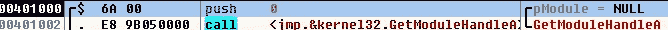
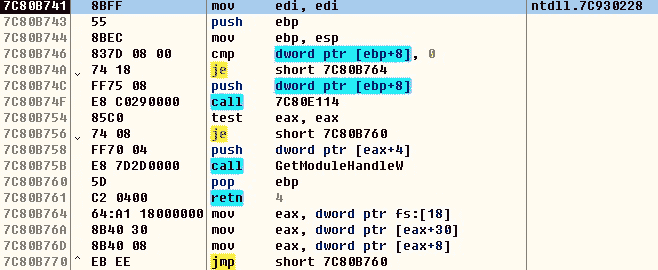
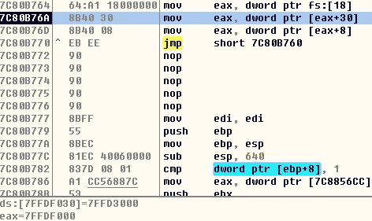
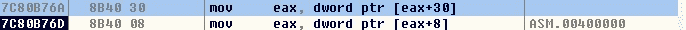
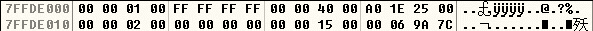

# 用 ollydbg 浅识 TEB 和 PEB 用来反跟踪

> 原文：[`www.pediy.com/kssd/pediy11/119827.html`](https://www.pediy.com/kssd/pediy11/119827.html)

标 题: 原创】用 ollydbg 浅识 TEB 和 PEB 用来反跟踪

作 者: 蓝云

时 间: 2010-09-4

本文目的：借助工具直观接触 `TEB` 和 `PEB`。

首先，来了解下什么是 `TEB` 和 `PEB`。

`TEB`（Thread Environment Block，线程环境块）：系统在此 `TEB` 中保存频繁使用的线程相关的数据。位于用户地址空间。进程中的每个线程都有自己的一个 `TEB`。一个进程的所有 `TEB` 都以堆栈的方式，存放在从 `0x7FFDE000`（WinXP，当然，不同的系统可能位于不同的地址）开始的线性内存中，每 `4KB` 为一个完整的 `TEB`，不过该内存区域是向下扩展的。在用户模式下，当前线程的 `TEB` 位于独立的 `4KB` 段，可通过 CPU 的 `FS` 寄存器来访问该段，一般存储在`[FS:0]`。在用户态下 `WinDbg` 中可用命令`$thread` 取得 `TEB` 地址。

`PEB`（Process Environment Block，进程环境块）存放进程信息，每个进程都有自己的 `PEB` 信息。位于用户地址空间。在 Win XP 下，进程环境块的地址对于每个进程来说是固定的，在 `0x7FFDF000` 处，这是用户地址空间，所以程序能够直接访问。

首先，来借助于 `windbg` 工具来观察 `TEB` 结构。

```
0:000:x86> dt ntdll32!_TEB

   +0x000 NtTib            : _NT_TIB
   +0x01c EnvironmentPointer : Ptr32 Void
   +0x020 ClientId         : _CLIENT_ID
   +0x028 ActiveRpcHandle  : Ptr32 Void
   +0x02c ThreadLocalStoragePointer : Ptr32 Void
   +0x030 ProcessEnvironmentBlock : Ptr32 _PEB
   +0x034 LastErrorValue   : Uint4B
   +0x038 CountOfOwnedCriticalSections : Uint4B
   +0x03c CsrClientThread  : Ptr32 Void
   +0x040 Win32ThreadInfo  : Ptr32 Void
   +0x044 User32Reserved   : [26] Uint4B
   +0x0ac UserReserved     : [5] Uint4B
   +0x0c0 WOW32Reserved    : Ptr32 Void
   +0x0c4 CurrentLocale    : Uint4B
   +0x0c8 FpSoftwareStatusRegister : Uint4B
   +0x0cc SystemReserved1  : [54] Ptr32 Void
   +0x1a4 ExceptionCode    : Int4B
   +0x1a8 ActivationContextStackPointer : Ptr32 _ACTIVATION_CONTEXT_STACK
   +0x1ac SpareBytes       : [36] UChar
   +0x1d0 TxFsContext      : Uint4B
   +0x1d4 GdiTebBatch      : _GDI_TEB_BATCH
   +0x6b4 RealClientId     : _CLIENT_ID
   +0x6bc GdiCachedProcessHandle : Ptr32 Void
   +0x6c0 GdiClientPID     : Uint4B
   +0x6c4 GdiClientTID     : Uint4B
   +0x6c8 GdiThreadLocalInfo : Ptr32 Void
   +0x6cc Win32ClientInfo  : [62] Uint4B
   +0x7c4 glDispatchTable  : [233] Ptr32 Void
   +0xb68 glReserved1      : [29] Uint4B
   +0xbdc glReserved2      : Ptr32 Void
   +0xbe0 glSectionInfo    : Ptr32 Void
   +0xbe4 glSection        : Ptr32 Void
   +0xbe8 glTable          : Ptr32 Void
   +0xbec glCurrentRC      : Ptr32 Void
   +0xbf0 glContext        : Ptr32 Void
   +0xbf4 LastStatusValue  : Uint4B
   +0xbf8 StaticUnicodeString : _UNICODE_STRING
   +0xc00 StaticUnicodeBuffer : [261] Wchar
   +0xe0c DeallocationStack : Ptr32 Void
   +0xe10 TlsSlots         : [64] Ptr32 Void
   +0xf10 TlsLinks         : _LIST_ENTRY
   +0xf18 Vdm              : Ptr32 Void
   +0xf1c ReservedForNtRpc : Ptr32 Void
   +0xf20 DbgSsReserved    : [2] Ptr32 Void
   +0xf28 HardErrorMode    : Uint4B
   +0xf2c Instrumentation  : [9] Ptr32 Void
   +0xf50 ActivityId       : _GUID
   +0xf60 SubProcessTag    : Ptr32 Void
   +0xf64 EtwLocalData     : Ptr32 Void
   +0xf68 EtwTraceData     : Ptr32 Void
   +0xf6c WinSockData      : Ptr32 Void
   +0xf70 GdiBatchCount    : Uint4B
   +0xf74 CurrentIdealProcessor : _PROCESSOR_NUMBER
   +0xf74 IdealProcessorValue : Uint4B
   +0xf74 ReservedPad0     : UChar
   +0xf75 ReservedPad1     : UChar
   +0xf76 ReservedPad2     : UChar
   +0xf77 IdealProcessor   : UChar
   +0xf78 GuaranteedStackBytes : Uint4B
   +0xf7c ReservedForPerf  : Ptr32 Void
   +0xf80 ReservedForOle   : Ptr32 Void
   +0xf84 WaitingOnLoaderLock : Uint4B
   +0xf88 SavedPriorityState : Ptr32 Void
   +0xf8c SoftPatchPtr1    : Uint4B
   +0xf90 ThreadPoolData   : Ptr32 Void
   +0xf94 TlsExpansionSlots : Ptr32 Ptr32 Void
   +0xf98 MuiGeneration    : Uint4B
   +0xf9c IsImpersonating  : Uint4B
   +0xfa0 NlsCache         : Ptr32 Void
   +0xfa4 pShimData        : Ptr32 Void
   +0xfa8 HeapVirtualAffinity : Uint4B
   +0xfac CurrentTransactionHandle : Ptr32 Void
   +0xfb0 ActiveFrame      : Ptr32 _TEB_ACTIVE_FRAME
   +0xfb4 FlsData         : Ptr32 Void
   +0xfb8 PreferredLanguages : Ptr32 Void
   +0xfbc UserPrefLanguages : Ptr32 Void
   +0xfc0 MergedPrefLanguages : Ptr32 Void
   +0xfc4 MuiImpersonation : Uint4B
   +0xfc8 CrossTebFlags    : Uint2B
   +0xfc8 SpareCrossTebBits : Pos 0, 16 Bits
   +0xfca SameTebFlags     : Uint2B
   +0xfca SafeThunkCall    : Pos 0, 1 Bit
   +0xfca InDebugPrint     : Pos 1, 1 Bit
   +0xfca HasFiberData     : Pos 2, 1 Bit
   +0xfca SkipThreadAttach : Pos 3, 1 Bit
   +0xfca WerInShipAssertCode : Pos 4, 1 Bit
   +0xfca RanProcessInit   : Pos 5, 1 Bit
   +0xfca ClonedThread     : Pos 6, 1 Bit
   +0xfca SuppressDebugMsg : Pos 7, 1 Bit
   +0xfca DisableUserStackWalk : Pos 8, 1 Bit
   +0xfca RtlExceptionAttached : Pos 9, 1 Bit
   +0xfca InitialThread    : Pos 10, 1 Bit
   +0xfca SpareSameTebBits : Pos 11, 5 Bits
   +0xfcc TxnScopeEnterCallback : Ptr32 Void
   +0xfd0 TxnScopeExitCallback : Ptr32 Void
   +0xfd4 TxnScopeContext  : Ptr32 Void
   +0xfd8 LockCount        : Uint4B
   +0xfdc SpareUlong0      : Uint4B
   +0xfe0 ResourceRetValue : Ptr32 Void
```

这是一个完整的 `TEB` 结构，我这里也有一份 `pteb.h` 的头文件

```
typedef struct _NT_TEB
{
   NT_TIB Tib;                   // 00h
   PVOID EnvironmentPointer;     // 1Ch
   CLIENT_ID Cid;               // 20h
   PVOID ActiveRpcInfo;         // 28h
   PVOID ThreadLocalStoragePointer; // 2Ch
   PPEB Peb;                    // 30h
   ULONG LastErrorValue;        // 34h
   ULONG CountOfOwnedCriticalSections; // 38h
   PVOID CsrClientThread;       // 3Ch
   PVOID Win32ThreadInfo;       // 40h
   ULONG Win32ClientInfo[0x1F]; // 44h
   PVOID WOW32Reserved;         // C0h
   ULONG CurrentLocale;         // C4h
   ULONG FpSoftwareStatusRegister; // C8h
   PVOID SystemReserved1[0x36];  // CCh
   PVOID Spare1;                // 1A4h
   LONG ExceptionCode;          // 1A8h
   ULONG SpareBytes1[0x28];     // 1ACh
   PVOID SystemReserved2[0xA];  // 1D4h
   GDI_TEB_BATCH GdiTebBatch;   // 1FCh
   ULONG gdiRgn;                // 6DCh
   ULONG gdiPen;                // 6E0h
   ULONG gdiBrush;              // 6E4h
   CLIENT_ID RealClientId;      // 6E8h
   PVOID GdiCachedProcessHandle; // 6F0h
   ULONG GdiClientPID;          // 6F4h
   ULONG GdiClientTID;          // 6F8h
   PVOID GdiThreadLocaleInfo;   // 6FCh
   PVOID UserReserved[5];       // 700h
   PVOID glDispatchTable[0x118]; // 714h
   ULONG glReserved1[0x1A];     // B74h
   PVOID glReserved2;           // BDCh
   PVOID glSectionInfo;         // BE0h
   PVOID glSection;             // BE4h
   PVOID glTable;               // BE8h
   PVOID glCurrentRC;           // BECh
   PVOID glContext;             // BF0h
   NTSTATUS LastStatusValue;    // BF4h
   UNICODE_STRING StaticUnicodeString; // BF8h
   WCHAR StaticUnicodeBuffer[0x105];   // C00h
   PVOID DeallocationStack;     // E0Ch
   PVOID TlsSlots[0x40];        // E10h
   LIST_ENTRY TlsLinks;         // F10h
   PVOID Vdm;                   // F18h
   PVOID ReservedForNtRpc;      // F1Ch
   PVOID DbgSsReserved[0x2];    // F20h
   ULONG HardErrorDisabled;     // F28h
   PVOID Instrumentation[0x10];  // F2Ch
   PVOID WinSockData;           // F6Ch
   ULONG GdiBatchCount;         // F70h
   ULONG Spare2;                // F74h
   ULONG Spare3;                // F78h
   ULONG Spare4;                // F7Ch
   PVOID ReservedForOle;        // F80h
}


## TEB 结构

```
ULONG WaitingOnLoaderLock;           // F84h

PVOID StackCommit;                  // F88h

PVOID StackCommitMax;               // F8Ch

PVOID StackReserve;                 // F90h

PVOID MessageQueue;                 // ???

} NT_TEB, *PNT_TEB;
```

注意到：

`+0x030 ProcessEnvironmentBlock : Ptr32 _PEB`

```
PPEB Peb;                           // 30h
```

`TEB` 偏移的 `0x30` 地址就是 `PEB` 的地址，下面来看看 `PEB` 的结构：

```
typedef struct _PEB

{

   UCHAR InheritedAddressSpace;                  // 00h

   UCHAR ReadImageFileExecOptions;               // 01h

   UCHAR BeingDebugged;                          // 02h

   UCHAR Spare;                                  // 03h

   PVOID Mutant;                                 // 04h

   PVOID ImageBaseAddress;                       // 08h

   PPEB_LDR_DATA Ldr;                            // 0Ch

   PRTL_USER_PROCESS_PARAMETERS ProcessParameters; // 10h

   PVOID SubSystemData;                          // 14h

   PVOID ProcessHeap;                            // 18h

   PVOID FastPebLock;                            // 1Ch

   PPEBLOCKROUTINE FastPebLockRoutine;           // 20h

   PPEBLOCKROUTINE FastPebUnlockRoutine;         // 24h

   ULONG EnvironmentUpdateCount;                 // 28h

   PVOID* KernelCallbackTable;                   // 2Ch

   PVOID EventLogSection;                        // 30h

   PVOID EventLog;                               // 34h

   PPEB_FREE_BLOCK FreeList;                     // 38h

   ULONG TlsExpansionCounter;                    // 3Ch

   PVOID TlsBitmap;                              // 40h

   ULONG TlsBitmapBits[0x2];                     // 44h

   PVOID ReadOnlySharedMemoryBase;               // 4Ch

   PVOID ReadOnlySharedMemoryHeap;               // 50h

   PVOID* ReadOnlyStaticServerData;              // 54h

   PVOID AnsiCodePageData;                       // 58h

   PVOID OemCodePageData;                        // 5Ch

   PVOID UnicodeCaseTableData;                   // 60h

   ULONG NumberOfProcessors;                     // 64h

   ULONG NtGlobalFlag;                           // 68h

   UCHAR Spare2[0x4];                            // 6Ch

   LARGE_INTEGER CriticalSectionTimeout;         // 70h

   ULONG HeapSegmentReserve;                     // 78h

   ULONG HeapSegmentCommit;                      // 7Ch

   ULONG HeapDeCommitTotalFreeThreshold;         // 80h

   ULONG HeapDeCommitFreeBlockThreshold;         // 84h

   ULONG NumberOfHeaps;                          // 88h

   ULONG MaximumNumberOfHeaps;                   // 8Ch

   PVOID** ProcessHeaps;                         // 90h

   PVOID GdiSharedHandleTable;                   // 94h

   PVOID ProcessStarterHelper;                   // 98h

   PVOID GdiDCAttributeList;                     // 9Ch

   PVOID LoaderLock;                             // A0h

   ULONG OSMajorVersion;                         // A4h

   ULONG OSMinorVersion;                         // A8h

   ULONG OSBuildNumber;                          // ACh

   ULONG OSPlatformId;                           // B0h

   ULONG ImageSubSystem;                         // B4h

   ULONG ImageSubSystemMajorVersion;             // B8h

   ULONG ImageSubSystemMinorVersion;             // C0h

   ULONG GdiHandleBuffer[0x22];                  // C4h

   PVOID ProcessWindowStation;                   // ???

} PEB, *PPEB;
```

```
PVOID ImageBaseAddress;                       // 08h
```

偏移 `08h` 的地址就是程序的基址，往上看：

```
UCHAR BeingDebugged;                          // 02h，这里就表示程序是否是在被调试模式了。
```

接下来，咱们就用 `ollydbg` 来调试看看这些数据了，记住，并没有那么神秘的。



我这里写一个小程序里面就调用一个函数 `GetModuleHandle`，咱们要做的就是跟进这个函数去看看



这个就是这个函数的执行体了，咱们要关心的就是 `7C80B764` 这个地址的一句：

```
mov eax,dword ptr fs:[18]
```

`fs:[0]` 寄存器里面存的就是指向 `TEB` 的地址，看看是什么地址啊，



看到没 `eax` 指向的就是 `TEB` 的地址，接着执行，`teb` 地址偏移 `30` 由上面的头文件就可以看出是 `peb` 的地址了，



此时可以确定 `peb` 的地址就是 `0x7FFDE000` 了

由上面的 `PEB` 结构

```
PVOID ImageBaseAddress;                       // 08h
```

再偏移 `08h` 就是基址了

```
UCHAR BeingDebugged;                          // 02h
```

偏移 `2` 字节就是表示是否被调试跟踪了



偏移 `2` 处就是 `01` 了，呵呵，表示被调试跟踪了，偏移 `8` 是 `00400000`，这就是基址了，可以证明了

如果自己用代码可以这么测试了：

```
mov     eax, fs:[30h]           ;指向 PEB

movzx   eax, byte ptr [eax + 2h]

or      al, al

jz      _Fine
```

如果等于 `0` 就是 `ok` 得了否则就被跟踪了。

## 参考资料

罗聪:浅谈利用 `TEB` 实现的反跟踪
