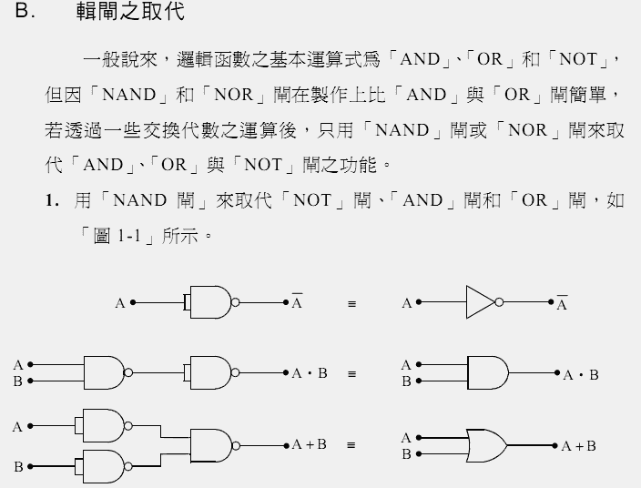
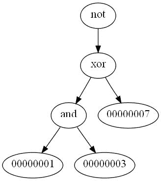
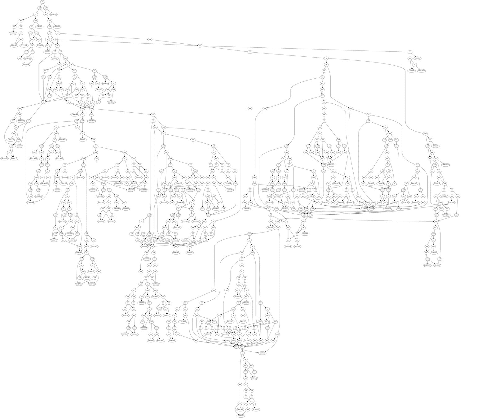
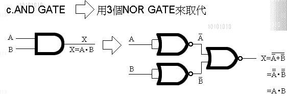
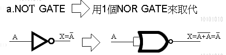
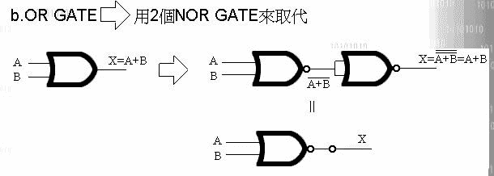
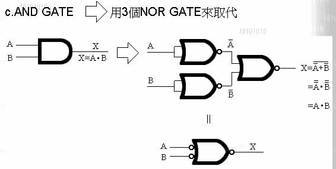
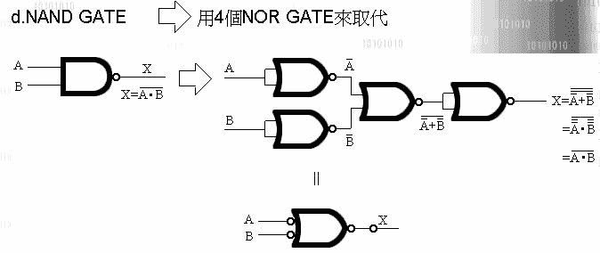
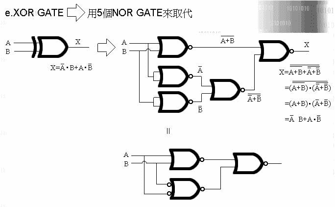
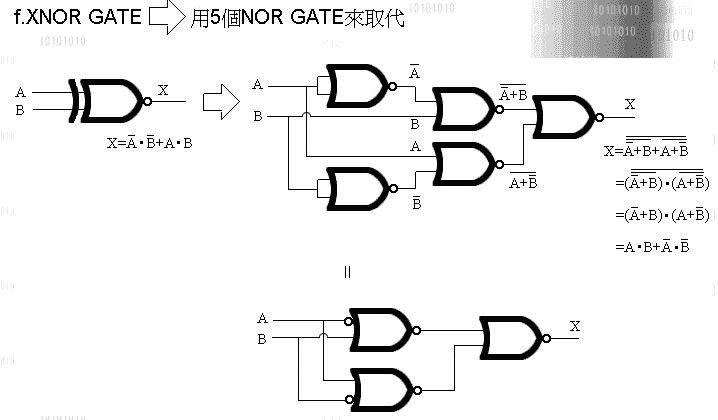

# 破解 vmp 程序的关键点

> 原文：[`www.pediy.com/kssd/pediy10/82618.html`](https://www.pediy.com/kssd/pediy10/82618.html)

## 内容

**引用: PART I：**

vmp 里面有很多 `handle`，有一种 `handle` 很特殊，有几份 `copy`，大致运算是：

`not A`

`not B`

`and A , B`

这个好像叫什么 `xx` 门的，它是计算 `jcc` 指令的关键点，一般爆破都是找 `jcc` 指令，因此，这条指令是破解的关键点

**PART II：**

11 楼说的东西是基础，在这里：

[`hi.baidu.com/depteicn/blog/it...331add189.html`](http://hi.baidu.com/depteicn/blog/item/4941f6b73c8036f331add189.html)

14 楼也是基础的电路图

建议把这两个看懂，再向下看

**PART III：**

vmp 里面有唯一的跳转指令，`handle` 大概是这样的

`mov e?x,\[ebp\]`

`add ebp,4`

`mov esi, e?x`

这条 `handle` 是跳转指令，`jmp`，唯一的跳转，那么如何实现条件跳转呢？就要用到上面的那条唯一的逻辑运算 `handle`

**PART IV：**

看到这里，大家应该明白了，vmp 实现跳转，是先用上面的 `xx` 门，把 `eflag` 计算好，是跳还是不跳，然后决定选择哪一个地址，再用 PART III 里面的指令跳过去

**PART V：**

所以说要破解 vmp 要找到关键的 `jmphandle`，确定这个 `handle` 是关键跳转，必须利用前面的 `xx` 门的计算来确定

## 资料

**引用:** 看懂上面的就可以看下面回帖中的高级教程了，虽然离破解有点远，但是离还原有点近

感谢发哥，感谢 B 哥，感谢 `ccfer`，感谢 `bughoho`，感谢所有观众，纪念刘和珍君

无花风月,我来推波助澜

## PART I

**引用:** vmp 里面只有 1 个逻辑运算指令 `not_not_and` 设这条指令为 `P`

`P(a,b) = ~a & ~b`

这条指令的神奇之处就是能模拟 `not` `and` `or` `xor` 4 条常规的逻辑运算指令

怕忘记了，直接给出公式，后面的数字指需要几次 `P` 运算

`not(a) = P(a,a) 1`

`and(a,b) = P(P(a,a),P(b,b)) 3`

`or(a,b) = P(P(a,b),P(a,b)) 2`

`xor(a,b) = P(P(P(a,a),P(b,b)),P(a,b)) 5`

上面的次数应该是最少需要的次数了，当然也可以展开，那样就更加复杂了

vmp 用 1 条指令模拟了 4 条指令，因此逆向起来比较复杂，如果中间夹杂垃圾运算，那么工程量非同小可

下面来证明一下上面 4 条等式

`not(a) = ~a = ~a & ~a = P(a,a)`

`and(a,b) = a & b = ~(~a) & ~(~b) = P(not(a),not(b)) = P(P(a,a),P(b,b))`

`or(a,b) = a | b = ~(~(a|b)) = ~(~a & ~b) = ~P(a,b) = P(P(a,b),P(a,b))`

`xor(a,b) = ~a & b | a & ~b = ~(~(~a & b | a & ~b)) = ~(~(~a & b) & ~(a & ~b)) = ~((a | ~b) & (~a | b)) = ~(1 | 1 | a & b | ~a & ~b) = ~(a & b) & ~(~a & ~b) = P(and(a,b),P(a,b)) = P(P(P(a,a),P(b,b)),P(a,b))`

上面的 `xor` 是最复杂的，不过简化后也只需要 5 次运算就可以实现了

至于 `eflag`，`eflag` 是根据结果来定的，由于都是逻辑运算，所以最后取一下 `eflag` 即可

在某修改版的 `vm` 中，还可以看到另一个强大的指令 `not_not_or` 设这条指令为 `Q`

`Q(a,b) = ~a | ~b`

同样，这一条指令可以模拟 4 条常规的逻辑运算指令

怕忘记了，直接给出公式，后面数字表示需要几次 `Q` 运算

`not(a) = Q(a,a) 1`

`and(a,b) = Q(Q(a,b),Q(a,b)) 2`

`or(a,b) = Q(Q(a,a),Q(b,b)) 3`

`xor(a,b) = Q(Q(Q(a,a),b),Q(a,Q(b,b))) 5`

基本和上面 `P` 指令相同，效率没什么变化

只对最复杂的 `xor` 证明一下，以防忘记

`xor(a,b) = ~a & b | a & ~b = ~(~(~a & b | a & ~b)) = ~(~(~a & b) & ~(a & ~b)) = ~((~(~a) | ~b) & (~a | ~(~b))) = ~(~(~a) | ~b) | ~(~a | ~(~b)) = Q(Q(not(a),b),Q(a,not(b))) = Q(Q(Q(a,a),b),Q(a,Q(b,b)))`

实在太难了，完全搞不定啊

`xor` 用真值表可以直接证明，另外还有一种非常好记的方法

`L = ~(A&B) = A 和 B 不都为 1 的位`

`R = ~(A|B) = A 和 B 不都为 0 的位`

`L & R = A 和 B 不都为 1 且不都为 0 的位 = 不同为 1 相同为 0 = XOR`

至于 `~` 等于或非/NOR 自身

PDF 文件：

[`u4.ksu.edu.tw/gallery/458/98_01.pdf`](http://u4.ksu.edu.tw/gallery/458/98_01.pdf)

NAND ' NOR 称为万用逻辑闸

因为我们可以单纯使用 `NAND` 或 `NOR` 来组成基本逻辑闸

因此 `NAND` 与 `NOR` 可以实现所有的布林函数



## BINARY GAMES

**引用:** BINARY GAMES

    forgot

--------------------------------------------------------------------------------

I.     `SWAP_XOR(x, y)`

  `x = A`

  `y = B`

1) `x ^= y`

  `x = A ^ B      // NOTE: A != B`

2) `y ^= x`

  `y = B ^ x = B ^ A ^ B = A`

3) `x ^= y`

  `x = A ^ B ^ y = A ^ B ^ A = B`

--------------------------------------------------------------------------------

II.     `SWAP_ADDSUB(x, y)`

  `x = A`

  `y = B`

1) `x += y`

  `x = A + B`

2) `y -= x`

  `y = B - (A + B) = -A`

3) `x += y        // subtration is slower, change y sign next step`

  `x = A + B - A = B`

4) `y = ~y + 1`

  `y = A`

--------------------------------------------------------------------------------

III.  `NEG(x)`

  `We assume x + y = 0`

  `x + y - 1 = -1 = 11111111...111111111b`

  `x = ~(y - 1)`

--------------------------------------------------------------------------------

IV.  `XOR(x, y)`

  `x = A`

  `y = B`

  `m = x | y`

  `n = x & y`

  `m - n = x ^ y`

--------------------------------------------------------------------------------

V.  `ALIGN(x, k)`

  `k = pow(2, n) = 00...........10000000000000000.........0`

  `We should make a mask to remove last bits of X`

V.  `ALIGN(x, k)`

  `k = pow(2, n) = 00...........10000000000000000.........0`

  `We should make a mask to remove last bits of X`

  `NEG(k) = ~k + 1`

  `e.g.  000010000 -> 111101111 -> 111110000 -> mask`

  `m = x + k - 1     // do nothing if x is aligned`

  `n = ~k + 1`

  `ALIGN(x, k) = m & n`

`~(~A+B)=~(~A+1-1+B)=~(-A-1+B)=~((B-A)-1)=A-B`

**引用:** *最初由 **海风月影** 发布*  减法难在 `eflag`

否则可以 `x + ( neg y)`

**引用:** `xadd(xchg,add)(xor eax,ebx xor ebx,eax)`

`xchg(xor eax,ebx xor ebx,eax xor eax,ebx)`

\----

`mov(mov eax,ebx = push ebx,pop eax)`

`movs`

`movsx`

`movzx`

\-----

`add`

`inc(add eax,1)`

\-----

`sub(不能变换为 add,因为标志位会不同)`

`ok dec(sub eax,1)`

`ok cmp(cmp=sub)`

\-----

`adc`

`sbb`

\-----

`ok test(test=and)`

`and`

\-----

`not(neg eax = not eax,add eax,1)`

`neg`

\-----

`or`

`xor`

`mul`

`div`

`imul`

`idiv`

\----

`shl(same)`

`sal`

\----

`shr(same not)`

`sar`

\----

`rcl`

`rcr`

\-----

`rol(和 ror 不能合用，因为标志位不一致）`

`ror`

`bswap(bswap eax = ror ax,8,ror eax,10h,ror ax,8)`

好久以前记的流水账,减法一直没想到,等牛人爆料

这难道是...

**代码:**

```
A B A-B ~A+B
0 0 (0)0 (0)1
0 1 (1)1 (1)0
1 0 (0)1 (0)0
1 1 (0)1 (0)0
```

`a test done some time ago`





## VMP 没那么复杂

只是单纯用 `NOR` 这个万用闸去实现 `NOT'AND'OR'XOR`

致于加法, VMP 内部自有这种东西

`add(d,d) ELF,Result`

`pushw(addb(wb,wb))  pushd(ELF)`

`add(w,w) EFL,Result`

LZ 的 PART1 的 `a'&b'` 等效于 `(a+b)'` 就是 `NOR` 闸

跟 `jcc` 较无关, 因为这是 VMP 的基, 很常用.

PARTIII 的 `jmp` 指令, 就是改 `ESI` 而己, 跟上面混在一起了

`vm.jmp(d+#d)    ;ESI=[EBP]+[EBP+4]`

PART IV 的跳不跳观念跟我们平常不太一样.

由上面的`#d` 决定. 通常 `d=Target`, `#d=0` 为跳   `jmp(d+#d)`

若 `#d=-d` 继续

\--- 帖子无法编辑, 也看不到

接上楼, VMP 内部也有 `shl(d,w) EFL,Result` 及 `FS:[d0]:= d1`

一些较为有目的性的指令

还原成可视(或称类 asm)个人认为并没想像中的难.

一直看不到帖子, 只好再自言自语了, 希望版主弄成连续一点

为何说没想像中的那么难呢？

下列是很常见的一连 3 个 VM 指令

原 `VM.ESP`:

   `12FFB0  00000286`

   `12FFB4  0012FFB8`

1.经过 `VM.push_esp` , 变成:

   `12FFAC  0012FFB0`

   `12FFB0  00000286`

   `12FFB4  0012FFB8`

2.再经过 `VM.pushd([d])` , 变成:

   `12FFAC  00000286  <- 复制一份了`

   `12FFB0  00000286`

   `12FFB4  0012FFB8`

3.再经过 `VM.nor(d,d) EFL,Result`  变成:    注: `nor` is `NOR` 闸

   `12FFAC  00000282 <- ELF`

   `12FFB0  FFFFFD79 <- Result`

   `12FFB4  0012FFB8`

这 3 个步骤其实就是 `NOT 0286h = FFFFFD79`


紧接着上列 3 个步骤后, 常见下列的动作:

4. `VM.pop`  丢掉 `ELF`, 变成:

   `12FFB0  FFFFFD79 <- Result`

   `12FFB4  0012FFB8`

5. `pushd(decode(followWord))` <- 从 `opcode` 处取 2 `byte` 当数据, 符号扩展 `PUSHD`

   `12FFAC  FFFFF7EA <- 数据 (亦即 0815 的 not)`

   `12FFB0  FFFFFD79 <- Result`

   `12FFB4  0012FFB8`

6. `VM.nor(d,d) EFL,Result`  变成:

   `12FFAC  00000202 <- ELF`

   `12FFB0  00000004 <- Result`

   `12FFB4  0012FFB8`

7. `VM.pop`  丢掉 `ELF`, 变成:

   `12FFB0  00000004 <- Result`

   `12FFB4  0012FFB8`

1~7 其实实现的就是 `00000286 & 00000815 = 00000004`



VMP 是很正规的.

原先是在这版某讨论帖写的. 之前这版块管制.

稍稍整理独立出来. 己看过的就飘过吧.

讲一下 VMP, 及还原代码的可行性.

VMP 其实不复杂, 反而是他的太单纯导致复杂化

万用闸有二种, 一种叫 `NOR Gate`, 一种叫 `NAND Gate`.

即称万用, 就表示单靠他自己, 就能变换出 `OR ' NOT ' AND ' XOR`

VMP 在 VM 内的运算选择了 `NOR Gate` 去实现 `NOT'AND'OR'XOR`

(实现图我列在最后)

致于加法, VMP 内部自有这种指令(直接用 `intel ADD` 指令)

`add(w,w) EFL,Result`

`add(d,d) ELF,Result`

`addb(wb,wb)  ELF,Result`

VMP 内部也有 `shl(d,w) EFL,Result` 及 `FS:[d0]:= d1`

等等一些较为有目的性的指令.

所以还原成可视(或称类 asm)个人认为并没想像中的难.

\-----------------------------------------------------------------------------

## VM 的条件跳转

条件跳转跟我们平常的观念不太一样.

这是 `jmp` : `#delta=0`

          `vm.jmp(d+#delta)  ;ESI=[EBP]+[EBP+4]`

上面的`#delta` 的值将决定所谓的跳或不跳.

通常 `d=Target`, `#delta=0` 为跳   `jmp(d+#d)`

若 `#delta=-d` 则 `ESI` 的值不会变, 也就是不跳(继续执行)的意思了.

\-----------------------------------------------------------------------------

## 为何说没想像中的那么难呢？

下列是很常见的一连 3 个 VM 指令

原 `VM.ESP`:    `*** 注: VM.ESP 是由 EBP 所表示 ***`

   `12FFB0  00000286`

   `12FFB4  0012FFB8`

1.经过 `VM.push_esp` , 变成:


#### 内存与指令执行流程

1. 初始状态：
   ```
   12FFAC  0012FFB0  
   12FFB0  00000286  
   12FFB4  0012FFB8  
   ```

2. 经过 `VM.pushd([d])` 之后，状态变为：
   ```
   12FFAC  00000286  <- 复制一份了  
   12FFB0  00000286  
   12FFB4  0012FFB8  
   ```

3. 经过 `VM.nor(d,d) EFL,Result` 之后，状态变为：
   **注**：`nor` 是 `NOR` 闸
   ```
   12FFAC  00000282  <- ELF  
   12FFB0  FFFFFD79  <- Result  
   12FFB4  0012FFB8  
   ```

这三个步骤实际上就是 `NOT 0286h = FFFFFD79`



紧接着上述 3 个步骤后，常见下列的动作：

4. `VM.pop` 丢掉 `ELF`，变成：
   ```
   12FFB0  FFFFFD79  <- Result  
   12FFB4  0012FFB8  
   ```

5. `pushd(decode(followWord))` <- 从 opcode 处取 2 byte 当数据，符号扩展 PUSHD
   ```
   12FFAC  FFFFF7EA  <- 数据 (亦即 0815 的 not)  
   12FFB0  FFFFFD79  <- Result  
   12FFB4  0012FFB8  
   ```

6. `VM.nor(d,d) EFL,Result` 变成：
   ```
   12FFAC  00000202  <- ELF  
   12FFB0  00000004  <- Result  
   12FFB4  0012FFB8  
   ```

7. `VM.pop` 丢掉 `ELF`，变成：
   ```
   12FFB0  00000004  <- Result  
   12FFB4  0012FFB8  
   ```

1~7 其实实现的就是 `00000286 & 00000815 = 00000004`

(`00000815` 被以 `NOT` 的型式硬编在 `OPCode`)


所以 `VMP` 的 `VM` 是很正规的.

一个简单的 80x86 指令 : `and reg, 00000815h`

被分解成 (假设 `reg` 的值已入 Stack)
```
         VM.push_esp  
         VM.pushd([d])  
         VM.nor(d,d)  
         VM.pop  
         VM.pushd(decode(followWord))  
         VM.nor(d,d)  
         VM.pop  
```

因为都是通过 `VM.Execute` 在分派的, 过于勇往直前的人就感觉 `VM` 一直在绕圈圈

\-----------------------------------------------------------------------------

可以写个分析引擎, 全在 `VM.Execute` 这点分析

根据 `VM.Stack` 内容及 `ESI` 的变化, 应该可分析出 90% 的接口入点 及 功能

(有些接口到底是什么功能得用套的)

当然了, 前提是 `VM` 有那些接口功能要知道

这可以算是我第一次看 `VMP`, 现在的火热觉得不分析一下好像跟不上流行

我只看了半天就分析出大多数常用的接口功能

可见人眼对这种花指令'垃圾代码的适应性很强

从 `EP` 到 `MessageBox('debugger has been found')`, 下列是绰绰有余了(用不到那么多)

可见得大多功能的实现都只依赖固定几种在组合变化而己(配合上面我写的 `NOR` 闸的变化)

#### 常用 VM 指令列表

*   `popd`
*   `pushd`
*   `push_esp`
*   `pushw(decode(flwb))`
*   `pushw(decode(flww))`
*   `pushd(decode(flwb))`
*   `pushd(decode(flww))`
*   `pushd(decode(flwd))`
*   `pushw(b[vm.decode(flwb)])`
*   `nor(d,d) EFL,Result`
*   `nor(bw,bw) ELF,wResult`
*   `add(d,d) ELF,Result`
*   `shr(d,bw) EFL,Result`
*   `shl(d,w) EFL,Result`
*   `add(d,d) ELF,Result`
*   `addb(wb,wb) ELF,wResult`
*   `pushw(b[d])`
*   `pushw(b(SS:[d]))`
*   `vm.decode(flwb):=bw`
*   `pushd([d])`
*   `SetFlag(d)`
*   `pushw(w(SS:[d]))`
*   `pushw(nor(w,w)) EFL,Result`
*   `add(w,w) EFL,Result`
*   `[vm.decode(followByte)]:= w`
*   `d:=[d]`
*   `[d0]:=d1`
*   `pushd(FS:[d])`
*   `FS:[d0]:= d1`
*   `SS:[d0]:= d1`
*   `SS:[d]`
*   `NewVM`
*   `VM.jmp(d0 + #d1)`
*   `VM.Exit`

#### 变量定义

注 :

*   `flwb` : `follow Byte`
*   `flww` : `follow Word`
*   `flwd` : `follow DWord`

至于 `popd` 及 `pushd` 到底是作用于 `VM.Context` 的那一个, 我写了个脚本可跑出来(`AL` 在决定的)

所以可正确翻译 `push xx , push xx`

所以应该大部份都可翻译出来.

例如之前那 7 条 `VM` 指令, 可直接翻成 `and xxx, 00000815`(硬编)

至于 `xxx` 到底是 `EAX` 或 `ECX` 或 内存... 得再往前看了.

就到这而. 己有利日后我遇到 `VMP` 该做什么事 ' 该做什么的逆向.

至于实现的编程不是我的强项了. 事实上是个弱鸡.

有问题不要问我, 因为我才刚接触.

阿门










