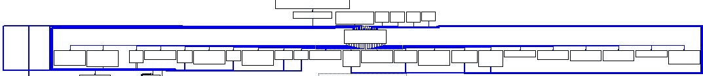
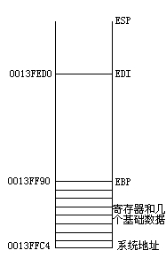

# VMProtect 加密程序解析

> 原文：[`www.pediy.com/kssd/pediy11/120127.html`](https://www.pediy.com/kssd/pediy11/120127.html)

此文章是我学习 VMProtect 虚拟机加密程序的心得，关于 VMProtect 宏观理论，参考了 N 多的网络文章和资料，做个笔记，以后好回顾，O(∩\_\_∩)O 哈哈~

软件：正版 `VMProtect2.04` 加密的 `Win98` 记事本

加密选项：除了 编译--调试模式与水印 以外，全部打钩；虚拟计算机--数量为默认值 1；编译类型：超级（变异+虚拟）

说明：即使是同一个程序，`VMProtect` 每次加密出来的代码都是不同的，所以如果你也去加密一个 `Win98` 记事本，是不会得到我下面的代码的。

## 一、VMProtect 虚拟机概述

虚拟机加密，就是说像 `VMP` 这样的保护程序，它会把源程序的 `X86` 指令变成自定义的伪指令，等到执行的时候，`VMP` 内置在保护程序中的 `VM` 就会启动，读取伪指令，然后解析执行。

`VMP` 是一个堆栈虚拟机，它的一切操作都是基于堆栈传递的。在 `VMP` 中，伪指令就是一个个的 handler，`VM` 中有一个核心的 Dispatch 部分，它通过读取程序的 bytecode，然后在 `DispatchiTable` 里面定位到不同的 handler 中执行。绝大多数情况下，在一个 handler 中执行完成后，程序将回到 Dispatch 部分，然后到 next handler 中执行。



在上面的框架中，核心的部件就是 Dispatch 部分，下面并列的部件就是 handlers。

经过 `VMP` 加密的 `X86` 指令，一条简单的指令被分解成数条 `VMP` 的伪指令，它按照自己的伪指令排列去实现原指令的功能，在加上其他的花指令混乱等等，你将完全看不到源程序指令。`VMP` 自带的各种机制都不再是以 `X86` 指令的形式去实现，而是用自己的伪指令去测试。

## 二、VMProtect 虚拟机具体解析

### 1）到达 VM 的 Dispatch 部分

`VMP` 要保存程序当前的 context 状况，然后进入虚拟代码执行

以下的代码完整粘贴自 `OD`。有`*`标记的是程序的流程代码。其他的是 junk code

`CPU` `Disasm`

```
Address   Hex dump          Command                                Comments

00437817   .  68 B59DF9FC   PUSH FCF99DB5

0043781C   .^ E9 F320FFFF   JMP 00429914

00429914   > /C70424 0A4142 MOV DWORD PTR SS:[ESP],E342410A          ; *

0042991B   . |56           PUSH ESI

0042991C   . |E8 E3C50000  CALL 00435F04

;开头放入了 1 个数字，这是基本数据。当然它现在是加密的。第一个 push 的数据并没有用，因为第二个 push 就覆盖掉了它，在动态调试中比较容易看出。

00435F04   $  E8 60160000   CALL 00437569                              ; \NOTEPAD.00437569

00437569  /$  C64424 04 87  MOV BYTE PTR SS:[ARG.1],87               ; NOTEPAD.00437569(guessed Arg1,Arg2,Arg3,Arg4,Arg5,Arg6,Arg7,Arg8,Arg9,Arg10,Arg11,Arg12,Arg13,Arg14,Arg15,Arg16,Arg17,Arg18,Arg19,Arg20)

0043756E  |.  C74424 08 D3A MOV DWORD PTR SS:[ARG.2],B433AFD3         ; *

00437576  |.  60           PUSHAD

00437577  |.  9C           PUSHFD

00437578  |.  8D6424 2C    LEA ESP,[ESP+2C] ；压入再多的数据都没用，这条指令直接修改了 ESP 指针

0043757C  \\.  E9 015C0000  JMP 0043D182

；又放入了一个数据，当然它依然是加密的

；当前堆栈情况：

；0013FFBC   B433AFD3  3

；0013FFC0   E342410A  .AB

；0013FFC4   7C817077  wp|   ; RETURN to kernel32.7C817077

0043D182  \\> /E9 31020000  JMP 0043D3B8

0043D3B8  /> \\60          PUSHAD

0043D3B9  |.  9C           PUSHFD

0043D3BA  |.  68 82589578  PUSH 78955882

0043D3BF  |.  897424 24    MOV DWORD PTR SS:[ESP+24],ESI              ; *

0043D3C3  |.  68 07421102  PUSH 2114207

0043D3C8  |.  68 8098AB76  PUSH 76AB9880

0043D3CD  |.  57           PUSH EDI

0043D3CE  |.  8D6424 30    LEA ESP,[ESP+30]

0043D3D2  \\.  E9 6C040000  JMP 0043D843

；我们现在可以来认识一点 VMP 的伎俩：

；1、虽然有很多的 push 指令，但是通过使用 lea esp,[esp+xx]这样的指令，前面的所有的 push 都将作废

；2、为了跳过前面的 junk push 指令，在真正需要往堆栈放入数据的时候就使用 mov dword ptr ss:[esp+xx],esi 这样的指令，跳过了堆栈的 xx 空间来存储

；保存 esi 寄存器

0043D843  |> >E8 B6F6FFFF  CALL 0043CEFE                                ; \NOTEPAD.0043CEFE

0043CEFE   $  BE 054674C6   MOV ESI,C6744605                             ; NOTEPAD.0043CEFE(guessed Arg1,Arg2,Arg3,Arg4,Arg5,Arg6,Arg7,Arg8,Arg9,Arg10,Arg11,Arg12,Arg13,Arg14,Arg15,Arg16,Arg17,Arg18,Arg19,Arg20)

0043CF03   .  8D6424 04     LEA ESP,[ESP+4]

0043CF07   .  0F80 D5050000 JO 0043D4E2

0043CF0D   .  57            PUSH EDI                                     ; *

0043CF0E   .  68 EF0D9B40   PUSH 409B0DEF

0043CF13   .  0FCF          BSWAP EDI

0043CF15   .  5F            POP EDI

0043CF16   .  53            PUSH EBX

0043CF17   .  891424        MOV DWORD PTR SS:[ESP],EDX                   ; *

0043CF1A   .  0FB6F1        MOVZX ESI,CL

0043CF1D   .  50            PUSH EAX                                     ; *

0043CF1E   .  9C            PUSHFD

0043CF1F   .  E9 C41A0000   JMP 0043E9E8

；保存 edi edx eax

0043E9E8  |> \\E8 8AF7FFFF  CALL 0043E177                                 ; \NOTEPAD.0043E177

0043E177  /$  66:0FCF       BSWAP DI                                     ; Undocumented instruction or encoding

0043E17A  |.  896C24 04     MOV DWORD PTR SS:[ARG.1],EBP                 ; *

0043E17E  \\.^ E9 BEF5FFFF  JMP 0043D741

；保存 ebp

0043D741  |> /871C24       XCHG DWORD PTR SS:[ESP],EBX                   ; *

0043D744  |.|9C            PUSHFD

0043D745  |.|60            PUSHAD

0043D746  |.|894C24 20     MOV DWORD PTR SS:[ESP+20],ECX                  ; *

0043D74A  |.|60            PUSHAD

0043D74B  |.|9C            PUSHFD

0043D74C  |.|66:891C24     MOV WORD PTR SS:[ESP],BX                       ; |Arg1

0043D750  |.|875424 40     XCHG DWORD PTR SS:[ESP+40],EDX                 ; *

0043D754  |.|E8 D50E0000   CALL 0043E62E                                    ; \NOTEPAD.0043E62E

；保存 ebx ecx 再次的保存 edx

0043E62E  /$  9C           PUSHFD                                          ; *

0043E62F  |.  8F4424 40    POP DWORD PTR SS:[ESP+40]                        ; *

0043E633  |.  66:89C6      MOV SI,AX

0043E636  |.  FF35 89D24300 PUSH DWORD PTR DS:[43D289]                      ; *

0043E63C  |.  8F4424 3C    POP DWORD PTR SS:[ESP+3C]                        ; *

；保存 eflags。和读取了一个数字 0 保存，这个 0 非常重要

0043E640  |.  0FCD          BSWAP EBP

0043E642  |.  66:FFC7      INC DI

0043E645  |.  47           INC EDI

0043E646  |.  C74424 38 000 MOV DWORD PTR SS:[ESP+38],0                    ; *

；再次放入了一个 0

；我们必须要在这里停顿一下了。由于是静态的看文章，O\_\_O"…，让我们来看一下堆栈：

0013FF90   00000000  ....  ; 0
0013FF94   00000000  ....  ; 数字 0
0013FF98   00000246  F..   ; eflags
0013FF9C   7C92E514  |     ; edx
0013FFA0   0013FFB0  .     ; ecx
0013FFA4   7FFDF000  .0    ; ebx
0013FFA8   0013FFF0  .     ; ebp
0013FFAC   00000000  ....  ；eax
0013FFB0   7C92E514  |     ;edx
0013FFB4   00500065  e.P.  ；edi
0013FFB8   00640061  a.d.  ；esi
0013FFBC   B433AFD3  3     ；最开始的 2 个基础加密数据
0013FFC0   E342410A  .AB
0013FFC4   7C817077  wp|   ; RETURN to kernel32.7C817077

；除了动态的 esp 寄存器，其他的寄存器已经保存完毕了，

0043E64E  |.  0FCD          BSWAP EBP

0043E650  |.  66:87D5      XCHG BP,DX

0043E653  |.  66:897C24 08 MOV WORD PTR SS:[ESP+8],DI

0043E658  |.  66:F7D3      NOT BX

0043E65B  |.  8B7424 68    MOV ESI,DWORD PTR SS:[ESP+68]                    ; *

；它读取的是第一个基础数据

0013FFC0   E342410A  .AB    ；*
0013FFC4   7C817077  wp|    ; RETURN to kernel32.7C817077

0043E65F  |.  66:0FCD      BSWAP BP                                        ; Undocumented instruction or encoding

0043E662  |.  0F98C6       SETS DH

0043E665  |.  0FCE         BSWAP ESI                                       ; *

0043E667  |.  66:F7D2      NOT DX

0043E66A  |.  66:0FBEEB    MOVSX BP,BL

0043E66E  |.  4E           DEC ESI                                         ; *

0043E66F  |.  66:FFC5      INC BP

0043E672  |.  20F6         AND DH,DH

0043E674  |.  66:C1D2 0E   RCL DX,0E

0043E678  |.  66:81FE 3214 CMP SI,1432                                      ; *

0043E67D  |.  81F6 63A1000A XOR ESI,0A00A163                                ; *

；到这里 esi 的计算完成，esi==0041E381，在 VMP 里，esi 都是指向 bytecode 的，看来马上就要开始读取了，然后跳转到 handler 了，哈哈。。还有一些准备工作的，就是要划分堆栈空间的，理解好 VMP 的堆栈空间划分是至关重要的。

0043E683  |.  45           INC EBP

0043E684  |.  80FD EF      CMP CH,0EF

0043E687  |.  66:0FB3D5    BTR BP,DX

0043E68B  |.  5A           POP EDX

0043E68C  |.  8D6C24 34    LEA EBP,[ESP+34]                                 ; *

；这里给 ebp 传递 0013FF90，切下第一刀

0043E690  |.  86F8         XCHG AL,BH

0043E692  |.  81EC 8C000000 SUB ESP,8C                                     ; *

；分配大段的堆栈空间

0043E698  |.  66:0FBEFA    MOVSX DI,DL

0043E69C  |.  89E7         MOV EDI,ESP                                      ; *

；这里给 edi 传递 0013FED0，切下第二刀



0043E69E  |>  C0FE 04       SAR DH,4

0043E6A1  |.  0F9FC3       SETG BL

0043E6A4  |.  FEC8         DEC AL

0043E6A6  |.  C0C0 02      ROL AL,2
```


### 1. Dispatch 核心逻辑与字节码读取

```
0043E6A9  |.  89F3             MOV EBX,ESI                     ; *
0043E6AB  |.  0FBAF2 05       BTR EDX,5
0043E6AF  |.  F7DA            NEG EDX
0043E6B1  |.  0FCA            BSWAP EDX
0043E6B3  |.  66:0FBAEA 0E    BTS DX,0E
0043E6B8  |.  0375 00         ADD ESI,DWORD PTR SS:[EBP]       ; *
0043E6BB  |>  66:0FA5FA       SHLD DX,DI,CL                   ; Dispatch
0043E6BF  |.  8A46 FF         MOV AL,BYTE PTR DS:[ESI-1]       ; *
```

在 `ebx` 中备份一下 `esi` 的 `0041e381`。`[ebp]` 中的是堆栈 `0013FF90` 里面的 `0`，看来这是一个偏移量，用来修正 bytecode 地址。开始读取 bytecode，看来准备工作完成。它没有读取 `[esi]`，而是 `[esi-1]`。

```
0043E6C2  |.  88FA            MOV DL,BH
0043E6C4  |.  30D8            XOR AL,BL                       ; * 在 ebx 中备份 bytecode 地址；原来是要地址参与到计算中
0043E6C6  |.  FECA            DEC DL
0043E6C8  |.  8D95 88EB93F7   LEA EDX,[EBP+F793EB88]
0043E6CE  |.  F6D0            NOT AL                          ; *
0043E6D0  |.  42              INC EDX
0043E6D1  |.  F7D2            NOT EDX
0043E6D3  |.  0F9FC2          SETG DL
0043E6D6  |.  FEC8            DEC AL                          ; *
0043E6D8  |.  D0CA            ROR DL,1
0043E6DA  |.  C0C8 07         ROR AL,7                        ; * 一直在计算 al 值，算好了
0043E6DD  |.  F5              CMC
0043E6DE  |.  C0E6 06         SHL DH,6
0043E6E1  |.  83EE 01        SUB ESI,1                       ; * 指针减 1
0043E6E4  |.  D0D2            RCL DL,1
0043E6E6  |.  66:0FB6D1       MOVZX DX,CL
0043E6EA  |.  66:D1DA         RCR DX,1
0043E6ED  |.  30C3            XOR BL,AL                       ; * bl 可是参与到计算的，bl 帮 al 算完了，现在 al 来帮 bl 算好下一次的值
0043E6EF  |.  60              PUSHAD
0043E6F0  |.  66:0FBAE1 06    BT CX,6
0043E6F5  |.^ E9 32E9FFFF     JMP 0043D02C
```

#### 地址解密与 Handler 查找

```
0043D02C  |>  /C0DE 07        RCR DH,7
0043D02F  |.  |0FB6C0         MOVZX EAX,AL                  ; *
0043D032  |.  |F5             CMC
0043D033  |.  |E9 E7200000    JMP 0043F11F
0043F11F  |>  \38F5           CMP CH,DH
0043F121  |.  66:FFC2         INC DX
0043F124  |.  8B1485 DBE143   MOV EDX,DWORD PTR DS:[EAX*4+43E1DB]  ; *等你等到我心痛呀
```

终于开始，`DispatchTable` 原来是在 `43E1DB`，获得的是加密的地址，如：`49C4C29F`，数据窗口去 `43E1DB` 看看，茫茫多的地址呀，有 200 多个，不过这个不代表着有 200 多个 handler，应该有一些是指向相同的 handler。

```
0043F12B  |.  F9              STC
0043F12C  |.  84F4            TEST AH,DH
0043F12E  |.  60              PUSHAD
0043F12F  |.^ E9 CCEFFFFF     JMP 0043E100
0043E100  |>  /81C2 6B197FB6  ADD EDX,B67F196B              ; *原来只用一条 ADD 指令就解出来了，上面的 49C4C29F=》0043DC0A，很简单的解密，自己可以去 DispatchTable 计算出所有的
0043E106  |.  |C60424 46     MOV BYTE PTR SS:[ESP],46
0043E10A  |.  |895424 3C     MOV DWORD PTR SS:[ESP+3C],EDX   ; * handler 地址存一下，存到哪里呢？看看堆栈吧
```

堆栈数据示例：
`0013FECC  0043DC0A  .C.  ; 存到这里`
`0013FED0  E5064000  .@   ;这里是 EDI 指向的空间，看一下前面的堆栈划分图`

#### Handler 调用准备

```
0043E10E  |.  |9C             PUSHFD
0043E10F  |.  |68 A42795AD    PUSH AD9527A4
0043E114  |.  |FF7424 0C      PUSH DWORD PTR SS:[ESP+0C]
0043E118  |.  |FF3424         PUSH DWORD PTR SS:[ESP]
0043E11B  |.  |FF7424 4C      PUSH DWORD PTR SS:[ESP+4C]      ; *
0043E11F  |.  |C2 5000       RETN 50                           ; *
```

这两条指令要一起看，第一条 push 的就是 `0013FECC  0043DC0A` 这个 handler 地址，第二条就跑去找 handler。

### 2）handlers 解析

紧接着上文，第一个进入的 handler：

```
; bytecode:[0041E380]=0C ; dispatchtable:[0043E563]=49C4C29F handleraddr:0043DC0A
; 功能（按照流程应该放在 handler 后面，但为了方便，把它放到这里）：把 ebpstack 中，ebp 指向的当前数据，移动到 edistack，具体位置则根据 eax 值变动；移动到[edi+eax]的位置
```

```
0043DC0A  |.  66:D3D2         RCL DX,CL
0043DC0D  |.  66:F7DA         NEG DX
0043DC10  |.  8D14A5 BD3F7D   LEA EDX,[FA7D3FBD]
0043DC17  |.  39F0            CMP EAX,ESI
0043DC19  |.  F6D8            NEG AL                          ; *
0043DC1B  |.  8D96 834403BB  LEA EDX,[ESI+BB034483]
0043DC21  |.  9C              PUSHFD
0043DC22  |.  F8              CLC
0043DC23  |.  66:0FCA         BSWAP DX                        ; Undocumented instruction or encoding
0043DC26  |.  C0C8 07        ROR AL,7                        ; *
0043DC29  |.  66:F7DA        NEG DX
0043DC2C  |.  8D92 915411CF  LEA EDX,[EDX+CF115491]
0043DC32  |.  FECA            DEC DL
0043DC34  |.  2C 20           SUB AL,20                       ; *
0043DC36  |.  81E2 37007496  AND EDX,96740037
0043DC3C  |.  C0D2 05         RCL DL,5
0043DC3F  |.  52              PUSH EDX
0043DC40  |.  F9              STC
0043DC41  |.  24 3C           AND AL,3C                       ; *
0043DC43  |.  8D6424 08       LEA ESP,[ESP+8]
0043DC47  |.  0F8F E90E0000   JG 0043EB36
```

#### 计算 EAX 值

```
0043EB36  />  \0FBDD4         BSR EDX,ESP
0043EB39  |.  66:81D2 A36F    ADC DX,6FA3
0043EB3E  |.  E8 3DF5FFFF     CALL 0043E080                   ; \\NOTEPAD.0043E080
```

#### Handler 入口 (0043E080)

```
0043E080  |$  8B55 00         MOV EDX,DWORD PTR SS:[EBP]      ; *
0043E083  |.  F6C6 E4         TEST DH,E4
0043E086  |.  83C5 04        ADD EBP,4                       ; *
0043E089  |.  60              PUSHAD
0043E08A  |.  60              PUSHAD
0043E08B  \.^ E9 47F3FFFF    JMP 0043D3D7
```

获取 `[ebp]` 数据，指针地址+4。

#### 数据移动至目标位置

```
0043D3D7  />  /891438         MOV DWORD PTR DS:[EDI+EAX],EDX  ; *
0043D3DA  |.  |FF3424         PUSH DWORD PTR SS:[ESP]
0043D3DD  |.  |68 7334B716    PUSH 16B73473
0043D3E2  |.  |8D6424 4C      LEA ESP,[ESP+4C]
0043D3E6  \.  |E9 D0120000    JMP 0043E6BB
```

移动到 `[edi+eax]` 位置。`ebpstack` 的值是那些呢，就是 `context` 和几个基础数据。handler 结束，回到 Dispatch 部分。

#### 返回 Dispatch 循环

```
0043E6BB  |>  >66:0FA5FA      SHLD DX,DI,CL                   ; Dispatch
0043E6BF  |.  |8A46 FF        MOV AL,BYTE PTR DS:[ESI-1]       ; *
0043E6C2  |.  |88FA            MOV DL,BH
0043E6C4  |.  |30D8            XOR AL,BL                       ; *
0043E6C6  |.  |FECA            DEC DL
0043E6C8  |.  |8D95 88EB93F7   LEA EDX,[EBP+F793EB88]
0043E6CE  |.  |F6D0            NOT AL                          ; *
0043E6D0  |.  |42              INC EDX
0043E6D1  |.  |F7D2            NOT EDX
0043E6D3  |.  |0F9FC2          SETG DL
0043E6D6  |.  |FEC8            DEC AL                          ; *
0043E6D8  |.  |D0CA            ROR DL,1
0043E6DA  |.  |C0C8 07        ROR AL,7                        ; *
0043E6DD  |.  |F5              CMC
0043E6DE  |.  |C0E6 06        SHL DH,6
0043E6E1  |.  |83EE 01        SUB ESI,1                       ; *
0043E6E4  |.  |D0D2            RCL DL,1
0043E6E6  |.  |66:0FB6D1       MOVZX DX,CL
0043E6EA  |.  |66:D1DA         RCR DX,1
0043E6ED  |.  |30C3            XOR BL,AL                       ; *
0043E6EF  |.  |60              PUSHAD
0043E6F0  |.  |66:0FBAE1 06    BT CX,6
0043E6F5  |.^|E9 32E9FFFF     JMP 0043D02C
```

#### 地址计算与跳转

```
0043D02C  |>  /C0DE 07        RCR DH,7
0043D02F  |.  |0FB6C0         MOVZX EAX,AL                  ; *
0043D032  |.  |F5             CMC
0043D033  |.  |E9 E7200000    JMP 0043F11F
0043F11F  |>  \38F5           CMP CH,DH
0043F121  |.  66:FFC2         INC DX
0043F124  |.  8B1485 DBE143   MOV EDX,DWORD PTR DS:[EAX*4+43E1DB]  ; *
0043F12B  |.  F9             STC
0043F12C  |.  84F4           TEST AH,DH
0043F12E  |.  60             PUSHAD
0043F12F  |.^ E9 CCEFFFFF    JMP 0043E100
0043E100  |>  /81C2 6B197FB6 ADD EDX,B67F196B              ; *
0043E106  |.  |C60424 46     MOV BYTE PTR SS:[ESP],46
0043E10A  |.  |895424 3C     MOV DWORD PTR SS:[ESP+3C],EDX   ; *
0043E10E  |.  |9C             PUSHFD
0043E10F  |.  |68 A42795AD    PUSH AD9527A4
0043E114  |.  |FF7424 0C      PUSH DWORD PTR SS:[ESP+0C]
0043E118  |.  |FF3424         PUSH DWORD PTR SS:[ESP]
0043E11B  |.  |FF7424 4C      PUSH DWORD PTR SS:[ESP+4C]      ; *
0043E11F  |.  |C2 5000       RETN 50                           ; *
```

我们要开始进入下一个 handler，以上的 dispatch 部分代码，在后面的文章中将不再出现。

### 2. 下一个 Handler


# Handler 1

; `bytecode:[0041E37F]=18` ; `dispatchtable:[0043E1F7]=49C4CED4` `handleraddr:0043E83F`

; 功能：读取 `[esi-4]` 的 `dword`，经过运算后，存入 `[ebp-4]`

```
0043E83F   .  F6D8           NEG AL
0043E841   .  80CC EA        OR AH,EA
0043E844   .  3F            AAS
0043E845   .  8B46 FC        MOV EAX,DWORD PTR DS:[ESI-4]           ; *
0043E848   .  F8            CLC
0043E849   .  80FE 1A       CMP DH,1A
0043E84C   .  F9            STC
0043E84D   .  0FC8          BSWAP EAX                                ; *
0043E84F   .  66:39F5       CMP BP,SI
0043E852   .  01D8          ADD EAX,EBX                              ; *
0043E854   .  F8            CLC
0043E855   .  60            PUSHAD
0043E856   .  F8            CLC
0043E857   .  C1C8 04       ROR EAX,4                                ; *
0043E85A   .^ E9 E6F0FFFF   JMP 0043D945
```

; 读取 `esi` 指向的 `bytecode` 数据中的下一个 `dword`，并进行运算

```
0043D945   > /C70424 164993 MOV DWORD PTR SS:[ESP],89934916
0043D94C   . |C64424 04 47  MOV BYTE PTR SS:[ESP+4],47
0043D951   . |F8            CLC
0043D952   . |8D76 FC       LEA ESI,[ESI-4]                          ; *
0043D955   . |F5            CMC
0043D956   . |2D E131FF38  SUB EAX,38FF31E1                         ; *
0043D95B   . |9C            PUSHFD                                   ; |Arg2
0043D95C   . |F9            STC                                      ; |
0043D95D   . |68 71811105  PUSH 5118171                             ; |Arg1 = 5118171
0043D962   . |66:0FBAE7 02 BT DI,2                                   ; |
0043D967   . |C1C0 0A        ROL EAX,0A                             ; |*
0043D96A   . |84C1          TEST CL,AL                               ; |
0043D96C   . |01C3          ADD EBX,EAX                              ; |
0043D96E   . |F9            STC                                      ; |
0043D96F   . |F5            CMC                                      ; |
0043D970   . |83ED 04       SUB EBP,4                                ; |*
0043D973   . |E8 98FDFFFF   CALL 0043D710                            ; \NOTEPAD.0043D710
```

；既然读出一个 `dword`，相应的就要修正 `esi` 指针 `[esi-4]`，并继续运算 `eax` 中取出的 `dword`
；最后有一条 `SUB EBP,4` 指令，如果我们结合上一个 handler 一起来看的话，前面把 `ebp+4`，这里重新让 `ebp` 回到了 `0013FF90`，继续指向 `ebpstack` 空间

```
0043D710  $  8945 00        MOV DWORD PTR SS:[EBP],EAX               ; *
0043D713  |.  9C            PUSHFD
0043D714  |.  51            PUSH ECX
0043D715  |.  FF3424        PUSH DWORD PTR SS:[ESP]
0043D718  |.  9C            PUSHFD
0043D719  |.  8D6424 3C     LEA ESP,[ESP+3C]
0043D71D  \.^ E9 37F7FFFF   JMP 0043CE59
```

； `eax` 中的运算结果 `8021D2F0`，存入 `[ebp]`

```
0043CE59  |> /98            CWDE
0043CE5A  |. |8D47 50       LEA EAX,[EDI+50]
0043CE5D  |. |F7C2 2BCFEA55 TEST EDX,55EACF2B
0043CE63  |. |E9 F01F0000   JMP 0043EE58

0043EE58  |> \60            PUSHAD
0043EE59  |.  66:0FA3F0     BT AX,SI
0043EE5D  |.  39C5          CMP EBP,EAX
0043EE5F  |.  E9 CDE5FFFF   JMP 0043D431

0043D431   > /E9 521C0000   JMP 0043F088

0043F088  /> \8D6424 20     LEA ESP,[ESP+20]
0043F08C  |.^ 0F87 29F6FFFF JA 0043E6BB
```

；handler 结束，返回 `dispatch`

# Handler 3

; `bytecode:[0041E37A]=52` ; `dispatchtable:[0043E59F]=49C4B5B9` `handleraddr:0043CF24`

; 功能：取出 `[ebp]` 数据，与 `[ebp-4]` 相加，保存在 `eax` 中，并清除 `[ebp]` 中的数据

```
0043CF24  /.  D2E4          SHL AH,CL
0043CF26  |.  F6D4          NOT AH
0043CF28  |.  8D0455 D1E8E1 LEA EAX,[EDX*2+E0E1E8D1]
0043CF2F  |.  8B45 00       MOV EAX,DWORD PTR SS:[EBP]               ; *
0043CF32  |.  66:0FA3F4     BT SP,SI
0043CF36  \\. E9 961F0000    JMP 0043EED1
```

；取出 `[EBP]` 数据，现在 `0013FF90` 中可不再是 `0` 了，而是上个 handler 中得到的数据 `8021D2F0`

```
0043EED1  |> \84C5          TEST CH,AL
0043EED3  |.  0145 04       ADD DWORD PTR SS:[EBP+4],EAX             ; *
0043EED6  |.  52            PUSH EDX
0043EED7  |.  C60424 83     MOV BYTE PTR SS:[LOCAL.0],83
0043EEDB  |.  8D6424 04     LEA ESP,[ARG.RETADDR]
0043EEDF  |.^ 0F83 68DFFFFF JNB 0043CE4D
```

; 取出的数据还要和 `[ebp+4]` 相加。
； `[0013FF94]=0`，还记得这个 `0` 是怎么来的，是 `VMP` 初始化部分是从内存中读出来的

```
0043CE4D  |> /60            PUSHAD
0043CE4E  |. |60            PUSHAD
0043CE4F  |. |9C            PUSHFD
0043CE50  |. |8F4424 3C     POP DWORD PTR SS:[ESP+3C]
0043CE54  |. |E9 66030000   JMP 0043D1BF

0043D1BF  /> \FF7424 3C     PUSH DWORD PTR SS:[ESP+3C]               ; *
0043D1C3  |.  8F45 00       POP DWORD PTR SS:[EBP]                   ; *
0043D1C6  |.  C70424 1D2D04 MOV DWORD PTR SS:[ESP],FC042D1D
0043D1CD  |.  9C            PUSHFD
0043D1CE  |.  9C            PUSHFD
0043D1CF  |.  9C            PUSHFD
0043D1D0  |.  8D6424 4C     LEA ESP,[ESP+4C]
0043D1D4  \\. E9 E2140000    JMP 0043E6BB
```

；重新填充数据到 `[ebp]` 中，不留痕迹，现在已经不能再堆栈中找到刚才的操作数了
；返回 `dispatch`

# Handler 4

和 1 相同

; `bytecode:[0041E379]=34` ; `dispatchtable:[0043E543]=49C4C29F` `handleraddr:0043DC0A`

; 功能：把 `ebpstack` 中，`ebp` 指向的当前数据，移动到 `edistack`，具体位置则根据 `eax` 值变动；移动到 `[edi+eax]` 的位置
； `[0013FEFC]=edx=ebp=00000286`

# Handler 5

和 1 相同

; `bytecode:[0041E378]=F5` ; `dispatchtable:[0043E57B]=49C4C29F` `handleraddr:0043DC0A`

; 功能：把 `ebpstack` 中，`ebp` 指向的当前数据，移动到 `edistack`，具体位置则根据 `eax` 值变动；移动到 `[edi+eax]` 的位置
； `[0013FEE0]=edx=ebp=8021D2F0`

# Handler 6

和 1 相同

; `bytecode:[0041E377]=07` ; `dispatchtable:[0043E54B]=49C4C29F` `handleraddr:0043DC0A`

; 功能：把 `ebpstack` 中，`ebp` 指向的当前数据，移动到 `edistack`，具体位置则根据 `eax` 值变动；移动到 `[edi+eax]` 的位置
； `[0013FEF8]=edx=ebp=00000246`

# Handler 7

和 1 大致相同

; `bytecode:[0041E376]=CD` ; `dispatchtable:[0043E59B]=49C4C29F` `handleraddr:0043DC0A`

; 功能：把 `ebpstack` 中，`ebp` 指向的当前数据，移动到 `edistack`，具体位置则根据 `eax` 值变动；移动到 `[edi+eax]` 的位置
； `[0013FED0]=edx=ebp=7C92E514`

```
0043DC0A  |.  66:D3D2       RCL DX,CL
0043DC0D  |.  66:F7DA       NEG DX
0043DC10  |.  8D14A5 BD3F7D LEA EDX,[FA7D3FBD]
0043DC17  |.  39F0          CMP EAX,ESI
0043DC19  |.  F6D8          NEG AL                               ; *
0043DC1B  |.  8D96 834403BB LEA EDX,[ESI+BB034483]
0043DC21  |.  9C            PUSHFD
0043DC22  |.  F8            CLC
0043DC23  |.  66:0FCA       BSWAP DX                               ; Undocumented instruction or encoding
0043DC26  |.  C0C8 07       ROR AL,7                               ; *
0043DC29  |.  66:F7DA       NEG DX
0043DC2C  |.  8D92 915411CF LEA EDX,[EDX+CF115491]
0043DC32  |.  FECA          DEC DL
0043DC34  |.  2C 20         SUB AL,20                              ; *
0043DC36  |.  81E2 37007496 AND EDX,96740037
0043DC3C  |.  C0D2 05       RCL DL,5
0043DC3F  |.  52            PUSH EDX
0043DC40  |.  F9            STC
0043DC41  |.  24 3C         AND AL,3C                              ; *
0043DC43  |.  8D6424 08     LEA ESP,[ESP+8]
0043DC47  |.  0F8F E90E0000 JG 0043EB36
```

；在前面的 handler 中，程序到这里就跳了。。但是这个不是。。程序流向下了。`eax` 出现了 `0`

```
0043DC4D  |.  60            PUSHAD
0043DC4E  |.  8B55 00       MOV EDX,DWORD PTR SS:[EBP]               ; *
0043DC51  \\. E9 86010000    JMP 0043DDDC

0043DDDC   > /E9 E4000000   JMP 0043DEC5

0043DEC5  |> \881424        MOV BYTE PTR SS:[ESP],DL
0043DEC8  |.  0FBAE6 05     BT ESI,5
0043DECC  |.  83C5 04       ADD EBP,4                                ; *
0043DECF  |.  9C            PUSHFD
0043DED0  |.  68 FA794941   PUSH 414979FA                            ; |Arg1 = 414979FA
0043DED5  |.  C64424 04 65  MOV BYTE PTR SS:[ESP+4],65               ; |Arg2 => 65
0043DEDA  |.  E8 87F6FFFF   CALL 0043D566                            ; \NOTEPAD.0043D566

0043D566  /$  891438        MOV DWORD PTR DS:[EDI+EAX],EDX           ; *
0043D569  |.  9C            PUSHFD
0043D56A  |.  C60424 2E     MOV BYTE PTR SS:[ESP],2E
0043D56E  |.  FF3424        PUSH DWORD PTR SS:[ESP]
0043D571  |.  8D6424 34     LEA ESP,[ESP+34]
0043D575  \\. E9 41110000    JMP 0043E6BB
```

经过这几天的 `VMP` 跟踪，在做了紧张的思想斗争后，本人决定放弃原来的想法，不再去记录所有的 `handlers` 了，我放弃了，我 `give up` 了。。。


# VMP 宏观分析：Handlers 解析

我决定从宏观上去看 VMP。对于 handlers 也是一样，还是提供一些精品 handlers 吧。有时间就来更新这个帖子，没时间就不来了。

要看这个还是要对 `vmp` 的堆栈划分有明确的理解。我把 `ebp` 指向的堆栈部分叫 `ebpstack`，把 `edi` 指向的堆栈部分叫 `edistack`，把 `esp` 指向的堆栈部分叫 `espstack`。

## 核心概念：首次处理的重要性

第一次很重要，所以我决定不是放一个，而是放两个 handlers，特别突出这个 `first` 的重要性。

### the first

#### handler address: `0043DC0A`

**源代码：**

```
CPU Disasm
Address   Hex dump        Command                         Comments

0043DC0A  66:D3D2        RCL  DX,CL
0043DC0D  66:F7DA        NEG  DX
0043DC10  8D14A5 BD3F7DFA LEA EDX,[FA7D3FBD]
0043DC17  39F0            CMP  EAX,ESI
0043DC19  F6D8            NEG  AL                       ; *
0043DC1B  8D96 834403BB   LEA EDX,[ESI+BB034483]
0043DC21  9C              PUSHFD
0043DC22  F8              CLC
0043DC23  66:0FCA        BSWAP DX                       ; Undocumented instruction or encoding
0043DC26  C0C8 07        ROR  AL,7                      ; *
0043DC29  66:F7DA        NEG  DX
0043DC2C  8D92 915411CF   LEA EDX,[EDX+CF115491]
0043DC32  FECA            DEC  DL
0043DC34  2C 20           SUB  AL,20                     ; *
0043DC36  81E2 37007496   AND EDX,96740037
0043DC3C  C0D2 05        RCL  DL,5
0043DC3F  52              PUSH EDX
0043DC40  F9              STC
0043DC41  24 3C           AND  AL,3C                     ; *
0043DC43  8D6424 08       LEA  ESP,[ESP+8]
0043DC47  0F8F E90E0000   JG   0043EB36   ；这里有一个分支，但是两个分支都是一样的，除了有一次走过另一个分支，其他都是跳走了，所以下面的代码我也就不发了，发跳转部分。

0043EB36  0FBDD4            BSR  EDX,ESP
0043EB39  66:81D2 A36F    ADC  DX,6FA3
0043EB3E  E8 3DF5FFFF      CALL 0043E080

0043E080  8B55 00          MOV  EDX,DWORD PTR SS:[EBP]       ; *
0043E083  F6C6 E4          TEST DH,E4
0043E086  83C5 04          ADD  EBP,4                     ; *
0043E089  60              PUSHAD
0043E08A  60              PUSHAD
0043E08B  ^ E9 47F3FFFF    JMP  0043D3D7

0043D3D7  891438          MOV  DWORD PTR DS:[EDI+EAX],EDX    ; *
0043D3DA  FF3424          PUSH DWORD PTR SS:[ESP]
0043D3DD  68 7334B716     PUSH 16B73473
0043D3E2  8D6424 4C       LEA  ESP,[ESP+4C]
0043D3E6  E9 D0120000     JMP  0043E6BB  ；到这里就结束了，下面就回到 Dispatch 部分了
```

估计没有人有兴趣去静态分析和好好的看上面的代码，我还是再贴个去除了 junk code 的简化版本。

```
0043DC19    F6D8         NEG  AL                      ; *
0043DC26    C0C8 07     ROR  AL,7                    ; *
0043DC34    2C 20       SUB  AL,20                   ; *
0043DC41    24 3C       AND  AL,3C                   ; *
0043E080    8B55 00     MOV  EDX,DWORD PTR SS:[EBP]    ; *
0043E086    83C5 04     ADD  EBP,4                   ; *
0043D3D7    891438      MOV  DWORD PTR DS:[EDI+EAX],EDX; *
```

计算 `al`，以 `al` 为索引，执行 `mov [edi+eax], [ebp]`。`al` 是从 bytecode 里读出来的，`vmp` 的 bytecode 压力应该是很大的。首先是在 `Dispatch` 里计算出来 `al`，然后通过 `[EAX*4+43E1DB]` 得到 `handleraddress`，这样了还不不能休息，进入这样的 handler 里面，还要继续参与计算。

这就是一个移动数据，`VMP` 不断的使用这个 handler，把数据从 `ebpstack` 移动到 `edistack`。感觉 `vmp` 挺无聊的，有事的时候调用一下这个，没事的时候也调用一下这个，把数据挪去挪来的。

### 对应的反向移动 Handler

挪去还要挪来，这就有了一个和它相对应的 handler。

#### handler address: `0043DFBE`

**源代码：**

```
CPU Disasm
Address   Hex dump        Command                         Comments

0043DFBE  0FBED3          MOVSX EDX,BL
0043DFC1  F6D8            NEG  AL                       ; *
0043DFC3  66:0FB6D2      MOVZX DX,DL
0043DFC7  66:0FABDA      BTS  DX,BX
0043DFCB  0FCA            BSWAP EDX
0043DFCD  C0C8 07        ROR  AL,7                      ; *
0043DFD0  66:0FABD2      BTS  DX,DX
0043DFD4  9C              PUSHFD
0043DFD5  66:89EA        MOV  DX,BP
0043DFD8  00FA            ADD  DL,BH
0043DFDA  2C 20           SUB  AL,20                     ; *
0043DFDC  F5              CMC
0043DFDD  24 3C           AND  AL,3C                     ; *
0043DFDF  E8 84EEFFFF     CALL 0043CE68

0043CE68  D2E2            SHL  DL,CL
0043CE6A  28FA            SUB  DL,BH
0043CE6C  8B1438          MOV  EDX,DWORD PTR DS:[EDI+EAX]  ; *
0043CE6F  F5              CMC
0043CE70  9C              PUSHFD
0043CE71  83ED 04         SUB  EBP,4                     ; *
0043CE74  E8 00000000     CALL 0043CE79
0043CE79  8955 00         MOV  DWORD PTR SS:[EBP],EDX    ; *
0043CE7C  9C              PUSHFD
0043CE7D  FF3424          PUSH DWORD PTR SS:[ESP]
0043CE80  8D6424 18       LEA  ESP,[ESP+18]
0043CE84  ^ E9 D0FFFFFF   JMP  0043CE59

0043CE59  /98             CWDE
0043CE5A  |8D47 50       LEA  EAX,[EDI+50]
0043CE5D  |F7C2 2BCFEA55 TEST EDX,55EACF2B
0043CE63  |E9 F01F0000   JMP  0043EE58

0043EE58  \\60            PUSHAD
0043EE59  66:0FA3F0      BT   AX,SI
0043EE5D  39C5            CMP  EBP,EAX
0043EE5F  ^ E9 CDE5FFFF   JMP  0043D431

0043D431  /E9 521C0000   JMP  0043F088

0043F088  \\8D6424 20    LEA  ESP,[ESP+20]
0043F08C  ^ 0F87 29F6FFFF JA   0043E6BB
```

以上代码完整粘贴自 OD，简化后的代码如下：

```
0043DFC1    F6D8         NEG  AL                      ; *
0043DFCD    C0C8 07     ROR  AL,7                    ; *
0043DFDA    2C 20       SUB  AL,20                   ; *
0043DFDD    24 3C       AND  AL,3C                   ; *
0043CE6C    8B1438      MOV  EDX,DWORD PTR DS:[EDI+EAX]; *
0043CE71    83ED 04     SUB  EBP,4                   ; *
0043CE79    8955 00     MOV  DWORD PTR SS:[EBP],EDX  ; *
```

这个 handler 和上一个是对应的，这个是计算 `al`，以 `al` 为索引，把数据从 `[edi+eax]` 移动到 `[ebp]`，也就是把数据从 `edistack` 移动到 `ebpstack`。

通过这 2 个 handlers，`VMP` 把数据动来动去，有事时候动一下，没事时候动一下，无聊时候动一下。

### the second

#### handler address: `0043D198`

```
0043D198  98              CWDE
0043D199  66:0FBCD2      BSF  DX,DX
0043D19D  10EA            ADC  DL,CH
0043D19F  66:0FB6C2      MOVZX AX,DL
0043D1A3  8B45 00         MOV  EAX,DWORD PTR SS:[EBP]      ; *
0043D1A6  66:F7C3 3739    TEST BX,3937
0043D1AB  D0D2            RCL  DL,1
0043D1AD  8B55 04         MOV  EDX,DWORD PTR SS:[EBP+4]     ; *
0043D1B0  66:0FBAE5 05    BT   BP,5
0043D1B5  68 3B4E2623     PUSH 23264E3B
0043D1BA  E9 EA0C0000     JMP  0043DEA9

0043DEA9  \\66:0FBAE5 06  BT   BP,6
0043DEAE  F7D0            NOT  EAX                    ; *
0043DEB0  ^ E9 2CFFFFFF   JMP  0043DDE1

0043DDE1  /F7D2           NOT  EDX                    ; *
0043DDE3  |F8             CLC
0043DDE4  |E8 D8EFFFFF    CALL 0043CDC1

0043CDC1  F8              CLC    ; NOTEPAD.0043CDC1(guessed Arg1,Arg2,Arg3,Arg4,Arg5,Arg6,Arg7,Arg8,Arg9,Arg10,Arg11,Arg12,Arg13,Arg14,Arg15,Arg16,Arg17,Arg18,Arg19,Arg20)
0043CDC2  21D0            AND  EAX,EDX                  ; *
0043CDC4  E9 28130000     JMP  0043E0F1

0043E0F1  \\9C            PUSHFD
0043E0F2  60              PUSHAD
0043E0F3  68 E0E4B3D7     PUSH D7B3E4E0
0043E0F8  8945 04         MOV  DWORD PTR SS:[EBP+4],EAX   ; *
0043E0FB  ^ E9 FBEFFFFF   JMP  0043D0FB

0043D0FB  /9C             PUSHFD                         ; *
0043D0FC  |8F4424 2C     POP  DWORD PTR SS:[ESP+2C]     ; *
0043D100  |E9 371B0000   JMP  0043EC3C

0043EC3C  \\C64424 04 8D  MOV  BYTE PTR SS:[ESP+4],8D
0043EC41  55              PUSH EBP
0043EC42  FF7424 0C       PUSH DWORD PTR SS:[ESP+0C]
0043EC46  FF7424 34       PUSH DWORD PTR SS:[ESP+34]     ; *
0043EC4A  8F45 00         POP  DWORD PTR SS:[EBP]        ; *
0043EC4D  9C              PUSHFD
```


### 汇编代码简化

以下代码经过简化处理：

```
0043EC4E    8D6424 3C       LEA ESP,[ESP+3C]
0043EC52  ^ E9 64FAFFFF     JMP 0043E6BB
```

```
0043D1A3    8B45 00         MOV EAX,DWORD PTR SS:[EBP]             ; *
0043D1AD    8B55 04         MOV EDX,DWORD PTR SS:[EBP+4]           ; *
0043DEAE    F7D0            NOT EAX                                 ; *
0043DDE1   /F7D2           NOT EDX                                 ; *
0043CDC2    21D0            AND EAX,EDX                             ; *
0043E0F8    8945 04         MOV DWORD PTR SS:[EBP+4],EAX           ; *
0043D0FB   /9C             PUSHFD                                    ; *
0043D0FC   |8F4424 2C      POP DWORD PTR SS:[ESP+2C]               ; *
0043EC46    FF7424 34      PUSH DWORD PTR SS:[ESP+34]               ; *
0043EC4A    8F45 00        POP DWORD PTR SS:[EBP]                   ; *
```

简化逻辑如下：
`a=[ebp]`, `b=[ebp+4]`
`not a`
`not b`
`and a,b`
`mov [ebp+4],a`

最后的 `a` 放到原来的 `b` 位置，都是在 `ebpstack` 中。

下半部分这个也经常可以看到，关键在于它第二个 `push` 的数据的位置，这个位置就在 `edi` 指针的上一个位置，`edi=0013FFD0`，而这个 `push` 的位置是 `0013FFCC`，这就是第一个 `PUSH` 放进去的数据。

现在我们可以知道，当上面的计算完成后，结果是放到原来的 `b` 位置，而 `a` 位置是被当前的标志位覆盖掉。

### Handler 逻辑分析

这个 `handler` 可是很重要的东西，先来看它上半部分，我们再简化一下。

这个 `handler` 这么著名，原因在于哪里呢？这个我就不班门弄斧了，直接贴一段别人的劳动成果：

以下内容粘贴自：`http://hi.baidu.com/depteicn/blog/item/4941f6b73c8036f331add189.html`

`vmp` 里面只有 1 个逻辑运算指令 `not_not_and` 设这条指令为 `P`

`P(a,b) = ~a & ~b`

这条指令的神奇之处就是能模拟 `not` `and` `or` `xor` 4 条常规的逻辑运算指令

怕忘记了，直接给出公式，后面的数字指需要几次 `P` 运算

```
not(a)   = P(a,a)                1
and(a,b) = P(P(a,a),P(b,b))      3
or(a,b)  = P(P(a,b),P(a,b))      2
xor(a,b) = P(P(P(a,a),P(b,b)),P(a,b)) 5
```

上面的次数应该是最少需要的次数了，当然也可以展开，那样就更加复杂了

`vmp` 用 1 条指令模拟了 4 条指令，因此逆向起来比较复杂，如果中间夹杂垃圾运算，那么工程量非同小可

下面来证明一下上面 4 条等式

```
not(a)   = ~a = ~a & ~a = P(a,a)
and(a,b) = a & b = ~(~a) & ~(~b) = P(not(a),not(b)) = P(P(a,a),P(b,b))
or(a,b)  = a | b = ~(~(a|b)) = ~(~a & ~b) = ~P(a,b) = P(P(a,b),P(a,b))
xor(a,b) = ~a & b | a & ~b = ~(~(~a & b | a & ~b)) = ~(~(~a & b) & ~(a & ~b)) = ~((a | ~b) & (~a | b)) = ~(1 | 1 | a & b | ~a & ~b) = ~(a & b) & ~(~a & ~b) = P(and(a,b),P(a,b)) = P(P(P(a,a),P(b,b)),P(a,b))
```

上面的 `xor` 是最复杂的，不过简化后也只需要 5 次运算就可以实现了

至于 `eflag`，`eflag` 是根据结果来定的，由于都是逻辑运算，所以最后取一下 `eflag` 即可

在某修改版的 `vm` 中，还可以看到另一个强大的指令 `not_not_or` 设这条指令为 `Q`

`Q(a,b) = ~a | ~b`

同样，这一条指令可以模拟 4 条常规的逻辑运算指令

怕忘记了，直接给出公式，后面数字表示需要几次 `Q` 运算

```
not(a)   = Q(a,a)                      1
and(a,b) = Q(Q(a,b),Q(a,b))            2
or(a,b)  = Q(Q(a,a),Q(b,b))            3
xor(a,b) = Q(Q(Q(a,a),b),Q(a,Q(b,b)))  5
```

基本和上面 `P` 指令相同，效率没什么变化

只对最复杂的 `xor` 证明一下，以防忘记

```
xor(a,b) = ~a & b | a & ~b = ~(~(~a & b | a & ~b)) = ~(~(~a & b) & ~(a & ~b)) = ~((~(~a) | ~b) & (~a | ~(~b))) = ~(~(~a) | ~b) | ~(~a | ~(~b)) = Q(Q(not(a),b),Q(a,not(b))) = Q(Q(Q(a,a),b),Q(a,Q(b,b)))
```

实在太难了，完全搞不定啊

写得太好了，不用解释了

还是说一下，只用一句话的讲么：就是说，通过上面一个 `handler` 的不断调用，`VMP` 可以实现 `not` `and` `or` `xor` 这 4 个逻辑运算。（真的只用一句话就解释了(⊙o⊙)哦。。哈哈哈哈）

`12 楼 yingyue` 还有说明

### NAND 门操作详解

接着搞 `NAND` 门，我们来看一下第一次 `NAND` 的操作全程。

这次呢要多打字少粘代码。。^\_^

由于我现在回过头来讲，有些地方，我说这个是 `XX` 数，那个是 `XX` 数，其实是后面才知道的，刚看到的时候，我也不知道洒。

我尽量的让各位大爷们，即使是静态的看也看清楚。先说点基础洒

`junk code` 太多，简化了，贴代码就直接贴关键的了。

讲故事都要有前奏，这个故事的前奏是这样的，你站在 `Dispatch` 这里，现在的情况是这样的：`ESI=0041E381` 这个指向的是 `bytecode` 的位置；堆栈的情况是这样的：`EBP=0013FF90`，从这里到系统进门的堆栈 `0013FFC4` 的位置，存着原程序的 `context` 和几个基础数据，共 13 个数据，我把下面的这小截堆栈这里叫做 `ebpstack`；`EDI=0013FED0`，它在 `ebpstack` 的上面，我上面这一大截叫做 `edistack`；`ESP=0013FED0`，现在它等于 `EDI`，而程序开始后，`EDI` 是不变了，而 `ESP` 呢，会随着程序的堆栈操作变化而不断发展，我 `0013FED0` 以上的所有堆栈叫做 `ebpstack`。下面呢 `VM` 启动，`VM` 首先要做什么呢，它先要把 `context` 和其他的几个基础数据从 `ebpstack` 保存到 `edistack` 中，好了，现在保存好了，`VM` 有其他动作了，我们的故事要开始了。

用到的 `handlers`:

#### 1

`;handleraddr:0043DFBE`
`;功能：计算 AL，以 AL 为索引，读取 edistack 到[ebp]`
`；命名：VM_MOVdw_[EBP],[EDI+EAX]`

```
0043DFC1    F6D8          NEG AL                            ; *
0043DFCD    C0C8 07      ROR AL,7                          ; *
0043DFDA    2C 20        SUB AL,20                         ; *
0043DFDD    24 3C        AND AL,3C                         ; *
0043CE6C    8B1438       MOV EDX,DWORD PTR DS:[EDI+EAX]    ; *
0043CE71    83ED 04      SUB EBP,4                         ; *
0043CE79    8955 00      MOV DWORD PTR SS:[EBP],EDX        ; *
```

#### 2

`;handleraddr:0043D978`
`;功能：从[esi]读取到 al，计算 al，放入[ebp-2]`
`；命名：VM_MOVw_[EBP-2],[EDI-1]`

```
0043D979    0FB646 FF   MOVZX EAX,BYTE PTR DS:[ESI-1]      ; *
0043D97E    30D8        XOR AL,BL                           ; *
0043D1ED    FEC8        DEC AL                              ; *
0043D1F0    F6D8        NEG AL                              ; *
0043D1F7    F6D0        NOT AL                              ; *
0043D1FD    30C3        XOR BL,AL                           ; *
0043CEE8   /83ED 02     SUB EBP,2                           ; *
0043DD79    66:8945 00  MOV WORD PTR SS:[EBP],AX            ; *
0043DD62    4E          DEC ESI                             ; *
```

#### 3

`handleraddr:0043E83F`
`;功能：读取[esi-4]的 dword，经过运算后，存入[ebp-4]`
`；命名：VM_MOVdw_[EBP-4],[ESI-4]`

```
0043E845    8B46 FC     MOV EAX,DWORD PTR DS:[ESI-4]        ; *
0043E84D    0FC8        BSWAP EAX                           ; *
0043E852    01D8        ADD EAX,EBX                         ; *
0043E857    C1C8 04     ROR EAX,4                           ; *
0043D952    8D76 FC     LEA ESI,[ESI-4]                     ; *
0043D956    2D E131FF38 SUB EAX,38FF31E1                    ; *
0043D967    C1C0 0A     ROL EAX,0A                          ; *
0043D96C    01C3        ADD EBX,EAX                         ; *
0043D970    83ED 04     SUB EBP,4                           ; *
0043D710    8945 00     MOV DWORD PTR SS:[EBP],EAX          ; *
```

#### 4

`;handleraddr:0043D8BD`
`;功能：从[ebp]地址空间读取一个字节到到 al。ax 存入[ebp+2]`
`;命名：VM_MOVb_[EBP+2],[MemAddr]   MemAddr=[EBP]`

```
0043D57B    8B55 00     MOV EDX,DWORD PTR SS:[EBP]          ; *
0043D589    83C5 02     ADD EBP,2                           ; *
0043D591    8A02        MOV AL,BYTE PTR DS:[EDX]            ; *
0043E70B    66:8945 00  MOV WORD PTR SS:[EBP],AX            ; *
```

#### 5

`;handleraddr:0043D72E`
`;功能：当前 ebp 指针存入[ebp-4]`
`；命名：VM_MOVdw_[EBP+4],EBP`

```
0043D72F    89E8        MOV EAX,EBP                         ; *
0043E613    83ED 04     SUB EBP,4                           ; *
0043E61C    8945 00     MOV DWORD PTR SS:[EBP],EAX          ; *
```

#### 6

`;handleraddr:0043E790`
`；功能：把 ebp 指向 a，[a]取出 word，放入[ebp+2]`
`；命名：VM_MOVw_[EBP+2],[[EBP]]`

```
0043E79C    8B55 00     MOV EDX,DWORD PTR SS:[EBP]          ; *
0043E7A7    83C5 02     ADD EBP,2                           ; *
0043E7AE    36:8A02     MOV AL,BYTE PTR SS:[EDX]            ; *
0043D01B    66:8945 00  MOV WORD PTR SS:[EBP],AX            ; *
```

#### 7

`;handleraddr:0043EB92`
`;功能：nand 门`
`命名：VM_NAND`

```
0043EB94    66:8B45 00  MOV AX,WORD PTR SS:[EBP]            ; *
0043EBA5    66:8B55 02  MOV DX,WORD PTR SS:[EBP+2]          ; *
0043EBB3    F6D0        NOT AL                              ; *
0043EBBB    F6D2        NOT DL                              ; *
0043EBC1    83ED 02     SUB EBP,2                           ; *
0043EBC5    20D0        AND AL,DL                           ; *
0043EBCD    66:8945 04  MOV WORD PTR SS:[EBP+4],AX          ; *
0043D26F    FF7424 28   PUSH DWORD PTR SS:[ESP+28]          ; *
0043D273    8F45 00     POP DWORD PTR SS:[EBP]              ; *
```

#### 8

`handleraddr:0043DC0A esi=0041E380`
`;功能：ebp 指向的当前数据，移动到 edistack，具根据 eax 值为索引；移动到[edi+eax]的位置`
`；命名：VM_MOVdw_[EDI+EAX],[EBP]`


## 汇编代码段

```
0043DC19  |.  F6D8            NEG AL                            ; *
0043DC26  |.  C0C8 07        ROR AL,7                          ; *
0043DC34  |.  2C 20          SUB AL,20                          ; *
0043DC41  |.  24 3C          AND AL,3C                          ; *
0043E080  |$  8B55 00        MOV EDX,DWORD PTR SS:[EBP]          ; *
0043E086  |.  83C5 04        ADD EBP,4                          ; *
0043D3D7  /> /891438        MOV DWORD PTR DS:[EDI+EAX],EDX      ; *
```

现在开始：

### 1. `VM_MOVdw_[EBP],[EDI+EAX]`

把 context 中的标志寄存器 `EFL` 读出来，放入 `ebpstack`：

`ebp=0013FFC0`

**CPU Stack**

| Locked | Value | ASCII Comments |
| :--- | :--- | :--- |
| `0013FFC0` | `00000246` | `F..`；就是它了，原来的 `EFL` |

### 2. `VM_MOVw_[EBP-2],[EDI-1]`

从 bytecode 里面弄了一个 byte 的数字出来，计算后，放到 `ebpstack`（读的时候是 byte，存的时候是 word，最后还是命名为 `MOVw`）：

`ebp=0013FFBE`

**CPU Stack**

| Locked | Value | ASCII Comments |
| :--- | :--- | :--- |
| `0013FFBC` | `0011AFD3` | `..`；堆栈数据要倒过来看，放进去的 word 是 `0011` |
| `0013FFC0` | `00000246` | `F..` |

；（实际上计算出来的是 byte，中间的 `11` 而已）

### 3. `VM_MOVdw_[EBP-4],[ESI-4]`

再从 bytecode 里面弄出一个 dword，计算后，放入 `ebpstack`：

`ebp=0013FFBA`

**CPU Stack**

| Locked | Value | ASCII Comments |
| :--- | :--- | :--- |
| `0013FFB8` | `7D510061` | `a.Q}`；看得出来放进去的是谁吗？是 `00427D51` |
| `0013FFBC` | `00110042` | `B...` |
| `0013FFC0` | `00000246` | `F..` |

### 4. `VM_MOVb_[EBP+2],[MemAddr]` `MemAddr=[EBP]`

原来上面一个 handler 计算出来的一个地址 `00427D51`，这个 handler 呢和上一个是搭配着一起用的，把 `[00427D51]` 的一个 byte 取出来，存的时候呢是以 word 覆盖掉原来的 `ebpstack` 位置：

**CPU Stack**

| Locked | Value | ASCII Comments |
| :--- | :--- | :--- |
| `0013FFB8` | `7D510061` | `a.Q}`；这一行是来打酱油的 |
| `0013FFBC` | `00110022` | `....`；这一行才是真玩意，计算出来 `22` |
| `0013FFC0` | `00000246` | `F..` |

### 5. `VM_MOVdw_[EBP+4],EBP`

其实你应该要知道中间的一行就是操作数了，现在还需要什么呢？还需要操作数的位置：

**CPU Stack**

| Locked | Value | ASCII Comments |
| :--- | :--- | :--- |
| `0013FFB8` | `0013FFBC` | `.`；操作数位置 |
| `0013FFBC` | `00110022` | `....`；操作数 |
| `0013FFC0` | `00000246` | `F..`；原标志位 `EFL` |

### 6. `VM_MOVw_[EBP+2],[[EBP]]`

`VM` 取出一个操作数，复制一份到 `[ebp+2]`，为什么要有这个 handler，不是已经有两个操作数了吗？想象关于用 `NAND` 模拟 `NOT(a)` 的时候，是 `NAND(a,a)`，这个时候我们不就需要 2 个 `a` 数据，才能实现 `not` 指令。

**CPU Stack**

| Locked | Value | ASCII Comments |
| :--- | :--- | :--- |
| `0013FFB8` | `0022FFBC` | `..`；复制了一份操作数 |
| `0013FFBC` | `00110022` | `....` |
| `0013FFC0` | `00000246` | `F..` |

### 7. `VM_NAND`

`ebp` 是指向 `0013FFBA` 的，所以这里的两个操作数将是 `0022` 与 `0022`，实际里面是 byte 操作，真正的操作数是 `22` 与 `22`。哦不可思议呀，我们已经用 `NAND(22,22)`，实际的操作是 `not(22)`

**CPU Stack**

| Locked | Value | ASCII Comments |
| :--- | :--- | :--- |
| `0013FFB8` | `00000286` | `..`；这个位置已经无用了，用当前 `EFL` 覆盖了 |
| `0013FFBC` | `001100DD` | `..`；计算结果是 `DD`，存为 `00DD` |
| `0013FFC0` | `00000246` | `F..` |

### 8. `VM_MOVdw_[EDI+EAX],[EBP]`

调用这个 handler，是为了去掉 `ebpstack` 的栈顶数据

**CPU Stack**

| Locked | Value | ASCII Comments |
| :--- | :--- | :--- |
| `0013FFBC` | `001100DD` | `..` |
| `0013FFC0` | `00000246` | `F..` |

今天到此结束，`0011` 这个数据在这里就是一个打酱油的，都没有登场的机会。预知后事如何，请听下回分解！砰！！！！

（关于 handler 的命名，太微观了不直接，太宏观了体现不出细节，我命名的太糟糕了）

加点东西，宏观上看，就是这样：

```
push  a                     ;0011                来自 bytecode 运算 a
push  b1                   ;0022                来自 bytecode 运算出内存地址 memaddr，再从[memaddr]获得 b
push  b2                   ;0022                复制 b
call    nand               ;nand 用到 2 个参数 b1\b2    由于 nand(b、b)相当于 not(b)   最后的结果存入到 b1 位置，这是堆栈还有一个无用位置 b2
pop                       ;清除一个栈顶数据 b2
```

再简化：

```
push a
not    b
```

（这里 a 没有参加运算，实际不用看 a 数据就 Ok 了

这个回调函数要悲剧了。。今天是不可能放出来了。。明天也不可能放出来了。何年何月出来要看了。。

我原来没有细看。。VMP 的 TLS 回调函数里面装的东西，居然他妈的是一个完整的 VM。和程序执行的那个用的是相同的初始化和 Dispatch。。

在程序里面不能设置 `int3` 和硬件断点。。因为 TLS 里面已经执行过一个 VM 了。。它做了多少事情呀。。我们跟着进去的其实 VMP 已经做了很多事情了。

本来想着看看不能设置 `int3` 和硬件断点。。进去 TLS 看看。。还想着 TLS 里。。VM 没有启动的话。。是不是能爽到直接看普通指令。。想不到。。原来 TLS 里面还有一个完整的 VM。。

慢慢来吧。。也没有想着。一下子就搞定 VMP。。

至少 `VMt` 里面是有着代码检测指令的。。刚好看看 VMP 是怎么检测的。。看 VMP 花几百条指令完成一个 `not(a)`。。总比不过看点 VMP 的代码检测。。

### 指令序列分析

```
VM_POPdw_EDISTACK
VM_PUSHdw_BYTECODEdw
VM_ADDdw_EBPSTACK
VM_POPdw_EDISTACK
VM_POPdw_EDISTACK
VM_POPdw_EDISTACK
VM_POPdw_EDISTACK
VM_POPdw_EDISTACK
VM_POPdw_EDISTACK
VM_POPdw_EDISTACK
VM_POPdw_EDISTACK
VM_POPdw_EDISTACK
VM_POPdw_EDISTACK
VM_POPdw_EDISTACK
VM_POPdw_EDISTACK
VM_POPdw_EDISTACK
VM_PUSHw_BYTECODEb
VM_PUSHdw_BYTECODEdw
VM_MOVb_EBPSTACK_[MEMADDR] MEMADDR=[EBP]
;两条指令实现一个功能：从 BYTECODE 计算地址。读取该地址的数据

VM_PUSHdw_EBP
VM_COPYw_EBPSTACK
;两条指令实现一个功能：复制操作数，一个变两个

VM_NANDb
;操作数是 NAND(a,a),5 条指令实现一个逻辑运算：not(a)

VM_POPdw_EDISTACK         ；扫尾工作
VM_ADDb_EBPSTACK          ；a=a+b
VM_POPdw_EDISTACK

VM_PUSHdw_EBP
VM_COPYw_EBPSTACK
;两条指令实现了一个功能：复制操作数，一个变两个

VM_NAND
;操作数是 NAND(a,a),5 条指令实现一个逻辑运算：not(a)

;两个 not，中间有一个加法是什么意思呢？

;运算：a=8 b=4
;not(a)=7
;a=a+b=7+4=11
;not(a)=4
;实现运算 a=a-b

;用二进制更容易看：8=1000 4=100

VM_POPdw_EDISTACK         ；扫尾工作
VM_MOVw_EDISTACK_EBPSTACK ；还读取 1Byte 的 bytecode，用于修改参与 Dispatch 运算的 bl，这个也记一下
VM_MOVdw_EBPSTACK_EDISTACK
VM_MOVdw_EBPSTACK_EDISTACK
VM_NANDdw                 ；操作数相同，nand(b,b)=not(b) b
VM_POPdw_EDISTACK         ；扫尾工作
VM_PUSHdw_BYTECODEw                         a
VM_NANDdw                 ;操作数不同，nand(a,nand(b,b))
；这里我的注释只是我跟的那一圈时候的参考，到底是同数 NAND 还是异数 NAND，要看具体的了。反正 VM_HANDdw 只是负责读取 EBPSTACK 栈顶的 2 个 dword 去操作，而上面说道的 nand 是多了一个复制操作数的指令。所以肯定 nand(a,a),而这里是没有复制的这一步操作，所以要看具体情况
VM_POPdw_EDISTACK         ;扫尾工作
VM_POPdw_EDISTACK         ;保存结果 00000286
VM_MOVdw_EBPSTACK_EDISTACK
VM_MOVdw_EBPSTACK_EDISTACK
VM_NANDdw                 ;操作数相同 nand(b1,b1)   eflags   b1
VM_POPdw_EDISTACK         ;扫尾工作
VM_PUSHdw_BYTECODEw                       a1
VM_NANDdw                 ;操作说不同 nand(a1,nand(b1,b1)
VM_POPdw_EDISTACK
VM_ADDdw_EBPSTACK         ;nand(a,nand(b,b)) + nand(a1,nand(b1,b1)
VM_POPdw_EDISTACK
VM_POPdw_EDISTACK         ;保存结果，两个保存数据都在 EDISTACK 栈顶 00000246
VM_PUSHdw_BYTECODEdw
VM_PUSHdw_BYTECODEdw
VM_PUSHdw_EBP
VM_PUSHw_BYTECODEb
VM_MOVdw_EBPSTACK_EDISTACK  ;放入的是上一个计算结果
VM_PUSHdw_EBP

;一口气放了一堆数据进去。来自各种各样的地方，有两个操作数堆栈地址，VM 一定要绕着，数据就在堆栈里，也要先去取出操作数地址，然后再从里面读出来。贴个当前堆栈图，倒着就可以找到各个 PUSH 的数据
```

**CPU Stack**

| Locked | Value | ASCII Comments |
| :--- | :--- | :--- |
| `0013F998` | `F99E` | |
| `0013F99C` | `02460013` | `.F` |
| `0013F9A0` | `00040000` | `...` |
| `0013F9A4` | `0013F9A8` | `.` |
| `0013F9A8` | `4DBE49D5` | `IM` |
| `0013F9AC` | `4DBE4AD8` | `JM` |

```
VM_COPYdw_EBPSTACK        ;复制操作数，完了后 ebpstack 就变这样
```

**CPU Stack**

| Locked | Value | ASCII Comments |
| :--- | :--- | :--- |
| `0013F998` | `0246` | |
| `0013F99C` | `02460000` | `..F` |
| | `0000` | `...` |

```
VM_NANDdw                 ;继续计算，00000246 是上面 nand(a,nand(b,b)) + nand(a1,nand(b1,b1)得到，现在再加一个 nand,就变成 nand[nand(a,nand(b,b)) + nand(a1,nand(b1,b1)，nand(a,nand(b,b)) + nand(a1,nand(b1,b1)],虽然 VM 猥琐了一下，隔开了再运算。我们要不受影响
VM_POPdw_EDISTACK         ;VM 的 nand 运算后堆栈顶还有一个原来操作数的位置，调用这条指令扫尾
VM_PUSHdw_BYTECODEb
VM_NANDdw
VM_POPdw_EDISTACK
VM_SHRdw_EBPSTACK         ;几个 NAND 的计算结果右移
VM_POPdw_EDISTACK         ；扫尾
VM_ADDdw_EBPSTACK         ；我们需要好好的停下来，说明一下。因为这里已经实现了一次条件判断，等有时间再来加上它条件判断的解析，发点堆栈空间。一个是前面的。后一个是判断完了的。。
```

**CPU Stack**

| Locked | Value | ASCII Comments |
| :--- | :--- | :--- |
| `0013F998` | `F99E` | |
| `0013F99C` | `02460013` | `.F` |
| `0013F9A0` | `00040000` | `...` |
| `0013F9A4` | `0013F9A8` | `.` |
| `0013F9A8` | `4DBE49D5` | `IM` |
| `0013F9AC` | `4DBE4AD8` | `JM` |

**CPU Stack**

| Locked | Value | ASCII Comments |
| :--- | :--- | :--- |
| `0013F9A0` | `00000004` | `...` |
| `0013F9A4` | `0013F9AC` | `.` |
| `0013F9A8` | `4DBE49D5` | `IM` |
| `0013F9AC` | `4DBE4AD8` | `JM` |

```
VM_COPYdw_EBPSTACK
```

**CPU Stack**

| Locked | Value | ASCII Comments |
| :--- | :--- | :--- |
| `0013F9A4` | `4DBE4AD8` | `JM` |
| `0013F9A8` | `4DBE49D5` | `IM` |
| `0013F9AC` | `4DBE4AD8` | `JM` |

```
VM_POPdw_EDISTACK              ；这个不是扫尾，把计算结果保存到 EDISTACK
VM_POPdw_EDISTACK
```


# VM 指令分析与 Code 执行逻辑

## 指令执行流：条件判断与栈操作

`VM_POPdw_EDISTACK` ；这两个才是清除 `EBPSTACK` 垃圾数据  

`VM_MOVdw_EBPSTACK_EDISTACK` ；这里重新取出来，因为刚才的是加密数据而且只实现了条件判断。还要继续操作  

（感谢发邀请码给我）  

`VM_PUSHdw_EBP`  

`VM_COPYdw_EBPSTACK` ；两个指令完成的是复制栈顶数据操作  

`VM_POPdw_EDISTACK` ；复制然后保存了一份到 `EDISTACK` tag1  

`VM_PUSHdw_EBP`

`VM_COPYdw_EBPSTACK`

`VM_NANDdw` ；取反数据 `not(a)`

### CPU Stack 快照

| Locked | Value | ASCII Comments |
| :--- | :--- | :--- |
| 0013F9A8 | 4DBE4AD8 | JM |
| 0013F9AC | 4DBE4AD8 | JM |

`VM_POPdw_EDISTACK` ；扫尾  

`VM_PUSHdw_BYTECODEdw` ；重新获取一个操作数 b  

`VM_NANDdw` ；`NAND(not(a), b)`  

`VM_POPdw_EDISTACK` ；扫尾  

`VM_MOVdw_EBPSTACK_EDISTACK` ；取得就是前面复制的 a，还没有进行操作的 tag1 指令  

`VM_PUSHdw_BYTECODEdw` ；获得操作数 b1  

`VM_NANDdw` ；`NAND(a, b1)`  

`VM_POPdw_EDISTACK` ；扫尾  

`VM_NANDdw` ；现在 2 个操作数合并 `NAND[NAND(NOT(A), B), NAND(A, B1)]`  

`VM_POPdw_EDISTACK` ；扫尾，看一下 `EBPSTACK` 堆栈

### CPU Stack 快照

| Locked | Value | ASCII Comments |
| :--- | :--- | :--- |
| 0013F9AC | 0043651A | eC. ；计算结果是这个 |

`VM_POPdw_EDISTACK` ；这个保存很重要,等下肯定还要读取，跟进 handler 里面去，记一下位置：0013F8C0 tag1  

`VM_POPdw_EDISTACK` ；已经保存了数据，清除 `EBPSTACK`，扫尾  

`VM_MOVdw_EBPSTACK_EDISTACK` ；存进去，马上继续操作，读出来了 tag1 指令  

`VM_MOVdw_EBPSTACK_EDISTACK`  
`VM_MOVdw_EBPSTACK_EDISTACK`  
`VM_MOVdw_EBPSTACK_EDISTACK`  
`VM_MOVdw_EBPSTACK_EDISTACK`  
`VM_MOVdw_EBPSTACK_EDISTACK`  
`VM_MOVdw_EBPSTACK_EDISTACK`  
`VM_MOVdw_EBPSTACK_EDISTACK`  
`VM_MOVdw_EBPSTACK_EDISTACK`  
`VM_MOVdw_EBPSTACK_EDISTACK`  
`VM_MOVdw_EBPSTACK_EDISTACK`  
`VM_MOVdw_EBPSTACK_EDISTACK`  

；这么多数据被从 `EDISTACK` 移动到了 `EBPSTACK`。这是原来初始化保存的 context 数据，第一个是计算出来的数据的  

；看一眼堆栈

### CPU Stack 快照

| Locked | Value | ASCII Comments |
| :--- | :--- | :--- |
| 0013F980 | 8021D2F0 | ! ; UNICODE "tractTitle" |
| 0013F984 | 0013F9C0 | . |
| 0013F988 | 00000246 | F.. |
| 0013F98C | 00000020 | ... |
| 0013F990 | 000359F4 | Y. |
| 0013F994 | 0013F9CC | . |
| 0013F998 | 00400000 | ..@. ; |
| 0013F99C | 00000000 | .... |
| 0013F9A0 | 004253CD | SB. ; RETURN from NOTEPAD.004255DB to NOTEPAD.004253CD |
| 0013F9A4 | 000359F4 | Y. |
| 0013F9A8 | 00400000 | ..@. ; |
| 0013F9AC | 0043651A | eC. |

`VM_PUSHdw_BYTECODEdw` ；还在继续放数据进 `EBPSTACK`，但是从 `BYTECODE` 中获得  

`VM_ADDdw_EBPSTACK` ；看一下堆栈，它的操作数是：

### CPU Stack 快照

| Locked | Value | ASCII Comments |
| :--- | :--- | :--- |
| 0013F97C | 7FDE2D10 | - |
| 0013F980 | 8021D2F0 | ! ; UNICODE "tractTitle" ；运算结果是 00000000 |

`VM_POPdw_EDISTACK` ；扫尾  

`VM_MOVdw_EBPSTACK_EDISTACK` ；继续放数据  

`VM_MOVdw_EBPSTACK_EDISTACK` ；把计算好的跳转地址再压入一次。现在 0043651A 就在 `EBPSTACK` 的栈顶  

`VM_JMP` ；把 0043651A 放到 `ESI`，`ESI` 是 VM 的 `BYTECODE` 指针，这就相当于跳转  

；我们来看一下，`VM_JMP` 结束后，并不是像其他伪指令一样，跳到 Dispatch，而是在它的上面一点，多执行几条指令：

```assembly
0043E6A9    89F3         MOV EBX,ESI                         ; *
0043E6B8    0375 00      ADD ESI,DWORD PTR SS:[EBP]          ; *
```

；`EBX` 是参与到 `BYTECODE` 的数据解码的，既然 `ESI` 指向的 `BYTECODE` 地址不同了，`EBX` 也要重新填充  

；`[EBP]` 中是 00000000，这是 VM 初始化进入时，放入的 0，它应该是一个偏移量，每次进入新的 `BYTECODE` 地址时，地址都要加上这个偏移量，在 VMP 中一个已经计算好的数据，可能 VMP 原来可以 `ESI` 到这里都是指向另一个位置，通过这个偏移量修正 `ESI` 指向 `BYTECODE` 地址。  

；我们来回忆一下，VM 到现在为止，只是进行了一次条件判断，然后跳转到相应的位置（这就是几千条指令做的事，⊙⊙b 汗）  

；VM 条件判断的操作数都是从 `BYTECODE` 流中获得，不是动态的去获取了什么信息，或许，这是 VMP 内部的一个标志判断，看有没有设置 XX 标志，要不要跳转到 YY 代码去执行一下，按照这样的思路来看的话，我们的程序已经跳转，我们要过去看看到底这个 YY 代码是做什么的，还有 XX 标志如果是 VMP 内部的标志的话，是什么标志呢？我们知道由于在原程序里无法设 `int3` 和硬件断点后保存，否则下次重新打开就会出问题，所以我们才进 TLS 来的，至少这个 TLS 是包含了代码检测的，猜测一下，这个 XX 标志难道是 VMP 用来判断是否进行代码检测的标志？如果那样，如果我们爆破了那个条件判断结果，不去 YY 代码执行，是不是能够跳过代码检测？一切都是未知的，以上内容纯属猜测，我们还是继续跟着进 YY 代码去看看吧，如果 YY 代码真的是负责代码检测的，我们再回来考虑爆破问题。（以上猜测完全错误。。⊙⊙b 汗）  

## 进入新的 `ESI` 指向的 `BYTECODE`

`VM_POPdw_EDISTACK` ；0013F8F0=00000000 原程序用的偏移量的 0  

`VM_PUSHdw_BYTECODEdw` ；8021D2F0 这个数字出现过几次了  

`VM_ADDdw_EBPSTACK` ；加上原程序初始化时的另外一个 00000000  

`VM_POPdw_EDISTACK` ；扫尾  

`VM_POPdw_EDISTACK` ；0013F8D4=8021D2F0  

`VM_POPdw_EDISTACK` ；0013F8D0=0013F9C0 这个比较记得，是原程序的 `EBP` 指针  

`VM_POPdw_EDISTACK` ；0013F8C8=00000246 这个是 `EFL`  

`VM_POPdw_EDISTACK` ；0013F8EC=00000020  

；换了 `ESI` 指针，重新保存初始化的几个数据，  

；在 `EDISTACK` 与 `EBPSTACK` 的移动指令里下个断，以后移动数据的位置都记录下来  

`VM_PUSHdw_EBP`  

`VM_COPYdw_EBPSTACK` ；复制 000359F4，看来要搞这个数，记录有点不清，忘记这个数是怎么来的了  

`VM_POPdw_EDISTACK` ；0013F8D8=000359F4，存个备份到 `EDISTACK`  

`VM_PUSHdw_EBP`  

`VM_COPYdw_EBPSTACK` ；在复制 000359F4  

`VM_NANDdw` ；`NAND(A, A) = NOT(A) = FFFCA60B`  

`VM_POPdw_EDISTACK` ；扫尾  

`VM_PUSHdw_BYTECODEdw` ；从 `BYTECODE` 流中获得一个参数  

`VM_NANDdw` ；`NAND(NAND(A), B)`  

`VM_POPdw_EDISTACK` ；扫尾  

`VM_PUSHdw_BYTECODEdw` ；取个参数：4DFD2FC2  

`VM_MOVdw_EBPSTACK_EDISTACK` ；移动 00359F4 过来，就是刚才原始的 A  

`VM_NANDdw` ；`NAND(A, B1)`  

`VM_POPdw_EDISTACK` ；扫尾  

`VM_NANDdw` ；`NAND[NAND(A), B), NAND(A, B1)]`  

`VM_POPdw_EDISTACK` ；扫尾  

`VM_NANDdw` ；上面的两个操作数，再次 NAND  

；前面跳转的地方就有这段了。这次再次出来，就在这里解析一下，这个操作是实现 `xor(a, b)`。B 和 B1 是有联系的，她们互为相反数，是你等于虚拟机直接传了一个相反数过来，相当于隐藏了一次 `NAND(B, B)` 操作。来看一个实例演算，演算过程放在下一楼  

`VM_POPdw_EDISTACK` ；0013F8C4=4DFE7636 `xor(000359F4, 4DFD2FC2)`  

`VM_POPdw_EDISTACK` ；0013F8C0=0013F9CC 继续保存原来程序的 context 结构数据  

`VM_POPdw_EDISTACK` ；0013F8E0=00400000  

`VM_POPdw_EDISTACK` ；0013F8E8=00000000  

`VM_POPdw_EDISTACK` ；0013F8F8=004253CD  

`VM_POPdw_EDISTACK` ；0013F8CC=000359F4  

`VM_POPdw_EDISTACK` ；0013F8DC=00400000  

`VM_POPdw_EDISTACK` ；0013F8E4=0043651A  

；所有的原程序 context 等数据保存完毕，提取 context 等数据，改动了其中之一。保存回去  

## 双操作数运算与栈清理机制

当进行双操作数运算时（通常都是），运算完后，结果占据了原操作数的一个位置，还有一个位置，另一个操作数在运算中会读取当前的 `EFL` 寄存器覆盖；为了保证通用性（不一定都是双操作数）VM 并没有在 `VM_NAND` 这样的指令中清除另一个操作数的堆栈空间，而是在结束后还需要调用 `VM_POPdw_EDISTACK` 的指令（不一定是 dw，但是那个只是一点点变化），把 `EBPSTACK` 的栈顶数据清除到 `EDISTACK`；这条指令并不是只作为清除，它也可以当做一条 `MOV` 指令来用，把数据从 `EBPSTACK` 移动到 `EDISTACK`  

`VM_PUSHdw_EBP`  

`VM_COPYdw_EBPSTACK` ；两个指令完成的是复制栈顶数据操作  

`VM_POPdw_EDISTACK` ；扫尾  

`XOR` 指令实际是 VM 运用 `NAND` 操作中有 `NOT` 操作。它保存了一个 `NOT` 操作，这样就相当于隐藏了一次 `NAND(B, B)` 的操作  

## 理论分析与反调试检测

贴不了了。说说理论吧。关于 `int3` 指令的检测。非常正规，和常规方法没有任何区别。从 PE 文件进去，获得程序文件开头地址。读取代码进行测试，没什么特色。  

在数据的堆栈移动中。比如：存储到 `[EDI+EAX]` 的位置，`EDI` 是固定的，而 `EAX` 是临时运算的。我们通过看 `EAX` 的计算过程可以看到，`EAX` 的最大偏移位置是 0--3C，一共可以有 16 个存储位置。同时为了按照 4 的边界对齐，选择了 3C 这个来构造  

VM 的虚拟环境检测，没有特色。都是一些老东西。很平常的 VMware 检测  

这个帖子拖这么长 代码估计是不发了 来更新上一些理论知识  

我的帖子怎么沉这么深了 给我起来！！^\_^  

## 跨堆栈指令与 DLL 检测

跳过了 N 多的指令 一下的所有记录都将是跳跃式的 一切初始化、计算、移动等无聊部分都被略过 当然如果关键操作 而我也没有看到的也将被跳过 将就着看吧 `VM_MOVdw_[EBP]_EBP+4` 这是一条跨堆栈的指令，他可以把数据随意的存到其他地方，VM 就是用这条指令把下面的 DLL 的名字存入到 `EBPSTACK` 下面的堆栈中，下面的堆栈空间被当做是一个字符串存储的数据空间  

### CPU Stack 快照

| Locked | Value | ASCII Comments |
| :--- | :--- | :--- |
| 0013F790 | 7C80B741 | A| ; kernel32.GetModuleHandleA |
| 0013F794 | 0013FF8C | . ; ASCII "SbieDll.dll" |

`VM_APIJMP_EBPSTACK`

；这个指令首先给 `ECX` 放入 API 参数的个数，循环读取参数，最后跳转进系统空间  

；第一个 `APIJMP` 检测的是 沙盘(sandboxie) 我没有用沙盘  

；跳转地址：004363EA  

；解码出第二个要检测的函数 `kernel32.IsDebuggerPresent`  

；还有一个地址 0013F6C8 004393BC C. ; Entry point of procedure

### CPU Stack 快照

| Locked | Value | ASCII Comments |
| :--- | :--- | :--- |
| 0013F698 | 7C813133 | 31| ; kernel32.IsDebuggerPresent |

；下一个要检测的是 `IsDebuggerPresent` 函数，但是在进入之前，先来一个 CC 码检测，看看有没有下断

### CPU Stack 快照

| Locked | Value | ASCII Comments |
| :--- | :--- | :--- |
| 0013F790 | 3133 | |
| 0013F794 | 00CC7C81 | |

`VM_EBPSTACKw_MEMb`

0013F794 00CC0064 d..

；接下来就是一系列的检查和比较跳转 这里不再复述  

；我肯定是没有下断点洒 最后计算好、解密完的地址是 0043C2D4  

`VM_JMP` ；走起

0013F698 7C813133 31| ; kernel32.IsDebuggerPresent

`VM_APIJMP_EBPSTACK`

；这里就直接改返回值了，返回值肯定是 1 洒，毫不犹豫的改为 0  

；接着就是检测返回值了 毫无疑问 VM 检测不出来^\_^  

；最后的比较跳转地址：0043929C  

`VM_JMP` ；走起

0013F794 7C85AAF2 | ; kernel32.CheckRemoteDebuggerPresent

；我们的第三位登场的角色就是它了  

`VM_JMP` ；走起  

；CC 码检测是必须的  

`VM_EBPSTACKw_MEMb`

0013F794 00CC008B ..


最后的比较+跳转时刻的堆栈图：

```
0013F780   FFBF  
0013F784   FD6CFFFF  l  
0013F788   0004FFFF  .  
0013F78C   0013F790  .  
0013F790   7681CB89  v  
0013F794   768003D3  v  
```

我肯定是没有下断点洒，最后计算好、解密完的地址是`0043A82B`。

`VM_JMP`          ；走起

```
0013F78C   7C85AAF2  |     ; kernel32.CheckRemoteDebuggerPresent  
0013F790   FFFFFFFF  
0013F794   0013FF98  .  
```

`VM_APIJMP_EBPSTACK`    ;执行去了

返回值修改为`0`。

接着还是一系列的比较，`ZF`位检测，最后的跳转地址：`00428F50`。

我们如果不修改，被查到你开了调试器，跑去了另外一路的结局就是：

```
0013F794   00423E60  `>B.   ; ASCII "A debugger has been found running in your system.  
Please, unload it from memory and restart your program."  
```

`VM_APIJMP_EBPSTACK`

```
0013F788   7C80B56F  o|     ; kernel32.GetModuleFileNameA  
0013F78C   00400000  ..@.   ; OFFSET NOTEPAD  
```

最后的结局就是消息框里“嘣”的弹出上面的话给你。

`VM_JMP`          ；走起

```
0013F794   7C809BE7  |     ; kernel32.CloseHandle  
```

下一个是这位。

```
0013F784   7C809BE7  |     ; kernel32.CloseHandle  
0013F788   DEADC0DE         ；这叫什么东西！  
0013F78C   0013FFE0  .     ; Pointer to next SEH record  
0013F790   00427A04  zB.   ; SE handler  
0013F794   0013FF98  .  
```

`VM_APIJMP_EBPSTACK`       ；执行

返回为`0`也不用去异常，这是一个关闭无效句柄的检测，`DEADCODE`本身就不是什么东西。

跳转地址：`0042357C`

`VM_JMP`          ；走起

这次去的地方并不是新的函数，而是释放掉在`CloseHandle`函数那里构建的`SEH`。

```
0013F794   7C863FCA  ?|     ; kernel32.UnhandledExceptionFilter  
```

首先依然是检测`CC`码，跳转地址：`00422E3E`

`VM_JMP`          ；走起

```
0013F794   7C809BE7  |     ; kernel32.CloseHandle  
```

这个也一起出现，跳转地址：`004262DC`

`VM_JMP`          ；走起

```
0013F76C   0013FF8C  .     ; ASCII "sice.sys"  
```

这个也出现，跳转地址：`00422D4C`

`VM_JMP`          ；走起

```
0013F794   0013FF8C  .     ; ASCII "siwvid.sys"  
```

字符串进一步解码为这个：

```
0013F790   00425E64  d^B.  
0013F794   0013FF8C  .     ; ASCII "siwvid.sys"  
```

`VM_APIJMP_EBPSTACK`

命名的有点问题，这个`handler`并不只是可以跳去`API`，它是有一个分支的，这里它就跳去了一个`VM`的`call`里。

`SoftIce`都停止开发了，我也没有用洒，不怕它检测。

```
0013F634   7C92D92E  .|     ; ntdll.NtQuerySystemInformation  
```

呼呼好绕呀，最后进入的是这个函数。

跳转地址：`0042357C`

`VM_JMP`          ；走起

跳转地址：`00426071`，我晕，我想不起我装了`SoftIce`的，让我们重新来过，这里过去就灭了。

`VM_JMP`          ；走起
