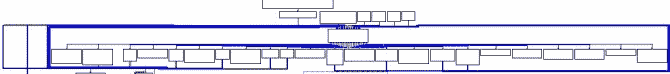
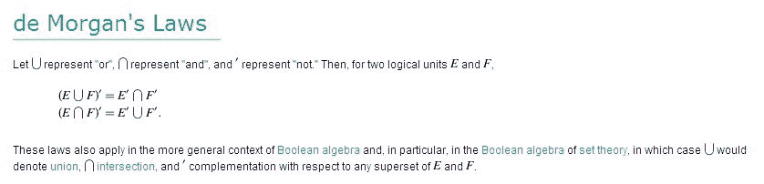
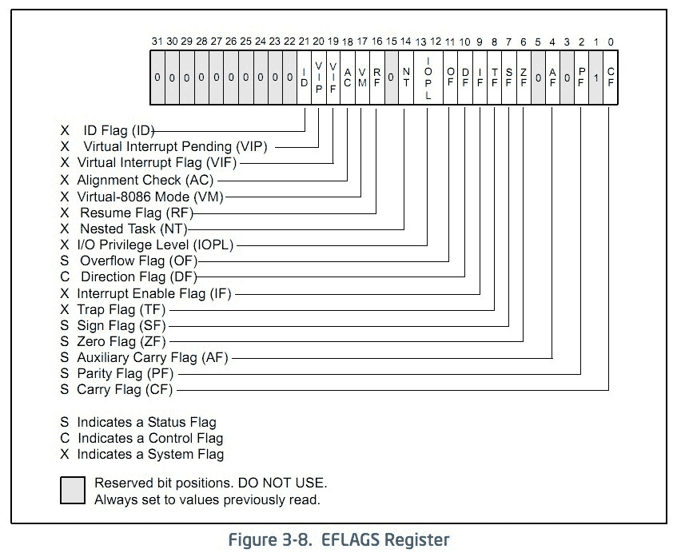

# VMProtect2.04 加壳程序从入门到精通

> 原文：[`www.pediy.com/kssd/pediy11/121412.html`](https://www.pediy.com/kssd/pediy11/121412.html)

VMProtect2.04 加壳程序从入门到精通

\---------自由、探索、共享---------

作者：000bInarYstAr\[MaTrix\]

两年来，我一直在思索：

人为什么而存在？

生命的意义究竟是什么？

什么样的人生才是真正的人生？

我应该以什么样的方式去度过我的人生旅程？

直到那一刻我忽然顿悟，不再犹豫的重新继续学习计算机，并决定调试 VMP。

我想说的是：2 年了，我回来了，我的心充满了光明。。。

我无法抑制住自己，我想自己总要去追寻着我的梦想才能让我满足。这久我猛然发现自己老了，真的老了，一切都是沧桑的，2 年的时光，回首过去，才发现自己已经不再年轻了。梦想依然年轻，它挥之不去，萦绕在我的肉体中，渗透进我的思想、我的精神，折磨着我的灵魂，我只有去追寻它，才能让我不再思索，才能满足自己。

以此为序，愿我不再忘记这段探索的旅程。。。

bInarYstAr

2010.10.16 8:44

此文章是我学习 VMProtect2.04 加壳程序的心得。在调试的过程中，尤其是初期，参考和查阅了 N 多的网络资料，在此一并表示感谢。在计算机书中，最著名的两类书名当属：XXXX 从入门到精通和 21 天学会 XXXX，我在仔细思考，最终觉得还是前者比较有吸引力。`OD` 的 `UDD` 文件的使用，在 `D:` 盘下新建文件夹 `Unpack`，把加壳记事本放入文件夹内，把 `UDD` 文件放入 `OD` 的 `UDD` 文件夹内。`OD` 打开加壳记事本后，`UDD` 文件会自动生效。

声明：本文在非盈利性用途可自由传播，转载时请注意保持文章的完整性和作者。

软件：正版 `VMProtect2.04` 加密的 `Win98` 记事本

加密选项：除了 编译--调试模式与水印 以外，全部打钩；虚拟计算机--数量为默认值 1；编译类型：超级（变异+虚拟）

调试器：官网下载的 `OllyDbg2.0`

加壳程序下载：`NOTEPAD.rar`

`UDD` 文件：`NOTEPAD-udd.rar`（这是是整理了伪指令的 `UDD` 文件，后续还会更新）

本文的结构：

**序言**

**文章简介**

**1. 基础知识**

   1.1. VMProtect 虚拟机简介
   1.2. VM 堆栈
   1.3. 伪指令汇总

**2. 综合运用**

   2.1. 常见伪指令组合
   2.2. NAND（与非门）
   2.3. EFLAGS 标志位检测+跳转

**3. NOTEPAD 全程跟踪**

   3.1. TLS
   3.2. VMP 外壳函数获取
   3.3. 虚拟执行环境与调试器检测
   3.4. HASH 值分块检测与 API 获取
   3.5. 重点解密循环

**4. 实验室（暂定）**

**尾声**

## 1. 基础知识

### 1.1. VMProtect 虚拟机简介

虚拟机加密，是指像 VMP 这样的保护程序，它会把源程序的 X86 指令变成自定义的伪指令，等到执行的时候，VMP 内置在保护程序中的 VM 就会启动，读取伪指令，然后解析执行。

VMP 是一个堆栈虚拟机，它的一切操作都是基于堆栈传递的。在 VMP 中，每一个伪指令就是一个 handler，VM 中有一个核心的 `Dispatch` 部分，它通过读取程序的 `bytecode`，然后在 `DispatchTable` 里面定位到不同的 handler 中执行。绝大多数情况下，在一个 handler 中执行完成后，程序将回到 `Dispatch` 部分，然后到 next handler 中执行。



在上面的框架中，核心的部件就是 `Dispatch` 部分，下面并列的部件就是 handlers。

经过 VMP 加密的 X86 指令，一条简单的指令被分解成数条 VMP 的伪指令，它按照自己的伪指令排列去实现原指令的功能，在加上其他的花指令混乱等等，你将完全看不到源程序指令。VMP 自带的各种机制都不再是以 X86 指令的形式去实现，而是用自己的伪指令去测试。

在 VMP 的 VM 运行过程中，各个寄存器的基本用途是：`EBP` 和 `EDI` 是 VM 堆栈指针（不是常规的堆栈）；`ESI` 是伪指令指针（相当于常规的 `EIP`）；`EAX` 是 VM 解密数据的主运算寄存器；`EBX` 是 VM 解密数据的辅运算寄存器；`ECX` 是常规的循环计数器；`ESP` 是常规的堆栈栈顶指针。`EDX` 是读取伪指令表数据；

`EDI`、`EBP` 分别指向 VM 堆栈的上下限位置，`EBP` 指向堆栈的下限并向上发展，`EDI` 指向堆栈的上限并使用 `[EDI+EAX]` 的方式向下发展；`ESI` 指向的内存块里包括要执行的伪指令序列，而不同的是，当 VM 要是使用到立即数时，也是从 `ESI` 读取。可见 `ESI` 内存块里面是精心构建的数据块，只有 VM 自身执行过程中，才能知道下一个数据是代表伪指令还是立即数；在 VM 运算中 `EAX` 寄存器很多时候通常只有 `AL` 参与运算然后在存取时再以 `AX` 或 `EAX` 得方式存取；`EBX` 在很多加密数据运算中，都会参与到 `EAX` 值的计算中，协助运算中正确的值。而每次 `EAX` 的值运算结束后，反过来会计算好下一次运算中 `EBX` 的值。所以 `EBX` 的数据一旦出错，下一个数据解密必然错误；在 VM 运行中，通常一切操作都是在 VM 堆栈内完成的，所以绝大多数情况下对 `ESP` 的操作都是花指令或 junk code。在一些虚拟与现实（比如说调用系统函数）交接的地方，系统并不知道 VM 堆栈的存在，这就需要把数据（比如系统函数的调用参数）移动到常规 `ESP` 栈顶。`EDX` 是一个较少使用的寄存器，只在一些解密循环里面参与运算。而它的一个主要的运用是在 `DISPATCH` 部件里，根据 `ESI` 的值来获取 `DispatchTable` 的数据，让 VM 执行下一条伪指令。

### 1.2. VM 堆栈

VMP 的 VM 是基于堆栈的虚拟家，理解好 VM 的堆栈空间划分和操作，是理解整个 VM 运行的基础。

VMProtect2.04 加壳程序是从 `TLS` 开始运行的，我们首先点击 `OD` 的 `options` 菜单，修改 `Startup and exit` 选项，让 `OD` 中断在 `TLS callback` 里。加壳程序运行后，VMP 初始化 VM，并进入 `DISPATCH` 部分。这里我们就以初始化后的堆栈为例。

VM 的堆栈一共使用 61 个 `DWORD`，上下分别有 2 个堆栈指针，下面为 `EBP` 指针，上面为 `EDI` 指针。下面是 VM 初始化时，给 `EDI` 和 `EBP` 指针赋值后的堆栈。

`EDI=0013F8BC`
`EBP=0013F9B0`

CPU Stack

| Locked | Value | ASCII Comments |
| :--- | :--- | :--- |
| | | |
| `0013F8BC` | `009539E8` | 9. | ；这里是 EDI 指向 |
| `0013F8C0` | `00950000` | ... |
| `0013F8C4` | `00150000` | ... |
| `0013F8C8` | `00000080` | ... |
| `0013F8CC` | `019314D6` | |
| `0013F8D0` | `0013F8A8` | . |
| `0013F8D4` | `7C92E920` | |
| `0013F8D8` | `00000000` | .... |
| `0013F8DC` | `00000000` | .... |
| `0013F8E0` | `00000000` | .... |
| `0013F8E4` | `FFFFFFFF` | |
| `0013F8E8` | `7C98FEFF` | |
| `0013F8EC` | `7C00ADE7` | .\| |
| `0013F8F0` | `00000000` | .... |
| `0013F8F4` | `00150000` | ... |
| `0013F8F8` | `0013F6F0` | . |
| `0013F8FC` | `0013F940` | @. |
| `0013F900` | `0013F944` | D. |
| `0013F904` | `7C92E920` | |
| `0013F908` | `7C9301E0` | |
| `0013F90C` | `FFFFFFFF` | |
| `0013F910` | `7C9301DB` | |
| `0013F914` | `7C9314D6` | |
| `0013F918` | `7C931514` | |
| `0013F91C` | `7C99E120` | |
| `0013F920` | `7C9314EA` | |
| `0013F924` | `5ADF1158` | XZ |
| `0013F928` | `00000001` | ... |
| `0013F92C` | `00000000` | .... |
| `0013F930` | `7FFDA000` | . |
| `0013F934` | `7FFDF000` | . |
| `0013F938` | `00158070` | p. |
| `0013F93C` | `0013F890` | . |
| `0013F940` | `00000000` | .... |
| `0013F944` | `0043D759` | YC. |
| `0013F948` | `0000E9ED` | .. |
| `0013F94C` | `409B0002` | .@ |
| `0013F950` | `00000020` | ... |
| `0013F954` | `0013F9CC` | . |
| `0013F958` | `0013F96C` | l. |
| `0013F95C` | `0043E9ED` | C. |
| `0013F960` | `000359F4` | Y. |
| `0013F964` | `00000020` | ... |
| `0013F968` | `004253CD` | SB. |
| `0013F96C` | `409B0000` | ..@ |
| `0013F970` | `00000020` | ... |
| `0013F974` | `0013F9CC` | . |
| `0013F978` | `0013F98C` | . |
| `0013F97C` | `00000000` | .... | ；这里是 EBP 指向 |
| `0013F980` | `00000000` | .... | ；这里是 VM 初始化保存的各个寄存器 |
| `0013F984` | `00000246` | F.. |
| `0013F988` | `000359F4` | Y. |
| `0013F98C` | `00000020` | ... |
| `0013F990` | `00000000` | .... |
| `0013F994` | `0013F9CC` | . |
| `0013F998` | `004253CD` | SB. |
| `0013F99C` | `000359F4` | Y. |
| `0013F9A0` | `00400000` | ..@. |
| `0013F9A4` | `0013F9C0` | . |
| `0013F9A8` | `C456C619` | V | ；这里是 VMP 的 2 个加密数据 |
| `0013F9AC` | `2EF6420A` | .B. |
| `0013F9B0` | `7C92118A` | | ; `RETURN` to `ntdll.7C92118A` | ；这里是 TLS 进来时的栈顶 |

关于 2 个加密数据和初始化的过程我们后续来说，这里我们主要关注 VM 的堆栈划分。

我把上面的 `EDI` 指向的堆栈称为 `EDISTACK`，把 `EBP` 指向的堆栈称为 `EBPSTACK`。在 VM 中，`EBPSTACK` 是运算区，各类数据的运算操作在这里完成；`EDISTACK` 是存储区包括长期存储数据和临时存储 `EBPSTACK` 的运算数。

下面我们来看一条数据移动伪指令：

命名：

`VM_MOVdw_EDISTACKdw_EBPSTACKdw`

代码：

```
0043DC19  |.  F6D8             NEG  AL                     ; *
0043DC26  |.  C0C8 07         ROR  AL,7                   ; *
0043DC34  |.  2C 20          SUB  AL,20                   ; *
0043DC41  |.  24 3C          AND  AL,3C                   ; *
0043E080  |$  8B55 00        MOV  EDX,DWORD PTR SS:[EBP]  ; *
0043E086  |.  83C5 04        ADD  EBP,4                   ; *
0043D3D7  /-> /891438        MOV  DWORD PTR DS:[EDI+EAX],EDX  ; *
```

功能：

把 1 个 `dword` 的数据从 `EBPSTACK` 栈顶移动到 `EDISTACK`，使用 `EAX` 作为偏移量

在 `EDISTACK` 的数据移动中，使用 `[EDI+EAX]` 的方式来存储与获取各个值。通过计算不同的 `EAX` 的值，可以到达 `EDISTACK` 中不同位置。在计算 `EAX` 值时，实际真正计算的是 `AL` 的值，我们来考虑一下 `AL` 的最小值和最大值，`AL=00` 时 `[EDI+EAX]=[0013F8BC+00000000]=0013F8BC`，`AL=FF` 时 `[EDI+EAX]=[0013F8BC+000000FF]=0013F9BB`，这是使用 `[EDI+EAX]` 可以读取的上下限。但是，在 VM 的 `AL` 值计算过程中，最后有一条 `AND AL,0x3C` 指令，`0x3C=00111100bit` 由于这条指令的限制，无论 `AL` 为任何值（从 `00000000bit` 到 `11111111bit`），通过 `AND` 操作，只能有 `1111bit` 的活动空间大小，`1111bit` 相当于 16，所以 `EDISTACK` 最多可以读取 16 个 `dword`；由于 `00111100bit` 最后两个 `00` 位的限制，任何数字与它 `AND` 后，后两位都必然为 0，变成与 4 对齐的值，说明 VM 都是按照 `0013F8BC 0013F8C0 0013F8C4 0013F8C8` 这样的 4 对齐来读取。在读取时，VM 可以读取 `byte word dword`，但是 VM 将不会去读取 `0013F8BE`。

由于 `EDISTACK` 堆栈向下发展，`EBPSTACK` 堆栈向上发展，`EDISTACK` 有 `0x3C` 控制着范围，而 `EBPSTACK` 是操作区，没有硬性的范围控制。为了预防两个空间相撞，在每次往 `EBPSTACK` 移动数据后，VM 都有相应的边界检测指令如下：

```
0043CE5A  |.  8D47 50        LEA  EAX,[EDI+50]            ; *
0043EE5D  |.  39C5           CMP  EBP,EAX                  ; *
0043F08C  |.^ \0F87 29F6FFFF JA  0043E6BB                  ; *
```

比较结果 大于 ，这个正常的情况，在这个 VM 跟踪过程中，我没有发现一次小于的情况。如果小于，也就是 `EBPSTACK` 栈顶已经到达 `[EDI+50]` 位置，VM 将会重新分配堆栈空间。`0x50` 的偏移量比 `0x3C` 的偏移量多 5 个 `dword` 的缓冲区。我们来手动修改 `EBP` 指针，看看 VM 的对于两个堆栈空间即将相撞的处理情况：

CPU Disasm

| Address | Hex dump | Command | Comments |
| :--- | :--- | :--- | :--- |
| `0043F092` | \|. 52 | `PUSH EDX` | ; |
| `0043D6C1` | \|. 8D5424 08 | `LEA EDX,[ARG.2]` | ; \*`EDX` 获得的是原来 `EDI` 指针地址 `0013F8BC` |
| `0043DF38` | \|. 8D4F 40 | `LEA ECX,[EDI+40]` | ; \*`0x40` 的偏移量是 `0x3C` 的偏移量数据 1 个 `dword` 结束后的位置 |
| `0043DF46` | \|. 29D1 | `SUB ECX,EDX` | ; \*减法计算出数据存储量 |
| `0043DF4B` | \|. 8D45 80 | `LEA EAX,[EBP-80]` | ; \*增加 `0x80` 的空间 |
| `0043DF5C` | \|. 24 FC | `AND AL,FC` | ; \*按 4 对齐 |
| `0043DF68` | \|. 29C8 | `SUB EAX,ECX` | ; \*在增加原来数据大小的堆栈空间 |
| `0043DF6E` | \|. 89C4 | `MOV ESP,EAX` | ; \* |
| `0043DF7E` | \|. 56 | `PUSH ESI` | ; \|`Arg1` = `NOTEPAD.425748`, \* |
| `0043DF87` | \|. 89D6 | `MOV ESI,EDX` | ; \|\* |


# 堆栈空间与 VM 跟踪技巧

## 堆栈空间管理

在虚拟机（VM）执行过程中，每次发现两个堆栈空间即将相撞时，VM 都会重新给 `EBP` 分配堆栈，并把原来 `EDISTACK` 中存储的数据移动到新的空间内。相关的汇编指令如下：

```
0043DB3A  /$  8D7C01 C0     LEA EDI,[EAX+ECX-40]    ; *
0043EC1E   .  89C7          MOV EDI,EAX              ; *
0043EEED  |.  F3:A4         REP MOVS BYTE PTR ES:[EDI],BYTE PTR DS:[ESI] ; *移动原来 EDISTACK 中存储的数据
0043EEF7  |.  8B7C24 10     MOV EDI,DWORD PTR SS:[ESP+10]    ; *
0043EEFF  |.  8B7424 10     MOV ESI,DWORD PTR SS:[ESP+10]    ; *
```

## OD 跟踪技巧

使用 OllyDbg（OD）跟踪 VM 堆栈时，可以参考以下小技巧：

在 OD 中跟踪 VM 数据移动时，双击 `0013F8BC` 地址，OD 将会以 `0013F8BC` 为基址，显示上下各个地址与它的偏移量，如图：

```
CPU Stack

Locked    Value     ASCII Comments
$-C       759D0000  ..u
$-8       00000001  ...
$-4       0013F8FC  .
$ ==>     009539E8  9.     ；这里是 0013F8BC，双击后的效果
$+4       00950000  ...
$+8       00150000  ...
$+C       00000080  ...
$+10      019314D6
```

在跟踪 VM 时，在数据移动伪指令中的 `AND AL,0x3C` 的下一条指令下断点。这样每次进行数据移动，你都可以看到这个断点，查看数据的去向和来源，这是极其有用的。

在很多复杂的运算地方，你需要在草稿纸上记下 `EDISTACK` 中一些空间的数据是来自什么时候？比如标志位 `ZF` 检测+跳转是 VM 的一个重要操作，而 `EFLAGS` 标志数都是相差不多或类似的 `00000286`、`00000246` 等等。如果你不能准确知道 `[EDI+EAX]` 存储或读取的位置，你将无法理解 VM 的操作。这非常的重要，请牢记！必要时连 OD 的数据窗口也一起配合显示 VM 堆栈。

把 OD 里的堆栈窗口拉高，让它尽可能多地显示数据。在高分辨率的电脑上，最好是能够显示出整个 VM 的堆栈。默认情况下，堆栈窗口是随着 `ESP` 指针的变化而自动显示的，这对于我们要时刻盯着 VM 堆栈的需求不相符。在堆栈窗口右键菜单中选择 `Lock address` 并打钩，这样 OD 就会锁定堆栈窗口。

到这里，关于堆栈空间的介绍就结束了。对堆栈的理解是本文的根基。

## 1.3. 伪指令汇总

调试 VMP 前期的一个重要的体力活是，识别出所有的伪指令，并根据它的用途给它相应的命名。以后就可以在 `DISPATCH` 部件的最后跳转地址：

```
0043E11F  |.  C2 5000     RETN 50
```

下断点，再盯着 VM 堆栈就可以知道 VM 的所有操作。

我们先来了解所有伪指令的 `DISPATCH`（调遣）部件：

```
0043E6BF  |.  8A46 FF     MOV AL,BYTE PTR DS:[ESI-1]        ; *
0043E6C4  |.  30D8        XOR AL,BL                         ; *
0043E6CE  |.  F6D0        NOT AL                            ; *
0043E6D6  |.  FEC8        DEC AL                            ; *
0043E6DA  |.  C0C8 07     ROR AL,7                          ; *
0043E6E1  |.  83EE 01     SUB ESI,1                         ; *
0043E6ED  |.  30C3        XOR BL,AL                         ; *
0043D02F  |.  0FB6C0      MOVZX EAX,AL                      ; *
0043F124  |.  8B1485 DBE143 00 MOV EDX,DWORD PTR DS:[EAX*4+43E1DB] ; *
0043E100  |> /81C2 6B197FB6 ADD EDX,B67F196B                ; *
0043E10A  |.  895424 3C   MOV DWORD PTR SS:[ESP+3C],EDX     ; *
0043E11B  |.  FF7424 4C   PUSH DWORD PTR SS:[ESP+4C]        ; *
0043E11F  |.  C2 5000     RETN 50
```

首先从 `ESI` 中解密获得下一条伪指令在 `DispatchTable`（调遣表）中的偏移量，使用 `[EAX*4+43E1DB]` 来读取出伪指令地址，简单的 `ADD` 解密后，把真正的伪指令地址压入 `ESP` 栈顶，最后用 `RETN 50` 跳转到相应的伪指令。

`MOV EDX,DWORD PTR DS:[EAX*4+43E1DB]` 给我们提供的信息：`DispatchTable` 的起始地址是 `0043E1DB`，最后一个 dword 的开始地址是以 `AL` 的最大值 `FF` 作为偏移量 `[FF*4+43E1DB]=0043E5D7`。我们把记事本中 `0043E1DB` -- `0043E5D7` 的数据粘贴如下：

### CPU Dump

```
Address   Hex dump                                  ASCII
0043E1D0                                  09|BA C4 49 D0|         .I
0043E1E0  BA C4 49 1E|B7 C4 49 E6|C4 C4 49 53|D1 C4 49 05| IIISI
0043E1F0  BE C4 49 75|D1 C4 49 D4|CE C4 49 0C|D6 C4 49 C3| IuII.I
0043E200  BD C4 49 7B|CE C4 49 67|BE C4 49 26|BF C4 49 EB| I{IgI&I
0043E210  C2 C4 49 82|D0 C4 49 3A|BA C4 49 1E|B5 C4 49 A8| II:II
0043E220  C4 C4 49 1E|B5 C4 49 2E|C8 C4 49 B9|BB C4 49 E9| II.II
0043E230  C3 C4 49 2D|B8 C4 49 95|C1 C4 49 82|D0 C4 49 75| I-IIIu
0043E240  D1 C4 49 C3|BE C4 49 16|B6 C4 49 2D|B8 C4 49 75| I镁II-Iu
0043E250  D1 C4 49 95|C1 C4 49 EB|C2 C4 49 52|BF C4 49 B4| IIIRI
0043E260  D3 C4 49 8B|D3 C4 49 05|CE C4 49 52|BF C4 49 D4| IIIRI
0043E270  CE C4 49 E8|B8 C4 49 C3|BD C4 49 C3|BE C4 49 5E| II媒I镁I^
0043E280  B4 C4 49 B1|B8 C4 49 61|BD C4 49 5D|BF C4 49 E9| IIaI\]I
0043E290  C3 C4 49 26|BF C4 49 5F|D0 C4 49 B4|D3 C4 49 E6| I&I\_II
0043E2A0  C4 C4 49 EC|B7 C4 49 1E|B5 C4 49 0D|C0 C4 49 0D| III.I.
0043E2B0  C0 C4 49 C3|BD C4 49 5D|BF C4 49 7B|CE C4 49 C3| I媒I\]I{I
0043E2C0  BD C4 49 1E|B5 C4 49 82|D0 C4 49 8A|B9 C4 49 A6| IIII
0043E2D0  D1 C4 49 EB|C2 C4 49 D4|CE C4 49 61|BD C4 49 09| IIIaI.
0043E2E0  BA C4 49 53|D1 C4 49 61|BD C4 49 3A|BA C4 49 3A| ISIaI:I:
0043E2F0  D0 C4 49 0C|D6 C4 49 3A|BA C4 49 1E|B7 C4 49 05| I.I:II
0043E300  CE C4 49 0D|C0 C4 49 82|D0 C4 49 27|D2 C4 49 7C| I.II'I|
0043E310  BD C4 49 E8|B8 C4 49 41|C2 C4 49 E9|C3 C4 49 25| IIAII%
0043E320  CE C4 49 53|C6 C4 49 61|BD C4 49 53|C6 C4 49 83| ISIaISI
0043E330  D6 C4 49 53|C6 C4 49 5D|BF C4 49 53|C6 C4 49 A8| ISI\]ISI
0043E340  C4 C4 49 53|C6 C4 49 5F|D0 C4 49 53|C6 C4 49 E6| ISI\_ISI
0043E350  C4 C4 49 53|C6 C4 49 3A|BA C4 49 53|C6 C4 49 00| ISI:ISI.
0043E360  C7 C4 49 53|C6 C4 49 2D|B8 C4 49 53|C6 C4 49 25| ISI-ISI%
0043E370  CE C4 49 53|C6 C4 49 83|D6 C4 49 53|C6 C4 49 1E| ISIISI
0043E380  B7 C4 49 53|C6 C4 49 C3|BD C4 49 53|C6 C4 49 62| ISI媒ISIb
0043E390  CF C4 49 53|C6 C4 49 12|D3 C4 49 53|C6 C4 49 E8| ISIISI
0043E3A0  B8 C4 49 05|CE C4 49 1E|B7 C4 49 8A|B9 C4 49 B4| IIII
0043E3B0  D3 C4 49 B9|BB C4 49 A6|D1 C4 49 E8|B8 C4 49 FE| IIII
0043E3C0  C0 C4 49 82|D0 C4 49 53|D1 C4 49 2D|B8 C4 49 52| IISI-IR
0043E3D0  BF C4 49 3A|D0 C4 49 C3|BE C4 49 A6|C1 C4 49 C3| I:I镁II
0043E3E0  BE C4 49 5E|B4 C4 49 82|D0 C4 49 7C|BD C4 49 C3| I^II|I
0043E3F0  BD C4 49 C3|BE C4 49 1E|B7 C4 49 61|BD C4 49 A6| I媒IIaI
0043E400  C1 C4 49 82|D0 C4 49 12|D3 C4 49 FE|C0 C4 49 25| IIII%
0043E410  CE C4 49 0C|D6 C4 49 09|BA C4 49 2E|C8 C4 49 67| I.I.I.Ig
0043E420  BE C4 49 8A|B9 C4 49 EB|C2 C4 49 D4|CE C4 49 95| IIII
0043E430  C1 C4 49 D1|C7 C4 49 09|BA C4 49 00|C7 C4 49 B9| II.I.I
0043E440  BB C4 49 D1|C7 C4 49 B4|D3 C4 49 5E|B4 C4 49 D1| III^I
0043E450  C7 C4 49 A8|C4 C4 49 A6|C1 C4 49 12|D3 C4 49 B4| IIII
0043E460  D3 C4 49 D0|BA C4 49 41|C2 C4 49 82|D0 C4 49 B1| I泻IAII
0043E470  B8 C4 49 1E|B5 C4 49 27|D2 C4 49 82|D0 C4 49 75| II'IIu
0043E480  D1 C4 49 5E|B4 C4 49 25|CE C4 49 16|B6 C4 49 7B| I^I%II{
0043E490  CE C4 49 7C|BD C4 49 EB|C2 C4 49 27|D2 C4 49 83| I|II'I
0043E4A0  D6 C4 49 12|D3 C4 49 2E|C8 C4 49 1E|B5 C4 49 E6| II.II
0043E4B0  C4 C4 49 C3|BD C4 49 95|C1 C4 49 1E|B5 C4 49 EC| I媒III
0043E4C0  B7 C4 49 B9|BB C4 49 5F|D0 C4 49 83|D6 C4 49 8A| II\_II
0043E4D0  B9 C4 49 A6|C1 C4 49 D4|CE C4 49 8B|D3 C4 49 0D| IIII.
0043E4E0  C0 C4 49 E8|B8 C4 49 2D|B8 C4 49 61|BD C4 49 82| II-IaI
0043E4F0  D0 C4 49 12|D3 C4 49 1E|B5 C4 49 7C|BD C4 49 D1| III|I
0043E500  C7 C4 49 7C|BD C4 49 05|CE C4 49 A6|C1 C4 49 5F| I|III\_
0043E510  D0 C4 49 1E|B7 C4 49 7B|CE C4 49 0C|D6 C4 49 05| II{I.I
0043E520  BE C4 49 9F|C2 C4 49 B9|BB C4 49 9F|C2 C4 49 D4| IIII
0043E530  CE C4 49 9F|C2 C4 49 EC|B7 C4 49 9F|C2 C4 49 62| IIIIb
0043E540  CF C4 49 9F|C2 C4 49 2D|B8 C4 49 9F|C2 C4 49 0C| II-II.
0043E550  D6 C4 49 9F|C2 C4 49 0D|C0 C4 49 9F|C2 C4 49 05| II.II
0043E560  BE C4 49 9F|C2 C4 49 C3|BD C4 49 9F|C2 C4 49 53| II媒IIS
0043E570  D1 C4 49 9F|C2 C4 49 75|D1 C4 49 9F|C2 C4 49 05| IIuII
0043E580  CE C4 49 9F|C2 C4 49 75|D1 C4 49 9F|C2 C4 49 27| IIuII'
0043E590  D2 C4 49 9F|C2 C4 49 09|BA C4 49 9F|C2 C4 49 B9| II.II
0043E5A0  B5 C4 49 E6|C4 C4 49 09|BA C4 49 8B|D3 C4 49 25| II.II%
0043E5B0  CE C4 49 0D|C0 C4 49 B9|B5 C4 49 E9|C3 C4 49 12| I.III
0043E5C0  D3 C4 49 FE|C0 C4 49 05|CE C4 49 83|D6 C4 49 0D| IIII.
0043E5D0  C0 C4 49 EC|B7 C4 49 D0|BA C4 49             II泻I
```

虽然 `DispatchTable` 的数据很多，但是很多不同的偏移量指向相同的数据，这是一种保护方式。我们反过来想，如果 `DispatchTable` 中每个 dword 指向的是不同的伪指令，这就意味着每个 `EAX` 偏移量指向着唯一的一条伪指令，进一步的来说就是每个 `ESI` 值代表着唯一的一条伪指令。那么，如果有人逆向这个算法，就可以知道每个 `ESI` 值对应的是哪个伪指令，这样就可以直接读取 `ESI` 值而了解 VMP 的执行伪指令，基本等于半自动识别 VMP。一名对 VMP 经验丰富的人，只要看着 VM 执行的伪指令盯着 `EBPSTACK` 堆栈，就可以理解 VM 的情况。现在，由于多个 `ESI` 值指向相同的伪指令，还有动态 `EBX` 解码，将会艰难的多。

我们在 OD 中寻找一个空间，写一段循环代码，把 `DispatchTable` 的数据全部解密出来：

原来的代码：

```
0043F11F   \38F5         CMP CH,DH
0043F121    66:FFC2      INC DX
0043F124    8B1485 DBE143 00 MOV EDX,DWORD PTR DS:[EAX*4+43E1DB]     ; *
```


### 修改跳转指令

```
0043F12B    F9                 STC  

0043F12C    84F4               TEST AH,DH  

0043F12E    60                 PUSHAD  

0043F12F   ^ E9 CC5EFCFF      JMP 0043E100  
```

把最后一条指令修改为：

```
0043F12F   ^\E9 CC5EFCFF      JMP 00405000  
```

### 在 `00405000` 添加循环代码

`CPU Disasm`

```
Address   Hex dump           Command                                     Comments  

00405000    60               PUSHAD  

00405001    BE DBE14300      MOV ESI,0043E1DB                            ; DispatchTable 地址  

00405006    BF 00514000      MOV EDI,00405100                            ; 解密循环地址  

0040500B    B9 00010000      MOV ECX,100  

00405010    31DB             XOR EBX,EBX  

00405012    8B0433           MOV EAX,DWORD PTR DS:[ESI+EBX]  

00405015    05 6B197FB6      ADD EAX,B67F196B                            ; 解密指令只有 1 条 ADD  

0040501A    89043B           MOV DWORD PTR DS:[EDI+EBX],EAX  

0040501D    83C3 04          ADD EBX,4  

00405020    49               DEC ECX  

00405021   ^ 75 EF          JNE SHORT 00405012  

00405023    61               POPAD  

00405024    E9 8E900200      JMP 0043E100  
```

循环结束后，在 `00405100` 中就还原了整个 `DispatchTable`：

`CPU Dump`

```
Address   Hex dump                                                 ASCII  

00405100  74 D3 43 00|3B D4 43 00|89 D0 43 00|51 DE 43 00|  tC.;C.C.QC.  

00405110  BE EA 43 00|70 D7 43 00|E0 EA 43 00|3F E8 43 00|  C.pC.C.?C.  

00405120  77 EF 43 00|2E D7 43 00|E6 E7 43 00|D2 D7 43 00|  wC..C.C.C.  

00405130  91 D8 43 00|56 DC 43 00|ED E9 43 00|A5 D3 43 00|  C.VC.C.C.  

00405140  89 CE 43 00|13 DE 43 00|89 CE 43 00|99 E1 43 00|  C.C.C.C.  

00405150  24 D5 43 00|54 DD 43 00|98 D1 43 00|00 DB 43 00|  $C.TC.C..C.  

00405160  ED E9 43 00|E0 EA 43 00|2E D8 43 00|81 CF 43 00|  C.C..C.C.  

00405170  98 D1 43 00|E0 EA 43 00|00 DB 43 00|56 DC 43 00|  C.C..C.VC.  

00405180  BD D8 43 00|1F ED 43 00|F6 EC 43 00|70 E7 43 00|  C.C.C.pC.  

00405190  BD D8 43 00|3F E8 43 00|53 D2 43 00|2E D7 43 00|  C.?C.SC..C.  

004051A0  2E D8 43 00|C9 CD 43 00|1C D2 43 00|CC D6 43 00|  .C.C.C.C.  

004051B0  C8 D8 43 00|54 DD 43 00|91 D8 43 00|CA E9 43 00|  C.TC.C.C.  

004051C0  1F ED 43 00|51 DE 43 00|57 D1 43 00|89 CE 43 00|  C.QC.WC.C.  

004051D0  78 D9 43 00|78 D9 43 00|2E D7 43 00|C8 D8 43 00|  xC.xC..C.C.  

004051E0  E6 E7 43 00|2E D7 43 00|89 CE 43 00|ED E9 43 00|  C..C.C.C.  

004051F0  F5 D2 43 00|11 EB 43 00|56 DC 43 00|3F E8 43 00|  C.C.VC.?C.  

00405200  CC D6 43 00|74 D3 43 00|BE EA 43 00|CC D6 43 00|  C.tC.C.C.  

00405210  A5 D3 43 00|A5 E9 43 00|77 EF 43 00|A5 D3 43 00|  C.C.wC.C.  

00405220  89 D0 43 00|70 E7 43 00|78 D9 43 00|ED E9 43 00|  C.pC.xC.C.  

00405230  92 EB 43 00|E7 D6 43 00|53 D2 43 00|AC DB 43 00|  C.C.SC.C.  

00405240  54 DD 43 00|90 E7 43 00|BE DF 43 00|CC D6 43 00|  TC.C.C.C.  

00405250  BE DF 43 00|EE EF 43 00|BE DF 43 00|C8 D8 43 00|  C.C.C.C.  

00405260  BE DF 43 00|13 DE 43 00|BE DF 43 00|CA E9 43 00|  C.C.C.C.  

00405270  BE DF 43 00|51 DE 43 00|BE DF 43 00|A5 D3 43 00|  C.QC.C.C.  

00405280  BE DF 43 00|6B E0 43 00|BE DF 43 00|98 D1 43 00|  C.kC.C.C.  

00405290  BE DF 43 00|90 E7 43 00|BE DF 43 00|EE EF 43 00|  C.C.C.C.  

004052A0  BE DF 43 00|89 D0 43 00|BE DF 43 00|2E D7 43 00|  C.C.C..C.  

004052B0  BE DF 43 00|CD E8 43 00|BE DF 43 00|7D EC 43 00|  C.C.C.}C.  

004052C0  BE DF 43 00|53 D2 43 00|70 E7 43 00|89 D0 43 00|  C.SC.pC.C.  

004052D0  F5 D2 43 00|1F ED 43 00|24 D5 43 00|11 EB 43 00|  C.C.$C.C.  

004052E0  53 D2 43 00|69 DA 43 00|ED E9 43 00|BE EA 43 00|  SC.iC.C.C.  

004052F0  98 D1 43 00|BD D8 43 00|A5 E9 43 00|2E D8 43 00|  C.C.C..C.  

00405300  11 DB 43 00|2E D8 43 00|C9 CD 43 00|ED E9 43 00|  C..C.C.C.  

00405310  E7 D6 43 00|2E D7 43 00|2E D8 43 00|89 D0 43 00|  C..C..C.C.  

00405320  CC D6 43 00|11 DB 43 00|ED E9 43 00|7D EC 43 00|  C.C.C.}C.  

00405330  69 DA 43 00|90 E7 43 00|77 EF 43 00|74 D3 43 00|  iC.C.wC.tC.  

00405340  99 E1 43 00|D2 D7 43 00|F5 D2 43 00|56 DC 43 00|  C.C.C.VC.  

00405350  3F E8 43 00|00 DB 43 00|3C E1 43 00|74 D3 43 00|  ?C..C.<C.tC.  

00405360  6B E0 43 00|24 D5 43 00|3C E1 43 00|1F ED 43 00|  kC.$C.<C.C.  

00405370  C9 CD 43 00|3C E1 43 00|13 DE 43 00|11 DB 43 00|  C.<C.C.C.  

00405380  7D EC 43 00|1F ED 43 00|3B D4 43 00|AC DB 43 00|  }C.C.;C.C.  

00405390  ED E9 43 00|1C D2 43 00|89 CE 43 00|92 EB 43 00|  C.C.C.C.  

004053A0  ED E9 43 00|E0 EA 43 00|C9 CD 43 00|90 E7 43 00|  C.C.C.C.  

004053B0  81 CF 43 00|E6 E7 43 00|E7 D6 43 00|56 DC 43 00|  C.C.C.VC.  

004053C0  92 EB 43 00|EE EF 43 00|7D EC 43 00|99 E1 43 00|  C.C.}C.C.  

004053D0  89 CE 43 00|51 DE 43 00|2E D7 43 00|00 DB 43 00|  C.QC..C..C.  

004053E0  89 CE 43 00|57 D1 43 00|24 D5 43 00|CA E9 43 00|  C.WC.$C.C.  

004053F0  EE EF 43 00|F5 D2 43 00|11 DB 43 00|3F E8 43 00|  C.C.C.?C.  

00405400  F6 EC 43 00|78 D9 43 00|53 D2 43 00|98 D1 43 00|  C.xC.SC.C.  

00405410  CC D6 43 00|ED E9 43 00|7D EC 43 00|89 CE 43 00|  C.C.}C.C.  

00405420  E7 D6 43 00|3C E1 43 00|E7 D6 43 00|70 E7 43 00|  C.<C.C.pC.  

00405430  11 DB 43 00|CA E9 43 00|89 D0 43 00|E6 E7 43 00|  C.C.C.C.  

00405440  77 EF 43 00|70 D7 43 00|0A DC 43 00|24 D5 43 00|  wC.pC..C.$C.  

00405450  0A DC 43 00|3F E8 43 00|0A DC 43 00|57 D1 43 00|  .C.?C..C.WC.  

00405460  0A DC 43 00|CD E8 43 00|0A DC 43 00|98 D1 43 00|  .C.C..C.C.  

00405470  0A DC 43 00|77 EF 43 00|0A DC 43 00|78 D9 43 00|  .C.wC..C.xC.  

00405480  0A DC 43 00|70 D7 43 00|0A DC 43 00|2E D7 43 00|  .C.pC..C..C.  

00405490  0A DC 43 00|BE EA 43 00|0A DC 43 00|E0 EA 43 00|  .C.C..C.C.  

004054A0  0A DC 43 00|70 E7 43 00|0A DC 43 00|E0 EA 43 00|  .C.pC..C.C.  

004054B0  0A DC 43 00|92 EB 43 00|0A DC 43 00|74 D3 43 00|  .C.C..C.tC.  

004054C0  0A DC 43 00|24 CF 43 00|51 DE 43 00|74 D3 43 00|  .C.$C.QC.tC.  

004054D0  F6 EC 43 00|90 E7 43 00|78 D9 43 00|24 CF 43 00|  C.C.xC.$C.  

004054E0  54 DD 43 00|7D EC 43 00|69 DA 43 00|70 E7 43 00|  TC.}C.iC.pC.  

004054F0  EE EF 43 00|78 D9 43 00|57 D1 43 00|3B D4 43 00|  C.xC.WC.;C.  
```

### 数据段显示与分析

`Intel` 的 `Little Endian`（小尾）方式存储让我们看的非常的别扭。在 `OD` 的主窗口（`CPU` 窗口）中来到 `00405000` `.data` 段，看一下 `00405100` 的显示：

```
004050F2    0000             ADD BYTE PTR DS:[EAX],AL  

004050F4    0000             ADD BYTE PTR DS:[EAX],AL  

004050F6    0000             ADD BYTE PTR DS:[EAX],AL  

004050F8    0000             ADD BYTE PTR DS:[EAX],AL  

004050FA    0000             ADD BYTE PTR DS:[EAX],AL  

004050FC    0000             ADD BYTE PTR DS:[EAX],AL  

004050FE    0000             ADD BYTE PTR DS:[EAX],AL  

00405100   ^ 74 D3          JE SHORT 004050D5  

00405102    43               INC EBX  

00405103    003B             ADD BYTE PTR DS:[EBX],BH  

00405105    D4 43            AAM 43  

00405110    BE EA430070      MOV ESI,700043EA  
```

`OD` 把我们的数据当做代码来显示了。点击右键-->`Analysis`-->`Analyse code` `Ctrl + A` ，弹出对话框是否分析，点击确定。显示如下：

```
004050FB       00             DB 00  

004050FC       00             DB 00  

004050FD       00             DB 00  

004050FE       00             DB 00  

004050FF       00             DB 00  

00405100    .  74D34300       DD 0043D374  

00405104    .  3BD44300       DD 0043D43B  

00405108    .  89D04300       DD 0043D089  

0040510C    .  51DE4300       DD 0043DE51  

00405110    .  BEEA4300       DD 0043EABE  

00405114    .  70D74300       DD 0043D770  

00405118    .  E0EA4300       DD 0043EAE0  

0040511C    .  3FE84300       DD 0043E83F  

00405120    .  77EF4300       DD 0043EF77  

00405124    .  2ED74300       DD 0043D72E  

00405128    .  E6E74300       DD 0043E7E6  

0040512C    .  D2D74300       DD 0043D7D2  
```

`OD` 正确的以数据方式显示，并且已经按照我们日常的习惯把数据按照 `Big Endian`（大尾）方式显示。

### 清除 `DispatchTable` 中的重复数据

对于 `DispatchTable` 中重复的数据，我们也要把他清除，在刚才 `00405000` 的汇编代码下面继续：

`CPU Disasm`

```
Address   Hex dump           Command                                     Comments  

00405000    60               PUSHAD  

00405001    BE DBE14300      MOV ESI,0043E1DB                            ; DispatchTable 地址  

00405006    BF 00514000      MOV EDI,00405100                            ; 解密循环地址  

0040500B    B9 00010000      MOV ECX,100  

00405010    31DB             XOR EBX,EBX  

00405012    8B0433           MOV EAX,DWORD PTR DS:[ESI+EBX]  
```


00405015: `05 6B197FB6` - `ADD EAX,B67F196B` ; 解密指令只有 1 条 `ADD`

0040501A: `89043B` - `MOV DWORD PTR DS:\[EDI+EBX\],EAX`

0040501D: `83C3 04` - `ADD EBX,4`

00405020: `49` - `DEC ECX`

00405021: `^ 75 EF` - `JNE SHORT 00405012`

00405023: `61` - `POPAD`

00405024: `EB 03` - `JMP SHORT 00405029`

00405026: `90` - `NOP`

00405027: `90` - `NOP`

00405028: `90` - `NOP`

00405029: `60` - `PUSHAD`

0040502A: `BE 00514000` - `MOV ESI,00405100` ; `TispatchTable`

0040502F: `BF 005A4000` - `MOV EDI,00405A00` ; `new DispatchTable`

00405034: `B9 00010000` - `MOV ECX,100`

00405039: `BA 00000000` - `MOV EDX,0`

0040503E: `8D1C8D 00000000` - `LEA EBX,\[ECX\*4\]`

00405045: `8B06` - `MOV EAX,DWORD PTR DS:\[ESI\]`

00405047: `83F8 00` - `CMP EAX,0`

0040504A: `74 1A` - `JE SHORT 00405066`

0040504C: `8907` - `MOV DWORD PTR DS:\[EDI\],EAX`

0040504E: `83C7 04` - `ADD EDI,4`

00405051: `83C2 04` - `ADD EDX,4`

00405054: `39DA` - `CMP EDX,EBX`

00405056: `74 0E` - `JE SHORT 00405066`

00405058: `3B0432` - `CMP EAX,DWORD PTR DS:\[ESI+EDX\]`

0040505B: `^ 75 F4` - `JNE SHORT 00405051`

0040505D: `C70432 00000000` - `MOV DWORD PTR DS:\[ESI+EDX\],0`

00405064: `^ EB EB` - `JMP SHORT 00405051`

00405066: `83C6 04` - `ADD ESI,4`

00405069: `49` - `DEC ECX`

0040506A: `^ 75 CD` - `JNE SHORT 00405039`

0040506C: `61` - `POPAD`

0040506D: `E9 8E900200` - `JMP 0043E100`

第一部分是前面解密代码，第二部分是分别比较 `00405100` 中的数据，把相同的全部放 `00000000`，同时把非 `0` 的数据存入 `00405A00` 中。

执行完这些代码后，`00405A00` 中生成了 VM 中所有的伪指令，再通过 OD 把它按照数据显示出来如下：

```
CPU Disasm
Address   Hex dump          Command                       Comments
00405A00    . \74D34300       DD 0043D374
00405A04    .  3BD44300       DD 0043D43B
00405A08    .  89D04300       DD 0043D089
00405A0C    .  51DE4300       DD 0043DE51
00405A10    .  BEEA4300       DD 0043EABE
00405A14    .  70D74300       DD 0043D770
00405A18    .  E0EA4300       DD 0043EAE0
00405A1C    .  3FE84300       DD 0043E83F
00405A20    .  77EF4300       DD 0043EF77
00405A24    .  2ED74300       DD 0043D72E
00405A28    .  E6E74300       DD 0043E7E6
00405A2C    .  D2D74300       DD 0043D7D2
00405A30    .  91D84300       DD 0043D891
00405A34    .  56DC4300       DD 0043DC56
00405A38    .  EDE94300       DD 0043E9ED
00405A3C    .  A5D34300       DD 0043D3A5
00405A40    .  89CE4300       DD 0043CE89
00405A44    .  13DE4300       DD 0043DE13
00405A48    .  99E14300       DD 0043E199
00405A4C    .  24D54300       DD 0043D524
00405A50    .  54DD4300       DD 0043DD54
00405A54    .  98D14300       DD 0043D198
00405A58    .  00DB4300       DD 0043DB00
00405A5C    .  2ED84300       DD 0043D82E
00405A60    .  81CF4300       DD 0043CF81
00405A64    .  BDD84300       DD 0043D8BD
00405A68    .  1FED4300       DD 0043ED1F
00405A6C    .  F6EC4300       DD 0043ECF6
00405A70    .  70E74300       DD 0043E770
00405A74    .  53D24300       DD 0043D253
00405A78    .  C9CD4300       DD 0043CDC9
00405A7C    .  1CD24300       DD 0043D21C
00405A80    .  CCD64300       DD 0043D6CC
00405A84    .  C8D84300       DD 0043D8C8
00405A88    .  CAE94300       DD 0043E9CA
00405A8C    .  57D14300       DD 0043D157
00405A90    .  78D94300       DD 0043D978
00405A94    .  F5D24300       DD 0043D2F5
00405A98    .  11EB4300       DD 0043EB11
00405A9C    .  A5E94300       DD 0043E9A5
00405AA0    .  92EB4300       DD 0043EB92
00405AA4    .  E7D64300       DD 0043D6E7
00405AA8    .  ACDB4300       DD 0043DBAC
00405AAC    .  90E74300       DD 0043E790
00405AB0    .  BEDF4300       DD 0043DFBE
00405AB4    .  EEEF4300       DD 0043EFEE
00405AB8    .  6BE04300       DD 0043E06B
00405ABC    .  CDE84300       DD 0043E8CD
00405AC0    .  7DEC4300       DD 0043EC7D
00405AC4    .  69DA4300       DD 0043DA69
00405AC8    .  11DB4300       DD 0043DB11
00405ACC    .  3CE14300       DD 0043E13C
00405AD0    .  0ADC4300       DD 0043DC0A
00405AD4    .  24CF4300       DD 0043CF24
```

这个 VM 一共有 52 条伪指令，在本节中我将一一列出这 52 条伪指令。每个分析 VMP 的人都有自己对伪指令的命名方式。

移动到 `EBPSTACK` 的数据使用 `PUSH` 指令，移动到 `EDISTACK` 的数据使用 `MOV` 指令。在 VM 中，对数据的操作包括 `byte` 和 `dword`，而存储的方式是 `word` 和 `dword`，当遇到 `byte` 和 `word` 交织在一起的时候，可以就把数据作为 `word` 操作来看。

下面我以 `VM_PUSHw_MEMORYb` 为例说明我的命名规则：

伪指令的命名统一使用 `VM_` 开头；并接上直观的助记符 `PUSH`；`EBPSTACK` 是移动的目的地；`MEMORY` 是移动的来源地；`w` 代表 `word`、`b` 代表 `byte`、`dw` 代表 `dword`；这条指令的表示：这是一条移动指令，把 1 个 `byte` 的数据从内存块移动到 `EBPSTACK`，存储时是按照 `word` 来存储。

在 VMP 的伪指令中包含有大量的花指令和 `junk code`，在本文列出的伪指令都是去除了这些无用代码。

`0043DC0A` 命名：

`VM_MOVdw_EDISTACKdw_EBPSTACKdw`

代码：

```
0043DC19  |.  F6D8          NEG AL                          ; *
0043DC26  |.  C0C8 07       ROR AL,7                        ; *
0043DC34  |.  2C 20         SUB AL,20                       ; *
0043DC41  |.  24 3C         AND AL,3C                       ; *
0043E080  |$  8B55 00       MOV EDX,DWORD PTR SS:\[EBP\]    ; *
0043E086  |.  83C5 04       ADD EBP,4                       ; *
0043D3D7  /> /891438        MOV DWORD PTR DS:\[EDI+EAX\],EDX ; *
```

功能：

把 `EBPSTACK` 栈顶 1 个 `dword` 的数据存储到 `EDISTACK`

`0043E7E6` 命名：

`VM_MOVw_EDISTACKw_EBPSTACKw`

代码：

```
0043E7EC    0FB646 FF     MOVZX EAX,BYTE PTR DS:\[ESI-1\] ; *
0043E7F6    28D8          SUB AL,BL                       ; *
0043E7FE    C0C8 05       ROR AL,5                        ; *
0043E80C    F6D8          NEG AL                          ; *
0043E816    34 0E         XOR AL,0E                       ; *
0043E822    28C3          SUB BL,AL                       ; *
0043E82E    66:8B55 00    MOV DX,WORD PTR SS:\[EBP\]      ; *
0043E835    83C5 02       ADD EBP,2                       ; *
0043F03F    4E            DEC ESI                         ; *
0043F045    66:891438     MOV WORD PTR DS:\[EDI+EAX\],DX  ; *
```

功能：

把 `EBPSTACK` 栈顶 1 个 `word` 的数据存储到 `EDISTACK`

`0043D374` 命名：

`VM_MOVb_EDISTACKb_EBPSTACKw`

代码：

```
0043D377  |.  8A46 FF       MOV AL,BYTE PTR DS:\[ESI-1\]   ; *
0043F148  /> \30D8          XOR AL,BL                       ; *
0043D460  |.  FEC0          INC AL                          ; |*
0043D469  |.  C0C8 07       ROR AL,7                        ; |*
0043D473  |.  FEC0          INC AL                          ; |*
0043D215  |.  30C3          XOR BL,AL                       ; *
0043EA9C  |.  4E            DEC ESI                         ; *
0043EAA0  |.  66:8B55 00    MOV DX,WORD PTR SS:\[EBP\]      ; *
0043EAAC  |.  83C5 02       ADD EBP,2                       ; *
0043DBDA  /> /881438        MOV BYTE PTR DS:\[EDI+EAX\],DL  ; *
```

把 `EBPSTACK` 栈顶 1 个 `word` 的数据按照 `byte` 的方式存储到 `EDISTACK`

`0043D21C` 命名：

`VM_PUSHw_IMMEDIATEw`

代码：

```
0043D21F    66:8B46 FE    MOV AX,WORD PTR DS:\[ESI-2\]      ; *
0043D22D    86E0          XCHG AL,AH                        ; *
0043E01A    66:29D8       SUB AX,BX                         ; *
0043E022    66:05 71F2    ADD AX,0F271                      ; *
0043E036    66:F7D8       NEG AX                            ; *
0043E03D    66:35 A61C    XOR AX,1CA6                       ; *
0043E054    66:29C3       SUB BX,AX                         ; *
0043E054    66:29C3       SUB BX,AX                         ; *
0043E976    8D76 FE       LEA ESI,\[ESI-2\]                 ; *
0043D094    /66:8945 00    MOV WORD PTR SS:\[EBP\],AX       ; *
```

功能：

从 `ESI` 数据中取得 1 个 `word` 的立即数压入 `EBPSTACK`

`0043E83F` 命名：


# `VM_PUSHdw_IMMEDIATEdw`

## 代码

```
0043E845   .  8B46 FC       MOV EAX,DWORD PTR DS:[ESI-4]              ; *
0043E84D   .  0FC8          BSWAP EAX                                 ; *
0043E852   .  01D8          ADD EAX,EBX                               ; *
0043E857   .  C1C8 04       ROR EAX,4                                 ; *
0043D952   .  8D76 FC       LEA ESI,[ESI-4]                           ; *
0043D956   .  2D E131FF38   SUB EAX,38FF31E1                          ; *
0043D967   .  C1C0 0A       ROL EAX,0A                                ; |*
0043D96C   .  01C3          ADD EBX,EAX                               ; |*
0043D970   .  83ED 04       SUB EBP,4                                 ; |*
0043D710  |$  8945 00       MOV DWORD PTR SS:[EBP],EAX                ; *
```

## 功能

从 `ESI` 数据中获得 1 个 `dword` 的立即数，压入 `EBPSTACK`

# `VM_PUSHdw_IMMEDIATEw`

## 代码

```
0043DB1E    66:8B46 FE      MOV AX,WORD PTR DS:[ESI-2]                ; *
0043D171   /86E0            XCHG AL,AH                                ; *
0043E948    66:29D8         SUB AX,BX                                 ; *
0043E951    66:05 71F2      ADD AX,0F271                              ; *
0043E95C    66:F7D8         NEG AX                                    ; *
0043E969    8D76 FE         LEA ESI,[ESI-2]                           ; *
0043D62C    66:35 A61C      XOR AX,1CA6                               ; *
0043D640   \66:29C3         SUB BX,AX                                 ; *
0043D648    98              CWDE                                      ; *
0043D190    83ED 04         SUB EBP,4                                 ; *
0043D933    8945 00         MOV DWORD PTR SS:[EBP],EAX                ; *
```

## 功能

从 `ESI` 数据中获得 1 个 `word` 的立即数，按照 `dword` 的方式压入 `EBPSTACK`

# `VM_PUSHw_IMMEDIATEb`

## 代码

```
0043D979   .  0FB646 FF     MOVZX EAX,BYTE PTR DS:[ESI-1]             ; *
0043D97E   .  30D8          XOR AL,BL                                 ; *
0043D1ED   .  FEC8          DEC AL                                    ; *
0043D1F0   .  F6D8          NEG AL                                    ; *
0043D1F7   .  F6D0          NOT AL                                    ; *
0043D1FD   .  30C3          XOR BL,AL                                 ; *
0043CEE8   > /83ED 02        SUB EBP,2                                 ; *
0043DD79  |.  66:8945 00    MOV WORD PTR SS:[EBP],AX                  ; |*
0043DD62  /$  4E            DEC ESI                                   ; *
```

## 功能

从 `ESI` 数据中获得 1 个 `byte` 的立即数，按照 `word` 的方式压入 `EBPSTACK`

# `VM_PUSHdw_IMMEDIATEb`

## 代码

```
0043D3A7    0FB646 FF       MOVZX EAX,BYTE PTR DS:[ESI-1]             ; *
0043D3AC    30D8            XOR AL,BL                                 ; *
0043D848    FEC8            DEC AL                                    ; *
0043D855    F6D8            NEG AL                                    ; *
0043D866    F6D0            NOT AL                                    ; *
0043D86D    30C3            XOR BL,AL                                 ; *
0043ED8C    66:98           CBW                                       ; *
0043CF7B    98              CWDE                                      ; *
0043EC00    8D76 FF         LEA ESI,[ESI-1]                           ; *
0043DB94    83ED 04         SUB EBP,4                                 ; *
0043DB9F    8945 00         MOV DWORD PTR SS:[EBP],EAX                ; *
```

## 功能

从 `ESI` 数据中获得 1 个 `byte` 的立即数，按照 `dword` 的方式压入 `EBPSTACK`

# `VM_ADDdw_EBPSTACK`

## 代码

```
0043CF2F  |.  8B45 00       MOV EAX,DWORD PTR SS:[EBP]                ; *
0043EED3  |.  0145 04       ADD DWORD PTR SS:[EBP+4],EAX              ; *
0043CE4F  |.  9C            PUSHFD                                    ; *
0043CE50  |.  8F4424 3C     POP DWORD PTR SS:[ESP+3C]                 ; *
0043D1BF  /> \FF7424 3C     PUSH DWORD PTR SS:[ESP+3C]                ; *
0043D1C3  |.  8F45 00       POP DWORD PTR SS:[EBP]                    ; *
```

## 功能

把 `EBPSTACK` 栈顶的 2 个 `dword` 数据相加，结果存储在 `[EBP+4]`，`EFLAGS` 标志存储在栈顶。

## 例

```
  0013F97C   8021D2F0  !
  0013F980   00000000  ....
VM_ADDdw_EBPSTACK
  0013F97C   00000286  ..
  0013F980   8021D2F0  !
```

# `VM_PUSHdw_MEMORYdw`

## 代码

```
0043D43F    8B45 00         MOV EAX,DWORD PTR SS:[EBP]                ; *
0043D10A    8B00            MOV EAX,DWORD PTR DS:[EAX]                ; *
0043D447    8945 00         MOV DWORD PTR SS:[EBP],EAX                ; *
```

## 功能

把 `EBPSTACK` 栈顶数据作为内存地址，从中读取 1 个 `dword` 的数据压入 `EBPSTACK`

# `VM_PUSHw_MEMORYw`

## 代码

```
0043E9D0    8B45 00         MOV EAX,DWORD PTR SS:[EBP]                ; *
0043E9D9    83C5 02         ADD EBP,2                                 ; *
0043DEBB    66:36:8B00      MOV AX,WORD PTR SS:[EAX]                  ; *
0043DDC4    66:8945 00      MOV WORD PTR SS:[EBP],AX                  ; *
```

## 功能

把 `EBPSTACK` 栈顶数据作为内存地址，从中读取 1 个 `word` 的数据压入 `EBPSTACK`

# `VM_PUSHw_MEMORYb`

## 代码

```
0043D57B  |.  8B55 00       MOV EDX,DWORD PTR SS:[EBP]
0043D589  |.  83C5 02       ADD EBP,2                                 ; *
0043D591  |.  8A02          MOV AL,BYTE PTR DS:[EDX]                  ; *
0043E70B  |.  66:8945 00    MOV WORD PTR SS:[EBP],AX                  ; *
```

## 功能

把 `EBPSTACK` 栈顶数据作为内存地址，从中读取 1 个 `byte` 的数据，按照 `word` 的方式压入 `EBPSTACK`

# `VM_PUSHw_EDISTACKw`

## 代码

```
0043DC5C    8A46 FF         MOV AL,BYTE PTR DS:[ESI-1]                ; *
0043DC66    28D8            SUB AL,BL                                 ; *
0043DC6D    C0C8 05         ROR AL,5                                  ; *
0043EADA    4E              DEC ESI                                   ; *
0043EE2E   \F6D8            NEG AL                                    ; *
0043EE34    34 0E           XOR AL,0E                                 ; *
0043E740    28C3            SUB BL,AL                                 ; *
0043E746    66:8B0438       MOV AX,WORD PTR DS:[EDI+EAX]              ; *
0043D9E4    83ED 02         SUB EBP,2                                 ; *
0043EE44    66:8945 00      MOV WORD PTR SS:[EBP],AX                  ; *
```

## 功能

从 `EDISTACK` 中读取 1 个 `word` 数据压入 `EBPSTACK`

# `VM_PUSHw_EDISTACKb`

## 代码

```
0043CF84    8A46 FF         MOV AL,BYTE PTR DS:[ESI-1]                ; *
0043CF8E    30D8            XOR AL,BL                                 ; *
0043EE0A   \FEC0            INC AL                                    ; *
0043EE11    C0C8 07         ROR AL,7                                  ; *
0043EE1E    FEC0            INC AL                                    ; *
0043D59C    30C3            XOR BL,AL                                 ; *
0043D2CE    4E              DEC ESI                                   ; *
0043D2D7    8A0438          MOV AL,BYTE PTR DS:[EDI+EAX]              ; *
0043D2E6    83ED 02         SUB EBP,2                                 ; *
0043D075    66:8945 00      MOV WORD PTR SS:[EBP],AX                  ; *
```

## 功能

从 `EDISTACK` 中读取 1 个 `byte` 数据，按照 `word` 方式压入 `EBPSTACK`

# `VM_PUSHdw_EBP`

## 代码

```
0043D72F  /.  89E8          MOV EAX,EBP                               ; *
0043E613  /$  83ED 04       SUB EBP,4                                 ; *
0043E61C  |.  8945 00       MOV DWORD PTR SS:[EBP],EAX                ; *
```

## 功能

复制 `EBP` 指针到 `EBPSTACK` 栈顶

## 例

```
  EBP 0013F9AC
  0013F9AC   00000000  ....
VM_PUSHdw_EBP
  0013F9A8   0013F9AC  .
  0013F9AC   00000000  ....
```

# `VM_COPYdw_EBPSTACK`

## 代码

```
0043EACC    8B45 00         MOV EAX,DWORD PTR SS:[EBP]                ; *
0043DE1B    36:8B00         MOV EAX,DWORD PTR SS:[EAX]                ; *
0043DE25    8945 00         MOV DWORD PTR SS:[EBP],EAX                ; *
```

## 功能


### `VM_COPYdw_EBPSTACK`

**功能：**
把 `EBPSTACK` 栈顶数据作为堆栈地址，从中读取一个 `dword` 的数据压入 `EBPSTACK`

**例：**

```text
  0013F998   F99E  
  0013F99C   02460013  .F  
  0013F9A0       0000  ...  
```

执行 `VM_COPYdw_EBPSTACK` 后：

```text
  0013F998   0246  
  0013F99C   02460000  ..F  
  0013F9A0       0000  ...  
```

**代码（0043E790）：**

```asm
0043E79C  |.  8B55 00       MOV EDX,DWORD PTR SS:[EBP]                 ; *
0043E7A7  |.  83C5 02       ADD EBP,2                                   ; *
0043E7AE  |.  36:8A02       MOV AL,BYTE PTR SS:[EDX]                    ; *
0043D01B  |.  66:8945 00    MOV WORD PTR SS:[EBP],AX                   ; *
```

### `VM_COPYw_EBPSTACK`

**功能：**
把 `EBPSTACK` 栈顶数据作为堆栈地址，从中读取一个 `byte` 的数据，按照 `word` 的方式压入 `EBPSTACK`

**例：**

```text
  0013F9A8   0013F9AC  .
  0013F9AC       0000  ....
```

执行 `VM_COPYw_EBPSTACK` 后：

```text
  0013F9A8   0000  
  0013F9AC       0000  ....
```

**代码（0043D198）：**

*(原文此处未提供具体指令行，仅保留命名结构)*

### `VM_NANDdw`

**功能：**
`dword` 版的与非门，从 `EBPSTACK` 的栈顶读取 2 个 `dword` 作为操作数，结果存储在第二个操作数位置，`EFLAGS` 标志存储在栈顶。

**例：**

```text
  0013F9A8   00000286  ..
  0013F9AC   00000286  ..
```

执行 `VM_NANDdw` 后：

```text
  0013F9A8   00000282  ..
  0013F9AC   FFFFFD79  y
```

**代码（0043D198）：**

```asm
0043D1A3    8B45 00         MOV EAX,DWORD PTR SS:[EBP]                 ; *
0043D1AD    8B55 04         MOV EDX,DWORD PTR SS:[EBP+4]               ; *
0043DEAE    F7D0            NOT EAX                                     ; *
0043DDE1   /F7D2            NOT EDX                                     ; *
0043CDC2    21D0            AND EAX,EDX                                 ; *
0043E0F8    8945 04         MOV DWORD PTR SS:[EBP+4],EAX                ; *
0043D0FB   /9C             PUSHFD                                       ; *
0043D0FC    8F4424 2C       POP DWORD PTR SS:[ESP+2C]                   ; *
0043EC46    FF7424 34       PUSH DWORD PTR SS:[ESP+34]                  ; *
0043EC4A    8F45 00         POP DWORD PTR SS:[EBP]                       ; *
```

### `VM_NANDw`

**功能：**
`word` 版的与非门，从 `EBPSTACK` 的栈顶读取 2 个 `word` 作为操作数，结果存储在第二个操作数位置，`EFLAGS` 标志存储在栈顶。

**例：**

```text
  EBP 0013F9AA
  0013F9A8   0000
  0013F9AC       0000  ....
```

执行 `VM_NANDw` 后：

```text
  0013F9A8   00000286  ..
  0013F9AC       00FF  ...
```

**代码（0043EB92）：**

```asm
0043EB94  |.  66:8B45 00    MOV AX,WORD PTR SS:[EBP]                    ; *
0043EBA5  |.  66:8B55 02    MOV DX,WORD PTR SS:[EBP+2]                 ; *
0043EBB3  |.  F6D0           NOT AL                                     ; *
0043EBBB  |.  F6D2           NOT DL                                     ; *
0043EBC1  |.  83ED 02        SUB EBP,2                                   ; *
0043EBC5  |.  20D0           AND AL,DL                                   ; *
0043EBCD  |.  66:8945 04    MOV WORD PTR SS:[EBP+4],AX                 ; *
0043EBD5  |.  9C             PUSHFD                                      ; *
0043D26F  |$  FF7424 28      PUSH DWORD PTR SS:[ESP+28]                 ; *
0043D273  |.  8F45 00        POP DWORD PTR SS:[EBP]                      ; *
```

### `VM_ADDw_EBPSTACK`

**功能：**
把 `EBPSTACK` 栈顶的 2 个 `word` 数据中的低 `byte` 相加，结果存储在第二个操作数位置，`EFLAGS` 标志存储在栈顶。

**例：**

```text
  0013F9AC   000000FF  ...
```

执行 `VM_ADDw_EBPSTACK` 后：

```text
  0013F9A8   0286  
  0013F9AC   00FF0000  ...
```

**代码（0043EB11）：**

```asm
0043EB14  |.  8A45 00       MOV AL,BYTE PTR SS:[EBP]                    ; *
0043EB1C  |.  83ED 02       SUB EBP,2                                   ; *
0043EB21  |.  0045 04       ADD BYTE PTR SS:[EBP+4],AL                  ; *
0043EB26  |.  9C            PUSHFD                                      ; *
0043EB27  |.  8F4424 20     POP DWORD PTR SS:[ESP+20]                   ; *
0043E8F9  |> /FF7424 40      PUSH DWORD PTR SS:[ESP+40]                  ; *
0043E8FD  |.  |8F45 00       POP DWORD PTR SS:[EBP]                      ; *
```

### `VM_PUSHdw_EDISTACKdw`

**功能：**
把 1 个 `dword` 的数据从 `EDISTACK` 压入 `EBPSTACK`

**代码（0043DFBE）：**

```asm
0043DFC1    F6D8            NEG AL                                     ; *
0043DFCD    C0C8 07         ROR AL,7                                    ; *
0043DFDA    2C 20           SUB AL,20                                   ; *
0043DFDD    24 3C           AND AL,3C                                   ; *
0043CE6C    8B1438          MOV EDX,DWORD PTR DS:[EDI+EAX]             ; *
0043CE71    83ED 04         SUB EBP,4                                   ; *
0043CE79    8955 00         MOV DWORD PTR SS:[EBP],EDX                 ; *
```

### `VM_SHRdw_EBPSTACK`

**功能：**
把 `EBPSTACK` 栈顶 1 个 `dword` 作为操作数，`[EBP+4]`作为移动位数，逻辑右移。结果 `dword` 存储在第二个操作数和第一个操作数的高 `byte`，`EFLAGS` 标志存储在栈顶。

**例：**

```text
  0013F99C   0040  
  0013F9A0   00040000  ...
```

执行 `VM_SHRdw_EBPSTACK` 后：

```text
  0013F99C   00000202  ..
  0013F9A0   00000004  ...
```

**代码（0043D7D2）：**

```asm
0043D7DA    8B45 00         MOV EAX,DWORD PTR SS:[EBP]                 ; *
0043D7E6    8A4D 04         MOV CL,BYTE PTR SS:[EBP+4]                 ; *
0043D4F8    83ED 02         SUB EBP,2                                   ; *
0043D504    D3E8            SHR EAX,CL                                  ; *
0043F17D   \8945 04         MOV DWORD PTR SS:[EBP+4],EAX                ; *
0043EA2E    9C              PUSHFD                                      ; *
0043EA30    FF7424 20       PUSH DWORD PTR SS:[ESP+20]                  ; *
0043EA34    8F45 00         POP DWORD PTR SS:[EBP]                      ; *
```

### `VM_SHLdw_EBPSTACK`

**功能：**
把 `EBPSTACK` 栈顶 1 个 `dword` 作为操作数，`[EBP+4]`作为移动位数，逻辑左移。结果 `dword` 存储在第二个操作数和第一个操作数的高 `byte`，`EFLAGS` 标志存储在栈顶。

**代码（0043E9A5）：**

```asm
0043E9A9    8B45 00         MOV EAX,DWORD PTR SS:[EBP]                 ; *
0043E9B5    8A4D 04         MOV CL,BYTE PTR SS:[EBP+4]                 ; *
0043E0B2   >83ED 02         SUB EBP,2                                   ; *
0043E0BC    D3E0            SHL EAX,CL                                  ; *
0043CDEA    8945 04         MOV DWORD PTR SS:[EBP+4],EAX                ; *
0043DD1A   \9C              PUSHFD
0043DD1B    8F4424 28       POP DWORD PTR SS:[ESP+28]                   ; *
0043DD24    FF7424 2C       PUSH DWORD PTR SS:[ESP+2C]                  ; *
0043DD28    8F45 00         POP DWORD PTR SS:[EBP]                      ; *
```

### `VM_SHRDdw_EBPSTACK`

**功能：**
`EBPSTACK` 双精度右移指令，执行完毕后，结果和 `EFLAGS` 存储到 `EBPSTACK`

**代码（0043DE51）：**

```asm
0043DE5D    8B45 00         MOV EAX,DWORD PTR SS:[EBP]                 ; *
0043DE69    8B55 04         MOV EDX,DWORD PTR SS:[EBP+4]               ; *
0043DE6E    8A4D 08         MOV CL,BYTE PTR SS:[EBP+8]                 ; *
0043DE73    83C5 02         ADD EBP,2                                   ; *
0043DE7A    0FADD0          SHRD EAX,EDX,CL                             ; *
0043D38F    8945 04         MOV DWORD PTR SS:[EBP+4],EAX                ; *
0043D66C    9C              PUSHFD                                      ; *
0043D66D    8F4424 34       POP DWORD PTR SS:[ESP+34]                   ; *
0043D67F    FF7424 40       PUSH DWORD PTR SS:[ESP+40]                  ; *
0043D683    8F45 00         POP DWORD PTR SS:[EBP]                      ; *
```

### `VM_SHLDdw_EBPSTACK`

**功能：**
`EBPSTACK` 双精度左移指令，执行完毕后，结果和 `EFLAGS` 存储到 `EBPSTACK`

**代码（0043D524）：**

```asm
0043D529    8B45 00         MOV EAX,DWORD PTR SS:[EBP]                 ; *
0043D537    8B55 04         MOV EDX,DWORD PTR SS:[EBP+4]               ; *
0043D545    8A4D 08         MOV CL,BYTE PTR SS:[EBP+8]                 ; *
0043D550    83C5 02         ADD EBP,2                                   ; *
0043D558    0FA5D0          SHLD EAX,EDX,CL                             ; *
0043D637    8945 04         MOV DWORD PTR SS:[EBP+4],EAX                ; *
0043CED3    9C              PUSHFD
0043D8F4   \FF7424 34       PUSH DWORD PTR SS:[ESP+34]                  ; *
0043D8F8    8F45 00         POP DWORD PTR SS:[EBP]                      ; *
```

### `VM_JMP`

**代码（0043D089）：**

```asm
0043D722    8B75 00         MOV ESI,DWORD PTR SS:[EBP]                 ; *
0043EF1F   \83C5 04         ADD EBP,4                                   ; *
  0043E6A9    89F3            MOV EBX,ESI                                ; *
```


### 0043E6B8
```
ADD ESI,DWORD PTR SS:[EBP]
```

**功能：**

把 `EBPSTACK` 栈顶地址移动到 `ESI`，重新初始化 `EBX` 和 `ESI`。

### 0043EF77
**命名：** `VM_EBPSTACK_CALL`

**代码：**

```
MOVZX EAX,BYTE PTR DS:[ESI-1]
XOR AL,BL
DEC AL
NEG AL
LEA ESI,[ESI-1]
NOT AL
XOR BL,AL
MOVZX ECX,AL
MOV DWORD PTR SS:[EBP-4],ECX
XOR EAX,EAX
XCHG DWORD PTR SS:[ECX*4+EBP],EAX
MOV DWORD PTR SS:[ESP+24],EAX
SUB ECX,1
JNE 0043ECE1
SUB EAX,EAX
MOV DWORD PTR SS:[ESP+4],0043EEB7
XCHG DWORD PTR SS:[EBP],EAX
MOV DWORD PTR SS:[ESP+8],EAX
PUSH DWORD PTR SS:[ESP+4]
PUSH DWORD PTR SS:[ESP+34]
RETN 38
```

**功能：**

VM 中最复杂的伪指令，用于系统 API 调用和程序过程调用。`ESI` 数据中取得参数的个数，`EAX` 循环取得参数，压入 `ESP` 指针指向的常规堆栈。大量使用 `[ESP+X]` 的方式调用，掺杂着废压栈操作，静态看代码难以看出。返回地址是常量压入的 `0043EEB7`。这条伪指令涉及内容众多，分支庞大，系统 API 调用和程序过程调用的走向都是不同的，在后面章节详述。我这里列举的是一次只有 1 个参数的系统 API 调用

### 0043D891
**命名：** `VM_MOVdw_MEMORYdw_EBPSTACKdw`

**代码：**

```
MOV EAX,DWORD PTR SS:[EBP]
MOV EDX,DWORD PTR SS:[EBP+4]
ADD EBP,8
MOV DWORD PTR DS:[EAX],EDX
```

**功能：**

`EBPSTACK` 栈顶数据作为地址，把栈顶的第二个 `dword` 存储到地址内

### 0043EFEE
**命名：** `VM_MOVdw_MEMORYdw_EBPSTACKdw`

**代码：**

```
MOV EAX,DWORD PTR SS:[EBP]
MOV EDX,DWORD PTR SS:[EBP+4]
ADD EBP,8
MOV DWORD PTR SS:[EAX],EDX
```

**功能：**

`EBPSTACK` 栈顶数据作为地址，把栈顶的第二个 `dword` 存储到地址内。与上一条伪指令完全相同

### 0043D157
**命名：** `VM_MOVdw_MEMORYdw_EBPSTACKdw`

**代码：**

```
MOV EAX,DWORD PTR SS:[EBP]
MOV EDX,DWORD PTR SS:[EBP+4]
ADD EBP,8
MOV DWORD PTR ES:[EAX],EDX
```

`EBPSTACK` 栈顶数据作为地址，把栈顶的第二个 `dword` 存储到地址内。与上两条伪指令完全相同

### 0043E9ED
**命名：** `VM_MOVw_MEMORYw_EBPSTACKw`

**代码：**

```
MOV EAX,DWORD PTR SS:[EBP]
MOV DX,WORD PTR SS:[EBP+4]
ADD EBP,6
MOV WORD PTR DS:[EAX],DX
```

**功能：**

`EBPSTACK` 栈顶数据作为地址，把栈顶的第二个 `word` 存储到地址内

### 0043D6CC
**命名：** `VM_MOVb_MEMORYb_EBPSTACKb`

**代码：**

```
MOV EAX,DWORD PTR SS:[EBP]
MOV DL,BYTE PTR SS:[EBP+4]
ADD EBP,6
MOV BYTE PTR SS:[EAX],DL
```

**功能：**

`EBPSTACK` 栈顶数据作为地址，把栈顶的第二个 `byte` 存储到地址内

### 0043CE89
**命名：** `VM_HASH`

**代码：**

```
MOV EDX,DWORD PTR SS:[EBP]
ADD EBP,4
XOR EAX,EAX
MOV ECX,EAX
SHL EAX,7
SHR ECX,19
OR EAX,ECX
XOR AL,BYTE PTR DS:[EDX]
INC EDX
DEC DWORD PTR SS:[EBP]
JNE 0043CEA8
MOV DWORD PTR SS:[EBP],EAX
```

**功能：**

计算一段数据的 `HASH` 值，`EBPSTACK` 栈顶第一个 `dword` 是数据地址，第二个 `dword` 是数据大小

### 0043DE13
**命名：** `VM_MOVdw_EBPreg_EBPSTACK`

**代码：**

```
MOV EBP,DWORD PTR SS:[EBP]
```

**功能：**

给 `EBP` 寄存器赋值 `EBPSTACK` 栈顶数据

### 0043DD54
**命名：** `VM_FS:[EBPSTACK]`

**代码：**

```
MOV EAX,DWORD PTR SS:[EBP]
MOV EAX,DWORD PTR FS:[EAX]
MOV DWORD PTR SS:[EBP],EAX
```

**功能：**

读取 `FS[X]` 数据，`X`=`EBPSTACK` 栈顶数据

### 0043D8C8
**命名：** `VM_SEH`

**代码：**

```
MOV EAX,DWORD PTR SS:[EBP]
MOV EDX,DWORD PTR SS:[EBP+4]
ADD EBP,8
MOV DWORD PTR FS:[EAX],EDX
```

**功能：**

给 `FS[X]` 传递 `Y` 数据，`X`=`EBPSTACK` 栈顶数据，`Y`=`EBPSTACK` 栈顶第 2 个数据。在实践中都是用于给 `FS[0]` 赋值，构建 `SEH`

### 0043DA69
**命名：** `VM_EXIT`

**代码：**

```
MOV ESP,EBP
POP EAX
POP ECX
POPFD
POP EBP
POP ECX
MOV EBX,DWORD PTR SS:[ESP+8]
MOV EBP,DWORD PTR SS:[ESP+14]
MOV EAX,DWORD PTR SS:[ESP+38]
MOV EAX,DWORD PTR SS:[ESP+38]
MOV EDI,DWORD PTR SS:[ESP+44]
POP ESI
PUSH DWORD PTR SS:[ESP+4]
RETN 8
```

**功能：**

给各个寄存器赋值 `EBPSTACK` 中的数据，`EBPSTACK` 中的最后一个数据是跳转地址

### 0043EC7D
**命名：** `VM_MOVdw_EFLreg_EBPSTACK`

**代码：**

```
PUSH DWORD PTR SS:[EBP]
POP DWORD PTR SS:[ESP+8]
PUSH DWORD PTR SS:[ESP+28]
POPFD
```

**功能：**

给 `EFLAGE` 寄存器赋值 `EBPSTACK` 栈顶数据

在 `F7` 跟踪加壳记事本的过程中，并不是所有的伪指令都使用到了，以下是没有被执行到的伪指令：

```
DD 0043D770
DD 0043EAE0
DD 0043E199
DD 0043DB00
DD 0043D82E
```


00405A68 . 1FED4300 DD 0043ED1F
00405A6C . F6EC4300 DD 0043ECF6
00405A70 . 70E74300 DD 0043E770
00405A74 . 53D24300 DD 0043D253
00405A78 . C9CD4300 DD 0043CDC9
00405A94 . F5D24300 DD 0043D2F5
00405AA4 . E7D64300 DD 0043D6E7
00405AA8 . ACDB4300 DD 0043DBAC
00405AB8 . 6BE04300 DD 0043E06B
00405ABC . CDE84300 DD 0043E8CD
00405ACC . 3CE14300 DD 0043E13C

由于没有实际的走过这些伪指令，静态分析后觉得，有个别伪指令的代码怕提取错了。把这些指令写成简介模式：

### 0043D770
`EBPSTACK` 的 `byte` 逻辑右移指令

### 0043EAE0
`VM_JMP` 跳转指令，重新给 `ESI` 赋值 `EBPSTACK` 栈顶数据

### 0043E199
复制 `EBPSTACK` 栈顶 1 个 `word` 的数据

### 0043DB00
把 `EBPSTACK` 栈顶数据作为地址，读取其中 1 个 `word` 的数据压入 `EBPSTACK`

### 0043D82E
`VM_DIV` 除法指令

### 0043ED1F
`CPUID` 指令，结果压入 `EBPSTACK`。

### 0043ECF6
把 `EBPSTACK` 数据 1 个 `byte` 移动到栈顶内存地址内

### 0043E770
给 `EBP` 寄存器的低 `word` 位赋值栈顶数据

### 0043D253
把 `SS` 段寄存器压入 `EBPSTACK` 栈顶

### 0043CDC9
另一种方式的 `word` 版 `NAND`，不过这个是在 `EBPSTACK` 堆栈内完成运算过程

### 0043D2F5
`EBPSTACK` 的 `byte` 逻辑左移指令

### 0043D6E7
`EBPSTACK` 的 `word` 逻辑左移指令

### 0043DBAC
`EBPSTACK` 的 `word` 逻辑右移指令

### 0043E06B
`EBPSTACK` 的 `word` 加法

### 0043E8CD
把 `EAX` 和 `EDX` 压入 `EBPSTACK`

### 0043E13C
把 `EBPSTACK` 数据 1 个 `word` 移动到栈顶内存地址内

到这里，所有的伪指令都罗列完毕，真的是体力活呀！

## 2. 综合运用

### 2.1. 常见伪指令组合

在 `VMP` 的伪指令的执行中有一些常见的组合套路，熟悉它们能让我们在跟踪 `VMP` 时更加的得心应手。这些组合与操作数的长度是无关的，下面的伪指令将去掉 `b` `w` `dw` 等标记。在例子部分，我将使用 `dword` 操作数来举例，直观明了。

#### 2.1.1

`VM_PUSH_EBP` ；复制 `EBP` 指针到 `EBPSTACK` 栈顶
`VM_COPY_EBPSTACK` ；把 `EBPSTACK` 栈顶数据作为堆栈地址，从中读取一个数据压入 `EBPSTACK`

这两条指令是 `VMP` 中结合的极其紧密的组合，它们几乎总是一起出现的，用于把 `EBPSTACK` 堆栈中的数据复制起来到 `EBPSTACK`。而很多情况下它们复制的就是原来的栈顶数据。在使用 `NAND` 来完成 `NOT(A)` 的运算中，它们是必备的前奏。凡是需要把操作数一个变两个的地方都有它们的身影。

例：

```
EBP 0013F9AC
0013F9AC 00000000 ....
0013F9B0 7C92118A | ; RETURN to ntdll.7C92118A
```
`VM_PUSH_EBP`
```
EBP 0013F9A8
0013F9A8 0013F9AC .
0013F9AC 00000000 ....
0013F9B0 7C92118A | ; RETURN to ntdll.7C92118A
```
`VM_COPY_EBPSTACK`
```
EBP 0013F9A8
0013F9A8 00000000 ....
0013F9AC 00000000 ....
0013F9B0 7C92118A | ; RETURN to ntdll.7C92118A
```

#### 2.1.2

`VM_NAND|VM_ADD_EBPSTACK|VM_SHLD_EBPSTACK|VM_SHR_EBPSTACK` 等等
`VM_MOV_EDISTACK_EBPSTACK` ；把 1 个数据从 `EBPSTAK` 栈顶移动到 `EDISTACK`，使用 `EAX` 作为偏移量

在 `VMP` 所有的运算伪指令中都是统一的模式，运算后的 `EFLAGS` 寄存器值位于 `EBPSTACK` 栈顶，运算结果位于紧接栈顶的 `[EBP+4]`。在运算结束后，跟上一条 `VM_MOV_EDISTACK_EBPSTACK` 把运算后的标志位移动到 `EDISTACK`，在很多时候，这都是一条废指令操作，纯粹是为去掉栈顶数据，以便继续操作运算结果。

如果接下来 `VM` 进行检测标志位的相关操作，这条指令就变得异常重要。例如：在对系统函数的 `CC` 码 `int3` 断点检测中，取出系统函数开头的第一个 `byte` 数据 `XX`，把它与 `CC` 相减，再跟上一个 `ZF` 标志位检测+跳转。在这个时候反过来，运算结果完全无用，而我们一定要在移动指令的 `EAX` 偏移量哪里下好断点，观察好 `EFLAGS` 寄存器值的走向与来源。

#### 2.1.3

在进行跳转时，围绕 `VM_JMP` 的前后，有大量无价值的数据移动操作。假设现在我们刚进行了一次条件判断，`VM` 刚刚把要跳转的地址确定并解密出来：

```
EBP 0013F9A8
0013F9A8 00000202 .. ；最后一次解密运算得到的 EFLAGS
0013F9AC 0043651A eC. ；跳转地址
0013F9B0 7C92118A | ; RETURN to ntdll.7C92118A
```
`VM_MOVdw_EDISTACKdw_EBPSTACKdw`

`VM_MOVdw_EDISTACKdw_EBPSTACKdw`
```
EBP 0013F9B0
0013F9B0 7C92118A | ; RETURN to ntdll.7C92118A
```
`VM_PUSHdw_EDISTACKdw`

`VM_PUSHdw_EDISTACKdw`

`VM_PUSHdw_EDISTACKdw`

`VM_PUSHdw_EDISTACKdw`

`VM_PUSHdw_EDISTACKdw`

`VM_PUSHdw_EDISTACKdw`

`VM_PUSHdw_EDISTACKdw`

`VM_PUSHdw_EDISTACKdw`

`VM_PUSHdw_EDISTACKdw`

`VM_PUSHdw_EDISTACKdw`

`VM_PUSHdw_EDISTACKdw`

`VM_PUSHdw_EDISTACKdw`
```
EBP 0013F980
0013F980 8021D2F0 !
0013F984 0013F9C0 .
0013F988 00000246 F..
0013F98C 00000020 ...
0013F990 000359F4 Y.
0013F994 0013F9CC .
0013F998 00400000 ..@. ; OFFSET NOTEPAD
0013F99C 00000000 ....
0013F9A0 004253CD SB. ; RETURN from NOTEPAD.004255DB to NOTEPAD.004253CD
0013F9A4 000359F4 Y.
0013F9A8 00400000 ..@. ; 该带着走的数据都在 EBPSTACK 里面带着走，到这里还没有完毕的。
0013F9AC 0043651A eC. ；还有其他的数据要放入，8021D2F0 要隐藏一下
0013F9B0 7C92118A | ; RETURN to ntdll.7C92118A
```
`VM_PUSHdw_IMMEDIATEdw`
```
0013F97C 7FDE2D10 -
0013F980 8021D2F0 !
0013F984 0013F9C0
```
`VM_ADDdw_EBPSTACK`
```
0013F97C 00000247 G..
0013F980 00000000 ....
0013F984 0013F9C0
```
`VM_MOVdw_EDISTACKdw_EBPSTACKdw`
```
0013F980 00000000 ....
0013F984 0013F9C0
```
`VM_PUSHdw_EDISTACKdw`

`VM_PUSHdw_EDISTACKdw`
```
0013F978 0043651A eC.
0013F97C 00000000 ....
0013F980 00000000 ....
0013F984 0013F9C0 .
0013F988 00000246 F..
0013F98C 00000020 ...
0013F990 000359F4 Y.
0013F994 0013F9CC .
0013F998 00400000 ..@. ; OFFSET NOTEPAD
0013F99C 00000000 ....
0013F9A0 004253CD SB. ; RETURN from NOTEPAD.004255DB to NOTEPAD.004253CD
0013F9A4 000359F4 Y.
0013F9A8 00400000 ..@. ; OFFSET NOTEPAD.B
0013F9AC 0043651A eC.
0013F9B0 7C92118A | ; RETURN to ntdll.7C92118A
```
`VM_JMP` ；带着 14 个数据，`VM` 终于跳转，除了栈顶 `0043651A` 放入 `ESI`，其他 13 个数据要重新保存

`VM_MOVdw_EDISTACKdw_EBPSTACKdw`
```
0013F980 00000000 ....
0013F984 0013F9C0 .
```
`VM_PUSHdw_IMMEDIATEdw`
```
0013F97C 8021D2F0 !
0013F980 00000000 ....
0013F984 0013F9C0 .
```
`VM_ADDdw_EBPSTACK`
```
0013F97C 00000286 ..
0013F980 8021D2F0 !
0013F984 0013F9C0 . ；重新恢复出来
```
`VM_MOVdw_EDISTACKdw_EBPSTACKdw`

`VM_MOVdw_EDISTACKdw_EBPSTACKdw`

`VM_MOVdw_EDISTACKdw_EBPSTACKdw`

`VM_MOVdw_EDISTACKdw_EBPSTACKdw`

`VM_MOVdw_EDISTACKdw_EBPSTACKdw` ；到这里停一下，搞个小运算，原 `EDX=000359F4` `XOR` `4DFD2FC2`
```
0013F990 000359F4 Y.
0013F994 0013F9CC .
0013F998 00400000 ..@. ; OFFSET NOTEPAD.B
0013F99C 00000000 ....
0013F9A0 004253CD SB. ; RETURN from NOTEPAD.004255DB to NOTEPAD.004253CD
0013F9A4 000359F4 Y.
0013F9A8 00400000 ..@. ; OFFSET NOTEPAD.B
0013F9AC 0043651A eC.
0013F9B0 7C92118A | ; RETURN to ntdll.7C92118A
```
`VM_PUSHdw_EBP`
```
0013F98C 0013F990 .
0013F990 000359F4 Y.
0013F994 0013F9CC .
```
`VM_COPYdw_EBPSTACK`
```
0013F98C 000359F4 Y.
0013F990 000359F4 Y.
0013F994 0013F9CC .
```
`VM_MOVdw_EDISTACKdw_EBPSTACKdw`
```
0013F990 000359F4 Y.
0013F994 0013F9CC .
```
`VM_PUSHdw_EBP`
```
0013F98C 0013F990 .
0013F990 000359F4 Y.
0013F994 0013F9CC .
```
`VM_COPYdw_EBPSTACK`
```
0013F98C 000359F4 Y.
0013F990 000359F4 Y.
0013F994 0013F9CC .
```
`VM_NANDdw`
```
0013F98C 00000282 ..
0013F990 FFFCA60B
0013F994 0013F9CC .
```
`VM_MOVdw_EDISTACKdw_EBPSTACKdw`
```
0013F990 FFFCA60B
0013F994 0013F9CC .
```
`VM_PUSHdw_IMMEDIATEdw`
```
0013F98C B202D03D =
0013F990 FFFCA60B
0013F994 0013F9CC .
```
`VM_NANDdw`
```
0013F98C 00000206 ..
0013F990 000109C0 ..
0013F994 0013F9CC .
```
`VM_MOVdw_EDISTACKdw_EBPSTACKdw`
```
0013F990 000109C0 ..
0013F994 0013F9CC .
```
`VM_PUSHdw_IMMEDIATEdw`
```
0013F98C 4DFD2FC2 /M
0013F990 000109C0 ..
0013F994 0013F9CC .
```
`VM_PUSHdw_EDISTACKdw`
```
0013F988 000359F4 Y.
0013F98C 4DFD2FC2 /M
0013F990 000109C0 ..
0013F994 0013F9CC .
```
`VM_NANDdw`
```
0013F988 00000286 ..
0013F98C B2008009 ..
0013F990 000109C0 ..
0013F994 0013F9CC .
```
`VM_MOVdw_EDISTACKdw_EBPSTACKdw`
```
0013F98C B2008009 ..
0013F990 000109C0 ..
0013F994 0013F9CC .
```
`VM_NANDdw`
```
0013F98C 00000206 ..
0013F990 4DFE7636 6vM
0013F994 0013F9CC .
```
`VM_MOVdw_EDISTACKdw_EBPSTACKdw`

`VM_MOVdw_EDISTACKdw_EBPSTACKdw`

`VM_MOVdw_EDISTACKdw_EBPSTACKdw`

`VM_MOVdw_EDISTACKdw_EBPSTACKdw`

`VM_MOVdw_EDISTACKdw_EBPSTACKdw`

`VM_MOVdw_EDISTACKdw_EBPSTACKdw`

`VM_MOVdw_EDISTACKdw_EBPSTACKdw`

`VM_MOVdw_EDISTACKdw_EBPSTACKdw`

`VM_MOVdw_EDISTACKdw_EBPSTACKdw`
```
EBP 0013F9B0
0013F9B0 7C92118A | ; RETURN to ntdll.7C92118A
```


每一次 `VM_JMP` 跳转，都要带着 14 个数据转，而其中呢 `VM` 还要搞上一点暗码转移。以后看到是 `VM_JMP` 跳转的状况，就是看着 `EBP` 指针，哗哗哗的让它执行，完毕了才停下来。中间的操作完全可以无视，我也是为了完整的表达才把它粘贴出了代码，实际看的时候，不用管。整个过程：要带着走的数据移到 `EBPSTACK` --> `VM_JMP` 跳转 --> 重新把数据保存到 `EDISTACK`。关于其中 `000359F4 XOR 4DFD2FC2` 的过程，请参考下一节 `2.2.NAND`。

由于其他的组合都和 `NAND` 或标志位检测 + 跳转相关，放在下两节中。这一节中的 3 个组合熟悉后，已经可以无视掉一部分 `VM` 的操作。

### 2.2.NAND（与非门）

本文的两节重头戏来了，`NAND`（与非门）与 `EFLAGS` 标志位检测 + 跳转，理解完了这两节后，对于 `VM` 就可以无视了，一切伪指令在你眼里都是正常的指令。跟踪 `VMP` 就和跟踪普通程序一样，想看 `API` 获取就看 `API` 获取，想看看程序的 `anti` 方式就看 `anti` 方式。一切都回到了正常，你可以看穿 `VM`（虚拟机）这个吓人的外衣。

#### 2.2.1.NAND 起源

`NAND`（与非门）和 `NOR`（或非门）来源于 de Morgan's Laws（德摩根定律），运用于逻辑、数字电路等方面，本节专注于它与 `and`、`or`、`xor`、`not` 之间的联系。

德摩根定律是属于逻辑学的定律。德摩根定律 (或称德摩根定理) 是形式逻辑中有关否定所描述的系统方式中的逻辑运算符对偶对的一系列法则。由此引出的关系也就被称为“德摩根二重性”。

奥古斯都德摩根首先发现了在命题逻辑中存在着下面这些关系：

`非(P 且 Q)＝(非 P)或(非 Q)`

`非(P 或 Q)＝(非 P)且(非 Q)`

德摩根的发现影响了乔治布尔从事的逻辑问题代数解法的研究，这巩固了德摩根作为该规律的发现者的地位，尽管亚里士多德也曾注意到类似现象、且这也为古希腊与中世纪的逻辑学家熟知 (引自 `Bocheski《形式逻辑历史》`)。（引自维基百科，关键字：德摩根定律）

我们再来看它在数学逻辑中的表示：



（引自：MathWorld，关键字：de Morgan's Laws）

由于不是用我们熟悉的计算机方式来表达，上面的两段解说比较抽象，请看 2.2.2。

#### 2.2.2.NAND 与逻辑运算

在加壳记事本中使用的是 `NAND`，下面部分将专注于 `NAND`。对于 `NOR`，理论都是一样的，只是不用 `NAND` 来实现。

`NAND(A,B)`：

- `NOT(A)`
- `NOT(B)`
- `AND(A,B)`

这就是 `NAND` 的操作方式。`NAND` 的价值在于：使用 `NAND` 可以实现 `NOT`、`AND`、`OR`、`XOR` 这 4 个逻辑运算。

`NOT(A)`:

`NAND(A,A)`

`AND(A,B)`:

`NAND(NAND(A,A),NAND(B,B))`

`OR(A,B)`:

`NAND(NAND(A,B),NAND(A,B))`

`XOR(A,B)`:

`NAND(NAND(NAND(A,A),NAND(B,B)),NAND(A,B))`

#### 2.2.3.VMP 伪指令执行过程

`NOT(4DBE4AD8)`：

```
  0013F9AC   4DBE4AD8  JM
  0013F9B0   7C92118A  |    ; RETURN to ntdll.7C92118A
VM_PUSHdw_EBP
  0013F9A8   0013F9AC  .
  0013F9AC   4DBE4AD8  JM
  0013F9B0   7C92118A  |    ; RETURN to ntdll.7C92118A
VM_COPYdw_EBPSTACK
  0013F9A8   4DBE4AD8  JM
  0013F9AC   4DBE4AD8  JM
  0013F9B0   7C92118A  |    ; RETURN to ntdll.7C92118A
VM_NANDdw
  0013F9A8   00000286  ..
  0013F9AC   B241B527  'A
  0013F9B0   7C92118A  |    ; RETURN to ntdll.7C92118A ；`NAND(A,A)`
VM_MOVdw_EDISTACKdw_EBPSTACKdw
  0013F9AC   B241B527  'A
  0013F9B0   7C92118A  |    ; RETURN to ntdll.7C92118A
NOT(4DBE4AD8)=B241B527
```

`AND(4DBE4AD8,4DFD2FC2)`：

```
  0013F9AC   4DBE4AD8  JM
  0013F9B0   7C92118A  |    ; RETURN to ntdll.7C92118A
VM_PUSHdw_EBP
  0013F9A8   0013F9AC  .
  0013F9AC   4DBE4AD8  JM
  0013F9B0   7C92118A  |    ; RETURN to ntdll.7C92118A
VM_COPYdw_EBPSTACK
  0013F9A8   4DBE4AD8  JM
  0013F9AC   4DBE4AD8  JM
  0013F9B0   7C92118A  |    ; RETURN to ntdll.7C92118A
VM_NANDdw
  0013F9A8   00000286  ..
  0013F9AC   B241B527  'A
  0013F9B0   7C92118A  |    ; RETURN to ntdll.7C92118A ；`NAND(NAND(A,A),NAND(B,B))`
VM_MOVdw_EDISTACKdw_EBPSTACKdw
  0013F9AC   B241B527  'A
  0013F9B0   7C92118A  |    ; RETURN to ntdll.7C92118A   
VM_PUSHdw_IMMEDIATEdw
  0013F9A8   B202D03D  = 
  0013F9AC   B241B527  'A
  0013F9B0   7C92118A  |    ; RETURN to ntdll.7C92118A ；`NAND(NAND(A,A),NAND(B,B))` `B202D03D=NAND(B,B)`
VM_NANDdw
  0013F9A8   00000206  ..
  0013F9AC   4DBC0AC0  .M
  0013F9B0   7C92118A  |    ; RETURN to ntdll.7C92118A ；`NAND(NAND(A,A),NAND(B,B))`
VM_MOVdw_EDISTACKdw_EBPSTACKdw
  0013F9AC   4DBC0AC0  .M
  0013F9B0   7C92118A  |    ; RETURN to ntdll.7C92118A
```

`VMP` 的 `B` 数据是直接传递它的相反数 `B202D03D` 给 `VM`，相当于隐藏了一次 `NAND(B,B)` 的过程。`AND(4DBE4AD8,4DFD2FC2)=4DBC0AC0`

`OR(00000293,00000100)`：

```
  0013F780   00000293  ..
  0013F784   00000100  ...
VM_NANDdw          ; `NAND(NAND(A,B),NAND(A,B))`
  0013F784   FFFFFC6C  l
VM_PUSHdw_EBP
VM_COPYdw_EBPSTACK       ; 复制结果，就相当于 `NAND(NAND(A,B),NAND(A,B))`
  0013F780   FFFFFC6C  l
  0013F784   FFFFFC6C  l
VM_NANDdw          ; `NAND(NAND(A,B),NAND(A,B))`
  0013F784   00000393  ..
OR (00000293,00000100)=00000393
```

`XOR(4DBE4AD8,4DFD2FC2)`：

```
  0013F9AC   4DBE4AD8  JM
  0013F9B0   7C92118A  |    ; RETURN to ntdll.7C92118A
VM_PUSHdw_EBP
  0013F9A8   0013F9AC  .
  0013F9AC   4DBE4AD8  JM
  0013F9B0   7C92118A  |    ; RETURN to ntdll.7C92118A
VM_COPYdw_EBPSTACK
  0013F9A8   4DBE4AD8  JM
  0013F9AC   4DBE4AD8  JM
  0013F9B0   7C92118A  |    ; RETURN to ntdll.7C92118A
VM_NANDdw
  0013F9A8   00000286  ..
  0013F9AC   B241B527  'A
  0013F9B0   7C92118A  |    ; RETURN to ntdll.7C92118A ；`NAND(NAND(NAND(A,A),NAND(B,B)),NAND(A,B))`
VM_MOVdw_EDISTACKdw_EBPSTACKdw
  0013F9AC   B241B527  'A
  0013F9B0   7C92118A  |    ; RETURN to ntdll.7C92118A   
VM_PUSHdw_IMMEDIATEdw
  0013F9A8   B202D03D  =
  0013F9AC   B241B527  'A
  0013F9B0   7C92118A  |    ; RETURN to ntdll.7C92118A ；`NAND(NAND(NAND(A,A),NAND(B,B)),NAND(A,B))` `B202D03D=NAND(B,B)`
VM_NANDdw
  0013F9A8   00000206  ..
  0013F9AC   4DBC0AC0  .M
  0013F9B0   7C92118A  |    ; RETURN to ntdll.7C92118A ；`NAND(NAND(NAND(A,A),NAND(B,B)),NAND(A,B))`
VM_MOVdw_EDISTACKdw_EBPSTACKdw
  0013F9AC   4DBC0AC0  .M
  0013F9B0   7C92118A  |    ; RETURN to ntdll.7C92118A
VM_PUSHdw_EDISTACKdw
  0013F9A8   4DBE4AD8  JM
  0013F9AC   4DBC0AC0  .M
  0013F9B0   7C92118A  |    ; RETURN to ntdll.7C92118A
VM_PUSHdw_IMMEDIATEdw
  0013F9A4   4DFD2FC2  /M
  0013F9A8   4DBE4AD8  JM
  0013F9AC   4DBC0AC0  .M
  0013F9B0   7C92118A  |    ; RETURN to ntdll.7C92118A
VM_NANDdw
  0013F9A4   00000282  ..
  0013F9A8   B2009025  %.
  0013F9AC   4DBC0AC0  .M
  0013F9B0   7C92118A  |    ; RETURN to ntdll.7C92118A ；`NAND(NAND(NAND(A,A),NAND(B,B)),NAND(A,B))`
VM_MOVdw_EDISTACKdw_EBPSTACKdw
  0013F9A8   B2009025  %.
  0013F9AC   4DBC0AC0  .M
  0013F9B0   7C92118A  |    ; RETURN to ntdll.7C92118A   
VM_NANDdw
  0013F9A8   00000202  ..
  0013F9AC   0043651A  eC.
  0013F9B0   7C92118A  |    ; RETURN to ntdll.7C92118A ；`NAND(NAND(NAND(A,A),NAND(B,B)),NAND(A,B))`
VM_MOVdw_EDISTACKdw_EBPSTACKdw
  0013F9AC   0043651A  eC.
  0013F9B0   7C92118A  |    ; RETURN to ntdll.7C92118A
```

上面这条 `XOR` 指令，就是 `VM` 在确定跳转地址后的解密指令。加密地址是 `A` 数据 `4DBE4AD8`，`XOR` 运算后得到 `ESI` 跳转地址 `0043651A`。

在 `VMP` 中，减法是采用迂回的方式实现的：

`A-B`:

- `NOT(A)`
- `A=A+B`
- `NOT(A)`

而 `NOT` 运算又要使用 `NAND` 来完成

`A-B`:

- `NAND(A,A)`
- `A=A+B`
- `NAND(A,A)`

### 2.3.EFLAGS 标志位检测 + 跳转

这一节看完后，就可以畅通无阻的浏览 `VMP` 的伪指令了。

#### 2.3.1.判断两个数是否相同

举例数据：

把立即数 `0000` 和内存 `00427D51` 中的 1 个 `word` 数据比较，检测是否为 0。

整个过程分为两个阶段：

**第一阶段：执行减法运算**

`A-B`:

- `NAND(A,A)` ；这里的标志位是无用的
- `A=A+B` ；获得标志位 `A`
- `NAND(A,A)` ；获得标志位 `B`

**第二阶段：合并两个标志位**

- `A=AND(A,00000815)`
- `B=AND(B,FFFFF7EA)`
- `A=A+B`

**第三阶段：检测 ZF 位 + 跳转**

- 构建跳转地址结构
- 检测 `ZF` 位
- 获得加密跳转地址
- 解密跳转地址
- 调用 `VM_JMP`

在开始这个部分前，把所有 `VM_MOV_EDISTACK_EBPSTACK` 伪指令中的 `AND AL,3C` 指令的下一条指令处下好断点，我们要记录下各个标志位的走向！`000000286-->14`（表示 `EFL` 存储到偏移量 14 的 `[EDI+EAX]` 位置）

**第一阶段：**

```
  0013F9B0   7C92118A  |    ; RETURN to ntdll.7C92118A
VM_PUSHw_IMMEDIATEb
  0013F9AC   0000
  0013F9B0   7C92118A  |    ; RETURN to ntdll.7C92118A ；立即数 IMM0000
VM_PUSHdw_IMMEDIATEdw
  0013F9A8   7D51
  0013F9AC   00000042  B...
  0013F9B0   7C92118A  |    ; RETURN to ntdll.7C92118A
VM_PUSHw_MEMORYb
  0013F9AC   00000000
  0013F9B0   7C92118A  |    ; RETURN to ntdll.7C92118A ；内存数 MEM0000。很明显，我们看到两个数是相同的
VM_PUSHdw_EBP
  0013F9A8   0013F9AC  .
  0013F9AC   00000000  ....
  0013F9B0   7C92118A  |    ; RETURN to ntdll.7C92118A
VM_COPYw_EBPSTACK
  0013F9A8   0000
  0013F9AC   00000000  ....
  0013F9B0   7C92118A  |    ; RETURN to ntdll.7C92118A ；复制内存数 MEM0000
VM_NANDw
  0013F9A8   00000286  ..
  0013F9AC   000000FF  ...
  0013F9B0   7C92118A  |    ; RETURN to ntdll.7C92118A ；NOT(MEM0000)=MEM00FF
VM_MOVdw_EDISTACKdw_EBPSTACKdw
  0013F9AC   000000FF  ...
  0013F9B0   7C92118A  |    ; RETURN to ntdll.7C92118A ；000000286-->14（表示 EFL 存储到偏移量 14 的 [EDI+EAX] 位置）
VM_ADDb_EBPSTACK
  0013F9A8   0286
```


### 第一阶段

`VM_MOVdw_EDISTACKdw_EBPSTACKdw`
```
0013F9AC   00FF0000  ...  
0013F9B0   7C92118A  |    ; RETURN to ntdll.7C92118A  ；00FF=IMM0000+MEM00FF  
```

`VM_MOVdw_EDISTACKdw_EBPSTACKdw`
```
0013F9AC   00FF  
0013F9B0   7C92118A  |    ; RETURN to ntdll.7C92118A  ；标志位 A 000000286-->04  
```

`VM_PUSHdw_EBP`
```
0013F9A8   F9AE  
0013F9AC   00FF0013  ..  
0013F9B0   7C92118A  |    ; RETURN to ntdll.7C92118A  
```

`VM_COPYw_EBPSTACK`
```
0013F9AC   00FF00FF  ..  
0013F9B0   7C92118A  |    ; RETURN to ntdll.7C92118A  
```

`VM_NANDw`
```
0013F9A8   0246  
0013F9AC   00000000  ....  
0013F9B0   7C92118A  |    ; RETURN to ntdll.7C92118A  ；NOT（00FF）  
```

`VM_MOVdw_EDISTACKdw_EBPSTACKdw`
```
0013F9AC   0000  
0013F9B0   7C92118A  |    ; RETURN to ntdll.7C92118A  ；标志位 B 00000246-->3C  
```

`VM_MOVw_EDISTACKb_EBPSTACKw`
```
0013F9B0   7C92118A  |    ; RETURN to ntdll.7C92118A  ；  
```

第一阶段结束。

两个操作数都是 `0000`，很明显这次判断将是两个数相同，减法后的 `ZF` 位置 `1`。

运算的结果都是无用的，关键在于它的标志位，继续看标志位 `ZF` 的检测+跳转

### 第二阶段

`VM_PUSHdw_EDISTACKdw`
```
0013F9AC   00000286  ..         
0013F9B0   7C92118A  |    ; RETURN to ntdll.7C92118A  ；标志位 A 000000286<--04  
```

`VM_PUSHdw_EDISTACKdw`
```
0013F9A8   00000286  ..  
0013F9AC   00000286  ..  
0013F9B0   7C92118A  |    ; RETURN to ntdll.7C92118A  ；再来一次标志位 A  
```

`VM_NANDdw`
```
0013F9A8   00000282  ..  
0013F9AC   FFFFFD79  y  
0013F9B0   7C92118A  |    ; RETURN to ntdll.7C92118A  ；NAND(A,A)=NOT(A)=FFFFFD79  
```

`VM_MOVdw_EDISTACKdw_EBPSTACKdw`
```
0013F9AC   FFFFFD79  y  
0013F9B0   7C92118A  |    ; RETURN to ntdll.7C92118A  
```

`VM_PUSHdw_IMMEDIATEw`
```
0013F9A8   FFFFF7EA  
0013F9AC   FFFFFD79  y  
0013F9B0   7C92118A  |    ; RETURN to ntdll.7C92118A  ；NAND(X,X)=NOT(00000815)=FFFFF7EA 传递相反数，隐藏 NOT(00000815)  
```

`VM_NANDdw`
```
0013F9A8   00000202  ..  
0013F9AC   00000004  ...  
0013F9B0   7C92118A  |    ; RETURN to ntdll.7C92118A  ；NAND(NAND（A,A),NAND(X,X)))=标志位 A 00000286 AND 00000815  
```

`VM_MOVdw_EDISTACKdw_EBPSTACKdw`
```
0013F9AC   00000004  ...  
0013F9B0   7C92118A  |    ; RETURN to ntdll.7C92118A  
```

`VM_PUSHdw_EDISTACKdw`
```
0013F9A8   00000246  F..  
0013F9AC   00000004  ...  
0013F9B0   7C92118A  |    ; RETURN to ntdll.7C92118A  ；标志位 B 00000246<--3C  
```

`VM_PUSHdw_EDISTACKdw`
```
0013F9A4   00000246  F..  
0013F9A8   00000246  F..  
0013F9AC   00000004  ...  
0013F9B0   7C92118A  |    ; RETURN to ntdll.7C92118A  ；再来一次标志位 B  
```

`VM_NANDdw`
```
0013F9A4   00000282  ..  
0013F9A8   FFFFFDB9  
0013F9AC   00000004  ...  
0013F9B0   7C92118A  |    ; RETURN to ntdll.7C92118A  ；NAND(B,B)=NOT(B)=FFFFFFB9  
```

`VM_MOVdw_EDISTACKdw_EBPSTACKdw`
```
0013F9A8   FFFFFDB9  
0013F9AC   00000004  ...  
0013F9B0   7C92118A  |    ; RETURN to ntdll.7C92118A  
```

`VM_PUSHdw_IMMEDIATEw`
```
0013F9A4   00000815  ..  
0013F9A8   FFFFFDB9  
0013F9AC   00000004  ...  
0013F9B0   7C92118A  |    ; RETURN to ntdll.7C92118A  ；NAND(Y,Y)=NOT(FFFFF7EA)=00000815 传递相反数，隐藏 NOT(FFFFF7EA)  
```

`VM_NANDdw`
```
0013F9A4   00000206  ..  
0013F9A8   00000242  B..  
0013F9AC   00000004  ...  
0013F9B0   7C92118A  |    ; RETURN to ntdll.7C92118A  ；NAND(NAND(B,B),NAND(Y,Y)))=标志位 B 00000246 AND FFFFF7EA  
```

`VM_MOVdw_EDISTACKdw_EBPSTACKdw`
```
0013F9A8   00000242  B..  
0013F9AC   00000004  ...  
0013F9B0   7C92118A  |    ; RETURN to ntdll.7C92118A  
```

`VM_ADDdw_EBPSTACK`
```
0013F9A8   00000202  ..  
0013F9AC   00000246  F..  
0013F9B0   7C92118A  |    ; RETURN to ntdll.7C92118A  ；两个 AND 后的标志位相加  
```

`VM_MOVdw_EDISTACKdw_EBPSTACKdw`
```
0013F9AC   00000246  F..  
0013F9B0   7C92118A  |    ; RETURN to ntdll.7C92118A  
```

`VM_MOVdw_EDISTACKdw_EBPSTACKdw`
```
0013F9B0   7C92118A  |    ; RETURN to ntdll.7C92118A  ；00000246-->00 暂存结果  
```

第二阶段结束

现在 `VMP` 已经把两个标志位合并成了一个，关于标志位合并的解析结束后再来看。继续看第三阶段：检测 `ZF`+跳转，注意看好堆栈数据的构造，堆栈虚拟机的跳转判断有他独特的地方！同时它巧妙的运用了 `ZF` 位在 `EFLAGS` 中的位置。

### 第三阶段

`VM_PUSHdw_IMMEDIATEdw`
```
0013F9AC   4DBE4AD8  JM  
0013F9B0   7C92118A  |    ; RETURN to ntdll.7C92118A  ；跳转地址 1  
```

`VM_PUSHdw_IMMEDIATEdw`
```
0013F9A8   4DBE49D5  IM  
0013F9AC   4DBE4AD8  JM  
0013F9B0   7C92118A  |    ; RETURN to ntdll.7C92118A  ；跳转地址 2  
```

`VM_PUSHdw_EBP`
```
0013F9A4   0013F9A8  .  
0013F9A8   4DBE49D5  IM  
0013F9AC   4DBE4AD8  JM  
0013F9B0   7C92118A  |    ; RETURN to ntdll.7C92118A  ；跳转地址指针  
```

`VM_PUSHw_IMMEDIATEb`
```
0013F9A0   0004  
0013F9A4   0013F9A8  .  
0013F9A8   4DBE49D5  IM  
0013F9AC   4DBE4AD8  JM  
0013F9B0   7C92118A  |    ; RETURN to ntdll.7C92118A  ；传递 4，看好堆栈的构造，下面的几个操作是独立的  
```

`VM_PUSHdw_EDISTACKdw`
```
0013F99C   0246  
0013F9A0   00040000  ...  
0013F9A4   0013F9A8  .  
0013F9A8   4DBE49D5  IM  
0013F9AC   4DBE4AD8  JM  
0013F9B0   7C92118A  |    ; RETURN to ntdll.7C92118A  ；第二阶段结果00000246<--00  
```

`VM_PUSHdw_EBP`
```
0013F998   F99E  
0013F99C   02460013  .F  
0013F9A0   00040000  ...  
0013F9A4   0013F9A8  .  
0013F9A8   4DBE49D5  IM  
0013F9AC   4DBE4AD8  JM  
0013F9B0   7C92118A  |    ; RETURN to ntdll.7C92118A  
```

`VM_COPYdw_EBPSTACK`
```
0013F998   0246  
0013F99C   02460000  ..F  
0013F9A0   00040000  ...  
0013F9A4   0013F9A8  .  
0013F9A8   4DBE49D5  IM  
0013F9AC   4DBE4AD8  JM  
0013F9B0   7C92118A  |    ; RETURN to ntdll.7C92118A  ；复制标志位  
```

`VM_NANDdw`
```
0013F998   0282  
0013F99C   FDB90000  ..  
0013F9A0   0004FFFF  .  
0013F9A4   0013F9A8  .  
0013F9A8   4DBE49D5  IM  
0013F9AC   4DBE4AD8  JM  
0013F9B0   7C92118A  |    ; RETURN to ntdll.7C92118A  ；NAND(A,A)=NOT(A)=NOT(00000246)=FFFFFFB9  
```

`VM_MOVdw_EDISTACKdw_EBPSTACKdw`
```
0013F99C   FDB9  
0013F9A0   0004FFFF  .  
0013F9A4   0013F9A8  .  
0013F9A8   4DBE49D5  IM  
0013F9AC   4DBE4AD8  JM  
0013F9B0   7C92118A  |    ; RETURN to ntdll.7C92118A  
```

`VM_PUSHdw_IMMEDIATEb`
```
0013F998   FFBF  
0013F99C   FDB9FFFF  
0013F9A0   0004FFFF  .  
0013F9A4   0013F9A8  .  
0013F9A8   4DBE49D5  IM  
0013F9AC   4DBE4AD8  JM  
0013F9B0   7C92118A  |    ; RETURN to ntdll.7C92118A  ；NAND(B,B)=NOT(00000040)=FFFFFFBF 传递相反数，隐藏 NOT(000000040)  
```

`VM_NANDdw`
```
0013F998   0202  
0013F99C   00400000  ..@.  ; OFFSET NOTEPAD.B  
0013F9A0   00040000  ...  
0013F9A4   0013F9A8  .  
0013F9A8   4DBE49D5  IM  
0013F9AC   4DBE4AD8  JM  
0013F9B0   7C92118A  |    ; RETURN to ntdll.7C92118A  ；NAND(NAND(B,B),NAND(B,B)))=标志位 00000246 AND 00000040  
```

`VM_MOVdw_EDISTACKdw_EBPSTACKdw`
```
0013F99C   0040  
0013F9A0   00040000  ...  
0013F9A4   0013F9A8  .  
0013F9A8   4DBE49D5  IM  
0013F9AC   4DBE4AD8  JM  
0013F9B0   7C92118A  |    ; RETURN to ntdll.7C92118A  ；AND 结果是 00000040，说明 ZF 位是 1，两个数相等；想想如果不相等，结果是 00000000  
```

`VM_SHRdw_EBPSTACKb`
```
0013F99C   00000202  ..  
0013F9A0   00000004  ...  
0013F9A4   0013F9A8  .  
0013F9A8   4DBE49D5  IM  
0013F9AC   4DBE4AD8  JM  
0013F9B0   7C92118A  |    ; RETURN to ntdll.7C92118A  ；右移 4 位刚好把 00000040 移动成 00000004；如果不相等，右移后是 00000000  
```

`VM_MOVdw_EDISTACKdw_EBPSTACKdw`
```
0013F9A0   00000004  ...  
0013F9A4   0013F9A8  .  
0013F9A8   4DBE49D5  IM  
0013F9AC   4DBE4AD8  JM  
0013F9B0   7C92118A  |    ; RETURN to ntdll.7C92118A   
```

`VM_ADDdw_EBPSTACK`
```
0013F9A0   00000206  ..  
0013F9A4   0013F9AC  .  
0013F9A8   4DBE49D5  IM  
0013F9AC   4DBE4AD8  JM  
0013F9B0   7C92118A  |    ; RETURN to ntdll.7C92118A  ；00000004+0013F9A8=0013F9AC；如果不相等，00000000+0013F9A8=0013F9A8  
```

`VM_MOVdw_EDISTACKdw_EBPSTACKdw`
```
0013F9A4   0013F9AC  .  
0013F9A8   4DBE49D5  IM  
0013F9AC   4DBE4AD8  JM  
0013F9B0   7C92118A  |    ; RETURN to ntdll.7C92118A  ；跳转地址指针指向的就是判断后的跳转地址  
```

`VM_COPYdw_EBPSTACK`
```
0013F9A4   4DBE4AD8  JM  
0013F9A8   4DBE49D5  IM  
0013F9AC   4DBE4AD8  JM  
0013F9B0   7C92118A  |    ; RETURN to ntdll.7C92118A  ；跳转地址指针指向的跳转地址复制出来  
```

`VM_MOVdw_EDISTACKdw_EBPSTACKdw`
```
0013F9A8   4DBE49D5  IM  
```


### 第三阶段结束

接下来 `VM` 将使用一次 `XOR` 运算解密 `4DBE4AD8` 数据（详见 2.2.3.XOR 举例），然后是 `VM_JMP` 指令调用的组合（详见 2.1.3.举例），全过程结束。

两个操作数都是 `0000`，1 个来自内存空间，一个来自 `ESI` 的编译数据，同时这段代码是在 `VM` 刚刚启动就进行的了，都是定量。但是 `VM` 还要进行检测，说明两个数据是不确定的，`VM` 在运行过程中要知道它是不是 0，可以把它猜测为 `VMP` 内部的一个信号。`VM` 一开始就要知道到底应该走向哪个分支。到后面我们会进行测试，如果这个信号比较结果不为 0，`VM` 的走向是怎样的。

下面我们来详解上面的操作过程，从第二阶段合并标志位来看。

#### 第一阶段：执行减法运算

`IMM0000-MEM0000:`

```
NAND(IMM0000,IMM0000) ；这里的标志位是无用的
00FF=IMM00FF+MEM0000 ；获得标志位 A 000000286
NAND(00FF,00FF) ；获得标志位 B 000000246
```

#### 第二阶段：合并两个标志位

```
00000004=AND(00000286,00000815)
00000242=AND(00000246,FFFFF7EA)
00000246=00000004+00000242
```

把两个标志位分别 `AND` 后相加，`AND` 操作时用于保留想要的标志位，加法把它合并起来。

关于 `EFLAGS` 标志位，`Intel` 的资料显示：



各个标志位的详细说明，请查阅 *Intel 64 and IA-32 Architectures Software Developer's Manual* (*Intel* 64 位与 *IA-32* 体系结构软件开发者指南) 中卷 1 的 3.4.3 `EFLAGS` Register。

关于 `ADD` 指令，`Intel` 的资料显示：

**`ADD`**

**Operation**

`DEST = DEST + SRC;`

**Flags Affected**

The `OF`, `SF`, `ZF`, `AF`, `CF`, and `PF` flags are set according to the result.

把 `00000286` `AND` `00000815` 使用二进制表示：

```
  0000 0000 0000 0000 0000 0010 1000 0110
AND  0000 0000 0000 0000 0000 1000 0001 0101
```

我们现在就可以看到，`VM` 要保留的是 `OF` `AF` `PF` `CF` 位。那么，`SF` 和 `ZF` 位为什么不在这里保留呢？我们要想到，由于这里并不是 `A-B` 的最后结果，`SF` 和 `ZF` 位要等到最后的运算完成才能知道。在标志位 A 中，`PF` 位为 1，`PF` 位被保留。

第一个 `AND` 数 `00000815` 与第二个 `AND` 数 `FFFFF7EA` 之间是有内在联系的。`00000815+FFFFF7EA=FFFFFFFF`，也就是说，这两个 `AND` 操作时可以把所有的标志位都保留下来的，不会出现遗漏。而把它分开的话，是由于变换了减法的运算方式不进行保留对应的保留。

最后的 `NAND(A,A)`：

```
NOT A    ；第一个操作数
NOT A    ；第二个操作数
AND A,A    ；最终标志位 B 00000246 是来自这里
```

关于 `AND` 逻辑运算，`Intel` 的资料显示：

**`AND`**

**Logical AND**

**Operation**

`DEST = DEST AND SRC;`

**Flags Affected**

The `OF` and `CF` flags are cleared; the `SF`, `ZF`, and `PF` flags are set according to the result. The state of the `AF` flag is undefined.

把 `00000246` `AND` `FFFFF7EA` 使用二进制表示：

```
  0000 0000 0000 0000 0000 0010 0**1**00 0110
AND  1111 1111 1111 1111 1111 0111 1**1**10 1010
```

`VM` 要把除了上面 `00000815` 保留了的 `OF` `AF` `PF` `CF` 以外的标志位都保留了下来。在标志位 B 中，`IF` `ZF` `PF` 和第二位是 `Intel` 的保留位默认为 1 这 4 个标志位为 1，所以 `IF` `ZF` `PF` 被保留。

两个标志位相加后，最终合并成为两个操作数 `SUB` 指令后的标志位 `00000246`

#### 第三阶段：构建跳转结构

构建跳转结构：

```
  0013F9A0   0004
  0013F9A4   0013F9A8  .
  0013F9A8   4DBE49D5  IM
  0013F9AC   4DBE4AD8  JM
```

把两个跳转地址 `4DBE49D5` 与 `4DBE4AD8` 压入堆栈。`0013F9A8` 成为跳转地址指针，指向第一个跳转地址。如果 `0013F9A8` 指针+4，它就会指向第二个指针。最后还有 1 个 `0004`，它并不是用于给指针+4 的操作数，它要参与到巧妙判断 `ZF` 位的运算中。

接下来，`VM` 用 `NAND` 执行一次 `AND` 操作，操作数是：标志位 `00000246` 与 `00000040` （在 `NAND` 操作中，`VM` 不意外的隐藏了一次 `NAND(B,B)` 操作，直接传递 `00000040` 的相反数 `FFFFFFBF`）

```
  0013F998   FFBF
  0013F99C   FDB9FFFF
  0013F9A0       FFFF  .
  0013F9A0   0004        ；为了清晰变现，把它分开显示
  0013F9A4   0013F9A8  .
  0013F9A8   4DBE49D5  IM
  0013F9AC   4DBE4AD8  JM
```

`VM_NANDdw`

```
  0013F99C   0040        ；运算结果为 00000040
  0013F9A0   00040000  ...
  0013F9A4   0013F9A8  .
  0013F9A8   4DBE49D5  IM
  0013F9AC   4DBE4AD8  JM
```

`NAND` 操作是：

```
  NOT(A)
  NOT(B)
  AND(A,B)
```

所以，在这条伪指令的内部，`00000246` `AND` `0000040`

把 `00000246` `AND` `00000040` 使用二进制表示：

```
  0000 0000 0000 0000 0000 0010 0100 0110
AND  0000 0000 0000 0000 0000 0000 0100 0000
```

唯一的检测 `ZF` 位，如果 `ZF` 位为 1，那么结果将是 `00000040`，否则是 `00000000`。由于 `ZF` 位刚好是在 byte 的 4 的位置，把它和前面的跳转地址指针相加，`0013F9A8+0` 则是不变，指向第一个地址，+4 就指向第二个地址，所以刚好可以让 `AND` 后的结果与指针 `0013F9A8` 进行 1 次加法运算，如果 `ZF` 位是 1，`0013F9A8+4` 将指向 `4DBE4AD8` 完成判断跳转。由于 `ZF` 位的前面还有 1 个 byte 的数据 0，就是 `00000040` 中最后的 1 个 byte0，如果直接和 `0013F9A8` 相加，就变成+40，所以要先进行 1 次 4 个 bit 的右移，`00000040` 变为 `00000004`，这样才正确。

`ZF` 位为 1,`AND` `00000040` 后：        `ZF` 位为 0，`AND` `00000040` 后：

```
  00000040            00000000
SHR(4)  00000004      SHR(4)  00000000
ADD   0013F9A8        ADD   0012F9A8
结果  0013F9AC        结果  0013F9A8
```

```
0013F9A4   0013F9AC  .            0013F9A4   0013F9A8  .   
0013F9A8   4DBE49D5  IM           0013F9A8   4DBE49D5  IM
0013F9AC   4DBE4AD8  JM           0013F9AC   4DBE4AD8  JM
```

`ZF` 位的不同带来跳转地址的不同，把相应的跳转地址解密后，使用 `VM_JMP` 给 `VM` 的指令指针 `ESI` 赋值，全程结束。

进行 `ZF` 位比较的话，只需要比较最后的标志位 B 就可以了，而且可以进行直接的比较，不需要这样截取+拼接，那么为什么 `VMP` 还需要在整个过程中截取了所有的标志位呢？我想，可以这么来考虑，在 `VMP` 中标志位的截取+拼接在代码中是属于一个模块，不管 `VMP` 要检测哪个标志位，它都是先调用这个模块然后再进行标志位检测。虽然在单纯的 `ZF` 位检测中，有了很多的不必要的操作，但是它增加了通用性，只要调用了这个模块，`VMP` 在后面可以接上任意标志位的检测。

## 3. NOTEPAD 全程跟踪

在这一章里，我们将全过程浏览 `NOTEPAD.EXE` 文件。本章显示的代码，外壳的花指令将全部跳过，`VM` 的伪指令则部份跳过。

### 3.1. TLS

#### 3.1.1. 到达 Dispatch 部份

`VMProtect2.04` 加壳程序是从 `TLS` 开始运行的，我们首先点击 `OD` 的 options 菜单，修改 `Startup and exit` 选项，让 `OD` 中断在 `TLS callback` 里。载入 `NOTOPAD.EXE` 后，程序停在这里：

```
004253CD   $  68 9AA597B7   PUSH B797A59A                      ; TLS callback function
```

当前的寄存器值：

```
EAX 004253CD NOTEPAD.004253CD
ECX 00000020
EDX 000359F4
EBX 00000000
ESP 0013F9B0
EBP 0013F9CC
ESI 0013F9C0
EDI 00400000 NOTEPAD.
```

进入 `VM` 之前，`VMP` 要保存当前的各个寄存器值，`VM` 堆栈要分配，同时给伪指令指针寄存器 `ESI` 赋值等等，初始化结束后，进入 `Dispatch` 部份 `VM` 开始运行。`F7` 单步下去：

```
0043BD02   .  C74424 40 0A4  MOV DWORD PTR SS:[ESP+40],2EF6420A      ; |\*
00429088  |> \\C74424 44 19C  MOV DWORD PTR SS:[ARG.17],C456C619      ; \*
；压入 VM 的两个定量。

0043DCD2  |.  893424         MOV DWORD PTR SS:[ESP],ESI               ; \*
0043CF0D   .  57             PUSH EDI                                   ; \*
0043CF17   .  891424         MOV DWORD PTR SS:[ESP],EDX                 ; \*
0043CF1D   .  50             PUSH EAX                                   ; \*
0043E17A  |.  896C24 04      MOV DWORD PTR SS:[ARG.1],EBP             ; \*
0043D741  |> /871C24         XCHG DWORD PTR SS:[ESP],EBX              ; \*
0043D746  |.  894C24 20      MOV DWORD PTR SS:[ESP+20],ECX            ; \*
；7 个寄存器保存完毕

0043D750  |.  875424 40      XCHG DWORD PTR SS:[ESP+40],EDX           ; |Arg17, \*
0043E62E  /$  9C             PUSHFD                                   ; \*
0043E62F  |.  8F4424 40      POP DWORD PTR SS:[ESP+40]                ; \*
0043E636  |.  FF35 89D24300  PUSH DWORD PTR DS:[43D289]              ; \*
0043E63C  |.  8F4424 3C      POP DWORD PTR SS:[ESP+3C]                ; \*
0043E646  |.  C74424 38 000  MOV DWORD PTR SS:[ESP+38],0              ; \*
；多保存 1 个寄存器，由于 ESP 是动态的，这个位置相当于是 ESP 寄存器的位置；EFLAGS；内存地址[43D289]；常量 0；一共保存 13 个数据
```

```
  0013F97C   00000000  ....  ;常量 0       20
  0013F980   00000000  ....  ;[43D289]      24  8121D2F0 相加       
  0013F984   00000246  F..   ;EFLAGS       0C
  0013F988   000359F4  Y.    ;EDX(给 ESP 寄存器的位置）  00
  0013F98C   00000020   ...  ;ECX         08
  0013F990   00000000  ....  ;EBX         1C
  0013F994   0013F9CC  .     ;EBP         28
  0013F998   004253CD  SB.   ;EAX         10
  0013F99C   000359F4  Y.    ;EDX         2C
  0013F9A0   00400000  ..@.  ;EDI         30
  0013F9A4   0013F9C0  .     ;ESI         38
  0013F9A8   C456C619  V     ;常量 B      3C
  0013F9AC   2EF6420A  .B.   ;常量 A      18
  0013F9B0   7C92118A  |     ; RETURN to ntdll.7C92118A
```

```
0043E65B  |.  8B7424 68      MOV ESI,DWORD PTR SS:[ESP+68]             ; \*
；这里读取的是常量 A=2EF6420A，以下是解密 2EF6420A 的过程：

0043E665  |.  0FCE           BSWAP ESI                                  ; \*
0043E66E  |.  4E             DEC ESI                                    ; \*
0043E67D  |.  81F6 63A1000A  XOR ESI,0A00A163                           ; \*
；结束，ESI=0042574E，这里就是 VM 的指令序列

0043E68C  |.  8D6C24 34      LEA EBP,[ESP+34]
0043E692  |.  81EC 8C000000  SUB ESP,8C                                 ; \*
0043E69C  |.  89E7           MOV EDI,ESP                                ; \*
；第一条指令 EBP 取得的地址是 0013F97C 的位置，也就是 13 个保存数据的结束地址，要在这个的基础上分配 VM 堆栈
```


### 3.1.1. 初始化与堆栈分配
*   保存的 `13` 个 `dword` (`34byte`)，`ESP` 在执行减法前，位于 `0013F9FC` 的 `34` 个 `byte` 位置，减法分配 `8Cbyte`；`34+34+8C=F4byte=61dword`
*   VM 堆栈的详细分析请查阅 `1.2.VM 堆栈`

```
0043E6A9  |.  89F3           MOV EBX,ESI                          ; \*
```
*   `EBX` 是 VM 解密数据的辅运算寄存器，初始化为 VM 的指令序列地址 `0042574E`

```
0043E6B8  |.  0375 00        ADD ESI,DWORD PTR SS:\[EBP\]          ; \*
```
*   `ESI` 的地址还要和常量 `0` 相加，相加会改变 VM 指令序列的地址，决定 VM 第一次运行后要执行的指令
*   常量 `0` 可以看作是 VM 内部的一个修正量，在 `NOTEPAD` 里它是 `0`

到这里，一切初始化完成，程序已经到达 `Dispatch`（调遣）部份。整个过程概括为：保存数据、分配 VM 堆栈、给 `ESI` 赋值。下一条指令就是所有伪指令执行完成后的返回地址 `0043E6BB`。

```
0043E6BB  |> >66:0FA5FA      SHLD DX,DI,CL                        ; Dispatch    花指令，没有什么意义
```

#### 3.1.2. Dispatch 部份解析
下面是第 `1` 条伪指令的获取过程：

```
0043E6BF  |.  8A46 FF        MOV AL,BYTE PTR DS:\[ESI-1\]          ; \*
```
*   开始读取伪指令序列号，以下是解密伪指令序列号 `C0` 的过程：

```
0043E6C4  |.  30D8           XOR AL,BL

0043E6CE  |.  F6D0           NOT AL                                 ; \*

0043E6D6  |.  FEC8           DEC AL                                 ; \*

0043E6DA  |.  C0C8 07        ROR AL,7                               ; \*
```
*   结束，`AL=E0`，它将用于在 `DispatchTable`（调遣表）中定位出伪指令地址。

```
0043E6E1  |.  83EE 01        SUB ESI,1                              ; \*

0043E6ED  |.  30C3           XOR BL,AL                              ; \*
```
*   指令序列减 `1`，计算好下一次 `BL` 的值

```
0043D02F  |.  0FB6C0         MOVZX EAX,AL                           ; \*

0043F124  |.  8B1485 DBE143 MOV EDX,DWORD PTR DS:\[EAX\*4+43E1DB\] ; \*
```
*   取出伪指令地址 `49C4C29F`，以下是解密 `49C4C29F` 的过程：
*   `DispatchTable` 的详细分析请查阅 `1.3.伪指令汇总`

```
0043E100  |> /81C2 6B197FB6 ADD EDX,B67F196B                        ; \*
```
*   只有 `1` 条解密指令，加上常量 `B67F196B`，`EDX=0043DC0A`

```
0043E10A  |.  895424 3C      MOV DWORD PTR SS:\[ESP+3C\],EDX        ; \*

0043E11B  |.  FF7424 4C     PUSH DWORD PTR SS:\[ESP+4C\]           ; \*

0043E11F  |.  C2 5000        RETN 50                                ; Enter
```
*   由于是使用 `RET` 指令来跳转，需要使用到真实堆栈指针 `ESP`，在暂存 `EDX` 地址时，VM 使用的空间是 `EDISTACK` 的上一个位置：

```
  0013F8B8   0043DC0A  .C.   ; RETURN from NOTEPAD.0043D5C7 to NOTEPAD.0043DC0A

  0013F8BC   00953F38  8?.       ；这里是 EDISTACK 的上限
```
*   到这里，VM 将进入执行第一条伪指令。整个过程：初始化、从 `ESI` 指针获得伪指令序列号、从 `DispatchTable` 获得伪指令地址、跳转执行伪指令。`Dispatch` 部份是 VM 中将会不断重复重复再重复的执行，所有的伪指令完毕后，都是返回到这里获得下一条伪指令。

#### 3.1.3. anti 方式初现
通过前面章节的介绍，在这一节里，我将对 `NOTEPAD` 从 `TLS` 回调函数到 `TLS` 退出进行一次概论。这个过程将不再出现任何的 `x86` 指令代码，前面介绍的伪指令组合和相关内容将会被缩短和链接后跳过。

1. **初始化**（请查阅 `3.1.初始化`）
   `NOTEPAD` 在 `TLS` 回调函数中断后，经过初始化过程后，开始执行伪指令。`VM` 将会把所有 `EBPSTACK` 中带过来的 `13` 个初始化保留数据暂存至 `EDISTACK`。

2. **`ESI` 数据 `0000` 与 `[00427D51]=0000` 进行比较+跳转**（请查阅 `2.3.1.判断相同`）

3. **VMP 将根据 PE 文件结构读取出程序入口的第一个字节进行 CC 码检测。**
   `VM` 会去到另外的堆栈空间操作整个过程，把 `ESP` 指针从 `0013F994-40=0013F954`，在开头构建 `2` 个 `0013F954` 进行 `NAND(A,A)` 中，和前面稍有不同，这里不再详述。过程：

   ```
   0013F994-40=0013F954

   MOV EBP,0013F954

     0013F988   0013F994  .
     0013F98C   0013F994  .
     0013F990   00000040  @...
     0013F994   0013F9C0  .       ；计算前的 EBP 指针
   ```

   `VM_NANDdw`
   ```
     0013F98C   FFEC066B  k
     0013F990   00000040  @...
     0013F994   0013F9C0  .
   ```

   `VM_ADDdw_EBPSTACK`
   ```
     0013F990   FFEC06AB   
     0013F994   0013F9C0  .
   ```

   `VM_PUSHdw_EBP`

   `VM_COPYw_EBPSTACK`
   ```
     0013F98C   FFEC06AB   
     0013F990   FFEC06AB   
     0013F994   0013F9C0  .
   ```

   `VM_NANDdw`
   ```
     0013F990   0013F954  T.
     0013F994   0013F9C0  .
   ```

   `VM_MOVdw_EBPreg_EBPSTACK`
   ```
     EBP 0013F954
   ```

   堆栈移动到 `0013F954` 后，

   `VM_PUSHdw_IMMEDIATEdw`        ；压入 `00427D51`

   开始从程序的入口地址根据 `PE` 文件格式定位：

   `VM_PUSHdw_IMMEDIATEdw`        ；压入 `00400000`，`NOTEPAD` 程序的文件头地址，`OD` 数据窗口跟踪

   ```
   00400000  4D 5A 90 00|03 00 00 00|04 00 00 00|FF FF 00 00|  MZ.........
   00400010  B8 00 00 00|00 00 00 00|40 00 00 00|00 00 00 00|  .......@.......
   00400020  00 00 00 00|00 00 00 00|00 00 00 00|00 00 00 00|  ................
   00400030  00 00 00 00|00 00 00 00|00 00 00 00|80 00 00 00|  ...............
   00400040  0E 1F BA 0E|00 B4 09 CD|21 B8 01 4C|CD 21 54 68|  ..!L!Th
   00400050  69 73 20 70|72 6F 67 72|61 6D 20 63|61 6E 6E 6F|  is program canno
   00400060  74 20 62 65|20 72 75 6E|20 69 6E 20|44 4F 53 20|  t be run in DOS
   00400070  6D 6F 64 65|2E 0D 0D 0A|24 00 00 00|00 00 00 00|  mode....$.......
   00400080  50 45 00 00|4C 01 09 00|65 91 46 35|00 00 00 00|  PE..L..eF5....
   00400090  00 00 00 00|E0 00 0F 01|0B 01 03 0A|00 F0 03 00|  .....
   004000A0  00 74 00 00|00 00 00 00|17 78 03 00|00 10 00 00|  .t......x....
   004000B0  00 50 00 00|00 00 40 00|00 10 00 00|00 10 00 00|  .P....@.......
   004000C0  04 00 00 00|00 00 00 00|04 00 00 00|00 00 00 00|  ................
   004000D0  00 50 04 00|00 04 00 00|CE 59 03 00|02 00 00 00|  .P....Y....
   004000E0  00 00 10 00|00 10 00 00|00 00 10 00|00 10 00 00|  ............
   004000F0  00 00 00 00|10 00 00 00|FC 1D 02 00|50 0C 00 00|  ........P...
   00400100  18 66 03 00|A0 00 00 00|00 00 04 00|00 50 00 00|  f........P..
   00400110  00 00 00 00|00 00 00 00|00 00 00 00|00 00 00 00|  ................
   00400120  00 00 00 00|00 00 00 00|00 00 00 00|00 00 00 00|  ................
   00400130  00 00 00 00|00 00 00 00|00 00 00 00|00 00 00 00|  ................
   00400140  F4 59 03 00|20 00 00 00|00 00 00 00|00 00 00 00|  Y. ...........
   00400150  00 00 00 00|00 00 00 00|B0 7D 03 00|4C 00 00 00|  ........}.L...
   00400160  00 00 00 00|00 00 00 00|00 00 00 00|00 00 00 00|  ................
   00400170  00 00 00 00|00 00 00 00|2E 74 65 78|74 00 00 00|  .........text...
   00400180  9C 3E 00 00|00 10 00 00|00 00 00 00|00 00 00 00|  >.............
   00400190  00 00 00 00|00 00 00 00|00 00 00 00|20 00 00 60|  ............ ..`
   004001A0  2E 64 61 74|61 00 00 00|4C 08 00 00|00 50 00 00|  .data...L...P..
   004001B0  00 00 00 00|00 00 00 00|00 00 00 00|00 00 00 00|  ................
   004001C0  00 00 00 00|40 00 00 C0|2E 69 64 61|74 61 00 00|  ....@...idata..
   004001D0  E8 0D 00 00|00 60 00 00|00 00 00 00|00 00 00 00|  ....`..........
   004001E0  00 00 00 00|00 00 00 00|00 00 00 00|40 00 00 40|  ............@..@
   004001F0  2E 76 6D 70|31 00 00 00|B8 4F 00 00|00 70 00 00|  .vmp1...O...p..
   00400200  00 50 00 00|00 10 00 00|00 00 00 00|00 00 00 00|  .P.............
   00400210  00 00 00 00|60 00 00 60|2E 76 6D 70|30 00 00 00|  ....`..`.vmp0...
   00400220  9C 0A 00 00|00 C0 00 00|00 00 00 00|00 00 00 00|  ................
   00400230  00 00 00 00|00 00 00 00|00 00 00 00|60 00 00 60|  ............`..`
   00400240  2E 76 6D 70|32 00 00 00|A0 FD 00 00|00 D0 00 00|  .vmp2........
   00400250  00 00 00 00|00 00 00 00|00 00 00 00|00 00 00 00|  ................
   00400260  00 00 00 00|20 00 00 20|2E 74 6C 73|00 00 00 00|  .... .. .tls....
   00400270  18 00 00 00|00 D0 01 00|00 10 00 00|00 60 00 00|  ............`..
   00400280  00 00 00 00|00 00 00 00|00 00 00 00|00 00 00 C0|  ...............
   00400290  2E 76 6D 70|33 00 00 00|85 11 02 00|00 E0 01 00|  .vmp3......
   004002A0  00 20 02 00|00 70 00 00|00 00 00 00|00 00 00 00|  . . .p..........
   004002B0  00 00 00 00|20 00 00 E2|2E 72 73 72|63 00 00 00|  .... ...rsrc...
   004002C0  B0 4F 00 00|00 00 04 00|00 50 00 00|00 90 02 00|  O......P....
   004002D0  00 00 00 00|00 00 00 00|00 00 00 00|40 00 00 40|  ............@..@
   004002E0  00 00 00 00|00 00 00 00|00 00 00 00|00 00 00 00|  ................
   004002F0  00 00 00 00|00 00 00 00|00 00 00 00|00 00 00 00|  ................
   00400300  00 00 00 00|00 00 00 00|00 00 00 00|00 00 00 00|  ................
   00400310  00 00 00 00|00 00 00 00|00 00 00 00|00 00 00 00|  ................
   00400320  00 00 00 00|00 00 00 00|00 00 00 00|00 00 00 00|  ................
   00400330  00 00 00 00|00 00 00 00|00 00 00 00|00 00 00 00|  ................
   00400340  00 00 00 00|00 00 00 00|00 00 00 00|00 00 00 00|  ................
   ..........................................................................
   ```

   ```
     0013F94C   0000003C  <...
     0013F950   00400000  ..@.  ; OFFSET NOTEPAD.    ；DOS_header_addr
   ```

   `VM_ADDdw_EBPSTACK`
   ```
     0013F950   0040003C  <.@.        ；e_magic
   ```

   `VM_PUSHdw_MEMORYdw`
   ```
     0013F950   00000080  ...
   ```

   取得 `e_magic` 的数值，获取 `PE` 文件头位置

   ```
     0013F94C   00000080  ...
     0013F950   00400000  ..@.  ; OFFSET NOTEPAD
   ```


### VM 堆栈初始化

```
VM_ADDdw_EBPSTACK  

  0013F950   00400080  .@.   ; ASCII "PE"      ；IMAGE_NT_HEADERS  

  0013F94C   00400080  .@.   ; ASCII "PE"  

  0013F950   00000028  (...  
```

```
VM_ADDdw_EBPSTACK  

  0013F950   004000A8  .@.        ；AddressOfEntryPoint  

VM_PUSHdw_MEMORYdw  

  0013F950   00037817  x.  
```

PE 文件头 `28` 偏移量的位置是属于 `IMAGE_OPTIONAL_HEADER32` 结构的 `AddressOfEntryPoint` 字段，程序执行入口 `RVA00037817`  

```
  0013F94C   00037817  x.  

  0013F950   00400000  ..@.  ; OFFSET NOTEPAD  
```

```
VM_ADDdw_EBPSTACK  

  0013F950   00437817  xC.  ; NOTEPAD.<ModuleEntryPoint>  
```

现在已经获得 `NOTEPAD` 的程序执行入口地址  

```
VM_PUSHw_IMMEDIATEb  

  0013F950   00CC  

  0013F94C   7817  

  0013F950   00CC0043  C..  
```

```
VM_PUSHw_MEMORYb  

  0013F950   00CC0068  h..  
```

从执行入口地址读取字节和 `CC` 进行比较，我没有在入口地址下 `INT3` 断点，取得的字节是 `68`，接下来 `VMP` 进行减法和标志位 `ZF` 检测，这里不再复述，在 `VM_JMP` 组合执行完毕后，恢复 `EBPSTACK` 重新回到 `0013F994`。  

#### IF 标志位置 1

`VM` 使用 `NAND` 进行 `1` 次 `AND` 操作，`AND` 操作数的一个是 `700`，截取的是 `DF`, `IF`, `TF` 位，另一个操作数是 `246`，这样保留的就是 Interrupt Enable Flag(`IF`)位。最后通过伪指令 `VM_MOVdw_EFLreg_EBPSTACK` 把结果压入 `EFlags` 寄存器。  

```
  0013F9A8   00000246  F..  

  0013F9AC   00000246  F..  

  0013F9B0   7C92118A  |    ; RETURN to ntdll.7C92118A  
```

```
VM_NANDdw  

  0013F9AC   FFFFFDB9  

  0013F9B0   7C92118A  |    ; RETURN to ntdll.7C92118A  
```

```
VM_PUSHdw_IMMEDIATEw  

  0013F9A8   000008FF  ..  

  0013F9AC   FFFFFDB9  

  0013F9B0   7C92118A  |    ; RETURN to ntdll.7C92118A  
```

```
VM_NANDdw  

  0013F9AC   00000200  ...  

  0013F9B0   7C92118A  |    ; RETURN to ntdll.7C92118A  
```

```
VM_MOVdw_EFLreg_EBPSTACK  
```

### 3.1.4. TLS 退出

```
  0013F990   8021D2F0  !  

  0013F994   8021D2F0  !  

  0013F998   00000246  F..  

  0013F99C   F6F93A39  9:  

  0013F9A0   00000020   ...  

  0013F9A4   00000000  ....  

  0013F9A8   0013F994  .  

  0013F9AC   004253CD  SB.   ; RETURN from NOTEPAD.004255DB to NOTEPAD.004253CD  

  0013F9B0   000359F4  Y.  

  0013F9B4   00400000  ..@.  ; OFFSET NOTEPAD.B  

  0013F9B8   0013F9C0  .  

  0013F9BC   7C92118A  |    ; RETURN to ntdll.7C92118A  
```

```
VM_EXIT  
```

程序返回进入 `7C92118A`，程序要从 `TLS` 中返回，我们去开始地址 `00437817` 地址下断点，在程序执行地址拦截下程序。  

```
  7C92118A    8BE6            MOV ESP,ESI  

  7C92118C    5B              POP EBX  

  7C92118D    5F              POP EDI  

  7C92118E    5E              POP ESI  

  7C92118F    5D              POP EBP  

  7C921190    C2 1000         RETN 10  
```

### 3.2. VMP 外壳函数获取

```
00437817   .  68 B59DF9FC   PUSH FCF99DB5  
```

在 `00437817` 把程序拦截下来后，和 `TLS` 相似，`VMP` 开始初始化 `VM` 等等操作，这里不再复述。`VM` 运行后还是先进行 `0000` 与 `[00427D51]` 中的 `0000` 进行比较+跳转。接下来把 `VM` 堆栈重新分配和 `TLS` 里的相似：  

```
  0013FF8C   0013FF98  

  0013FF90   0013FF98  
```

```
VM_NANDdw  

  0013FF90   FFEC0067  g.  

  0013FF94   00000800  ...  
```

```
VM_ADDdw_EBPSTACK  

  0013FF94   FFEC0867  g  
```

```
VM_PUSHdw_EBP  

  0013FF90   0013FF94  .  

  0013FF94   FFEC0867  g  
```

```
VM_COPYdw_EBPSTACK  

  0013FF90   FFEC0867  g  

  0013FF94   FFEC0867  g  
```

```
VM_NANDdw  

  0013FF94   0013F798  .    ; UNICODE "er"  
```

```
VM_MOVdw_EBPreg_EBPSTACK  
```

伪指令进行了一次减法操作 `0013FF98-800=0013F798`，最终把 `0013F798` 赋值给 `EBPSTACK`，在这条指令里进行的边界检查中，将触发这个 `VM` 堆栈的重新分配（详情请查阅 `1.2.VM` 堆栈）  

来到新的 `VM` 堆栈 `0013F798` 中，`EF` 标志位也将再次的置 `1`，一切都和 `TLS` 里相同。  

#### 3.2.1. 动态链接库

接下来就要进入大规模的 `anti` 检测了，在进入之前还有一个准备工作，在接下来的使用中，需要使用到一个 `buffer`（缓冲区）用于存储 API 函数的返回值，动态链接库名字等等内容，`VM` 采用的方式是 `0013FF98-10=0013FF88`，这样就在 `0013FF88----0013FF98` 之间分配好了 `buffer`，`4` 个 `dword`：  

```
  0013FF88   00000212  ..  

  0013FF8C   00000282  ..  

  0013FF90   00000202  ..  

  0013FF94   0013F798  .    ; UNICODE "er"  

  0013FF98    
```

在后面的 `anti` 检测中，很多都会使用到这个 `buffer` 空间。接下来就开始往 `buffer` 内写入常量数据：  

```
  0013F790   0013FF88  .  

  0013F794   6E72656B  kern  
```

`VM_MOVdw_MEMORYdw_EBPSTACKdw` ；写入 `kern`

```
VM_PUSHdw_IMMEDIATEdw  

  0013F78C   0013FF88  .  

  0013F790   00000004  ...  

  0013F794   32336C65  el32  
```

`VM_ADDdw_EBPSTACK` ；`buffer` 存储地址+`4`

```
  0013F790   0013FF8C  .  

  0013F794   32336C65  el32  
```

`VM_MOVdw_MEMORYdw_EBPSTACKdw` ；写入 `el32`

```
VM_PUSHdw_IMMEDIATEdw  

  0013F78C   00000008  ...  

  0013F790   0013FF88  .  

  0013F794   6C6C642E  .dll  
```

`VM_ADDdw_EBPSTACK` ；`buffer` 存储地址+`8`

```
  0013F790   0013FF90  .  

  0013F794   6C6C642E  .dll  
```

`VM_MOVdw_MEMORYdw_EBPSTACKdw` ；写入 `.dll`

```
VM_PUSHdw_IMMEDIATEdw  

  0013F78C   0000000C  ....  

  0013F790   0013FF88  .  

  0013F794   00000000  ....  
```

`VM_ADDdw_EBPSTACK` ；`buffer` 存储地址+`C`

```
  0013F790   0013FF94  .  

  0013F794   00000000  ....  
```

`VM_MOVdw_MEMORYdw_EBPSTACKdw` ；写入 `00000000`

现在我们来看看 `buffer` 中整体写入的数据：  

```
  0013FF88   6E72656B  kern  

  0013FF8C   32336C65  el32  

  0013FF90   6C6C642E  .dll  

  0013FF94   00000000  ....  
```

`kernel32.dll` 链接库，多么熟悉的字眼呀，`VM` 写入这个数据后，会开始进行一次 `VM_JMP` 的相关操作，准备跳转到新的地方继续，下面是 `VM_JMP` 伪指令的数据：  

```
  0013F75C   0042816C  lB.  

  0013F760   00000000  ....  

  0013F764   7FF224A8  $  

  0013F768   7C92E514  |    ; ntdll.KiFastSystemCallRet  

  0013F76C   7FFD8000  .  

  0013F770   00000202  ..  

  0013F774   00000000  ....  

  0013F778   0013FFB0  .  

  0013F77C   00000202  ..  

  0013F780   0013FF98  .  

  0013F784   0013FF88  .    ; ASCII "kernel32.dll"  

  0013F788   7FF224A8  $  

  0013F78C   0013FF88  .    ; ASCII "kernel32.dll"  

  0013F790   00000282  ..  

  0013F794   004389FB  C.    ; Entry point of procedure  
```

```
VM_JMP  
```

最终 `VM` 终于来到 `ANTI` 检测和 `VM` 后期将要不断调用的伪指令 `VM_EBPSTACK_CALL`，用于 API 函数和程序自身过程调用，两者的操作都是离开虚拟机环境的。API 函数调用将进入系统空间，必然需要离开虚拟机环境，而这里的过程调用也是离开虚拟机环境的。离开虚拟机环境其实很简单，只需要堆栈上变换一下，本来都是在 `VM` 堆栈的数据参数需要移动到 `ESP` 指针的堆栈空间内，正常的程序执行它是使用 `ESP` 指针的，不懂得到 `VM` 堆栈内取数据。  

```
  0013F78C   00428275  uB.   ; RETURN from NOTEPAD.00436E08 to NOTEPAD.00428275  

  0013F790   0013FF88  .    ; ASCII "kernel32.dll"  

  0013F794   004389FB  C.    ; Entry point of procedure  
```

```
VM_EBPSTACK_CALL  
```

关于这条伪指令，我再来详细解说一下，首先它通过 `VM` 的 `ESI` 数据获得这次函数调用的参数个数。这次它的参数是 `1` 个，然后把 `1` 给 `ECX`，下面是这条伪指令内部获取参数的指令：  

```
0043E0C6    87448D 00       XCHG DWORD PTR SS:[ECX*4+EBP],EAX        ; *  

0043E0CD    894424 24       MOV DWORD PTR SS:[ESP+24],EAX           ; *  
```

`EBP=0013F78C`，在循环里面通过 `[ECX*4+EBP]` 的方式，`ECX` 的值就决定了要取出多少个参数，取出的参数压入 `ESP` 指向的堆栈，在这里显示的是 `[ESP+24]`，`24` 的偏移是因为有花指令，不用考虑。一切准备好后，就跳转到 `00428275`。最后的跳转指令数据截取：  

```
  $ ==>      00428275  uB.   ; RETURN from NOTEPAD.00436E08 to NOTEPAD.00428275  

  $+4        9AF17581  u  

  $+8        14415549  IUA  

  $+C        0013F6D8  .  

  $+10       00428137  7B.  

  $+14       0013F78C  .  

  $+18       0013F6C0  .  

  $+1C       80A6D7DB  爪  

  $+20       0043EF77  wC.  

  $+24       00000000  ....  

  $+28       00428275  uB.   ; RETURN from NOTEPAD.00436E08 to NOTEPAD.00428275  

  $+2C       0043EED7  C.  

  $+30       00000246  F..  

  $+34       0043EED7  C.  

  $+38       00428275  uB.   ; RETURN from NOTEPAD.00436E08 to NOTEPAD.00428275  

  $+3C       0043EEB7  C.    ; RETURN from NOTEPAD.0043D111 to NOTEPAD.0043EEB7  ；执行这条指令，去除 38 垃圾数据后跳转数据  

  $+40       0013FF88  .    ; ASCII "kernel32.dll"  
```

```
0043DE10    C2 3800         RETN 38                                   ; Call Enter  
```

既然是跳转到 `00428275`，我们来看看 `00428275` 处是什么样的代码，那里只有一条跳转指令：  

```
00428275  -/FF25 E47D4300   JMP DWORD PTR DS:[<&KERNEL32.LoadLibrary  
```

现在就很清晰了，这次 `call` 是使用 `LoadLibrary` 函数来获取 `Kernel32.dll` 链接库句柄。我们在 `call return address` 处 `0043EEB7` 处下断，然后就可以 `F9` 运行，直接拦截下系统调用结束后返回的结果 `EAX=7C800000`。现在又要回到虚拟机中了，反过来就需要把数据放回到 `VM` 堆栈中，按照 `VM` 运行方式让它在 `VM` 堆栈中操作。  

在返回 `VM` 的过程中，首先是把原来 `EBPSTACK` 中的参数占据的位置释放：  

```
0043ED41    8B4D FC         MOV ECX,DWORD PTR SS:[EBP-4]              ; *这里是保存的本次 call 的参数个数  

0043ED46    8D6C8D 00       LEA EBP,[ECX*4+EBP]                       ; *释放掉对应的空间  
```

把 `EAX` 中的结果保存到 `EBPSTACK`  

```
  EAX=7C800000  
```

```
0043ED50    8945 00         MOV DWORD PTR SS:[EBP],EAX               ; *  

  0013F790   7C800000  ..|  
```

返回 `VM` 后，进行一次 `VM_JMP` 调用  

#### 3.2.2. 循环

分配新的 `buffer` 空间，`0013FF88-10=0013FF78` 再分配 `4` 个 `dword` 的空间出来，使用上面的方式往新的 `buffer` 空间写入数据。`4` 个 `dword` 写入完成后 `buffer` 空间的数据如下：  

```
  0013FF78   8D7E029C  ~   

  0013FF7C   8F81160C  .  

  0013FF80   048DFF7E  ~  

  0013FF84   00C78D05  .  

  0013FF88   6E72656B  kern  
```


```
  0013FF8C   32336C65  el32  
  0013FF90   6C6C642E  .dll  
  0013FF94   00000000  ....  
```

调用 `VM_JMP` 跳转到新的地方，接下来毫无疑问的是继续进行 `call` 调用

```
  0013F788   00421C48  HB.  ; Entry point of procedure  
  0013F78C   7C800000  ..|  
  0013F790   0013FF78  x.  
  0013F794   00427C45  E|B.  
```

`VM_EBPSTACK_CALL`

这次是带着 `kernel32.dll` 的句柄 `7C800000` 和 `0013FF78` 两个参数调用 `00421C48`，这次是一个过程调用，我们下面来看 `00421C48` 的代码：

```
  00421C4E    55               PUSH EBP                                ; *  
  00421C58    8D6C24 04        LEA EBP,[ESP+4]                         ; *下面要使用 EBP 来读取参数，先保存后定位  
  00421C76    56               PUSH ESI                                ; *  
  00421C80    893C24          MOV DWORD PTR SS:[ESP],EDI               ; *  
  00421C85    53               PUSH EBX                                ; *  
  00421C8C    52               PUSH EDX                                ; *  
```

该保存的保存起来

```
  00421C92    8B45 08          MOV EAX,DWORD PTR SS:[EBP+8]            ; *读取第一个参数 kernel32.dll 句柄 7C800000  
```

接下来的部分和 `TLS` 中的 `PE` 文件头定位相似，不过 `TLS` 是使用伪指令实现的，这里用常规指令实现。

```
00436B42    8B70 3C         MOV ESI,DWORD PTR DS:[EAX+3C]             ; *  
00436B4E    01C6            ADD ESI,EAX                               ; *  
00436B5C    8B56 78         MOV EDX,DWORD PTR DS:[ESI+78]             ; * 78 偏移是导出表结构位置，kernel32.dll 的导出表 RVA  
0043A773    01C2            ADD EDX,EAX                               ; * 获得导出表开始位置 7C80262C  
0043A77D    8B4E 7C         MOV ECX,DWORD PTR DS:[ESI+7C]             ; * 78 偏移是导出表结构位置，kernel32.dll 的导出表大小  
00435CB9    01D1            ADD ECX,EDX                               ; * 获得导出表结束位置 7C809345  
00435CBE    894D F0         MOV DWORD PTR SS:[EBP-10],ECX             ; * 保存起来  
00435CCB    8B4D 0C         MOV ECX,DWORD PTR SS:[EBP+0C]             ; * 这里获取的是第二个参数 0013FF78  
0041EE80    8B7A 24         MOV EDI,DWORD PTR DS:[EDX+24]             ; * 导出表 24 偏移的是 AddressOfNamesOrdinals 指向输入序列号数组  
0041EE8B    01C7            ADD EDI,EAX                               ; * 输入序列号数组地址 7C804424  
0041EE8F    8B5A 20         MOV EBX,DWORD PTR DS:[EDX+20]             ; * 导出表 20 偏移的是 AddressOfNames 函数名字的指针的地址  
0041EE9B    01C3            ADD EBX,EAX                               ; * 函数名字的指针地址 7C80353C  
0041EEB1    8B4A 18         MOV ECX,DWORD PTR DS:[EDX+18]             ; * 导出表 18 偏移的是 NumberOfNames AddressOfNames 数组的项数  
```

一切准备就绪开始读取导出表函数比较

```
0041EED5    83E9 01         SUB ECX,1                                 ; * 计数器第 1 个 word 减去  
0041EEDF    894D FC         MOV DWORD PTR SS:[EBP-4],ECX              ; *  
0041EEF0    8B4D F8         MOV ECX,DWORD PTR SS:[EBP-8]              ; * 整个程序的载入偏移量  
00428D66    034D FC         ADD ECX,DWORD PTR SS:[EBP-4]              ; *  
00428D6B    D1E9            SHR ECX,1                                 ; * 计数器除以 2，按照 word 方式  
00428D72    8B3C8B          MOV EDI,DWORD PTR DS:[ECX*4+EBX]          ; *  
00428514  /01C7            ADD EDI,EAX                               ; *  
```

`EDI` `7C806FB2` `ASCII "GetVDMCurrentDirectories"`，到这里就得到 API 函数名了

```
0042851E    8B75 0C         MOV ESI,DWORD PTR SS:[EBP+0C]             ; * 0013FF78  
0043A156    AC              LODS BYTE PTR DS:[ESI]                    ; *  
0043A159    F6D0            NOT AL                                     ; *  
0043A165    F6D8            NEG AL                                     ; *  
00435255  /FEC0            INC AL                                     ; *  
0043525C    34 37           XOR AL,37                                  ; *  
0043552A    FEC0            INC AL                                     ; *  
00435530    D0C0            ROL AL,1                                   ; *  
0041E634    FEC0            INC AL                                     ; *  
```

接下来就是比较

```
004388E1    3A07            CMP AL,BYTE PTR DS:[EDI]                   ; *  
004388E7 ^\0F8C 35EAFFFF    JL 00437322                                ; *  
004388ED    8D7F 01         LEA EDI,[EDI+1]                             ; *  
004219F2  /0F87 9A6B0100    JA 00438592                                ; *  
00425FB3    3B4D FC         CMP ECX,DWORD PTR SS:[EBP-4]               ; *  
00425FC4    83C1 01         ADD ECX,1                                  ; *  
00425FCD    894D F8         MOV DWORD PTR SS:[EBP-8],ECX               ; *  
```

注意好它的跳转方式是通过 `JL` 和 `JA` 方式一起实现，上面的是比较失败后的循环。如果相同的话，`JL` 和 `JA` 这里都不能跳转，我们去 `JA` 的下一条指令拦截比较相同的情况：

```
004219F2  /0F87 9A6B0100    JA 00438592                                ; *  
004219F8  |E8 2B480000      CALL 00426228        ；F4 这里  
```

现在我们就找到第一个字母比较相同的函数是 `VirtualAlloc`

```
0042968E    807F FF 00      CMP BYTE PTR DS:[EDI-1],0                  ; *  
0043712D ^\0F85 F213FFFF    JNE 00428525                                 ; *  
```

出来到外循环看是不是已经比较到尾部，还没有就回去比较第 2 个字节，我们直接跳出循环看结果

```
0043712D ^\0F85 F213FFFF    JNE 00428525                                 ; *  
00437133    0FBAAEF 16      BTS EDI,16          ；F4 这里，所有字节都相同的函数是 VirtualProtect  
```

到这里比较完毕，要找的函数是 `VirtualProtect`

```
0043C9C1    8B7A 24         MOV EDI,DWORD PTR DS:[EDX+24]              ; * AddressOfNamesOrdinals  
0043C9C7    01C7            ADD EDI,EAX                               ; *  
0043C9CC    0FB70C4F        MOVZX ECX,WORD PTR DS:[ECX*2+EDI]         ; *  
0043C9D6    29CF            SUB EDI,ECX                                 ; *  
0043C9DB    8B7A 1C         MOV EDI,DWORD PTR DS:[EDX+1C]              ; * AddressOfFunctions  
0043C9E3    01C7            ADD EDI,EAX                               ; *  
0042862B  /8B3C8F          MOV EDI,DWORD PTR DS:[ECX*4+EDI]           ; *  
00438A9F  \01F8            ADD EAX,EDI                                 ; *  
```

解说不过来了，大家不明白的去复习 `PE` 文件格式的导出表部分吧，上面的指令结束后，得到了 `VirtualProtect` 的系统地址 `7C801AD4`

```
0043EEB7    89D1            MOV ECX,EDX                               ; call return address  
```

回到 `call` 返回地址，数据压入 `EBPSTACK` 这里等于 `0013F790`

```
  0013F790   7C801AD4  |    ; kernel32.VirtualProtect  
  0013F794   00427C45  E|B.  
```

我们在平时的代码中也经常可以看到，`call` 调用完毕后检测一下是不是 `0`，`VMP` 也是一样的，只是用伪指令来实现

```
  0013F78C   7C801AD4  |    ; kernel32.VirtualProtect  
  0013F790   7C801AD4  |    ; kernel32.VirtualProtect  
  0013F794   00427C45  E|B.  
```

`VM_NANDw`

```
  0013F790   837FE52B  +  
  0013F794   00427C45  E|B.  
```

`VM_PUSHdw_EBP`

`VM_COPYdw_EBPSTACK`

```
  0013F78C   837FE52B  +  
  0013F790   837FE52B  +  
  0013F794   00427C45  E|B.  
```

`VM_NANDw`

```
  0013F790   7C801AD4  |    ; kernel32.VirtualProtect  
  0013F794   00427C45  E|B.  
```

两个 `NOT` 指令为的就是要它的标志位来进行 `ZF` 位检测+跳转 `VM_JMP` 指令

接下来 `VM` 将会进行一次 `CC` 码检测，看看 `VirtualProtect` 函数开始地址有没有下断点，此部分不再复述，记录关键数据：

```
  0013F78C   1AD4  
  0013F790   00CC7C80  |.  
  0013F794   00427C45  E|B.  
```

读取出 `7C801AD4` 函数的首字节，与 `CC` 码进行一次减法操作，获取其中的标志位，进行 `ZF` 位检测+跳转

在前面的 `EBPSTACK` 中一直附带着 `00427C45` 这个数据而没有动静，现在在确定一切安全没有问题，`VM` 再次调用 `VM_JMP` 控制 `VM` 跳转到 `00427C45` 位置，下面我们就来看看 `00427C45` 是干什么操作的

```
  0013F790   C9058E9B   
  0013F794   7C801AD4  |    ; kernel32.VirtualProtect  
```

`VM_ADDw_EBPSTACK`

```
  0013F794   4585A96F  oE  
  0013F78C   0013F798  
  0013F790   00000020  
  0013F794   4585A96F  oE  
```

`VM_ADDw_EBPSTACK`

```
  0013F790   0013F7B8  .  
  0013F794   4585A96F  oE  
```

`VM_MOVb_MEMORYb_EBPSTACKb`

现在我们看清楚，`00427C45` 这个 `VM` 子程序过程是把得到的系统地址加密起来存放，不让它按照明码的方式存储。到这里完成了一个系统函数获取到存储的全过程，接下来程序回到 `3.2.2.循环` 的开头，开始新的函数获取，从往 `0013FF78` 压入 4 个 `dword` 开始，接着就退出 `00427C45` 这个 `VM` 子程序过程。当 `kernel32.dll` 结束后又进入下一个 `DLL` 文件，程序回到 `3.2.1.动态链接库` 这一部分不再复述，接下来直接粘贴获取的函数汇总

`kernel32.dll`：

```
0013F780   7C801AD4  |    ; kernel32.VirtualProtect      ；加密后 0013F7B8   4585A96F  oE  
0013F790   7C809AF1  |     ; kernel32.VirtualAlloc      ；加密后 0013F7C0   7ED1C93F  ?~  
0013F790   7C801A28  (|   ; kernel32.CreateFileA      ；加密后 0013F7DC   45E78F5A  ZE  
0013F778   7C809BE7  |    ; kernel32.CloseHandle      ；加密后 0013F7D8   877DBA31  1}  
0013F790   7C810B17  |   ; kernel32.GetFileSize      ；加密后 0013F7E4   05F84F8C  O  
0013F790   7C80950A  .|    ; kernel32.CreateFileMappingA   ；加密后 0013F7F4   8B5A496C  lIZ  
```


## 3. 外层函数获取与加密

### kernel32.dll

| 明文地址 | 原始地址 | 字符 | 函数名 | 状态 | 加密后地址 | 加密值 | 字符 |
| :--- | :--- | :--- | :--- | :--- | :--- | :--- | :--- |
| `0013F790` | `7C80B9A5` | `;` | `kernel32.MapViewOfFile` | 加密后 | `0013F7C4` | `C2DC4B94` | `K` |
| `0013F790` | `7C80BA14` | `;` | `kernel32.UnmapViewOfFile` | 加密后 | `0013F798` | `230A53C4` | `S.#` |
| `0013F790` | `7C80B741` | `A` | `kernel32.GetModuleHandleA` | 加密后 | `0013F7CC` | `058C4D40` | `@M` |
| `0013F794` | `7C813133` | `3` | `kernel32.IsDebuggerPresent` | 加密后 | `0013F7EC` | `9C056A3F` | `?j` |
| `0013F794` | `7C85AAF2` | `|` | `kernel32.CheckRemoteDebuggerPresent` | 加密后 | `0013F7F8` | `77ED7C33` | `3\|w` |
| `0013F790` | `7C863FCA` | `?` | `kernel32.UnhandledExceptionFilter` | 加密后 | `0013F7D0` | `35B5E8D3` | `5` |

### ntdll.dll

| 明文地址 | 原始地址 | 字符 | 函数名 | 状态 | 加密后地址 | 加密值 | 字符 |
| :--- | :--- | :--- | :--- | :--- | :--- | :--- | :--- |
| `0013F794` | `7C92D7FE` | `|` | `ntdll.ZwQueryInformationProcess` | 加密后 | `0013F7B0` | `D324C5FE` | `$` |
| `0013F794` | `7C92DCAE` | `|` | `ntdll.NtSetInformationThread` | 加密后 | `0013F7A8` | `E42D06B3` | `-` |
| `0013F794` | `7C92D92E` | `.` | `ntdll.NtQuerySystemInformation` | 明码存储 | `00425E60` | `7C92D92E` | - |

到这里所有的外壳函数获取结束，VM 执行 `VM_JMP` 跳转走。由于最后的 1 条系统函数地址是存储在内存中，`00425E60` 进行加法操作，不让他以明码出现。同时 VM 作为堆栈虚拟机，还是喜欢堆栈的存储方式，所以再找一个堆栈空间 `0013F7E8`，把暗码地址放进去：

```
0013F790   03DDEA1E
0013F794   00425E64 d^B.
```

`VM_ADDdw_EBPSTACK`

```
0013F794   04204882 H
0013F78C   00000050 P...
0013F790   0013F798 .
0013F794   04204882 H
```

`VM_ADDdw_EBPSTACK`

```
0013F790   0013F7E8 .
0013F794   04204882 H
```

`VM_MOVdw_MEMORYdw_EBPSTACKdw`

## 3.3. 虚拟执行环境与调试器检测

在前面所有的节里面的内容全部都是贯穿的，没有一个地方遗漏下来的在解析，但是这一节和上一节的结尾并没有连接在一起，不是我想藏着捏着搞流水账脱文出来，实在是没有精力一条一条的去说。我已经想吐了，没有心情继续写下去了，越是想着全盘托出，有些地方老是更有压力害怕遗漏了东西。还有一个是想赶快结稿的心理也有一些。再说，`VMP` 的 `ANTI` 检测是很有趣的一个部分，当你知道下面有一节很有趣，而一直绕在上面的基础地方，实在也有点心急。总之，如果你发现我有遗漏了没有解说的地方就自己去看好了。下面我们就直接来到 `ANTI` 部分：

### 3.3.1. VMware

```
0013F78C   00000000 ....
0013F790   0043B7B2 C.    ; RETURN from NOTEPAD.00435E6A to NOTEPAD.0043B7B2
0013F794   0013FF98 .
```

`VM_FS:[EBPSTACK]`；读取 `FS:[0]` 的数据

```
0013F78C |0013FFE0 .
0013F790 \\0043B7B2 C.    ; RETURN from NOTEPAD.00435E6A to NOTEPAD.0043B7B2
0013F794   0013FF98 .
0013F784   00000000 ....
0013F788   0013F78C .
0013F78C   0013FFE0 .
0013F790   0043B7B2 C.    ; RETURN from NOTEPAD.00435E6A to NOTEPAD.0043B7B2
0013F794   0013FF98 .
```

`VM_SEH`

```
0013F78C |0013FFE0 .    ; Pointer to next SEH record
0013F790 \\0043B7B2 C.    ; SE handler
0013F794   0013FF98 .
```

这是 VM 构建新的 `SEH`。读取 `FS:[0]` 的原来的 `SEH` 地址，然后放入新的进去 `VM_SEH` 伪指令里实现的，不明白的自己去看 `SEH` 相关资料。构建好 `SEH` 后程序调用 `VM_EXIT`，

```
0013F770   00000000 ....
0013F774   0013FF98 .
0013F778   564D5868 hXMV
0013F77C   00005658 XV..
0013F780 [0042536C lSB.  ; RETURN from NOTEPAD.00426E8B to NOTEPAD.0042536C
0013F784   31921C56 V1
0013F788   0042536C lSB.  ; RETURN from NOTEPAD.00426E8B to NOTEPAD.0042536C
0013F78C   0013FFE0 .    ; Pointer to next SEH record
0013F790   0043B7B2 C.    ; SE handler
0013F794   0013FF98 .
```

`VM_EXIT`

接下来程序在：

```
0042536C   .  ED             IN EAX,DX                      ; I/O command
```

这条指令这里就卡死了。为什么呢？因为 `VM_EXIT` 中有着给各个寄存器赋值的操作，其中这里他就构建了一个 `VMware` 的后门指令检测。在这里算是 `VMP` 的第一个正规的 `ANTI` 来了。执行这条指令时候的 CPU 状态和 `VMware` 后门检测的源码：

`CPU - main thread, module NOTEPAD`

```
EAX 564D5868
ECX 0000000A
EDX 00005658
EBX 00000000
ESP 0013F78C
EBP 0013FF98
ESI 0013FF8C ASCII "ntdll.dll"
EDI 0013FF70
EIP 0042536C NOTEPAD.0042536C
```

`VMware` 的后门指令检测。这个么不用问为什么。这个就是后门

```
    mov eax, 564D5868h
    mov ebx, 00000000h
    mov ecx, 0000000Ah
    mov edx, 00005658h
    in eax, dx
```

这个检测很普通，由于只有在 `VMware` 下这条指令才有返回值，否则就是一次异常。而我们是在真实环境下的。这个太普通了。我根本没有用什么虚拟机。想深入了解的自己 `google` 资料看。

我是没有在 `VMware` 调试 `VMP`，所以它必定异常出错，现在就可以看到刚才构建的 `SEH` 的作用了。去 `SEH` 地址下断，然后忽略异常继续调试。

```
0043B7B2   .^\\E9 7DD2FFFF   JMP 00438A34                   ; VMware SEH
```

我们来到了这里继续调试，在 `SEH` 中，将保存当前的结构，重新初始化一个 `VM`，并在这个 `VM` 里面修改掉 `context` 结构中 `EIP` 指针。要看懂修改的伪指令，还是复习一下 `SEH` 回调函数：

首先看好 `SEH` 回调函数的参数，它一共有 4 个参数：

`SEH_Handler proc _lpExceptionRecord, _lpSEH, _lpContext, _lpDispatcherContext`

对应 `VMP` 里的 `SEH` 地址看看具体数据

```
0013F3C4 [7C9232A8 2|    ; RETURN to ntdll.7C9232A8
0013F3C8  0013F4AC .            ；第一个参数：ExceptionRecord 指针
0013F3CC  0013F78C .            ；第二个参数：SEH 指针
0013F3D0  0013F4C0 .            ；第三个参数：Context 指针
0013F3D4  0013F480 .            ；第四个参数：DispatcherContext 指针
```

附 `CONTEXT` 结构环境：

```
代码:typedefstruct_CONTEXT{
/*000*/DWORD ContextFlags;
/*004*/DWORD Dr0;
/*008*/DWORD Dr1;
/*00C*/DWORD Dr2;
/*010*/DWORD Dr3;
/*014*/DWORD Dr6;
/*018*/DWORD Dr7;
/*01C*/FLOATING_SAVE_AREAFloatSave;
/*08C*/DWORD SegGs;
/*090*/DWORD SegFs;
/*094*/DWORD SegEs;
/*098*/DWORD SegDs;
/*09C*/DWORD Edi;
/*0A0*/DWORD Esi;
/*0A4*/DWORD Ebx;
/*0A8*/DWORD Edx;
/*0AC*/DWORD Ecx;
/*0B0*/DWORD Eax;
/*0B4*/DWORD Ebp;
/*0B8*/DWORD Eip;           ；B8 的偏移量位置是 Eip
/*0BC*/DWORD SegCs;
/*0C0*/DWORD EFlags;
/*0C4*/DWORD Esp;
/*0C8*/DWORD SegSs;
/*0CC*/ BYTE ExtendedRegisters[MAXIMUM_SUPPORTED_EXTENSION];
/*2CC*/}CONTEXT;
```

先用理论来说一下：

1. 第三个参数得到 `context` 结构地址 `0013F4C0`。
2. `context` 结构基地址+`B8` 得到 `Eip` 存储地址。
3. 把安全的返回地址放入 `Eip` 位置。
4. `SEH` 异常返回，程序从新的 `Eip` 地址开始执行。

下面来看伪指令的操作过程：

```
0013F3C4   7C9232A8 2|    ; RETURN to ntdll.7C9232A8
```

`VM_PUSHdw_IMMEDIATEb`

```
0013F3C0   0000000C ....
0013F3C4   7C9232A8 2|    ; RETURN to ntdll.7C9232A8
```

`VM_PUSHdw_IMMEDIATEb`

```
0013F3BC   00000008 ...
0013F3C0   0000000C ....
0013F3C4   7C9232A8 2|    ; RETURN to ntdll.7C9232A8
```

`VM_PUSHdw_EBP`

```
0013F3B8   0013F3BC .
0013F3BC   00000008 ...
0013F3C0   0000000C ....
0013F3C4   7C9232A8 2|    ; RETURN to ntdll.7C9232A8
```

`VM_ADDdw_EBPSTACK`

```
0013F3BC   0013F3C4 .
0013F3C0   0000000C ....
0013F3C4   7C9232A8 2|    ; RETURN to ntdll.7C9232A8
```

`VM_ADDdw_EBPSTACK`

```
0013F3C0   0013F3D0 .
0013F3C4   7C9232A8 2|    ; RETURN to ntdll.7C9232A8
```

这是 1）阶段，加 `8` 获得参数的位置，加 `C` 获得第三个参数：

```
0013F3C0   0013F3D0 .
0013F3C4   7C9232A8 2|    ; RETURN to ntdll.7C9232A8
0013F3C8   0013F4AC .
0013F3CC   0013F78C .
0013F3D0   0013F4C0 .
0013F3D4   0013F480 .
```

`VM_COPYdw_EBPSTACK`

```
0013F3C0   0013F4C0 .
0013F3C4   7C9232A8 2|    ; RETURN to ntdll.7C9232A8
```

这是 1）阶段，获得 `context` 结构地址 `0013F4C0`

```
0013F3B8   0013F4C0 .
0013F3BC   000000B8 ...
0013F3C0   00436C7D }lC.
0013F3C4   7C9232A8 2|    ; RETURN to ntdll.7C9232A8
```

`VM_ADDdw_EBPSTACK`

```
0013F3BC   0013F578 x.   ; ASCII "lSB"
0013F3C0   00436C7D }lC.
0013F3C4   7C9232A8 2|    ; RETURN to ntdll.7C9232A8
```

这是 2）阶段，`context` 结构 `B8` 偏移量位置是 `Eip` 位置

`VM_MOVdw_MEMORYdw_EBPSTACKdw`

这是 3）阶段，本来 `Eip` 位置是发生异常的指令地址：

```
0013F578   0042536C lSB.  ; RETURN from NOTEPAD.00426E8B to NOTEPAD.0042536C
```

经过修改后，放入了返回后的执行地址：

```
0013F578   00436C7D }lC.
0013F398   F32B430A .C+
0013F39C   00000000 ....
0013F3A0   00000246 F..
0013F3A4   7C9232BC 2|
0013F3A8   0013F4C0 .
0013F3AC   00000000 ....
0013F3B0   0013F3E4 .
0013F3B4   00000000 ....
0013F3B8   7C9232BC 2|
0013F3BC   00000000 ....
0013F3C0   00000000 ....
0013F3C4   7C9232A8 2|    ; RETURN to ntdll.7C9232A8
```

`VM_EXIT`

这是 4）阶段。最后调用 `VM_EXIT` 返回，里面给寄存器赋值，让系统从 `SEH` 返回，而返回后 `eip` 指针被修改，我们就需要从新放入的地址 `00436C7D` 拦截程序跟踪。接下来重新初始化 `VM`。我们继续走起了。现在前面放置的 `SEH` 已经无用了，释放掉恢复原来的 `SEH`，直接放伪指令的实现过程了，不明白的查 `SEH` 资料：

```
0013F788   00000000 ....
```

`VM_FS:[EBPSTACK]`；`FS:[O]` 的值取出来，得到当前的 `SEH` 结构存储地址

```
0013F788   0013F78C .
```

`VM_MOVdw_EBPreg_EBPSTACK`；移动 `EBP` 指针下去，到达 `SEH` 结构存执地址

```
0013F788   00000000 ....
0013F78C   0013FFE0 .    ; Pointer to next SEH record
0013F790   0043B7B2 C.    ; SE handler
```

`VM_SEH`；恢复原来的 `SEH`，`0013FFE0` 放入 `FS:[0]`

### 3.3.2. 单步模式


这个检测方法用伪指令来实现可以说是非常非常的猥琐。这招对于一般的人来说毫无意义，因为都是直接运行或者从来不进伪指令里面去，很容易就过了，反倒是碰到我这样 `F7` 单步走 `VM` 的人来说，不小心就中招了。总之十分猥琐的方法。

```
  0013F78C   00000000  ....
  0013F790   0041F070  pA.   ; RETURN from NOTEPAD.00423165 to NOTEPAD.0041F070
  0013F794   0013FF98  .
```

`VM_FS:[EBPSTACK]`          ；读取 `FS:[0]` 的值当前 `SEH` 结构

```
  0013F78C |0013FFE0  .
  0013F790 \0041F070  pA.   ; RETURN from NOTEPAD.00423165 to NOTEPAD.0041F070
  0013F794   0013FF98  .
  0013F784   00000000  ....
  0013F788   0013F78C  .
  0013F78C   0013FFE0  .
  0013F790   0041F070  pA.   ; RETURN from NOTEPAD.00423165 to NOTEPAD.0041F070
  0013F794   0013FF98  .
```

`VM_SEH`

```
  0013F78C |0013FFE0  .    ; Pointer to next SEH record
  0013F790 \0041F070  pA.   ; SE handler
  0013F794   0013FF98  .
```

构建新的 `SEH` 结构，现在的异常处理程序地址是 `0041F070`

下面 `VM` 会进行一次 `OR` 操作，标志位 `00000293 OR 00000100 = 00000393` 并把结果压入 `EFLAGS` 寄存器，伪指令过程如下：

```
  0013F77C   0013F780  .
  0013F780   00000008  ...
  0013F784   00000100  ...
  0013F788   00000293  ..
  0013F78C   0013FFE0  .    ; Pointer to next SEH record
  0013F790   0041F070  pA.   ; SE handler
  0013F794   0013FF98  .
```

`VM_ADDdw_EBPSTACK`

```
  0013F780   0013F788  .
  0013F784   00000100  ...
  0013F788   00000293  ..
```

`VM_COPYdw_EBPSTACK`

```
  0013F780   00000293  ..
  0013F784   00000100  ...
  0013F788   00000293  ..
```

`VM_NANDdw`

```
  0013F784   FFFF
FC6C  l
  0013F788   00000293  ..
```

`VM_PUSHdw_EBP`

`VM_COPYdw_EBPSTACK`

```
  0013F780   FFFF
FC6C  l
  0013F784   FFFF
FC6C  l
  0013F788   00000293  ..
```

`VM_NANDdw`

```
  0013F784   00000393  ..
  0013F788   00000293  ..
```

`VM_PUSHdw_EBP`

```
  0013F780   0013F784  .
  0013F784   00000393  ..
  0013F788   00000293  ..
```

`VM_PUSHdw_IMMEDIATEb`

```
  0013F77C   00000004  ...
  0013F780   0013F784  .
  0013F784   00000393  ..
  0013F788   00000293  ..
```

`VM_ADDdw_EBPSTACK`

```
  0013F780   0013F788  .
  0013F784   00000393  ..
  0013F788   00000293  ..
```

`VM_MOVdw_MEMORYdw_EBPSTACKdw`

```
  0013F788   00000393  ..
  0013F758   00000286  ..
  0013F75C   0013FF8C  .    ; ASCII "ntdll.dll"
  0013F760   00000206  ..
  0013F764   00426C00  .lB.
  0013F768   0000000A  ....
  0013F76C   00000000  ....
  0013F770   0013FF98  .
  0013F774   00000000  ....
  0013F778   00005658  XV..
  0013F77C   0013FF70  p.
  0013F780   0013FF8C  .    ; ASCII "ntdll.dll"
  0013F784   00428173  sB.
  0013F788   00000393  ..
```

`VM_EXIT`

在 `VM_EXIT` 中，最后一个数据 `00000393` 是

```
00428173    9D                 POPFD                            ; *
```

被压入了 `EFLAGS` 寄存器，现在我们可以看看 `00000100` 这个 `OR` 操作数影响的是 `Trap Flag`（`TF`）位，这个过程就是把标志位的 `TF` 位置 1。根据 `Intel` 资料：

`TF` (`bit` `8`)          `Trap` `flag`  `Set` `to` `enable` `single-step` `mode` `for` `debugging;`
                         `clear` `to` `disable` `single-step` `mode.`

也就是 `VM` 设置单步模式(`single-step` `mode`)。下面我们来回头进好好看看 `00428173` 这个过程的详细代码：

```
00428173  |.  9D             POPFD                            ; *
00428174  |.  0F31           RDTSC
00428176  |.  90             NOP
00428177  |.  9C             PUSHFD
00428178  |.  C70424 0A429C MOV DWORD PTR SS:[ESP],489C420A
0042817F  |.  9C             PUSHFD
00428180  \\.  E9 58030100   JMP 004384DD
```

这段代码你要是一条一条的 `F7` 走下去，完全没有问题。能够一直走到 `JMP 004384DD` 这里，然后程序就开始初始化 `VM`，看不到任何的问题。而事实上你已经中招了。接下来就等着看被 `VMP` 发现的提示框吧。

而如果你直接在进入这个 `00428173` 的过程前来一个 `F9`，比如说 `VM_EXIT` 伪指令处。你就会发现程序被拦截下来了

```
00428173  |.  9D             POPFD                            ; * single-step mode
00428174  |.  0F31           RDTSC
00428176  |.  90             NOP                              ; ************************************************
00428177  |.  9C             PUSHFD
00428178  |.  C70424 0A429C MOV DWORD PTR SS:[ESP],489C420A
0042817F  |.  9C             PUSHFD
00428180  \\.  E9 58030100   JMP 004384DD
```

在 `NOP` 指令这里，程序就被拦截下来了。看一下 `OD` 下角的提示框显示：

`Break` `on` `single-step` `trap` `set` `by` `application` `-` `Shift+Run/Step` `to` `pass` `exception` `to` `the` `program`

来说说原理，由于 `OD` 这样的 `Ring3` 调试器，`F7` 单步靠的就是 `TF` 标志位，所以如果你单步走这段代码。`VM` 程序设置的 `TF` 位就会和 `OD` 调试器的 `TF` 位相同，`OD` 以为是自己的单步调试，就不会触发这个异常，而一旦你 `F9` 运行程序，`OD` 才会发现：哦，原来这里调试的程序自己设置一个 `TF` 单步异常！注意看 `OD` 给的提示消息：中断在应用程序设置的单步陷阱-`Shift+Run/Step` 跳过程序异常

怎么没有注意到。什么时候变成 关注 了。。

先把 `VMP` 加密程序 调试器检测 的草稿部分放出来一些。。关于 `VM` 的结构。堆栈空间的划分。伪指令的命名和解析。各个逻辑运算。`JMP` 指令。比较指令等等内容。。估计要等整理出来再放。。

跳过了 `N` 多的指令 一下的所有记录都将是跳跃式的 一切初始化、计算、移动等无聊部分都被略过 当然如果关键操作 而我也没有看到的也将被跳过 将就着看吧 代码是不发了

`VM_MOVdw_[EBP]_EBP+4` 这是一条跨堆栈的指令，他可以把数据随意的存到其他地方，`VM` 就是用这条指令把下面的 `DLL` 的名字存入到 `0013FF8C`，下面的堆栈空间被当做是一个字符串存储的数据空间

`CPU` `Stack`

`Locked`    `Value`       `ASCII` `Comments`

```
0013F790   7C80B741  A|    ; kernel32.GetModuleHandleA
0013F794   0013FF8C  \_.   ; ASCII "SbieDll.dll"
```

`VM_APIJMP_EBPSTACK`

；这个指令首先给 `ECX` 放入 `API` 参数的个数，循环读取参数，最后跳转进系统空间

；第一个 `APIJMP` 检测的是 沙盘(`sandboxie`) 我没有用沙盘

；跳转地址：`004363EA`

；解码出第二个要检测的函数 `kernel32.IsDebuggerPresent`

；还有一个地址 `0013F6C8`  `004393BC`  `C.`   `;` `Entry` `point` `of` `procedure`

`CPU` `Stack`

`Locked`    `Value`       `ASCII`  `Comments`

```
0013F698   7C813133  31|    ; kernel32.IsDebuggerPresent
```

；下一个要检测的是 `IsDebuggerPresent` 函数，但是在进入之前，先来一个 `CC` 码检测，看看有没有下断

`CPU` `Stack`

`Locked`    `Value`       `ASCII`  `Comments`

```
0013F790   3133
0013F794   00CC7C81  |.
```

`VM_EBPSTACKw_MEMb`

```
0013F794   00CC0064  d..
```

；接下来就是一系列的检查和比较跳转 这里不再复述

；我肯定是没有下断点洒 最后计算好、解密完的地址是 `0043C2D4`

`VM_JMP`         ；走起

```
0013F698   7C813133  31|    ; kernel32.IsDebuggerPresent
```

`VM_APIJMP_EBPSTACK`

；这里就直接该返回值了，返回值肯定是 `1` 洒，毫不犹豫的改为 `0`

；接着就是检测返回值了 毫无疑问 `VM` 检测不出来 `^\_^`

；最后的比较跳转地址：`0043929C`

`VM_JMP`         ；走起

```
0013F794   7C85AAF2  |      ; kernel32.CheckRemoteDebuggerPresent
```

；我们的第三位登场的角色就是它了

；在开始正常的操作之前 `VM` 都是会搞一下 `NOT(A)` `NOT(A)` 在后面 `VM` 会检测 `ZF` 看函数地址是不是 `0` 这个无聊的操作就是为了能确定有没有正常的获得地址 比较跳转地址：`0043A72E`

`VM_JMP`         ；走起

；`CC` 码检测是必须的

`VM_EBPSTACKw_MEMb`

```
0013F794   00CC008B  ..
```

；最后的比较+跳转时刻的堆栈图：

```
0013F780   FFBF
0013F784   FD6CFFFF  l
0013F788   0004FFFF  \_.
0013F78C   0013F790  \_.
0013F790   7681CB89  v
0013F794   768003D3  \_v
```

；我肯定是没有下断点洒 最后计算好、解密完的地址是 `0043A82B`

`VM_JMP`         ；走起

```
0013F78C   7C85AAF2  |     ; kernel32.CheckRemoteDebuggerPresent
0013F790   FFFFFFFF
0013F794   0013FF98  \_.
```

`VM_APIJMP_EBPSTACK`      ;执行去了

；返回值修改为 `0`

；接着还是一系列的比较，`ZF` 位检测，最后的跳转地址：`00428F50`

；我们如果不修改，被查到你开了调试器，跑去了另外一路的结局就是：

```
0013F794   00423E60  \`>B.   ; ASCII "A debugger has been found running in your system.
Please, unload it from memory and restart your program."
```

`VM_APIJMP_EBPSTACK`

```
0013F788   7C80B56F  o|     ; kernel32.GetModuleFileNameA
0013F78C   00400000  ..@.   ; OFFSET NOTEPAD
```

；最后的结局就是消息框里"嘣"的弹出上面的话给你

`VM_JMP`         ；走起

```
0013F794   7C809BE7  |      ; kernel32.CloseHandle
```

；下一个是这位

```
0013F784   7C809BE7  |      ; kernel32.CloseHandle
0013F788   DEADC0DE          ；这叫什么东西！
0013F78C   0013FFE0  \_.     ; Pointer to next SEH record
0013F790   00427A04  \_zB.   ; SE handler
0013F794   0013FF98  \_.
```

`VM_APIJMP_EBPSTACK`        ；执行

；返回为 `0` 也不用去异常 这是一个关闭无效句柄的检测 `DEADCODE` 本身就不是什么东西

；把 `C0000008` 异常刚出现就给为 `0000000` 返回，貌似就可以跳过了。跳转地址：`0042357C`

`VM_JMP`         ；走起

；这次去的地方并不是新的函数，而是释放掉在 `CloseHandle` 函数那里构建的 `SEH`

```
0013F794   7C863FCA  ?|     ; kernel32.UnhandledExceptionFilter
```

；首先依然是检测 `CC` 码，跳转地址：`00422E3E`

`VM_JMP`         ；走起

```
0013F794   7C809BE7  |      ; kernel32.CloseHandle
```

；这个也一起出现，跳转地址：`004262DC`

`VM_JMP`         ；走起

```
0013F76C   0013FF8C  \_.     ; ASCII "sice.sys"
```

;这个也出现，跳转地址：`00422D4C`

```
0013F68C   00425E64  d^B.
0013F690   0043EEB7  C.    ; RETURN from NOTEPAD.0043D111 to NOTEPAD.0043EEB7
0013F694   0013FF8C  \_.    ; ASCII "sice.sys"
```

`VM_JMP`         ；走起

```
0013F794   0013FF8C  \_.     ; ASCII "siwvid.sys"
```

；字符串进一步解码为这个

```
0013F790   00425E64  d^B.
0013F794   0013FF8C  \_.     ; ASCII "siwvid.sys"
```

`VM_APIJMP_EBPSTACK`

；命名的有点问题，这个 `handler` 并不只是可以跳去 `API`，它是有一个分支的，这里它就跳去了一个 `VM` 的 `call` 里

；`SoftIce` 都停止开发了，我也没有用洒，不怕它检测

```
0013F634   7C92D92E  .|    ; ntdll.NtQuerySystemInformation
```


# 调试过程记录

## 初步分析与分配
呼呼 好绕呀，最后进入的是这个函数。

`0013F66C` `/0042999D` B. ; RETURN from `NOTEPAD.004235BA` to `NOTEPAD.0042999D`
`0013F670` `|00000000` ....
`0013F674` `|00010C80` .\_.
`0013F62C` `/7C809A2D` -| ; `kernel32.LocalAlloc`

分配的句柄是：`00157D28`。

`0013F61C` `7C92D92E` .| ; `ntdll.NtQuerySystemInformation`

最后获得了系统当前的运行进程并保存到 `00157D28`。

## CPU Dump 数据解析
每个中间还有很多的空间，把他们去除后，类似于这个样子：

这里中间掉了一点。下面有补充

```text
CPU Dump

Address   Hex dump                                                 ASCII

00157D28  79 00 00 00|0D F0 AD BA|00 00 00 00|00 80 4D 80|  y.........M
00157D38  00 D0 20 00|00 40 00 0C|00 00 00 00|01 00 12 00|  . ..@......\_.\_.
00157D48  5C 57 49 4E|44 4F 57 53|5C 73 79 73|74 65 6D 33|  \WINDOWS\system3
00157D58  32 5C 6E 74|6B 72 6E 6C|70 61 2E 65|78 65 00 BA|  2\ntkrnlpa.exe.
...............
00157E48  0D F0 AD BA|00 00 00 00|00 50 6E 80|00 0D 02 00|  ......Pn..\_.
00157E58  00 40 00 0C|01 00 00 00|01 00 12 00|5C 57 49 4E|  .@..\_...\_.\_.\WIN
00157E68  44 4F 57 53|5C 73 79 73|74 65 6D 33|32 5C 68 61|  DOWS\system32\ha
00157E78  6C 2E 64 6C|6C 00 AD BA|0D F0 AD BA|0D F0 AD BA|  l.dll...
```

还有很多的了其中就包括了这个：（我前几天刚装了 `SoftIce`）

```text
00159A08  00 00 00 00|00 10 CD B9|00 70 02 00|00 40 00 09|  ..\_凸.p\..\@..
00159A18  1A 00 00 00|01 00 00 00|53 69 77 76|69 64 2E 73|  \_...\_...Siwvid.s
00159A28  79 73 00 BA|0D F0 AD BA|0D F0 AD BA|0D F0 AD BA|  ys....
```

## 进程列表比较
接下来就是开始比较，一个一个的读出来和 `siwvid.sys` 比较。

对这些数据结构有了一些认识。

第一个 `79 00 00 00` 这个 `dword` 是表示表里有多少个程序。

要读取这些数据，就要 `00157D28+4=00157D2C` 从这里开始读取：

```assembly
0041EC14    83C1 FF          ADD ECX,-1
00427D2E  ^\0F84 3DE3FFFF    JE 00426071
```

循环的计数就是 `00000079`，结构的第一个 `dword`。

```assembly
00427D36    81C2 1C010000   ADD EDX,11C
```

通过这一句说明，每个结构是 `11C` 的大小，执行后就去到下一个结构那里了。

```assembly
004262FC    0FB772 1A       MOVZX ESI,WORD PTR DS:[EDX+1A]
```

在到达下一个结构比如 `00157E48` 后，通过这条指令就可以获得其中的数字 `0012`。

```assembly
00426307    8D7416 1C       LEA ESI,[EDX+ESI+1C]                ; *
```

接着来这条指令，OK，我们就可以获得 `hal.dll`。

```assembly
00425364    8B7D 08         MOV EDI,DWORD PTR SS:[EBP+8]        ; *
```

这里是获得 `EBPSTACK` 中存着的 `siwvid.sys`。

```assembly
0041E9CA    8A07            MOV AL,BYTE PTR DS:[EDI]            ; *
```

获得要比较的 `Siwvid.sys` 的第一个数字 `S=73`。

```assembly
00435F96    3C 41           CMP AL,41
```

`73` 和 `41` 比较用 `"S"` 和 `"A"` 比较。

```assembly
00422AA4   /0F82 18000000   JB 00422AC2                         ; *
```

应该是大于 `"A"`。

```assembly
00422AAB    3C 5A           CMP AL,5A                           ; * A--Z
```

`73` 和 `41` 比较用 `"S"` 和 `"Z"` 比较。

```assembly
00422AB6   /0F87 06000000   JA 00422AC2
00422AC0    04 20           ADD AL,20
```

比较的就是说，进行一下检测，得到的应该在字母 `A--Z` 之间，否则就跳转了，小于 `A` 的我们不去管它，只看这个分支；小于 `Z` 的，就不跳转继续执行第二条指令 加 `20` 可以把大写转换为小写。说明它是用小写进行比较。

```assembly
00422AC7    8A26            MOV AH,BYTE PTR DS:[ESI]            ; *
```

获得 `hal.dll` 的第一个字符 `"h"=71`。

```assembly
0043790C    80FC 41         CMP AH,41                           ; * A
00429178   /0F82 1B000000   JB 00429199
00429186    80FC 5A         CMP AH,5A                           ; * A--Z
```

这里都是和前面的处理一样的，看看是不是大于 `A`，如果是大写就转化为小写。`"h"` 这个字符。

```assembly
00424C76    38E0            CMP AL,AH                           ; *
```

这里比较；他要进入另外一个分支。

```assembly
 0043DE10         RETN 38
   0013F690   0043F143  CC.
   0013F694   0013FF8C  .    ; ASCII "siwvid.sys"
   0013F698   7C809BE7  |    ; kernel32.CloseHandle
```

## 代码记录与分析
记录一下代码：

```assembly
00425E6C    9C              PUSHFD                              ; *
00425E6D    872C24          XCHG DWORD PTR SS:[ESP],EBP         ; * 保存 EBP 指针
00425E70    E9 EE290000     JMP 00428863                        ; *
00428863   \89E5           MOV EBP,ESP                         ; * 更新 EBP 指针到 ESP
0042886E    83EC 08         SUB ESP,8                           ; *
   0013F684   0043EF77  wC.             ；ESP
   0013F688   00000000  ....
   0013F68C   0013F790  .             ；EBP
   0013F690   0043F143  CC.
   0013F694   0013FF8C  .    ; ASCII "siwvid.sys"
   0013F698   7C809BE7  |    ; kernel32.CloseHandle
004259BA    891C24          MOV DWORD PTR SS:[ESP],EBX          ; *
004259BF    56              PUSH ESI                            ; *
004259C5    57              PUSH EDI                            ; *
```

前面已经放了两个数据，后面的这些一起就是保存了当前的 `context` 结构。

这是在保存 VM 的寄存器数据，我们要简单回到现实中一下；`ESP` 指针是局部保存的寄存器值。

```assembly
004259C8    31DB            XOR EBX,EBX                         ; * 初始化 EBX
004259CD    8D45 F8         LEA EAX,[EBP-8]                     ; *
00428FF9   \8918           MOV DWORD PTR DS:[EAX],EBX          ; *
0043546C    FF3424          PUSH DWORD PTR SS:[ESP]             ; *
0043546F    874424 04       XCHG DWORD PTR SS:[ESP+4],EAX       ; *
00435481    8D45 FC         LEA EAX,[EBP-4]                     ; *
00439AC9   \FF30           PUSH DWORD PTR DS:[EAX]             ; * ntdll.NtQuerySystemInformation
   0013F660   7C92D92E  .|   ; ntdll.NtQuerySystemInformation
   0013F664   0041E1ED  A.    ; RETURN from NOTEPAD.00439ADB to NOTEPAD.0041E1ED
   0013F668   0000000B    ；第一个参数：系统信息类型
   0013F66C   0013F688  . ；返回系统句柄内存空间指针
   0013F670   00000000  ....  ；内存空间大小 byte
   0013F674   0013F684  .  ；成功调用返回 0
```

这次调用 B 类型，貌似和上面查阅的资料有所不同，他在第四个参数的指针位置 `0013F684`。

```text
  0013F684   00008640  @..
```

在后面这个位置会成为获得内存分配空间的大小依据。

```assembly
00428BD7    D1E0            SHL EAX,1                           ; *
```

把 `EAX` 中 `00008640*2=00010C80`。

```assembly
00438C21    8945 FC         MOV DWORD PTR SS:[EBP-4],EAX        ; *
00423E1B    874424 2C       XCHG DWORD PTR SS:[ESP+2C],EAX      ; *
00425A5F    C74424 2C 00000 MOV DWORD PTR SS:[ESP+2C],0         ; *
00425A71    8D05 E87D4300   LEA EAX,[<&KERNEL32.LocalAlloc>]    ; *
```

前面计算好大小，然后开始放置参数，到这里获得函数。

```assembly
00428DB0    C74424 2C 9D994 MOV DWORD PTR SS:[ESP+2C],0042999D  ; *
00423849    FF30            PUSH DWORD PTR DS:[EAX]             ; *
00423854    C2 3C00         RETN 3C                           ; APIJMP RETN 3C
   0013F668   7C809A2D  -|    ; kernel32.LocalAlloc
   0013F66C   0042999D  B.    ; RETURN from NOTEPAD.004235BA to NOTEPAD.0042999D
   0013F670   00000000  ....  ；If zero is specified, the default is the LMEM_FIXED flag
   0013F674   00010C80  ..   ；number of bytes to allocate
```

`EAX=00157D28`。

```assembly
004299A5    09C0            OR EAX,EAX                          ; *
004299AC  ^\0F84 BFC6FFFF   JE 00426071                         ; *
```

判断返回值是否为零；跳过一些初始化指令。

```text
0013F660   7C92D92E  .|   ; ntdll.NtQuerySystemInformation
0013F664   0043A352  RC.
0013F668   0000000B   
0013F66C   00157D28  (}.
0013F670   00010C80  ..
0013F674   0013F684  .
```

到这里就回到了上面检测的地方。

## 详细检测流程
详细记录一下检测的进程，按照顺序分别是：

1）`siwvid.sys` ；第一个我就有，⊙⊙b 汗，先跳过再说。刚才手按太快没有跳过，重来后发现第一个是：`sice.sys`，不管他，反正我全部记录下来。

搜了一圈发现没有搜到，原以为接着就会载入下一个黑名单，但是它先调用：

```assembly
00423815    8D05 EC7D4300   LEA EAX,[<&KERNEL32.LocalFree>]
```

1）`sice.sys`
2）`siwvid.sys`
3）`ntice.sys`
4）`iceext.sys`
5）`syser.sys`

到这里就结束了，回 VM 去了；回 VM 后会接着来一个返回值检测，就是看有没有查到调试器。

接着就解码出 `ntdll.ZwQueryInformationProcess`。

```text
0013F794   7C92D7FE  |    ; ntdll.ZwQueryInformationProcess
0013F798   230A53C4  S.#
```

接下来是老规矩，`CC` 码检测，有没有 `int3` 断点在函数开头；进入 `ntdll.ZwQueryInformationProcess` 函数。

```text
  0013F67C   7C92D7FE  |    ; ntdll.ZwQueryInformationProcess
  0013F680   0043EEB7  C.    ; RETURN from NOTEPAD.0043D111 to NOTEPAD.0043EEB7
  0013F684   FFFFFFFF    ；ProcessHandle
  0013F688   0000001E  ...   ；ProcessInformationClass
  0013F68C   0013FF98  . ；ProcessInformation
  0013F690   00000004  ...  ；ProcessInformationLength
  0013F694   00000000  ....  ；ReturnLength
```

这个真的要贴一下，不然会忘记的，连另一个一起写下来；`00000001E` 和 `0000001F` 是未公开的类名；`00000001E` 是当有调试活动开始，系统会创建一个 debug object，而这个类名就是用来查询这个句柄；`00000001F` 这个类名更直接，根据系统中是否有调试器存在，返回 true 和 false。

我的系统里面是有 `Softice` 的，所以这个函数后：

`EAX=00000000`

`0013FF98` 那里返回了 `00000068`

`VMP` 只检测了 `EAX` 就判断我有调试器了，所以这个函数返回 `00000000` 就是调用成功，直接就可以判断。

让我们重头来过，把返回值更改为 `00000001`。


# 调试器检测与反调试分析

## 初步观察

在走了 `N` 步，跳过了 `N` 条伪指令后，终于 `EBPSTACK` 里出现了一点貌似有意思的东西。

```
0013F78C   0013FFE0  .    ; Pointer to next SEH record  
0013F790   00436302  cC.  ; SE handler  
0013F794   0013FF98  .  
0013F798   230A53C4  S.#  
```

获取 `2` 个常量：

```
0013F6A0   00004647  GF..  
0013F784   4A4D0000  
```

接下来进入 `VM_EXIT`，我照常来一个 `F9`。

程序停下来了，当前的各种数据如下：

```
004394FA    9D              POPFD     ；int3 异常  
004394FB    60              PUSHAD  
```

寄存器状态：
- `EAX` `00000000`
- `ECX` `0000E39D`
- `EDX` `BFEBFBFF`
- `EBX` `00000000`
- `ESP` `0013F788`
- `EBP` `0013FF98`
- `ESI` `00004647`
- `EDI` `00004A4D`

内存数据：
```
0013F78C   0013FFE0  .    ; Pointer to next SEH record  
0013F790   00436302  cC.  ; SE handler  
```

还在检测 `Softice`，真不知道如果我不装它，能够少多少麻烦！看了半天资料也没看出要怎么过，直接在 `SEH` 下断，飞过去了，貌似没有什么问题，不管它继续走。

也不知道上面有没有检测了什么东西，不管了，赶时间呀，一定要尽快跟完整个程序，反正都是检测调试器部分，要是检测到，早爆发了，没检测掉的，错过了也不管了。

接下来就是堆栈跑了老远的距离呀，然后连着来 `VM_EXIT`，慢慢的退下去了。

`FS` 寄存器又登场了：

`VM_FS:[EBPSTACK]` ；`EBPSTACK=00000000`

清除了前面设置的 `SEH`。继续刷过一大堆的伪指令。

`VM_EBPSTACKdw_MEMdw` ；获取的是 `0043D289` 的数据。然后解码出下一个函数：

```
 0013F794   7C92DCAE  |    ; ntdll.NtSetInformationThread  
```

接 `CC` 码检测。

## 理论背景：NtSetInformationThread

先来一段理论：

`NtSetInformationThread()` 的参数列表如下。要实现这一功能，`ThreadHideFromDebugger(0x11)` 被当作 `ThreadInformationClass` 参数传递，`ThreadHandle` 通常设为当前线程的句柄(`0xFFFFFFFE`)：

```c
NTSTATUS NTAPI NtSetInformationThread(
HANDLE                        ThreadHandle,
THREAD_INFORMATION_CLASS      ThreadInformaitonClass,
PVOID                         ThreadInformation,
ULONG                         ThreadInformationLength
);
```

`ThreadHideFromDebugger` 内部设置内核结构 `ETHREAD16` 的 `HideThreadFromDebugger` 成员。一旦这个成员设置以后，主要用来向调试器发送事件的内核函数 `_DbgkpSendApiMessage()` 将不再被调用。

### 示例

调用 `NtSetInformationThread()` 的一个典型示例：

```asm
push          0                               ;InformationLength  
push          NULL                            ;ThreadInformation  
push          ThreadHideFromDebugger          ;0x11  
push          0xfffffffe                      ;GetCurrentThread()  
call          [NtSetInformationThread]  
```

对应汇编执行流：

```
0013F67C   7C92DCAE  |    ; ntdll.NtSetInformationThread  
0013F680   0043EEB7  C.    ; RETURN from NOTEPAD.0043D111 to NOTEPAD.0043EEB7  

0013F684   FFFFFFFE  

0013F688   00000011  ...  

0013F68C   00000000  ....  

0013F690   00000000  ....  
```

不解释。。想想怎么过吧。

`GetCurrentProcess` 返回值是 `-1`。`GetCurrentThread` 返回值是 `-2`。这是个假的句柄，仅仅用来代表当前线程，还有当前进程用 `-1` 表示。

把 `FFFFFFFE` 改为 `FFFFFFFD`，然后把返回值 `EAX=C0000008` 改为 `00000000`。

程序回到 `VM` 中执行，解码出的下一个有用的东西是：

接着出来的东西也要贴下来。怎么说也有点用处了：

```
 0013F788   00437DF0  }C.   ; <&KERNEL32.GetModuleFileNameA>  
 0013F78C         00400000  ..@.  ;  
 0013F790   0013FB98  .    ; PTR to UNICODE "kernel32.dll"  
 0013F794   00000104  ..  
```

`VM_EBPSTACKdw_MEMdw` ；取出 `GetModuleFileNameA` 函数的地址

```
 0013F788           7C80B56F  o|    ; kernel32.GetModuleFileNameA  
 0013F78C         00400000  ..@.  ; OFFSET NOTEPAD.B  
 0013F790   0013FB98  .    ; PTR to UNICODE "kernel32.dll"  
 0013F794   00000104  ..  
```

`VM_APIJMP_EBPSTACK`

```c
DWORD GetModuleFileName(
    HMODULE hModule,  // handle to module to find filename for  
    LPTSTR lpFilename,  // pointer to buffer for module path  
    DWORD nSize   // size of buffer, in characters  
   );  
```

参数也贴贴。

获得了路径：

```
 0013F68C   0013FB98  .    ; ASCII "D:\\JKylin\\VMProtect Ultimate2.04\\NotePad\\NOTEPAD.exe"  
```

`EAX` 中返回长度 `00000034`。

`VM` 接着就检测一下返回的是不是 `0`，看看有没有执行成功。

你以为检测完了，实际还没有完，我们还在路上。

## CreateFileA 检测

下一个函数是它：

```
 0013F69C   7C801A28  (|   ; kernel32.CreateFileA  
 0013F778   7C801A28  (|   ; kernel32.CreateFileA  
 0013F77C   0013FB98  .    ; ASCII "D:\\JKylin\\VMProtect Ultimate2.04\\NotePad\\NOTEPAD.exe"  
 0013F780   80000000  ...  
 0013F784   00000003  ...  
 0013F788   00000000  ....  
 0013F78C   00000003  ...  
 0013F790   00000080  ...  
 0013F794   00000000  ....  
```

`VM_APIJMP_EBPSTACK`

打开自身来看看有没有调试器。

```c
HANDLE CreateFile(
    LPCTSTR lpFileName,        // pointer to name of the file  
    DWORD dwDesiredAccess,     // access (read-write) mode  
    DWORD dwShareMode,        // share mode  
    LPSECURITY_ATTRIBUTES lpSecurityAttributes,  // pointer to security attributes  
    DWORD dwCreationDistribution,     // how to create  
    DWORD dwFlagsAndAttributes,     // file attributes  
    HANDLE hTemplateFile       // handle to file with attributes to copy   
   );  
```

我决定玩玩这样，我在路径里放上了 `win98` 的原始记事本，命名为 `NOTEPAC.exe`。然后修改函数的参数为 `NOTEPAC.exe`。

返回了 `0000006C`，看看 `VMP` 到底只是比较一下就过了，还是他要做其他的事情。

`VMP` 检测返回值是否为 `0`，肯定不为洒，我已经改了。

果然 `VMP` 没有那么轻易放过这个句柄，早知道我应该放上加壳记事本的复本，算了，到后面改跳转好了。

## GetFileSize 检测

下一个函数是：`GetFileSize`。

接着我们就来到了这里：

```
 0013F78C   7C810B17  |   ; kernel32.GetFileSize  
 0013F790   0000006C  l...  
 0013F794   00000000  ....  
```

```c
DWORD GetFileSize(
    HANDLE hFile,  // handle of file to get size of
    LPDWORD lpFileSizeHigh   // address of high-order word for file size
   );  
```

还是贴贴函数参数比较人性化，`^\_^`，可惜前面的没有贴。

得到的大小是 `EAX=0000D000`。

毫无疑问，我相信 `VMP` 肯定已经提前计算好了文件值，现在要看看是不是一样了。

`VM_EBPSTACKdw_MEMdw` ；估摸着这里得到的应该就加密的原程序大小了

```
  0013F794   A5B56CFF  l  
```

解密解密：

```
  0013F794   F48003FF  
```

`0043DE51` 地址，出来一个新的伪指令：

```
  0013F78C   03FF  
  0013F790   03FFF480  
  0013F794   000AF480  ..  
```

相关指令：

```
0043DE5D    8B45 00         MOV EAX,DWORD PTR SS:[EBP]               ; *
0043DE69    8B55 04         MOV EDX,DWORD PTR SS:[EBP+4]             ; *
0043DE6E    8A4D 08         MOV CL,BYTE PTR SS:[EBP+8]               ; *
0043DE7A    0FADD0          SHRD EAX,EDX,CL                          ; *
0043D38F    8945 04         MOV DWORD PTR SS:[EBP+4],EAX             ; *
```

非常清晰，这个伪指令就是读取 `EBPSTACK` 的数据，然后移位，我把它命名为 `VM_SHRw_EBPSTACK`。

`F48003FF` 解密成了 `FFFD2000`。

继续解密解密，貌似这里贴的太细了。早知道直接贴结果：

```
0013F794   0002E000  ..    ;这个应该是结果了  
```

果然接下来就是比较大小是否一致，`EBPSTACK` 和 `EDISTACK` 中暂存的所有 `0000D000` 都修改为 `0002E000`。

```
  0013F790   0002E000  ..      ；这里是修改的  
  0013F794   0002E000  ..  
```

检测是否相同，跳转地址为 `004259B3`。

## CreateFileMappingA 检测

下面解密出场的函数是：`CreateFileMappingA`

```
  0013F77C   7C80950A  .|    ; kernel32.CreateFileMappingA  
  0013F780   0000006C  l...  
  0013F784   00000000  ....  
  0013F788   00000002  ...  
  0013F78C   00000000  ....  
  0013F790   00000000  ....  
  0013F794   00000000  ....  
```

```c
HANDLE CreateFileMapping(
    HANDLE hFile,            // handle to file to map  
    LPSECURITY_ATTRIBUTES lpFileMappingAttributes,  // optional security attributes  
    DWORD flProtect,         // protection for mapping object  
    DWORD dwMaximumSizeHigh,        // high-order 32 bits of object size   
    DWORD dwMaximumSizeLow,        // low-order 32 bits of object size   
    LPCTSTR lpName           // name of file-mapping object  
   );  
```

这个玩笑开大了，刚才真的应该放一个加壳记事本的复本呀。

函数调用完后，`EAX` 返回的句柄是 `00000070`。

`VM` 检测返回值是否为 `0`。

很多套路都是一样的，每个函数解密后必定要看看是否为 `0`，接着 `CC` 码检测，每个函数完成后，都是检测返回值，然后跳转到相应的位置，然后又做点事，又跳转到另外一个地方。

这次的跳转地址是：`00427D2A`，其实根本没有用处，随便写写记记。`⊙⊙b` 汗。

我用 `0D2.0` 无插件又装着 `SoftIce`，开着程序就不敢关闭呀。重装一次壳程序，就要重新手动跑到原来的地方。超级麻烦。

大量的放入函数参数，都是以明码常量放入的，这么多参数不可能 `VMP` 每个都去加密洒。函数倒是都是加密的洒。

## MapViewOfFile 检测

废话少说，下一个解密函数是：`MapViewOfFile`

```
  0013F780   7C80B9A5  |     ; kernel32.MapViewOfFile  
  0013F784   00000070  p...  
  0013F788   00000004  ...  
  0013F78C   00000000  ....  
  0013F790   00000000  ....  
  0013F794   00000000  ....  
```

```c
LPVOID MapViewOfFile(
    HANDLE hFileMappingObject,    // file-mapping object to map into address space   
    DWORD dwDesiredAccess,    // access mode  
    DWORD dwFileOffsetHigh,    // high-order 32 bits of file offset  
    DWORD dwFileOffsetLow,    // low-order 32 bits of file offset  
    DWORD dwNumberOfBytesToMap   // number of bytes to map  
   );  
```

函数执行完毕，返回的映射地址是 `00A00000`，不管三七二十一先在数据窗口里面跟踪着 `00A00000`，同时开了 `PEID` 把加壳记事本的程序也打开，`Hex Viewer` 打开，先做点准备工作，如果它要搞什么比较之类的东西我也好看着点，谁叫我当时放了不同的程序给它打开。

`VM` 照例先检测一下返回值是否为 `0` 并跳转：`0043BE55`。

哗哗哗的跳过了一些内容,后面发现悲剧了。

`VM` 算了 `120`，然后加到了映射地址。现在 `00A00000+120=00A00120`，我们还是来理理 `PE` 文件格式，看看 `120` 是 `PE` 中的什么地方。

`0043CE89`，哦哦，有新的伪指令出现。里面的重要的一条指令就是：


0043D7EF \\\3202            XOR AL,BYTE PTR DS:\[EDX\]            ; \*  

`[EDX]`中的就是`[00A00120]`，`EAX` 在前面被清 0 了  

由于 VMP 是在打开自身的程序。所以原程序的一切内容它事先都是知道的。根本就不通过慢慢的定位。直奔主题去了  

`120` 是 PE 数据表目录中的重定位表目录  

  0013F790   00A00120   .  

  0013F794   0001EF2B  ).  

VM 进入了一个循环，他从 `00A00120` 开始，不断的循环计算里面的值。`0001EF2B` 就是里面的计数器。这是在计算指定大小数据块的一个值。我们来贴一下完整的循环代码，看看到底是什么算法：  

```
0043DCC0    89C1            MOV ECX,EAX                      ; \*结果放到 ECX 中保存  

0043E6FA    C1E0 07         SHL EAX,7                        ; 

0043E701    C1E9 19         SHR ECX,19                       ; \*  

0043D2BD   /09C8           OR EAX,ECX                        ; \*  

0043D7EF   \\3202          XOR AL,BYTE PTR DS:\[EDX\]            ; \*  

0043D7F2    42            INC EDX            ； \*数据地址指针  

0043DD12    FF4D 00       DEC DWORD PTR SS:\[EBP\]                  ; \*循环计数器 求值的数据块大小  

0043F023  ^\\0F85 7FDEFFFF    JNE 0043CEA8          ；\*计数器为 0，就跳出循环  
```

；一个简单的 hash 值计算，不管他是什么东西，直接要结果，肯定是要比较撒  

；哈哈 由于给他加载的程序太小，所以根本就没有算完，程序就异常了。读不到数据了。重头来过了。这次让他加载自己的复本  

；`0043CE89` 命名为 `VM_HASH`  

；这次好了，让他打开加壳记事本的复本。随便他怎么算都可以  

计算结束后得到的 HASH 值是：`EAX=E3E4A8CC`  

；`0043E9CA`，新的伪指令出现，命名为 `VM_MOVw_EBPSTACK_\[EBPSTACK\]`  

比较测试结果，然后 VM 继续  

；数据一致有从 `00436057` 的地方出来  

开始继续动映射程序的脑子：  

  0013F790   0001F07B  {.  

  0013F794   00A30000  ...  

`VM_ADDdw_EBPSTACK`  

；太多的操作了，绕来绕去。想睡觉了。看不过来。直接跳过了。  

  0013F6B8   7C80BA14  |    ; `kernel32.UnmapViewOfFile`  

释放了空间  

  0013F790   7C809BE7  |    ; `kernel32.CloseHandle`  

  0013F794   00000070  p...  

关闭句柄  

  0013F790   7C809BE7  |    ; `kernel32.CloseHandle`  

  0013F794   0000006C  l...  

彻底关闭  

到这里 VMP 的调试器检测告一段落  

前面 VMP 还有关于 VMware 的检测，就在这里说一下了  

CPU - main thread, module `NOTEPAD`  

`EAX` 564D5868  

`ECX` 0000000A  

`EDX` 00005658  

`EBX` 00000000  

`ESP` 0013F78C  

`EBP` 0013FF98  

`ESI` 0013FF8C ASCII "ntdll.dll"  

`EDI` 0013FF70  

`EIP` 0042536C `NOTEPAD.0042536C`  

VMware 的后门指令检测。这个么不用问为什么。这个就是后门  

    `mov eax, 564D5868h`  

    `mov ebx, 00000000h`  

    `mov ecx, 0000000Ah`  

    `mov edx, 00005658h`  

    `in eax, dx`  

这个检测很普通，由于只有在 VMware 下这条指令才有返回值，否则就是一次异常。而我们是在真实环境下的。这个太普通了。我根本没有用什么虚拟机。所以直接去 `ESP`（注意，现在是真实空间，和普通一样，我们就是要 `ESP`）找到 `SEH` 异常地址。跳过去就 OK 了。  

简单的总结一下  

1）VMware 检测  

2）`SbieDll.dll` 沙盘检测  

3）`IsDebuggerPresent`  

4）`CheckRemoteDebuggerPresent`  

5）`closehandle` 非法句柄  

6）`NtQuerySystemInformation` 进程名比较：  

      a）`sice.sys`  

      b）`siwvid.sys`  

      c）`ntice.sys`  

      d）`iceext.sys`  

      e）`syser.sys`  

7)`ZwQueryInformationProcess`   `0000001E` 类检测  

8）`4647` `4A4D` `int3` 异常 `SoftIce` 后门检测  

9）`NtSetInformationThread`   `00000011` 类检测  

10）`CreateFileA` 打开自身检测  

      a)`CreateFileA` 打开自身  

      b)`GetFileSize` 得到文件大小检测  

      c)`CreateFileMappingA` 与 `MapViewOfFile` 把打开的自身映射进程序中  

      d)使用自身的一个简单的 XOR+位移的 hash 伪指令，计算出打开自身的 hash 值并比较检测  

      e)这个非常非常的重要，也非常非常的可惜，我太想睡了，同时实在受不了了，哗哗哗的按过了一大堆伪指令。O(∩\_∩)O 哈哈~。不知道 VMP 做了什么  

      f)调用 `UnmapViewOfFile`、`CloseHandle`、`CloseHandle` 函数退出打开的自身。 

引用: *最初由 **Mxixihaha**发布*  嗯 `LZ` 确实很强悍. 不知道 `LZ` 能不能也悄悄分享下去 2.06 版的文件效验  


这个。2.06 的我也没有接触过。我看的是 2.04 的。  

在 2.04 中。调试器检测的最后 `createfile` 打开自身哪里，VM 本来是要打开自身的，我是修改了文件名。让他去打开自身的一个复本。这样。不管他怎么算都是非常正确的  

hash 值分块检测那里，表面非常难看懂，因为中间掺杂了很多标志位的检测，而有些是假的，有些是真的，要进行详细的分辨，相当于把先写出一个带有花指令的循环，然后再把它用 VM 的伪指令表现出来，但是真正看懂了。就会觉得漏洞非常大  

`vm_hash` 是计算 hash 值的那个函数，它有 2 个参数，分别是计算的 开始地址和计数器  

分块检测部分是按照结构排列的，每个结构包括 3 个数据，每个数据都是 `dword` 的，当然它都是加密的，使用的时候要解密出来  

第一个 `dword` 解密出来的是 `vm_hash` 检测的块的内存偏移地址，出来后加上 `00400000` 这样的基地址就是 hash 函数的第一个参数 开始地址  

第二个 `dword` 解密出来的是 `vm_hash` 检测的第二个参数 计数器 比如说 `100` `2000` 这样的  

解出 2 个参数后，VM 就调用 `vm_hash`，得到 hash 值 `xxxx`  

接着就是第三个 `dword`，我觉得最大的弱点就在这里，第三个 `dword` 的解密相当的简单，而它就是正确的 hash 值 `YYYY`，  

接着就是 `YYYY` 和 `XXXX` 比较，这里就很巧妙的运用了标志位寄存器中 `ZF` 位的位置，这个在后面详述，反正就是比较值要相同，不相同就会留下一个 `01` 的标记，到后面的结果就是，弹出对话框，告诉你，被修改了。  

这样就结束了一个结构快的比较  

接着就是结构地址+C，跳到下一个地址，循环的计数器减 1，并相应的进行 `ZF` 位测试+跳转，看看循环计数器是不是已经为 0 了，重新开始这个循环，直到所有的块结束  

我觉得最搞笑的地方就在于第三个 `dword`，这就相当于一个明码的正确 hash 值嘛，根本不用去管 VM 的 `vm_hash` 函数计算结果是多少，直接在比较的时候，改成第三个 `dword` 就可以了。就相当于明码注册码比较一样。  

第三个 `dword` 还有有一点点加密的，但是太弱了，和明码差不多  

我用的是 `OD2.0`，不带任何的插件等等东西，每次走过了或者其他的情况等等要重来时。都是手动跑着去的，后面的 hash 值这里，把所有的 `int3` 断点隐藏，在 `vm_hash` 这里下个硬件断点。也是一样的，他怎么算都是正确的，
