# Themida v1.8.0.0 Demo 虚拟机分析 – Part6

> 原文：[`www.pediy.com/kssd/pediy08/pediy8-808-6.htm`](https://www.pediy.com/kssd/pediy08/pediy8-808-6.htm)

## Handler Type 3

这是最复杂的 1 种,在 1 字节 `opcode` 中只有 1 个。其功能为控制转移,将其命名为 `Vm_Jxx` 不是很确切,这个指令可实现 `JMP`/`Jxx`/`Call` 的功能。使用的 `OpcodeDetail` 数据为 4 字节。


还是先看代码。这种 `handler` 没有显式地为 `flag` 赋初值,而是直接初始化自己感兴趣的位。

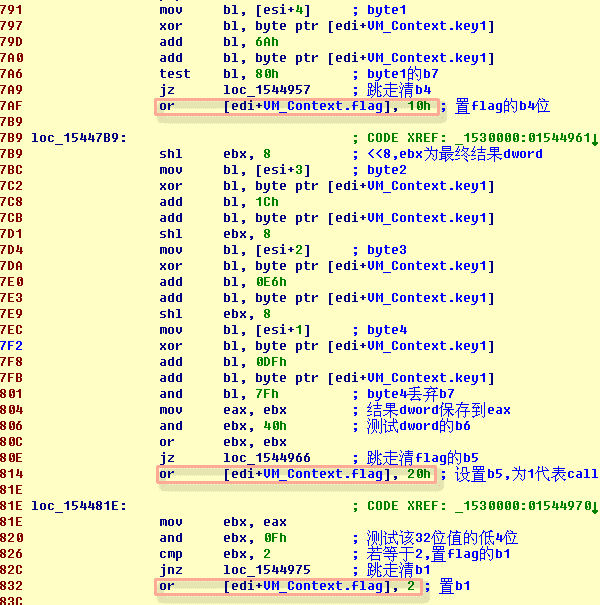

解码 4 个字节。若 `byte1` 的 `b7` 为 1,设置 `flag.b4` 位。若 `byte4` 的 `b6` 为 1,设置 `flag.b5`(代表这是个 `call`)。`byte4` 的低 4 位值若为 2,设置 `flag.b1`。

解出的 4 个字节合并为 1 个 `dword`(其中 `byte4` 丢弃了 `b7`)。

| ***b7*** | ***b6*** | ***b5*** | ***b4*** | ***b3*** | ***b2*** | ***b1*** | ***b0*** |
| :--- | :--- | :--- | :--- | :--- | :--- | :--- | :--- |
| Unknown | | Unknown | | | | Unknown | |

这是 `handler type3` 对 `flag` 的解释。遗憾的是一共出现了 3 个标记位,却有 2 个位不清楚其含义。不过在手工还原代码的过程中这 2 位没有用上,后面会列出使用了 `flag.b1` 和 `flag.b4` 的代码。

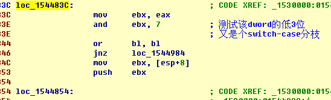

下面与 `Type 1` 类似,是根据 `byte4` 的低 3 位 `switch-case` 分枝。这里也会在 `VM` 栈压入 `NewArgument`(就是控制转移的 `dst`)。

### Case 0

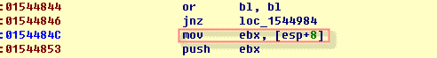

在进入 `handler` 时 `vm` 栈内至少有前面 `handler` 执行压入的 2 个 `dword`。到这里的 `mov` 时,`[esp]` 为 `OldArgument`。即 `NewArgument` = 进入 `handler` 时的 `[esp+4]`。我没有碰到过这种情况,猜测是在模仿 `ret` 指令。

### Case 1

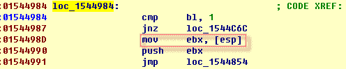

`NewArgument` = `OldArgument`,即用 `Key1` 解码出的 `imm32`。如果写解码程序,这是唯一能确定 `dst` 真实地址的情况。

### Case 2

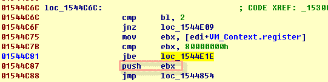

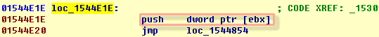

```
if(VM_Context.register > 80000000h)
NewArgument = VM_Context.register
else
NewArgument = [VM_Context.register]
```

### Case 3

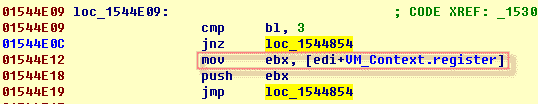

`NewArgument` = `VM_Context.register`

即 `byte4` 包含跳转 `dst` 及 `flag` 标记位设置的信息。下面检测解码结果 `dword` 的高 24 位(由 `byte1`-`byte3` 组成)以确定控制转移类型。为了方便称这个 `dword` 为 `dwJmpType`。

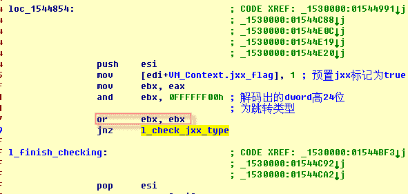

预置 `VM_Context.jmp_flag` 标记为 1,`handler` 最终会检查这个值,只有非 0 才真正发生控制转移,否则会 `jmp esi` 继续执行下一条指令。`dwJmpType` 的高 24 位若为 0,不再执行后续判断,这样必然执行跳转。即 `dwJmpType & 0xFFFFFF00 == 0 -> JMP`。

先看第 1 段检测代码。

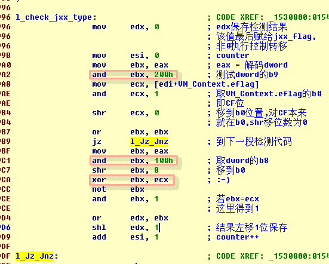

`edx` 初始化为 0,用于保存检测结果。每段检测若符合跳转条件,会将 `edx` 的对应位置 1。最后将 `edx` 赋给 `VM_Context.jmp_flag` 以决定是否执行跳转。`esi` 为计数器,每执行一段检测代码加 1(无论检测结果如何,即 `edx` 对应位是否被置 1)。

检测 `dwJmpType` 的 `b9` 位,若为 0 则跳过本段检测代码,意思是当前操作对下面几行代码所检测的 `VM_Context.eflag` 位不感兴趣 J。否则取 `b8` 并移动到 `b0` 位。

取 `VM_Context.eflag` 的 `b0` 位,也移动到 `b0` 位置(程序生成的代码 J)。`eflag` 的 `b0` 位为 `CF`。

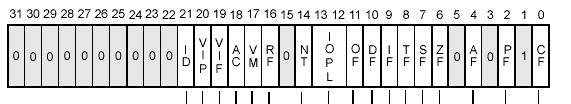

此时 `dwJmpType` 和 `VM_Context.eflag` 的被检测位都在 `b0` 位置了。然后 `XOR`/`NOT`/`AND`。

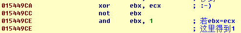

如果 `ebx` 等于 `ecx`, `and` 后 `ebx` 为 1,会执行跳转。

已经够清楚了 J。`dwJmpType` 的 `b9` 为 1,表示要用 `b8` 检测 `VM_Context.eflag` 的 `CF` 位。`b8` 为 1 代表 `JC`,为 0 是 `JNC`。是否真正发生跳转要看 `VM_Context.eflag` 对应位的取值。

`dwJmpType` 的高 24 位中用于检测跳转类型的数据基本是这样两位 1 组使用的。

下面列出后续检测代码。

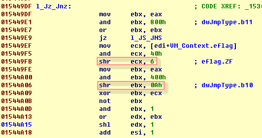

`JZ`/`JNZ`。

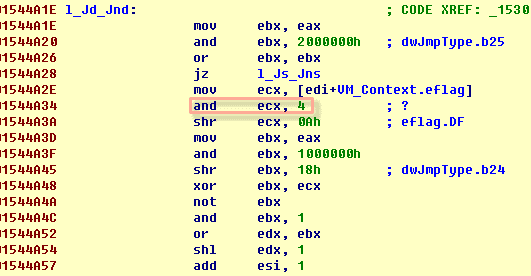

`JD`/`JND`,并没有对应的 `x86` 指令。测试这个标记是用于判断在模仿串操作指令(`movsb`, `lodsb`…)时 `ESI`/`EDI` 应递增还是递减。从 `shr ecx,0Ah` 可以看出代码感兴趣的是 `eflag` 的 `b10` 即 `DF` 位。

注意 `and ecx,4`。下面是原始代码(这里并没有清理错 J)。

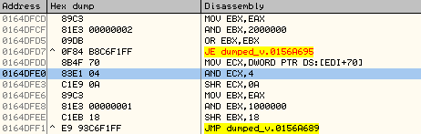

这导致用来比较的 `DF` 位始终为 0,即串操作指令永远不会按 `ESI`/`EDI` 递减的方式执行,这应该是 `Themida` 的 `bug`,正确值为 `400h`。如果有兴趣,可以用 `VM` 保护设置 `DF` 位后执行串操作指令的代码测试一下。

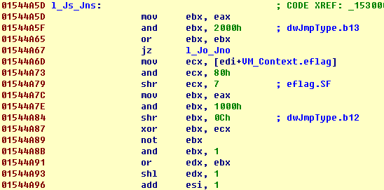

`JS`/`JNS`。

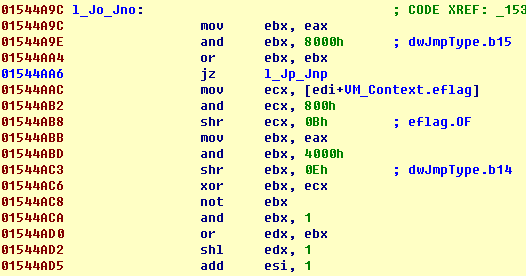

`JO`/`JNO`。

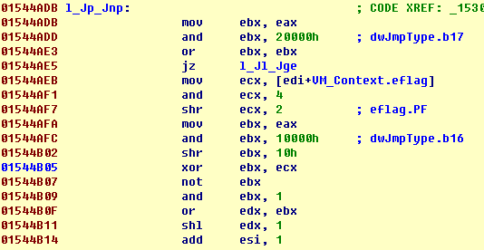

`JP`/`JNP`。

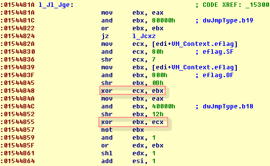

`JL`/`JGE`。这里用了 `eflag` 的 2 个标记位。

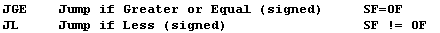

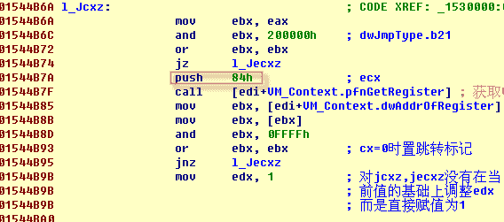

`JCXZ`。这里使用了 `VM_Context.pfnGetRegister` 函数,参数为寄存器在 `VM_Context` 内的偏移。

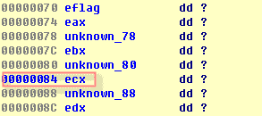

返回值为 `VM_Context.ecx` 的实际地址,保存在 `VM_Context.dwAddrOfRegister`。当 `cx` 值为 0 时直接将 `edx` 置 1 了。

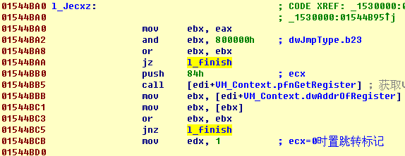

`JECXZ`。`ecx` 为 0 直接将 `edx` 置 1。注意 `JCXZ` 和 `JECXZ` 没有增加计数器 `esi` 的值。

下面的这几行代码我没有看明白 L。

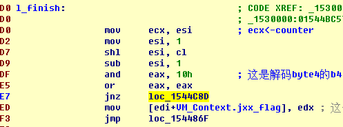

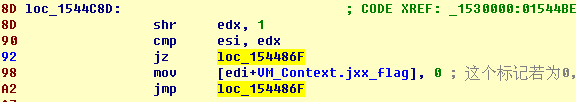

先看标记检测。解码 `byte4.b4` 位若为 0,将结果保存到 `VM_Context.JmpFlag`,结束跳转类型判断。

一般情况下,跳转类型应为上述 9 组(16 个)中的 1 种,即如果对 `eflag` 的检测符合跳转条件,`edx` 中的结果值只有一位被置 1(由于 `edx` 每次左移了 1 位,这个被置 1 的位应在 `edx` 的 `b1`-`b9` 范围内),计数器 `esi` 应为 1。例如,若跳转指令为 `JC`/`JNC`,且符合跳转条件,则 `edx` 的 `b1` = 1, `esi` = 1。

但检测代码并非互斥的 `switch-case`,而是连续的 `if` 语句。若 `dwJmpType` 内的数据符合多组判断条件,即有多段检测代码被执行,则 `edx` 内可能有多个位被置 1,计数器 `esi` > 1。什么样的跳转指令会造成这样的结果? 可以看到上述的跳转类型确实不足以覆盖 `x86` 的全部 `Jxx` 指令(但所有 `Jxx` 指令可能检测的 `eflag` 标记位这里都出现过了)。另外,即使检测 `eflag` 同样的位,也可解释为不同的指令。

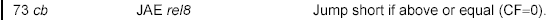

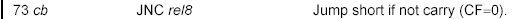

这 2 个指令检测的是同 1 位。如何解释还需要看代码的上下文(虽然其效果是一样的)。

猜测 `byte4` 的这个标记代表了 9 组之外的其它一些跳转类型。当 `byte4.b4` 为 1 时,没有将 `edx` 赋给 `VM_Context.jmp_flag`,而是跳到了 `1544C8D`。

这里对计数器 `esi` 的使用很奇特。`esi` 的值代表执行了几段检测代码(从 `dwJmpType` 可以确切判断出检测了 `VM_Context.eflag` 的哪些位,这里并没有进行这样的判断)。

假设 `esi`=2,代表执行了 2 段检测。仅从这个值并不知道执行的是哪 2 段。

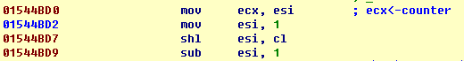

这几行的执行结果是 `esi == 11b`。

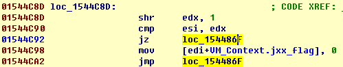

`edx` 右移 1 位(每次保存结果后左移过 1 位),若 `esi` == `edx`,则结束跳转类型判断。因 `VM_Context.jmp_flag` 预置为 1,此时会发生跳转。否则 `VM_Context.jmp_flag` 清 0,不跳转。

虽然不知道 `esi` 是因为执行哪 2 段得到结果值 2 的,`edx` 要等于 `11b`,根据其移位操作,可以明确地判定为最开始的 2 组检查,即检测了 `VM_Context.eflag` 的 `CF`, `ZF` 位。

再假设 `dwJmpType` 内用来与 `eflag` 对应位 `XOR` 操作的位取值为 0,即 `eflag` 的 `CF`, `ZF` 为 0 导致 `edx` = `11b`，则这里的跳转类型应该是:

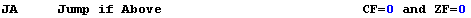

对这个问题的讨论到此为止。我没有看清楚,也许仔细分析 `x86` 的 `Jxx` 指令对 `eflag` 标记位的使用会更明白。一般情况下前面的 9 组指令足够了。`Themida` 的作者够 `CrazyJ`。

下表列出 `dwJmpType` 高 24 位含义。

| ***位*** | ***TRUE*** | ***FALSE*** |
| :--- | :--- | :--- |
| ***b8*** | ***JC*** | ***JNC*** |
| ***b9*** | ***是否用 b8 测试 VM\_Context.eflag 的 CF 位*** | |
| ***b10*** | ***JZ*** | ***JNZ*** |
| ***b11*** | ***是否用 b10 测试 VM\_Context.eflag 的 ZF 位*** | |
| ***b12*** | ***JS*** | ***JNS*** |
| ***b13*** | ***是否用 b12 测试 VM\_Context.eflag 的 SF 位*** | |
| ***b14*** | ***JO*** | ***JNO*** |
| ***b15*** | ***是否用 b14 测试 VM\_Context.eflag 的 OF 位*** | |
| ***b16*** | ***JP*** | ***JNP*** |
| ***b17*** | ***是否用 b16 测试 VM\_Context.eflag 的 PF 位*** | |
| ***b18*** | ***JL*** | ***JGE*** |
| ***b19*** | ***是否用 b18 测试 VM\_Context.eflag 的 SF,OF 位******JGE-> SF=OF,JL-> SF != OF,这里要检测 2 个位*** | |
| ***b20*** | ***未用*** | |
| ***b21*** | ***JCXZ*** | |
| ***b22*** | ***未用*** | |
| ***b23*** | ***JECXZ*** | |
| ***b24*** | ***JD*** | ***JND*** |
| ***b25*** | ***是否用 b24 测试 VM\_Context.eflag 的 DF,这并没有对应的 x86 指令,VM 测试这个位用于判断模仿串操作指令(movsb,lodsb…)时,ESI/EDI 应递增还是递减*** | |

下面准备执行跳转操作。

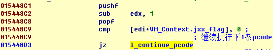

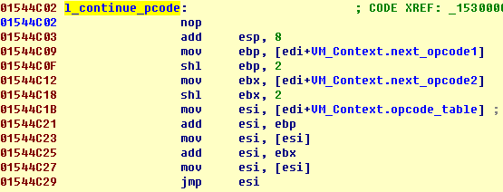

若 `VM_Context.JmpFlag` 值为 0,不发生跳转,继续执行下一条 `PCODE` 指令。否则检测 `NewArgument` 值,解析跳转的 `dst`。

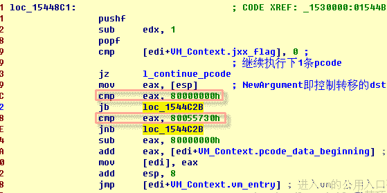

当 `80000000h <= NewArgument < 80055730h` 时,将该值减 `80000000` 作为 `offset`,加当前 `VM` 保护代码对应 `PCODE` 数据起始地址,得到 1 个新的 `PCODE` 数据地址,保存到 `VM_Context.pcode_data`,跳转到 1 字节 `opcode` `handler` 搜索代码(1 字节 `opcode` 保存在 `PCODE.Init_Keys` 域的低 7 位)。这是个 `pcode` 跳转,即跳转的 `dst` 仍然是 `VM` 保护代码。

对不同的被加壳程序,这里的地址上限值不同。注意 `55730h` 这个值相当大(看看 `oep` 处 `VM` 保护代码 `PCODE` 数据的 `size`)。

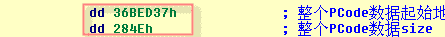

猜测这种跳转的 `dst` 位于另外 1 块 `VM` 保护代码内。

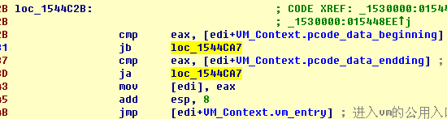

第 2 个地址范围检查,若 `NewArgument` 落到当前 `PCode` 数据地址范围内,则是在同一 `VM` 保护代码块内的 `PCODE` 间跳转。同样将 `dst` 对应 `PCODE` 数据地址保存到 `VM_Context.pcode_data`,跳转到 1 字节 `opcode` 解析代码。

显然,控制转移的 `dst` 对应 `PCODE` 数据,其 `Init_keys` 域必须包含 1 字节 `opcode`。执行 `dst` 的 `handler` 时,各个 `Key` 会重新清 0。

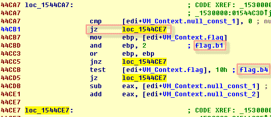

若 `Argument` 没有落在上述 2 个地址范围内,跳转的 `dst` 不是被 `VM` 保护的代码,而是原程序中的真实地址。若 `VM_Context+60h` 的 `dword` 非 0,检测 `flag` 的 `b1`, `b4`,条件满足用 `VM_Context+60h`, `VM_Context+64h` 的 2 个 `dword` 调整地址值(操作和 `Type1` 中对 `OldArgument` 的调整完全相同)。

由于这 2 个 `dword` 总为 0,第 1 个 `JZ` 就跳走了,不清楚 `flag.b1` 和 `flag.b4` 的确切含义。

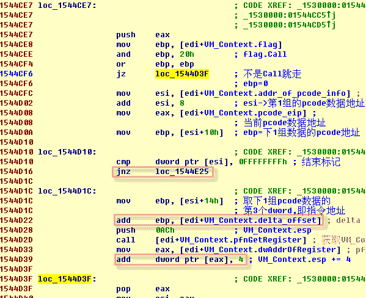


接下来检测 `flag.Call` 标记。若为 0，表示该控制转移不是个 CALL 调用，跳到 `1544D3F`。如果为 Call，下面是个循环。搜索当前指令的 PCODE 数据地址落在 PCODE 数据地址表（即 PUSH/JMP 下的数据）中哪 1 个数据项的地址范围，找到后取其下一个数据项的第 3 个 dword，加上 `DeltaOffset` 作为 CALL 的返回地址，写入原程序栈。

先列出 `1544D16` 处 JNZ 的 dst 代码。

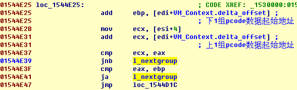

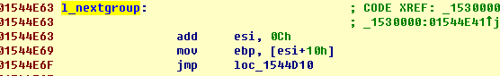

这段代码看起来比较复杂，用 1 张图来说明就直观了。

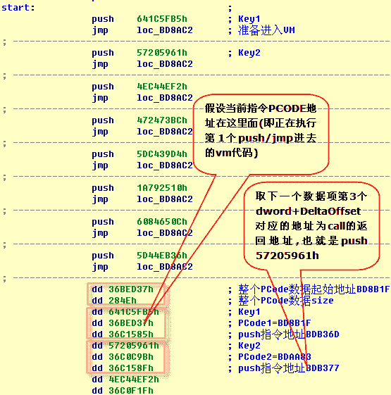

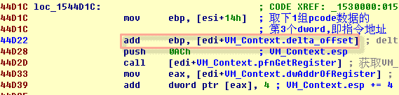

执行这句 `add` 后，`ebp` 即返回地址。注意接下来将原程序的 `esp` 指针加了 4。这是因为若控制转移为 CALL，前面执行的 handler 在原程序的栈内先压了 1 个 dword，这里要平衡栈指针。

先看一段解码的数据。


其对应的原始代码为：


可以看到，在 CALL 前原程序栈内压入了一个 dword。如果是 JMP/Jxx 不会这样。不知道 Themida 为什么这么做。

下面是 CALL 与 JMP/Jxx 的公用代码。

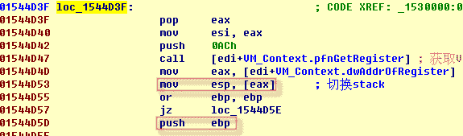

切换堆栈。如果是 CALL（`ebp` 非 0），将返回地址压入原程序栈。

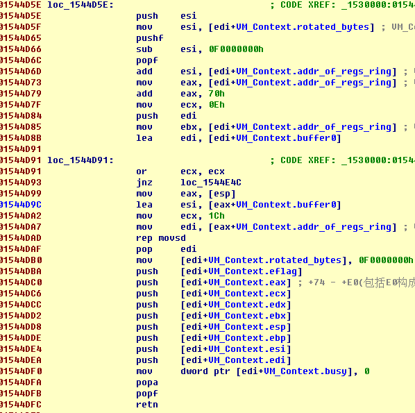

将 `VM_Context` 内通用寄存器恢复到原位置。恢复执行环境，退出 VM。

```
4dd466d0e1e0cc123afbe504da2462ca
```
