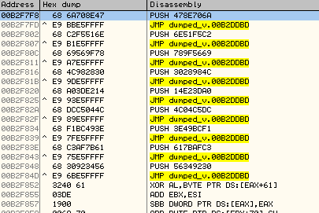
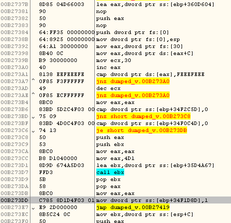

# Themida v1.8.0.0 Demo 虚拟机分析 – Part8

> 原文：[`www.pediy.com/kssd/pediy08/pediy8-808-8.htm`](https://www.pediy.com/kssd/pediy08/pediy8-808-8.htm)

## 关于解码器

实际上，从前面得到的细节已经可以写解码程序了。问题是写出的解码器只能针对这一个程序。由于加壳时引入的随机因素（`PCODE` 各 `field` 具有可变的 `offset`，解码 `PCODE` 数据时使用可变的字节值以及动态的 2 字节 `opcode`），即使完全看懂了 VM 的运作机理，也不见得能干净利落地将其击破。

要写出通用的解码器，需要解决以下问题：

识别 `handler` 的行为以解析 `opcode` 的确切含义，正确提取 `PCODE` 数据的各 `field` 及所用的解码字节常量。当然，还有个最大的障碍，必须尽可能清理变形代码。这些我目前做不到。

需要说明的是，前面所有的分析都来自对 dump 出的 VM 的逆向，我只看了硬币的反面，从来没有跟过加壳过程（这很愚蠢！J）。有兴趣的朋友不妨跟一下加壳时 VM 代码的生成过程，一定会有新的发现。

最后，我们以 `Themida1800 Demo` 内的一段 VM 保护代码为例，讲解手工还原代码。



这段 VM 保护代码内包含 `Themida` 的 anti-debug，包括所谓的 `HeapMagic`（这个名字似乎也是来源于 `shoooo`）。在列出解码数据前，先啰嗦几句。

由于 VM 自己的寄存器及 `VM_Context` 内保存的原程序寄存器实际都只是 `VM_Context` 结构内的成员变量，解码时使用的命名方式有点别扭，如 `context.eax` 表示 `eax` 的值，`addr_context.eax` 表示 `VM_Context.eax` 的地址。也许你有更好的方式 J。

VM 内的大部分操作都使用 VM 自己的栈（堆栈机？）。举 2 个例子。



对 `push eax` 的模仿。



对 `lea ebx,[ebp+035D4CFA]` 的模仿。注意第 3 行压栈的是 `ebp + 035D4CFA` 的结果值，而不是 `[ebp + 035D4CFA]` 所指向的值，所以这里应还原为 `lea` 指令。若为 `push [context.register]`，则还原代码为 `mov ebx,[ebp+035D4CFA]`。

另外，从以前修复 `CVDemo` 的情况看，的确有所谓的 `Virtual Machine Anti-Dumper` 存在，隐藏在解码数据的前面约 1000 行内。但这些代码有明显的特征，即每个 `handler` 执行时都将 4 个 `key` 清 0 了。很容易看出，真正要还原的代码正是从 `keys` 被连续使用时开始的。

## 解码数据

其中第 1 列为 `counter`，第 2,3 列为 `opcode`，第 4 列为 `pcode` 数据地址。我已经分了行，每组对应 1 条还原的指令。

```
0001 02     00B2DE1A  mov      [addr_context.register],addr_context.eax
0002 2A 00  00B2DE28  push     [context.register]
0003 1F 01  00B2DE36  mov      [addr_context.register],addr_context.eax
0004 14 00  00B2DE44  pop      [context.register] (4 bytes)
0005 1F 01  00B2DE52  mov      [addr_context.register],context.ebp
0006 0E 00  00B2DE6E  add      [addr_context.register],034F2C5D
0007 2D 02  00B2DE8A  push     [context.register]
0008 19 01  00B2DE60  push     00000000
0009 27 00  00B2DE7C  cmp      [esp+4],[esp] (4 bytes)
0010 30 01  00B2DE98  jnz      00B2DF08
0011 2C 01  00B2DEA6  mov      [addr_context.register],context.ebp
0012 0E 00  00B2DEB4  add      [addr_context.register],034F0C4D
0013 16 00  00B2DEDE  push     [context.register]
0014 2D 02  00B2DED0  push     00000000
0015 27 00  00B2DEC2  cmp      [esp+4],[esp] (4 bytes)
0016 09 01  00B2DEEC  load     context.register,02AC3398
0017 11 01  00B2DEFA  jz       00B2E242
0018 2C 01  00B2DF08  mov      [addr_context.register],addr_context.eax
0019 2B 02  00B2DF24  push     [context.register]
0020 33 02  00B2DF16  mov      [addr_context.register],context.esp
0021 2D 00  00B2DF32  sub      [addr_context.register],00000004
0022 14 00  00B2DF5C  pop      [context.register] (4 bytes)
0023 16 00  00B2DF40  push     [addr_context.register]
0024 14 00  00B2DF4E  pop      [addr_context.esp] (4 bytes)
0025 1F 01  00B2DF6A  mov      [addr_context.register],addr_context.ebx
0026 16 00  00B2DFB0  push     [context.register]
0027 1F 01  00B2DFBE  mov      [addr_context.register],context.esp
0028 36 00  00B2DF86  sub      [addr_context.register],00000004
0029 01 01  00B2DFCC  pop      [context.register] (4 bytes)
0030 19 01  00B2DF78  push     [addr_context.register]
0031 14 00  00B2DF94  pop      [addr_context.esp] (4 bytes)
0032 23 02  00B2DFA2  load     context.register,083B1BB9
0033 23 01  00B2DFDA  mov_reg  [addr_context.eax],context.eax
0034 23 02  00B2DFE8  load     context.register,08169770
0035 2D 02  00B2DFF6  push     0000047B
0036 1B 02  00B2E012  mov      [addr_context.register],addr_context.eax
0037 14 00  00B2E004  pop      [context.register] (4 bytes)
0038 13 00  00B2E020  load     context.register,064E0B3F
0039 33 02  00B2E02E  mov      [addr_context.register],addr_context.eax
0040 2D 02  00B2E074  push     [context.register]
0041 12 00  00B2E04A  mov      [addr_context.register],context.ebp
0042 0E 00  00B2E066  add      [addr_context.register],034F1B41
0043 32 02  00B2E03C  pop      [context.register] (4 bytes)
0044 12 01  00B2E058  load     context.register,0753383F
0045 1B 02  00B2E082  mov      [addr_context.register],context.ebp
0046 1E 00  00B2E09E  add      [addr_context.register],035D4CFA
0047 19 01  00B2E0AC  push     [addr_context.register]
0048 12 00  00B2E0BA  mov      [addr_context.register],addr_context.ebx
0049 01 01  00B2E090  pop      [context.register] (4 bytes)
0050 1B 02  00B2E0C8  mov      [addr_context.register],context.esp
0051 11 02  00B2E0F2  sub      [addr_context.register],00000004
0052 2D 02  00B2E0D6  push     [addr_context.register]
0053 32 02  00B2E10E  pop      [addr_context.esp] (4 bytes)
0054 2A 00  00B2E11C  push     00B2E146
0055 33 02  00B2E12A  mov      [addr_context.register],context.esp
0056 01 01  00B2E138  pop      [context.register] (4 bytes)
0057 12 00  00B2E0E4  mov      [addr_context.register],addr_context.ebx
0058 33 01  00B2E146  call     [context.register]
0059 25 02  00B2E100  load     context.register,0021A180
0060 2C 01  00B2E154  mov      [addr_context.register],context.esp
0061 2B 02  00B2E162  push     [context.register]
0062 12 00  00B2E19A  mov      [addr_context.register],addr_context.ebx
0063 32 02  00B2E17E  pop      [context.register] (4 bytes)
0064 1B 02  00B2E170  mov      [addr_context.register],context.esp
0065 0E 01  00B2E1B6  add      [addr_context.register],00000004
0066 2D 02  00B2E18C  push     [addr_context.register]
0067 14 00  00B2E1A8  pop      [addr_context.esp] (4 bytes)
0068 33 02  00B2E1C4  mov      [addr_context.register],context.esp
0069 16 00  00B2E226  push     [context.register]
0070 1F 01  00B2E218  mov      [addr_context.register],addr_context.eax
0071 14 00  00B2E1E0  pop      [context.register] (4 bytes)
0072 1B 02  00B2E1D2  mov      [addr_context.register],context.esp
0073 37 02  00B2E1EE  add      [addr_context.register],00000004
0074 2A 00  00B2E234  push     [addr_context.register]
0075 01 01  00B2E1FC  pop      [addr_context.esp] (4 bytes)
0076 13 00  00B2E20A  load     context.register,06F15901
0077 2C 01  00B2E242  mov      [addr_context.register],context.ebp
0078 26 00  00B2E26C  add      [addr_context.register],034F0C4D
0079 2B 02  00B2E27A  push     [context.register]
0080 2B 02  00B2E250  push     00000000
0081 27 00  00B2E25E  cmp      [esp+4],[esp] (4 bytes)
0082 16 01  00B2E288  jz       00B2E58A
0083 2C 01  00B2E296  mov      [addr_context.register],addr_context.eax
0084 2B 02  00B2E2A4  push     [context.register]
0085 1F 01  00B2E2DC  mov      [addr_context.register],context.esp
0086 2D 00  00B2E2CE  sub      [addr_context.register],00000004
0087 32 02  00B2E2EA  pop      [context.register] (4 bytes)
0088 19 01  00B2E2B2  push     [addr_context.register]
0089 14 00  00B2E2C0  pop      [addr_context.esp] (4 bytes)
0090 33 02  00B2E2F8  mov      [addr_context.register],addr_context.ebx
0091 16 00  00B2E34C  push     [context.register]
0092 12 00  00B2E314  mov      [addr_context.register],context.esp
0093 2D 00  00B2E306  sub      [addr_context.register],00000004
0094 32 02  00B2E322  pop      [context.register] (4 bytes)
0095 16 00  00B2E33E  push     [addr_context.register]
0096 32 02  00B2E330  pop      [addr_context.esp] (4 bytes)
0097 2B 02  00B2E35A  push     0000047B
0098 1B 02  00B2E368  mov      [addr_context.register],addr_context.eax
0099 14 00  00B2E384  pop      [context.register] (4 bytes)
0100 13 00  00B2E376  load     context.register,0C7E36F0
0101 1F 01  00B2E392  mov      [addr_context.register],addr_context.eax
0102 2B 02  00B2E3A0  push     [context.register]
```


0103 12 00 00B2E3CA `mov [addr_context.register],context.ebp`

0104 37 02 00B2E3BC `add [addr_context.register],034F1B41`

0105 14 00 00B2E3AE `pop [context.register] (4 bytes)`

0106 33 02 00B2E3D8 `mov [addr_context.register],context.ebp`

0107 0D 02 00B2E402 `add [addr_context.register],035D49E9`

0108 19 01 00B2E410 `push [addr_context.register]`

0109 1F 01 00B2E3E6 `mov [addr_context.register],addr_context.ebx`

0110 14 00 00B2E3F4 `pop [context.register] (4 bytes)`

0111 12 01 00B2E41E `load context.register,00D1BDF4`

0112 1B 02 00B2E42C `mov [addr_context.register],context.esp`

0113 36 00 00B2E43A `sub [addr_context.register],00000004`

0114 2B 02 00B2E464 `push [addr_context.register]`

0115 32 02 00B2E49C `pop [addr_context.esp] (4 bytes)`

0116 2A 00 00B2E48E `push 00B2E4AA`

0117 1B 02 00B2E480 `mov [addr_context.register],context.esp`

0118 14 00 00B2E472 `pop [context.register] (4 bytes)`

0119 12 00 00B2E456 `mov [addr_context.register],addr_context.ebx`

0120 00 01 00B2E448 `call [context.register]`

0121 2C 01 00B2E4AA `mov [addr_context.register],context.esp`

0122 16 00 00B2E4C6 `push [context.register]`

0123 12 00 00B2E50C `mov [addr_context.register],addr_context.ebx`

0124 32 02 00B2E4FE `pop [context.register] (4 bytes)`

0125 33 02 00B2E4B8 `mov [addr_context.register],context.esp`

0126 37 02 00B2E4E2 `add [addr_context.register],00000004`

0127 16 00 00B2E4F0 `push [addr_context.register]`

0128 01 01 00B2E4D4 `pop [addr_context.esp] (4 bytes)`

0129 12 00 00B2E51A `mov [addr_context.register],context.esp`

0130 19 01 00B2E528 `push [context.register]`

0131 1F 01 00B2E57C `mov [addr_context.register],addr_context.eax`

0132 01 01 00B2E560 `pop [context.register] (4 bytes)`

0133 12 00 00B2E56E `mov [addr_context.register],context.esp`

0134 26 00 00B2E552 `add [addr_context.register],00000004`

0135 2B 02 00B2E544 `push [addr_context.register]`

0136 01 01 00B2E536 `pop [addr_context.esp] (4 bytes)`

0137 2C 01 00B2E58A `mov [addr_context.register],addr_context.eax`

0138 2D 02 00B2E5C2 `push [context.register]`

0139 12 00 00B2E5A6 `mov [addr_context.register],addr_context.eax`

0140 01 01 00B2E598 `pop [context.register] (4 bytes)`

0141 13 00 00B2E5B4 `load context.register,067ADA17`

0142 33 02 00B2E5D0 `mov [addr_context.register],context.ebp`

0143 0D 02 00B2E608 `add [addr_context.register],03613F38`

0144 2D 02 00B2E5DE `push [addr_context.register]`

0145 1F 01 00B2E5FA `mov [addr_context.register],addr_context.eax`

0146 32 02 00B2E5EC `pop [context.register] (4 bytes)`

0147 2D 02 00B2E616 `push 00000094`

0148 12 00 00B2E624 `mov [addr_context.register],context.eax`

0149 01 01 00B2E632 `pop [context.register] (4 bytes)`

0150 2D 02 00B2E640 `push 00000047`

0151 12 00 00B2E64E `mov [addr_context.register],context.ebp`

0152 26 00 00B2E65C `add [addr_context.register],034F1A5D`

0153 01 01 00B2E66A `pop [context.register] (1 bytes)`

0154 19 01 00B2E678 `push 93C8F7C1`

0155 12 00 00B2E6A2 `mov [addr_context.register],context.esp`

0156 2D 00 00B2E694 `sub [addr_context.register],00000004`

0157 32 02 00B2E6B0 `pop [context.register] (4 bytes)`

0158 2A 00 00B2E6BE `push [addr_context.register]`

0159 01 01 00B2E686 `pop [addr_context.esp] (4 bytes)`

0160 12 00 00B2E6CC `mov [addr_context.register],context.ebp`

0161 0E 00 00B2E720 `add [addr_context.register],034F0B35`

0162 19 01 00B2E712 `push [context.register]`

0163 12 00 00B2E6F6 `mov [addr_context.register],context.esp`

0164 11 02 00B2E6E8 `sub [addr_context.register],00000004`

0165 32 02 00B2E73C `pop [context.register] (4 bytes)`

0166 19 01 00B2E6DA `push [addr_context.register]`

0167 32 02 00B2E704 `pop [addr_context.esp] (4 bytes)`

0168 12 01 00B2E72E `load context.register,05966075`

0169 1F 01 00B2E74A `mov [addr_context.register],context.ebp`

0170 1E 00 00B2E774 `add [addr_context.register],035E5263`

0171 2A 00 00B2E782 `push [addr_context.register]`

0172 33 02 00B2E758 `mov [addr_context.register],addr_context.eax`

0173 14 00 00B2E790 `pop [context.register] (4 bytes)`

0174 12 01 00B2E766 `load context.register,05D9008B`

0175 12 00 00B2E79E `mov [addr_context.register],context.esp`

0176 36 00 00B2E800 `sub [addr_context.register],00000004`

0177 16 00 00B2E7C8 `push [addr_context.register]`

0178 32 02 00B2E80E `pop [addr_context.esp] (4 bytes)`

0179 16 00 00B2E7BA `push 00B2E81C`

0180 1B 02 00B2E7E4 `mov [addr_context.register],context.esp`

0181 32 02 00B2E7F2 `pop [context.register] (4 bytes)`

0182 12 00 00B2E7AC `mov [addr_context.register],addr_context.eax`

0183 11 01 00B2E7D6 `call [context.register]`

0184 2C 01 00B2E81C `mov [addr_context.register],context.ebp`

0185 0D 02 00B2E862 `add [addr_context.register],03613F38`

0186 2A 00 00B2E82A `push [addr_context.register]`

0187 1F 01 00B2E846 `mov [addr_context.register],addr_context.edi`

0188 32 02 00B2E854 `pop [context.register] (4 bytes)`

0189 09 01 00B2E838 `load context.register,04E4223B`

0190 1B 02 00B2E870 `mov [addr_context.register],addr_context.edi`

0191 2D 02 00B2E8B6 `push [context.register]`

0192 12 00 00B2E8A8 `mov [addr_context.register],context.esp`

0193 36 00 00B2E88C `sub [addr_context.register],00000004`

0194 14 00 00B2E89A `pop [context.register] (4 bytes)`

0195 2B 02 00B2E8C4 `push [addr_context.register]`

0196 14 00 00B2E87E `pop [addr_context.esp] (4 bytes)`

0197 1B 02 00B2E8D2 `mov [addr_context.register],context.esp`

0198 11 02 00B2E90A `sub [addr_context.register],00000004`

0199 2A 00 00B2E926 `push [addr_context.register]`

0200 32 02 00B2E934 `pop [addr_context.esp] (4 bytes)`

0201 16 00 00B2E8E0 `push 00B2E950`

0202 1F 01 00B2E942 `mov [addr_context.register],context.esp`

0203 01 01 00B2E8FC `pop [context.register] (4 bytes)`

0204 1F 01 00B2E918 `mov [addr_context.register],addr_context.eax`

0205 11 01 00B2E8EE `call [context.register]`

0206 2C 01 00B2E950 `mov [addr_context.register],context.ebp`

0207 0E 01 00B2E988 `add [addr_context.register],03613F38`

0208 2A 00 00B2E95E `push [addr_context.register]`

0209 33 02 00B2E96C `mov [addr_context.register],addr_context.eax`

0210 32 02 00B2E97A `pop [context.register] (4 bytes)`

0211 1F 01 00B2E996 `mov [addr_context.register],context.eax`

0212 1E 00 00B2E9CE `add [addr_context.register],00000010`

0213 2B 02 00B2E9B2 `push [context.register]`

0214 19 01 00B2E9C0 `push 00000001`

0215 27 00 00B2E9A4 `cmp [esp+4],[esp] (4 bytes)`

0216 2A 02 00B2E9DC `jnz 00B2EA5A`

0217 2C 01 00B2E9EA `mov [addr_context.register],context.eax`

0218 26 00 00B2EA30 `add [addr_context.register],00000008`

0219 2A 00 00B2E9F8 `push [context.register]`

0220 19 01 00B2EA06 `push 00000000`

0221 27 00 00B2EA14 `cmp [esp+4],[esp] (4 bytes)`

0222 12 01 00B2EA22 `load context.register,0776D0E8`

0223 33 01 00B2EA3E `jnz 00B2EA5A`

0224 10 00 00B2EA4C `jmp 00B2EE3C`

0225 27 01 00B2EA5A `push 00000049`

0226 12 00 00B2EA92 `mov [addr_context.register],context.ebp`

0227 0E 00 00B2EA68 `add [addr_context.register],034F1A5D`

0228 32 02 00B2EA76 `pop [context.register] (1 bytes)`


```
0229 12 01  00B2EA84  load     context.register,0A54598D

0230 19 01  00B2EAA0  push     AFAAAF5A

0231 33 02  00B2EACA  mov      [addr_context.register],context.esp

0232 11 02  00B2EAF4  sub      [addr_context.register],00000004

0233 32 02  00B2EAAE  pop      [context.register] (4 bytes)

0234 19 01  00B2EAE6  push     [addr_context.register]

0235 01 01  00B2EABC  pop      [addr_context.esp] (4 bytes)

0236 09 01  00B2EAD8  load     context.register,00C5A107

0237 1B 02  00B2EB02  mov      [addr_context.register],context.ebp

0238 0E 01  00B2EB72  add      [addr_context.register],034F0B35

0239 19 01  00B2EB10  push     [context.register]

0240 12 00  00B2EB3A  mov      [addr_context.register],context.esp

0241 2D 00  00B2EB1E  sub      [addr_context.register],00000004

0242 32 02  00B2EB56  pop      [context.register] (4 bytes)

0243 2D 02  00B2EB2C  push     [addr_context.register]

0244 14 00  00B2EB48  pop      [addr_context.esp] (4 bytes)

0245 09 01  00B2EB64  load     context.register,002113A6

0246 1B 02  00B2EB80  mov      [addr_context.register],context.ebp

0247 37 02  00B2EB9C  add      [addr_context.register],035E5263

0248 2A 00  00B2EBC6  push     [addr_context.register]

0249 12 00  00B2EB8E  mov      [addr_context.register],addr_context.eax

0250 32 02  00B2EBAA  pop      [context.register] (4 bytes)

0251 09 01  00B2EBB8  load     context.register,0D7892FE

0252 1B 02  00B2EBD4  mov      [addr_context.register],context.esp

0253 36 00  00B2EC0C  sub      [addr_context.register],00000004

0254 2B 02  00B2EC36  push     [addr_context.register]

0255 01 01  00B2EC1A  pop      [addr_context.esp] (4 bytes)

0256 2D 02  00B2EC44  push     00B2EC52

0257 1F 01  00B2EC28  mov      [addr_context.register],context.esp

0258 32 02  00B2EBE2  pop      [context.register] (4 bytes)

0259 33 02  00B2EC52  mov      [addr_context.register],addr_context.eax

0260 33 01  00B2EBFE  call     [context.register]

0261 25 02  00B2EBF0  load     context.register,0F1E5AFA

0262 2C 01  00B2EC60  mov      [addr_context.register],addr_context.eax

0263 2D 02  00B2EC98  push     [context.register]

0264 33 02  00B2EC8A  mov      [addr_context.register],context.ebp

0265 0D 02  00B2EC7C  add      [addr_context.register],034F0EBD

0266 32 02  00B2EC6E  pop      [context.register] (4 bytes)

0267 12 00  00B2ECA6  mov      [addr_context.register],context.esp

0268 36 00  00B2ED16  sub      [addr_context.register],00000004

0269 16 00  00B2ED08  push     [addr_context.register]

0270 01 01  00B2ECC2  pop      [addr_context.esp] (4 bytes)

0271 2A 00  00B2ECFA  push     00B2ED24

0272 33 02  00B2ECB4  mov      [addr_context.register],context.esp

0273 01 01  00B2ECD0  pop      [context.register] (4 bytes)

0274 12 00  00B2ECEC  mov      [addr_context.register],addr_context.eax

0275 11 01  00B2ECDE  call     [context.register]

0276 25 02  00B2ED24  load     context.register,02D9BB27

0277 02 02  00B2ED32  or_reg   [addr_context.eax],context.eax

0278 23 02  00B2ED40  load     context.register,0F0AD617

0279 30 01  00B2ED4E  jnz      00B2EDB0

0280 2C 01  00B2ED5C  mov      [addr_context.register],context.ebp

0281 0E 00  00B2ED78  add      [addr_context.register],034F1D8D

0282 2D 02  00B2ED86  push     [context.register]

0283 2D 02  00B2ED6A  push     00000000

0284 27 00  00B2ED94  cmp      [esp+4],[esp] (4 bytes)

0285 06 00  00B2EDA2  jz       00B2EE3C

0286 2C 01  00B2EDB0  mov      [addr_context.register],context.ebp

0287 26 00  00B2EDDA  add      [addr_context.register],034F4CF3

0288 16 00  00B2EDE8  push     [addr_context.register]

0289 1B 02  00B2EDF6  mov      [addr_context.register],addr_context.edi

0290 14 00  00B2EDBE  pop      [context.register] (4 bytes)

0291 13 00  00B2EDCC  load     context.register,0860F17B

0292 34 01  00B2EE04  mov_reg  [addr_context.eax],00000001

0293 23 02  00B2EE12  load     context.register,05CC85D7

0294 33 02  00B2EE20  mov      [addr_context.register],addr_context.edi

0295 11 01  00B2EE2E  jmp      [context.register]

0296 2C 01  00B2EE3C  mov      [addr_context.register],context.ebp

0297 0D 02  00B2EE74  add      [addr_context.register],034F25F9

0298 19 01  00B2EE9E  push     [context.register]

0299 12 00  00B2EE90  mov      [addr_context.register],addr_context.eax

0300 16 00  00B2EE4A  push     [context.register]

0301 17 00  00B2EEAC  xor      [esp+4],[esp] (4 bytes)

0302 1F 01  00B2EE66  mov      [addr_context.register],context.ebp

0303 37 02  00B2EE82  add      [addr_context.register],034F25F9

0304 01 01  00B2EE58  pop      [context.register] (4 bytes)

0305 33 02  00B2EEBA  mov      [addr_context.register],addr_context.eax

0306 2D 02  00B2EED6  push     [context.register]

0307 1F 01  00B2EF1C  mov      [addr_context.register],context.ebp

0308 0E 00  00B2EEE4  add      [addr_context.register],034F1695

0309 2B 02  00B2EF00  push     [context.register]

0310 1E 00  00B2EEC8  add      [esp+4],[esp] (4 bytes)

0311 1F 01  00B2EF0E  mov      [addr_context.register],addr_context.eax

0312 14 00  00B2EEF2  pop      [context.register] (4 bytes)

0313 1B 02  00B2EF2A  mov      [addr_context.register],context.ebp

0314 0E 01  00B2EF38  add      [addr_context.register],034F0FED

0315 2D 02  00B2EF8C  push     [context.register]

0316 1B 02  00B2EF46  mov      [addr_context.register],addr_context.eax

0317 2B 02  00B2EF62  push     [context.register]

0318 0E 00  00B2EFA8  add      [esp+4],[esp] (4 bytes)

0319 12 00  00B2EF7E  mov      [addr_context.register],context.ebp

0320 26 00  00B2EF9A  add      [addr_context.register],034F0FED

0321 32 02  00B2EF70  pop      [context.register] (4 bytes)

0322 12 01  00B2EF54  load     context.register,0E3F53F5

0323 00 02  00B2EFB6  xor_reg  [addr_context.eax],context.ebx

0324 1B 02  00B2EFC4  mov      [addr_context.register],context.ebp

0325 0D 02  00B2F042  add      [addr_context.register],034F1695

0326 16 00  00B2EFFC  push     [context.register]

0327 33 02  00B2F00A  mov      [addr_context.register],addr_context.eax

0328 2D 02  00B2EFE0  push     [context.register]

0329 0D 02  00B2F018  add      [esp+4],[esp] (4 bytes)

0330 33 02  00B2EFEE  mov      [addr_context.register],context.ebp

0331 0E 00  00B2F034  add      [addr_context.register],034F1695

0332 14 00  00B2F026  pop      [context.register] (4 bytes)

0333 09 01  00B2EFD2  load     context.register,0C0EBF52

0334 3E 02  00B2F050  mov_reg  [addr_context.eax],context.eax

0335 1F 01  00B2F05E  mov      [addr_context.register],context.ebp

0336 37 02  00B2F096  add      [addr_context.register],034F2C5D

0337 2B 02  00B2F0A4  push     [context.register]

0338 2A 00  00B2F088  push     00000000

0339 27 00  00B2F07A  cmp      [esp+4],[esp] (4 bytes)

0340 09 01  00B2F06C  load     context.register,09088A57

0341 33 01  00B2F0B2  jnz      00B2F122

0342 2C 01  00B2F0C0  mov      [addr_context.register],context.ebp

0343 1E 00  00B2F0CE  add      [addr_context.register],034F0C4D

0344 2A 00  00B2F0DC  push     [context.register]

0345 2B 02  00B2F0F8  push     00000000

0346 27 00  00B2F106  cmp      [esp+4],[esp] (4 bytes)

0347 13 00  00B2F0EA  load     context.register,094234B8

0348 00 01  00B2F114  jz       00B2F416

0349 2C 01  00B2F122  mov      [addr_context.register],addr_context.eax

0350 2B 02  00B2F15A  push     [context.register]

0351 1F 01  00B2F184  mov      [addr_context.register],context.esp

0352 36 00  00B2F168  sub      [addr_context.register],00000004

0353 32 02  00B2F14C  pop      [context.register] (4 bytes)

0354 2D 02  00B2F13E  push     [addr_context.register]

0355 32 02  00B2F130  pop      [addr_context.esp] (4 bytes)
```


```
0356 23 02  00B2F176  load     context.register,01C514DE

0357 12 00  00B2F192  mov      [addr_context.register],addr_context.ebx

0358 19 01  00B2F1D8  push     [context.register]

0359 12 00  00B2F1CA  mov      [addr_context.register],context.esp

0360 11 02  00B2F1BC  sub      [addr_context.register],00000004

0361 01 01  00B2F1A0  pop      [context.register] (4 bytes)

0362 19 01  00B2F1AE  push     [addr_context.register]

0363 14 00  00B2F1F4  pop      [addr_context.esp] (4 bytes)

0364 09 01  00B2F1E6  load     context.register,039132D8

0365 3E 02  00B2F202  mov_reg  [addr_context.eax],context.eax

0366 3E 02  00B2F210  mov_reg  [addr_context.eax],0000047B

0367 12 01  00B2F21E  load     context.register,02793B0E

0368 33 02  00B2F22C  mov      [addr_context.register],addr_context.eax

0369 2D 02  00B2F23A  push     [context.register]

0370 12 00  00B2F248  mov      [addr_context.register],context.ebp

0371 37 02  00B2F264  add      [addr_context.register],034F26A1

0372 32 02  00B2F256  pop      [context.register] (4 bytes)

0373 1B 02  00B2F272  mov      [addr_context.register],context.ebp

0374 0E 01  00B2F2AA  add      [addr_context.register],035D4D61

0375 16 00  00B2F29C  push     [addr_context.register]

0376 1F 01  00B2F28E  mov      [addr_context.register],addr_context.ebx

0377 14 00  00B2F280  pop      [context.register] (4 bytes)

0378 12 00  00B2F2B8  mov      [addr_context.register],context.esp

0379 36 00  00B2F31A  sub      [addr_context.register],00000004

0380 2B 02  00B2F2C6  push     [addr_context.register]

0381 01 01  00B2F2D4  pop      [addr_context.esp] (4 bytes)

0382 2A 00  00B2F30C  push     00B2F336

0383 33 02  00B2F2FE  mov      [addr_context.register],context.esp

0384 32 02  00B2F2E2  pop      [context.register] (4 bytes)

0385 1F 01  00B2F328  mov      [addr_context.register],addr_context.ebx

0386 2A 02  00B2F2F0  call     [context.register]

0387 2C 01  00B2F336  mov      [addr_context.register],context.esp

0388 16 00  00B2F37C  push     [context.register]

0389 1B 02  00B2F36E  mov      [addr_context.register],addr_context.ebx

0390 14 00  00B2F344  pop      [context.register] (4 bytes)

0391 12 00  00B2F352  mov      [addr_context.register],context.esp

0392 26 00  00B2F398  add      [addr_context.register],00000004

0393 2A 00  00B2F360  push     [addr_context.register]

0394 01 01  00B2F38A  pop      [addr_context.esp] (4 bytes)

0395 12 00  00B2F3A6  mov      [addr_context.register],context.esp

0396 16 00  00B2F3EC  push     [context.register]

0397 1B 02  00B2F408  mov      [addr_context.register],addr_context.eax

0398 32 02  00B2F3B4  pop      [context.register] (4 bytes)

0399 33 02  00B2F3D0  mov      [addr_context.register],context.esp

0400 0E 00  00B2F3C2  add      [addr_context.register],00000004

0401 2B 02  00B2F3DE  push     [addr_context.register]

0402 01 01  00B2F3FA  pop      [addr_context.esp] (4 bytes)

0403 2C 01  00B2F416  mov      [addr_context.register],context.ebp

0404 0E 01  00B2F432  add      [addr_context.register],034F0C4D

0405 2D 02  00B2F424  push     [context.register]

0406 2A 00  00B2F440  push     00000000

0407 27 00  00B2F45C  cmp      [esp+4],[esp] (4 bytes)

0408 12 01  00B2F44E  load     context.register,0A4490C7

0409 30 01  00B2F46A  jz       00B2F75E

0410 2C 01  00B2F478  mov      [addr_context.register],addr_context.eax

0411 2B 02  00B2F4CC  push     [context.register]

0412 1F 01  00B2F4A2  mov      [addr_context.register],context.esp

0413 36 00  00B2F486  sub      [addr_context.register],00000004

0414 14 00  00B2F494  pop      [context.register] (4 bytes)

0415 2D 02  00B2F4BE  push     [addr_context.register]

0416 01 01  00B2F4B0  pop      [addr_context.esp] (4 bytes)

0417 1F 01  00B2F4DA  mov      [addr_context.register],addr_context.ebx

0418 2D 02  00B2F520  push     [context.register]

0419 33 02  00B2F52E  mov      [addr_context.register],context.esp

0420 36 00  00B2F504  sub      [addr_context.register],00000004

0421 01 01  00B2F53C  pop      [context.register] (4 bytes)

0422 2B 02  00B2F512  push     [addr_context.register]

0423 01 01  00B2F4E8  pop      [addr_context.esp] (4 bytes)

0424 09 01  00B2F4F6  load     context.register,03BD6BA7

0425 25 01  00B2F54A  mov_reg  [addr_context.eax],0000047B

0426 33 02  00B2F558  mov      [addr_context.register],addr_context.eax

0427 19 01  00B2F566  push     [context.register]

0428 1F 01  00B2F582  mov      [addr_context.register],context.ebp

0429 26 00  00B2F59E  add      [addr_context.register],034F26A1

0430 01 01  00B2F574  pop      [context.register] (4 bytes)

0431 12 01  00B2F590  load     context.register,0B0101A1

0432 33 02  00B2F5AC  mov      [addr_context.register],context.ebp

0433 37 02  00B2F5BA  add      [addr_context.register],035D4A02

0434 2B 02  00B2F5E4  push     [addr_context.register]

0435 1B 02  00B2F5D6  mov      [addr_context.register],addr_context.ebx

0436 01 01  00B2F5C8  pop      [context.register] (4 bytes)

0437 1F 01  00B2F5F2  mov      [addr_context.register],context.esp

0438 36 00  00B2F60E  sub      [addr_context.register],00000004

0439 2B 02  00B2F662  push     [addr_context.register]

0440 32 02  00B2F638  pop      [addr_context.esp] (4 bytes)

0441 2A 00  00B2F646  push     00B2F670

0442 12 00  00B2F600  mov      [addr_context.register],context.esp

0443 01 01  00B2F62A  pop      [context.register] (4 bytes)

0444 1F 01  00B2F654  mov      [addr_context.register],addr_context.ebx

0445 16 01  00B2F61C  call     [context.register]

0446 2C 01  00B2F670  mov      [addr_context.register],context.esp

0447 2B 02  00B2F6A8  push     [context.register]

0448 1B 02  00B2F6D2  mov      [addr_context.register],addr_context.ebx

0449 14 00  00B2F69A  pop      [context.register] (4 bytes)

0450 1F 01  00B2F6C4  mov      [addr_context.register],context.esp

0451 0E 00  00B2F67E  add      [addr_context.register],00000004

0452 2A 00  00B2F68C  push     [addr_context.register]

0453 01 01  00B2F6B6  pop      [addr_context.esp] (4 bytes)

0454 12 00  00B2F6E0  mov      [addr_context.register],context.esp

0455 19 01  00B2F70A  push     [context.register]

0456 12 00  00B2F750  mov      [addr_context.register],addr_context.eax

0457 14 00  00B2F734  pop      [context.register] (4 bytes)

0458 1B 02  00B2F718  mov      [addr_context.register],context.esp

0459 0E 01  00B2F726  add      [addr_context.register],00000004

0460 2B 02  00B2F6FC  push     [addr_context.register]

0461 32 02  00B2F742  pop      [addr_context.esp] (4 bytes)

0462 23 02  00B2F6EE  load     context.register,09EDA0AA

0463 05 00  00B2F75E  mov_reg  [addr_context.eax],context.eax

0464 12 00  00B2F76C  mov      [addr_context.register],context.ebp

0465 37 02  00B2F7A4  add      [addr_context.register],03613FCC

0466 2A 00  00B2F788  push     [context.register]

0467 12 00  00B2F796  mov      [addr_context.register],addr_context.eax

0468 14 00  00B2F77A  pop      [context.register] (4 bytes)

0469 00 02  00B2F7B2  xor_reg  [addr_context.eax],7475EDFF

0470 07 00  00B2F7C0  add_reg  [addr_context.eax],context.ebp

0471 1F 01  00B2F7CE  mov      [addr_context.register],addr_context.eax

0472 06 00  00B2F7DC  jmp      [context.register]

0473 28 02  00B2F7EA  exit_vm
```

还原的代码

```
    ; 第 1 段

    mov     eax,eax
    cmp     dword ptr [ebp+034F2C5D],0
    jnz     l_00B2DF08
    cmp     dword ptr [ebp+034F0C4D],0
    jz      l_00B2E242

l_00B2DF08:

    push    eax
    push    ebx
    mov     eax,eax
    mov     eax,0000047B
    mov     [ebp+034F1B41],eax
```


```
    lea     ebx,[ebp+035D4CFA]

    call    ebx

    ; 第 2 段

    pop     ebx

    pop     eax

l_00B2E242:

    cmp     dword ptr [ebp+034F0C4D],0

    jz      l_00B2E58A

    push    eax

    push    ebx

    mov     eax,0000047B

    mov     [ebp+034F1B41],eax

    lea     ebx,[ebp+035D49E9]

    call    ebx

    ; 第 3 段

    pop     ebx

    pop     eax

l_00B2E58A:

    mov     eax,eax

    lea     eax,[ebp+03613F38]

    mov     dword ptr [eax],00000094

    mov     byte ptr [ebp+034F1A5D],47

    push    93C8F7C1

    push    dword ptr [ebp+034F0B35]

    lea     eax,[ebp+035E5263]

    call    eax

    ; 第 4 段

    lea     edi,[ebp+03613F38]

    push    edi

    call    eax

    ; 第 5 段

    lea     eax,[ebp+03613F38]

    cmp     dword ptr [eax+10],1

    jnz     l_00B2EA5A

    cmp     dword ptr [eax+8],0

    jnz     l_00B2EA5A

    jmp     l_00B2EE3C

l_00B2EA5A:

    mov     byte ptr [ebp+034F1A5D],49

    push    AFAAAF5A

    push    dword ptr [ebp+034F0B35]

    lea     eax,[ebp+035E5263]

    call    eax

    ; 第 6 段 

    mov     [ebp+034F0EBD],eax

    call    eax

    ; 第 7 段

    or      eax,eax

    jnz     l_00B2EDB0

    cmp     dword ptr [ebp+034F1D8D],0

    jz      l_00B2EE3C

l_00B2EDB0:

    lea     edi,[ebp+034F4CF3]

    mov     eax,1

    jmp     edi

l_00B2EE3C:

    xor     [ebp+034F25F9],eax

    add     eax,[ebp+034F1695]

    add     [ebp+034F0FED],eax

    xor     eax,ebx

    add     [ebp+034F1695],eax

    mov     eax,eax

    cmp     dword ptr [ebp+034F2C5D],0

    jnz     l_00B2F122

    cmp     dword ptr [ebp+034F0C4D],0

    jz      l_00B2F416

l_00B2F122:

    push    eax

    push    ebx

    mov     eax,eax

    mov     eax,0000047B

    mov     [ebp+034F26A1],eax

    lea     ebx,[ebp+035D4D61]

    call    ebx

    ; 第 8 段

    pop     ebx

    pop     eax

l_00B2F416:

    cmp     dword ptr [ebp+034F0C4D],0

    jz      l_00B2F75E

    push    eax

    push    ebx

    mov     eax,0000047B

    mov     [ebp+034F26A1],eax

    lea     ebx,[ebp+035D4A02]

    call    ebx

    ; 第 9 段

    pop     ebx

    pop     eax

l_00B2F75E:

    mov     eax,eax

    mov     eax,[ebp+03613FCC]

    xor     eax,7475EDFF

    add     eax,ebp

    jmp     eax
```

其中第 7 段内红色的代码检查的标记，检测到 `debugger` 时为 `1`。这个标记的设置其实并不在 `vm` 内。



可以编程将解码数据直接汇编为机器码，我没有试过 J。

致谢

- `www.pediy.com`
- `www.unpack.cn`
- `4dd466d0e1e0cc123afbe504da2462ca`
