...[/content]`.

**Analysis of the Input Text:**
- The input contains a header `# Themida 1.9.1.x CISC VM 简单分析`.
- There are blockquotes (`>`) which seem to be part of the original document layout (referencing an article).
- There are sub-headings marked with bold text or underscores like `VM_入口代码____________________`.
- There is a C structure definition `VMContext` which looks like code/asm syntax.
- There is a list of PCODE data entries which look like a table or code list.
- Many technical terms need backticks: `Themida`, `CISC`, `RISC`, `VM`, `PCODE`, `JMP`, `call`, `push`, `imm32`, `key`, `RISC-64`, `RISC-128`, `CISC-2`, `handler`, `esp`, `ebx`, `esi`, `ebp`, `ecx`, `eax`, `edx`, `edi`, `eflag`, `counter`, `IndexOfEcxInCtx`, `DeltaOffset`, `Busy`, `field_34`, `field_38`, `RellocOffset`, `field_40`, `VMContext`, `struct`, `ends`, `JMP`, `PUSH`, `POP`, `PUSH32`, `POP32`, `R2`, `addr_ctx.eflag`, `addr_ctx.edi`, `addr_ctx.esi`, `addr_ctx.ebp`, `addr_ctx.ebx`, `ecx`, `eax`, `edx`, `edi`, `esi`, `ebp`, `eflag`, `jcxz`, `jecxjz`.

**Step-by-Step Processing:**

1.  **Headings**:
    - The main title `# Themida 1.9.1.x CISC VM 简单分析` is good.
    - The blockquote section `> **Themida 1.9.1.x CISC Processor VM****简单分析**` seems to be a subtitle or citation. I will treat the content inside the blockquotes carefully. The instruction says "Re-structure headings". The text inside `> **VM****入口代码****...**` looks like a sub-heading.
    - `> # VM\_Context\_\_\_...` is clearly a sub-heading.
    - `> **Opcode****与****PCODE****数据****...**` is a sub-heading.

    *Decision*: Since the input uses `>` for the whole body which looks like a copy-paste from a webpage or specific formatting, I should probably flatten the blockquotes into standard Markdown if they are just formatting artifacts, OR keep them if they represent a "quote" block. However, looking at the content, it's a continuous article. The `>` symbols likely came from a source that put everything in a blockquote or just weird formatting. The prompt asks to "optimize paragraph format". I will remove the leading `>` characters to make it clean standard Markdown, unless it's clearly a citation. The first part `> 原文...` is a citation. The rest is the main text.
    - Let's look at the structure:
        - Title: `# Themida 1.9.1.x CISC VM 简单分析`
        - Citation: `> 原文：...`
        - Subtitle/Author info: `> **Themida...**`, `> by softworm`.
        - Body text: `> 这篇文章...`
        
    *Refined Decision*: I will strip the `>` prefix for the main body text to make it a standard document, but keep the `>` for the explicit "Original Source" citation if appropriate, or just format it as a standard quote block. However, usually "排版" (layout/typesetting) implies cleaning up the "copy-paste" artifacts. The `>` seems to apply to *everything*. I will remove the `>` markers to produce clean Markdown.

2.  **Specific Section Formatting**:
    - **VMContext Structure**:
      The text `00000000 VMContext struc...` is assembly-like syntax. It should be inside a code block.
      ```asm
      00000000 VMContext       struc ; (sizeof=0x44)
      ...
      00000044 VMContext       ends
      ```
    - **PCODE Data**:
      The text starting with `00000   113D9802...` is a list of disassembled/decoded instructions. This should be in a code block or a monospaced block. Given the alignment, a code block is best.

3.  **Backticks Application**:
    - `Themida`, `CISC`, `RISC`, `VM`, `PCODE`, `JMP`, `call`, `push`, `imm32`, `key`, `RISC-64`, `RISC-128`, `CISC-2`, `handler`, `esp`, `ebx`, `esi`, `ebp`, `ecx`, `eax`, `edx`, `edi`, `eflag`, `counter`, `IndexOfEcxInCtx`, `DeltaOffset`, `Busy`, `field_34`, `field_38`, `RellocOffset`, `field_40`, `VMContext`, `struct`, `ends`, `PUSH`, `POP`, `PUSH32`, `POP32`, `R2`, `addr_ctx.eflag`, etc.
    - Bold/Italic removal:
      - `**Processor Type****:**` -> `Processor Type:`
      - `**Mutable CISC Processor**:` -> `**Mutable CISC Processor**:` (Keep bold for headings/emphasis? The rule says "if wrapped in bold... remove stars and add backticks" *only* for technical terms. "Mutable CISC Processor" is a proper noun/name of a configuration. Is it a `ClassName` or `cmdname`? It's a setting name. I will add backticks to the technical terms. `**Processor Type**` is a UI label. I'll probably make it `**Processor Type**` or `Processor Type`. The rule says: "all standalone appearing variable names... function names... class names... path names... command names... and their statements... need backticks".
      - `Processor Type` is a key/label. I will treat specific technical identifiers like `CISC`, `RISC`, `VM`, `PCODE` as needing backticks.
      - `**This is not esp, but ebx...**` -> The text says `**这不是****esp,****而是****ebx...`. I need to clean this up. `这不是 `esp`，而是 `ebx`...`

4.  **Images**:
    - `` -> Keep as is.

5.  **Drafting the Content**:

    *   **Title**: `# Themida 1.9.1.x CISC VM 简单分析`
    *   **Meta**:
        `> 原文：[\`www.pediy.com/kssd/pediy09/pediy09-536.htm\`](https://www.pediy.com/kssd/pediy09/pediy09-536.htm)`
        `> **Themida 1.9.1.x CISC Processor VM** 简单分析`
        `> by softworm`
    *   **Intro**:
        `这篇文章不是 VM 的完整分析...`
    *   **VM Processor Options**:
        The text lists options.
        `**Processor Type:**`
        `**Mutable CISC Processor**:` -> `**Mutable CISC Processor**: ...`
        `**Mutable CISC-2 Processor (New)**:` -> `**Mutable CISC-2 Processor (New)**: ...`
        `**Mutable RISC-64 Processor**:` -> `**Mutable RISC-64 Processor**: ...`
        `**Mutable RISC-128 Processor**:` -> `**Mutable RISC-128 Processor**: ...`
        
        In these paragraphs, I need to backtick: `CISC`, `RISC`, `VM`, `CISC-2`, `RISC-64`, `RISC-128`, `CodeReplace`.
        
    *   **Comparison**:
        `从文档看,使用 RISC 指令集的保护更强。Processor Type 可分为 2 类...`
        Backtick: `RISC`, `CISC`, `CISC-2`, `RISC-64`, `RISC-128`, `Themida1.9.1.1`, `RISC`, `CISC`.
        
    *   **Entry Code**:
        Heading: `## VM 入口代码` (Converting the bold/underline to a proper subheading)
        Images.
        Text: `原程序以 1 个 JMP 开始执行 VM 保护代码。` -> `JMP`, `VM`.
        Text: `进入 VM, push 的 imm32 是 PCODE 数据的地址...` -> `VM`, `push`, `imm32`, `PCODE`, `KEY`.
        Text: `ebx 为进入 VM 时 push 的 dword, esi 指向 PCODE 数据。` -> `ebx`, `VM`, `push`, `dword`, `esi`, `PCODE`.
        Text: `下面执行取指令代码...`
        Text: `解码 opcode, 跳到对应的 handler。` -> `opcode`, `handler`.
        Text: `与 RISC 相似, 被 VM 保护的代码也被 call 及非模仿指令分成若干段。` -> `RISC`, `VM`, `call`.
        
    *   **VM Context**:
        Heading: `## VM Context`
        Code Block:
        ```asm
        00000000 VMContext       struc ; (sizeof=0x44)
        00000000 ecx             dd ?
        ...
        00000044 VMContext       ends
        ```
        (I will clean up the weird `****` artifacts inside the asm comments).
        Text: `有几个 field 不清楚含义...`
        
    *   **Handler Table / Opcode**:
        Text: `VMConext 下就是 handler 表...` -> `VMConext` (typo in source? likely `VMContext`), `handler`, `byte`, `opcode`, `0x11`.
        Text: `进入 VM 时保存执行环境...`
        
    *   **Opcode & PCODE Data**:
        Heading: `## Opcode 与 PCODE 数据`
        Text: `这个 VM 的结构...` -> `VM`, `RISC`, `PCODE`, `handler`, `stack`.
        Text: `所有的 Opcode 只有 1 字节...` -> `Opcode`, `handler`, `operand`, `dword`.
        Text: `进入 VM 后, 有几个寄存器是有特殊含义的...` -> `VM`.
        Text: `handler 没有使用 ebp...` -> `handler`, `ebp`, `PUSH`, `POP`, `handler`, `R2` (if mentioned? The text says "named them", looking at next block).
        Text: `下面以进入 VM 时保存 context 为例...` -> `VM`, `context`, `pushad`, `pushfd`, `PCODE`.
        
        Code Block for PCODE listing:
        ```text
        00000   113D9802  079871D7  33  PUSH32      addr_ctx.eflag
        00001   113D9804  079871DD  93  POP32       R2        ; R2<-context内eflag的地址
        ...
        ```

**Detailed Rules Check:**
- "Remove extra empty lines": I will consolidate paragraphs.
- "Backticks for technical terms":
  - `Themida`, `CISC`, `RISC`, `VM`, `PCODE`, `JMP`, `call`, `push`, `pop`, `imm32`, `dword`, `key`, `RISC-64`, `RISC-128`, `CISC-2`, `handler`, `esp`, `ebx`, `esi`, `ebp`, `ecx`, `eax`, `edx`, `edi`, `eflag`, `counter`, `IndexOfEcxInCtx`, `DeltaOffset`, `Busy`, `field_34`, `field_38`, `RellocOffset`, `field_40`, `VMContext`, `struct`, `ends`, `PUSH`, `POP`, `PUSH32`, `POP32`, `R2`, `addr_ctx.eflag`, `addr_ctx.edi`, `addr_ctx.esi`, `addr_ctx.ebp`, `addr_ctx.ebx`, `opcode`, `byte`, `0x11`, `pushad`, `pushfd`, `context`.
- "Bold/Italic wrapped technical terms":
  - `**Processor Type****:**` -> `**Processor Type:**` (This is a UI label, not a code var. I will keep bold for emphasis but remove the weird `****` glue).
  - `**Mutable CISC Processor**:` -> `**Mutable CISC Processor**:`. The term `CISC` is technical. Should it be `**Mutable** `CISC` `Processor**`? No, usually the whole phrase is the name. But the rule says "standalone appearing... class names...". `Mutable CISC Processor` is likely a configuration name. I will backtick the specific architectural terms if they stand alone, but for the title, I'll keep it bold. Inside the description: `based in CISC technology` -> `based in `CISC` technology`.
  - `*<Inside Code Virtualizer>*` -> This is a book/article title. It's italic. It's not a variable/function/class/path/cmd. So I can leave it italic or just normal text. The rule says "If the above things [tech terms] are wrapped in bold/italic, remove stars and add backticks". Book titles are not tech terms in this list. So I will leave `*Inside Code Virtualizer*` as is, or just `Inside Code Virtualizer`. I'll stick to standard markdown italics for titles.

**Refining the Code Blocks:**
The `VMContext` struct has comments with `****` inside.
`00000014 esi ... ; ****这不是****esp,****而是****ebx,****vm****不切换栈****,****不必保留****esp **`
I need to clean this comment to: `; This is not esp, but ebx, vm does not switch stack, no need to preserve esp` (Translate? No, keep language. `这不是 esp，而是 ebx，vm 不切换栈，不必保留 esp`). And backtick the register names.
Inside a code block, backticks are just characters. But the rule says "Add backticks to variables...". Usually, inside code blocks, you don't *add* syntax highlighting markers like backticks around identifiers; the block itself indicates it's code. However, the prompt specifically asks to add backticks to variable names etc. If I put them in a code block, `ebx` is just text. If I keep the comment outside the code block or mixed in, I need to be careful.
The input has the struct definition mixed with bold text artifacts.
`**00000000 VMContext       struc ; (sizeof=0x44)**`
I will put the whole struct in a ` ```asm ` block. Inside the block, I will remove the bold markers `**`. For the comments inside the block, I will clean up the Chinese text and backticks.
Example:
```asm
00000014 esi             dd ?        ; 这不是 `esp`，而是 `ebx`，`vm` 不切换栈，不必保留 `esp`
```
Wait, inside a code block, backticks are literal. Do I need them? The rule says "All standalone appearing variable names... need backticks". This usually applies to inline code in text. Inside code blocks, the whole thing is code. However, to be safe and consistent with "cleaning up", I will just write clean C/ASM comments. If I strictly follow "add backticks to var names", I might break the code block syntax if I'm not careful, or it looks weird.
Let's look at the PCODE list.
`**00000   113D9802 ... PUSH32 addr_ctx.eflag**`
I will put this in a code block too.
Inside the code block:
`00000   113D9802  079871D7  33  PUSH32      addr_ctx.eflag`
The variable `addr_ctx.eflag` is in the code. I don't think I need backticks *inside* a code block for the content itself, as the block defines the scope. The backtick rule is primarily for *inline* technical terms in the body text.
However, the prompt example:
`if (condVar > someVal) {console.log("xxx")}` -> This is a whole statement. It gets a code block.
The `VMContext` part is a mix of code and bolded text. I will separate them.

**Final Plan:**
1.  Header.
2.  Citation block.
3.  Intro text.
4.  "Processor Type" section.
5.  "VM Entry Code" section.
6.  "VM Context" section (with code block).
7.  "Opcode and PCODE Data" section (with code block).

**Handling the `>` quotes:**
The input is heavily wrapped in `>`. I will strip these to create proper Markdown document structure.

**Handling Images:**
Keep ``.

**Handling specific text corrections:**
- `**Processor Type****:**` -> `**Processor Type:**`
- `**Mutable CISC Processor**:` -> `**Mutable CISC Processor**:`
- `**Mutable CISC-2 Processor ****(New)**:` -> `**Mutable CISC-2 Processor (New)**:`
- `**Mutable RISC-64 Processor**:` -> `**Mutable RISC-64 Processor**:`
- `**Mutable RISC-128 Processor**:` -> `**Mutable RISC-128 Processor**:`
- `*<Inside Code Virtualizer>*` -> `<i>Inside Code Virtualizer</i>` or `*Inside Code Virtualizer*`.
- `**VM****入口代码****\_\_\_...` -> `## VM 入口代码`
- `# VM\_Context\_\_...` -> `## VM Context`
- `**Opcode****与****PCODE****数据****...` -> `## Opcode 与 PCODE 数据`

**Inline Code Backticks:**
- `CISC`, `RISC`, `VM`, `PCODE`, `JMP`, `call`, `push`, `pop`, `imm32`, `dword`, `key`, `handler`, `esp`, `ebx`, `esi`, `ebp`, `ecx`, `eax`, `edx`, `edi`, `eflag`, `counter`, `IndexOfEcxInCtx`, `DeltaOffset`, `Busy`, `RellocOffset`, `field_34`, `field_38`, `field_40`, `VMContext`, `struct`, `ends`, `PUSH32`, `POP32`, `R2`, `addr_ctx.eflag`, `opcode`, `byte`, `0x11`, `pushad`, `pushfd`, `context`.

Let's execute.

[content]
# Themida 1.9.1.x CISC VM 简单分析

> 原文：[`www.pediy.com/kssd/pediy09/pediy09-536.htm`](https://www.pediy.com/kssd/pediy09/pediy09-536.htm)

> **Themida 1.9.1.x CISC Processor VM** 简单分析

> by softworm

这篇文章不是 `VM` 的完整分析，我没有看完，看的也不是 `Themida` 自己，是个用 `Themida` 保护的软件，名字就不说了。第一次看 `CISC` 指令集的 `VM`，肯定有理解上的错误，仅供参考。

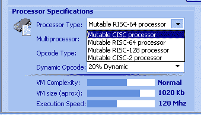

在加壳的时候，`VM` 处理器有 4 个选项，我以前写过的 `Themida1800` Demo 虚拟机分析，使用的应该是 `RISC-128`。下面是文档中对 `VM Processor` 的描述：

**Processor Type:**

**Mutable CISC Processor:** This processor is based in `CISC` technology, where the size of each instruction is different. Each generated `CISC` processor will be totally different and unique (mutable) for each protected application to avoid a general attack over the embedded virtual machine. `CISC` processors run faster and with smaller size than `RISC` processors, though the complexity (security) level is bigger in `RISC` processors.

**Mutable CISC-2 Processor (New):** This processor is based in `CISC` technology, where the size of each instruction is different. Each generated `CISC-2` processor will be totally different and unique (mutable) for each protected application to avoid a general attack over the embedded virtual machine. `CISC-2` processors have a similar design than the above `CISC` processor but the internal microinstructions are more complex, this requires a bigger size in the generated virtual opcodes, producing a bigger final application but with higher security level than `CISC` processors. Notice that if you insert many `VM / CodeReplace` macros, this processor can produce a bigger size in your application than `RISC` processors.

**Mutable RISC-64 Processor:** This processor is based in `RISC` technology, where the size of each instruction is equal to 64 bits. Each generated `RISC-64` processor will be totally different and unique (mutable) for each protected application to avoid a general attack over the embedded virtual machine. The `RISC-64` processor is a complex processor with higher security than `CISC` processors but the size and execution speed are not as optimum as for `CISC` processors.

**Mutable RISC-128 Processor:** This processor is based in `RISC` technology, where the size of each instruction is equal to 128 bits. Each generated `RISC-128` processor will be totally different and unique (mutable) for each protected application to avoid a general attack over the embedded virtual machine. The `RISC-128` processor offers higher complexity level than `CISC` and `RISC-64` processors, but the execution performance is lower.

从文档看，使用 `RISC` 指令集的保护更强。`Processor Type` 可分为 2 类，`CISC`/`CISC-2` 与 `RISC-64`/`RISC-128`。从文档中看不出 `CISC` 与 `CISC-2` 在细节上的区别，我也没有自己加壳去仔细验证，即不清楚这里用的究竟是 `CISC` 还是 `CISC-2`。用 `Themida1.9.1.1` 分别选择 4 种类型加壳测试了一下，`RISC` 与 `CISC` 是可以区分的：

使用 `RISC` processor，`VM` 相关部分在动态分配的 6 块内存中，这也是实际使用得较多的，脱壳后需要补 6 个区段（如果不还原代码）。使用 `CISC` processor，`VM` 的 `context` 及 `handler` 就在壳代码所在区段，脱壳后不需要补区段。`VM` 引擎与原程序共用 1 个堆栈。

值得注意的是，我读了一遍 `scherzo` 写的 *Inside Code Virtualizer*，文章截图中的入口代码与我看到的极其相似，猜测 `CV` 使用的可能就是 `CISC` 指令集的某一种。

## VM 入口代码

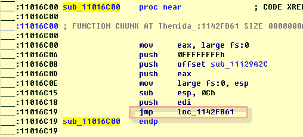

原程序以 1 个 `JMP` 开始执行 `VM` 保护代码。

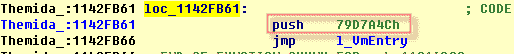

进入 `VM`，`push` 的 `imm32` 是 `PCODE` 数据的地址，同时被用作 `PCODE` 数据解码 `KEY`。

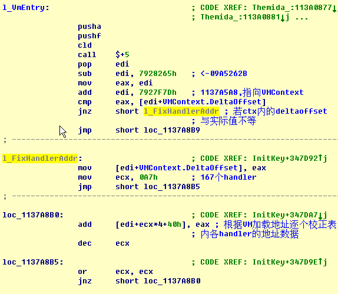

这里的代码与 `scherzo` 文章中截图完全相同。

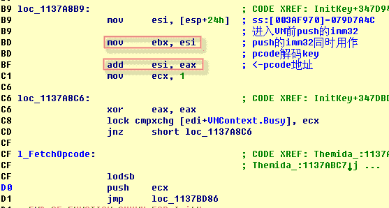

`ebx` 为进入 `VM` 时 `push` 的 `dword`，`esi` 指向 `PCODE` 数据。


下面执行取指令代码，这部分代码不在 `handler` 地址表内，也是变形代码，`esi` 下面为清理后的结果。

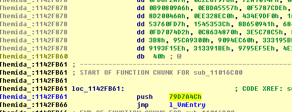

解码 `opcode`，跳到对应的 `handler`。注意进入 `VM` 时 `push` 的 `dword`，又被用作解码 `key`。所有的 `handler`（除了退出 `VM` 的），在执行完后都会跳到这里继续取指循环。`xor` 用的 `imm8`（也许包括解码算法）是加壳时随机生成的。

与 `RISC` 相似，被 `VM` 保护的代码也被 `call` 及非模仿指令分成若干段。但进入 `VM` 时的代码，不象 `RISC` 指令集那样表现为连续的 `PUSH`/`JMP`，第 1 个 `PUSH`/`JMP` 与其它的是分开的。

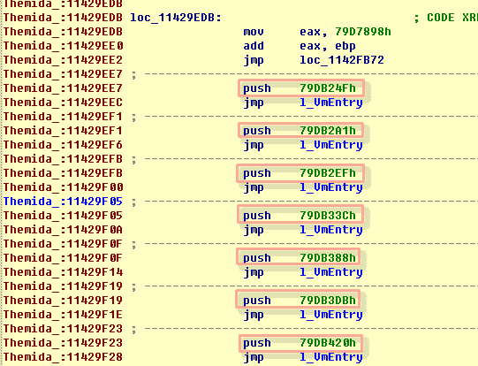

这是第 1 个 `PUSH`/`JMP`，上面就是这段代码的 `PCODE` 数据。向上翻：

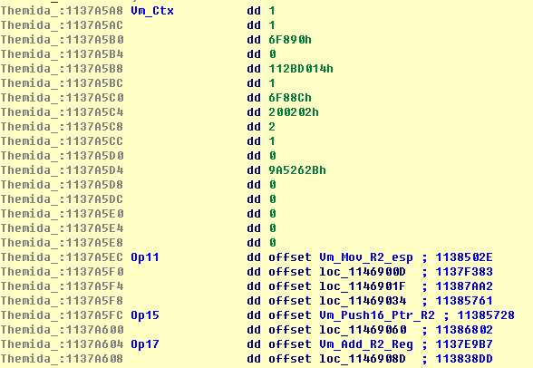

直到 `PCODE` 数据结束，出现 `PUSH`/`JMP`，这些 `PUSH`/`JMP` 与第 1 个是同属一段 `VM` 保护代码的。如果该段代码内没有 `call` 或非模仿指令，则只有第 1 对 `PUSH`/`JMP`。

## VM Context

有几个 `field` 不清楚含义，还原代码时没有碰上，这篇文章不是完整分析。


```asm
00000000 VMContext       struc ; (sizeof=0x44)
00000000 ecx             dd ?
00000004 eax             dd ?
00000008 edx             dd ?
0000000C edi             dd ?
00000010 ebx             dd ?        ; 这不是 esp，而是 ebx，vm 不切换栈，不必保留 esp
00000014 esi             dd ?
00000018 ebp             dd ?
0000001C eflag           dd ?
00000020 JxxFlag         dd ?        ; 是否执行控制转移的标记
00000024 counter         dd ?        ; 模仿控制转移指令时使用
00000028 IndexOfEcxInCtx dd ?        ; ecx 在 ctx 内的 index，在模仿 jcxz/jecxz 时使用
0000002C DeltaOffset     dd ?
00000030 Busy            dd ?
00000034 field_34        dd ?
00000038 field_38        dd ?
0000003C RellocOffset    dd ?        ; 处理重定位数据的 offset
00000040 field_40        dd ?
00000044 VMContext       ends
```

`VMConext`（注：原文如此，应为 `VMContext`）下就是 `handler` 表，所有 `Context` 成员，加上 `handler` 表，用 1 个 `byte` 即可寻址，为避免混淆，`opcode` 的编码没有从 0 开始，而是直接从 `0x11` 开始的。`handler` 表内的数据已经用清理变形代码后的代码地址替换了，注释是原代码地址。

进入 `VM` 时保存执行环境，退出 `VM` 时恢复各寄存器。这些代码都放到 `VM` 内执行了。

## Opcode 与 PCODE 数据

这个 `VM` 的结构与以前看过的 `RISC` 指令集 `VM` 相比，的确简单很多，绝大部分 `handler` 一目了然，清理后只有几行，不需要进行分类。所有的操作都通过 `stack` 实现，这给分析 `PCODE` 带来了一些麻烦，尤其是操作数在栈上的时候，后面再讲。


所有的 `Opcode` 只有 1 字节。每个 `handler` 可以有 0,1,2,4 字节的操作数，如果有操作数，需要对 `operand` 解码，如下面的 `handler` 解码 1 个 `dword` 并压栈。

进入 `VM` 后，有几个寄存器是有特殊含义的：


`handler` 没有使用 `ebp`（变形代码会 `PUSH`/`POP` 保护后使用）。`handler` 实际使用了 3 个寄存器，为避免混淆，另外命名，可以认为这 3 个寄存器是 `VM` 内部的寄存器。


下面以进入 `VM` 时保存 `context` 为例，其中从栈上取的数据是进入 `VM` 时的 `pushad`/`pushfd` 压入的。列出的 `PCODE` 解码结果，格式为：


```text
00000   113D9802  079871D7  33  PUSH32      addr_ctx.eflag
00001   113D9804  079871DD  93  POP32       R2        ; R2<-context内eflag的地址
00002   113D9805  0798714E  1F  POP32       [R2]      ; 弹出栈上的eflag保存
00003   113D9806  07987151  33  PUSH32      addr_ctx.edi
00004   113D9808  0798715F  93  POP32       R2
00005   113D9809  079871CC  1F  POP32       [R2]      ; 弹出栈上的edi保存
00006   113D980A  079871D3  33  PUSH32      addr_ctx.esi
00007   113D980C  079871DB  93  POP32       R2
00008   113D980D  07987148  1F  POP32       [R2]      ; 弹出栈上的esi保存
00009   113D980E  07987157  33  PUSH32      addr_ctx.ebp
00010   113D9810  0798715E  93  POP32       R2
00011   113D9811  079871CD  1F  POP32       [R2]       ; 弹出栈上的ebp保存
00012   113D9812  079871D2  33  PUSH32      addr_ctx.ebx
00013   113D9814  079871DD  93  POP32       R2
00014   113D9815  0798714E  1F  POP32       [R2]       ; 弹出栈上的esp保存
```


# VM 指令流分析

以下表格展示了 VM 的指令执行过程，包括寄存器操作与栈交互。

| 偏移量 | 地址 | 字节 | 指令 | 说明 |
| :--- | :--- | :--- | :--- | :--- |
| 00015 | 113D9816 | 07987151 | `AE SetEcxIdx 00` | 设置 context 内 `IndexOfEcxInCtx`，即 `ecx` |
| | | | | 为 `ctx` 内第 1 个 `dword` |
| 00016 | 113D9818 | 079871FF | `33 PUSH32 addr_ctx.ebx` | |
| 00017 | 113D981A | 079871C8 | `93 POP32 R2` | |
| 00018 | 113D981B | 0798715B | `1F POP32 [R2]` | 弹出栈上的 `ebx` 保存。注意与上面保存 `esp` 使用 `ctx` 同一个 field，即丢弃了 `esp`，因为 `vm` 与原程序共用栈，不需要保存 `esp` |
| 00019 | 113D981C | 07987144 | `33 PUSH32 addr_ctx.edx` | |
| 00020 | 113D981E | 07987175 | `93 POP32 R2` | |
| 00021 | 113D981F | 079871E6 | `1F POP32 [R2]` | 弹出栈上的 `edx` 保存 |
| 00022 | 113D9820 | 079871F9 | `33 PUSH32 addr_ctx.ecx` | |
| 00023 | 113D9822 | 079871CA | `93 POP32 R2` | |
| 00024 | 113D9823 | 07987159 | `1F POP32 [R2]` | 弹出栈上的 `ecx` 保存 |
| 00025 | 113D9824 | 07987146 | `33 PUSH32 addr_ctx.eax` | |
| 00026 | 113D9826 | 07987174 | `93 POP32 R2` | |
| 00027 | 113D9827 | 079871E7 | `1F POP32 [R2]` | 弹出栈上的 `eax` 保存 |
| 00028 | 113D9828 | 079871F8 | `11 MOV32 R2,esp` | |
| 00029 | 113D9829 | 079871E9 | `AD PUSH32 R2` | |
| 00030 | 113D982A | 07987144 | `1E PUSH32 00000004` | |
| 00031 | 113D982F | 0798715E | `66 ADD32 [esp+4],[esp]` | |
| 00032 | 113D9830 | 07987138 | `26 POP32 esp` | `add esp,4` 丢弃进入 `vm` 时 `push` 的 `dword` |
| 00033 | 113D9831 | 0798711E | `7D ClearKey` | 解码 `key`(即 `ebx`) 清 0 |

## OPCODE 与操作数尺寸

大部分 `OPCODE` 根据操作数的 `size` 分为 3 组，即 8/16/32 位。由于操作需要通过栈实现，对于 8/16 位操作数，有时候需要将操作数零扩展压栈。

前面已经提到了 `Vm_Push32_Imm32`，下面看看 8 位和 16 位操作。


PUSH 8 位立即数。


PUSH 16 位立即数。

## 控制转移指令

`OPCODE` 中复杂一点的是控制转移指令，这个 handler 与我在此前《Themida1800 Demo VM 分析》中的完全相同，就不啰嗦了。不同的是 `Jxx` 是由 2 个 handler 实现的：


第 2 句才真正将 `PCODE` 指针置到 `dst`。

## PCODE 变形

这个是以前没有看到过的，即 `PCODE` 也是变形的。不知道下一步 Themida 会不会把 VM 保护的原程序代码也变形。

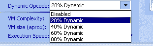

估计是这个选项造成的。

下面举几个例子：

### 示例 1


明显的垃圾指令。

### 示例 2


前 4 句等于 `mov R2,edi`。有了最后一句，前 4 句是垃圾。

### 示例 3


这个要复杂一些。前 6 行等于 `push ebx`, `push ebp`，看起来似乎是 `sub ebx,ebp`，但最后一句的 `dst` 却是 `R2`。这种代码一般后面还跟着一个 `ADD/SUB/XOR…` 指令，真正的操作数在前面压栈了。这几行全是垃圾。如果真正是 `sub ebx,ebp`，最后不会是 `pop R2`，而应该是这样的代码：


即将结果写入回目的操作数。

`PCODE` 变形是递归生成的，各种变形模式可以相互嵌套，需要清理，否则难以理解。

由于 VM 通过栈来实现操作，VM 又与原程序共用一个栈，有的代码看起来比较复杂，特别是操作数本身就在栈上的时候。下面举一个例子。


注意 `counter` 的值，这已经是清理过的 `PCODE`，原始的有 107 行。这段代码实现的是

```assembly
xchg ebx,[esp]
```

是 `AntiDump` 相关代码，原始代码就是变形代码。


全部代码等于 `PUSH EDX`，由此可见 Themida VM 的性能损耗有多大。

## Anti-Debug 修复

我自己原来改过的 `OllyDbg` 在 `WinXP SP2` 下会被检测到，所以看了一下这部分代码，下面是修复的代码（你的 OD 不一定是这里过不去）。

```assembly
    or          eax, eax            ; IsDebuggerPresent 的返回
    jnz         l_113D98C9
    cmp         dword ptr [ebp+07922CB1], 00000000 ; <- 这里为 1, 被发现了
    jz          l_113D9932

l_113D98C9:
    lea         edi, [ebp+0792501D]
    mov         eax, 00000001
    jmp         edi

l_113D9932:
    xor         [ebp+07920ABD], eax
    add         eax, [ebp+07921585]
    add         [ebp+0792219D], eax
    xor         eax, ebx
    ... ; 省略

    ; 下面是将该 dword 置 1 的代码, 被 call 分为 9 段

    ; 第 1 段
    mov         eax, eax
    cmp         dword ptr [ebp+0792299D], 0
    jnz         loc_1
    cmp         dword ptr [ebp+07920499], 0
    jz          loc_2

loc_1:
    push        eax
    push        ebx
    mov         eax, eax
    mov         eax, 000004D1
    mov         [ebp+0792309D], eax
    lea         ebx, [ebp+0794FBCC]
    call        ebx

    ; 第 2 段
    pop         ebx
    pop         eax

loc_2:
    cmp         dword ptr [ebp+07920499], 0
    jz          loc_3
    push        eax
    push        ebx
    mov         eax, 000004D1
    mov         [ebp+0792309D], eax
    lea         ebx, [ebp+0794F8BB]
    call        ebx

    ; 第 3 段
    pop         ebx
    pop         eax

loc_3:
    mov         eax, eax
    cmp         dword ptr [ebp+0792340D], 00000001
    jnz         loc_4 ; 跳到 loc_4 为 OK
    cmp         dword ptr [ebp+07920621], 00000000
    jnz         loc_4
    cmp         dword ptr [ebp+07921F75], 00000000
    jnz         loc_4
    mov         byte ptr [ebp+07920325], 49
    push        8C1529E9
    push        dword ptr [ebp+079228D1]
    lea         eax, [ebp+07923BFA]
    call        eax               ; 调用 homemade_GetProcAddress 获取 IsBadReadPtr

    ; 第 4 段
    mov         [ebp+07981030], eax
    mov         eax, fs:[00000030]
    mov         eax, [eax+0000000C]
    mov         ecx, 00000010
    and         eax, FFFFF000
    add         eax, 00001000    ; 从下一页开始
    jmp         loc_5

loc_8:
    push        eax
    push        ecx
    push        00000004         ; 4 bytes
    push        eax              ; _PEB_LDR_DATA 下一页起始地址
    call        [ebp+07981030]  ; IsBadReadPtr

    ; 第 5 段
    mov         ebx, eax
    pop         ecx
    pop         eax
    or          ebx, ebx
    jz          loc_6           ; 可读?
    jmp         loc_7           ; 开始检查

loc_6:
    add         eax, 00001000   ; 到下 1 页
    dec         ecx            ; 读 16 页 (每页的前 4 bytes)

loc_5:
    or          ecx, ecx
    jnz         loc_8
```


```
      jmp                 loc_4                       ; 若16页均可读,则跳过下面的anti;-)

loc_7:
      sub                 eax,00000010                 ; 退到最后1个可读页(的最后16 bytes)
      push               eax
      push               00000010
      push               eax
      call                [ebp+07981030]               ; 这16 bytes是否可读?
      ; 第6段
      mov                 ebx,eax
      pop                eax
      or                   ebx,ebx
      jnz                 loc_4                          ; 不能读则跳过
      ; 4个DWORD全为FEEEFEEE则设置标记
      cmp                 dword ptr [eax],FEEEFEEE
      jnz                 loc_4
      cmp                 dword ptr [eax+00000004],FEEEFEEE
      jnz                 loc_4
      cmp                 dword ptr [eax+00000008],FEEEFEEE
      jnz                 loc_4
      cmp                 dword ptr [eax+0000000C],FEEEFEEE
      jnz                 loc_4
      mov                 eax,eax
      cmp                 dword ptr [ebp+0792299D],00000000
      jnz                 loc_8
      cmp                 dword ptr [ebp+07920499],00000000
      jz                  loc_9
loc_8:
      push               eax
      push               ebx
      mov                 eax,eax
      mov                 eax,000004D1
      lea                 ebx,[ebp+0794F939]
      call                ebx
      ; 第7段
      pop                ebx
      pop                eax
      mov                 eax,eax
loc_9:
      mov                 dword ptr [ebp+07922CB1],00000001   ; debugger detected
loc_4:
      mov                 eax,eax
      cmp                 dword ptr [ebp+0792299D],00000000
      jnz                 loc_10
      cmp                 dword ptr [ebp+07920499],00000000
      jz                  loc_11
loc_10:
      push               eax
      push               ebx
      mov                 eax,eax
      mov                 eax,000004D1
      mov                 [ebp+07920651],eax
      lea                 ebx,[ebp+0794FC33]
      call                ebx
      ; 第8段
      pop                ebx
      pop                eax
loc_11:
      cmp                 dword ptr [ebp+07920499],00000000
      jz                  loc_12
      push               eax
      push               ebx
      mov                 eax,000004D1
      mov                 [ebp+07920651],eax
      lea                 eax,[ebp+0794F8D4]
      call                ebx
      ; 第9段
      pop                ebx
      pop                eax
loc_12:
      mov                 eax,eax
      mov                 eax,[ebp+0798102C]
      xor                 eax,35F9E374
      add                 eax,ebp
      jmp                 eax
```

这样的检测，我的`OllyDbg`本来应该能通过的，问题在`WinXP SP`自己。`SP2`为防止溢出攻击，对`PEB`的地址作了随机化处理，如果用来隐藏`OllyDbg`的代码使用了`7FFDF000`的硬编码地址，就会对错误的地址进行数据清理。

如果清理代码是注入的，直接从`fs:[30h]`取，不会有问题。如果是在被调试进程之外用`WriteProcessMemory`实现的，需要用`GetThreadSelectorEntry`获取`fs`段的地址。

## Virtual Machine Anti-Dump

这里的讨论不适用于`1.8.x.x`。在写这篇文章的时候，`Themida`升级到`1.9.4.0`，专门提到增强了`Anti-Dump`，所以估计也对付不了`1940`了。

原程序中一段被`VM`保护的代码，开始执行时首先就是`AntiDump`。我看的这个程序，用于`AntiDump`的`PCODE`约`9500`行。`AntiDump`原始代码就是变形代码。

脱壳后运行，出现内存访问异常，异常出现在`VM`内，试图访问`8D8C0`的数据。下面是部分还原代码:

```
……
      push     dword ptr [ebp+0792090D]  ; [11372F38]= 8D8C0h
      push     ebp
      push     ebx
      mov      ebx,501B7E96
      mov      ebp,C605CE17
      add      ebp,ebx
      pop      ebx
      add      [esp+4],ebp
      pop      ebp
      mov      eax,[esp]
      add      esp,00000004
      sub      eax,16214CAD
      push     000001901
      mov      [esp],ecx
      push     esi
      mov      esi,0A09435A             ;  Magic Number为硬编码值
      sub      esi,C18ED54D             ;  487a6e0d
      mov      ecx,esi
      pop      esi
      push     esi
      mov      esi,ecx
      mov      edx,esi
      pop      esi
      pop      ecx
      cmp      [eax],edx         ; Anti-Dump
      jz        l_1142D17E
```

这里`eax`为`8D8C0`，这里的`dword`必须等于硬编码值`487A6E0D`。这是壳代码分配的内存，`dump`出来后自然没有。这个地址保存在壳代码区段内:

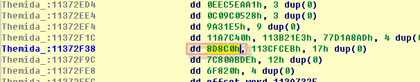

知道为什么就简单了 J。

还出现了另外一种。我看的是个`DLL`，却检测了宿主`EXE`的`MZ`头。至于`EXE`文件是否存在这种`AntiDump`，我没有验证。

这段代码直接看了一下，没有还原代码了。从`11374BA8`获取`EXE`的加载地址。

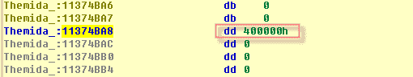

检测`MZ+0Ch`的`word`。

```
07311   1144CAA8  00000000  15  PUSH16      [R2]
07328   1144CABF  000000DC  A2  PUSH16      0600
07339   1144CACF  0000008F  4F  CMP16       [esp+2],[esp]
07358   1144CAE9  000034E8  79  POP32       [addr_ctx.eflag]
07360   1144CAEC  00000000  3E  JZ
07361   1144CAF1  00000C3F  87  SetDst      1144CE3B  ; Anti-Dump
```

即`MZ+0Ch`应为`600h`。正常的文件这里为`FFFF`。

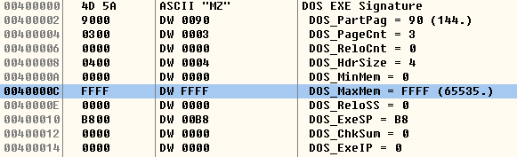

`AntiDump`我就碰到这 2 种，不清楚还有没有别的。

`Themida`的`CISC`指令集`VM`相比之下比较简单，实战中也出现较少，倒是可以用来学学`VMJ`。

## 致谢

`www.pediy.com`

`www.unpack.cn`

`4dd466d0e1e0cc123afbe504da2462ca`
