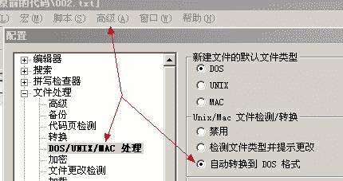

# CV 变形代码的学习：去除变形代码 直接将还原成 ASM X86 CODE 的一种方法

> 原文：[`www.pediy.com/kssd/pediy10/82340.html`](https://www.pediy.com/kssd/pediy10/82340.html)

## 去除变形代码：直接将 CV 还原成 ASM X86 CODE 的一种方法

这篇文章主要参考了这个帖子的代码 `http://www.woodmann.com/forum/blog.php?b=115`

这个断断续续搞了数月 并且不断修改的 时间周期长 所以下面举的例子不一定正确

因为都是碰到错误然后修改程序 碰到的错误记不得了 所以模拟处一个错误 可能有错 欢迎拍砖= =

效果见附件 附件文本要用 `UE` 打开 记事本打开的话 换行不能被识别 是 `UNIX` 格式的 因为 `YACC` `BISON` 用的是 `CYGWIN` 下的 `printf("\\n")` 是 `unix` 下的换行格式。。

从我上一篇文章可以看出 即使写出解码程序 解码出的东西分析起来依然不容乐观 垃圾代码还是非常多。 而且 `VM` 的 `VM` 环境可以设置成很多个 并不是每处的解码程序都一样 且 `HANDLER` 的变形也很麻烦。（这篇文章不包括二次 `VM`）

### 本文章的目的

1. 还原变形代码 （这个是参考这篇文章 `http://www.woodmann.com/forum/blog.php?b=115`） 这个帖子提供的程序我用来还原我加密的 `handlers` 达不到理想的情况而且 `BUG` 多多 我增加大概 1000 多行代码左右和翻新了部分代码才达到我想要的效果 不过非常感谢作者的劳动 因为他的方向是正确的 特别分析语法部分用了 `YACC` `FLEX`， 使分析语法变得很方便，这个是编译原理中的课程~

2. 把 `VM` 还原成相对简单的 `X86` `ASM` `CODE`

我把去除变形代码的大体原理说下

`Add` `[esp]` `8` 包含操作符 左操作数 右操作数 当然左右操作数可以是表达式

我们可以把 `Add` `[esp]` `8` 放入一个结构体

```c
struct node {
  int op;          // 操作符 比如是 MOV ADD 等
  int arg1;        // 左操作数 比如 EAX EBX 等
  int arg2;        // 右操作数 比如 EAX EBX 等
  int targ1;        // 左操作数类型 比如 寄存器 表达式 常数等等
  int targ2;        // 右操作数类型 比如 寄存器 表达式 常数等等
  struct exp *e;    // 表达式结构体 因为左右操作数不同时是表达式 所以一个就行了
  struct node *old;
  struct node *next;
  struct node *prev;
};
```

操作数类型有 `NUMBER` 常数 寄存器 `REGISTER` 表达式 `TYPE`

比如我们要还原

```asm
push eax
or [esp] ecx
pop edx
```

成

```asm
mov edx eax
or edx ecx
```

因为基于堆栈的运算比较难看 所以这个要还原

这里就是有 3 个 `struct node` 了 分别是 `node1` `node2` `node3`

这个操作就是

```c
node3->op = node2 ->op;
node3->arg2 = node2 ->arg2;
node3->targ2= node2 ->targ2;
node2 ->op = MOV;
node2 ->arg1=nxt->arg1;
node2 ->targ1=REGISTER;
node2 ->arg2=tmp->arg1;
node2 ->targ2=REGISTER;
removeNode(node1, &code);
```

这里要注意下 一定要去掉第一个节点 不能把第一 二行改成 `mov edx eax` `or edx ecx` 然后去掉第三个 `node` 为什么呢 看下面一种情况

```asm
push eax
mov edx 2
or [esp] edx
mov edx 3
pop edx
```

这样精简后变成

```asm
mov edx eax
mov edx 2
or edx 2
mov edx 3
```

因为程序后面有对 `MOV` 的优化 导致的结果就是 `mov edx 3`

很显然 结果并不是这样 应该是

```asm
mov edx 2
mov edx eax
mov edx 3
or edx 2
```

因为 `CV` 的变形是可以嵌套的 所以上面的的情况遇到也是理所当然的了= =

上面是基于堆栈方面的优化

代码就是下面的 （原帖例子只有几行简单的代码：））

这个是我不断增加的结果 所以比较难看 比较乱 - -

```c
if(tmp->op==PUSH && tmp->targ1==REGISTER){
      //now search for pop register
          inPushPop = isUsed = 0;
        OnlyOneUsed = 0;
      for_each(tmp->next, nxt){
//        if(
        if( nxt->targ1==REGISTER && (isInUse(tmp->arg1, nxt->arg1)==1)/*(isSafe(nxt, tmp->arg1) == 0)*/说明不安全 说明假如 PUSH ECX 那么 CH ECX 则可能被用过 */
          &&nxt->op!=POP&&nxt->op!=PUSH)
        {
          inPushPop = isInUse(tmp->arg1, nxt->arg1);
          rubish = nxt;
          inPushPop = 1;
        }
        if(nxt->targ1==REGISTER && (isInUse(tmp->arg1, nxt->arg2)==1) /*)*/&& nxt->targ2==REGISTER && inPushPop==1 &&nxt->op!=POP&&nxt->op!=PUSH)
        {
          isUsed = 1;
          OnlyOneUsed++;
        }
 /*
push eax
pop  [esp+4]
pop eax       BUG
  */
        if(nxt->targ1==TYPE &&nxt->op!=POP&&nxt->op!=PUSH && nxt->e->targ1==REGISTER&&nxt->e->arg1==ESP
          &&nxt->e->targ2 != TYPE
          && nxt->e->targ2 != REGISTER && nxt->e->targ2 != NUMBER)
        {
          ++expEspLeft;
          nxtspe = nxt;
        }
        if(nxt->targ2==TYPE &&nxt->op!=POP&&nxt->op!=PUSH && nxt->e->targ1==REGISTER&&nxt->e->arg1==ESP
          &&nxt->e->targ2!=TYPE&&nxt->e->targ2!=REGISTER&&nxt->e->targ2!=NUMBER)
        {
          ++expEspRight;
        }
        if(nxt->op==PUSH && nxt->targ1==REGISTER && nxt->arg1==tmp->arg1){
          break; // 说明有连续两个 PUSH EDX 先紧下面一个处理
        }
        if(nxt->op==POP && nxt->targ1==REGISTER && nxt->arg1!=tmp->arg1){
          if(inPushPop==0 && isUsed==0 && expEspLeft==1 && expEspRight==0)
          {
            nxt->op = nxtspe->op;
            nxt->arg2 = nxtspe->arg2;
            nxt->targ2= nxtspe->targ2;
            nxtspe->op = MOV;
            nxtspe->arg1=nxt->arg1;
            nxtspe->targ1=REGISTER;
            nxtspe->arg2=tmp->arg1;
            nxtspe->targ2=REGISTER;
            removeNode(tmp, &code);
            if(beDebug == 1)
            {
              printf("--push eax   or [esp] ecx  pop edx ---> remove(must remove the fisrt node) mov edx eax or edx ecx (remove one nodes)\\n");
                        //mov edx eax  or edx ecx
              printList(&code);
            }
            break;
          }
        }
}
```

还有典型的就是增加垃圾的运算

比如 `mov edx 4`

变形成

```asm
Mov eax 2
Add eax 2   //这里的 ADD 可以是 or and 等等垃圾运算
Mov edx eax
```

这种的话

直接循环检测每行 如果 `op==MOV` `arg1==REGISTER` `arg2==NUMBER`

然后再跑个二次循环 依次检测每个 `node` 如果 `arg1` 一样且 `arg2` 类型为 `NUMBER` 就可以合并了 原帖对 `dx` `cx` 等小 16 位寄存器处理不对 还少考虑了情况 比较下我的程序和原帖程序就可以发现

`Mov eax 2` `add eax 2` 就是 `mov eax 4`

```c
  for_each(list->front, tmp){
    if(tmp->op==MOV && tmp->targ1==REGISTER && tmp->targ2==NUMBER){
      found = tmp;
      for_each(tmp->next, tmp2){
        if(isSafe(tmp2, found->arg1)==0 && (tmp2->op== PUSH || tmp2->op== POP))// tmp2 的操作影响 found 的第一个寄存器
          break;  //确保不是 PUSH POP 的计算 且 第一个操作数没有改变
        if((tmp2->arg1 != found->arg1) || (tmp2->targ1!=found->targ1))
        {// 第一个操作数一定要一样 确保安全
          continue;
        }
        if(tmp2->targ2 == TYPE) break;  // 如果第二个操作数是表达式 就直接推出这一次循环
        undef = 0;
//        printf("op = %d found->arg2 = 0x%08x, tmp2->arg2=0x%08x\\n", tmp2->op, found->arg2, tmp2->arg2);
        if((tmp2->targ2 == NUMBER || tmp2->targ2==NONE) && tmp2->op!=PUSH && tmp2->op!=POP && tmp2->op!=LODSB && tmp2->op!=LODSW && tmp2->op!=LODSD){  // mov eax, 6    add eax 2   变成 mov eax, 8
          if( (found->arg1<8) &&  (found->arg1>=0) )
          {
            found->arg2 = (found->arg2)&0xFF;
            HaveChange =1 ;
          }
          if( (found->arg1<16) &&  (found->arg1>7) )
          {
            found->arg2 = (found->arg2)&0xFFFF;
            HaveChange =1 ;
          }
          if(beDebug == 1)
          {
            printf("--calc some exps \\n");
            printList(&code);
          }
          result = emulate(tmp2->op, found->arg2, tmp2->arg2, &undef);
          if( ( (found->arg1)<8) &&  ( (found->arg1)>=0) )
          {
            result = result&0xFF;
          }
          if( (found->arg1<16) &&  (found->arg1>7) )
          {
            result = result&0xFFFF;
          }
          if(undef)// 说明不能运算
            break;
          found->arg2 = result;
          HaveChange =1 ;
//          printf("result = %08x\\n", result);
          removeNode(tmp2, list);
          HaveChange =1 ;
        }
        else{
          break;
        }
      }
    }
  }
```

我们就拿 `dump_wmimmc.sys` 中的一个看下 因为手上没有最新的 `CV` 就拿他实验了 免费的最新 `CV` 学习对象= =

看下结果 全部 166 个 `HANDLER` 还原见附件

```asm
pop ax
mov [edx ] al
sub al bl
xor al 0000006b
sub bl al
movzx eax al
pop dx
push ecx
mov ch dl
push 00007e41
mov [esp ] esp
add [esp ] 00000004
pop ax
pop cx
pop ax
movzx cx al
push cx
pop cx
shr [esp ] cl
pushf
pop eax
pop ecx
cmp ecx eax
pushf
pop cx
shl [esp ] cl
pushf
pop ax
add [esp ] al
pushf
push [edx ]
pushf
push [edi 0000001c ]
popf
pop cx
neg [esp ]
pushf
pop ax
pop cx
```

`handler15` 就不列了 这个就是 `JXX` 判断 每个版本的应该一样的 这里效果不太好

```asm
pop ax
or [esp ] ax
pushf
sub al bl
xor al 000000cc
xor al 000000ff
sub bl al
movzx eax al
```


# 汇编代码片段

```asm
cmp eax 00000007  
mov eax esp  
add edx edx  
pop [edx]  
pop ecx  
pop eax  
movzx ecx ax  
push ecx  
push [edi 0000001c]  
popf  
pop cx  
mov ax 0000beeb  
add ax bx  
add ax 00006ca7  
mov si 0000e43c  
sub bx ax  
movzx eax ax  
push ax  
mov sp [esp]  
push [edi 0000001c]  
popf  
pop ax  
pop ax  
inc [esp]  
pushf  
cmp [edi 00000020] 00000000  
pop ecx  
pop eax  
pop edx  
idiv ecx  
push edx  
push eax  
pushf  
push [edi 0000003c]  
add al 0000000a  
sub al bl  
push ecx  
mov ch 0000000f  
push ebx  
mov bl 00000039  
pop ax  
mov ebx 00000000  
mov [ebx] al  
and [edi 0000001c] fffffdff
```

这里就是最新的 CV 前 30 个 `HANDLER` 的意义。估计有点 BUG，没有人工去检测。

我上一篇文章的 `handler` 自己验证了，还算满意。

## 2. 把 VM 中间码还原成 X86CODE

上一篇文章的解码程序我们可以改变下，去掉保存寄存器、恢复寄存器，就变为堆栈变形码（暂且这样称吧）：

```asm
mov edx esp
push edx
push 4
pop eax
add [esp] eax
pop edx
push edx
push edx
push 4
pop eax
add [esp] eax
pop edx
pop edx
push [edx]
push addr_real_eax
pop edx
push edx
push addr_real_ebx
pop edx
pop edx
pop [edx]
push addr_real_eax
push addr_real_eax
pop edx
pop edx
push real_eax
push 2
pop eax
add [esp] eax
pushfd
pop real_eflags
push addr_real_eax
pop edx
pop [edx]
push addr_real_eax
pop edx
push real_eax
push 3
push addr_real_edi
pop edx
push real_edi
push addr_real_ebx
pop edx
push real_ebx
pop eax
or [esp] eax
pushfd
pop real_eflags
pop edx
pop eax
sub [esp] eax
pushfd
pop real_eflags
push addr_real_eax
pop edx
pop [edx]
```

其中里面涉及的 VM 寄存器（保存原始寄存器的内存地址）也当做寄存器。

比如 `push addr_real_eax` 就是原来解码处的 `push block_1_addr`，`comment: regEax addr`。

`real_eax` 就是原来解码程序中的 `regEax`。

相当于寄存器增加了 3 倍...

那么：

```asm
push 2
push addr_real_eax
pop edx
pop [edx]
```

不就等于 `mov real_eax 2` 了吗 = =

仔细看下我上面分析的，其实到了 `2e` 处，`esp` 就是原来程序的 `ESP`，所以 VM 也可以看做基于堆栈的变形。

`2e` `64: mov esp,[esp]` `comment: get regESP` // 以上 5 行就是 `mov edx, esp` `add edx, 4` `mov esp, edx`

// 到这里 堆栈就是原始状态了

所以还原 VM 又转到了还原变形代码的问题上去了。

好了，利用上面的知识，写出对应的还原代码。

还原上面堆栈变形码的结果就是：

```asm
mov edx esp
add edx 4
mov real_eax [edx]
sub real_eax 1
mov eax real_ebx
mov edx real_edi
or edx eax
mov eax 3
mov edx addr_real_eax
```

`56` 行的代码变成了 `9` 行。这里很容易人工还原了，只要左操作数为 `real` 开头的就是有用的，别的去掉，然后推理下。

就是：

```asm
mov edx esp
add edx 4
mov real_eax [edx]
sub real_eax 1
```

就是对应加密前的：

```asm
mov eax, [esp+4]
add eax 2
sub eax 3
```

这里优化代码把原程序都优化了，`add eax 2`、`sub eax 3` 变成 `sub real_eax 1` :)

# 联系方式

找一份编程类工作。

QQ: `983732543`

邮箱: `983732543@qq.com`

最后的附件用 `Ultraedit` 打开。你想同时打开多个文本并对比，要设置下，不然总提示转换成 DOS 格式。




`还原效果.rar`
