# [算法进阶]TMPGEnc v2.58 注册算法分析-基于堆栈的简单虚拟机 v1.0

> 原文：[`www.pediy.com/kssd/pediy09/pediy09-553.htm`](https://www.pediy.com/kssd/pediy09/pediy09-553.htm)

### 1. History

这个目标是 05 年 5.1 前后，看雪论坛的好好学习找我的，我断断续续搞了 1 年半，最后终于做出 keygen 了。

本还想进一步研究的，可惜没有太多时间，连台电脑都还买不起。本想等买了电脑来庆祝的，现在想申请 CUG I [免试]，感觉拿不出像样的东西，暂且拿出来混个精华，希望不辱 CUG 的名号。这个教材就当作 1.0 版本吧，如果以后再有研究再修改。

### 2. 虚拟机

虚拟机主要可分为 基于堆栈的虚拟机和 基于寄存器的虚拟机。

`TMPGEnc` 进入虚拟机的代码为：

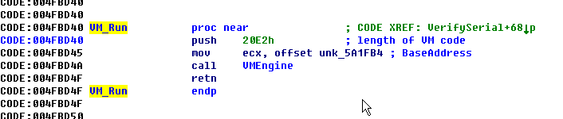

VM Engine 的代码为：

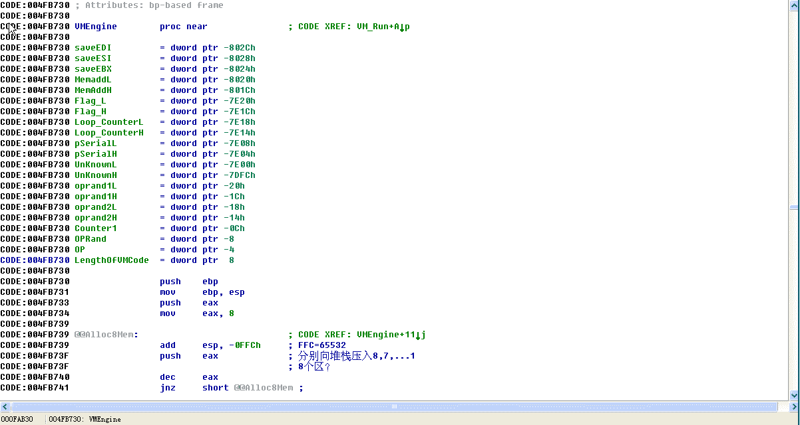
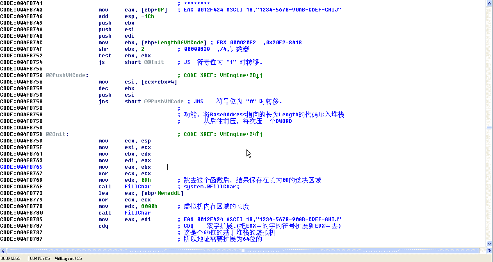

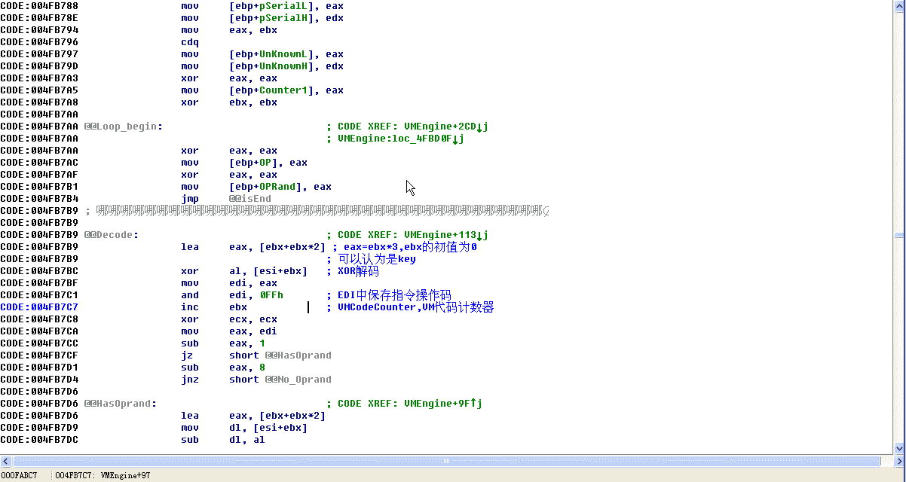

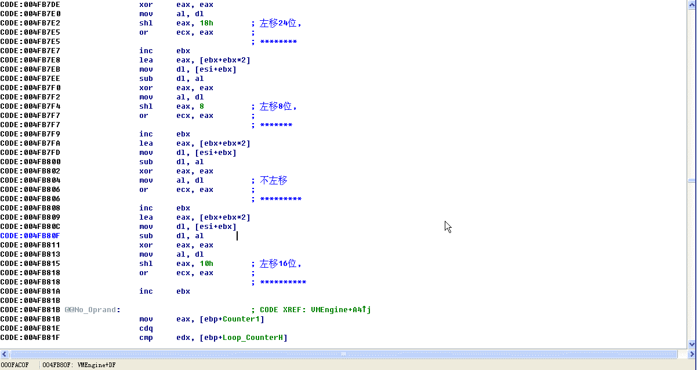

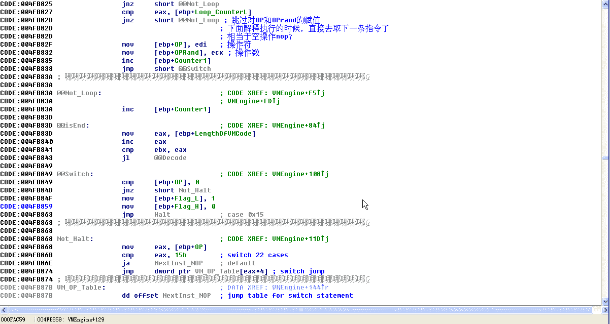

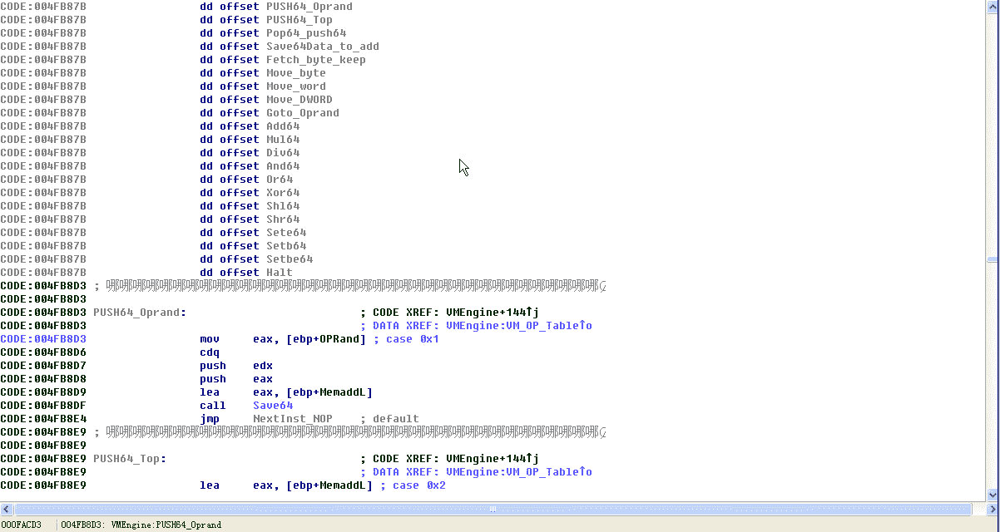

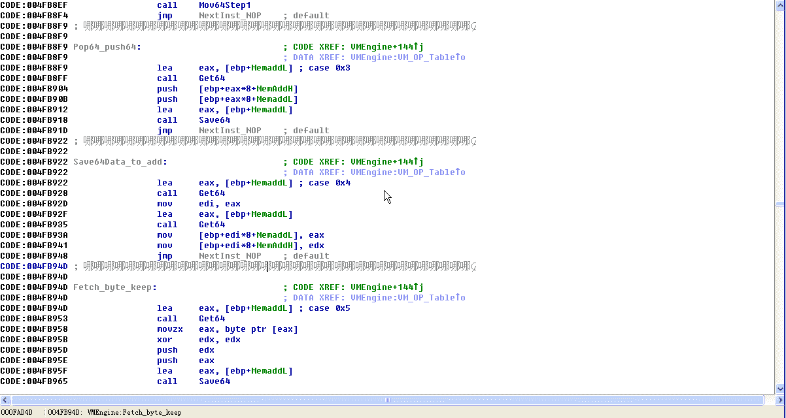

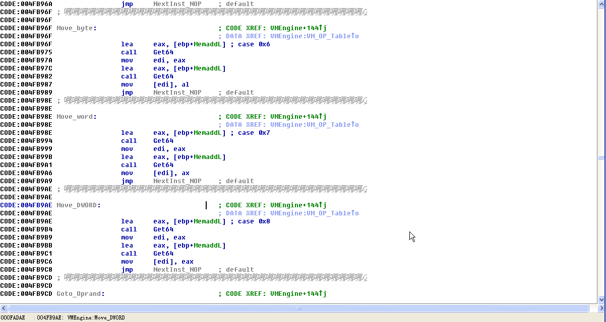

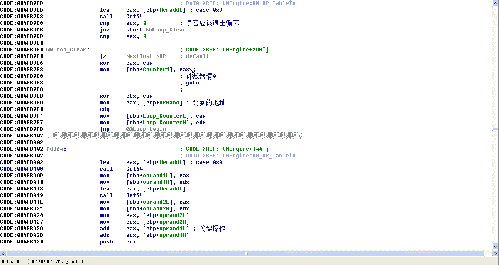

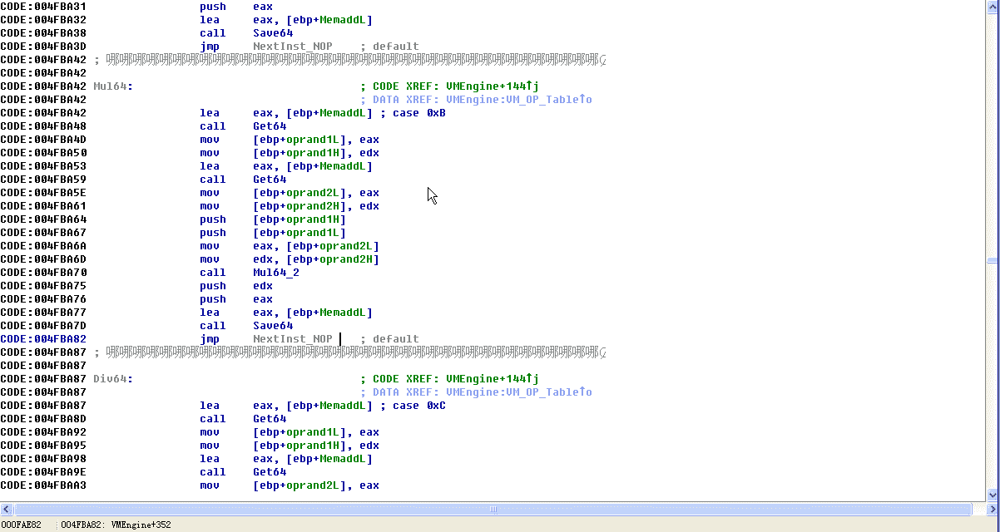

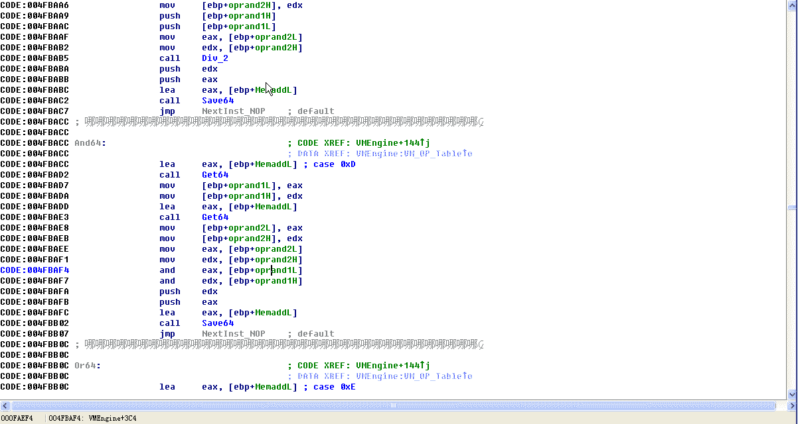

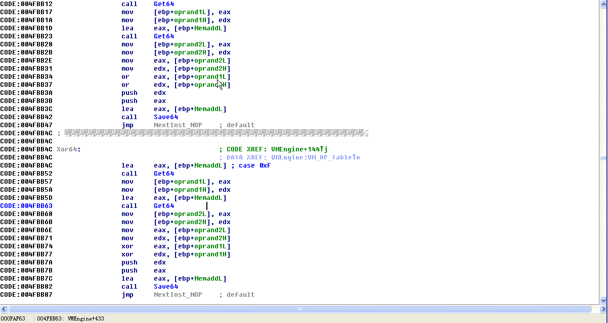

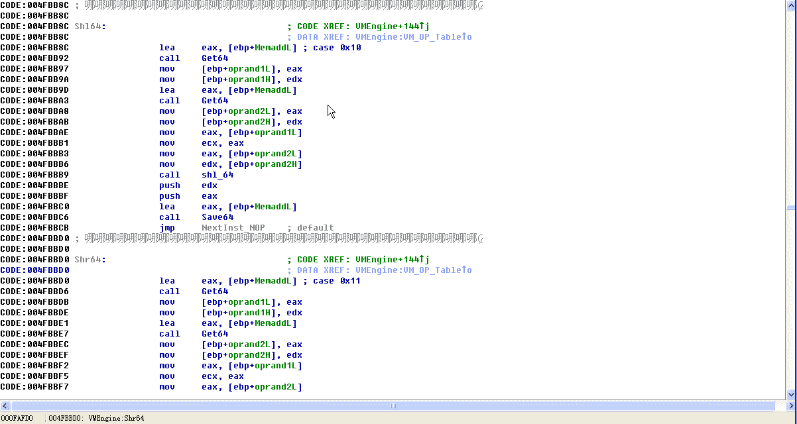

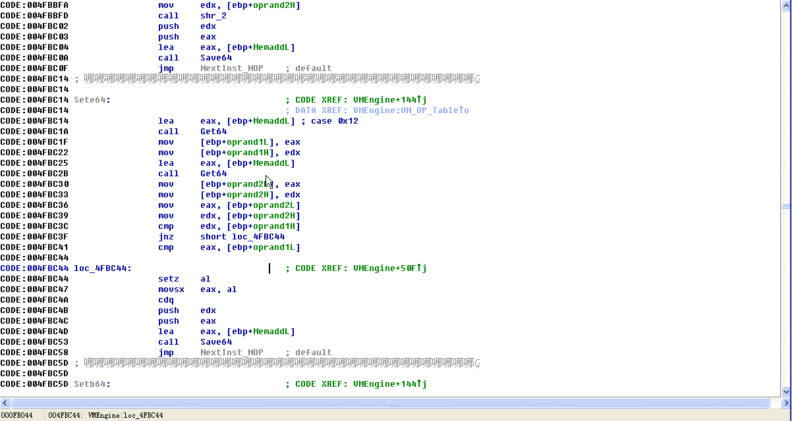

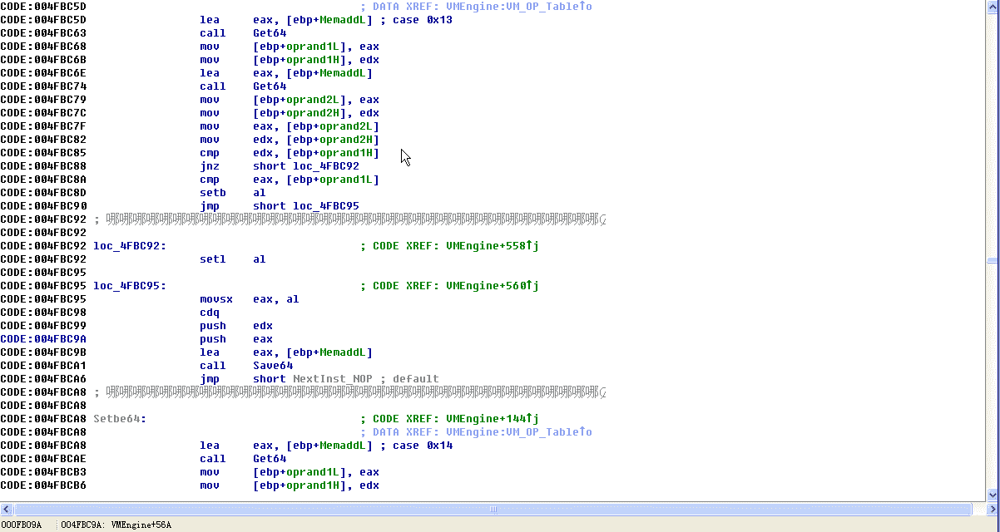

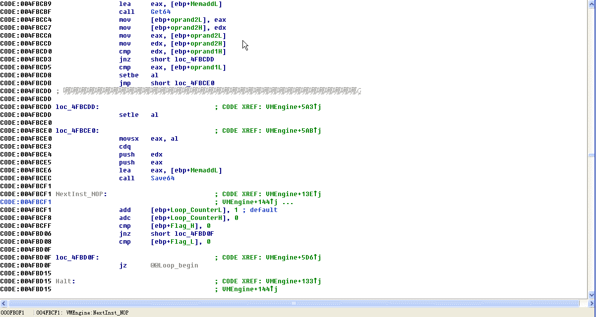

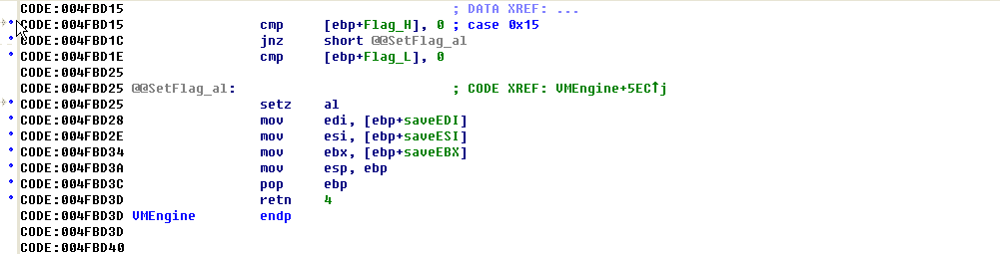

### 3. 反汇编 VM 代码

基本思路 i 就是将 VM 代码反汇编出来，然后看这个给予堆栈的虚拟机的代码（不是 X86 汇编了）。

我写的一个很简单的反汇编的代码如下：

```
代码:
```


```c
void VMCode()
{
    HANDLE hVMcode;//VM code
    HANDLE hDatad;
    BYTE buf1CRC32[8419]; //8418=1020*8+258,1020/6=170
    char VMCodeLine[100];
    BOOL iread;
    int i, LineNUm=0;
    int iVMcode;
    DWORD VMdata;
    DWORD dwSize;
    DWORD BytesWritten;

    hVMcode = CreateFile("VMCode.txt", GENERIC_WRITE, 0, NULL, OPEN_ALWAYS, FILE_ATTRIBUTE_NORMAL, NULL);
    hDatad = CreateFile("Datad.dat", GENERIC_READ, FILE_SHARE_READ, NULL, OPEN_EXISTING, FILE_ATTRIBUTE_READONLY, NULL);
    memset(buf1CRC32, 0, 8419);
    memset(VMCodeLine, 0, 100);
    iread = ReadFile(hDatad, buf1CRC32, 8419, &dwSize, NULL);
    CloseHandle(hDatad);

    //LineNUm: VMcode Data
    for (i = 0; i < 8419; i++)
    {
        iVMcode = buf1CRC32[i];
        switch (iVMcode)
        {
        case 1:
            VMdata = (buf1CRC32[i+4] << 24) | (buf1CRC32[i+1] << 16) | (buf1CRC32[i+2] << 8) | (buf1CRC32[i+3]);
            wsprintf(VMCodeLine, "%d:        PUSH64 %8x", LineNUm, VMdata);
            if (LineNUm < 100)
            {
                VMCodeLine[19] = 0x0D;
                VMCodeLine[20] = 0x0A;
                VMCodeLine[21] = 0;
                WriteFile(hVMcode, VMCodeLine, 22, &BytesWritten, NULL);
            }
            else if (LineNUm < 1000)
            {
                VMCodeLine[20] = 0x0D;
                VMCodeLine[21] = 0x0A;
                VMCodeLine[22] = 0;
                WriteFile(hVMcode, VMCodeLine, 23, &BytesWritten, NULL);
            }
            else
            {
                VMCodeLine[21] = 0x0D;
                VMCodeLine[22] = 0x0A;
                VMCodeLine[23] = 0;
                WriteFile(hVMcode, VMCodeLine, 24, &BytesWritten, NULL);
            }

            i = i + 4;
            LineNUm++;
            break;
        case 2:
            wsprintf(VMCodeLine, "%d:        PUSH64_2", LineNUm);
            VMCodeLine[13] = 0x0D;
            VMCodeLine[14] = 0x0A;
            VMCodeLine[15] = 0;
            WriteFile(hVMcode, VMCodeLine, 16, &BytesWritten, NULL);

            LineNUm++;
            break;
        case 3:
            wsprintf(VMCodeLine, "%d:        Pop64_push64", LineNUm);
            VMCodeLine[17] = 0x0D;
            VMCodeLine[18] = 0x0A;
            VMCodeLine[19] = 0;
            WriteFile(hVMcode, VMCodeLine, 20, &BytesWritten, NULL);
            LineNUm++;
            break;
        case 4:
            wsprintf(VMCodeLine, "%d:        Pop64_pop64", LineNUm);
            VMCodeLine[16] = 0x0D;
            VMCodeLine[17] = 0x0A;
            VMCodeLine[18] = 0;
            WriteFile(hVMcode, VMCodeLine, 19, &BytesWritten, NULL);
            LineNUm++;
            break;
        case 5:
            wsprintf(VMCodeLine, "%d:        Pop64_Byte_push64", LineNUm);
            VMCodeLine[22] = 0x0D;
            VMCodeLine[23] = 0x0A;
            VMCodeLine[24] = 0;
            WriteFile(hVMcode, VMCodeLine, 25, &BytesWritten, NULL);
            LineNUm++;
            break;
        case 6:
            wsprintf(VMCodeLine, "%d:        Pop64_push64_Byte", LineNUm);
            VMCodeLine[23] = 0x0D;
            VMCodeLine[24] = 0x0A;
            VMCodeLine[25] = 0;
            WriteFile(hVMcode, VMCodeLine, 26, &BytesWritten, NULL);
            LineNUm++;
            break;
        case 7:
            wsprintf(VMCodeLine, "%d:        Pop64_push64_Word", LineNUm);
            VMCodeLine[23] = 0x0D;
            VMCodeLine[24] = 0x0A;
            VMCodeLine[25] = 0;
            WriteFile(hVMcode, VMCodeLine, 26, &BytesWritten, NULL);
            LineNUm++;
            break;
        case 8:
            wsprintf(VMCodeLine, "%d:        Pop64_push64_DWord", LineNUm);
            VMCodeLine[24] = 0x0D;
            VMCodeLine[25] = 0x0A;
            VMCodeLine[26] = 0;
            WriteFile(hVMcode, VMCodeLine, 27, &BytesWritten, NULL);
            LineNUm++;
            break;
        case 9:
            VMdata = (buf1CRC32[i+4] << 24) | (buf1CRC32[i+1] << 16) | (buf1CRC32[i+2] << 8) | (buf1CRC32[i+3]);
            wsprintf(VMCodeLine, "%d:        Goto %8d", LineNUm, VMdata);
            if (LineNUm < 100)
            {
                VMCodeLine[18] = 0x0D;
                VMCodeLine[19] = 0x0A;
                VMCodeLine[20] = 0;
                WriteFile(hVMcode, VMCodeLine, 21, &BytesWritten, NULL);
            }
            else if (LineNUm < 1000)
            {
                VMCodeLine[19] = 0x0D;
                VMCodeLine[20] = 0x0A;
                VMCodeLine[21] = 0;
                WriteFile(hVMcode, VMCodeLine, 22, &BytesWritten, NULL);
            }
            else
            {
                VMCodeLine[20] = 0x0D;
                VMCodeLine[21] = 0x0A;
                VMCodeLine[22] = 0;
                WriteFile(hVMcode, VMCodeLine, 23, &BytesWritten, NULL);
            }
            i = i + 4;
            LineNUm++;
            break;
        case 0xA:
            wsprintf(VMCodeLine, "%d:        Pop64_pop64_Add_push64", LineNUm);
            VMCodeLine[28] = 0x0D;
            VMCodeLine[29] = 0x0A;
            VMCodeLine[30] = 0;
            WriteFile(hVMcode, VMCodeLine, 31, &BytesWritten, NULL);
            LineNUm++;
            break;
        case 0xB:
            wsprintf(VMCodeLine, "%d:        Pop64_pop64_Mul_push64", LineNUm);
            VMCodeLine[28] = 0x0D;
            VMCodeLine[29] = 0x0A;
            VMCodeLine[30] = 0;
            WriteFile(hVMcode, VMCodeLine, 31, &BytesWritten, NULL);
            LineNUm++;
            break;
        case 0xC:
            wsprintf(VMCodeLine, "%d:        Pop64_pop64_Div_push64", LineNUm);
            VMCodeLine[28] = 0x0D;
            VMCodeLine[29] = 0x0A;
            VMCodeLine[30] = 0;
            WriteFile(hVMcode, VMCodeLine, 31, &BytesWritten, NULL);
            LineNUm++;
            break;
        case 0xD:
            wsprintf(VMCodeLine, "%d:        Pop64_pop64_And_push64", LineNUm);
            VMCodeLine[27] = 0x0D;
            VMCodeLine[28] = 0x0A;
            VMCodeLine[29] = 0;
            WriteFile(hVMcode, VMCodeLine, 30, &BytesWritten, NULL);
            LineNUm++;
            break;
        case 0xE:
            wsprintf(VMCodeLine, "%d:        Pop64_pop64_Or_push64", LineNUm);
            VMCodeLine[26] = 0x0D;
            VMCodeLine[27] = 0x0A;
            VMCodeLine[28] = 0;
            WriteFile(hVMcode, VMCodeLine, 29, &BytesWritten, NULL);
            LineNUm++;
            break;
        case 0xF:
            wsprintf(VMCodeLine, "%d:        Pop64_pop64_Xor_push64", LineNUm);
            VMCodeLine[27] = 0x0D;
            VMCodeLine[28] = 0x0A;
            VMCodeLine[29] = 0;
            WriteFile(hVMcode, VMCodeLine, 30, &BytesWritten, NULL);
            LineNUm++;
            break;
        case 0x10:
            wsprintf(VMCodeLine, "%d:        Pop64_pop64_Shl_push64", LineNUm);
            VMCodeLine[27] = 0x0D;
            VMCodeLine[28] = 0x0A;
            VMCodeLine[29] = 0;
            WriteFile(hVMcode, VMCodeLine, 30, &BytesWritten, NULL);
            LineNUm++;
            break;
        case 0x11:
            wsprintf(VMCodeLine, "%d:        Pop64_pop64_Shr_push64", LineNUm);
            VMCodeLine[27] = 0x0D;
            VMCodeLine[28] = 0x0A;
            VMCodeLine[29] = 0;
            WriteFile(hVMcode, VMCodeLine, 30, &BytesWritten, NULL);
            LineNUm++;
            break;
        case 0x12:
            wsprintf(VMCodeLine, "%d:        Pop64_pop64_Sete_push64", LineNUm);
            VMCodeLine[28] = 0x0D;
            VMCodeLine[29] = 0x0A;
            VMCodeLine[30] = 0;
            WriteFile(hVMcode, VMCodeLine, 31, &BytesWritten, NULL);
            LineNUm++;
            break;
        case 0x13:
            wsprintf(VMCodeLine, "%d:        Pop64_pop64_Setb_push64", LineNUm);
            VMCodeLine[28] = 0x0D;
            VMCodeLine[29] = 0x0A;
            VMCodeLine[30] = 0;
            WriteFile(hVMcode, VMCodeLine, 31, &BytesWritten, NULL);
            LineNUm++;
            break;
        case 0x14:
            wsprintf(VMCodeLine, "%d:        Pop64_pop64_Setbe_push64", LineNUm);
            VMCodeLine[29] = 0x0D;
            VMCodeLine[30] = 0x0A;
            VMCodeLine[31] = 0;
            WriteFile(hVMcode, VMCodeLine, 32, &BytesWritten, NULL);
            LineNUm++;
            break;
        default:
            wsprintf(VMCodeLine, "%d:        VMend", LineNUm);
            VMCodeLine[11] = 0x0D;
            VMCodeLine[12] = 0x0A;
            VMCodeLine[13] = 0;
            WriteFile(hVMcode, VMCodeLine, 14, &BytesWritten, NULL);
            LineNUm++;
            break;
        }
    }

    CloseHandle(hVMcode);
}
```


4. 阅读“汇编”

下面是反汇编出来的虚拟机汇编代码，估计只有我一个人看得懂。：）

代码:


### 1. 初始化与序列号处理
`BaseAddr:00127490`

```
0:        PUSH64       43   //index of pSerial
1:        Pop64_push64 //压入 pSerial
2:        PUSH64       50
3:        Pop64_pop64  //第一次 pop 的作 index，第二次 pop 的作数据，保存数据
//00127710 E4 F4 12 00 00 00 00 00 漪......
4:        PUSH64       50
5:        Pop64_push64 //pop64_pop64 的逆运算
6:        Pop64_Byte_push64 //弹出 pSerial，然后取一个 byte，18，即注册码长度，压入堆栈
7:        PUSH64       3f //即 63
8:        Pop64_pop64_Setbe_push64 //18<3F,al=1
9:        PUSH64       0
10:       Pop64_pop64_Sete_push64  //al=0
11:       PUSH64       40         //比较的结果所存放地址的 index
12:       Pop64_pop64            //保存比较结果
13:       PUSH64       50
14:       Pop64_push64           //
15:       Pop64_Byte_push64      //弹出 pSerial，然后取一个 byte，18，即注册码长度，压入堆栈
16:       PUSH64       5d        //保存长度 18 的 index,
17:       Pop64_pop64            //保存长度
18:       PUSH64       50
19:       Pop64_push64
20:       Pop64_Byte_push64      //再次压入长度
21:       PUSH64       51
22:       Pop64_pop64            //保存长度
23:       PUSH64       50
24:       Pop64_push64           //压入 pSerial
25:       PUSH64       1
26:       Pop64_pop64_Add_push64 //指针加 1，pSerial+1,指向第一个字符
27:       PUSH64       50
28:       Pop64_pop64            //保存取出的字符
29:       PUSH64       5d
30:       PUSH64       1
31:       Pop64_pop64_Add_push64 //5d+1=5E,压入 5E
32:       PUSH64       4f        //index
33:       Pop64_pop64            //保存 5E 到 index(4F)处
34:       PUSH64       50        //循环开始**************
```

#### 循环 1：字符移位
```
35:       Pop64_push64           //压入 pSerial
36:       Pop64_Byte_push64      //取第一个字符 54'T'
37:       PUSH64       4f
38:       Pop64_push64           //5E 保存到 4F 处
39:       Pop64_pop64            //54'T'保存到 5E 处
40:       PUSH64       4f
41:       Pop64_push64
42:       PUSH64       1
43:       Pop64_pop64_Add_push64 //5E+1=5F
44:       PUSH64       4f
45:       Pop64_pop64            //5F 保存到 4F 处
46:       PUSH64       50
47:       Pop64_push64
48:       PUSH64       1
49:       Pop64_pop64_Add_push64 //pSerial+2
50:       PUSH64       50
51:       Pop64_pop64            //保存指针到 index50 处
52:       PUSH64       51
53:       Pop64_push64
54:       PUSH64       1
55:       PUSH64 ffffffff
56:       Pop64_pop64_Mul_push64 //1*FFFFFFFF=FFFFFFFF,
57:       Pop64_pop64_Add_push64 //+(-1),18-1=17
58:       PUSH64       51
59:       Pop64_pop64            //保存 17 到 51 处
60:       PUSH64       51
61:       Pop64_push64           //取出长度 17
62:       PUSH64       0
63:       Pop64_pop64_Setbe_push64 //长度到 0 了吗,17>0,al=0
64:       PUSH64       0
65:       Pop64_pop64_Sete_push64  //相等，al＝1
66:       Goto       34           //循环，就是 jne**************
```

循环结果：
```
%%%%%%%%%%%%%%%%%%%%%%%%
d ebp+0FFFF7FE0+5D*8
00127778  18 00 00 00 00 00 00 00  .......
00127780  54 00 00 00 00 00 00 00  T.......
00127788  45 00 00 00 00 00 00 00  E.......
00127790  32 00 00 00 00 00 00 00  2.......
00127798  35 00 00 00 00 00 00 00  5.......
001277A0  2D 00 00 00 00 00 00 00  -.......
001277A8  50 00 00 00 00 00 00 00  P.......
001277B0  4B 00 00 00 00 00 00 00  K.......
001277B8  4E 00 00 00 00 00 00 00  N.......
001277C0  42 00 00 00 00 00 00 00  B.......
001277C8  2D 00 00 00 00 00 00 00  -.......
001277D0  4E 00 00 00 00 00 00 00  N.......
001277D8  50 00 00 00 00 00 00 00  P.......
001277E0  38 00 00 00 00 00 00 00  8.......
001277E8  50 00 00 00 00 00 00 00  P.......
001277F0  2D 00 00 00 00 00 00 00  -.......
001277F8  53 00 00 00 00 00 00 00  S.......
00127800  52 00 00 00 00 00 00 00  R.......
00127808  50 00 00 00 00 00 00 00  P.......
00127810  56 00 00 00 00 00 00 00  V.......
00127818  2D 00 00 00 00 00 00 00  -.......
00127820  53 00 00 00 00 00 00 00  S.......
00127828  46 00 00 00 00 00 00 00  F.......
00127830  57 00 00 00 00 00 00 00  W.......
00127838  36 00 00 00 00 00 00 00  6.......
00127840  00 00 00 00 00 00 00 00  ........
%%%%%%%%%%%%%%%%%%%%%%%%
```

```
67:       PUSH64       5d
68:       PUSH64       4f
69:       Pop64_pop64              //保存 5D 到 4F 处
70:       PUSH64       4f
71:       Pop64_push64             //取出 5D
72:       PUSH64       1
73:       Pop64_pop64_Add_push64  //5D+1=5E
74:       Pop64_push64            //取出 5E 指向的数据，压入堆栈
75:       PUSH64       4f
76:       Pop64_push64            //取出 4F 指向的数据，压入堆栈
77:       Pop64_push64            //取出 5D 指向数据 0，压入堆栈
78:       PUSH64       0
79:       Pop64_pop64_Setbe_push64 //长度 18>0,al=0
80:       PUSH64       40
81:       Pop64_pop64              //保存 0 到 40 处
82:       PUSH64       2
83:       PUSH64       51
84:       Pop64_pop64              //保存 2 到 51 处
```

### 2. 内部字符处理循环
```
85:       PUSH64       4f          //@@@@@@@@@@@@@@@@@Loop begin
86:       Pop64_push64
87:       PUSH64       51
88:       Pop64_push64
89:       Pop64_pop64_Add_push64   //5D+2=5F
90:       Pop64_push64             //取 5F 指向的字符 45'E'
91:       PUSH64       4f
92:       Pop64_push64             //取出 4F 指向的 5D，pSerial
93:       PUSH64       51
94:       Pop64_push64             //取出 51 指向的 2，i
95:       Pop64_pop64_Add_push64   //5D+2=5F
96:       PUSH64       1
97:       PUSH64 ffffffff
98:       Pop64_pop64_Mul_push64
99:       Pop64_pop64_Add_push64  //5F-1=5E
100:      Pop64_pop64             //取出的字符 45'E'保存到 5E 处，5F 处移到 5E 处，后移
101:      PUSH64       51
102:      Pop64_push64
103:      PUSH64       1
104:      Pop64_pop64_Add_push64  //计数器 i+1
105:      PUSH64       51
106:      Pop64_pop64             //保存计数器
107:      PUSH64       51
108:      Pop64_push64            //取出计数器
109:      PUSH64       4f
110:      Pop64_push64           //4F->5D
111:      Pop64_push64           //5D->18
112:      Pop64_pop64_Setbe_push64 //3<18,al=1
113:      Goto       85          //@@@@@@@@@@@@@@@@@@Loop End
```

循环后状态：
```
%%%%%%%%%%%%%%%%%%%%%%%%
00127778  18 00 00 00 00 00 00 00  .......
00127780  45 00 00 00 00 00 00 00  E.......
00127788  32 00 00 00 00 00 00 00  2.......
00127790  35 00 00 00 00 00 00 00  5.......
00127798  2D 00 00 00 00 00 00 00  -.......
001277A0  50 00 00 00 00 00 00 00  P.......
001277A8  4B 00 00 00 00 00 00 00  K.......
001277B0  4E 00 00 00 00 00 00 00  N.......
001277B8  42 00 00 00 00 00 00 00  B.......
001277C0  2D 00 00 00 00 00 00 00  -.......
001277C8  4E 00 00 00 00 00 00 00  N.......
001277D0  50 00 00 00 00 00 00 00  P.......
001277D8  38 00 00 00 00 00 00 00  8.......
001277E0  50 00 00 00 00 00 00 00  P.......
001277E8  2D 00 00 00 00 00 00 00  -.......
001277F0  53 00 00 00 00 00 00 00  S.......
001277F8  52 00 00 00 00 00 00 00  R.......
00127800  50 00 00 00 00 00 00 00  P.......
00127808  56 00 00 00 00 00 00 00  V.......
00127810  2D 00 00 00 00 00 00 00  -.......
00127818  53 00 00 00 00 00 00 00  S.......
00127820  46 00 00 00 00 00 00 00  F.......
00127828  57 00 00 00 00 00 00 00  W.......
00127830  36 00 00 00 00 00 00 00  6.......
00127838  36 00 00 00 00 00 00 00  6.......
%%%%%%%%%%%%%%%%%%%%%%%%
```

### 3. 数字验证与转换
```
114:      PUSH64       4f
115:      Pop64_push64             //4F->5D
116:      Pop64_push64             //5D->18
117:      PUSH64       1
118:      PUSH64 ffffffff
119:      Pop64_pop64_Mul_push64
120:      Pop64_pop64_Add_push64 //18-1=17
121:      PUSH64       4f
122:      Pop64_push64            //4F->5D
123:      Pop64_pop64             //保存 17 到 5D 处
124:      PUSH64       47
125:      Pop64_pop64            //保存 54 到 47 处
126:      PUSH64       5d
127:      PUSH64       4f
128:      Pop64_pop64           //保存 5D 到 4F 处
129:      PUSH64       4f
130:      Pop64_push64         //4F->5D
131:      PUSH64       1
132:      Pop64_pop64_Add_push64  //5D+1=5E
133:      Pop64_push64        //5E 指向的数据 45'E'
134:      PUSH64       4f
135:      Pop64_push64        //4F->5D
136:      Pop64_push64        //5D->长度 17
137:      PUSH64       0
138:      Pop64_pop64_Setbe_push64  //17>0,al=0
139:      PUSH64       40
140:      Pop64_pop64        //保存 0 到 40 处
141:      PUSH64       2
142:      PUSH64       51
143:      Pop64_pop64        //保存 2 到 51 处
```

#### 数字处理循环
```
144:      PUSH64       4f   //@@@@@@@@@@@@@Loop begin
145:      Pop64_push64      //4F->5D
146:      PUSH64       51
147:      Pop64_push64      //取出计数器 i(2)
148:      Pop64_pop64_Add_push64 //5D+2=5F
149:      Pop64_push64          //取出 5F 指向的字符 32'2'
150:      PUSH64       4f
151:      Pop64_push64    //4F->5D
152:      PUSH64       51
153:      Pop64_push64      //取出计数器 i(2)
154:      Pop64_pop64_Add_push64 //5D+2=5F
155:      PUSH64       1
156:      PUSH64 ffffffff
157:      Pop64_pop64_Mul_push64
158:      Pop64_pop64_Add_push64 //5F-1=5E
159:      Pop64_pop64
160:      PUSH64       51
161:      Pop64_push64
162:      PUSH64       1
163:      Pop64_pop64_Add_push64 //i+1
164:      PUSH64       51
165:      Pop64_pop64
166:      PUSH64       51
167:      Pop64_push64
168:      PUSH64       4f
169:      Pop64_push64
170:      Pop64_push64
171:      Pop64_pop64_Setbe_push64  //3<17,al=1
172:      Goto      144    //@@@@@@@@@@@@@@Loop End
```

循环后结果：
```
%%%%%%%%%%%%%%%%%%%%%%%%%%%%
00127778  17 00 00 00 00 00 00 00  .......
00127780  32 00 00 00 00 00 00 00  2.......
00127788  35 00 00 00 00 00 00 00  5.......
00127790  2D 00 00 00 00 00 00 00  -.......
00127798  50 00 00 00 00 00 00 00  P.......
001277A0  4B 00 00 00 00 00 00 00  K.......
001277A8  4E 00 00 00 00 00 00 00  N.......
001277B0  42 00 00 00 00 00 00 00  B.......
001277B8  2D 00 00 00 00 00 00 00  -.......
001277C0  4E 00 00 00 00 00 00 00  N.......
001277C8  50 00 00 00 00 00 00 00  P.......
001277D0  38 00 00 00 00 00 00 00  8.......
001277D8  50 00 00 00 00 00 00 00  P.......
001277E0  2D 00 00 00 00 00 00 00  -.......
001277E8  53 00 00 00 00 00 00 00  S.......
001277F0  52 00 00 00 00 00 00 00  R.......
001277F8  50 00 00 00 00 00 00 00  P.......
00127800  56 00 00 00 00 00 00 00  V.......
00127808  2D 00 00 00 00 00 00 00  -.......
00127810  53 00 00 00 00 00 00 00  S.......
00127818  46 00 00 00 00 00 00 00  F.......
00127820  57 00 00 00 00 00 00 00  W.......
00127828  36 00 00 00 00 00 00 00  6.......
00127830  36 00 00 00 00 00 00 00  6.......
00127838  36 00 00 00 00 00 00 00  6.......
00127840  00 00 00 00 00 00 00 00  ........
%%%%%%%%%%%%%%%%%%%%%%%%%%%%
```

### 4. 字符移位与校验
```
173:      PUSH64       4f
174:      Pop64_push64
175:      Pop64_push64
176:      PUSH64       1
177:      PUSH64 ffffffff
178:      Pop64_pop64_Mul_push64
179:      Pop64_pop64_Add_push64
180:      PUSH64       4f
181:      Pop64_push64
182:      Pop64_pop64
183:      PUSH64       48          //
184:      Pop64_pop64              //保存到 48 处
185:      PUSH64       5d
186:      PUSH64       4f
187:      Pop64_pop64
188:      PUSH64       4f
189:      Pop64_push64
190:      PUSH64       1
191:      Pop64_pop64_Add_push64
192:      Pop64_push64
193:      PUSH64       4f
194:      Pop64_push64
195:      Pop64_push64
196:      PUSH64       0
197:      Pop64_pop64_Setbe_push64
198:      PUSH64       40
199:      Pop64_pop64
200:      PUSH64       2
201:      PUSH64       51
202:      Pop64_pop64
203:      PUSH64       4f            //@@@@@@@@@@Loop Begin
204:      Pop64_push64
205:      PUSH64       51
206:      Pop64_push64
207:      Pop64_pop64_Add_push64
208:      Pop64_push64
209:      PUSH64       4f
210:      Pop64_push64
211:      PUSH64       51
212:      Pop64_push64
213:      Pop64_pop64_Add_push64
214:      PUSH64       1
215:      PUSH64 ffffffff
216:      Pop64_pop64_Mul_push64
217:      Pop64_pop64_Add_push64
218:      Pop64_pop64
219:      PUSH64       51
220:      Pop64_push64
221:      PUSH64       1
222:      Pop64_pop64_Add_push64
223:      PUSH64       51
224:      Pop64_pop64
225:      PUSH64       51
226:      Pop64_push64
227:      PUSH64       4f
228:      Pop64_push64
229:      Pop64_push64
230:      Pop64_pop64_Setbe_push64
231:      Goto      203       //@@@@@@@@@@Loop End
//这个循环和上面那段循环相同
```

内存状态：
```
%%%%%%%%%%%%%%%%%%%%%%%%
00127778  16 00 00 00 00 00 00 00  .......
00127780  35 00 00 00 00 00 00 00  5.......
00127788  2D 00 00 00 00 00 00 00  -.......
00127790  50 00 00 00 00 00 00 00  P.......
00127798  4B 00 00 00 00 00 00 00  K.......
001277A0  4E 00 00 00 00 00 00 00  N.......
001277A8  42 00 00 00 00 00 00 00  B.......
001277B0  2D 00 00 00 00 00 00 00  -.......
001277B8  4E 00 00 00 00 00 00 00  N.......
001277C0  50 00 00 00 00 00 00 00  P.......
001277C8  38 00 00 00 00 00 00 00  8.......
001277D0  50 00 00 00 00 00 00 00  P.......
001277D8  2D 00 00 00 00 00 00 00  -.......
001277E0  53 00 00 00 00 00 00 00  S.......
001277E8  52 00 00 00 00 00 00 00  R.......
001277F0  50 00 00 00 00 00 00 00  P.......
001277F8  56 00 00 00 00 00 00 00  V.......
00127800  2D 00 00 00 00 00 00 00  -.......
00127808  53 00 00 00 00 00 00 00  S.......
00127810  46 00 00 00 00 00 00 00  F.......
00127818  57 00 00 00 00 00 00 00  W.......
00127820  36 00 00 00 00 00 00 00  6.......
00127828  36 00 00 00 00 00 00 00  6.......
00127830  36 00 00 00 00 00 00 00  6.......
00127838  36 00 00 00 00 00 00 00  6.......
00127840  00 00 00 00 00 00 00 00  ........
%%%%%%%%%%%%%%%%%%%%%%%%%
```

### 5. 数值运算与校验
```
232:      PUSH64       4f
233:      Pop64_push64
234:      Pop64_push64
235:      PUSH64       1
236:      PUSH64 ffffffff
237:      Pop64_pop64_Mul_push64
238:      Pop64_pop64_Add_push64
239:      PUSH64       4f
240:      Pop64_push64
241:      Pop64_pop64            //15 保存到 5D 处
242:      PUSH64       30
243:      PUSH64 ffffffff
244:      Pop64_pop64_Mul_push64
-30
00125398  FFFFFFD0
0012539C  FFFFFFFF
245:      Pop64_pop64_Add_push64 //32-30=2
246:      PUSH64_2             //取出栈顶数据，压入
247:      PUSH64       0
248:      Pop64_pop64_Setb_push64 //2>0,al=0
249:      PUSH64       0
250:      Pop64_pop64_Sete_push64 //0=0,al=1
251:      PUSH64       0
252:      Pop64_pop64_Sete_push64 //1!=0,al=0
253:      PUSH64       40
254:      Pop64_pop64              //结果 0 保存到 40 处
255:      PUSH64_2
256:      PUSH64       9          //再与 9 相比较
257:      Pop64_pop64_Setbe_push64 //2<9,al=1
258:      PUSH64       0
259:      Pop64_pop64_Sete_push64  //1!=0,al=0
260:      PUSH64       40
261:      Pop64_pop64              //结果 0 保存到 40 处
262:      PUSH64       a
263:      Pop64_pop64_Mul_push64   //2*10
264:      PUSH64       5d
265:      PUSH64       4f
266:      Pop64_pop64             //4F->5D
267:      PUSH64       4f
268:      Pop64_push64            //取出 5D
269:      PUSH64       1
270:      Pop64_pop64_Add_push64  //5D+1=5E
271:      Pop64_push64            //取出 5E 指向的字符 35'5'
272:      PUSH64       4f
273:      Pop64_push64            //4F->5D
274:      Pop64_push64            //5D->长度 15
275:      PUSH64       0
276:      Pop64_pop64_Setbe_push64 //15>0,al=0
277:      PUSH64       40
278:      Pop64_pop64              //保存到 40 处
279:      PUSH64       2
280:      PUSH64       51
281:      Pop64_pop64
282:      PUSH64       4f            //@@@@@@@@@Loop begin
```

数字移位循环：
```
283:      Pop64_push64
284:      PUSH64       51
285:      Pop64_push64
286:      Pop64_pop64_Add_push64
287:      Pop64_push64
288:      PUSH64       4f
289:      Pop64_push64
290:      PUSH64       51
291:      Pop64_push64
292:      Pop64_pop64_Add_push64
293:      PUSH64       1
294:      PUSH64 ffffffff
295:      Pop64_pop64_Mul_push64
296:      Pop64_pop64_Add_push64
297:      Pop64_pop64
298:      PUSH64       51
299:      Pop64_push64
300:      PUSH64       1
301:      Pop64_pop64_Add_push64
302:      PUSH64       51
303:      Pop64_pop64
304:      PUSH64       51
305:      Pop64_push64
306:      PUSH64       4f
307:      Pop64_push64
308:      Pop64_push64
309:      Pop64_pop64_Setbe_push64
310:      Goto      282           //Loop END
//同上
```

状态：
```
%%%%%%%%%%%%%%%%%%%%%%%%%%%%%%%
00127778  15 00 00 00 00 00 00 00  .......
00127780  2D 00 00 00 00 00 00 00  -.......
00127788  50 00 00 00 00 00 00 00  P.......
00127790  4B 00 00 00 00 00 00 00  K.......
00127798  4E 00 00 00 00 00 00 00  N.......
001277A0  42 00 00 00 00 00 00 00  B.......
001277A8  2D 00 00 00 00 00 00 00  -.......
001277B0  4E 00 00 00 00 00 00 00  N.......
001277B8  50 00 00 00 00 00 00 00  P.......
001277C0  38 00 00 00 00 00 00 00  8.......
001277C8  50 00 00 00 00 00 00 00  P.......
001277D0  2D 00 00 00 00 00 00 00  -.......
001277D8  53 00 00 00 00 00 00 00  S.......
001277E0  52 00 00 00 00 00 00 00  R.......
001277E8  50 00 00 00 00 00 00 00  P.......
001277F0  56 00 00 00 00 00 00 00  V.......
001277F8  2D 00 00 00 00 00 00 00  -.......
00127800  53 00 00 00 00 00 00 00  S.......
00127808  46 00 00 00 00 00 00 00  F.......
00127810  57 00 00 00 00 00 00 00  W.......
00127818  36 00 00 00 00 00 00 00  6.......
00127820  36 00 00 00 00 00 00 00  6.......
00127828  36 00 00 00 00 00 00 00  6.......
00127830  36 00 00 00 00 00 00 00  6.......
00127838  36 00 00 00 00 00 00 00  6.......
00127840  00 00 00 00 00 00 00 00  ........
%%%%%%%%%%%%%%%%%%%%%%%%%%%%%%
```

### 6. 字符串计算
```
311:      PUSH64       4f
312:      Pop64_push64
313:      Pop64_push64
314:      PUSH64       1
315:      PUSH64 ffffffff
316:      Pop64_pop64_Mul_push64
317:      Pop64_pop64_Add_push64
318:      PUSH64       4f
319:      Pop64_push64
320:      Pop64_pop64
321:      PUSH64       30
322:      PUSH64 ffffffff
323:      Pop64_pop64_Mul_push64
324:      Pop64_pop64_Add_push64
325:      PUSH64_2
326:      PUSH64       0
327:      Pop64_pop64_Setb_push64
328:      PUSH64       0
329:      Pop64_pop64_Sete_push64
330:      PUSH64       0
331:      Pop64_pop64_Sete_push64
332:      PUSH64       40
333:      Pop64_pop64
334:      PUSH64_2
335:      PUSH64       9
336:      Pop64_pop64_Setbe_push64
337:      PUSH64       0
338:      Pop64_pop64_Sete_push64
339:      PUSH64       40
340:      Pop64_pop64                //上面一段同上，看是否在数字 0-9 之间
341:      Pop64_pop64_Add_push64   //20+5=25(0x19)
342:      PUSH64       49
343:      Pop64_pop64                //保存到 49 处
```

`d ebp+0FFFF7FE0+47*8`
```
001276C8  54 00 00 00 00 00 00 00 45 00 00 00 00 00 00 00  T.......E.......
001276D8  19 00 00 00 00 00 00 00                        .......
```

```
344:      PUSH64       47          //
345:      Pop64_push64             //取出 47 指向的字符 54'T'
346:      PUSH64       48
347:      Pop64_push64             //取出 48 指向的字符 45'E'
348:      Pop64_pop64_Mul_push64   //54*45=16A4
349:      PUSH64       49
350:      Pop64_push64             //取出版本号 19
351:      PUSH64       1
352:      Pop64_pop64_Add_push64   //19+1=1A
353:      Pop64_pop64_Mul_push64   //16A4*1A=24CA8
354:      PUSH64       56
355:      Pop64_pop64              //保存到 56 处
356:      PUSH64       dd
357:      PUSH64       1
358:      Pop64_pop64_Add_push64   //DD+1=DE
359:      PUSH64       4f
360:      Pop64_pop64              //DE 保存到 4F 处
361:      PUSH64       41
362:      PUSH64       51
363:      Pop64_pop64              //41 保存到 51 处
364:      PUSH64       51          //@@@@@@@@@@Loop Begin
```

字符表填充循环（A-Z）：
```
365:      Pop64_push64             //取出 51->41
366:      PUSH64       4f
367:      Pop64_push64             //4F->DE
368:      Pop64_pop64              //41 保存到 DE 处
369:      PUSH64       4f
370:      Pop64_push64             //4F->DE
371:      PUSH64       1
372:      Pop64_pop64_Add_push64   //DE+1=DF
373:      PUSH64       4f
374:      Pop64_pop64              //DF 保存到 4F 处
375:      PUSH64       51
376:      Pop64_push64             //51->41
377:      PUSH64       1
378:      Pop64_pop64_Add_push64   //41+1=42
379:      PUSH64       51
380:      Pop64_pop64              //42 保存到 51 处
381:      PUSH64       51
382:      Pop64_push64             //取出 51->42
383:      PUSH64       5a          //
384:      Pop64_pop64_Setbe_push64  //42<5A,al=1
385:      Goto      364            //@@@@@@@@@@Loop End
//5A 即字符 Z，41 即字符 A
```

内存状态（A-Z）：
```
%%%%%%%%%%%%%%%%%%%%%%%
d ebp+0FFFF7FE0+0DE*8
00127B80  41 00 00 00 00 00 00 00 42 00 00 00 00 00 00 00  A.......B.......
00127B90  43 00 00 00 00 00 00 00 44 00 00 00 00 00 00 00  C.......D.......
00127BA0  45 00 00 00 00 00 00 00 46 00 00 00 00 00 00 00  E.......F.......
00127BB0  47 00 00 00 00 00 00 00 48 00 00 00 00 00 00 00  G.......H.......
00127BC0  49 00 00 00 00 00 00 00 4A 00 00 00 00 00 00 00  I.......J.......
00127BD0  4B 00 00 00 00 00 00 00 4C 00 00 00 00 00 00 00  K.......L.......
00127BE0  4D 00 00 00 00 00 00 00 4E 00 00 00 00 00 00 00  M.......N.......
00127BF0  4F 00 00 00 00 00 00 00 50 00 00 00 00 00 00 00  O.......P.......
00127C00  51 00 00 00 00 00 00 00 52 00 00 00 00 00 00 00  Q.......R.......
00127C10  53 00 00 00 00 00 00 00 54 00 00 00 00 00 00 00  S.......T.......
00127C20  55 00 00 00 00 00 00 00 56 00 00 00 00 00 00 00  U.......V.......
00127C30  57 00 00 00 00 00 00 00 58 00 00 00 00 00 00 00  W.......X.......
00127C40  59 00 00 00 00 00 00 00 5A 00 00 00 00 00 00 00  Y.......Z.......
00127C50  00 00 00 00 00 00 00 00 00 00 00 00 00 00 00 00  ................
%%%%%%%%%%%%%%%%%%%%%%%
```

数字表填充循环（2-9）：
```
386:      PUSH64       32
387:      PUSH64       51
388:      Pop64_pop64            //32 保存到 51 处
389:      PUSH64       51       //@@@@@@@@@@@Loop Begin
390:      Pop64_push64
391:      PUSH64       4f
392:      Pop64_push64         //4F 指向 F8，F8-DE=1A(26)
393:      Pop64_pop64
394:      PUSH64       4f
395:      Pop64_push64
396:      PUSH64       1
397:      Pop64_pop64_Add_push64  //F8+1=F9
398:      PUSH64       4f
399:      Pop64_pop64
400:      PUSH64       51
401:      Pop64_push64
402:      PUSH64       1
403:      Pop64_pop64_Add_push64  //32+1=33
404:      PUSH64       51
405:      Pop64_pop64
406:      PUSH64       51
407:      Pop64_push64
408:      PUSH64       39
409:      Pop64_pop64_Setbe_push64 //33<39,al=1
410:      Goto      389    //@@@@@@@@@@loop end
```

状态：
```
%%%%%%%%%%%%%%%%%%%%%%%%%%%
d ebp+0FFFF7FE0+0DE*8
00127B80  41 00 00 00 00 00 00 00 42 00 00 00 00 00 00 00  A.......B.......
...
00127C50  32 00 00 00 00 00 00 00 33 00 00 00 00 00 00 00  2.......3.......
00127C60  34 00 00 00 00 00 00 00 35 00 00 00 00 00 00 00  4.......5.......
00127C70  36 00 00 00 00 00 00 00 37 00 00 00 00 00 00 00  6.......7.......
00127C80  38 00 00 00 00 00 00 00 39 00 00 00 00 00 00 00  8.......9.......
00127C90  00 00 00 00 00 00 00 00 00 00 00 00 00 00 00 00  ................
%%%%%%%%%%%%%%%%%%%%%%%%%%%
```

### 7. 索引计算与查表
```
411:      PUSH64       dd
412:      PUSH64       1
413:      Pop64_pop64_Add_push64  //DD+1=DE
414:      PUSH64       4f
415:      Pop64_pop64             //DE 保存到 4F 处
416:      PUSH64      11d
417:      PUSH64       1
418:      Pop64_pop64_Add_push64 //11D+1=11E
419:      PUSH64       50
420:      Pop64_pop64           //11E 保存到 50 处
421:      PUSH64       0
422:      PUSH64       51
423:      Pop64_pop64           //0 保存到 51 处
424:      PUSH64       56       //@@@@@@@@@Loop begin 1
425:      Pop64_push64          //56->0024CA8
426:      PUSH64       3
427:      Pop64_pop64_And_push64  //0024CA8 and 3=0
428:      PUSH64       51
429:      Pop64_push64           //51->0
430:      Pop64_pop64_Mul_push64  //0*0=0
431:      PUSH64      98b2
432:      Pop64_pop64_Xor_push64  //0 Xor 98B2＝98B2
433:      PUSH64       57
434:      Pop64_pop64             //98B2 保存到 57 处
435:      PUSH64       56
436:      Pop64_push64
437:      PUSH64       2
438:      Pop64_pop64_Shr_push64  //00024CA8 >> 2=0000932A
439:      PUSH64       56
440:      Pop64_push64
441:      PUSH64       3
442:      Pop64_pop64_And_push64  //0024CA8 and 3=0
443:      PUSH64       17
444:      Pop64_pop64_Shl_push64  // 0 << 17=0
445:      Pop64_pop64_Or_push64   //932A or 0=932A
446:      PUSH64       56
447:      Pop64_pop64             //932A 保存到 56 处
448:      PUSH64       0
449:      PUSH64       52
450:      Pop64_pop64            //0 保存到 52 处
451:      PUSH64       52        //@@@@@@@@@@@@Loop begin2
452:      Pop64_push64           //取出 52 处的 0
453:      PUSH64       57
454:      Pop64_push64           //取出 57 处的 98B2
455:      Pop64_pop64_Add_push64 //0+98B2=98B2
456:      PUSH64_2               //压入栈顶的 98B2
457:      PUSH64       22
458:      Pop64_pop64_Div_push64 //98B2/22=47D,余数 98B2-22*47D=18,保存商 47D
459:      PUSH64       22
460:      Pop64_pop64_Mul_push64 //47D*22=0000989A
461:      PUSH64 ffffffff
462:      Pop64_pop64_Mul_push64
463:      Pop64_pop64_Add_push64 //98B2-989A=18，得到余数
464:      PUSH64       58
465:      Pop64_pop64            //余数保存到 58 处
466:      PUSH64       58
467:      Pop64_push64          //取出 58 指向的余数 18
468:      PUSH64       50
469:      Pop64_push64          //取出 50 指向的余数 11E
470:      Pop64_pop64_Add_push64 //11E+18=136
471:      Pop64_push64           //取出 136 指向的值
```

`d ebp+0FFFF7FE0+136*8`
```
00127E40  00 00 00 00 00 00 00 00                  ........
```

```
472:      PUSH64       0
473:      Pop64_pop64_Sete_push64  //al=1
474:      PUSH64       0
475:      Pop64_pop64_Sete_push64  //al=0
476:      Goto      493            //jne，没跳
477:      PUSH64       51
478:      Pop64_push64            //51 指向 00,01
479:      PUSH64       4f
480:      Pop64_push64            //4F 指向 DE
481:      Pop64_pop64_Add_push64  //00+DE=DE
482:      Pop64_push64            //取出 DE 处的 41'A'
483:      PUSH64       58
484:      Pop64_push64            //取出 58 处的 18，余数
485:      PUSH64       50
486:      Pop64_push64            //取出 58 处的 11E
487:      Pop64_pop64_Add_push64  //11E+18=136
488:      Pop64_pop64             //保存 41'A'到 136
489:      PUSH64       0
490:      PUSH64       0
491:      Pop64_pop64_Sete_push64 //0=0，al=1
492:      Goto      504           //jne,跳出内层循环
493:      PUSH64       52
494:      Pop64_push64
495:      PUSH64       1
496:      Pop64_pop64_Add_push64
497:      PUSH64       52
498:      Pop64_pop64
499:      PUSH64       52
500:      Pop64_push64
501:      PUSH64       22
502:      Pop64_pop64_Setb_push64
503:      Goto      451         //@@@@@@@@@@@@loop end 2
504:      PUSH64       51
505:      Pop64_push64          //取出 51 处的计数器 i
506:      PUSH64       1
507:      Pop64_pop64_Add_push64  //i+1
508:      PUSH64       51
509:      Pop64_pop64             //保存 i
510:      PUSH64       51
511:      Pop64_push64
512:      PUSH64       22        //计数器的上限，34=26+8
513:      Pop64_pop64_Setb_push64
514:      Goto      424      //@@@@@@@@@@@@loop end 1
```

结果：
```
%%%%%%%%%%%%%%%%%%%%%%%%%%%
00127D80  4E 00 00 00 00 00 00 00  N.......
00127D88  46 00 00 00 00 00 00 00  F.......
00127D90  4F 00 00 00 00 00 00 00  O.......
00127D98  50 00 00 00 00 00 00 00  P.......
00127DA0  52 00 00 00 00 00 00 00  R.......
00127DA8  54 00 00 00 00 00 00 00  T.......
00127DB0  53 00 00 00 00 00 00 00  S.......
00127DB8  55 00 00 00 00 00 00 00  U.......
00127DC0  49 00 00 00 00 00 00 00  I.......
00127DC8  51 00 00 00 00 00 00 00  Q.......
00127DD0  57 00 00 00 00 00 00 00  W.......
00127DD8  58 00 00 00 00 00 00 00  X.......
00127DE0  59 00 00 00 00 00 00 00  Y.......
00127DE8  56 00 00 00 00 00 00 00  V.......
00127DF0  5A 00 00 00 00 00 00 00  Z.......
00127DF8  32 00 00 00 00 00 00 00  2.......
00127E00  33 00 00 00 00 00 00 00  3.......
00127E08  35 00 00 00 00 00 00 00  5.......
00127E10  34 00 00 00 00 00 00 00  4.......
00127E18  36 00 00 00 00 00 00 00  6.......
00127E20  37 00 00 00 00 00 00 00  7.......
00127E28  38 00 00 00 00 00 00 00  8.......
00127E30  42 00 00 00 00 00 00 00  B.......
00127E38  39 00 00 00 00 00 00 00  9.......
00127E40  41 00 00 00 00 00 00 00  A.......
00127E48  45 00 00 00 00 00 00 00  E.......
00127E50  44 00 00 00 00 00 00 00  D.......
00127E58  47 00 00 00 00 00 00 00  G.......
00127E60  43 00 00 00 00 00 00 00  C.......
00127E68  48 00 00 00 00 00 00 00  H.......
00127E70  4A 00 00 00 00 00 00 00  J.......
00127E78  4B 00 00 00 00 00 00 00  K.......
00127E80  4C 00 00 00 00 00 00 00  L.......
00127E88  4D 00 00 00 00 00 00 00  M.......
00127E90  00 00 00 00 00 00 00 00  ........
11E+余数作 index
```

### 8. 后续字符处理
```
515:      PUSH64       5d
516:      PUSH64       4f
517:      Pop64_pop64             //5D 保存到 4F 处
518:      PUSH64       4f
519:      Pop64_push64
520:      PUSH64       1
521:      Pop64_pop64_Add_push64  //5D+1=5E
522:      Pop64_push64
523:      PUSH64       4f
524:      Pop64_push64           //4F->5D
525:      Pop64_push64           //5D->14
526:      PUSH64       0
527:      Pop64_pop64_Setbe_push64  //14>0,al=0
528:      PUSH64       40
529:      Pop64_pop64               //保存 0 到 40 处
530:      PUSH64       2
531:      PUSH64       51
532:      Pop64_pop64              //2 保存到 51
533:      PUSH64       4f           //@@@@@@@@@@Loop begin
```

字符串移位循环：
```
534:      Pop64_push64             //取出 4F->5D
535:      PUSH64       51
536:      Pop64_push64             //取出 51->02
537:      Pop64_pop64_Add_push64   //5D+02=5F
538:      Pop64_push64
539:      PUSH64       4f
540:      Pop64_push64
541:      PUSH64       51
542:      Pop64_push64
543:      Pop64_pop64_Add_push64
544:      PUSH64       1
545:      PUSH64 ffffffff
546:      Pop64_pop64_Mul_push64
547:      Pop64_pop64_Add_push64  ;5F-1=5E
548:      Pop64_pop64             ;50'p'存入 5E
549:      PUSH64       51
550:      Pop64_push64
551:      PUSH64       1
552:      Pop64_pop64_Add_push64
553:      PUSH64       51
554:      Pop64_pop64
555:      PUSH64       51
556:      Pop64_push64
557:      PUSH64       4f
558:      Pop64_push64
559:      Pop64_push64
560:      Pop64_pop64_Setbe_push64
561:      Goto      533           //@@@@@@@@@@Loop end
```

状态：
```
%%%%%%%%%%%%%%%%%%%%%%%%%%%%%%
d ebp+0FFFF7FE0+5D*8
00127778  14 00 00 00 00 00 00 00  .......
00127780  50 00 00 00 00 00 00 00  P.......
...
00127838  36 00 00 00 00 00 00 00  6.......
%%%%%%%%%%%%%%%%%%%%%%%%%%%%%%
```

### 9. 循环验证与长度检查
```
562:      PUSH64       4f
563:      Pop64_push64         //4F->5D
564:      Pop64_push64         //5D->长度 14
565:      PUSH64       1
566:      PUSH64 ffffffff
567:      Pop64_pop64_Mul_push64
568:      Pop64_pop64_Add_push64
569:      PUSH64       4f
570:      Pop64_push64
571:      Pop64_pop64        //保存长度 13 到 5D
572:      PUSH64       2d
573:      Pop64_pop64_Sete_push64 //20=20，al=01
574:      PUSH64       0
575:      Pop64_pop64_Sete_push64 //al=0
576:      PUSH64       40
577:      Pop64_pop64            //保存到 40
578:      PUSH64       9d
579:      PUSH64       4f
580:      Pop64_pop64           //9D 保存到 4F
581:      PUSH64       0
582:      PUSH64       4f
583:      Pop64_push64         //取 4F 处的 9D
584:      Pop64_pop64          //0 存入到 9D
585:      PUSH64       5d
586:      PUSH64       4f
587:      Pop64_pop64         //5D 存入 4F 处
588:      PUSH64       4f
589:      Pop64_push64
590:      PUSH64       1
591:      Pop64_pop64_Add_push64  //5D+1=5E
592:      Pop64_push64            //取出 5E 指向的 50'P'
593:      PUSH64       4f
594:      Pop64_push64
595:      Pop64_push64
596:      PUSH64       0
597:      Pop64_pop64_Setbe_push64
598:      PUSH64       40
599:      Pop64_pop64
600:      PUSH64       2
601:      PUSH64       51
602:      Pop64_pop64
603:      PUSH64       4f        //@@@@@@@@@@@@Loop Begin
```

循环执行：
```
604:      Pop64_push64
605:      PUSH64       51
606:      Pop64_push64
607:      Pop64_pop64_Add_push64
608:      Pop64_push64
609:      PUSH64       4f
610:      Pop64_push64
611:      PUSH64       51
612:      Pop64_push64
613:      Pop64_pop64_Add_push64
614:      PUSH64       1
615:      PUSH64 ffffffff
616:      Pop64_pop64_Mul_push64
617:      Pop64_pop64_Add_push64
618:      Pop64_pop64
619:      PUSH64       51
620:      Pop64_push64
621:      PUSH64       1
622:      Pop64_pop64_Add_push64
623:      PUSH64       51
624:      Pop64_pop64
625:      PUSH64       51
626:      Pop64_push64
627:      PUSH64       4f
628:      Pop64_push64
629:      Pop64_push64
630:      Pop64_pop64_Setbe_push64
631:      Goto      603       //@@@@@@@@@@@@Loop end
```

状态：
```
%%%%%%%%%%%%%%%%%%%
d ebp+0FFFF7FE0+5D*8
00127778  13 00 00 00 00 00 00 00  .......
...
00127840  00 00 00 00 00 00 00 00  ........
%%%%%%%%%%%%%%%%%%%
```

### 10. 进一步字符处理
```
632:      PUSH64       4f
633:      Pop64_push64
634:      Pop64_push64
635:      PUSH64       1
636:      PUSH64 ffffffff
637:      Pop64_pop64_Mul_push64
638:      Pop64_pop64_Add_push64
639:      PUSH64       4f
640:      Pop64_push64
641:      Pop64_pop64        //保存长度 12 到 5D
642:      PUSH64       9d
643:      PUSH64       4f
644:      Pop64_pop64   //保存 9D 到 4F
645:      PUSH64       4f
646:      Pop64_push64  //4F->9D
647:      Pop64_push64  //9D->00
648:      PUSH64       1
649:      Pop64_pop64_Add_push64  //00+01=01
650:      PUSH64       4f
651:      Pop64_push64
652:      Pop64_pop64  //保存 01 到 9D
653:      PUSH64       4f
654:      Pop64_push64
655:      PUSH64       4f
656:      Pop64_push64   //保存 9D 到 4F
657:      Pop64_push64   //保存 01 到 9D
658:      Pop64_pop64_Add_push64 //9D+1=9E
659:      Pop64_pop64    //保存 1 到 9E
660:      PUSH64       5d
661:      PUSH64       4f
662:      Pop64_pop64    //把 5D 存入 4F
663:      PUSH64       4f
664:      Pop64_push64
665:      PUSH64       1
666:      Pop64_pop64_Add_push64  //5D+1=5E
667:      Pop64_push64            //取 5E 指向的字符 4B'K'
668:      PUSH64       4f
669:      Pop64_push64
670:      Pop64_push64
671:      PUSH64       0
672:      Pop64_pop64_Setbe_push64
673:      PUSH64       40
674:      Pop64_pop64
675:      PUSH64       2
676:      PUSH64       51
677:      Pop64_pop64
678:      PUSH64       4f        //@@@@@@@@@@@@loop begin
```

循环：
```
679:      Pop64_push64
680:      PUSH64       51
681:      Pop64_push64
682:      Pop64_pop64_Add_push64
683:      Pop64_push64
684:      PUSH64       4f
685:      Pop64_push64
686:      PUSH64       51
687:      Pop64_push64
688:      Pop64_pop64_Add_push64
689:      PUSH64       1
690:      PUSH64 ffffffff
691:      Pop64_pop64_Mul_push64
692:      Pop64_pop64_Add_push64
693:      Pop64_pop64
694:      PUSH64       51
695:      Pop64_push64
696:      PUSH64       1
697:      Pop64_pop64_Add_push64
698:      PUSH64       51
699:      Pop64_pop64
700:      PUSH64       51
701:      Pop64_push64
702:      PUSH64       4f
703:      Pop64_push64
704:      Pop64_push64
705:      Pop64_pop64_Setbe_push64
706:      Goto      678           //@@@@@@@@@@@@loop end
```

状态：
```
%%%%%%%%%%%%%%%%%%%%%%%%%%
00127778  12 00 00 00 00 00 00 00  .......
...
00127840  00 00 00 00 00 00 00 00  ........
%%%%%%%%%%%%%%%%%%%%%%%%%%
```

### 11. 重复处理块
```
707:      PUSH64       4f
...
781:      Goto      753         //@@@@@@@Loop end
```

```
782:      PUSH64       4f
...
856:      Goto      828    //@@@@@@@@@
```

```
857:      PUSH64       4f
...
931:      Goto      903          //@@@@@@@@@@@@
```

```
932:      PUSH64       4f
...
994:      Goto      966         //@@@@@@@@@@@@
```

```
995:      PUSH64       4f
...
1069:     Goto      1041      //@@@@@@@@@@@@
```

结果：
```
%%%%%%%%%%%%%%%%%%%%%%%%%
00127978  06 00 00 00 00 00 00 00  .......
00127980  50 00 00 00 00 00 00 00  P.......
...
001279B0  00 00 00 00 00 00 00 00  ........
TE25-PKNB-NP8P-SRPV-SFW6
%%%%%%%%%%%%%%%%%%%%%%%%%
```

### 12. 最终解码循环
```
1070:     PUSH64       4f
...
1099:     PUSH64       5b       //把 0 存入 5B 处
1100:     Pop64_pop6
1101:     PUSH64       0
1102:     PUSH64       5a      //把 0 存入 5A 处
1103:     Pop64_pop6
1104:     PUSH64       1
1105:     PUSH64       51
1106:     Pop64_pop6         //把 1 存入 51 处，这是计数器
1107:     PUSH64       1
1108:     PUSH64       59
1109:     Pop64_pop6         //把 1 存入 59 处
1110:     PUSH64 ffffffff        //@@@@@@@@@Loop begin 1
1111:     PUSH64       5c
1112:     Pop64_pop6           //把-1 存到 5C 处
1113:     PUSH64       0
1114:     PUSH64       52
1115:     Pop64_pop6           //把 0 存到 52
1116:     PUSH64       52          //@@@@@@@@@Loop begin 2
```

解码逻辑：
```
1117:     Pop64_push6
1118:     PUSH64       5a
1119:     Pop64_push6           //取出 5A 处的 61
1120:     Pop64_pop64_Add_push64  //0+61=61
1121:     PUSH64       51
1122:     Pop64_push6           //取出计数器 i(1-6)
1123:     PUSH64       7
1124:     Pop64_pop64_Mul_push64  //i*7,6*7=2A
1125:     Pop64_pop64_Add_push64  //61+2A=8B
1126:     PUSH64_2
1127:     PUSH64       22
1128:     Pop64_pop64_Div_push64  //8B/22=4
1129:     PUSH64       22
1130:     Pop64_pop64_Mul_push64
1131:     PUSH64 ffffffff
1132:     Pop64_pop64_Mul_push64
1133:     Pop64_pop64_Add_push64  //余数 8B-22*4=3
1134:     PUSH64       1
1135:     Pop64_pop64_Add_push64  //3+1=4
1136:     PUSH64      11d
1137:     Pop64_pop64_Add_push64  //4+11D=121
1138:     Pop64_push6             //取出 121 指向的 50'P'
```

查表：
`d ebp+0FFFF7FE0+11e*8`
```
00127D80  4E 00 00 00 00 00 00 00 46 00 00 00 00 00 00 00  N.......F.......
...
00127E90  00 00 00 00 00 00 00 00 00 00 00 00 00 00 00 00  ................
对 34 取模，用余数来查表
d ebp+0FFFF7FE0+09D*8
00127978  06 00 00 00 00 00 00 00 50 00 00 00 00 00 00 00  .......P.......
...
001279A8  50 00 00 00 00 00 00 00                        P.......
%%%%%%%%%%%%%%%%%%%%%%%%%
```

```
1139:     PUSH64       9d
1140:     PUSH64       51
1141:     Pop64_push6             //取 51 处的计数器 i
1142:     Pop64_pop64_Add_push64 //9D+i，9D+6=A3
1143:     Pop64_push6             //取 A3 处的 50'P'
1144:     Pop64_pop64_Sete_push6  //p=p，al=1
1145:     PUSH64       0
1146:     Pop64_pop64_Sete_push6  //al=0
1147:     Goto      1156          //al=0 不跳，向后@@@@@@@@@@@@@@@@@@@@@@@@@@
1148:     PUSH64       52
1149:     Pop64_push6            //取出 52 处的 0
1150:     PUSH64       5c
1151:     Pop64_pop6            //保存到 5C 中
1152:     PUSH64       0
1153:     PUSH64       0
1154:     Pop64_pop64_Sete_push6  //al=1
1155:     Goto      1167       //al=1，跳了，向后@@@@@@@@
1156:     PUSH64       52
1157:     Pop64_push6
1158:     PUSH64       1
1159:     Pop64_pop64_Add_push64    ;+1
1160:     PUSH64       52
1161:     Pop64_pop6
1162:     PUSH64       52
1163:     Pop64_push6
1164:     PUSH64       22
1165:     Pop64_pop64_Setb_push6
1166:     Goto      1116     //向前//@@@@@@@@@@@Loop begin 2
1167:     PUSH64       5c
1168:     Pop64_push6               //取出 5C 处的 0
1169:     PUSH64       0
1170:     Pop64_pop64_Setb_push6   //1>0,al=0
1171:     PUSH64       40
1172:     Pop64_pop6               //0 保存到 40 处
1173:     PUSH64       5b
1174:     Pop64_push6               //取出 5B 处的 00103D48(i=5)，0024A158(i=6)
1175:     PUSH64       5c
1176:     Pop64_push6             //取出 5C 处的 1(i=5),0(i=6)
1177:     PUSH64       59
1178:     Pop64_push6             //取出 59 处的 00146410(i=5),02B54A20(i=6)
1179:     Pop64_pop64_Mul_push64  //146410*1=146410(i=5),0*02B54A20=0(i=6)
1180:     Pop64_pop64_Add_push64  //00103D48+00146410=0024A158(i=5),24A158+0=24A158(i=6)
1181:     PUSH64       5b
1182:     Pop64_pop6               //保存 0024A158 到 5B 处
1183:     PUSH64       5a
1184:     Pop64_push6             //取出 5A 处的 00000020
1185:     PUSH64       3
1186:     Pop64_pop64_Mul_push64  //20*3=60
1187:     PUSH64       5c
1188:     Pop64_push6            //取出 5C 处的 1
1189:     Pop64_pop64_Add_push64 //60+1=61
1190:     PUSH64_2
1191:     PUSH64       64
1192:     Pop64_pop64_Div_push64 //61/64=0，余 61
1193:     PUSH64       64
1194:     Pop64_pop64_Mul_push64  //0*64=0
1195:     PUSH64 ffffffff
1196:     Pop64_pop64_Mul_push64
1197:     Pop64_pop64_Add_push64 //得到余数 61
1198:     PUSH64       5a
1199:     Pop64_pop6            //保存到 5A 处
1200:     PUSH64       59
1201:     Pop64_push6           //取出 59 处的 00146410
1202:     PUSH64       22
1203:     Pop64_pop64_Mul_push64  //00146410 *22=2B54A20
1204:     PUSH64       59
1205:     Pop64_pop6             //保存 2B54A20 到 59 处
1206:     PUSH64       51
1207:     Pop64_push6           //取出 51 处的计数器 i(5)
1208:     PUSH64       1
1209:     Pop64_pop64_Add_push64  //加 1
1210:     PUSH64       51
1211:     Pop64_pop6             //保存计数器
1212:     PUSH64       51
1213:     Pop64_push6
1214:     PUSH64       9d
1215:     Pop64_push6           //取出 9D 处的 6
1216:     Pop64_pop64_Setbe_push6
1217:     Goto      1110        //@@@@@@@@@@Loop end 1，<=6 的时候跳上去循环
```

状态：
```
%%%%%%%%%%%%%%%%%%%%%%%%%%%%
d ebp+0FFFF7FE0+050*8
00127710  1E 01 00 00 00 00 00 00 07 00 00 00 00 00 00 00  ...........
...
00127840  00 00 00 00 00 00 00 00 00 00 00 00 00 00 00 00  ................
%%%%%%%%%%%%%%%%%%%%%%%%%%%%
```

### 13. 大整数处理
```
1218:     PUSH64       5b
1219:     Pop64_push6           //取 5B 处的 24A158
1220:     PUSH64_2
1221:     PUSH64_2
1222:     PUSH64      258
1223:     Pop64_pop64_Div_push64 //24A158/258=FA1
1224:     PUSH64      258
1225:     Pop64_pop64_Mul_push64
1226:     PUSH64 ffffffff
1227:     Pop64_pop64_Mul_push64
1228:     Pop64_pop64_Add_push64 //24A158-258*FA1=0
1229:     PUSH64       45
1230:     Pop64_pop6             //余数保存在 45 处
1231:     PUSH64      258
1232:     Pop64_pop64_Div_push64 //24A158/258=FA1
1233:     PUSH64_2
1234:     PUSH64_2
1235:     PUSH64      7d0
1236:     Pop64_pop64_Div_push64 //FA1/7D0=2
1237:     PUSH64      7d0
1238:     Pop64_pop64_Mul_push64
1239:     PUSH64 ffffffff
1240:     Pop64_pop64_Mul_push64
1241:     Pop64_pop64_Add_push64 //FA1-7D0*2=1
1242:     PUSH64       4b
1243:     Pop64_pop6             //保存 1 到 4B 处
1244:     PUSH64      7d0
1245:     Pop64_pop64_Div_push64  //FA1/7D0=2
1246:     PUSH64       4a
1247:     Pop64_pop6            //保存 2 到 4A 处
1248:     PUSH64       9d
1249:     PUSH64       4f
1250:     Pop64_pop6            //9D 存入到 4F
1251:     PUSH64       0
1252:     PUSH64       4f
1253:     Pop64_push6             //取 4F 处的 9D
1254:     Pop64_pop6            //0 保存到 9D 处
1255:     PUSH64       5d
1256:     PUSH64       4f
1257:     Pop64_pop6            //5D 保存到 4F
1258:     PUSH64       4f
1259:     Pop64_push6             //取出 4F->5D
1260:     PUSH64       1
1261:     Pop64_pop64_Add_push64  //5D+1=5E
1262:     Pop64_push6             //取出 5E 指向的 38'8'
1263:     PUSH64       4f
1264:     Pop64_push6
1265:     Pop64_push6
1266:     PUSH64       0
1267:     Pop64_pop64_Setbe_push6
1268:     PUSH64       40
1269:     Pop64_pop6
1270:     PUSH64       2
1271:     PUSH64       51
1272:     Pop64_pop6
1273:     PUSH64       4f             //@@@@@@@@@@@loop begin
```

循环：
```
1274:     Pop64_push6
...
1301:     Goto      1273            //@@@@@@@@@@@8 loop end
```

后续块：
```
1302:     PUSH64       4f
...
1376:     Goto      1348            //@@@@@@@@@@@@@@@@@@@@@
```

```
1377:     PUSH64       4f
...
1451:     Goto      1423           //@@@@@@@@@@@@@-
```

```
1452:     PUSH64       4f
...
1514:     Goto      1486           //@@@@@@@@@@@@
```

```
1515:     PUSH64       4f
...
1589:     Goto      1561           //@@@@@@@@@@@@
```

```
1590:     PUSH64       4f
...
1664:     Goto      1636              //@@@@@@@@@@@@@
```

```
1665:     PUSH64       4f
...
1739:     Goto      1711               //@@@@@@@@@@@@@@@@@@
```

```
1740:     PUSH64       4f
...
1814:     Goto      1786            //@@@@@@@@@@@@@@
```

```
1815:     PUSH64       4f
...
1877:     Goto      1849               //@@@@@@@@@@@@@@@@
```

```
1878:     PUSH64       4f
...
1952:     Goto      1924            //@@@@@@@@@@@@@@@@@@
```

```
1953:     PUSH64       4f
...
2027:     Goto      1999               //@@@@@@@@@@@@@@
```

```
2028:     PUSH64       4f
...
2102:     Goto      2074               //@@@@@@@@@@@@@@@@@@
```

结果：
```
%%%%%%%%%%%%%%%%%%%%%%%%
d ebp+0FFFF7FE0+09D*8
00127978  0A 00 00 00 00 00 00 00 38 00 00 00 00 00 00 00  ........8.......
...
001279C8  36 00 00 00 00 00 00 00                        6.......
TE25-PKNB-NP8P-SRPV-SFW6
最后 10 个字符
%%%%%%%%%%%%%%%%%%%%%%%%%
```

### 14. 最终验证循环
```
2103:     PUSH64       4f
...
2254:     Goto      2147               //@@@@@@Loop end 1
//结果：---------------------------------------------------------------------
```

状态：
```
%%%%%%%%%%%%%%%%%%%%%
d ebp+0FFFF7FE0+050*8
00127710  1E 01 00 00 00 00 00 00 0B 00 00 00 00 00 00 00  ......  .......
...
00127770  00 00 00 00 00 00 00 00                        ........
%%%%%%%%%%%%%%%%%%%%%%
```

### 15. 大数除法与存储
```
2255:     PUSH64       5b
2256:     Pop64_push6         //取 5b 指向的 000017BB:3FBC5660
2257:     PUSH64_2
2258:     PUSH64_2
2259:     PUSH64       31
2260:     Pop64_pop64_Div_push64   //000017BB:3FBC5660 /31=7B:FC138460
2261:     PUSH64       31
2262:     Pop64_pop64_Mul_push64
2263:     PUSH64 ffffffff
2264:     Pop64_pop64_Mul_push64
2265:     Pop64_pop64_Add_push64  //17BB3FBC5660-31*7BFC138460=0
2266:     PUSH64       46
2267:     Pop64_pop6             //0 保存到 46 处
2268:     PUSH64       31
2269:     Pop64_pop64_Div_push64  //000017BB:3FBC5660 /31=7B:FC138460
2270:     PUSH64_2
2271:     PUSH64_2
2272:     PUSH64 98009680
2273:     Pop64_pop64_Div_push64 //7BFC138460 /00989680=D003
2274:     PUSH64 98009680
2275:     Pop64_pop64_Mul_push64
2276:     PUSH64 ffffffff
2277:     Pop64_pop64_Mul_push64
2278:     Pop64_pop64_Add_push64 //7BFC138460-989680*D003=1C0E0
2279:     PUSH64       4c
2280:     Pop64_pop6        //保存 1C0E0 到 4C 处
2281:     PUSH64 98009680
2282:     Pop64_pop64_Div_push64 //7BFC138460 /00989680=D003
2283:     PUSH64       4d
2284:     Pop64_pop6        //保存到 4D 处
2285:     PUSH64       4a
2286:     Pop64_push6            //取出 4A 处的 02
2287:     PUSH64       4d
2288:     Pop64_push6            //取出 4D 处的 D003
2289:     PUSH64       3f
2290:     Pop64_pop64_And_push6  //D003 and 3F=03
2291:     Pop64_pop64_Xor_push6  //2 Xor 3=1
2292:     PUSH64       4a
2293:     Pop64_pop6         //保存到 4A 处
2294:     PUSH64       0
2295:     PUSH64       1
2296:     PUSH64 ffffffff
2297:     Pop64_pop64_Mul_push64
2298:     Pop64_pop64_Add_push64
2299:     PUSH64       4e
2300:     Pop64_pop6           //保存-1 到 4E 处
```

### 16. 位操作循环
```
2301:     PUSH64       4e
2302:     PUSH64       45
2303:     Pop64_push6      //取出 0
2304:     PUSH64       10                  --------
2305:     PUSH64       53
2306:     Pop64_pop6           //保存 10 到 53
2307:     PUSH64       54
2308:     Pop64_pop6           //保存 0 到 54
2309:     PUSH64       4f
2310:     Pop64_pop6           //保存 4E 到 4F
2311:     PUSH64       4f                    //@@@@@@@
2312:     Pop64_push6             //4F->4E
2313:     Pop64_push6             //4E->-1
2314:     PUSH64      8000
2315:     Pop64_pop64_And_push6   //FFFFFFFF And 8000=8000
2316:     PUSH64       0
2317:     Pop64_pop64_Sete_push6  //al=0
2318:     PUSH64       0
2319:     Pop64_pop64_Sete_push6  //al=1
2320:     PUSH64       55
2321:     Pop64_pop6             //保存 1 到 55 处
2322:     PUSH64       4f
2323:     Pop64_push6            //4F->4E
2324:     Pop64_push6            //4E->-1
2325:     PUSH64       1
2326:     Pop64_pop64_Shl_push6  //FFFFFFFF <<1= FFFFFFFE
2327:     PUSH64      ffff
2328:     Pop64_pop64_And_push6  //FFFE
2329:     PUSH64       4f
2330:     Pop64_push6            //4F->4E
2331:     Pop64_pop6           //保存 FFFE 到 4E 处
2332:     PUSH64       55
2333:     Pop64_push6            //取出 55 处的 1
2334:     PUSH64       0
2335:     Pop64_pop64_Sete_push6  //al=0
2336:     PUSH64       54
2337:     Pop64_push6            //取出 54 处的 0
2338:     PUSH64       1
2339:     PUSH64       53
2340:     Pop64_push6      //取 53 处的 10
2341:     PUSH64       1
2342:     PUSH64 ffffffff
2343:     Pop64_pop64_Mul_push64
2344:     Pop64_pop64_Add_push64  //10-1=0F
2345:     Pop64_pop64_Shl_push6   //1<<F=8000
2346:     Pop64_pop64_And_push6   //0 and 8000 =0 ，base[54] and 8000
2347:     PUSH64       0
2348:     Pop64_pop64_Sete_push6  //al=1
2349:     PUSH64       0
2350:     Pop64_pop64_Sete_push6  //al=0
2351:     Pop64_pop64_Xor_push6   //0 Xor 0=0,55 处 1 反得 0
2352:     PUSH64       0
2353:     Pop64_pop64_Sete_push6  //al=1
2354:     PUSH64       0
2355:     Pop64_pop64_Sete_push6  //al=0
2356:     Goto      2365           //al=0,no jump
2357:     PUSH64       4f
2358:     Pop64_push6             //4F->4E
2359:     Pop64_push6             //4E->FFFE
2360:     PUSH64      8005
2361:     Pop64_pop64_Xor_push6   //FFFE Xor 8005=7FFB
2362:     PUSH64       4f
2363:     Pop64_push6             //4F->4E
2364:     Pop64_pop6           //保存 7FFB 到 4E
```

循环控制：
```
2365:     PUSH64       53
2366:     Pop64_push6             //取 53 处的 10
2367:     PUSH64       1
2368:     PUSH64 ffffffff
2369:     Pop64_pop64_Mul_push64
2370:     Pop64_pop64_Add_push64 //10-1=0F
2371:     PUSH64       53
2372:     Pop64_pop6             //0F 保存到 53
2373:     PUSH64       53
2374:     Pop64_push6            //取出 53 处的 0F
2375:     PUSH64       0
2376:     Pop64_pop64_Setbe_push6 //F>0,al=0
2377:     PUSH64       0
2378:     Pop64_pop64_Sete_push6  //al=1
2379:     Goto      2311           //@@@@@@@@@
```

状态：
```
%%%%%%%%%%%%%%%%%%%%%
d ebp+0FFFF7FE0+4a*8
001276E0  01 00 00 00 00 00 00 00 01 00 00 00 00 00 00 00  ................
...
00127770  00 00 00 00 00 00 00 00 00 00 00 00 00 00 00 00  ................
%%%%%%%%%%%%%%%%%%%%%
```

### 17. 重复位操作块
```
2380:     PUSH64       4e
...
2458:     Goto      2390            //@@@@@@@@@@@@@
```

状态：
```
%%%%%%%%%%%%%%%%%%%
d ebp+0FFFF7FE0+4a*8
001276E0  01 00 00 00 00 00 00 00 01 00 00 00 00 00 00 00  ................
...
00127770  00 00 00 00 00 00 00 00 00 00 00 00 00 00 00 00  ................
%%%%%%%%%%%%%%%%%%%
```

```
2459:     PUSH64       4e
...
2537:     Goto      2469                //@@@@@@@@@@@@
```

状态：
```
%%%%%%%%%%%%%%%%%
d ebp+0FFFF7FE0+4a*8
001276E0  01 00 00 00 00 00 00 00 01 00 00 00 00 00 00 00  ................
...
00127770  00 00 00 00 00 00 00 00 00 00 00 00 00 00 00 00  ................
%%%%%%%%%%%%%%%%
```

```
2538:     PUSH64       4e
...
2616:     Goto      2548            //@@@@@@@@@@@@@@@
```

状态：
```
%%%%%%%%%%%%%%%%%
d ebp+0FFFF7FE0+4a*8
001276E0  01 00 00 00 00 00 00 00 01 00 00 00 00 00 00 00  ................
...
00127770  00 00 00 00 00 00 00 00 00 00 00 00 00 00 00 00  ................
%%%%%%%%%%%%%%%%%
```

```
2617:     PUSH64       4e
...
2695:     Goto      2627            //@@@@@@@@@@@@@
```

状态：
```
%%%%%%%%%%%%%%
d ebp+0FFFF7FE0+4a*8
001276E0  01 00 00 00 00 00 00 00 01 00 00 00 00 00 00 00  ................
...
00127770  00 00 00 00 00 00 00 00 00 00 00 00 00 00 00 00  ................
%%%%%%%%%%%%%%
```

```
2696:     PUSH64       4e
...
2774:     Goto      2706           //@@@@@@@@@@
```

状态：
```
%%%%%%%%%%%%%%%%%%%%%%%%
d ebp+0FFFF7FE0+4a*8
001276E0  01 00 00 00 00 00 00 00 01 00 00 00 00 00 00 00  ................
...
00127770  00 00 00 00 00 00 00 00 00 00 00 00 00 00 00 00  ................
%%%%%%%%%%%%%%%%%%%%%%%%
```

```
2775:     PUSH64       4e
...
2853:     Goto      2785               //@@@@@@@@@@@@@@
```

状态：
```
%%%%%%%%%%%%%%%%
d ebp+0FFFF7FE0+4a*8
001276E0  01 00 00 00 00 00 00 00 01 00 00 00 00 00 00 00  ................
...
00127770  00 00 00 00 00 00 00 00 00 00 00 00 00 00 00 00  ................
%%%%%%%%%%%%%%%%
```

```
2854:     PUSH64       4e
...
2932:     Goto      2864               //@@@@@@@@@@@@@@
```

状态：
```
%%%%%%%%%%%%%%%%
d ebp+0FFFF7FE0+4a*8
001276E0  01 00 00 00 00 00 00 00 01 00 00 00 00 00 00 00  ................
...
00127770  00 00 00 00 00 00 00 00 00 00 00 00 00 00 00 00  ................
%%%%%%%%%%%%%%%%
```

### 18. 最终比较与结果存储
```
2933:     PUSH64       4e
2934:     Pop64_push6         //
2935:     PUSH64       4d
2936:     Pop64_push6
2937:     Pop64_pop64_Sete_push6  //D003=D003，al=1
2938:     PUSH64       0
2939:     Pop64_pop64_Sete_push6  //al=0
2940:     PUSH64       40
2941:     Pop64_pop6             //保存 0 到 40 处
2942:     PUSH64       45
2943:     Pop64_push6             //取 45 处的 0
2944:     PUSH64       44
2945:     Pop64_push6             //取 44 处的 12F5E7
```

`d ebp+0FFFF7FE0+44*8`
```
001276B0  E7 F5 12 00 00 00 00 00 00 00 00 00 00 00 00 00  珲.............
...
00127730  E0 C0 01 00 00 00 00 00 01 00 00 00 00 00 00 00  嗬............
```

最终结果：
```
0012F5E7  00 00 00 54 45 19 01 01 00 E0 C0 01 00               ...TE.嗬.
```

存储结果：
```
2946:     PUSH64       0
2947:     Pop64_pop64_Add_push64         //0012F5E7+0=0012F5E7，这是结果的地址
2948:     Pop64_push64_Word              //*****word1,开始保存结果 ，0
2949:     PUSH64       46
2950:     Pop64_push6                    //取 46 处的 0
2951:     PUSH64       44
2952:     Pop64_push6                     //取 44 处的 12F5E7
2953:     PUSH64       2
2954:     Pop64_pop64_Add_push64         //地址加 2
2955:     Pop64_push64_Byte            //*****byte1，0
2956:     PUSH64       47
2957:     Pop64_push6                   //取 47 处的
2958:     PUSH64       44
2959:     Pop64_push6
2960:     PUSH64       3
2961:     Pop64_pop64_Add_push64
2962:     Pop64_push64_Byte            //*****byte2
2963:     PUSH64       48
2964:     Pop64_push6
2965:     PUSH64       44
2966:     Pop64_push6
2967:     PUSH64       4
2968:     Pop64_pop64_Add_push64
2969:     Pop64_push64_Byte           //*****byte3
2970:     PUSH64       49
2971:     Pop64_push6
2972:     PUSH64       44
2973:     Pop64_push6
2974:     PUSH64       5
2975:     Pop64_pop64_Add_push64
2976:     Pop64_push64_Byte          //*****byte4
2977:     PUSH64       4a
2978:     Pop64_push6
2979:     PUSH64       44
2980:     Pop64_push6
2981:     PUSH64       6
2982:     Pop64_pop64_Add_push64
2983:     Pop64_push64_Byte        //******byte5
2984:     PUSH64       4b
2985:     Pop64_push6
2986:     PUSH64       44
2987:     Pop64_push6
2988:     PUSH64       7
2989:     Pop64_pop64_Add_push64
2990:     Pop64_push64_Word       //********word2
2991:     PUSH64       4c
2992:     Pop64_push6
2993:     PUSH64       44
2994:     Pop64_push6
2995:     PUSH64       9
2996:     Pop64_pop64_Add_push64
2997:     Pop64_push64_DWord      //*****DWord
```

结束：
```
2998:     VMend
```


要想写注册机就得看懂上面的算法，我是一行一行看的，不知道有没有更好的办法，或许是去找作者要源码吧。：）

## 5.注册机

检查注册码的结果保存在一个结构里面：

```
typedef struct result   {    
    unsigned short Time; //45
    //30959(1990.1),Not equal with 30E0B,
    //00030959=199001
    //0030E0B=200203,等于 200203 时要检验黑名单
    char  a ;            //46
    // ;<=0，设为 0
    char  t  ;           //47
    //54'T'
    char  e  ;           //48
    //45'E'
    char  v  ;           //49
    //19＝25，版本号为 2.5，
    char  flag ;         //4A
    //1,为 1 表示 true
    unsigned short   c;   //4B
    //01,01F4,2,63,3E8,7CF
    //；为 1 时，直接去比较时间是否为 200203
    //；2《＝x《＝63   good boy
    //；63《x《1F4 bad boy
    //；1F4《＝x《＝3E7 good boy
    //；3E8《＝x《＝7CF good boy
    //；》7CF bad boy
    //；为其他值时，时间必须不等于 200203
    int  remainder ;      //4C
    //0001C0E0 ,必须不在黑名单内
} RESULT;
```

校验注册码的代码的 C 实现：

```
init_tab('T','E',(char)0x19);
base5B=calc_result( serial);
r.Time= (unsigned short)(base5B % 0x258);//0x258=600
sang= (unsigned short)(base5B / 0x258);
r.flag= (char)(sang / 0x7D0);//0x7D0=2000
r.c=sang % 0x7D0;

base5B=calc_result( serial2);
a=base5B / 0x31;
r.a=(char)(base5B % 0x31);//0
base4D=(unsigned long)(a /0x00989680);//CheckSum
r.remainder=(int)(a % 0x00989680);
r.flag=(char)(r.flag ^ (base4D & 0x3F));

if (CheckSum(r)==base4D)
{
    MessageBox(hDlg,"CheckSum OK.","CheckSum",0);
}
```

算注册码调用 `keygen()`就行了

```
void keygen(void)
{
    RESULT r;
    unsigned long iCheckSum;
    UINT64 temp,base5B;
    int flag;

    char *p=serials;
    BOOL bOK;
    r.Time=0;
    r.a=0;
    r.t='T';
    r.e='E';
    r.v=(char)0x19;//2.5
    r.flag=1;
    r.c=1;

    do
    {
        r.remainder= (GetTickCount() * rand()) % 0x00989680;//生成随机数
        //r.remainder=0x1C0E0;
        iCheckSum=CheckSum(r);

        temp=r.remainder+((INT64)(iCheckSum))*0x00989680;
        base5B=temp*0x31;
        //base5B=0x000017bb3fbc5660;

        //判断 base5B 的合法性
        bOK=GetSerial(p,12,23,base5B);

        if(bOK)
        {
            flag=(iCheckSum & 0x3F) ^ (r.flag);

            temp=r.c+ flag * 0x7D0;

            base5B=temp*0x258;

            bOK= GetSerial(p,5,11,base5B);
        }
    }while(!bOK);

    bOK=!bOK;
}
```

其他代码：


# `TE25-PKNB-NP8P-SRPV-SFW6`

## Memory Layout

```
00 00 00 54 45 19 01 01 00 E0 C0 01 00   // [45]  46 47 48 49 4A [4B ]   [4C]
```

- `[43]`: Stores sequence number address `PSerial`
- `[44]`: Stores result address, `pResult`, `12F5E7`
- `[45]`: `base[45]=base[5B] mod 258`
- `[46]`: `base[46]=base[5B] mod 31`
- `[4A]`: `base[4A]=sang / 7D0`, `base[4A]=base[4A] Xor (base[4D] and 3F)=1`
  - `sang=base[5B]/258`
- `[4B]`: `base[4B]=sang mod 7D0`
- `[4C]`: `base[4C]=a mod 常数`, `7BFC138460-989680*D003=1C0E0`, saved to `4C`
  - `a=base[5B]/31` quotient
- `[4D]`: `CRCsum`, `base[4D]=a/常数`, `7BFC138460 /00989680=D003`, saved to `4D`
- `Result` comes from `Base[5B]`
- `[4E]`: `CRCsum`, initialized to `-1`
- `[4F]`: `base[4F]=4E`, points to `4E`
- `[50]`: Stores `43`, `ppSerial`
- `[51]`: Counter `i`
- `[52]`: Counter `j`
- `[53]`: `base[53]=10(8,20)`, initialization
- `[54]`: `base[54]=0(base[45])`, data, calculates `CRC16`
- `[55]`: `base[55]` stores `[4E]` `TopBit`
- `[56]`: `base[56]=16A4(i.e. T*E)*1A(19+1)=24CA8` entry point
- `[57]`: `base[57]=(base[51] *(base[56] and 3)) xor 0x98B2` (`0x98B2` is constant)
- `[58]`: Saves remainder
- `[59]`: `base[59]=base[59] *22`
- `[5A]`: `base[5A]=(base[5A]*3 +base[5C]) mod 64`
- `[5B]`: `base[5B]=base[5C] * base[59] + base[5B]`, important step
- `[5C]`: `base[5C]`, comparison result, `0` or `1`
- `[5D]`: Saves length
  - `5D-43+1=1B(27)`
- `[5E]`: No such variable

## Initialization

```c
void init_tab(char t,char e,char v)
//t='T',e='E',v='\19'(2.5)
{
  char *str="ABCDEFGHIJKLMNOPQRSTUVWXYZ23456789";
  char aa[35]={0};
  char *str2=aa;//"ABCDEFGHIJKLMNOPQRSTUVWXYZ23456789";
  //str2="NFOPRTSUIQWXYVZ2354678B9AEDGCHJKLM"
  int base56,base57,base58;
  int i,j;
  
  base56=t*e*(v+1);
  
  for (i=0;i<0x22;i++)
  {
      base57=(i *(base56 & 3)) ^ 0x98B2 ; //0x98B2 is constant
      base56=(base56 >>2) | ((base56 & 3) << 0x17);
      for (j=0;j<0x22;j++)
      {
          base58=(base57+j) % 0x22; //base58 may produce conflict
          if (*(str2+base58)==0)
          {
              *(str2+base58)=*(str+i);
              break;
          }
      }
  }
  
  printf("str2=%s\n",str2);
}
```

## Result Calculation

```c
UINT64 calc_result(const char serial[])
//serial[]={(char)0x6,'P','K','N','B','N','P'}
//serial[] 06 50 4B 4E 42 4E 50
//P K N B N P
{
    int base5C;
    UINT64 base59=1,base5A=0,base5B=0;
    int i,j;
    int index;
    char *str2="NFOPRTSUIQWXYVZ2354678B9AEDGCHJKLM";
    
    //34 pick 6 permutation P(34,6)=(34*33*32*31*30*29)=968330880
    
    for (i=1;i<=serial[0];i++)
    {
        base5C=-1;
        
        for (j=0;j<0x22;j++)
        {
            index=(int)(((base5A + j)+i *7) % 0x22) ;
            //non-sequential search, base5C is the number of times needed for successful search
            if (*(str2+index) == serial[i])
            {
                base5C=j;         
            }
            
        }////base5C=1E(i=1),15(i=2)
        
        base5B=base5C * base59 + base5B;
        base5A=(base5A*3 +base5C) % 0x64;
        base59=base59 * 0x22; //22⁵=2B54A20
    }
    
    //51-5C
    //00127718  07 00 00 00 00 00 00 00 00 00 00 00 00 00 00 00  ................
    //00127728  00 00 00 00 00 00 00 00 00 00 00 00 00 00 00 00  ................
    //00127738  00 00 00 00 00 00 00 00 00 54 26 01 00 00 00 00  ........T&.....
    //00127748  F0 98 00 00 00 00 00 00 17 00 00 00 00 00 00 00  ..............
    //00127758  40 D8 13 5C 00 00 00 00 5B 00 00 00 00 00 00 00  @?\....[.......
    //00127768  58 A1 24 00 00 00 00 00 00 00 00 00 00 00 00 00  X?.............
      
    index=0;
    
    return base5B;
}
```

## Checksum

```c
unsigned long CheckSum(RESULT r)
{
    unsigned long  remainder = 0xFFFF;
    int            byte;
    unsigned char  bit;
    unsigned char  message[13]={'\0','\0','\0','T', 'E', (char)0x19, '\01', '\01','\0',0xE0, 0xC0,0x01,'\0'};
    unsigned const char *p = message;
    int            TopBit,flag;
    int            i,j;
    int     Time=0;
    char    c=0;
    int     d=1;
    int     e=r.remainder;//e=0x1C0E0;
    
    for(i=16;i>0;i--)    
    {
        if( (remainder & 0x8000) ) 
            TopBit=1;
        else
            TopBit=0;
        
        if ((Time) & (1 << (i-1) ))
            flag=1;
        else
            flag=0;
            
        remainder=(remainder << 1 ) & 0xFFFF;
        
        if ( ! ((!TopBit) ^ flag))
            remainder=remainder ^ 0x8005;
    } //7FFB,FFF6,7FE9,FFD2,7FA1,FF42,7E81,FD02
      //7A01,F402,6801,D002,2001,4002,8004,800D
      
    for (j=2;j<7;j++)
    {
        for(i=8;i>0;i--)    
        {
            if( (remainder & 0x8000) ) 
                TopBit=1;
            else
                TopBit=0;
                
            if ((message[j]) & (1 << (i-1) ))
                flag=1;
            else
                flag=0;
                
            remainder=(remainder << 1 ) & 0xFFFF;
            
            if ( ! ((!TopBit) ^ flag))
                remainder=remainder ^ 0x8005;
        } //801F,803B,8073,80E3,81C3,8383,8703,8E03
          //9C03,3806,700C,E018(⁰x8005=0x601D),
    }
    
    for(i=16;i>0;i--)    
    {
        if( (remainder & 0x8000) ) 
            TopBit=1;
        else
            TopBit=0;
            
        if ((d) & (1 << (i-1) ))
            flag=1;
        else
            flag=0;
            
        remainder=(remainder << 1 ) & 0xFFFF;
        
        if ( ! ((!TopBit) ^ flag))
            remainder=remainder ^ 0x8005;
    }
    
    for(i=32;i>0;i--)    
    {
        if( (remainder & 0x8000) ) 
            TopBit=1;
        else
            TopBit=0;
            
        if ((e) & (1 << (i-1) ))
            flag=1;
        else
            flag=0;
            
        remainder=(remainder << 1 ) & 0xFFFF;
        
        if ( ! ((!TopBit) ^ flag))
            remainder=remainder ^ 0x8005;
    }
    
    return remainder;
}
```

## Get Serial

```c
BOOL GetSerial(char *pSerial,int iStart, int iEnd,UINT64 base5B)
{
    const char * str2="NFOPRTSUIQWXYVZ2354678B9AEDGCHJKLM";
    int i,j,k,index=-1;
    UINT64 pow=1;//base59
    UINT64 base5A=0;
    int base5C[25]={-1};
    int aa=0;
    
    if (iEnd==23)
        aa=2;
    if(iEnd==11)
        aa=1;
        
    for (i=iEnd-aa;i>iStart;i--)
    {
        pow*=0x22;
    }
    
    //base5B        0x000017bb3fbc5660
    //  a    0x0000007bfc138460
    //    e,9,2,17,10,1b,1a,14,e,0
    
    //base5B=0x000017bb3fbc5660;
    for (i=iEnd;i>=iStart;i--)
    {
        if ((i+1)%5!=0)
        {
            base5C[i]=(int)(base5B / pow);
            if(base5C[i]>=0x22)
                return false;
            base5B=base5B % pow;
            pow/=0x22;
        }
        
        if ((i==iStart) && (base5B!=0))
        {
            return false;
        }
    }
    
    k=1;
    for (i=iStart;i<=iEnd;i++)
    {
        //solve base5A=(base5A*3 +base5C) % 0x64;
        //Note that left and right base5A are not equal
        //base5A initial value is 0,
        //Second time: base5A=base5C % 0x64;
        //Also 0<=basc5C<0x22, so base5A=base5C
        //Third time:base5A=base5C
        
        //base5A: 0,   
        //base5C:
        
        if ((i+1)%5==0)
        {
            *(pSerial+i)='-';
            i++;
        }
        
        index=(int)(((base5A + base5C[i])+k *7) % 0x22) ;
        base5A=(base5A*3 +base5C[i]) % 0x64;
        *(pSerial+i)=*(str2+index);
        k++;          
    }
    
    return true;
}
```


其他代码：

`idb` 文件：

[TMPGEnc.IDB.BY.winndy.rar](http://bbs.pediy.com/upload/bbs/52885/TMPGEnc.IDB.BY.winndy.rar)

注册机源码放出来：

`TMPGEnc PLUS.Keygen.By.winndy.zip`

反汇编出来的代码：

`反汇编出来的 VMCode.By.winndy.zip`

`4dd466d0e1e0cc123afbe504da2462ca`
