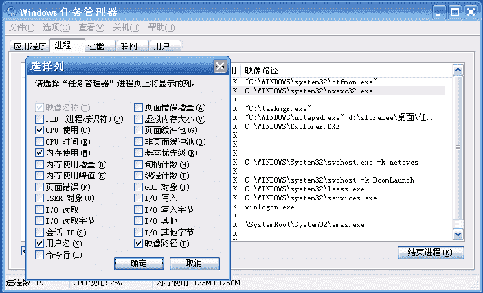
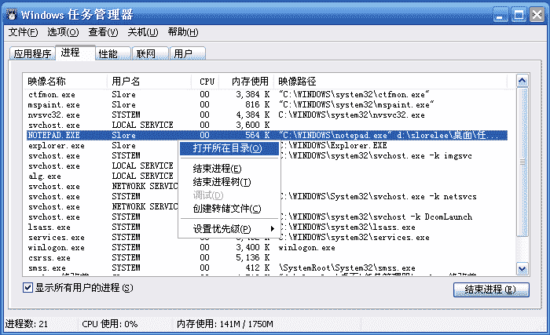
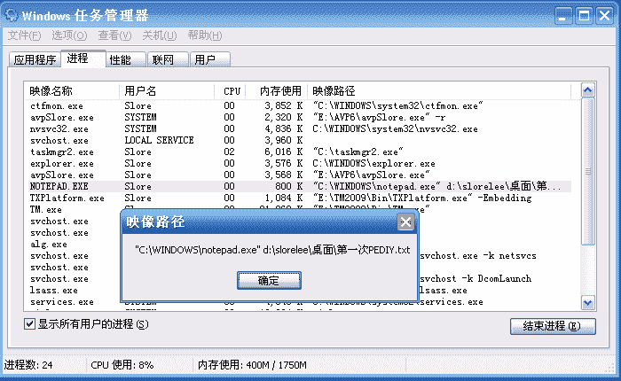

# 第一次 PEDIY---让 Windows 任务管理器更强,更人性!

> 原文：[`www.pediy.com/kssd/pediy10/95905.html`](https://www.pediy.com/kssd/pediy10/95905.html)

【文章标题】: 第一次 PEDIY---让 Windows 任务管理器更强,更人性!

【文章作者】: `slore`

【作者邮箱】: `slorelee@yahoo.com.cn`

【软件名称】: `taskmgr.exe`

【下载地址】: 附件

【使用工具】: `PEiD`, `OD`, `ImportREC`, `Restorator`

【操作平台】: `Windows XP SP3`

看了 `stalker` 前辈的给任务管理器增加显示程序完整路径功能

链 接: [`bbs.pediy.com/showthread.php?t=82582`](http://bbs.pediy.com/showthread.php?t=82582)

感觉很不错,但是不够好(不是技术,是本身的任务管理器不好。)

我手头一直用的任务管理器本身就有这个功能,而且更人性,更方便。

如图所示:



`PIC1.PNG`

而且右键有直接打开到所选进程所在目录并选中的功能,很方便。



`PIC2.PNG`

`PEiD 0.95` 查壳:

`PECompact 2.5 Retail -> Jeremy Collake`

自己不会脱壳,看到壳就先搜索了。

网上的基本都是 `BP VirtualFree` 下断和查找 `push 8000` 的方法。

但是这个程序下断,`Alt+F9` 回不到原程序领空,直接白了...很郁闷,

后来找到了[`bbs.pediy.com/showthread.php?t=94624`](http://bbs.pediy.com/showthread.php?t=94624)

这个单步法还挺简单,成功脱壳修复,但是查壳显示:什么都没找到 \*

不过 `OD` 载入,好像没有问题。(查看了下微软原版的也是什么都没找到 \*)

要添加显示程序的命令行参数的功能。本来不添加这个功能这个任务管理器已经很不错了。但是不 `DIY` 下,怎么好意思发呢～哈哈。

本身程序既然能获取路径,一定已经有这个函数,先看函数列表。

`GetCommandLine` 先想到,后来查了原型,没有参数,应该只能的本身运行程序的参数。

一个个觉得不认识和可能会是下断……苦试了 3~4 个小时发现 `NtReadVirtualMemory` 这个函数,在每次打开个新程序的时候会停下来(`7C8021E5`),`F8` 跟着走,`ret` 一层来到调用 `ReadProcessMemory` 的过程,继续 `F8`,看最后的 `ret` 的位置。

出来是 `0100CF52`,在点下回车键,进到函数,可以看到:

`Local Calls from 0100A739, 0100CF52`

我们先回 `0100CF52` 去,继续走看下堆栈。

```asm
0100CF25   |.  FF73 08        PUSH DWORD PTR DS:[EBX+8]                ; /ProcessId
0100CF28   |.  6A 00         PUSH 0                                    ; |Inheritable = FALSE
0100CF2A   |.  68 10040000   PUSH 410                                  ; |Access = VM_READ|QUERY_INFORMATION
0100CF2F   |.  FF15 14110001 CALL DWORD PTR DS:[<&kernel32.OpenProces\>; \OpenProcess
0100CF35   |.  85C0          TEST EAX,EAX
0100CF37   |.  8985 F0FDFFFF MOV DWORD PTR SS:[EBP-210],EAX
0100CF3D   |.  0F84 A7000000 JE taskmgr.0100CFEA
0100CF43   |.  68 04010000   PUSH 104                                  ; /Arg4 = 00000104
0100CF48   |.  8D8D F4FDFFFF LEA ECX,DWORD PTR SS:[EBP-20C]           ; |
0100CF4E   |.  51            PUSH ECX                                    ; |Arg3
0100CF4F   |.  6A 00         PUSH 0                                    ; |Arg2 = 00000000
0100CF51   |.  50            PUSH EAX                                    ; |Arg1
0100CF52   |.  E8 9F560000   CALL taskmgr.010125F6                     ; \taskmgr.010125F6
0100CF57   |.  85C0          TEST EAX,EAX                                ;从上面出来继续 F8
0100CF59   |.  74 34         JE SHORT taskmgr.0100CF8F
0100CF5B   |.  8D3C00        LEA EDI,DWORD PTR DS:[EAX+EAX]
0100CF5E   |.  8D47 02       LEA EAX,DWORD PTR DS:[EDI+2]
0100CF61   |.  50            PUSH EAX                                    ; /Size
0100CF62   |.  6A 40         PUSH 40                                   ; |Flags = LPTR
0100CF64   |.  FF15 38110001 CALL DWORD PTR DS:[<&kernel32.LocalAlloc\>; \LocalAlloc
0100CF6A   |.  85C0          TEST EAX,EAX
0100CF6C   |.  8983 A0000000 MOV DWORD PTR DS:[EBX+A0],EAX
0100CF72   |.  74 1B         JE SHORT taskmgr.0100CF8F
0100CF74   |.  8BCF          MOV ECX,EDI
0100CF76   |.  8BF8          MOV EDI,EAX
0100CF78   |.  8BC1          MOV EAX,ECX
0100CF7A   |.  C1E9 02       SHR ECX,2
0100CF7D   |.  8DB5 F4FDFFFF LEA ESI,DWORD PTR SS:[EBP-20C]           ;堆栈看到这里能显示进程的全路径
0100CF83   |.  F3:A5         REP MOVS DWORD PTR ES:[EDI],DWORD PTR DS:[ESI]
0100CF85   |.  8BC8          MOV ECX,EAX
0100CF87   |.  83E1 03       AND ECX,3
0100CF8A   |.  F3:A4         REP MOVS BYTE PTR ES:[EDI],BYTE PTR DS:[ESI]
0100CF8C   |.  8B75 10       MOV ESI,DWORD PTR SS:[EBP+10]
0100CF8F   |>  68 04010000   PUSH 104
0100CF94   |.  8D85 F4FDFFFF LEA EAX,DWORD PTR SS:[EBP-20C]
0100CF9A   |.  50            PUSH EAX
0100CF9B   |.  FFB5 F0FDFFFF PUSH DWORD PTR SS:[EBP-210]
0100CFA1   |.  E8 A2560000   CALL taskmgr.01012648                     ;这个 CALL 不知道为什么没注释,
0100CFA6   |.  85C0          TEST EAX,EAX                                ;通过句柄查找映像路径我们补丁要用到。
0100CFA8   |.  74 34         JE SHORT taskmgr.0100CFDE
0100CFAA   |.  8D3C00        LEA EDI,DWORD PTR DS:[EAX+EAX]
0100CFAD   |.  8D47 02       LEA EAX,DWORD PTR DS:[EDI+2]
0100CFB0   |.  50            PUSH EAX                                    ; /Size
0100CFB1   |.  6A 40         PUSH 40                                   ; |Flags = LPTR
0100CFB3   |.  FF15 38110001 CALL DWORD PTR DS:[<&kernel32.LocalAlloc\>; \LocalAlloc
0100CFB9   |.  85C0          TEST EAX,EAX
0100CFBB   |.  8983 9C000000 MOV DWORD PTR DS:[EBX+9C],EAX
0100CFC1   |.  74 1B         JE SHORT taskmgr.0100CFDE
0100CFC3   |.  8BCF          MOV ECX,EDI
0100CFC5   |.  8BF8          MOV EDI,EAX
0100CFC7   |.  8BC1          MOV EAX,ECX
0100CFC9   |.  C1E9 02       SHR ECX,2
0100CFCC   |.  8DB5 F4FDFFFF LEA ESI,DWORD PTR SS:[EBP-20C]           ;到这里我们看到了带运行参数的字符串!兴奋!终于找到了。
0100CFD2   |.  F3:A5         REP MOVS DWORD PTR ES:[EDI],DWORD PTR DS:[ESI]
0100CFD4   |.  8BC8          MOV ECX,EAX
0100CFD6   |.  83E1 03       AND ECX,3
0100CFD9   |.  F3:A4         REP MOVS BYTE PTR ES:[EDI],BYTE PTR DS:[ESI]
0100CFDB   |.  8B75 10       MOV ESI,DWORD PTR SS:[EBP+10]
0100CFDE   |>  FFB5 F0FDFFFF PUSH DWORD PTR SS:[EBP-210]               ; /hObject
0100CFE4   |.  FF15 5C110001 CALL DWORD PTR DS:[<&kernel32.CloseHandl\>; \CloseHandle
```

我们再看下这个 `0100A739` 位置:

发现它在从 `0100A709` 开始到 `0100A756` 是个函数。

流程:

`OpenProcess->CALL taskmgr.010125F6->CloseHandle`

这里 `CALL taskmgr.010125F6` 我们从前面的那个断点进来知道会得到程序的全路径。

它要干什么呢?我们看下函数入口从谁 `CALL` 来。

`Local Call from 0100A781`

转过来,我们看到又是个比较短的函数(上下滚动下就能看全了),很注意到用了 2 个 `shell32` 下面函数

`DS:[010011D4]=7D5BE074 (shell32.SHParseDisplayName)`

`DS:[010011D8]=7D692B76 (shell32.SHOpenFolderAndSelectItems)`

`SHOpenFolderAndSelectItems`:

e 文字面意思是打开文件夹选择文件

你想到了什么呢?

正是这个任务管理器一个很方便的功能,右键进程打开进程所在目录。

我们验证下,看下这个函数被谁调用

`Local Call from 0100BE59`

转过去看:

是 `Cases...switch...` 结构的代码

进这里前的比较语句是:

`81F9 CFC30000 CMP ECX,0C3CF`

用资源查看器打开程序看菜单如下:

```
111 MENU

{
 POPUP "Banana"
 {
  MENUITEM "打开所在目录(&O)", -15409
  MENUITEM SEPARATOR
  MENUITEM "结束进程(&E)", -25508
  MENUITEM "结束进程树(&T)", -25431
  MENUITEM "调试(&D)", -25509
  MENUITEM "创建转储文件(&C)", -25405
  MENUITEM SEPARATOR
  POPUP "设置优先级(&P)"
  {
   MENUITEM "实时(&R)", -25507
   MENUITEM "高(&H)", -25505
   MENUITEM "高于标准(&A)", -25506
   MENUITEM "标准(&N)", -25504
   MENUITEM "低于标准(&B)", -25503
   MENUITEM "低(&L)", -25502
  }
  MENUITEM "关系设置(&A)...", -25481
 }
}
```

我用的 `Restorator`,显示"打开所在目录(&O)"的 ID 是-15409

用 `CALC` 计算 `65536-15409` 再转十六进制正好是 `C3CF`

(上面都静态分析,这里 `F2` 下,对进程右键...果然过来了)

运气不错!碰巧找到了我们要打补丁的跳转入口。

既然打开了,就顺手把我们的菜单补上来:

```
MENUITEM "打开所在目录(&O)", -15409
MENUITEM "映像路径(&I)", -15408
MENUITEM SEPARATOR
```

这个是菜单-15408(`C3D0`),没什么要求不要和其他的资源 ID 重复就行。

补丁入口,如何获取带参数的映像路径,我们的菜单

准备工作做好了,下面开工写补丁代码。

思路:

`OpenProcess->CALL 01012648->MessageBoxW->CloseHandle`

思路是正确的,我的第一次补丁遇到了许多错误,这里给最终修订好的,

后面会说明你和第一个补丁代码的完善部分。

`PEiD` 查看全 0 信息。

```
\---------------------------
节    RVA    偏移    大小
.text    00026BDF  00026BDF  00010421
.rsrc0    00047097  00047097  00000F69
.rsrc    000B264C  000B264C  000009B4
.mackt    000B44BF  000B44BF  00000B41
\---------------------------
```

决定补丁写在.text 下面的 `01026F00` 处:

补丁代码:

```asm
01026F00   \> 81F9 D0C30000  CMP ECX,0C3D0                             ;判断菜单是不是"映像路径(I)"
01026F06   .  0F85 A3000000  JNZ taskmgr.01026FAF                      ;不是则转原程序指令处
01026F0C   .  60              PUSHAD                                    ;保护现场
01026F0D   .  8B40 08        MOV EAX,DWORD PTR DS:[EAX+8]              ;进程 PID
01026F10   .  83F8 04        CMP EAX,4                                 ;判断是不是 SYSTEM.EXE 进程
```


# 代码段分析
01026F13 . 0F84 95000000 JE taskmgr.01026FAE ;是则转恢复现场

01026F19 . 50 PUSH EAX ; /ProcessId

01026F1A . 6A 00 PUSH 0 ; |Inheritable = FALSE

01026F1C . 68 10040000 PUSH 410 ; |Access = VM_READ|QUERY_INFORMATION

01026F21 . FF15 14110001 CALL DWORD PTR DS:[<&kernel32.OpenProcess>] ; \OpenProcess

01026F27 . 8985 00FAFFFF MOV DWORD PTR SS:[EBP-600],EAX ;将 OpenProcess 打开的句柄保存

01026F2D . 83A5 F8F9FFFF > AND DWORD PTR SS:[EBP-608],0 ;将字符串保存地址清零

01026F34 . 85C0 TEST EAX,EAX ;判断 EAX 是否为 0 即 OpenProcess 是否成功

01026F36 . 74 76 JE SHORT taskmgr.01026FAE ;不成功跳到恢复现场

01026F38 . 68 04010000 PUSH 104

01026F3D . 8D85 F4FBFFFF LEA EAX,DWORD PTR SS:[EBP-40C]

01026F43 . 50 PUSH EAX ;传入保存结果地址

01026F44 . FFB5 00FAFFFF PUSH DWORD PTR SS:[EBP-600] ;OpenProcess 句柄

01026F4A . E8 F9B6FEFF CALL taskmgr.01012648 ;获取进程映像路径的函数

01026F4F . 85C0 TEST EAX,EAX ;EAX 保存查询到的字符串 WORD 数

01026F51 . 74 31 JE SHORT taskmgr.01026F84 ;没有查询到则转 CloseHandle

01026F53 . 8D3C00 LEA EDI,DWORD PTR DS:[EAX+EAX] ;转为字节数保存到 EDI

01026F56 . 8D47 02 LEA EAX,DWORD PTR DS:[EDI+2] ;字符串结尾 0000 需要两个字节

01026F59 . 50 PUSH EAX ; /Size

01026F5A . 6A 40 PUSH 40 ; |Flags = LPTR

01026F5C . FF15 38110001 CALL DWORD PTR DS:[<&kernel32.LocalAlloc>] ; \LocalAlloc

01026F62 . 85C0 TEST EAX,EAX ;判断是否申请成功,成功 EAX 为地址

01026F64 . 8985 F8F9FFFF MOV DWORD PTR SS:[EBP-608],EAX ;将申请到的空间首地址保存

01026F6A . 74 18 JE SHORT taskmgr.01026F84 ;不成功转 OpenProcess

01026F6C . 8BCF MOV ECX,EDI

01026F6E . 8BF8 MOV EDI,EAX ;字符串复制目的地址放入 EDI

01026F70 . 8BC1 MOV EAX,ECX ;复制字节数保存在 EAX

01026F72 . C1E9 02 SHR ECX,2 ;字节数/4=按 DWORD 复制的次数

01026F75 . 8DB5 F4FBFFFF LEA ESI,DWORD PTR SS:[EBP-40C] ;字符串复制源地址存入 ESI

01026F7B . F3:A5 REP MOVS DWORD PTR ES:[EDI],DWORD PTR DS:[ESI];执行字符串双字复制

01026F7D . 8BC8 MOV ECX,EAX

01026F7F . 83E1 03 AND ECX,3 ;计算剩余字节数,即按字节复制次数

01026F82 . F3:A4 REP MOVS BYTE PTR ES:[EDI],BYTE PTR DS:[ESI] ;执行字符串字节复制

01026F84 > FFB5 00FAFFFF PUSH DWORD PTR SS:[EBP-600] ; /hObject

01026F8A . FF15 5C110001 CALL DWORD PTR DS:[<&kernel32.CloseHandle>] ; \CloseHandle

01026F90 . 8B85 F8F9FFFF MOV EAX,DWORD PTR SS:[EBP-608] ;读取保存的字符串地址

01026F96 . 85C0 TEST EAX,EAX

01026F98 . 74 14 JE SHORT taskmgr.01026FAE ;没有有效字符串地址则不弹消息框

01026F9A . 6A 00 PUSH 0 ; /Style = MB_OK|MB_APPLMODAL

01026F9C . 68 C06F0201 PUSH taskmgr.01026FC0 ; |Title = "映像路径"

01026FA1 . 50 PUSH EAX ; |Text

01026FA2 . FF35 645D0101 PUSH DWORD PTR DS:[1015D64] ; |hOwner = NULL

01026FA8 . FF15 94120001 CALL DWORD PTR DS:[<&user32.MessageBoxW>] ; \MessageBoxW

01026FAE > 61 POPAD ;恢复现场

01026FAF > 81F9 CFC30000 CMP ECX,0C3CF ;跳转处替换的汇编指令

01026FB5 .^E9 974EFEFF JMP taskmgr.0100BE51 ;转到原程序执行处

01026FBA 0000 ADD BYTE PTR DS:[EAX],AL

01026FBC 0000 ADD BYTE PTR DS:[EAX],AL

01026FBE 0000 ADD BYTE PTR DS:[EAX],AL

01026FC0 2066 CF50 ;标题(Unicode)

01026FC4 EF8D 845F

01026FC8 0000

## 入口
引用: `0100BE4B . 81F9 CFC30000 CMP ECX,0C3CF`

`0100BE51 > 75 42 JNZ SHORT taskmgr.0100BE95`

改为:
引用: `0100BE4B . E9 B0B00100 JMP taskmgr.01026F00`

`0100BE50 90 NOP`

`0100BE51 > 75 42 JNZ SHORT taskmgr.0100BE95`

## 补丁代码完善历史
1. 将贴出来的第一部分代码整段 COPY 去，精简只保留 `OpenProcess`，`CALL 01012648`，`CloseHandle` 的代码，然后直接 `CALL 01012648` 后，将 `DWORD PTR SS:[EBP-20C] PUSH` 给 `MessageBoxW` 调试看堆栈调用的时候的确有路径信息，但是弹出是乱码。

问题原因：`SS` 是在堆栈中，数据被冲掉了……

解决方法：看到那段用了 `LocalAlloc` 申请空间了，就加过来了。

2. 成功显示了，但是新问题出现：发现后面的字符老少几字节。

原因：不知道具体代码作用（生搬），只知道大概代码块作用。简单说对细节不了解 `0100CFD` 之后就将 `EDI` 传给 `MessageBoxW` 了（因为看堆栈是自己想要的数据。）

解决方法：将其后的 `0100CFD2`、`0100CFD4` 执行后再传 `EDI`。（具体原因看最终代码 `01026F7D` 附近的注释）

3. `MessageBoxW` 开始都是 `PUSH 0` 只有 `TEXT` 是传查到的字符串地址，能弹是能弹出来，但是有小问题，标题为"错误"，任务管理器本身有在最前面显示的功能，如果开了总在最上功能，弹出来的消息框看不到。

原因：参数不合理

解决方法：加参数标题，和 Owner 句柄

标题简单，在代码区后面加了几个字节，注意这里要 Unicode 编码。

Owner，我们要 Taskmgr 的句柄，自己 `FindWindows` 可以，但是麻烦，编程的时候我们对句柄都是直接调用的，程序应该会保存在固定的位置。找不到再 `FindWindows` 这条路……

在 `SetWindowsPos` 下断

`01005390 |. FF15 38130001 CALL DWORD PTR DS:[<&user32.SetWindowPos>] ; \SetWindowPos`

看着堆栈 F9，看啥时候标题是"Windows 任务管理器"（断点很多，比较笨下在这里了。。。）

功夫不负有心人，看到了，准备把他存在段地址里面，不知道那安全，数据区拖到最后了。。

后来想，程序应该会存，记下 `SetWindowPos` 的 `hwnd` 参数，在数据区搜索下 XA XB XC，没有结果好失望，后来想起存储结构高低位要变，搜索 XC XB XA，铛铛铛~终于被我找着咯~（明星三缺一的台词原来是【碰】）。

仔细一看断点处下面一点的：

`01005399 |. FF35 645D0101 PUSH DWORD PTR DS:[1015D64] ; |hWnd = NULL`

`0100539F |. FF15 88130001 CALL DWORD PTR DS:[<&user32.ShowWindow>] ; \ShowWindow`

（自己应该好笨，再 ShowWindow 设置断点估计 F9 能少按几十次）

这里就直接用了。我们向上看下来源：

`01005353 |. FF15 98120001 CALL DWORD PTR DS:[<&user32.CreateDialogParam>; \CreateDialogParamW`

`01005359 |. 3BC3 CMP EAX,EBX`

`0100535B |. A3 645D0101 MOV DWORD PTR DS:[1015D64],EAX`

改怎么调用知道了吧？（最终代码 MessageBoxW 部分也可以看到）

测试，任务管理器置顶不置顶都可以正常显示消息框。

4. 调试的时候消息框完了，调用 `CloseHandle` 总是进异常处理部分。

原因：生搬硬套，知道要一个参数照搬别的地方的 `PUSH EBX`，那里 `EBX` 也许是句柄这里就……

解决方法：转存 `OpenProcess` 的句柄。

`01026F27 . 8985 00FAFFFF MOV DWORD PTR SS:[EBP-600],EAX`

以前的认识是：把 `EAX` 存到 `EBP-600` 的地址里面，一点都不知道为什么，现在知道了。顺便提下开始用的 `EBP-210`，但是会下面的获取映像路径的 `CALL` 清空，所以这里把写远些。

5. 逻辑结构进行了改善。`OpenProcess->查询->CloseHandle->MessageBoxW` 这个经过前面那些，越来越了解，所以比较简单，就是提下保存地址不要选太近……这里用了 `EBP-608`

6. 程序 OD 调试测试都 OK……实际运行却……

问题：`MessageBoxW` 显示内容一会全一会不全，有的中间还显示乱码。

原因：保存地址太近，被刷掉了...调试的时候都没错，可能调试的时候实时性比较高。

解决方法：保存位置从 `EBP-20C` 改到 `EBP-40C`。

7. 问题：对 `SYSTEM.EXE` 右键会出错。

解决方法：这个进程是 PID 固定为 4，所以做了下简单判断即可。

其他进程没有映像路径的测试通过从 `01026F51` 跳转。

顺便改了下颜色，调试的时候看到注释 RGB 字样。。。

bp `CreatePen` 下断：

`5650h` 处 设置性能页网格颜色

`90C5h` 处 设置联网页网格颜色

好像还有几个断点，颜色不是常数用的 `EDI+固定量`，所以就没去改。

你要是查出来了记得分享哦。

（记得以前有篇文章叫给 Windows 任务管理器点颜色看看，里面说那个地址改成自己的，还有那个地址……给了固定的值，版本不同的任务管理器发现和他说的不一样一直没机会改，今天终于得偿所愿，更重要的是知道为什么改几个字节就会变了。）

至此自己已经满意了，第一能这样感觉很不错，虽然很累，花了一晚上 + 一下午时间。

修改后保存，运行下看看效果：



PIC3.PNG

直接对着弹出对话框 Ctrl+C 就能复制（不知道多少人知道，很实用的功能）

```
---------------------------
映像路径
---------------------------
"C:\WINDOWS\notepad.exe" d:\slorelee\桌面\第一次 PEDIY.txt
---------------------------
确定
---------------------------
```

PS:

说 stalker 前辈用的任务管理器不好，测试的时候发现这个任务管理器在任务界面，右键菜单和结束任务按钮有些不灵，开始以为和自己 DIY 的部分有关，下了断点点结束任务不会执行那里，而且调试状态都能一点就结束（残念），后来网上重新下载了很多 Longhorn 任务管理器都有这个问题，反应不好不太重要，关键如果结束驱动器或文件夹任务居然会重启 `EXPLORER`（似乎被结束掉了...），所以不是 DIY 的错~别拍我。最后下了所谓的完美版，测试了几次都还没发现那个问题，但是还是有结束任务点了没反映的状况，不过没之前的夸张。
