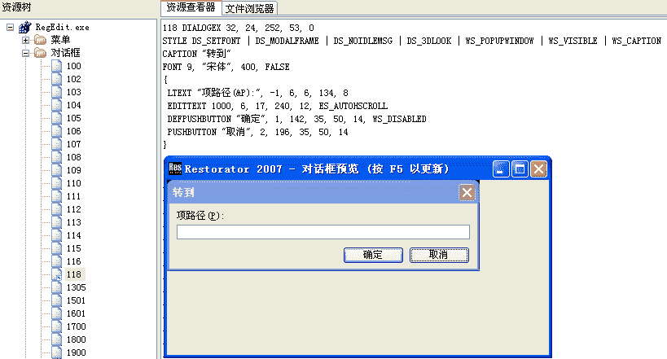
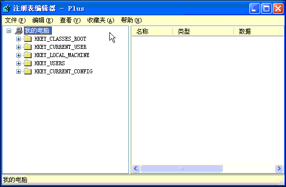

# PEDIY---让注册表编辑器更人性(一)增加 "转到(Goto)" 功能!

> 原文：[`www.pediy.com/kssd/pediy10/99485.html`](https://www.pediy.com/kssd/pediy10/99485.html)

- 【文章标题】：PEDIY---让 RegEdit 更人性(一)增加 "转到(Goto)" 功能!
- 【文章作者】：slore
- 【作者邮箱】：slorelee@yahoo.com.cn
- 【软件名称】：`regedit.exe`
- 【下载地址】：附件
- 【使用工具】：OD, Restorator, ZeroAdder
- 【操作平台】：Windows XP SP3

**本次修改的 `regedit` 已经修改一次，改了 `regedit` 的标题，和本身的类名，以及删除了对通过注册表设置 `DisableRegEditTools` 来禁用注册表编辑器的部分。**

**这样做的目的是打造一个不被禁用的注册表编辑器(特殊场合需要这样)，但是改动并不影响下面操作，所以如果你要在默认的注册表编辑器增加该功能，拷贝我的补丁到原注册表编辑器即可。**

PEDIY 当然先开 Windows 的刀了……(我不是第一人哦，记事本，计算器都被改的不行了。)

但是诸多修改只是练手，个人更注重实用性。

继先前对 Windows 任务管理器的增强之后，今天我们来让注册表编辑器更人性吧。

对任务管理器 DIY 的链接：

[`bbs.pediy.com/showthread.php?t=95905`](http://bbs.pediy.com/showthread.php?t=95905)

## 前言

一直以来微软各个操作系统上的注册表编辑器都没有转到功能，经常要查看注册表的时候难免要麻烦一番，一级一级的展开，看来是 MS 不喜欢我们去动注册表吧。虽然打首字母可以快速定位，但是还是很麻烦，你觉得呢?

很多第三方注册表编辑器，提供了这个功能，但是基本需要注册，而且功能对于我来说有些太繁琐了，主要三方动不动就更新……

如果你觉得当前对注册表编辑器的使用你很满意了，那么下面的内容你当作 PEDIY 的练手吧。

让注册表快速定位是我还不会一点编程的时候就希望用的，每次打开注册表编辑器都感慨，如此简单的功能为什么不给呢……还好我的电脑(资源管理器)这个更经常用的东西是有的。

毕竟用人家的东西，不满也只好自己忍受了。

曾经用 VB 写过一个"地址栏"，其实是一个程序，用 `SetParent` 把自己做到注册表编辑器上，但是不会 Hook 他的 `WM_RESIZE` 消息，拖动下窗口就不见了……一直就搁浅了(而且用总是 Shell 的嫌疑，效率也不高)。

过了 5,6 年，今天决定○一下自己这个梦。给注册表编辑器进行 DIY，加上这个功能!

让 RegEdit 更人性(一)增加 "转到(Goto)" 功能!

让 RegEdit 更人性(二)添加 "地址栏" 功能!

(计划中...,能力还不够，还需了解些知识)

大家都知道注册表编辑器有 `LastKey` 和收藏夹为大家方便访问。所以里面一定有代码去实现，所以我们去找下吧。OD 打开 Regedit，查找参考字符串找到 `LastKey` 有 2 个，进去看下一个后面用了 `SetRegValue` 应该是关闭的时候保存当前位置的，下断 Run 也证实了。

进另一个地方 F8 单步看读取了 `LastKey` 后到了下面:

```
01005D4F  |.  50            PUSH EAX
01005D50  |.  E8 D2E7FFFF   CALL RegEdit.01004527
```

跟进去发现这个就是我们要找到的函数啦，而且调用很方便，就一个参数要去的路径字符串的指针地址(字符串是 Unicode 方式存储)。

这个 `CALL RegEdit.01004527` 我们就记下来。

## 资源修改

下面我们需要一个对话框，还有对应菜单选项。

用资源编辑器打开 Regedit，对话框我们先打开 104 资源

```
104 DIALOGEX 32, 24, 252, 53, 0
STYLE DS_SETFONT | DS_MODALFRAME | DS_NOIDLEMSG | DS_3DLOOK | DS_CONTEXTHELP | WS_POPUPWINDOW | WS_VISIBLE | WS_CAPTION
CAPTION "加载配置单元"
FONT 9, "宋体", 400, FALSE
{
  LTEXT "项名称(&K):", -1, 6, 6, 134, 8
  EDITTEXT 1001, 6, 17, 240, 12, ES_AUTOHSCROLL
  DEFPUSHBUTTON "确定", 1, 142, 35, 50, 14
  PUSHBUTTON "取消", 2, 196, 35, 50, 14
}
```

做简单修改，去掉 `DS_CONTEXTHELP` 样式(右上角的帮助按钮)，改改名称，把 `EDITTEXT` 的 ID 改为 1000，并设置确定按钮默认禁用(代码有解释)，并添加为 118 号对话框资源。

结果如下图所示:



下面增加菜单项，转到菜单 103 处:

在查看菜单项我们修改如下:

```
  POPUP "查看(&V)", 514
  {
    MENUITEM "状态栏(&B)", 668
    MENUITEM "", -1, MFT_SEPARATOR
    MENUITEM "拆分(&L)", 670
    MENUITEM "", -1, MFT_SEPARATOR
    MENUITEM "显示二进位数据(&D)", 679
    MENUITEM "", -1, MFT_SEPARATOR
    MENUITEM "转到(&G)...\tCtrl+G", 888
    MENUITEM "", -1, MFT_SEPARATOR
    MENUITEM "刷新(&R)\tF5", 648
  }
```

888 是菜单的 ID 不重复就好了，我们给它加个加速键。

资源编辑器打开快捷键(ACCELERATOR 资源)列表，在后面追加如下:

```
888: "Ctrl+G"

//菜单 ID 和对应快捷键
```

看了下默认的空间似乎都不大，所以自己用 ZeroAdder 添加了一个 1KB 的区段。

```
\---------------------------
Cave Info
\---------------------------
 Section     RVA     Offset   Size
 .text   00018908 00017D08 000000F8
 .data   00019229 00018029 000001D7
 .rsrc   0006236D 0002056D 00000093
 Slore   00063008 00020608 000003F8
\---------------------------
确定
\---------------------------
```

## 菜单消息处理

```
01006327  |. /0F8F 97000000    JG RegEdit.010063C4  '这里打开我们的对话框
比 768(0x300)大的 ID 号从这里跳转处理。。。我们的菜单 888(0x378)就加在这里吧
(其实这条判断链上能写地方很多，自己凭喜好选择吧)。
```

我们写补丁的地址在 `01063010`

所以将 `010063C4` 处:

引用:
```
010063C4  |> \8BC6          MOV EAX,ESI
010063C6  |.  2D 00050000  SUB EAX,500                      ;  Switch (cases 500..501)
010063CB  |.  74 1C        JE SHORT regedit.010063E9
```

修改为:

引用:
```
010063C4   >-\E9 47CC0500  JMP RegEdit.01063010
010063C9      90            NOP
010063CA      90            NOP
010063CB   .  74 1C         JE SHORT RegEdit.010063E9
```

### 补丁内容

补丁分为三段，第一段是菜单处理:

引用:
```
01063010    B8 78030000     MOV EAX,378               ;EAX 设置为 888
01063015    3BF0            CMP ESI,EAX               ;比较点击的菜单 ID 和 888
01063017    75 06           JNZ SHORT RegEdit.0106301F    ;不相等转程序原来 010063C4 的代码
01063019    57              PUSH EDI                  ;如果是我们的"转到"菜单，调用 01063030 处函数
0106301A    E8 11000000     CALL RegEdit.01063030
0106301F    8BC6            MOV EAX,ESI               ;程序原来
01063021    2D 00050000     SUB EAX,500               ;010063C4 的代码
01063026  - E9 A033FAFF     JMP RegEdit.010063CB        ;跳回程序原流程
```

第二段补丁打开我们的"转到"对话框

这个代码完全是 COPY 程序打开"删除收藏夹"对话框的代码，比较短很简单就是调用 `DialogBoxParamW` 打开窗口。自己看下 `DialogBoxParamW` 的参数列表就很明了了。

打开"删除收藏夹"对话框的代码

引用:
```
01004E38  /$  8BFF          MOV EDI,EDI
01004E3A  |.  55            PUSH EBP
01004E3B  |.  8BEC          MOV EBP,ESP
01004E3D  |.  6A 00         PUSH 0                        ; /lParam = NULL
01004E3F  |.  68 454C0001  PUSH RegEdit.01004C45         ; |DlgProc = RegEdit.01004C45
01004E44  |.  FF75 08      PUSH DWORD PTR SS:[EBP+8]       ; |hOwner
01004E47  |.  6A 71         PUSH 71                       ; |pTemplate = 71
01004E49  |.  FF35 30950101 PUSH DWORD PTR DS:[1019530]     ; |hInst = NULL
01004E4F  |.  FF15 30140001 CALL DWORD PTR DS:[<&USER32.DialogBoxParamW>]   ; \DialogBoxParamW
01004E55  |.  5D            POP EBP
01004E56  \.  C2 0400       RETN 4
```

我们的代码:

引用:
```
01063030    8BFF            MOV EDI,EDI
01063032    55              PUSH EBP
01063033    8BEC            MOV EBP,ESP
01063035    6A 00           PUSH 0
01063037    68 60300601     PUSH RegEdit.01063060            ;回调函数地址
0106303C    FF75 08         PUSH DWORD PTR SS:[EBP+8]
0106303F    6A 76           PUSH 76                          ;对话框 Template(模板)，0x76 即 118
01063041    FF35 30950101   PUSH DWORD PTR DS:[1019530]
01063047    FF15 30140001   CALL DWORD PTR DS:[<&USER32.DialogBoxPar>; USER32.DialogBoxParamW
0106304D    5D              POP EBP
0106304E    C2 0400         RETN 4
```

第三段补丁我们的"转到"对话框的回调函数(消息处理)

这里可以参考"添加收藏夹"的回调函数(010049E2)，代码和我们的补丁差不多就不在这里重复了，有兴趣的话可以比对下不同之处。

注:

`WM_INITDIALOG`,272,0110,在一个对话框程序被显示前发送此消息给它，通常用此消息初始化控件和执行其它任务

`WM_COMMAND`,273,0111,当用户选择一条菜单命令项或当某个控件发送一条消息给它的父窗口，一个快捷键被翻译

引用:
```
01063060    8BFF            MOV EDI,EDI
01063062    55              PUSH EBP
01063063    8BEC            MOV EBP,ESP
01063065    8B45 0C         MOV EAX,DWORD PTR SS:[EBP+C]
01063068    2D 10010000     SUB EAX,110                ;Switch 判断是否是 WM_INITDIALOG(0x110)消息
0106306D    56              PUSH ESI
0106306E    0F84 EC000000   JE RegEdit.01063160        ;是转 01063160
01063074    48              DEC EAX                    ;判断是否是 WM_COMMAND(0x111)消息
01063075    74 07           JE SHORT RegEdit.0106307E  ;是 WM_COMMAND 消息转到 0106307E
01063077    33C0            XOR EAX,EAX                ;Deafult 都不是则清零，直接退出
01063079    E9 E5000000     JMP RegEdit.01063163
0106307E    8B4D 10         MOV ECX,DWORD PTR SS:[EBP+10]
01063081    0FB7F1          MOVZX ESI,CX
01063084    8BC6            MOV EAX,ESI
01063086    48              DEC EAX                    ;如果 ID 是 1 (确定按钮的 ID 号)
01063087    74 4D           JE SHORT RegEdit.010630D6  ;转到 010630D6
01063089    48              DEC EAX                    ;如果 ID 是 2 (取消按钮的 ID 号)
0106308A    0F84 8C000000   JE RegEdit.0106311C        ;转到 0106311C
01063090    2D E6030000     SUB EAX,3E6                ;如果 ID 是 1000 (编辑框的 ID 号)
01063095    0F85 C5000000   JNZ RegEdit.01063160       ;都不是则转出
0106309B    C1E9 10         SHR ECX,10                 ;这 2 句不清楚干嘛，希
0106309E    66:81F9 0003  CMP CX,300                   ;望知道的帮忙解释下
010630A3    0F85 B7000000   JNZ RegEdit.01063160
```


```text
010630A9    6A 00           PUSH 0                                                  ; /lParam = 0
010630AB    6A 00           PUSH 0                                                  ; |wParam = 0
010630AD    6A 0E           PUSH 0E                                                   ; |Message = WM_GETTEXTLENGTH
010630AF    FF75 14         PUSH DWORD PTR SS:[EBP+14]                                 ; |hWnd
010630B2    FF15 08130001  CALL DWORD PTR DS:[<&USER32.SendMessageW>]                 ; \SendMessageW
010630B8    F7D8            NEG EAX                                                   ;对文本框的长度检查,如果为空
010630BA    1BC0            SBB EAX,EAX                                               ;确定按钮不可用,反之可用。
010630BC    F7D8            NEG EAX
010630BE    50              PUSH EAX                                                  ; /Enable
010630BF    6A 01           PUSH 1                                                    ; |/ControlID = 1
010630C1    FF75 08         PUSH DWORD PTR SS:[EBP+8]                                  ; ||hWnd
010630C4    FF15 D8120001  CALL DWORD PTR DS:[<&USER32.GetDlgItem>]                   ; |\GetDlgItem
010630CA    50              PUSH EAX                                                  ; |hWnd
010630CB    FF15 38130001  CALL DWORD PTR DS:[<&USER32.EnableWindow>]                 ; \EnableWindow
010630D1    E9 8A000000     JMP RegEdit.01063160
010630D6    68 00040000     PUSH 400                                                  ;确定按钮按下申请 1024 长度的空间
010630DB    6A 40           PUSH 40
010630DD    FF15 10120001   CALL DWORD PTR DS:[<&KERNEL32.LocalAlloc>]                ; kernel32.LocalAlloc
010630E3    85C0            TEST EAX,EAX                                              ;判断是否申请成功
010630E5    74 35           JE SHORT RegEdit.0106311C                                  ;申请失败转 EndDialog
010630E7    A3 40920101     MOV DWORD PTR DS:[1019240],EAX                             ;成功则保存指针到 1019240 处
010630EC    68 00040000     PUSH 400                                                  ; /Count = 400 (1024.)
010630F1    FF35 40920101   PUSH DWORD PTR DS:[1019240]                                ; |Buffer
010630F7    68 E8030000     PUSH 3E8                                                  ; |ControlID = 3E8 (1000.) ;编辑框
010630FC    FF75 08         PUSH DWORD PTR SS:[EBP+8]                                  ; |hWnd
010630FF    FF15 14130001   CALL DWORD PTR DS:[<&USER32.GetDlgItemTextW>]              ; \GetDlgItemTextW
01063105    56              PUSH ESI
01063106    FF75 08         PUSH DWORD PTR SS:[EBP+8]                                  ; /hWnd
01063109    FF15 B4120001   CALL DWORD PTR DS:[<&USER32.EndDialog>]                   ; \EndDialog
0106310F    FF35 40920101   PUSH DWORD PTR DS:[1019240]                                ;传入要查看的项路径字符串地址
01063115    E8 0D14FAFF     CALL RegEdit.01004527                                      ;调用前面找到的转到函数
0106311A    EB 44           JMP SHORT RegEdit.01063160
0106311C    56              PUSH ESI
0106311D    FF75 08         PUSH DWORD PTR SS:[EBP+8]                                  ; /hWnd
01063120    FF15 B4120001   CALL DWORD PTR DS:[<&USER32.EndDialog>]                   ; \EndDialog
01063126    EB 38           JMP SHORT RegEdit.01063160
01063128    57              PUSH EDI
01063129    8B7D 14         MOV EDI,DWORD PTR SS:[EBP+14]
0106312C    6A 00           PUSH 0                                                    ; /lParam = 0
0106312E    68 00040000     PUSH 400                                                  ; |wParam = 400
01063133    68 C5000000     PUSH 0C5                                                  ; |Message = EM_LIMITTEXT
01063138    BE E8030000     MOV ESI,3E8                                               ; |
0106313D    56              PUSH ESI                                                  ; |ControlID => 3E8 (1000.)
0106313E    FF75 08         PUSH DWORD PTR SS:[EBP+8]                                  ; |hWnd
01063141    893D 40920101   MOV DWORD PTR DS:[1019240],EDI                            ; |
01063147    FF15 5C120001   CALL DWORD PTR DS:[<&USER32.SendDlgItemMessageW>]          ; \SendDlgItemMessageW
0106314D    57              PUSH EDI                                                  ; /Text
0106314E    56              PUSH ESI                                                  ; |/ControlID => 3E8 (1000.)
0106314F    FF75 08         PUSH DWORD PTR SS:[EBP+8]                                  ; ||hWnd
01063152    FF15 D8120001   CALL DWORD PTR DS:[<&USER32.GetDlgItem>]                   ; |\GetDlgItem
01063158    50              PUSH EAX                                                  ; |hWnd
01063159    FF15 34130001   CALL DWORD PTR DS:[<&USER32.SetWindowTextW>]               ; \SetWindowTextW
0106315F    5F              POP EDI
01063160    33C0            XOR EAX,EAX
01063162    40              INC EAX
01063163    5E              POP ESI
01063164    5D              POP EBP
01063165    C2 1000         RETN 10
```

效果预览:



附件列表

`Pic1.PNG`

`Pic2.GIF`

`DIY-注册表编辑器.txt`

`RegEdit 原版(XP SP3).exe`

`RegEdit-Plus.exe`

完,希望大家喜欢此次 DIY。

`10596A0` `HWND`

上传的附件

|  || `DIY-注册表编辑器.rar` [附件请到论坛下载]   
|
