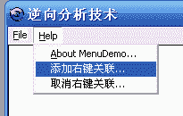
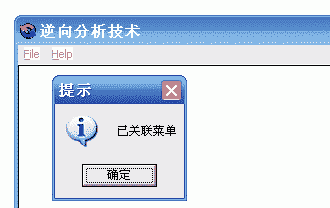
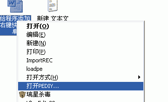
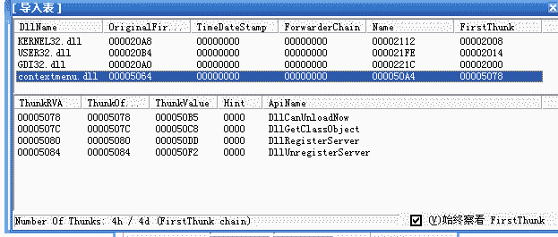
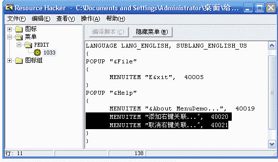

# 为程序添加右键快捷菜单

> 原文：[`www.pediy.com/kssd/pediy08/pediy8-334.htm`](https://www.pediy.com/kssd/pediy08/pediy8-334.htm)

【文章标题】: 为程序添加右键快捷菜单
【文章作者】: laomms
【软件名称】: 附件下载
【操作平台】: winxp
【作者声明】: 只是感兴趣，没有其他目的。失误之处敬请诸位大侠赐教!

`WINRAR`、`FLASHGET` 等的右键快捷菜单很让人羡慕，它是通过 `Windows Shell` 扩展编程实现的，所谓的 `Shell` 扩展就是添加某种功能到 `Windows Shell` 的 `COM` 对象，然后通过注册 `COM` 控件在注册表中增加或删除相关键值。如果打开 `FLASHGET` 会发现目录有个上下文菜单扩展控件 `Jccatch.dll`，通过注册该 `DLL` 实现右键菜单关联。本篇文章通过 `DIY` 为程序添加右键关联菜单。

我们就拿看雪大哥的 `pediy.EXE` 来做实验，要实现下图的功能：







## 一、编写 COM 控件

首先我们需要写一个上下文菜单扩展控件控件供程序调用，网上有很多的相关代码，我找了个 `DELPHI` 的，稍微修改了一下，源码看附件，名称是 `contextmenu.dll`，跟其它的 `COM` 控件一样，也有四个输出函数：`DllGetClassObject`, `DllCanUnloadNow`, `DllRegisterServer`, `DllUnregisterServer`。我们想实现按下“添加右键关联”时调用 `DllRegisterServer` 注册控件，按下“取消右键关联”时调用 `DllUnregisterServer` 取消注册。

## 二、为程序添加 DLL 链接

接下来我们要做的就是将 `DLL` 引入到程序中，可以利用 `Loadlibrary` 函数和 `GetProcessAddress` 函数相结合，然后获取需要的函数的地址，也可以用 `LOADPE`、`IIDKING` 等工具加载，类似的文章已经很多了。我选择用 `IIDKing2.01`。用 `IIDKing` 打开 `PEDIY.EXE`，选择 `contextmenu.dll`，`IIDKing` 自动显示了 `DLL` 的所有输出函数，选中后添加，输入表中便已经有了 `contextmenu.dll`。我们用 `LOADPE` 载入 `PEDIY.EXE`，看看输入表中 `contextmenu.dll` 各函数的 `THUNKRVA` 值



`DllRegisterServer` 为 `00005080`，`DllUnregisterServer` 为 `005084`，那调用时就可以用基地址+`THUNKRVA` 值的方法（记住勾选始终查看 `FIRSTTHUNK` 值）。

```
CALL DWORD PTR DS:[405080] ; 调用 DllRegisterServer
CALL DWORD PTR DS:[405084] ; 调用 DllUnregisterServer
```

## 三、为程序添加菜单项目

我们先用 `Resource Hacker` 为程序添加两个子菜单：



已知“`ABOUT MENUD EMO`”的菜单 `ID` 为 `40019`（`9C53H`），再设置“添加右键关联”为 `40020`（`9C54H`），“取消右键关联”`40021`（`9C55H`）。

由于原程序的关于的窗口是引用 `MessageBox` 消息框的，所以弹出的对话框信息我们就直接引用原来的 `MessageBoxA`。

## 四、添加响应代码

简单讲一下程序是如何处理菜单响应的：当你按下菜单执行相应的命令后，`CreateDialogBoxParamA` 会调用窗口回调函数来处理，即把包含菜单命令的信息作为参数送给窗口回调函数，有时候是 `CreateWindowsEx` 或者 `MessageBoxA`，因为一般界面中菜单或按钮有多个，所以代码组合一般都是这样：

```
cmp eax,xxxx(菜单 id) ；比较一下是不是这个菜单命令
jz label1 ；如果是就转到这个菜单的响应函数
jmp label2 ;如果不是就对比是否为下一个菜单

Label2:
cmp eax,xxx2(菜单 id2) ；比较一下是不是这个菜单
jz xxxxxxx2 ；如果是就转到这个菜单的响应函数
jmp label3 ；不是继续判断下一个
```

查看 `PEDIY.EXE` 的输入表，知道关于的菜单响应函数是 `MessageBoxA`，所以我们在 `OD` 中对 `MessageBoxA` 下断，`F9` 运行程序后，按下 `ABOUT MENUD EMO`，程序就被断下了。我们向上看，很容易看到菜单 `ID` 对比的地方：

```
004011FA  |.  8955 F8       MOV DWORD PTR SS:[EBP-8],EDX
004011FD  |.  817D F8 539C0>CMP DWORD PTR SS:[EBP-8],9C53     ;  是不是关于对话框的 ID
00401204  |./74 02         JE SHORT 00401208                    ;  更改这里的代码，跳到下面执行
00401206  |>  EB 1A        JMP SHORT 00401222
00401208  |>  6A 40        PUSH 40                              ; /Style = MB_OK|MB_ICONASTERISK|MB_APPLMODAL
0040120A  |.  68 00304000  PUSH 00403000                        ; |Title = "pediy"
0040120F  |.  68 44304000  PUSH 00403044                        ; |Text = "逆向分析技术
(c) 段钢, 2002"
00401214  |.  8B45 08      MOV EAX,DWORD PTR SS:[EBP+8]         ; |
00401217  |.  50           PUSH EAX                             ; |hOwner
00401218  |.  FF15 44204000 CALL DWORD PTR DS:[<&USER32.MessageBoxA>>; \MessageBoxA
0040121E  |.  33C0         XOR EAX,EAX
```

我们需要对 `00401204` 处的代码进行更改，以便它跳到我们添加的其它菜单的 `ID` 对比，并执行相应的响应事件。找到空余的地方 `00401250` 处开始修改：

```
00401204  |./74 02         JE SHORT 00401208                    ;  更改这里的代码，跳到下面执行，改为：
00401204  |.  EB 4A        JMP SHORT 00401250   

00401250  |>^\74 B6        JE SHORT 00401208                    ;  如果是关于对话框的 ID，跳回到上面的对话框调用处
00401252  |.  817D F8 549C0>CMP DWORD PTR SS:[EBP-8],9C54     ;  如果不是，则判断不是添加右键关联的 ID
00401259  |.  74 15        JE SHORT 00401270                    ;  如果是，就跳到 401270 处处理相关信息
0040125B  |.  817D F8 559C0>CMP DWORD PTR SS:[EBP-8],9C55     ;  如果不是，判断不是取消右键关联的 ID
00401262     74 1C        JE SHORT 00401295                    ;  如果是，就跳到 401295 处处理相关信息
00401264  |.^ EB A0        JMP SHORT 00401206                   ;  跳回原来的地方
00401266  |   00           DB 00
00401267  |   00           DB 00

00401270     60           PUSHAD                               ;  保护现场
00401271     FF75 08      PUSH DWORD PTR SS:[EBP+8]             ;  压入添加右键关联的 ID
00401274     FF15 80504000 CALL DWORD PTR DS:[405080]           ;  调用 contextm.Dll 的 DLLRegisterServer 函数
0040127A     6A 40        PUSH 40                              ;  对话框风格
0040127C     68 BA124000  PUSH 004012BA                        ;  对话框标题“关于”，写在了 4012BA 处
00401281     68 C5124000  PUSH 004012C5                        ;  对话框内容：已关联菜单，在 4012C5 处
00401286     6A 00        PUSH 0                               ;  对话框句柄
00401288     FF15 44204000 CALL DWORD PTR DS:[402044]           ;  呼叫 MessageBoxA 函数
0040128E     61           POPAD                                ;  恢复现场
0040128F  |.^ EB B5        JMP SHORT pediy.00401246             ;  跳回到正常流程
00401291     00           DB 00
00401292     00           DB 00
0040127E     90           NOP
0040127F     90           NOP

00401295  |> \60          PUSHAD                               ;  保护现场
00401296  |.  FF75 08      PUSH DWORD PTR SS:[EBP+8]             ;  压入取消右键关联的 ID
00401299  |.  FF15 84504000 CALL DWORD PTR DS:[405084]           ;  调用 contextm.Dll 的 DllUnregisterServer 函数
0040129F  |.  6A 40        PUSH 40                              ;  对话框风格
004012A1  |.  68 BA124000  PUSH pediy.004012BA                  ;  对话框标题“关于”，写在了 4012BA 处
004012A6  |.  68 D1124000  PUSH pediy.004012D1                  ;  对话框内容：已取消关联，在 4012D1 处
004012AB  |.  6A 00        PUSH 0                               ;  对话框句柄
004012AD  |.  FF15 44204000 CALL DWORD PTR DS:[402044]           ;  呼叫 MessageBoxA 函数
004012B3  |.  60           POPAD                                ;  恢复现场
004012B4    ^ EB 90        JMP SHORT 00401246                   ;  跳回到正常流程
00401291     00           DB 00
00401292     00           DB 00

004012BA     CC           INT3                                 ;  ASCII：关于
004012BB    ^ E1 CA       LOOPDE SHORT 00401287
004012BD     BE 00000000   MOV ESI,0
004012C2     00           DB 00
004012C3     00           DB 00
004012C4     00           DB 00
004012C5     D2D1         RCL CL,CL                            ;  ASCII：已关联菜单
004012C7     B9 D8C1AAB2   MOV ECX,B2AAC1D8
004012CC     CB           RETF                                 ;  远距返回
004012CD     B5 A5        MOV CH,0A5
004012CF     00           DB 00
004012D0     00           DB 00
004012D1     D2D1         RCL CL,CL                            ;  ASCII：已取消关联
004012D3     C8 A1CFFB     ENTER 0CFA1,0FB
004012D7     B9 D8C1AA00   MOV ECX,0AAC1D8
004012DC     00           DB 00
```

打好补丁后另存为一个可执行文件，这时打开这个文件，按下“添加右键关联”，程序并在系统中注册了 `contextmenu.dll`，并弹出对话框提示已关联菜单，按下“取消右键关联”则反注册 `DLL` 控件。可以在任意文件上右击，菜单中已经出现了“打开 `PEDIY`”选项。当然直接注册 `DLL` 控件也能实现这样的功能，或者直接修改注册表键值也能达到效果。

【版权声明】: 本文原创于看雪技术论坛, 转载请注明作者并保持文章的完整, 谢谢!
2006 年 08 月 17 日 8:56:19

但是有一点，由于 `DLL` 中调用应用程序路径的语句用的是绝对路径，所以只能把 `PEDIY` 和 `DLL` 放在 `D` 盘根目录下。代码是这样的：

```
ShellExecute(0,nil,'d:\\pediy.exe',PChar(sSaveFile),charSavePath,SW_NORMAL);
```

我试着将 `d:\\pediy.exe` 改为相对路径，但始终没有成功。试了以下几种方法：

```
PathStr:=ExtractFilePath(Paramstr(0));
Strname:=pathstr+'diy.exe';
ShellExecute(0,nil,PChar(Strname),nil,nil,SW_NORMAL);
//WinExec(PChar(Strname), lpici.nShow);

--------------
PathStr:=GetCurrentDir;
Strname:=pathstr+'diy.exe';
ShellExecute(0,nil,PChar(Strname),PChar(sSaveFile),charSavePath,SW_NORMAL);

---------------

function GetDllPath(): PChar;   //获取 DLL 路径
var 
  ModuleName: string;
begin 
  SetLength(ModuleName, 260);
```


```
GetModuleFileName(HInstance, PChar(ModuleName), Length(ModuleName));
result := PChar(ModuleName);
end;
ShellExecute(0, nil, 'pediy.exe', PChar(sSaveFile), GetDllPath(), SW_NORMAL);
```

但是都不成功，希望高手能够解决。

`ShellExecute` 的第三个参数需要传入的是绝对路径，如果你需要省略路径，那么把 `pediy.exe` 这个文件放入 `windows` 目录，传入参数时只给文件名就可调用了。

为什么放入 `windows` 目录就可以了，其实这里是一个全局环境变量起的作用（打开一个 console 窗口，输入 `path`，就可以看到当前的环境变量值）。函数会轮流搜索这里的每一个值，改变这个环境变量值，加入一个新值 `D:\`，调用 `ShellExecute` 传入 `"pediy.exe"` 才会成功。

`ExtractFilePath` 和 `GetCurrentDir` 这两个函数可能是 Delphi 的版本，我在 MSDN 上找不到说明，不过我猜这两个函数返回的是进程的当前路径而不是 DLL 的路径。调用 DLL 的进程是 `Explorer`，所以你也要把 `pediy.exe` 放入和 `Explorer.exe` 相当的文件目录才行。这两个函数的行为是不是和我说的一样，你输出这两个函数返回值看下吧。

`GetModuleFileName` 我不知道 Delphi 的版本函数行为是怎么样的，不过在 MSDN 上的说明函数返回的是一个包含文件名的完整路径，你把返回值直接拿来做为 `ShellExecute` 的第 5 个参数，不正确吧？而且 `ShellExecute` 的这个参数是设计为进程运行后以这个参数值为它的当前路径，但是你却认为这是指定加载时以这个路径找 `pediy.exe` 这个文件，显然你理解错了它的意思。

最后，解决方法：

1. 注册环境变量值（`SetEnvironmentVariable`），使用相对路径。
2. 用了 `ExtractFilePath` 和 `GetCurrentDir` 这类函数，那么把 `pediy.exe` 文件放到调用该 DLL 的程序目录下吧。
3. 自己处理路径保证传入 `ShellExecute` 的是绝对路径。

Buddhat
