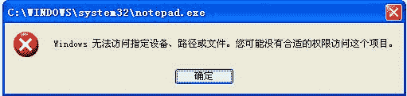

# 第一次 inline hook 蓝屏了。。。

> 原文：[`www.pediy.com/kssd/pediy10/93570.html`](https://www.pediy.com/kssd/pediy10/93570.html)

今天在调试自己编写的 `inline hook` 时，蓝屏了，然后用 `windbg` 调试 `dump` 文件，下面是 `windbg` 得到的信息：

```
PEB is paged out (Peb.Ldr = 7ffd500c).  Type ".hh dbgerr001" for details

PEB is paged out (Peb.Ldr = 7ffd500c).  Type ".hh dbgerr001" for details
```

我已经看了 `peb` 和 `_PEB_LDE_DATA` 结构，但是还是不明白上面的信息是什么意思。高手帮我看看，改怎么解决。

我是 `inline hook ObReferenceObjectByHandle()`，下面是我的代码：

```c
#include <ntddk.h>

#include <string.h>

extern POBJECT_TYPE *PsProcessType;

void close_write_protected()
{
  //cancel write protected
  __asm
  {
    CLI           
    MOV eax, CR0     
    AND eax, NOT 10000H  
    MOV CR0, eax
  }
}

void open_write_protected()
{
  __asm
  {
    MOV eax, CR0
    OR eax, 10000H
    MOV CR0, eax
    STI
  }   
}

//this routine unload current driver
VOID DriverUnload(IN PDRIVER_OBJECT DriverObject)
{
  KIRQL irql;
  unsigned char routine_head[5] = {0x8b,0xff,0x55,0x8b,0xec};
  irql = KeRaiseIrqlToDpcLevel();
  close_write_protected();
  //unload inline hook
  RtlCopyMemory(ObReferenceObjectByHandle,routine_head,5);
  open_write_protected();
  KeLowerIrql(irql);
  DbgPrint("inline hook success unload.");
  return;
}

int call_failed(
        IN HANDLE Handle,
        IN ACCESS_MASK DesiredAccess,
        IN POBJECT_TYPE ObjectType,
        IN KPROCESSOR_MODE AccessMode,
        OUT PVOID *Object,
        OUT POBJECT_HANDLE_INFORMATION HandleInfo
        )
{   
  KIRQL irql;
  //mov edi,edi
  //push ebp
  //mov ebp,esp
  unsigned char routine_head[5] = {0x8b,0xff,0x55,0x8b,0xec};
  //jmp address
  unsigned char jmp_code[5] = {0xe9,0x00,0x00,0x00,0x00};
  if(ObjectType == *PsProcessType)  //this object is a process
  {
    irql = KeRaiseIrqlToDpcLevel();
    close_write_protected();
    //unload inline hook
    RtlCopyMemory(ObReferenceObjectByHandle,routine_head,5);
    ObReferenceObjectByHandle(
        Handle,         
        DesiredAccess,
        ObjectType,
        AccessMode,
        Object,
        HandleInfo      
      );
    open_write_protected();
    KeLowerIrql(irql);
    if(_stricmp((const char *)Object+0x174,"notepad.exe") != 0)  //this process is protected
    {
      return 1;
    }
    else
    {
      *Object = (PVOID)-1;
      return 0;
    }     
  }
  return 0;
}

//jmp this routine
__declspec(naked) my_routine()
{
  __asm
  {
    mov edi,edi
    push ebp
    mov ebp,esp
    //parameter enter the stack
    push [ebp+0x1c]
    push [ebp+0x18]
    push [ebp+0x14]
    push [ebp+0x10]
    push [ebp+0xc]
    push [ebp+8]
    call call_failed
  }
}

//driver program entry routine
//rewrite ObReferenceObjectByHandle() start 5 byte for jmp address to my_routine
NTSTATUS DriverEntry(IN PDRIVER_OBJECT DriverObject,IN PUNICODE_STRING RegistryPath)
{
  int jmp_offset;  //a jmp operation from current to my_routine
  KIRQL irql;
  unsigned char jmp_code[5] = {0xe9,0x00,0x00,0x00,0x00};
  DriverObject -> DriverUnload = DriverUnload;  //set this driver unload routinue
  irql = KeRaiseIrqlToDpcLevel();
  close_write_protected();
  //inline hook ObReferenceObjectByHandle()
  jmp_offset = (char *)my_routine - (char *)ObReferenceObjectByHandle - 5;
  RtlCopyMemory(jmp_code+1,&jmp_offset,4);
  RtlCopyMemory(ObReferenceObjectByHandle,jmp_code,5);
  open_write_protected();
  KeLowerIrql(irql);
  DbgPrint("install inline hook success.");
  return STATUS_SUCCESS;
}
```

楼主还是没有看明白上一帖大家的提醒，第一次 `inline hook` 就在 `Ring0` 下玩……

代码错误至少包括：

1. `call_failed` 中没有判断 `ObReferenceObjectByHandle` 的调用是否成功，如果调用失败，`Object` 就不是有效的指针，下面对其的访问就可能导致错误
2. 没有判断 `ObjectType`，`ObReferenceObjectByHandle` 可以获取各种类型的 `Object`，如果不是进程 `Object` 的话，后面对 `Object` 的访问同样可能出错
3. `my_routine` 函数的内容不全，从这里看出楼主没有必要的 `Win32` 汇编基础，作为一个 `naked` 的函数，所有汇编代码都要你自己写，包括开始的 `push ebp` 和 `mov ebp, esp`，更包括 `call call_failed` 之后怎么根据情况处理参数最后 `jmp` 到原始函数，`sysnap` 原代码里也是有的，显然楼主又没有领会他的意思而把这部分代码随意抹掉了。
4. `call_failed` 调用 `ObReferenceObjectByHandle` 后都没有 `ObDereferenceObject`……

首先 `sysnap` 早年的这份代码本身就不是很完善，再加上楼主借鉴的时候不理解其意义而随意更改了和抹去了一些必要的内容，这样的代码是必蓝无疑，而且以楼主这样写代码的状态，在 `Ring0` 级恐怕蓝 `N` 多次也不一定能把错误全纠正过来。

楼主如果真要学好 `inline hook`，还是应该老老实实从 `Ring3` 开始，当你对 `inline hook` 足够熟悉，怎么摆弄它都可以的时候，你再考虑拓展到 `Ring0`，这样效率才会更高。

to `轩辕小聪`:

昨天在 `QQ` 群，`flowercode` 帮我解答了很久，最后他总结：

1. 你覆盖了 `ObRef` 前五个字节实现 `Hook`。（正确）
2. `my_routine()` 执行了原来的前五个字节。（正确）
3. `my_routine()` 调用了 `call_failed()`。（没问题）
4. `call_failed()` 里 `Unhook` 了 `ObRef`。（于是又变成了原来的前五个字节）
5. 你又调用了原版的 `ObRef`。（蓝屏）

我今天早上修改了下，准备晚上调试看看，因为我白天还要在公司写代码。

很谢谢你 2 个帖子都打了这么多汉字。

第 1 条，我确实没做判断，不过貌似不应该失败呀～ 不过我这样写确实不严谨，不过我现在写第一个 `inline hook`，只要可以实现功能就可以了，其它我没想。

第 2 条，我已经加上了处理其它对象类型的代码了，这个确实是很大的问题。

第 3 条，`push ebp` `mov ebp,esp` 我写了，不过 `my_routine()` 我没有接收 `call_failed()` 的返回值，因为我打算在 `call_failed()` 中把所有操作做完。

第 4 条，晕，原来还有一个销毁对象的函数要调用呀～ 之前看 `sysnap` 的代码也没看到，自己就不知道了，好的，我会添加进去的。我会慢慢把这个代码写好的。

引用: *最初由 **loqich** 发布*  这几点不对的 对调用频率高的函数 在多核 `cpu` 下不能使用覆盖的方式

这里先不考虑多核 `CPU` 下可能出错的问题，`FC` 说的是函数流程问题，这本来应该是楼主自己必须搞清楚的。在 `inline hook` 的函数里，整个流程自己一定要有清晰的概念（你的函数执行到哪一步了，执行到这一步的时候，原函数头部是处于什么样的状态，被 `Hook` 了，还是暂时解除 `Hook` 了，你什么时候要 `call` 进或 `jmp` 进原函数里面……），否则函数流程没有理清楚，就极容易出现你难以预料的错误。

引用: 第 1 条，我确实没做判断，不过貌似不应该失败呀～ 不过我这样写确实不严谨，不过我现在写第一个 `inline hook`，只要可以实现功能就可以了，其它我没想。

第 3 条，`push ebp` `mov ebp,esp` 我写了，不过 `my_routine()` 我没有接收 `call_failed()` 的返回值，因为我打算在 `call_failed()` 中把所有操作做完。

1. 为什么不可能失败？你调用前没有对参数作任何判断，你就不能说调用一定成功。另外，你要的的确只是要实现功能就可以了，但是在 `Ring0`，只要一点错误就很可能蓝屏（尽管有时这个错误跟你的 `inline hook` 功能实现无关），因此你在 `Ring0` 玩，这样情况可能会遇到 `N` 次，这样的干扰不利于你弄清楚 `inline hook` 本身。这也是我们几次劝告希望你先从 `Ring3` 开始的原因。
2. 你打算在 `call_failed()` 中完成，但是实际上你没有完成，你还是得仔细看看 `sysnap` 的原来的代码的流程，`call_failed()` 只是确定是否是有保护的进程，当然你在 `call_failed()` 中顺便再根据是否要保护来修改 `Object` 那是可以的，但是 **最后你回到 `my_routine` 之后，还是要 `jmp` 到原 `ObRef` 五个字节之后的代码继续执行**，这是 `sysnap` 有而你没有的。
3. `sysnap` 早年的这份代码，本身就有不完善的地方，如反复 `hook` 和 `unhook` 等等。

我看光讲楼主一下子是不会明白的，特别是 `inline hook` 不要老是重复 `HOOK` 和 `UNHOOK` 的话，应该怎么做。

所以干脆现写了一个同样功能的驱动，同样 `inline hook ObReferenceObjectByHandle`，同样是改前面五字节，同样是使用改 `CR0` 的方法去掉写保护，同样是阻止对 `notepad.exe` 进程 `EPROCESS` 的访问。

但是替代函数流程不完全一样，当判断访问的是 `notepad.exe` 进程时，替代函数返回 `STATUS_ACCESS_DENIED`。

替代函数进入原始函数不需要使用重复多次的 `HOOK` 和 `UNHOOK`。

源码、`sys`、`pdb` 都在压缩包里了，用 `Kmdkit` 写的，楼主如果看不懂源代码也没关系，或者 `IDA` 下分析一下驱动文件，加载完后用 `windbg` 的 `Local Kernel Debug` 看一看 `ObReferenceObjectByHandle`。

效果：

加载驱动后，双击记事本图标，弹出如下错误框：



启动其他进程则正常。

说明：这个驱动目的是让楼主看看到底 `inline hook` 是怎么做的。`EPROCESS` 中 `ImageFileName` 偏移同样直接采用 `XP` 下的 `0x174`，因此不能移植到其他系统。

上传的附件

|  | `HookObRef.rar` |

引用: *最初由 **loqich** 发布*  ..一直不明白 为什么大家都不用 `PsGetProcessImageFileName` 这个函数呢。要硬编码偏移呢？

我也想用，但是我不清楚是不是 `2000` 也有这个函数，而且 `KmdKit` 的 `ntoskrnl.lib` 没有这个函数，要调用还要动态获取地址，所以索性硬编码了。

查了一下 `DDK` 里 `w2k` 和 `wxp` 的 `ntoskrnl.lib` 里都是有这个函数的，看来 `KmdKit` 里的太老了。

update:

把 `DDK` 里的 `ntoskrnl.lib` 替换掉 `KmdKit` 中老的版本，自己声明 `PsGetProcessImageFileName` 并调用，编译出来的版本见附件，功能一样。

上传的附件

|  | `HookObRef2.rar` |

我摸索了一下 `sysnap` 那份代码，流程大概如下。如果不对，还请各位指出来：

1. 代理函数以 `naked` 形式编写，并且函数体要用 `asm` 来实现，形式参数与 `ObRef` 相同。
2. 代理函数体中的开辟新栈帧并且调用过滤函数：

   ```
   push ebp
   mov ebp,esp
   ```
3. 然后使用 `push` 指令把实参入栈：

   ```
   push [...]
   push [...]
   ```
4. 现在就可以直接 `call` 过滤函数了
5. 过滤函数返回 `int`，并且代理函数根据这个 `int` 判断，是否正确调用原始 `ObRef`，过滤函数的形参与 `ObRef` 相同。
6. 首先判断用户所请求的 `Object` 是不是一个 `Process`。
7. 关闭写保护，改写 `ObRef` 前 5 字节为 `jmp address`。
8. 调用 `ObRef` 以获得用户想要的 `Object`，然后判断这个 `Object` 中的 `ImageFileName` 是不是要保护的进程。
9. 过滤函数返回 1 或 0 来告诉调用者是否正却调用 `ObRef`


引用: *最初由 `emc` 发布*

我摸索了一下 `sysnap` 那份代码，流程大概如下。如果不对，还请各位指出来：

1. 代理函数以 `naked` 形式编写，并且函数体要用 `asm` 来实现，形式参数与 `ObRef` 相同。
2. 代理函数体中的开辟新栈帧并且调用过滤函数：
   ```asm
   push ebp
   mov ebp, esp
   ```
3. 然后使用 `push` 指令把...

`sysnap` 的代理函数：

```
实现原函数的前面五个字节代码，也相当于开辟新栈帧；
将所有参数重新入栈并调用过滤函数：

过滤函数：
{
    若 ObjectType 不为 PsProcessType，直接返回 0；
    ObjectType 为 PsProcessType：
    {
        将 ObRef 的前五字节还原；
        调用 ObRef；
        判断 EPROCESS 的 ImageFileName 是否是 notepad.exe：
        {
            是：
            {
                重新将 ObRef 的前五字节改为 jmp address；
                return 1；
            }
            否：
            {
                重新将 ObRef 的前五字节改为 jmp address；
                return 0；
            }
        }
    }
}

判断过滤函数返回值：
为 0：
{
    直接跳到 ObRef 五个字节后的代码执行；
}
为 1：
{
    把 Handle 参数改为 -1，即无效句柄，以使调用失败；
    直接跳到 ObRef 五个字节后的代码执行；
}
```

其中红字部分，是一个替代函数要完整完成原函数功能所要做到的。蓝字部分则是一个 `UNHOOK` -> 调用原函数 -> 重新 `HOOK` 的过程。

to `轩辕小聪`:

谢谢你一直的关注与帮助，你分析的流程和我之前理解的很接近，而且我又对照了你的流程分析和 `sysnap` 的原始代码重新修改了我的代码，但是又一次蓝屏，大概看了下 `dump` 的分析，貌似和 `irql` 有关系，你帮我看下，我现在去 `google` 上熟悉下 `irql` 的知识。

to `achillis`:

教主兄，帮帮我啊。

最近的 `inline hook ObReferObjectByHandle()` 代码：

```c
#include <ntddk.h>
#include <string.h>

extern POBJECT_TYPE *PsProcessType;

//mov edi,edi
//push ebp
//mov ebp,esp

unsigned char routine_head[5] = {0x8b, 0xff, 0x55, 0x8b, 0xec};

//jmp address
unsigned char jmp_code[5] = {0xe9, 0x00, 0x00, 0x00, 0x00};

void close_write_protected()
{
    //cancel write protected
    __asm
    {
        CLI
        MOV eax, CR0
        AND eax, NOT 10000H
        MOV CR0, eax
    }
}

void open_write_protected()
{
    __asm
    {
        MOV eax, CR0
        OR eax, 10000H
        MOV CR0, eax
        STI
    }
}

//this routine unload current driver
VOID DriverUnload(IN PDRIVER_OBJECT DriverObject)
{
    KIRQL irql;
    irql = KeRaiseIrqlToDpcLevel();
    close_write_protected();
    //unload inline hook
    RtlCopyMemory(ObReferenceObjectByHandle, routine_head, 5);
    open_write_protected();
    KeLowerIrql(irql);
    DbgPrint("inline hook success unload.");
    return;
}

//this routine return 0 success run ObReferenceObjectByHandle()
//this routine return 1 failed run ObReferenceObjectByHandle()
int call_failed(
        IN HANDLE Handle,
        IN ACCESS_MASK DesiredAccess,
        IN POBJECT_TYPE ObjectType,
        IN KPROCESSOR_MODE AccessMode,
        OUT PVOID *Object,
        OUT POBJECT_HANDLE_INFORMATION HandleInfo
        )
{
    PEPROCESS process;
    KIRQL irql;
    //this object is a process
    if (ObjectType == *PsProcessType)
    {
        irql = KeRaiseIrqlToDpcLevel();
        close_write_protected();
        //Unload inline hook in ObReferenceObjectByHandle()
        RtlCopyMemory(ObReferenceObjectByHandle, routine_head, 5);
        //run the kernel routine
        ObReferenceObjectByHandle(Handle, DesiredAccess, ObjectType, AccessMode, &process, NULL);
        //install inline hook to ObReferenceObjectByHandle()
        RtlCopyMemory(ObReferenceObjectByHandle, jmp_code, 5);
        //this request point to notepad.exe
        if (_stricmp((char *) ((char *) process + 0x174), "notepad.exe") == 0)
            return 1;
        else
            return 0;
        open_write_protected();
        KeLowerIrql(irql);
    }
    else //this object not a process
    {
        return 0;
    }
}

//jmp this routine
__declspec(naked) my_routine(
              IN HANDLE  Handle,
              IN ACCESS_MASK  DesiredAccess,
              IN POBJECT_TYPE  ObjectType,
              IN KPROCESSOR_MODE  AccessMode,
              OUT PVOID  *Object,
              OUT POBJECT_HANDLE_INFORMATION  HandleInfor
              )
{
    __asm
    {
        mov edi, edi
        //create next stack for sub routine using
        push ebp
        mov ebp, esp
        //parameter enter the stack
        push [ebp+0x1c]
        push [ebp+0x18]
        push [ebp+0x14]
        push [ebp+0x10]
        push [ebp+0xc]
        push [ebp+8]
        //enter the routine
        call call_failed
        cmp eax, 1
        jz start_new
        mov eax, ObReferenceObjectByHandle
        add eax, 5
        jmp eax
    start_new:
        mov [ebp+8], -1
        mov eax, ObReferenceObjectByHandle
        add eax, 5
        jmp eax
    }
}

//in this routine install inline hook
NTSTATUS DriverEntry(IN PDRIVER_OBJECT DriverObject, IN PUNICODE_STRING RegistryPath)
{
    //this is offset of jmp to my routine
    int jmp_offset;
    KIRQL irql;
    //set current driver unload routine
    DriverObject->DriverUnload = DriverUnload;
    irql = KeRaiseIrqlToDpcLevel();
    close_write_protected();
    //count and get to my_routine offset
    jmp_offset = (char *) my_routine - (char *) ObReferenceObjectByHandle - 5;
    //create the jmp offset to jmp_offset
    RtlCopyMemory(jmp_code + 1, &jmp_offset, 4);
    //inline hook ObReferenceObjectByHandle routine
    RtlCopyMemory(ObReferenceObjectByHandle, jmp_code, 5);
    open_write_protected();
    KeLowerIrql(irql);
    DbgPrint("install inline hook success.");
    return STATUS_SUCCESS;
}
```

`windbg` 分析的 `dump` 信息：

```
DRIVER_IRQL_NOT_LESS_OR_EQUAL (d1)

An attempt was made to access a pageable (or completely invalid) address at an
interrupt request level (IRQL) that is too high.  This is usually
caused by drivers using improper addresses.

If kernel debugger is available get stack backtrace.

Arguments:

Arg1: 0041f4a4, memory referenced
Arg2: 00000002, IRQL
Arg3: 00000000, value 0 = read operation, 1 = write operation
Arg4: 0041f4a4, address which referenced memory

Debugging Details:

------------------
PEB is paged out (Peb.Ldr = 7ffde00c).  Type ".hh dbgerr001" for details
PEB is paged out (Peb.Ldr = 7ffde00c).  Type ".hh dbgerr001" for details
READ_ADDRESS:  0041f4a4
CURRENT_IRQL:  2
FAULTING_IP:

+41f4a4
0041f4a4 ??              ???

PROCESS_NAME:  Dbgview.exe
DEFAULT_BUCKET_ID:  DRIVER_FAULT
BUGCHECK_STR:  0xD1
LAST_CONTROL_TRANSFER:  from 0041f4a4 to 804e287f
FAILED_INSTRUCTION_ADDRESS:

+41f4a4
0041f4a4 ??              ???

STACK_TEXT:

f318c854 0041f4a4 badb0d00 0012f370 00000000 nt!KiTrap0E+0x233
WARNING: Frame IP not in any known module. Following frames may be wrong.
0012f354 00000000 00000000 00000000 00000000 0x41f4a4

STACK_COMMAND:  kb

FOLLOWUP_IP:

nt!KiTrap0E+233
804e287f f7457000000200   test    dword ptr [ebp+70h],20000h

SYMBOL_STACK_INDEX:  0

SYMBOL_NAME:  nt!KiTrap0E+233

FOLLOWUP_NAME:  MachineOwner

MODULE_NAME: nt

IMAGE_NAME:  ntoskrnl.exe

DEBUG_FLR_IMAGE_TIMESTAMP:  42250ff9

FAILURE_BUCKET_ID:  0xD1_CODE_AV_BAD_IP_nt!KiTrap0E+233

BUCKET_ID:  0xD1_CODE_AV_BAD_IP_nt!KiTrap0E+233

Followup: MachineOwner
```

看起来是 `DbgPrint` 的时候出了问题，`IRQL`==2，`KeLowerIrql` 没效果？把 `KeRaiseIrqlToDpcLevel` 和 `KeLowerIrql` 注释掉试试。

引用: *最初由 `emc` 发布* to `轩辕小聪`：

呵呵，我们都大意了，犯了一个最常见的错误。

`open_write_protected();`
`KeLowerIrql(irql);`

上面的 2 条代码永远不可能被执行，所以我在 `return` 之前调用这 2 条就可以了。问题已经解决了，谢谢你的帮助。

请看：`http://bbs.pediy.com/showthread.php?p=657507#post657507`

倒，还真没注意你在之前已经 `return` 了……

一定要注意，去掉写保护与加上写保护，以及提 `IRQL` 与还原 `IRQL` 的操作，一定要一一对应，绝不能有前无后……
