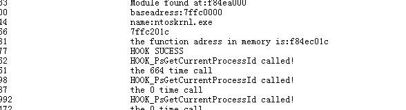

# 学习笔记之钩住驱动程序导入表

> 原文：[`www.pediy.com/kssd/pediy10/62316.html`](https://www.pediy.com/kssd/pediy10/62316.html)

这篇文章算是我的学习笔记吧,贴之与菜鸟们一起学习.因为偶也是菜鸟,很多概念性的,技术性的讲得不好还请矫正,好了,开始:

当我们的程序调用一个 API 时候,比如 `CreateWindowEx`,在编译的时候生成代码

```
call dword ptr
```

`[__imp__CreateWindowExA@48]`,这个 API 的地址就在`__imp__CreateWindowExA@48`中,在程序加载运行的时候,`__imp__CreateWindowExA@48`代表`CreateWindowEx`的内存地址,于是如果程序运行时候,我们把`__imp__CreateWindowExA@48`改成自己函数的地址,那当程序调用`CreateWindowEx`,实际上是跳到了我们的函数里,这就是 `IAT HOOK` 的基本思想,

这篇文章是钩住驱动程序的 `IAT`,不过这之前,先看一下用户态于 `IAT` 有关的一些信息,这有利于菜鸟理解接下来的驱动代码,(我也是菜鸟)因为驱动程序和一般的 `EXE` 程序一样,都是 `PE` 格式

下面的这段用户代码基本是遍历遍历本程序的导入函数,然后打出来

```c
#include <windows.h>

#include <stdio.h>

#include <imagehlp.h>

#pragma comment(lib,"imagehlp.lib")

int main()

{

  char *dll_name[30];

    char* function_name[30];

  HMODULE hInstance;

    int outloop_index=0;

    PIMAGE_THUNK_DATA thunk;

  hInstance=GetModuleHandle(NULL);

    IMAGE_DOS_HEADER *dosheader= (IMAGE_DOS_HEADER *)hInstance;

    IMAGE_NT_HEADERS *ntheader= (IMAGE_NT_HEADERS *)((DWORD)hInstance + dosheader->e_lfanew);

    IMAGE_DATA_DIRECTORY *pSymbolTable= &ntheader->OptionalHeader.DataDirectory[1];

    IMAGE_IMPORT_DESCRIPTOR *pImportDesc =(IMAGE_IMPORT_DESCRIPTOR *)((DWORD)hInstance + pSymbolTable->VirtualAddress);

        printf("the module is load at:%d\n",hInstance);

      printf("the pointer to ImportDesc is: %d\n",pImportDesc);

   while(pImportDesc ->FirstThunk)

{

       dll_name[outloop_index]=(char*)((PBYTE)hInstance+pImportDesc->Name);

     printf("------%s-------\n",dll_name[outloop_index]);

     outloop_index++;

    thunk=( PIMAGE_THUNK_DATA)((PBYTE)hInstance+ pImportDesc->OriginalFirstThunk);

    int x=0;

    while(thunk->u1.Function)

    {

        function_name[x]=(char*)((PBYTE)hInstance +

            ( DWORD)thunk->u1.AddressOfData+2);

    printf("%s\n",function_name[x]);

    x++;

    thunk++;

    }

   pImportDesc++;

}

   return 0 ;

}
```

好了,这里的 `hInstance` 是由 `hInstance=GetModuleHandle(NULL)`获得,`hInstance` 表示当前程序装载的基址,这个基地址很重要,没有它就不能正确定位调用函数在内存中的地址,

在驱动程序,这里我们假使要 `HOOK` `C:\\WINDOWS\\SYSTEM32\\test_sysnap.sys`, `test_sysnap.sys`

这个程序很简单,就是用 `DPC` 定时输出一个字符串:

```c
VOID Myroutine(IN PKDPC Dpc,IN PVOID DeferredContext,IN PVOID SystemArgument1,IN PVOID SystemArgument2)

{

    HANDLE id=PsGetCurrentProcessId();

    DbgPrint("the Current Process Id is:%x \n",id);

}
```

嗯,那 `test_sysnap.sys` 就一定导入了 `PsGetCurrentProcessId`,我们就是要 `IAT HOOK` 这个函数,这样以后系统调用 `Myroutine` 执行到 `PsGetCurrentProcessId`,都会转到我们自己的程序里运行

在讲用户程序的时候,我们说过 `hInstance` 很重要,那驱动程序的 `IAT HOOK`,我们也需要知道 `test_sysnap.sys` 被加载在驱动程序里的什么地址,这里我们用 `ZwQuerySystemInformation` 这个函数就可以获得,前提,这个函数学没有被 `HOOK`,这里我们就是这么假使滴,好了,先运行 `test_sysnap.sys`,代码在后面在最后-----------------------------------------------------------------------------------------------------------------------

再看下面的驱动程序

```c
#include "ntddk.h"

#include "hookiat.h"

#pragma comment(lib,"ntdll.lib")

PVOID GetDriverBaseAdress(char* driverName)

{

  ULONG size,index;

  PULONG buf;

  PSYSTEM_MODULE_INFORMATION module;

  PVOID driverAddress=0;

  ZwQuerySystemInformation(SystemModuleInformation,&size, 0, &size);

  if(NULL==(buf = (PULONG)ExAllocatePool(PagedPool, size)))

  {

    DbgPrint("failed alloc memory failed  \n");

    return 0;

  }

  status=ZwQuerySystemInformation(SystemModuleInformation,buf, size , 0);

  if(!NT_SUCCESS( status ))

  {

       DbgPrint("failed  query\n");

     return 0;

  }

  module = (PSYSTEM_MODULE_INFORMATION)(( PULONG )buf + 1);

  for (index = 0; index < *buf; index++)

  if (_stricmp(module[index].ImageName + module[index].ModuleNameOffset, driverName) == 0)

  {

    driverAddress = module[index].Base;

        DbgPrint("Module found at:%x\n",driverAddress);

  }

  ExFreePool(buf);

  return driverAddress;

}

VOID Unload(PDRIVER_OBJECT  DriverObject)

{

    DbgPrint("Unload Called \r\n");

}

NTSTATUS DriverEntry(PDRIVER_OBJECT DriverObject, PUNICODE_STRING str)

{

  PVOID base = NULL;

        base = GetDriverBaseAdress("test_sysnap.sys.sys");

        DriverObject->DriverUnload = Unload;

  return STATUS_SUCCESS;

}
```

编译一下,确实真实 `DbgPrint` 了 `test_sysnap.sys` 加载的地址,/////好了,我们的目标是找到 `call dword ptr [__imp__PsGetCurrentProcessId@XX]`,修改之

首先我们要定位 `IAT`,找出 `PsGetCurrentProcessId` 在其中的 `RAV////`,最后目的就是得到`DWORD*( (BYTE*)base + Thunk ) + RVA`,修改之,这里 `base` 已经得到了,接下来就是 `Thunk` 和 `RVA`,

首先我们用 `ZwOpenFile`,`ZwCreateSection`,`ZwMapViewOfSection` 几个函数来映射 `test_sysnap.sys`,其实跟方法就是跟用户程序使用 `CreateFile`,`CreateFileMapping`,`MapViewOfFile` 一样

```c
PVOID CreateMapFileAndReturnBaseAddress(PUNICODE_STRING pDriverName)

{

  HANDLE  hFile;

//HANDLE  hSection 看需要在别的地方 ZWclose(hSection),若不用.那定义成局部变量就可以了,或者做为数参数传递

    char *pszModName;

    PVOID MapFileBaseAddress = NULL;

  SIZE_T size=0;

    IO_STATUS_BLOCK stataus;

    OBJECT_ATTRIBUTES oa ;

  InitializeObjectAttributes(

    &oa,

  pDriverName,

    OBJ_CASE_INSENSITIVE,

    0,

    0

    );

ZwOpenFile(&hFile,

       FILE_EXECUTE | SYNCHRONIZE,

       &oa,

       &stataus,

       FILE_SHARE_READ,

       FILE_SYNCHRONOUS_IO_NONALERT);

  oa.ObjectName = 0;

 ZwCreateSection(&hSection,

        SECTION_ALL_ACCESS,

        &oa,

        0,

        PAGE_EXECUTE,

        SEC_IMAGE,

        hFile);

 ZwMapViewOfSection(hSection,

           PsGetCurrentProcessId(),

           &MapFileBaseAddress,

           0,

           1024,

           0,

           &size,

           ViewShare,

           MEM_TOP_DOWN,

           PAGE_READWRITE);

ZwClose(hFile);

DbgPrint("baseadress:%x\n",MapFileBaseAddress);

return MapFileBaseAddress;

}
```

把这个函数加上去, `DriverEntry` 添加:

```c
UNICODE_STRING driverName;

RtlInitUnicodeString(&driverName, L"\\Device\\HarddiskVolume1\\Windows\\System32\\drivers\\test_sysnap.sys");

    BaseAddress= CreateMapFileAndReturnBaseAddress(&driverName);

DbgPrint("MapFile Return Address:%x",BaseAddress);
```

编译一下,运行后没问题,`GOOD`,继续,到这里我们已经获得了 `MapFileBaseAddress`,接着就是用它来获得 `ImageImportDescriptor`

```c
DWORD GetImageImportDescriptorPointer(IN OUT HANDLE* hMod, IN OUT IMAGE_IMPORT_DESCRIPTOR** pImportDesc)

  {

  IMAGE_DOS_HEADER * dosheader;

  IMAGE_OPTIONAL_HEADER * optheader;

    PVOID BaseAddress = NULL;

    UNICODE_STRING driverName;

  RtlInitUnicodeString(&driverName, L"\\Device\\HarddiskVolume1\\Windows\\System32\\drivers\\test_sysnap.sys");

    BaseAddress=  CreateMapFileAndReturnBaseAddress(&driverName);

    *hMod = BaseAddress;

  dosheader= (IMAGE_DOS_HEADER *)BaseAddress;

    optheader =(IMAGE_OPTIONAL_HEADER *) ((BYTE*)BaseAddress+dosheader->e_lfanew+24);

    *pImportDesc = (IMAGE_IMPORT_DESCRIPTOR *)((BYTE*)dosheader+ optheader->DataDirectory[IMAGE_DIRECTORY_ENTRY_IMPORT].VirtualAddress);

    if( NULL == (*pImportDesc)) return 0;

  else

    return 1;

    DbgPrint("DataEntryAddress:%x\n",pImportDesc);

  }
```

照样把该函数学添加上去,自己加点测试的,编译一下,运行没什么问题,这样我们就得到了

`MapFileBaseAddress` 和 `ImageImportDescriptor`,接着就是用他们来找 `Thunk` 和 `RVA`

```c
DWORD GetFunctionThunkAndRav(IN char* lpFunctionName, IN char* lpFunctionLibrary, OUT DWORD* pThunk, OUT DWORD* pRVA) 

{

  HANDLE   hMod;

  IMAGE_IMPORT_DESCRIPTOR * pImportDesc;

  IMAGE_THUNK_DATA* thunk;

  char *pszModName;

  DWORD firstThunkList;

    DWORD ret;

  BOOLEAN isOrdinal;

    BOOLEAN foundIt;

  int x=0;

    SIZE_T size=0;

  ret=GetImageImportDescriptorPointer(&hMod,&pImportDesc);

  if(ret==0)

  {

       DbgPrint("GetImageImportDescriptorPointer return NULL");

    return 0;

  }
```


```
  //遍历 IMPORT DIRECTORY TABLE,找到 ntoskrnl.exe 对应的 IMAGE_IMPORT_DESCRIPTOR  

  while (pImportDesc->FirstThunk)  

  {     
  
    pszModName = (PSTR) ((PBYTE) hMod + pImportDesc->Name);  

    if (_stricmp(pszModName, lpFunctionLibrary) == 0 )  

    {  
      foundIt = TRUE;  
            DbgPrint("name:%s\n",pszModName);  
      break;  
    }  
    pImportDesc++;  

  }  

  if(foundIt==FALSE)  

  {  
    return 0;  

  }  

  //得到 ntoskrnl.exe 的 IMAGE_IMPORT_DESCRIPTOR,就可以其 IAT,IAT 中就可以找到导出函数了  

  thunk = (IMAGE_THUNK_DATA*) ( (BYTE*)hMod + pImportDesc->OriginalFirstThunk);  

    firstThunkList = (DWORD)((PBYTE)hMod + pImportDesc->FirstThunk);  

    foundIt = FALSE;  

while(thunk->u1.Function)  

  {  

    isOrdinal = 0;  

    //IMAGE_THUNK_DATA 其实就是一个 DWORD,它要么是 Ordinal,要么是 AddressOfData  

    if(thunk->u1.Function >= 0x01000000) isOrdinal = TRUE;  

    if(!isOrdinal) // 以名字到处而不是序号  

    {  

      //IMAGE_IMPORT_BY_NAME  

      char* functionName = (char*) ( (BYTE*)hMod + (DWORD)thunk->u1.AddressOfData + 2 );  

      if (_stricmp(functionName, lpFunctionName) == 0 )  

      {  
        *pThunk = pImportDesc->FirstThunk;  

        *pRVA = x;  

        DbgPrint("%x",( DWORD *)((PBYTE)hMod +pImportDesc->FirstThunk)+x);  

          ZwClose(hSection);  

        return 1;  

      }  

    }  

    if(isOrdinal)  

    {  

      ZwClose(hSection);  

      return (DWORD) NULL;  

    }  

    x++;  

    thunk++;  

    firstThunkList++;  

  }  

if(foundIt==FALSE)  

  {  

    ZwClose(hSection);  

    return 0;  

  }  

  ZwClose(hSection);  

  return 0;  

}  
```

添加这个函数，稍微测试下，没什么问题，好的，这里我们已经得到`(DWORD*)( (BYTE*)base + Thunk ) + RVA`，接着就是最后的工作，修改之  

`g_FunctionInMemory = (DWORD*)( (BYTE*)base + Thunk ) + RVA;`  

.  

.   

```
_asm  

  {  

    CLI          

    MOV  EAX, CR0     

    AND EAX, NOT 10000H  

    MOV  CR0, EAX     

  }  

  *(PVOID*)g_FunctionInMemory = MyPsGetCurrentProcessId;  

    DbgPrint("HOOK SUCESS");  

  _asm  

  {  

    MOV  EAX, CR0     

    OR  EAX, 10000H       

    MOV  CR0, EAX       

    STI           

  }  
```

`test_sysnap.sys` 的代码可以在 `http://hi.baidu.com/sysnap` 找到  

到此为止，我们的工作就完成了，结果就是这样:  



上传的附件

|  || 钩住驱动程序导入表.rar  

 |
