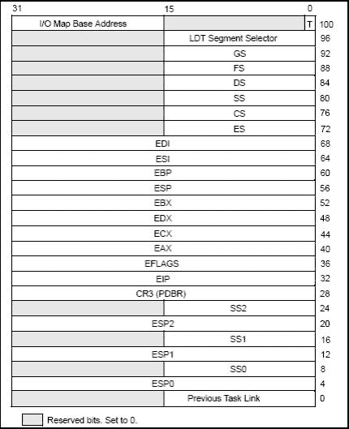
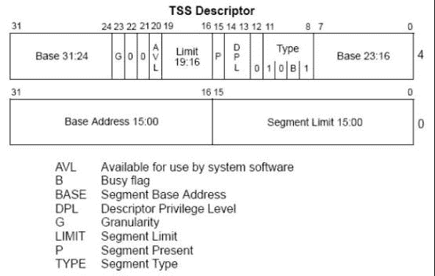
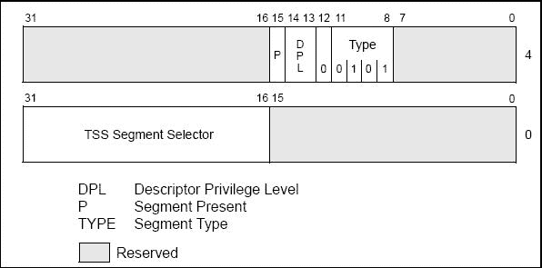
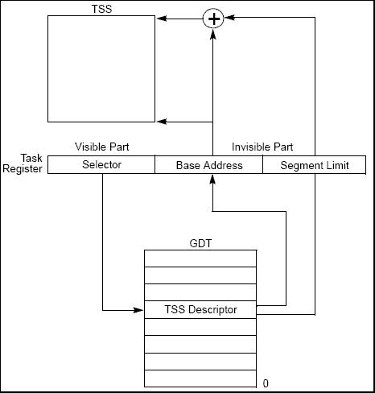
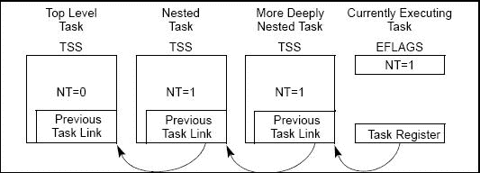
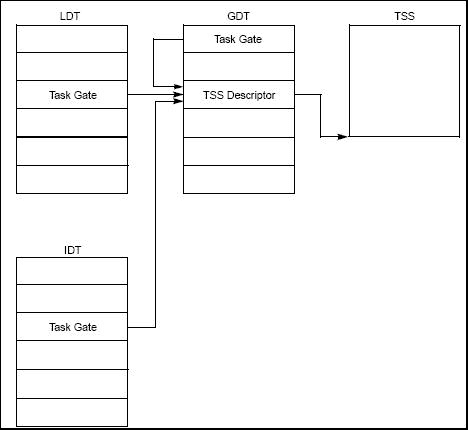

# rootkit ring3 进 ring0 之门系列\[三\] -- 任务门

> 原文：[`www.pediy.com/kssd/pediy10/62510.html`](https://www.pediy.com/kssd/pediy10/62510.html)

今天我们一起学习下任务门。为了便于理解原理，首先来看几个数据结构。

处理器为了处理任务，定义了 5 个相关的数据结构。

1) `Task-state segment (TSS)`

2) `TSS descriptor`

3) `Task-gate descriptor`

4) `Task register`

5) `NT flag in the EFLAGS register`

## 1。Task-state segment (TSS)



我们看到这是 `TTS` 的最基本的结构，在它的后面，操作系统还可以另外增加若干字节以存放一些额外的数据，不过 CPU 只使用最基本的共 104 字节的空间。从上面的结构中我们可以看见，里面几乎保存了一个进程运行所需要使用的 CPU 的所有信息。

从上表中，我们知道了 CPU 将当前任务的相关信息保存在什么地方，不过这个 `TSS` 实在是太大了！它不可能放在 CPU 中，而只能被放在内存中，因此我们还需要一个指针指向内存中的 `TSS`，这样 CPU 就可以通过这个指针找到相应的 `TSS` 了，这样的指针有两种，我们分别将其称为“`TSS 描述符`”和“`任务门`”。

## 2。TSS descriptor



上图就是“`TSS 描述符`”结构，从图中我们可以看见，它给出了一个 `TSS` 所在的内存位置以及 `TSS` 的大小。这里需要注意的是，从前面的 `TSS` 基本结构图中我们可以知道一个 `TSS` 基本结构最小不能小于 104 字节，因此，这里的 `TSS` 的大小限制最小是 103（`TSS` 的最小结构的大小 104 - 1）。另外还要特别引起注意的就是图中的“`B`”位，这一标志位用来标志一个任务是否是忙任务。如果 `B` 位被清零，那么我们就说这个任务是一个“可用任务”，如果 `B` 位被置 1，我们说这个任务是一个“忙任务”，所谓“忙任务”是指它正在被运行，或者它是一个被任务链链接起来的任务，明白“`B`”位的用处在实际的编程序非常重要，但在这里不打算详加描述，把详细的描述留给下面的文字完成。

从上图我们可以看出，一个“`TSS 描述符`”指代了一个 `TSS` 结构，按理来说，这已经完全足够使用了，但是用于 Intel 允许在中断的时候也可以进行任务切换，这样，我们就可以把中断处理程序作为一个专门的任务，然而，中断描述符表中存放的只能是门描述符，而上面的“`TSS 描述符`”并不是一种门描述符，因此，它不能被放在中断描述符表中，于是 Intel 又定义了一种“`任务门`”，它其实指向的是一个“`TSS 描述符`”，但由于它是一种门描述符，因此，它可以被放在中断描述符表中，这样当发生中断的时候，CPU 通过中断号查询中断描述符表，得到相应的门描述符，如果发现它是一个“`任务门`”，则通过它找到相应的“`TSS 描述符`”，再通过相应的“`TSS 描述符`”找到相应的“`TSS 结构`”。其实，我总觉得定义“`任务门`”有点多此一举，但 Intel 已经这样做了，我们也就不得不照办。下面，我们就来看看“`任务门`”的结构：

## 3。Task-gate descriptor



上图就是“`任务门`”的结构，其中被用到的地方极少，Intel 真是浪费啊！`P` 位与 `DPL` 位与前面的“`TSS 描述符`”中的相应位的作用是一样的，这里就不多述说了，余下就说说“`TSS 选择符`”吧。在操作系统中，`TSS` 描述符由于会被 CPU、中断服务程序、其它进程访问，因此它只能放在“`全局描述符表`”中。因此我们需要用一个索引来指出“`TSS 描述符`”在`全局描述符表`中的位置，这样我们就可以找到相应的“`TSS 描述符`”了，这个索引就被称之为“`TSS 选择符`”。

## 4。Task register



在 `windows` 多任务操作系统中，每个任务都有自己的任务段 `TSS`，当任务实现转换的时候，当前任务的寄存器值和其他相关信息都会保存到自己对应的任务段中，然后从将要运行的任务的任务段中读出数据，用来初始化寄存器。这么多的任务，CPU 怎样知道哪个“`TSS 描述符`”所指代的任务是当前正在执行中的当前任务呢？在 CPU 内部有一个 `TR`（任务寄存器），它里面存放的就是当前正在执行的任务的“`TSS 描述符`”，在发生任务切换的时候，CPU 也会自动将新任务的“`TSS 描述符`”载入其中。

## 5。NT flag in the EFLAGS register

`NT` (`Nested Task`): 控制中断返回指令 `IRET`, 它宽度为 1 位。`NT=0`, 用堆栈中保存的值恢复 `EFLAGS`，`CS` 和 `EIP` 从而实现中断返回；`NT=1`，则通过任务切换实现中断返回。



通过上面介绍，我们的思路便有了。

1) 定义一个内核函数，定义一个全局变量 `TSS`，并初始化它，让 `TSS.EIP` 指向定义的内核函数。内核函数中需要注意使用 `IRETD` 返回。

2）在 `GDT` 中创建一个 `TSS` 描述符，用来描述全局变量 `TSS`。

3）在 `GDT` 或者 `IDT` 中建立任务门，指向 `TSS` 描述符。

4) 在 `RING3` 程序中调用任务门。如果任务门是在 `GDT` 中，则使用类似调用门调用的方法，

   如果任务门在 `IDT` 中，则是用类似中断门调用的方法。

原理图如下：



下面我们根据我们的思路进行些试验。

实验 1：在实验中，我们定义了一个内核函数

```
MyTaskGateFunction proc
    cli
  invoke DbgPrint, $CTA0("MyTaskGate calling...\n")
  iretd

MyTaskGateFunction endp
```

然后，我们定义了

```
myTss TSS <?>
```

接下来，我们在 `GDT` 中找一个空闲位置添加 `tss` 描述符。

```
AddTSSInGDT proc uses  ebx esi edi
   LOCAL dessel:dword
  pushfd
    pushad
  push esi
  sgdt [esp-2]
  pop esi
  mov eax,8
  .while eax < GDT_LIMIT
       lea edx,[esi+eax]
       assume edx:ptr DESC
       test [edx].ATTRIB,80h
      .if ZERO?
         mov [edx].LIMITL,MyTssLimit
         mov [edx].LIMITH,0
         mov [edx].ATTRIB,89h
         lea ebx,myTss
         mov [edx].BASEL,bx
         shr ebx,16
         mov [edx].BASEM,bl
         mov [edx].BASEH,bh   
         mov dessel,eax    
          .break
     .endif    
      assume edx:nothing
      add eax,8
  .endw
  popad
    popfd
    mov eax,dessel
  ret

AddTSSInGDT endp
```

接下来，需要添加任务门描述符，由于任务门可以在 `idt`，`gdt` 和 `ldt` 中，`windowxp` 中不含 `ldt`。

因此我们可以有两种方法添加任务门。

```
AddTaskGateInIDT proc
  push ebx
  push ecx
  sidt [esp-2]
  pop ecx
  mov eax,0
  .while eax < IDT_LIMIT
       lea edx,[ecx+eax]
       assume edx:ptr GATE
       test [edx].GTYPE,80h
      .if ZERO?
         cli
         mov bx,myTssSel
         mov [edx].OFFSETL,0
         mov [edx].SELECTOR,bx
         mov [edx].DCOUNT,0
         mov [edx].GTYPE,GATE_TYPE
         mov [edx].OFFSETH,0    
         sti   
          .break
     .endif    
      assume edx:nothing
      add eax,8
  .endw
  pop ebx
  ret  

AddTaskGateInIDT endp

AddTaskGateInGDT proc
  push ebx
  push ecx
  sgdt [esp-2]
  pop ecx
  mov eax,8
  .while eax < GDT_LIMIT
       lea edx,[ecx+eax]
       assume edx:ptr GATE
       test [edx].GTYPE,80h
      .if ZERO?
         cli
         mov bx,myTssSel
         mov [edx].OFFSETL,0
         mov [edx].SELECTOR,bx
         mov [edx].DCOUNT,0
         mov [edx].GTYPE,GATE_TYPE
         mov [edx].OFFSETH,0    
         sti   
          .break
     .endif    
      assume edx:nothing
      add eax,8
  .endw
  pop ebx
  ret  

AddTaskGateInGDT endp
```

剩下的事情，我们就是根据任务门添加的位置进行调用了。

如果任务门添加在 `GDT` 中，则可以用下面的调用

```
#include "stdio.h"

void main()
{
    short farcall[3] = {0};
    farcall[2] = 0x4b;  //假设任务门在 GDT 中的索引是 0x48,  0x48 OR RPL (03H) =  4BH
    _asm call fword ptr[farcall];
}
```

如果在 `IDT` 中，调用方式为：

```
#include "stdio.h"

void main()
{
   //如果在 idt 中的索引值为 0x100，由于每个中断向量占 8 字节，因此中断号=0x100 / 8，
   //即 0x20。
    _asm int 0x20;
}
```

我们按照这个思路写出代码，然后测试，发现我们的程序就像“三精口服液，都是蓝瓶的”。

开始找原因了，我们对照下系统的 `TSS` 的值，`TSS` 描述符和 `tss gate`。

步骤一、`GDT` 表中导出的数据，在其中发现有 4 个 `TSS` 段。第一个是用于当前任务切换的。处于 `busy` 状态。

```
Sel.  Base       Limit     DPL  P    G     Description
-------------------------------------------------------------------------------
0008  00000000   FFFFFFFF   0   P    4Kb   Execute/Read, accessed
0010  00000000   FFFFFFFF   0   P    4Kb   Read/Write, accessed
0018  00000000   FFFFFFFF   3   P    4Kb   Execute/Read, accessed
0020  00000000   FFFFFFFF   3   P    4Kb   Read/Write, accessed
**0028  80042000   000020AB   0   P    1b    32-Bit TSS (Busy)**
0030  FFDFF000   00001FFF   0   P    4Kb   Read/Write, accessed
0038  7FFDF000   00000FFF   3   P    1b    Read/Write, accessed
0040  00000400   0000FFFF   3   P    1b    Read/Write
0048  00000000   00000000   0   NP   1b    Reserved
**0050  8054A500   00000068   0   P    1b    32-Bit TSS (Available)**
**0058  8054A568   00000068   0   P    1b    32-Bit TSS (Available)**
0060  00022F30   0000FFFF   0   P    1b    Read/Write, accessed
0068  000B8000   00003FFF   0   P    1b    Read/Write
0070  FFFF7000   000003FF   0   P    1b    Read/Write
0078  80400000   0000FFFF   0   P    1b    Execute/Read
0080  80400000   0000FFFF   0   P    1b    Read/Write
0088  00000000   00000000   0   P    1b    Read/Write
0090  00000000   00000000   0   NP   1b    Reserved
0098  00000000   00000000   0   NP   1b    Reserved
**00A0  89AA2008   00000068   0   P    1b    32-Bit TSS (Available)**
00A8  00000000   00000000   0   NP   1b    Reserved
```

下面还有三个，接下来分别看看这个任务状态段。这三个任务状态段，大小只有 `0x68` 字节

`TSS` 的值如下：

```
lkd>  dt _ktss 8054A500  nt!_KTSS
   +0x000 Backlink          : 0
   +0x002 Reserved0         : 0
   +0x004 Esp0             : 0x80547500
   +0x008 Ss0              : 0x10
   +0x00a Reserved1        : 0
   +0x00c NotUsed1         : [4] 0
   +0x01c CR3              : 0xe84000
   +0x020 Eip              : 0x8053fa5e
   +0x024 EFlags           : 0
   +0x028 Eax              : 0
   +0x02c Ecx              : 0
   +0x030 Edx              : 0
   +0x034 Ebx              : 0
   +0x038 Esp              : 0x80547500
   +0x03c Ebp              : 0
   +0x040 Esi              : 0
   +0x044 Edi              : 0
   +0x048 Es               : 0x23
   +0x04a Reserved2        : 0
   +0x04c Cs               : 8
   +0x04e Reserved3        : 0
   +0x050 Ss               : 0x10
   +0x052 Reserved4        : 0
   +0x054 Ds               : 0x23
   +0x056 Reserved5        : 0
```


`+0x058 Fs : 0x30`  
`+0x05a Reserved6 : 0`  
`+0x05c Gs : 0`  
`+0x05e Reserved7 : 0`  
`+0x060 LDT : 0`  
`+0x062 Reserved8 : 0`  
`+0x064 Flags : 0`  
`+0x066 IoMapBase : 0x20ac`  
`+0x068 IoMaps : [1] _KiIoAccessMap`  
`+0x208c IntDirectionMap : [32] "T???"`

其中 `eip` 指向 `0x8053fa5e`，该段对应于 `IDT` 中的 `08` 任务门。异常处理函数：`KiTrap08`。

```
lkd> u 0x8053fa5e

nt!KiTrap08:

8053fa5e fa              cli
8053fa5f 8b0d3cf0dfff    mov     ecx,dword ptr ds:[0FFDFF03Ch]
8053fa65 8d4150          lea     eax,[ecx+50h]
8053fa68 c6400589        mov     byte ptr [eax+5],89h
8053fa6c 9c              pushfd
8053fa6d 812424ffbfffff  and     dword ptr [esp],0FFFFBFFFh
8053fa74 9d              popfd
8053fa75 a13cf0dfff      mov     eax,dword ptr ds:[FFDFF03Ch]
```

## 二、`lkd> dt _ktss 8054A568`

`nt!_KTSS`

```
+0x000 Backlink         : 0
+0x002 Reserved0        : 0
+0x004 Esp0             : 0x80547500
+0x008 Ss0              : 0x10
+0x00a Reserved1        : 0
+0x00c NotUsed1         : [4] 0
+0x01c CR3              : 0xe84000
+0x020 Eip              : 0x8053e98c
+0x024 EFlags           : 0
+0x028 Eax              : 0
+0x02c Ecx              : 0
+0x030 Edx              : 0
+0x034 Ebx              : 0
+0x038 Esp              : 0x80547500
+0x03c Ebp              : 0
+0x040 Esi              : 0
+0x044 Edi              : 0
+0x048 Es               : 0x23
+0x04a Reserved2        : 0
+0x04c Cs               : 8
+0x04e Reserved3        : 0
+0x050 Ss               : 0x10
+0x052 Reserved4        : 0
+0x054 Ds               : 0x23
+0x056 Reserved5        : 0
+0x058 Fs               : 0x30
+0x05a Reserved6        : 0
+0x05c Gs               : 0
+0x05e Reserved7        : 0
+0x060 LDT              : 0
+0x062 Reserved8        : 0
+0x064 Flags            : 0
+0x066 IoMapBase        : 0x20ac
+0x068 IoMaps           : [1] _KiIoAccessMap
+0x208c IntDirectionMap : [32] ""
```

其中 `eip` 指向 `0x8053e98c`，该段对应于 `IDT` 中的 `02` 任务门。异常处理函数：`KiTrap02`。

```
lkd> u 0x8053e98c

nt!KiTrap02:

8053e98c fa              cli
8053e98d ff3540f0dfff    push    dword ptr ds:[0FFDFF040h]
8053e993 a13cf0dfff      mov     eax,dword ptr ds:[FFDFF03Ch]
8053e998 8a685f          mov     ch,byte ptr [eax+5Fh]
8053e99b 8a485c          mov     cl,byte ptr [eax+5Ch]
8053e99e c1e110          shl     ecx,10h
8053e9a1 668b485a        mov     cx,word ptr [eax+5Ah]
8053e9a5 890d40f0dfff    mov     dword ptr ds:[0FFDFF040h],ecx
```

## 三、`lkd> dt _ktss 89AA2008`

`nt!_KTSS`

```
+0x000 Backlink         : 0
+0x002 Reserved0        : 0
+0x004 Esp0             : 0x80547500
+0x008 Ss0              : 0x10
+0x00a Reserved1        : 0
+0x00c NotUsed1         : [4] 0
+0x01c CR3              : 0xe84000
+0x020 Eip              : 0x806cfbe8
+0x024 EFlags           : 0
+0x028 Eax              : 0
+0x02c Ecx              : 0
+0x030 Edx              : 0
+0x034 Ebx              : 0
+0x038 Esp              : 0x80547500
+0x03c Ebp              : 0
+0x040 Esi              : 0
+0x044 Edi              : 0
+0x048 Es               : 0x23
+0x04a Reserved2        : 0
+0x04c Cs               : 8
+0x04e Reserved3        : 0
+0x050 Ss               : 0x10
+0x052 Reserved4        : 0
+0x054 Ds               : 0x23
+0x056 Reserved5        : 0
+0x058 Fs               : 0x30
+0x05a Reserved6        : 0
+0x05c Gs               : 0
+0x05e Reserved7        : 0
+0x060 LDT              : 0
+0x062 Reserved8        : 0
+0x064 Flags            : 0
+0x066 IoMapBase        : 0x20ad
+0x068 IoMaps           : [1] _KiIoAccessMap
+0x208c IntDirectionMap : [32] "0???"
```

其中 `eip` 指向 `0x806cfbe8`，该段对应于 `IDT` 中的 `12h` 任务门。异常处理函数：`HalpMcaExceptionHandlerWrapper`。用于硬件检查。

```
lkd> u 0x806cfbe8

hal!HalpMcaExceptionHandlerWrapper:

806cfbe8 fa              cli
806cfbe9 ff3540f0dfff    push    dword ptr ds:[0FFDFF040h]
806cfbef a13cf0dfff      mov     eax,dword ptr ds:[FFDFF03Ch]
806cfbf4 8aa8a7000000    mov     ch,byte ptr [eax+0A7h]
806cfbfa 8a88a4000000    mov     cl,byte ptr [eax+0A4h]
806cfc00 c1e110          shl     ecx,10h
806cfc03 668b88a2000000  mov     cx,word ptr [eax+0A2h]
806cfc0a 890d40f0dfff    mov     dword ptr ds:[0FFDFF040h],ecx
```

我们按照这三个 `tss` 的值，来初始化我们的 `myTss`，除了 `eip` 不相同外，其他的都相同。

```
SetMyTssValue proc uses ebx esi edi
  pushfd
    pushad
  push esi
  sgdt [esp-2]
  pop esi
  str trR
    movzx eax,trR
    add esi,eax
    mov eax,[esi+2]
    and eax,0ffffffh
    mov ebx,[esi + 4]
    and ebx,0ff000000h
    or eax,ebx
    mov esi,eax
    assume esi:ptr TSS
    ;给 mytss 初始化
    cld
    lea edi,myTss
    mov ecx,MyTssLimit
    xor eax,eax
    rep stosb
    mov myTss.Esp0,080547500h
    push word ptr 010h
    pop word ptr myTss.Ss0
    mov myTss.rCR3,0e84000h
    mov myTss.Eip,offset MyTaskGateFunction ;0806cfbe8h   
    push word ptr 023h
    pop word ptr myTss.rEs
    push word ptr 08h
    pop word ptr myTss.rCs
    push word ptr 10h
    pop word ptr myTss.rSs
    push word ptr 23h
    pop word ptr myTss.rDs
    push word ptr 30h
    pop word ptr myTss.rFs
    mov myTss.IoMapBase,20adh
    assume esi:nothing
    popad
    popfd
  ret
SetMyTssValue endp
```

测试的结果，还是蓝屏。

试验 2:我们一不做二不休，干脆，我们不让 `mytss.Eip` 指向我们定义的内核函数了，而是指向上面列出的 `dt _ktss 89AA2008` 中的 `eip` 的值。也就是，我们定义的 `mytss` 的值，是完全拷贝系统 `tss` 的值。继续测试，发现还是蓝屏。

试验 3：我们不自己定义 `myTss` 了，而是直接使用系统已知的 `tss 89AA2008`。我们自己定义 `tss descriptor` 和 `tss gate`。这次试验成功了。

实验 4：我们不再定义 `tss descriptor` 了，直接使用系统的。我们只定义 `tss gate`。这次试验也成功了。

试验 5：根据实验 3 的情况，直接使用系统的 `TSS`，然后修改其 `TSS.EIP` 指向我们自定义的内核函数，结果实验也失败了。

试验 6：根据实验 4 的情况，直接 `HOOK` 系统 `tss.eip` 指向的函数。大家可以自己测试看看。

## 上传的附件

`` `MyTaskGate.rar`
