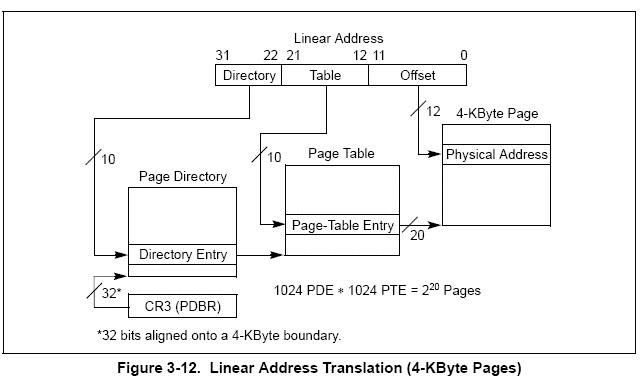
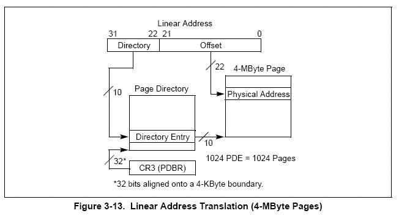
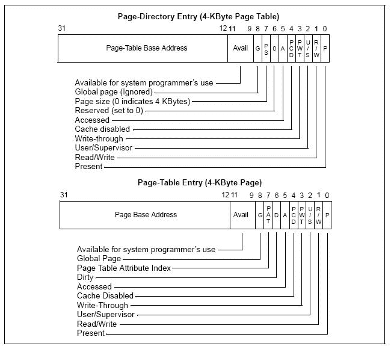
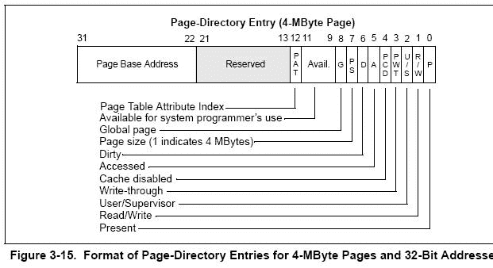
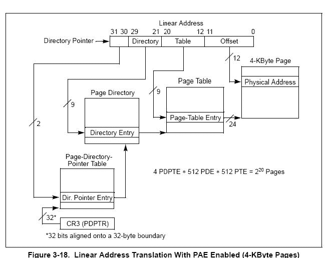
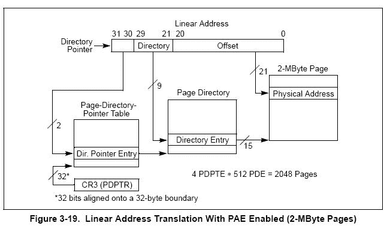
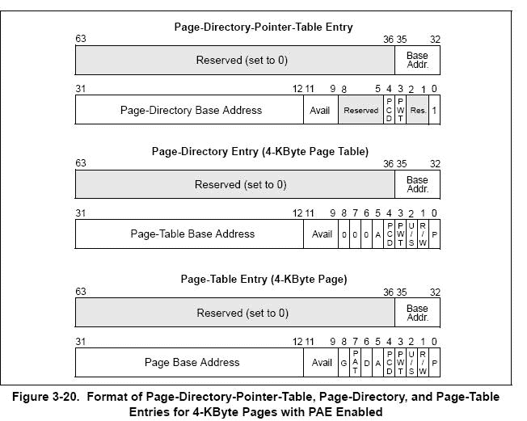
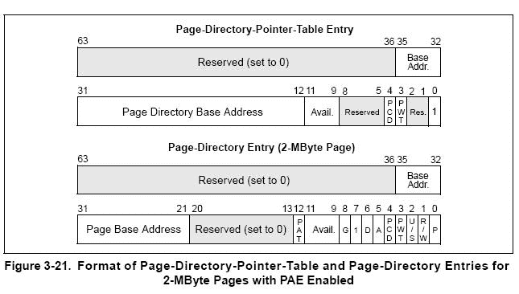

# 透过 MmIsAddressValid 看 Windows 分页机制

> 原文：[`www.pediy.com/kssd/pediy10/61327.html`](https://www.pediy.com/kssd/pediy10/61327.html)

这两天在逆向分析 `MmIsAddressValid` 这个函数，学习了下 PAE 分页机制，并且也发现了一个问题。就是本机 `ntoskrnl` 中导出的 `MmIsAddressValid` 函数是采用非 PAE 方式的，而本机 XP SP2 系统采用的却是 PAE 方式的分页机制。这个可以通过 `windbg` 中看到。在这里写出来与大家分享。关于 PAE (Physical Address Extension 物理地址扩展) 是 Intel x86 Pentium Pro 处理器引入的一种内存映射模式。在此模式下 CPU 可以访问多达 64GB 的物理内存。

在 PAE 模式下 PDE 和 PTE 为 64 位，而不是原来的 32 位。其结构如下：

```
lkd> dt _hardware_pte

nt!_HARDWARE_PTE

   +0x000 Valid            : Pos 0, 1 Bit
   +0x000 Write            : Pos 1, 1 Bit
   +0x000 Owner            : Pos 2, 1 Bit
   +0x000 WriteThrough     : Pos 3, 1 Bit
   +0x000 CacheDisable     : Pos 4, 1 Bit
   +0x000 Accessed         : Pos 5, 1 Bit
   +0x000 Dirty            : Pos 6, 1 Bit
   +0x000 LargePage        : Pos 7, 1 Bit
   +0x000 Global           : Pos 8, 1 Bit
   +0x000 CopyOnWrite      : Pos 9, 1 Bit
   +0x000 Prototype        : Pos 10, 1 Bit
   +0x000 reserved0        : Pos 11, 1 Bit
   +0x000 PageFrameNumber  : Pos 12, 26 Bits
   +0x000 reserved1        : Pos 38, 26 Bits
   +0x000 LowPart          : Uint4B
   +0x004 HighPart         : Uint4B
```

以上具体理论部分可以看下 intel 的 v3.System Programming Guide。上面有这两种分页方式的介绍。

非 PAE 分页，理论部分，看图，分 4K 和 4M 两种页。









下面是 ida 看到的 `ntoskrnl.exe` 中导出的 `MmIsAddressValid`。

```
.text:0040C661 ; BOOLEAN __stdcall MmIsAddressValid(PVOID VirtualAddress)
.text:0040C661                  public MmIsAddressValid
.text:0040C661 MmIsAddressValid proc near              ; CODE XREF: sub_40D65E+Cp
.text:0040C661                              ; sub_415459:loc_415470p ...
.text:0040C661
.text:0040C661 VirtualAddress   = dword ptr  8
.text:0040C661
.text:0040C661 ; FUNCTION CHUNK AT .text:0041B84E SIZE 00000007 BYTES
.text:0040C661 ; FUNCTION CHUNK AT .text:0044A4F2 SIZE 00000019 BYTES
.text:0040C661
.text:0040C661                  mov     edi, edi
.text:0040C663                  push    ebp
.text:0040C664                  mov     ebp, esp
.text:0040C666                  mov     ecx, [ebp+VirtualAddress]
.text:0040C669                  mov     eax, ecx
.text:0040C66B                  shr     eax, 14h        ; 右移 20 位
.text:0040C66E                  mov     edx, 0FFCh       ; 取高 10 位
.text:0040C673                  and     eax, edx
.text:0040C675                  sub     eax, 3FD00000h   ; 加上 0xc0300000
.text:0040C675                              ; PDE = ((VA >> 22) << 2 ) & 0xffc + 0xc0300000
.text:0040C67A                  mov     eax, [eax]
.text:0040C67C                  test    al, 1           ; present 位
.text:0040C67E                  jz      loc_41B84E
.text:0040C684                  test    al, al
.text:0040C686                  js      short loc_40C6AC ; 判断 page size 位
.text:0040C688                  shr     ecx, 0Ah        ; 右移 10 位
.text:0040C68B                  and     ecx, 3FFFFCh
.text:0040C691                  sub     ecx, 40000000h
.text:0040C697                  mov     eax, ecx        ; PTE = ((VA >> 12) << 2 ) & 0x3FFFC + 0xc0000000
.text:0040C699                  mov     ecx, [eax]      ; ecx = PTE Context
.text:0040C69B                  test    cl, 1           ; 判断 present 位
.text:0040C69E                  jz      loc_41B84E
.text:0040C6A4                  test    cl, cl
.text:0040C6A6                  js      loc_44A4F2      ; 判断 page size 位
.text:0040C6AC
.text:0040C6AC loc_40C6AC:                           ; CODE XREF: MmIsAddressValid+25j
.text:0040C6AC                              ; MmIsAddressValid+3DE9Fj
.text:0040C6AC                  mov     al, 1
.text:0040C6AE
.text:0040C6AE loc_40C6AE:                           ; CODE XREF: MmIsAddressValid+F1EFj
.text:0040C6AE                  pop     ebp
.text:0040C6AF                  retn    4
.text:0040C6AF MmIsAddressValid endp
.text:0040C6AF
```

还原为 c 代码为：

```c
BOOLEAN MmIsAddressValid ( PVOID VirtualAddress )
{
    BYTE PresentSign = 0x1;
    BYTE PageSizeSign = 0x80;
    BYTE PresentAndPageSizeSign = 0x81;
    PVOID lVirtualAddress;
    ULONG PDE,PDEContext;
    ULONG PTE,PTEContext;

    lVirtualAddress = VirtualAddress;
    PDE = (((ULONG)lVirtualAddress>>22)<<2) & 0xffc + 0xC0300000;
    PDEContext = (ULONG)*(PVOID)PDE;

    if(!(PDEContext & PresentSign))
        return FALSE;

    if(PDEContext & PageSizeSign)
        return TRUE;

    PTE = (((ULONG)lVirtualAddress>>12)<<2) & 0x3FFFc + 0xC0000000;
    PTEContext = (ULONG)*(PVOID)PTE;

    if(!(PTEContext & PresentSign ))
        return FALSE;

    if(!(PTEContext & PageSizeSign))
        return TRUE;
    else
    {
        PDE = (ULONG)PTE & 0xffc  + 0xc0300000;
        PDEContext = (ULONG)*(PVOID)PDE;
        if(PDEContext & PresentAndPageSizeSign)
           return TRUE;
    }

    return FALSE;
}
```

它是非 PAE 分页模式。从代码中得出 `PDE`, `PTE` 的计算公式为：

* `PDE = ((VA >> 22) << 2 ) & 0xffc + 0xc0300000；`
* `PTE = ((VA >> 12) << 2 ) & 0x3FFFFC + 0xc0000000；`

PAE 分页，理论部分，看图，分 4K 和 2M 两种页。









接下来看看 Windbg 中反编译得到的。

```
lkd> u MmIsAddressValid l 50

nt!MmIsAddressValid:
80510fa0 8bff             mov     edi,edi
80510fa2 55               push    ebp
80510fa3 8bec             mov     ebp,esp
80510fa5 51               push    ecx           ;申请空间 EBP - 4
80510fa6 51               push    ecx           ;申请空间 EBP - 8
80510fa7 8b4d08           mov     ecx,dword ptr [ebp+8] ; 取参数，虚拟地址
80510faa 56               push    esi
80510fab 8bc1             mov     eax,ecx
80510fad c1e812           shr     eax,12h ; 右移 12H(18 位,相当于>>21<<3),即线性地址高 11 位（32- 21）代表页目录索引，而页目录中每
                                            ; 个索引占 8 个字节，故该索引在页目录中的相对偏移位置是页目录索引*8，也就是<<3。找到其
                                            ; PDE
80510fb0 bef83f0000       mov     esi,3FF8h ;3FF8H = 11 1111 1111 1 000 ,标示取高 11 位
80510fb5 23c6             and     eax,esi
80510fb7 2d0000a03f       sub     eax,3FA00000h ; 页目录对应的虚拟地址 0 - 3FA00000 = c0600000h,页目录地址 + 原有的 eax 的偏移 =
                                              ; PDE,每个 PDE 中有 8 字节，代表 64 位的页表
80510fbc 8b10             mov     edx,dword ptr [eax]   ;取 PDE 低 4 字节
80510fbe 8b4004           mov     eax,dword ptr [eax+4] ;取 PDE 高 4 字节
80510fc1 8945fc           mov     dword ptr [ebp-4],eax ;暂存
80510fc4 8bc2             mov     eax,edx
80510fc6 57               push    edi
80510fc7 83e001           and     eax,1    ;页面存在标志 Present 位
80510fca 33ff             xor     edi,edi
80510fcc 0bc7             or      eax,edi
80510fce 7461             je      nt!MmIsAddressValid+0x91 (80511031) ;如果页面存在标志 Present 位 = 0，表示该页没有加载到对应的
                                            ;物理页面，不是有效地址。
80510fd0 bf80000000       mov     edi,80h ; 80H = 1000 0000
80510fd5 23d7             and     edx,edi             ;取 Page size 位，Page size 位 = 1，表示 LargePage
80510fd7 6a00             push    0
80510fd9 8955f8           mov     dword ptr [ebp-8],edx
80510fdc 58               pop     eax                 ;EAX = 0
80510fdd 7404             je      nt!MmIsAddressValid+0x43 (80510fe3) ; 最高位 = 0 ，非 LargePage
80510fdf 85c0             test    eax,eax
80510fe1 7452             je      nt!MmIsAddressValid+0x95 (80511035) ;最高位 = 1，LargePage 的情况，跳转
80510fe3 c1e909           shr     ecx,9  ;ecx=线性地址,右移 9 位,相当于>>12 <<3 。即地址中的高 20 位代表 pte 偏移，低 12 位表示属性
```


`80510fe6 81e1f8ff7f00    and     ecx,7FFFF8h ;7FFFF8h = 0111 1111 1111 1111 1111 1 000,20 位,第 31 到第 12 位,即前面 20 位`

`80510fec 8b81040000c0    mov     eax,dword ptr [ecx-3FFFFFFCh];  `

`80510ff2 81e900000040    sub     ecx,40000000h  ;pte=((VA>>12)<<3) &0x7FFFF8 +0xc0000000; (-0x40000000 means +0xc0000000)  `

`80510ff8 8b11            mov     edx,dword ptr [ecx] ;PTE context`

`80510ffa 8945fc         mov     dword ptr [ebp-4],eax`

`80510ffd 53             push    ebx`

`80510ffe 8bc2           mov     eax,edx`

`80511000 33db          xor     ebx,ebx`

`80511002 83e001        and     eax,1 ; pte 页面存在标志 Present 位`

`80511005 0bc3          or      eax,ebx`

`80511007 5b            pop     ebx`

`80511008 7427          je      nt!MmIsAddressValid+0x91 (80511031);无效位跳转`

`8051100a 23d7          and     edx,edi ;edx=pte,edi=80h,取 Page size 位，Page size 位 = 1，表示 LargePage`

`8051100c 6a00          push    0`

`8051100e 8955f8        mov     dword ptr [ebp-8],edx ;暂存`

`80511011 58            pop     eax`

`80511012 7421          je      nt!MmIsAddressValid+0x95 (80511035) ;not LargePage,valid`

`80511014 85c0          test    eax,eax                         ; LargePage`

`80511016 751d          jne     nt!MmIsAddressValid+0x95 (80511035)`

`80511018 23ce          and     ecx,esi  ;ecx=pte,esi=3FF8h 3FF8H = 11 1111 1111 1 000 ,表示取高 11 位 2M 分页的情况`

`8051101a 8b89000060c0  mov     ecx,dword ptr [ecx-3FA00000h] ; 0 - 3FA00000 = c0600000h ;ecx = PDE Context`

`80511020 b881000000    mov     eax,81h ;判断 Page size 位和 Present 位`

`80511025 23c8          and     ecx,eax`

`80511027 33d2          xor     edx,edx`

`80511029 3bc8          cmp     ecx,eax     `

`8051102b 7508          jne     nt!MmIsAddressValid+0x95 (80511035)`

`8051102d 85d2          test    edx,edx ;not valid`

`8051102f 7504          jne     nt!MmIsAddressValid+0x95 (80511035)`

`80511031 32c0          xor     al,al`

`80511033 eb02          jmp     nt!MmIsAddressValid+0x97 (80511037)`

`80511035 b001          mov     al,1`

`80511037 5f            pop     edi`

`80511038 5e            pop     esi`

`80511039 c9            leave`

`8051103a c20400        ret     4`

还原为 c 的代码为：

```c
BOOLEAN MmIsAddressValid ( PVOID VirtualAddress )

{

    BYTE PresentSign = 0x1;

  BYTE PageSizeSign = 0x80;

  BYTE PresentAndPageSizeSign = 0x81;

  PVOID lVirtualAddress;

  ULONG PDE,PDEContext;

  ULONG PTE,PTEContext;

  lVirtualAddress = VirtualAddress;

  PDE = (((ULONG)lVirtualAddress>>21)<<3) & 0x3FF8 + 0xC0600000;

  PDEContext = (ULONG)*(PVOID)PDE;

  if(!(PDEContext & PresentSign))

    return FALSE;

  if(PDEContext & PageSizeSign)

    return TRUE;

    PTE = (((ULONG)lVirtualAddress>>12)<<3) & 0x7FFFF8 + 0xC0000000;

  PTEContext = (ULONG)*(PVOID)PTE;

  if(!(PTEContext & PresentSign ))

    return FALSE;

  if(!(PTEContext & PageSizeSign))

    return TRUE;

  else

  {

         PDE = (ULONG)PTE & 0x3ff8  + 0xc0600000;

     PDEContext = (ULONG)*(PVOID)PDE;

     if(PDEContext & PresentAndPageSizeSign)

       return TRUE;

  }

    return FALSE;

}
```

现在 PAE 模式，`PDE`, `PTE` 地址的计算公式是：

`int PDE = ((lVirtualAddress>>21)<<3) & 0x3FF8 + 0xC0600000;`

`int PTE = ((lVirtualAddress>>12)<<3) & 0x7FFFF8 + 0xC0000000;`

以上 `VA` 表示 `virtual address`

看看本机 `pte` 和 `pde` 的基地址

`lkd> !pte`

```
               VA 00000000
PDE at 00000000C0600000    PTE at 00000000C0000000
contains 000000004D5C1067  contains 0000000000000000
pfn 4d5c1 ---DA--UWEV
```
