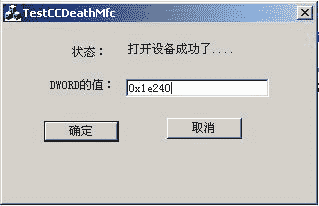

# 真正的驱动入门（附小程序代码）

> 原文：[`www.pediy.com/kssd/pediy09/pediy09-672.htm`](https://www.pediy.com/kssd/pediy09/pediy09-672.htm)

> 【文章标题】: 真正的驱动入门（附小程序代码）

> 【文章作者】: CCDeath  

> 【下载地址】: 自己搜索下载

> 【作者声明】: 只是感兴趣，没有其他目的。失误之处敬请诸位大侠赐教!

> 【详细过程】

很多初学驱动入门比较难，最后发现“难”是难在配置方面和 `WDM` 型几个比较抽象的概念。偶学了有半个月吧，很多网上写的不全，终于了解比较简单的整个流程了...

### 1. 书籍推荐

有个大侠推荐的...这些书籍可以从看雪、电骡、迅雷、驱网、得益网下得到....

前提必须会点 C 语言、MFC 框架 [测试的时候，弄一个比较漂亮的截面 :-) ]

*   《windows 2000 内部揭密》 -> 这里面可以学到什么是 `IRP`、内存管理、文件系统之类
*   《驱动模型设计》 -> 好详细的一本书.
*   《windows 2000\xp wdm 设备驱动程序设计》 -> 使用 `DS` 开发，无论如何使用里面的工具会更帅...说真的...
*   《DDK 文档及 DDK 里面的例子》-> `DDK` 开发包 -> 安装的时候要注意，一定把她及所在例子钩起来,不然你找不到 `DDK` 文档的....
*   `www.driverdevelop.com` -> 人气有点低，不够还很很不错..,专业人士较多
*   `www.pediy.com` -> 人气很高，很热情,各个领域人的都有.

### 2. 环境准备

*   **虚拟机** (`VMWare` 等): 建议装 `Windows` `2000.iso` 不然配置会出现很多的错误, 同时候用 `softice` 或者 `windbg`，避免 `OS` 蓝屏，把时间浪费在开机上...
*   `DriverStudio` `3.2`: 开发工具包. 如果喜欢在 `DDK` 环境下，也可以利用这个开发包里面的一些工具：`DriverMonitor`、`EAZDriverInstaller`、`softice`
*   `Windbg`: 中文教程较少. 但是跟微软走, 比较有保障. 就怕他最后要收钱...双机调试.
*   `VC` `6.0++`：这个要先安装，然后才安装 `DDK`，这个顺序可不能乱..
*   `DDK`: 没得说.. `VC` 开发工具包含这个目录，才能弹出提示符号比如 `this->` 点这边才能弹出。.
    *   在 工具->选项->目录->`H:\WINDDK\2600\INC\DDK\WXP`. 有时候 `H:\WINDDK\2600\INC\DDK` 不能识别，不能 `this->`
*   `VC` 助手: 这个工具一定要装, 很好用的。很快捷，掉渣...

注意：如果配置上还有问题的话，百度将会是你最后的归宿...

### 3. 先解决简单概念问题后解决 WDM 模型的概念

#### a. OS

时间分片, 但是记得给每个线程的时间 CPU 不一定相同.

```c
#include "windows.h"
#include "iostream.h"

void main()
{
    HANDLE hThread;
    hThread=CreateThread(NULL,0,ThreadProc,NULL,0,NULL);//不写 ThreadProc 了...懒
    CloseHandle(hThread);//一.关闭线程句柄，线程可没终止. 2.主线程 main 对线程引用不感兴趣 3. 前为 n=0.
                         //当执行 CreateThread() n+1; hThread=CreateThread() n+1+1
                         // 所以现在计数可是 n(n=0)+2=2; 当关闭 CloseHandle(hThread) n=n-1; 还有线程结束时 n=n-1;
                         // 最后 n=0，系统检测为 0，才会释放线程
}
```

顺便提一下 `Sleep()` 函数: 貌似很简单一个问题，睡觉谁不会呀...却十分体现出 `CPU` 分片的问题.
`Sleep(400)`，比如我们的 `hThread` 的时间是运行 600 毫秒, 突然运行到 300 秒, 来了个 `Sleep(400)`, 过了之后, 清醒过来，请问现在 `hThread` 还可以运行多少毫秒? 是 300 秒？还是 0 秒？ 应该是 0 秒...在 `Sleep` 睡眠期间, `CPU` 干什么呢？赶快从队列找一个优先级高线程的来玩玩

#### b. 同步与异步

有异步的地方，肯定需要同步的存在....宏观上是异步，但是执行同一种，同一时间，资源，就需要同步。
有很多种具体书籍《win32 多线程设计》--侯捷译。不知道是谁写的...:-)。这时候什么信号量、互斥对象、事件将会是你的最爱

```c
void main()
{
    HANDLE hMutext=CreateMutex(NULL,true\false,"ccdeath");//true 表示调用 CreateMutex 线程拥有所有权，即 main()主线程拥有，其他线称不可以 CloseHanle(hMutex), 只能
    //创建之后都是设为已通知状态.
    //拥有者释放
}
```

直接理解：事件为钥匙和要访问的资源为房间，更为简便.

*   有信号（已通知状态）：就是告诉线程，说偶(事件)这边有钱，大家（线程）快来抢钱...

#### c. 类型转换

`PVOID& IoctlBuffer (void);` `ULONG RegWord;`

*   `(ULONG)IocltBuffer（）=?RegWord;` -> 1. 先 `PVOID`===指针+void。先解决 void 转化
*   `(ULONG \*)IocltBuffer（）=RegWord;` -> 2. 接着解决指针转化
*   -> 3. 转化完之后. 再进行一般化处理
*   `*(ULONG \*)IocltBuffer()=RegWord` -> 4. 这才是正确的.

我们看 `IocltBuffer()` 是个指针.

#### d. 类型定义

虽然看似简单.

`typedef NTSTATUS (\*R)(KIrp I);` -> 5
`NTSTATUS wo(Krp I)` -> 6
`R=&wo;` -> 7 什么情况下成立, 就是 5 和 6 参数和返回值要相同.

有时候在 `DDK` 编程中出现 `NTSTATUS \*\*AddDevice(PDRIVER\_OBJCET DriverObject, PDEVICE\_OBJECT fdo);`

```c
DriverEntry()
{
    DriverObject->MarjorFunction\[IRP\_MJ\_XX\]}=\*\*AddDevice;//我们是怎么判断为什么她的原形是上面那个呢？用 VC 助手
    //go 一下，跑到 MajorFunction\[\]就明白。原来用了 typedef, 从根据根据上面 7 就知道了，类型与返回值要相同...
}
```

规律总结：
`typedef int p;`
`p i=5;`
就是把变量(在 `int p` 时候, `p` 为变量)当成类型(`typedef int p`, `p` 为类型)来用。

### 5. 实际例子

接下来我们继续看实际例子, 从武安河稍微改装了一个，一个是基于 `DS`+`main()`，另为一个是基于 `DS`+`MFC` 测试程序。

#### a. 开发环境

我的 `DS` 是 `3.2`。好象没有 `main` 和 `MFC` 框架只有 `win32sdk`。不知道你们是不是...碰到好多人跟偶是一样的....

*   `*.inf`：配置文件，怎么安装驱动，提供这个驱动的拥有者的信息之类的等...
*   `*.sys`：我们要的驱动....驱动大业，蒸蒸日上；看学学院，蒸蒸日上。

首先点 "DDK Build Settings"->Luanch Program. 接着启动 `VC`，工具栏就看见 `DriverStudio` 工具栏了. 点设置，开始...
在设置中，反正没有 `console` 测试程序，干脆测试程序就不要集成到驱动程序里面去。把设置中的 "集成测试程序" 打勾给去掉...自己在写一个集成测试程序，再集合到驱动程序也一样...

1.  **文件打开空间** (`\*dsw`)，去到 `C:\Program Files\Compuware\DriverStudio\DriverWorks\source` 下重新编译一下，选择批（最后两个）组建.
    *   `Build Environment Variables`
    *   `BASEDIR=H:\WINDDK\2600`
    *   `vdw\_wdm.lib - 0 error(s), 0 warning(s)`

    就 OK 了...

2.  然后再编译，靠，还出现问题...不怕，偶已经从 `win2003` `ddk` 中把需要的文件都拷贝过来了。缺什么，偶们就补什么..
    *   `csq.lib`
    *   `csq.h`
    *   `ntstrsafe.lib`
    *   在附件里，偶会上传的.

3.  基本 OK 了。开始写驱动，接着写驱动程序，接着调试驱动程序，接着安装驱动程序，打开监视器观察是否有错误发生，再返回来修改驱动程序。好了，一步步来了...

先在 `DriverEntry(){ DbgPrint("驱动加载了....");}` 编译一下，生成 `*.sys`. 用监视器(`DS` 里面的工具 `Moniter`) 打开这个 `*.sys`. 接着按 `go`...是不是看到驱动加载了...

```text
122.734    Default        CCDeath: CCDeathDriver::DriverEntry++.  Compiled at 21:33:07 on Dec  7 2007
122.734    Default        CCDeath: 驱动加载了....
122.734    Default        CCDeath: CCDeathDriver::DriverEntry--. STATUS 0
122.734    Default        CCDeath: CCDeathDriver::Unload++.
122.734    Default        CCDeath: CCDeathDriver::Unload--.
      Monitor         -- end --
```

高兴吧....

#### 通信程序

要写一个通信程序...驱动程序和应用程序是两个不同世界的人...想沟通是需要桥梁的....

按照上面方法创建一个驱动程序为 `CCDeath`. 沟通的桥梁就是 `CCDeathInterface.h` 和 `CCDeathIoctl.h`，自己手动添加...具体要里面的内容要看书籍才行。具体函数就是 `DeviceControl()` 这个东西。

*   `CCDeathIoctl.h`: //控制命令，请注意存放了如何 ruan 冲区的方式是 `METHOD\_BUFFERED\`/`METHOD\_IN\_DIRECT\`/`METHOD\_NEITHER`
*   `CCDeathInterface.h`: //设备的接口，我们可以用的....

从新打开一个工程新建一个 `consle` 测试程序. 为 `TestCCDeath`; 也包含 `CCDeathInterface.h` 和 `CCDeathIoctl.h` 这两个头文件才能沟通...".." //`CCDeathInterface.h` ".."//`CCDeathIoctl`.

把 `TestCCDeath` 放入到 `CCDeath` 目录下，接着打开 `CCDeath` 工程，选择“工程”->"插入工程到工作空间"。

添加头文件和变量

```c
//添加头文件：
#include "..\\\\CCDeathInterface.h"
#include "..\\\\CCDeathIoctl.h"

//添加变量:
GUID CCDeathClassGuid=CCDeathDevice\_CLASS\_GUID;//要修改下面一个函数哦
```

在 `DeviceControl()` 函数中对 3 中方式进行处理...

```c
NTSTATUS CCDeathDevice::DeviceControl(KIrp I)
{
    NTSTATUS status = STATUS\_SUCCESS;

    switch (I.IoctlCode())
    {
        case READ\_DWORD:
            status=CCDeath\_DWORD\_Hander(I);
            break;
        case READ\_STRING:
            status=CCDeath\_STRING\_Hander(I);
            break;
        case READ\_BOOLEAN:
            status=CCDeath\_BOOLEAN\_Hander(I);
            break;
        default:
            status = STATUS\_INVALID\_DEVICE\_REQUEST;
            break;
    }
    return  status;
}

NTSTATUS CCDeathDevice::CCDeath\_DWORD\_Hander(KIrp I)
{
    ....
    // 处理
}
```

三个处理共同点：
*   `I.information()=sizeof(ULONG);` //成功的时候
*   `I.information()=0;` //失败的时候

三个处理不同点：


### 写测试程序

#### 问题一
**现象**：`Cannot open include file: 'devintf.h': No such file or directory`

**解决方法**：在 `TestCCDeath.dsp` 中添加以下配置：

```cpp
# ADD CPP /I "$(DRIVERWORKS)\\include"
```

#### 问题二
**现象**：
```text
OpenByInterface.obj : error LNK2001: unresolved external symbol __imp__SetupDiDestroyDeviceInfoList@4
OpenByInterface.obj : error LNK2001: unresolved external symbol __imp__SetupDiGetClassDevsA@16
OpenByInterface.obj : error LNK2001: unresolved external symbol __imp__SetupDiGetDeviceInterfaceDetailA@24
OpenByInterface.obj : error LNK2001: unresolved external symbol __imp__SetupDiEnumDeviceInterfaces@20
Release/TestCCDeath.exe : fatal error LNK1120: 4 unresolved externals
执行 link.exe 时出错.
TestCCDeath.exe - 1 error(s), 0 warning(s)
```

**解决方法**：使用 `#pragma comment(lib, "setupapi")`。

#### 测试结果
运行测试程序后输出：
```text
开始要测试 CCDeath 驱动程序了：
错误码 ERROR opening device: (0) returned from CreateFile
退出测试程序...
Press any key to continue
```

#### 问题三
**现象**：上述运行失败。

**原因**：驱动程序尚未安装。

**解决方案**：
1. 打开 `DS` 中的 `Monitor` 工具开始监视。
2. 打开 `DS` 中的 `EZDriverInstaller`（快速安装驱动），选择 `*.inf` 文件。在 `Add New Device` 中加载 `*.sys` 文件。
3. 运行测试程序。
4. 观察监视器，进行调试（使用 SoftICE 等工具）。

**运行结果**：
```text
开始要测试 CCDeath 驱动程序了：
设备已经被发现，打开句柄成功....
READ_DWORD:0x1e240
Press any key to continue
```

### 经验总结
（后续内容继续补充，感谢阅读。）

### 版权声明
本文原创于看雪技术论坛，转载请注明作者并保持文章完整。

*日期：2007年12月07日 23:06:35*

### 详细信息
* **标题**：真正的驱动入门（二）
* **下载**：自行搜索下载
* **声明**：出于兴趣，欢迎指正。

#### 开发过程概述
继上一篇之后，感觉若真想深入学习驱动，还需阅读《驱动模型设计》等经典著作。本文旨在提供一条更便捷的途径，特别是在配置问题和某些模糊概念的澄清上。

本次主要任务包括：
1. 完成基于 `MFC` 框架的测试程序编写。
2. 分析 `WDM` 模型中较为模糊的概念。
3. 结合所学知识开发多功能程序。

#### MFC 框架程序开发
1. 创建 `MFC` 对话框应用程序，移除“关于对话框”和 `ActiveX` 控件，保持界面简洁。
2. 在 `TestCCDeathMfc.dsp` 工程中引入 `OpenByInterface.cpp`。
3. 解决头文件缺失问题（类似之前的 `devintf.h` 错误），修改 `TestCCDeathMfc.dsp`，在 `Source=\\OpenByInterface.cpp` 中添加相应的包含路径配置。
4. 修改 `OpenByInterface.cpp`，头文件如下：

```cpp
#include "StdAfx.h"
#include <winioctl.h>   // XP 系统需要
#include <devintf.h>    // DriverWorks
```

5. 在主框架中添加头文件和声明：

```cpp
// 添加头文件
#include "..\\CCDeathInterface.h"
#include "..\\CCDeathIoctl.h"
#include <winioctl.h>   // XP 系统需要

// 函数声明
HANDLE OpenByInterface(GUID* pClassGuid, DWORD instance, PDWORD pError);

// 变量声明
HANDLE hDevice = INVALID_HANDLE_VALUE;
GUID ClassGuid = CCDeathDevice_CLASS_GUID;
```

6. 将文件加入驱动程序工程，设置为活动工程，并进行界面设置。编译运行后效果与之前一致。



#### 一、核心理论概念（参考《驱动模型设计》Walter Oney）

**1. 分页与非分页、任意线程上下文与非任意上下文**
* **分页**：可理解为内存与硬盘的交互（涉及磁盘IO）。
* **非分页**：可理解为纯内存操作。
* **任意线程上下文**：线程不确定、不固定。上下文（Context）即描述线程信息的结构体（如线程上下文块）。*（比喻：像有很多个女朋友。）*
* **非任意线程上下文**：线程已确定。*（比喻：像只有一个老婆。）*

**2. IRQL 与自旋锁**
主要解决共享资源竞争问题；内核同步对象主要控制线程流程。
* `IRQL` 主要解决单 CPU 抢占问题。
* `自旋锁` 主要解决多 CPU 并发（抢占）问题。

鉴于驱动程序需支持多 CPU，仅使用 `IRQL` 是不够的，`自旋锁` 是更明智的选择。

**3. 关键函数记忆**

`IRP` 相关：
```cpp
KIRQL Irq;
KeRaiseIrql(XXX_LEVEL, &Irq);
KeLowerIrql(Irq);
```

`SpinLock` 相关：
```cpp
KSPIN_LOCK spinlock;
KIRQL Irq;
KeAcquireSpinLock(&spinlock, &Irq);
KeReleaseSpinLock(&spinlock, Irq);
```
*注：“自旋”指在一个小的循环内重复执行“测试并设置（test-and-set）”操作。*

在 `DISPATCH_LEVEL` 级别，可以使用更快捷的封装操作（前提是确认当前处于该级别）：

`IRP` 相关：
```cpp
KeRaiseIrqlToDpcLevel();
```

`SpinLock` 相关：
```cpp
KeAcquireSpinLockAtDpcLevel();
KeReleaseSpinLockFromDpcLevel(); // 原文拼写为 Realse，此处修正为 Release
```

**界限说明**：
* `IRQL`：执行在高于或等于 `DISPATCH_LEVEL` 的代码绝不能造成页故障。
* `SpinLock`：仅能在低于或等于 `DISPATCH_LEVEL` 时请求自旋锁。在持有自旋锁期间，内核会将代码提升到 `DISPATCH_LEVEL` 运行。

**4. 数组指针与指针数组**
示例代码：
```cpp
static NTSTATUS (*fcntab[])(PDEVICE_OBJECT, PIRP) =
{
    HandleStartDevice, // IRP_MN_START_DEVICE
    HandleQueryRemove, // IRP_MN_QUERY_REMOVE_DEVICE
    /* etc. */
};
```
* **数组指针**：指向数组的指针。
  * 示例：`int a[3][3], (*p)[3]; p = a;`
* **指针数组**：元素为指针的数组。
  * 示例：`int *p[3];`
  * `*p[0]`, `*p[1]`, `*p[2]` 均为指针。

#### 二、请求包（IRP）深入解析

`IRP` 结构用于与驱动程序通信（回顾：`I.information() = sizeof(ULONG)`）。
涉及组件：`I/O` 管理器、`Pnp` 管理器、线程调度器、`OS`、驱动程序。

**1. IRP 难点：`PendingReturned`**
`PendingReturned(BOOLEAN)` 函数：若参数为 `true` 则返回 `STATUS_PENDING`。若返回此值，必须调用 `IoMarkIrpPending()`。

```cpp
if (Irp->PendingReturned(true)) // true 时候返回 STATUS_PENDING. 如果返回这个值必须调用这个值
{
    IoMarkIrpPending(Irp); // pending 中文意思的是等候的意思...
}
```
一个 `IRP` 用 `IoMarkIrpPending()` 转为未处理完成状态，`STATUS_PENDING` 通知调用者该 `IRP` 尚未完成。

**2. I/O 堆栈单元与 IRP 的关系**
从数据结构角度分析 `IRP` 结构中的 `CurrentLocation`（成员函数/变量）和 `Tail` 成员变量：
`CurrentLocation` 和 `Tail.Overlay.CurrentStackLocation`（`PIO_STACK_LOCATION`）未直接公开给驱动程序使用，但可通过 `IoGetCurrentIrpStackLocation()` 获取。
* `CurrentLocation`：当前 `I/O` 堆栈单元的索引。
* `CurrentStackLocation`：指向该单元的指针。
理解这一点有助于调试驱动程序。

**3. I/O 堆栈单元创建逻辑**
“同时还创建了一个与之关联的 `IO_STACK_LOCATION` 结构数组：数组中的每个堆栈单元都对应一个将处理该 `IRP` 的驱动程序，另外还有一个堆栈单元供 `IRP` 的创建者使用。”

驱动程序通常分配带有额外堆栈单元的 `IRP`，在第一个单元中设置 `DeviceObject` 指针，并在调用 `IoSetCompletionRoutine` 和 `IoCallDriver` 之前使用 `IoSetNextIrpStackLocation` 跳过额外堆栈单元。这样，在完成例程中调用 `IoMarkIrpPending` 不会出现错误，且能获得有效的设备对象。

`2K` 源代码参考（来自驱网）：
```cpp
#define IopInitializeIrp( Irp, PacketSize, StackSize ) { \
    RtlZeroMemory( (Irp), (PacketSize) ); \
    (Irp)->Type = (CSHORT) IO_TYPE_IRP; \
    (Irp)->Size = (USHORT) ((PacketSize)); \
    (Irp)->StackCount = (CCHAR) ((StackSize)); \
    (Irp)->CurrentLocation = (CCHAR) ((StackSize) + 1); \
    (Irp)->ApcEnvironment = KeGetCurrentApcEnvironment(); \
    InitializeListHead (&(Irp)->ThreadListEntry); \
    (Irp)->Tail.Overlay.CurrentStackLocation = \
    ((PIO_STACK_LOCATION) ((UCHAR *) (Irp) + \
    sizeof( IRP ) + \
    ( (StackSize) * sizeof( IO_STACK_LOCATION )))); \
}

NTSTATUS FASTCALL
IopfCallDriver(
IN PDEVICE_OBJECT DeviceObject,
IN OUT PIRP Irp
)
/*++
Routine Description:
This routine is invoked to pass an I/O Request Packet (IRP) to another
driver at its dispatch routine.
Arguments:
*/
```


### 参数说明
- `DeviceObject` - 指向应接收 IRP 的设备对象的指针。
- `Irp` - 指向请求的 IRP 的指针。
- **返回值**: 驱动分发例程返回的状态。

```c
//
// Ensure that this is really an I/O Request Packet.
//
ASSERT( Irp->Type == IO_TYPE_IRP );

//
// Update the IRP stack to point to the next location.
//
Irp->CurrentLocation--;

if (Irp->CurrentLocation <= 0) {
    KeBugCheckEx( NO_MORE_IRP_STACK_LOCATIONS, (ULONG_PTR) Irp, 0, 0, 0 );
}

irpSp = IoGetNextIrpStackLocation( Irp );
Irp->Tail.Overlay.CurrentStackLocation = irpSp;

//
// Save a pointer to the device object for this request so that it can
// be used later in completion.
//
irpSp->DeviceObject = DeviceObject;

//
// Invoke the driver at its dispatch routine entry point.
//
driverObject = DeviceObject->DriverObject;

PERFINFO_DRIVER_MAJORFUNCTION_CALL(Irp, irpSp, driverObject);

status = driverObject->MajorFunction[irpSp->MajorFunction]();

PERFINFO_DRIVER_MAJORFUNCTION_RETURN(Irp, irpSp, driverObject);

return status;
}
```

这段代码逻辑非常微妙，IO 请求包（IRP）的概念抽象程度较高，至少需要阅读两遍以上才能理解透彻，但整体流程非常清晰。

### 即插即用
这里仅做简要提及，重点在于综合程序。

**术语：I/O 资源**
WDM 包含四种标准 I/O 资源类型：`I/O 端口`、`内存寄存器`、`DMA 通道`、`中断请求`。
由于 I/O 总线与 CPU 在寻址物理硬件的方式上不同，因此存在两种资源列表：
- `raw` 资源包含总线相关的数值。
- `translated` 资源包含系统相关的数值。

#### 综合程序解说
**3 种通知方式：**
1. **窗口通知** (SDK，可参考 `ccdeath` 中的《实用软件-详细代码注释》)：响应 `WM_DEVICECHANGE` 消息。
2. **服务通知**：调用 `RegisterServiceCtrlHandlerEx` 注册一个扩展的控制处理函数。
3. **内核模式通知**：调用 `IoRegisterPlugPlayNotification`。
4. **自制通知**：`IoReportTargetDeviceChange` | `IoReportTargetDeviceChangeAsynchronous`。

**控制命令：**
```c
// 采用 METHOD_BUFFERED 模式
#ifndef __CCDeathPnP_Ioctl__
#define __CCDeathPnP_Ioctl__

#define PNEVENT_IOCTL_800 CTL_CODE(FILE_DEVICE_UNKNOWN, 0x800, METHOD_BUFFERED, FILE_ANY_ACCESS)
#endif
```

**接口**
```c
// 接口文件包含窗口通知、定制通知、内核通知
#define WindowsDevice_CLASS_GUID \
    { 0x7cbbad7c, 0x3873, 0x476b, { 0xa1, 0x22, 0x1e, 0x8e, 0x1a, 0x7e, 0xc6, 0x6a } }

DEFINE_GUID(MakeDevice_CLASS_GUID, 0x28ce01a1, 0x9436, 0x11d2, 0x81, 0xb5, 0x0, 0xc0, 0x4f, 0xa3, 0x30, 0xa6);

#define KernerDevice_CLASS_GUID \
    { 0xc6287288, 0x81d8, 0x4c2b, { 0x92, 0x21, 0x95, 0xb1, 0xaa, 0xed, 0x29, 0x49 } }
```

// 在 `Device.cpp` 中加入：头文件、变量名和一些 API 声明。

//=========== 下面是核心部分 ...

### 读写数据
*(此部分原文省略，直接进入电源管理)*

### 电源管理
... `AddDevice(....)` ...

```cpp
CCDeathDevice* pDevice = new (
    NULL,                 // no name
    FILE_DEVICE_UNKNOWN,
    NULL,                 // no name
    0,
    DO_DIRECT_IO
        | DO_POWER_PAGABLE // 状态位 DO_POWER_PAGABLE
    )
CCDeathDevice(Pdo, m_Unit); // 初始化对象

if (pDevice == NULL)               // 分配是否成功
{
    T<<"错误的创建设备对象"<<"\n";
    status = STATUS_INSUFFICIENT_RESOURCES;
}
else
{
    status = pDevice->ConstructorStatus(); // 判断其构造函数有没有错误 ...
    if (!NT_SUCCESS(status))
    {
        delete pDevice; // 有错构造，则删除设备对象
    }
    else
    {
        m_Unit++;
        pDevice->ReportNewDevicePowerState(PowerDeviceD1); // 由开始状态 0 转入 1
    }
}
....
}
```
// 分配在 `OnDevicePowerUp()` 和 `OnDeviceSleep()` 例程中分别判断是系统电源还是设备电源就可以了...
// 然后再写 2 个函数分别根据当前上升的电源状态标位得出具体的状态名...

```c
PCHAR DevicePowerStateName(DEVICE_POWER_STATE ps);
PCHAR SystemPowerStateName(SYSTEM_POWER_STATE ps);
```

例如：
```c
PCHAR SystemPowerStateName(SYSTEM_POWER_STATE ps) // PS 是具体的数值
{
    static PCHAR PowerStates[] = { // 先根据 DDK 找出电源的状态，列出来
        // 或者 SYSTEM_POWER_STATE，光标定位在这，VC 助手 go 一下，把
        // 这个状态拷贝过来
        "PowerSystemUnspecified",
        "PowerSystemWorking",
        "PowerSystemSleeping1",
        "PowerSystemSleeping2",
        "PowerSystemSleeping3",
        "PowerSystemHibernate",
        "PowerSystemShutdown"
    };

    if (ps > PowerSystemShutdown)  // 最大值是 6，如果超过这 6 种，被定位没有声明的状态。
        return "<undefined power state>";
    else
        return PowerStates[ps]; // 根据位置判断好
}
```

- 电源睡眠的时候不需要检测。
- 电源上升的时候每隔 30 秒检测一下。

### Windows 管理诊断管理
*(此处原文省略)*

### 综合程序
顺便提一下，生成对话框之后必须删除设备句柄。可以自己写一个构造函数，或者重载 `OnDestroy()` 都是可以的...

```cpp
CPnp::~CPnp()
{
    if (m_hDevice != INVALID_HANDLE_VALUE)
    {
        delete m_hDevice;
    }
}
```

电源管理程序部分如上，运行效果如下：

```text
10.328    Default        ccdeath 说: CCDeathDevice::Create++.  IRP 8254B008
10.328    Default        ccdeath 说: CCDeathDevice::Create--.  IRP 8254B008, STATUS 0
10.328    Default        ccdeath 说: CCDeathDevice::OnDevicePowerUp++.  IRP 827A5C90
10.328    Default        ccdeath 说: 已经进入了 OnDevicePowerUp
10.328    Default        ccdeath 说: 设备的电源状态 PowerDeviceD0
10.328    Default        ccdeath 说: CCDeathDevice::OnDevicePowerUp--.  IRP 827A5C90, STATUS 0
12.719    Default        ccdeath 说: CCDeathDevice::DeviceControl++.  IRP 8269C610
12.719    Default        ccdeath 说: 已经进入到电源处理了....
12.719    Default        ccdeath 说: CCDeathDevice::DeviceControl--.  IRP 8269C610, STATUS 0
41.469    Default        ccdeath 说: CCDeathDevice::OnDeviceSleep++.  IRP 82673338
41.469    Default        ccdeath 说: 已经进入了 OnDevicePowerSleep
41.469    Default        ccdeath 说: 设备的电源状态 PowerDeviceD1
41.469    Default        ccdeath 说: CCDeathDevice::OnDeviceSleep--.  IRP 82673338, STATUS 0
      Monitor         -- end --
```

---

### 【经验总结】
12 月 9 号是偶的生日，谢谢郭姐姐买蛋糕给偶吃和送礼物给偶，让偶四年里度过最后一个，也是最好的一个生日... 祝福郭姐永远快乐，出去工作以后，事事顺心，开开心心....

这些都是安河兄的例子，只是稍微改装了... 花了三天写的...

下次拿自己做的，主要分析调试 `*.Sys` 方面的... 下一回就是终结版了...

---

### 【版权声明】
本文原创于看雪技术论坛，转载请注明作者并保持文章的完整，谢谢!

<br>
2007 年 12 月 10 日 11:12:17

> 很好很强大: ``
> 虽然 LZ 的确比较怀旧的说 ``

- **虚拟机 (VMWare 等)**：建议装 `Windows 2000.iso`，不然配置会出现很多的错误，同时用 `softice` 或者 `windbg`，避免 OS 蓝屏，把时间浪费在开机上...
- 据说 2K 已经退出微软的主流支持了。无论是研究服务器模式还是 station 模式，貌似都不是特别好。
- 比如说新的驱动模式 `WDK` 就没有 2K 的份。
- 个人觉得搞一般开始还是 `XP` 比较好，毕竟现在 `XP` 的普及率高达 0.8。

**DriverStudio3.2**: 开发工具包。如果喜欢在 `DDK` 环境下，也可以利用这个开发包里面的一些工具：`DriverMonitor`、`EAZDriverInstaller`、`softice`。

这个东西在 `XP` 上都不是很好安装，`Vista` 就更不用说了，装了等于不装。
第一，它已经停止开发了。
其次，它的调试器无论是单机还是远程（原文误写为双击）都基本上处于无法用的状态。微软有专门的驱动诊断工具.. `DS` 这个东西貌似还算有些过时了。

`DS` 里面的工具 `Monitor`: 这个用被微软收购的 `DbgView` 来看就可以的说。


### 调试与开发环境

**Windbg**: 中文教程较少。但是跟微软走，比较有保障。就怕他最后要收钱...双机调试。

**VC6.0++**：这个要先安装，然后才安装 `DDK`，这个顺序可不能乱。

最近都出 `VS2008` 了，不晓得中国人是缺钱还是咋的，就喜欢那个 `VC6`。简直想不通。先不说得不到任何微软的支持，编译器也显然比起之后的版本差。要搞效率的朋友至少应该注意了 `VC6` 可没有 `SSe2` 指令选项，其次新版的 `SDK` 根本无法在 `VC6` 种编译通过。01 年就是它得最后版本了。我在想 01 年貌似连 `XP` 都还没有比如 `SP2` 时代更不要说什么 `2k3` `Vista` 了。

况且 `VC6` 的不稳定和编译器对模板支持还有 `ISO` 支持都是有问题的。完全搞不明白的说。

### DDK 相关

**DDK**: 没得说.. `VC` 开发工具包含这个目录，才能弹出提示符号比如 `this->` 点这边才能弹出。

在 `工具->选项->目录->H:\\WINDDK\\2600\\INC\\DDK\\WXP`。有时候 `H:\\WINDDK\\2600\\INC\\DDK` 不能识别，不能 `this->`。

反正 `DDK6000` 我是在微软的官方下载的。我个人觉得还是新点好些。一些未文档化的 `API` 都有了部分 `LIB` 文件可以直接链接了。另外 `DDK6000` 开始帮助文档就和 `MSDN` 一样了，是那个专用浏览器而不是 `CHM` 这个很罪恶的东西。

### VC 助手

**VC 助手**: 这个工具一定要装，很好用的。很快捷，掉渣...

这个暂时不发表意见，我用 `VS2008` 配合 `VA` 完全是不顺手。当然写点模板或者 `C++STL` 应用还是有好处的，因为这个 `VS` 的代码提示有些问题。以前还是比较喜欢用的，过了一年多不用还真是不习惯了。不过话说回来了，用它浏览代码还是不错的，代码颜色比较漂亮。不过话又说回来了，无论怎么说 `VA` 的代码辅助功能根 `VC#` 比起来还是差距大着了\貌似有些偷换概念了 !\[ \] 微软有时考虑东西还是蛮人性化的。所以我觉得不用 `VA` 就学 `Windows` 源代码那样，甚至用 `notepad` 来写 :) 开个玩笑

### 学习建议

另外建议真正想玩驱动的朋友去 `CodeProject` 看那个入门教程，那个教程的应该说不错，至少得到中外人士的一致肯定，比起 `MSDN` 来更分类系统一些。基本把 `WDM` 的内存管理 `IO` 管理这些用最为精炼的语句做了一个大致的介绍。至少看了以后写点 `SSDT` `HOOKER` 不是什么难事了

但是最后还是得用 `MSDN` 来啃的，任何所谓的'快速'入门或者 `XX` 天入门这种都不太可信，除非你只是做一个兴趣话的了解当新闻看，那就无可厚非了。

`LZ` 不要生气奥 :)

`4dd466d0e1e0cc123afbe504da2462ca`
