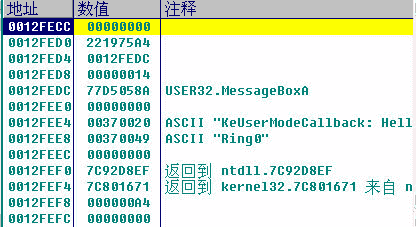
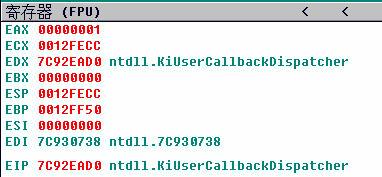
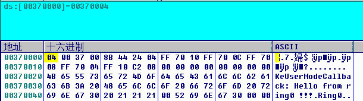
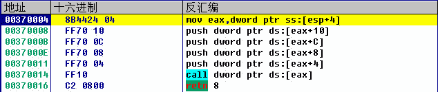
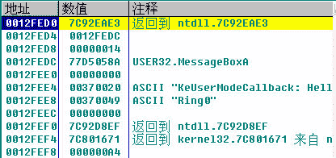

# KeUserModeCallback 用法详解

> 原文：[`www.pediy.com/kssd/pediy11/104918.html`](https://www.pediy.com/kssd/pediy11/104918.html)

`ring0`调用`ring3`早已不是什么新鲜事，除了`APC`，我们知道还有`KeUserModeCallback`。其原型如下：

```
NTSTATUS
KeUserModeCallback (
    IN ULONG ApiNumber,
    IN PVOID InputBuffer,
    IN ULONG InputLength,
    OUT PVOID *OutputBuffer,
    IN PULONG OutputLength
    );
```

但是对于这个函数怎么用，很多人还不是很清楚，因为它未文档化，参数意义又比较晦涩，但是我们除了`wrk`中的源码可以参考，还有一些实例可供调试研究。所以，要搞清楚它的调用过程并不困难，但是需要一些基本的知识，比如系统调用和返回的过程(`KiFastCallEntry`,`KiServiceExit`等)。本文尽量不多谈这种过程转换的细节，而把主要注意力集中在传入的参数及调用过程，以灰盒的方式来分析它。

调试的例子是一个俄国佬的`Ring0MessageBox`，我自己也写过一份(其实就是逆的)，放在看雪了，几乎完全一样。代码地址放在文后了，这东西以前发过一次，不过没讲原理。

有兴趣的可以下载回来扔到`Vmware`里，拿起调试器，一起来`Debug`~

## 一、KeUserModeCallback 的基础知识

我们都知道一个普通的系统调用，它的过程大概是这样的(以`OpenProcess`为例)：

`kernel32!OpenProcess` -> `ntdll!ZwOpenProcess` -> `ntdll!KiFastSystemCall` -> `sysenter` -> `nt!KiFastCallEntry` -> `nt!NtOpenProcess` -> `nt!KiFastCallEntry`(返回后)-> `nt!KiServiceExit` -> `sysexit` -> `ntdll!KiFastSystemCallRet` -> `kernel32!OpenProcess`(返回后)

这是一个`ring3`->`ring0`->`ring3`的过程。

而`KeUserModeCallback`的过程是这样的

`nt!KeUserModeCallback` -> `nt!KiCallUserMode` -> `nt!KiServiceExit` -> `ntdll!KiUserCallbackDispatcher` -> 回调函数 -> `int2B` -> `nt!KiCallbackReturn` -> `nt!KeUserModeCallback`(调用后)

这是一个`ring0`->`ring3`->`ring0`的过程，在堆栈准备完毕后，借用`KiServiceExit`的力量回到了`ring3`，它的着陆点是`KiUserCallbackDispatcher`，然后`KiUserCallbackDispatcher`从`PEB`中取出`KernelCallbackTable`的基址，再以`ApiIndex`作为索引在这个表中查找对应的回调函数并调用，调用完之后再`int2B`触发`nt!KiCallbackReturn`再次进入内核，修正堆栈后跳回`KeUserModeCallback`，完成调用。

大致的流程是这样的，只要搞清楚传入的参数是如何使用并如何影响到最后的执行结果，就知道怎么去调用了。

需要注意的地方是：

(1) `ring3`的指令只能访问`ring3`的内存地址，所以如果需要访问数据，必须放在`ring3`可以访问到的内存中。所以在准备参数的过程中，通常是使用`ZwAllocateVirtualMemory`来申请`ring3`内存，其它方法如使用已有的内存，或放在栈中(`\_ClientLoadLibrary`的方法)等都是可以的，只是访问数据时小有差别罢了。

(2) `KeUserModeCallback`的调用需要用户态栈的参与，因此内核线程无法调用`KeUserModeCallback`，必须在某个`ring3`线程的上下文中才可以。

下面进行具体的调试观察，以事实说话。

## 二、数据准备

调试环境:`Vmware`+`WinXPSP2`+`Windbg`

加载`Callback.sys`驱动，然后执行`ring3`部分的`CallBackClient.exe`，触发`CallMessageBox`调用~

这个函数先是一些准备工作，先获取当前进程的`PEB`并从中找到`user32.dll`的地址，然后`GetProcAddress`取得`MessageBoxA`的地址，这个没什么好说的。

这里取到的数据是:

`user32.dll` `Base=0x77D10000`

`Address of MessageBoxA=0x77D5058A`

`KernelCallbackTable=0x77D12970`

然后申请一块用户态内存，放入`shellcode`和需要的数据（这里是字符串），这样在`ring3`就可以访问了。

`Alloced Buffer=0x00370000` //申请到的内存地址

然后把我们在`ring3`要执行的代码和数据放到申请的`buffer`里.

```
//开始填充缓冲区
*(ULONG*)pBuf=(ULONG)pBuf+sizeof(ULONG);//这里放的是一个 shellcode 的指针,shellcode 将会被放在 pBuf+4 的位置
RtlCopyMemory(pBuf+4,(char*)CallBackStub,CALLSTUBLEN);//pBuf+4 的位置开始是 shellcode
RtlCopyMemory(pBuf+32,szText,strlen(szText));//从 bufer+32 开始拷贝字符参数
RtlCopyMemory(pBuf+32+strlen(szText)+1,szCaption,strlen(szCaption));//注意加 1 以便留出一个 0x00 作为 sxText 的结束符
缓冲区的填充并没有什么特别的要求。这里我排列好的样子是:
kd> db 0x00370000
00370000  04 00 37 00 8b 44 24 04-ff 70 10 ff 70 0c ff 70  ..7..D$..p..p..p
00370010  08 ff 70 04 ff 10 c2 08-00 00 00 00 00 00 00 00  ..p.............
00370020  4b 65 55 73 65 72 4d 6f-64 65 43 61 6c 6c 62 61  KeUserModeCallba
00370030  63 6b 3a 20 48 65 6c 6c-6f 20 66 72 6f 6d 20 72  ck: Hello from r
00370040  69 6e 67 30 20 21 21 21-00 52 69 6e 67 30 00 00  ing0 !!!Ring0..
00370050  00 00 00 00 00 00 00 00-00 00 00 00 00 00 00 00  ................
00370060  00 00 00 00 00 00 00 00-00 00 00 00 00 00 00 00  ................
00370070  00 00 00 00 00 00 00 00-00 00 00 00 00 00 00 00  ................
```

`pBuf`开头，存放的是`shellcode`的地址

`pBuf+4`，是我们准备的一小段`shellcode`，地址为`0x00370004`

`pBuf+0x20`,是`MessageBoxA`的`szText`参数

`pBuf+0x4A`,是`MessageBoxA`的`szCaption`参数

## 三、参数准备

然后才是最关键的`KeUserModeCallback`的参数填写:

参数一:`ApiIndex`

```
ApiIndex=((ULONG)pBuf - KernelCallbackTable)/4;
```

为什么这么计算呢？因为`ApiIndex`本来的意义就是像它的名字所描述的那样，是在一个表中的索引。这个表就是`KernelCallbackTable`，`KiUserCallbackDispatcher`是这样取得回调函数的地址的:

`CallbackFunPointer=KernelCallbackTable[ApiIndex]`

所以我们计算`Index`的时候刚好相反，减去`KernelCallbackTable`，再除以`4`(也就是机器字长，指针的长度)，但是注意`pBuf`必须是按字长对齐的，否则经过逆运算之后无法得到原始值。

所以，`ApiIndex=(0x00370000-0x77D12970)/4=0x221975a4`

然后:

```
Arguments[0]=addrMessageBoxA;
Arguments[1]=0;//hWnd=NULL
Arguments[2]=(ULONG)pBuf+32;//szText
Arguments[3]=(ULONG)pBuf+32+strlen(szText)+1;//szCaption
Arguments[4]=0;//MB_OK
```

`Arguments`是我构造的一个数组，其第一个元素是`MessageBoxA`的地址，后面依次是`MessageBoxA`的各个参数,这此数据将被会`shellcode`所使用。

然后调用`KeUserModeCallback`，传入的`ApiIndex`即刚才计算得到的数据，`InputBuffer`就是构造的`Arguments`数组，`InputBufferLen`就是传入的数组的大小。

`OutputBuffer`和`OutputBuffer`似乎并没有被使用，只要传入有效的值就可以了。

具体数据：`ApiIndex=0x221975a4`,`InputBufferLength=0x14`

## 四、调用细节

接下来，我们进入`KeUserModeCallback`的内部过程(参考了`wrk`)，由于后面涉及的调用大多都不是标准的调用过程，所以必须密切关注栈的变化。

```
KeUserModeCallback()
{
  //只分析关键代码
  //从 KPCR->CurrentThread->TrapFrame->HardwareEsp 取得 UserStack 的地址，这里为 0012fef0
  UserStack = KiGetUserModeStackAddress (); //注意该函数返回的是一个指向 UserStack 的指针
  //保存原始的 UserStack，后面还要恢复
    OldStack = *UserStack;
    //接下来要往栈里放数据，计算新的栈顶,OldStack - InputLength 就是新的栈顶了，再对齐一下，这里值为 0012fedc
    NewStack = (OldStack - InputLength) & ~(alignof(EXCEPTION_REGISTRATION_RECORD) - 1);
    //计算 EXCEPTION_REGISTRATION_RECORD 需要的 Length，这里为 KiCallUserMode 做准备(xp 和 win2003 此处略有不同,xp 下 Length 固定为 0x10)
    Length = 4*sizeof(ULONG) + sizeof(EXCEPTION_REGISTRATION_RECORD);
    //从 NewStack 再向上 Length 大小的位置开始，验证是否可写，验证的地址为 0012fecc 长度为 Length + InputLength= 0x10 + 0x14 = 0x24
    ProbeForWrite ((PCHAR)(NewStack - Length), Length + InputLength, sizeof(CHAR));
    //没有异常，将传入的数据拷入栈中，此时 NewStack=OldStack - InputLength
  kd> r esi,edi,ecx
  esi=f6299bdc edi=0012fedc ecx=5
  kd> dd esi
  f6299bdc  77d5058a 00000000 00370020 00370049
  f6299bec  00000000 00001000 f6299b34 00000346
  kd> dd edi //NewStack
  0012fedc  00000018 00000000 0012ff1c 00000040
  0012feec  00000000 7c92d8ef 7c801671 000000a4
    RtlCopyMemory ((PVOID)NewStack, InputBuffer, InputLength);
    //
    // Push arguments onto user stack. Note space remains for the exception
    // registration record following the callback function arguments.
    //
    //0012fedc 再减 0x10，为 0012fecc
    NewStack -= Length;
    *((PULONG)NewStack) = 0;
    *(((PULONG)NewStack) + 1) = ApiNumber;
    *(((PULONG)NewStack) + 2) = (ULONG)(NewStack+Length);
    *(((PULONG)NewStack) + 3) = (ULONG)InputLength;
  //保存新设置的 NewStack 到 TrapFrame 中
    *UserStack = NewStack;
    //调用 KiCallUserMode
    Status = KiCallUserMode(OutputBuffer, OutputLength);
    //调用 KiCallUserMode 时用户栈的内容是这样的(esp=0x0012fecc):
    kd> dd 0012fecc
  0012fecc  00000000 221975a4 0012fedc 00000014
  0012fedc  77d5058a 00000000 00370020 00370049
  0012feec  00000000 7c92d8ef 7c801671 0000009c
  //KiCallUserMode 的细节不多讲，下面省略
}
```

## 五、回到 ring3 继续执行

现在回到`ring3`了，`ring3`下还是习惯用`OD`，在`KiUserCallbackDispatcher`处下断(注意使用条件断点，否则无数飞向`user32`的调用将会把你淹没)。

此时栈的情况是这样的:



此时各寄存器的值:



可以看到，这时`esp=0x12fecc`，正是`KiCallUserMode`之前`UserESP`的值，栈中的数据和`KiCallUserMode`时用户栈的内容是一样的.

```
ntdll!KiUserCallbackDispatcher
7C92EAD0 >  83C4 04            add esp,4  //跳过栈中第一个数据，然后栈顶就是 ApiIndex 了
7C92EAD3   5A                 pop edx //ApiIndex 到 edx 中
7C92EAD4   64:A1 18000000     mov eax,dword ptr fs:[18] //TEB->NtTib.Self，指向 TEB 本身，放到 eax 中
7C92EADA   8B40 30            mov eax,dword ptr ds:[eax+30] //TEB 偏移 0x30 处即 PEB，放到 eax 中
7C92EADD   8B40 2C            mov eax,dword ptr ds:[eax+2C] //PEB 偏移 0x2C 处即 KernelCallbackTable，放到 eax 中
7C92EAE0   FF1490             call dword ptr ds:[eax+edx*4] //查表并调用
7C92EAE3   33C9              xor ecx,ecx
7C92EAE5   33D2              xor edx,edx
7C92EAE7   CD 2B             int 2B
```

在这里：`call dword ptr ds:[eax+edx*4]`

`eax`即`KernelCallbackTable`,`edx`即`ApiIndex`，这只是一个简单的查表动作

这个`KernelCallbackTable`是给`use32.dll`用的，可以观察一下(省略了很多内容):

代码:


```
77d12970  77d3f534 USER32!__fnCOPYDATA
77d12974  77d583ac USER32!__fnCOPYGLOBALDATA
...
77d12a5c  77d3f5cb USER32!__ClientFreeLibrary
77d12a60  77d3a3fc USER32!__ClientGetCharsetInfo
77d12a64  77d58a7c USER32!__ClientGetDDEFlags
77d12a68  77d58bd5 USER32!__ClientGetDDEHookData
77d12a6c  77d4f715 USER32!__ClientGetListboxString
77d12a70  77d365aa USER32!__ClientGetMessageMPH
77d12a74  77d3aa6d USER32!__ClientLoadImage
77d12a78  77d3dc84 USER32!__ClientLoadLibrary
...
77d12af0  77d590c5 USER32!__fnOUTLPCOMBOBOXINFO
77d12af4  77d59105 USER32!__fnOUTLPSCROLLBARINFO
```

这里面就有大家比较熟悉的全局钩子相关的 `USER32!__ClientLoadLibrary` 和 `USER32!__ClientFreeLibrary`

也就是说，`KiUserCallbackDispatcher` 仅仅是按照索引从这个表中取出对应的函数的地址并调用，这就是参数名称为什么叫做 `ApiIndex`。

我们前面计算 `ApiIndex` 的过程就是这个过程的逆过程，所以计算结果为：

```
FunPointer=77d12970 + 0x221975a4 * 4 = 0x00370000  //(实际上高位发生了溢出，但是并不影响)
```

所以这里实际上就是 `call dword ptr ds:[0x00370000]`

`0x00370000` 是什么呢？就是我们前面申请的内存的地址

而 `0x00370000` 里的值是 `0x00370004`，也就是我们放置的 `shellcode` 的地址，这样就 `call` 到我们的 `shellcode` 去了~~

如图：



`shellcode`:



现在对于前面为何那样放置数据比较清楚了吧~

## 六、执行指定代码

下面是准备执行 `shellcode` 的时候的栈中的数据：



简单分析：此时栈顶是返回地址，然后依次存放的是复制参数时的 `UserStack`, 然后是 `InputBufferLength`, 再往下就是我们传入的 `Arguments` 数组的内容了，此时栈中的数据已经非常明了，所以 `shellcode` 为什么这样写一点也不用奇怪了~~

代码:

```
//[esp]是返回地址，返回到 KiUserCallbackDispatcher 中
00370004    8B4424 04            mov eax,dword ptr ss:[esp+4] //eax 就是 KeUserModeCallback 中 NewStack 的值，指向我们传入的 InputBuffer
00370008    FF70 10             push dword ptr ds:[eax+10] //第四个参数入栈
0037000B    FF70 0C             push dword ptr ds:[eax+C]  //第三个参数入栈
0037000E    FF70 08             push dword ptr ds:[eax+8]  //第二个参数入栈 
00370011    FF70 04             push dword ptr ds:[eax+4]  //第一个参数入栈 
00370014    FF10                call dword ptr ds:[eax]    //[eax]就是 MessageBoxA，执行到这里，MessageBox 弹出来了~
00370016    C2 0800             retn 8 //这个 ret 8 是固定的
```

### 为什么要有 shellcode?

对于 `win32k` 发起的 `KeUserModeCallback`，因为它在 `ring3` 有人接头(`KernelCallbackTable` 中的各个函数)，所以只需要传入 `ApiIndex` 和 `InputBuffer` 相关的就可以了。而我们自己发起的 `KeUserModeCallback` 则没有接头人，所以必须自己操办一切，在 `ring0` 找好接头人，然后回调过去让它办事。

### shellcode 一定要这么写吗？

不是的。事实上这个 `shellcode` 的写法并不好，只能处理固定的四个参数，若参数不是四个将会出现错误。具体 `shellcode` 如何写，取决于栈中的数据排列和数据的意义。只要能正确使用数据并返回，`shellcode` 怎么写随你的便~~甚至你可以直接修改 `KiUserCallbackDispatcher` 的代码，那么怎么调用你说了算(比如发现是全局钩子回调节器的 `ApiIndex`, 也就是 `0x42` 就咔嚓掉啊~~).

## 七、返回内核

执行完回调函数(在这里就是我们的 `shellcode`)返回到 `KiUserCallbackDispatcher` 中,`ecx` 和 `edx` 清零后，`int2B` 返回到内核 `nt!KiCallbackReturn` 处，随后根据之前保存的环境和数据返回到 `KeUserModeCallback`，`KeUserModeCallback` 再恢复 `TrapFrame->HardwareEsp`，于是就像什么都没有发生过一样~~

实际上由于 `call` 之后的操作很简单，所以我们也可以自己实现

```
add esp,8

int 2B
```

这样就回到内核了，中间的细节不多讲了，不是今天主题~~

关于回调函数的返回值：

在 `int2B` 时，回调函数的返回值在 `eax` 中，刚回到 `KiCallBackReturn` 时，`eax` 不变，这个返回值一值被保存至返回到 `KeUserModeCallBack` 返回，所以 `KeUserModeCallback` 的返回值也就是回调函数的返回值。即如果你回调的是 `OpenProcess`，那么 `KeUserModeCallback` 的返回值就是 `ProcessHandle`~~

一句话总结：**`KeUserModeCallback` 就是把参数放在栈中然后借用 `KiServiceExit` 回到 `ring3` 的 `KiUserCallbackDispatcher` 后得出回调函数地址并执行(参数在栈中)，然后又 `int2B` 回到 `ring0`。**

### 其它事项：

(1)`KeUserModeCallback` 的调用是一个非常“精密”的过程，所以必须小心填写参数.

(2)由于 `KernelCallbackTable` 是专为 `User32.dll` 使用的，所以如果一个进程未加载 `user32.dll`，那么 `PEB->KernelCallbackTable` 将为 `NULL`. 此时上面的代码将无法工作，但是我们可以自己构造一个表并填充这个域~

(3)纯内核线程无法调用 `KeUserModeCallback`，因为它没有 `UserStack`~

所以，想在 `DriverEntry` 中 `Attach` 到别的进程使用 `KeUserModeCallback` 是不可能成功的，但是我们可以 `Hook` 某个地方，然后等目标进程到来的时候，借用它的线程来实现调用~

上传的附件

|  || `Ring0MessageBox_Src.rar` |
|---|---|
