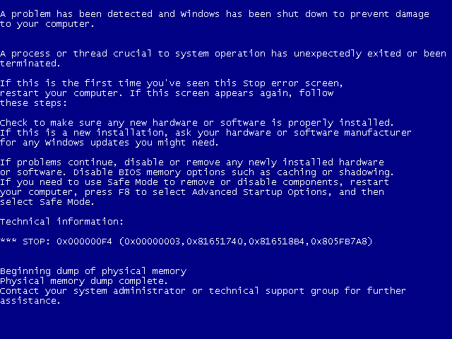
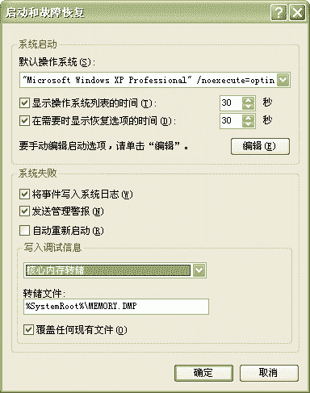
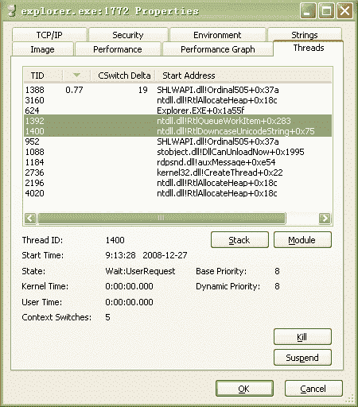
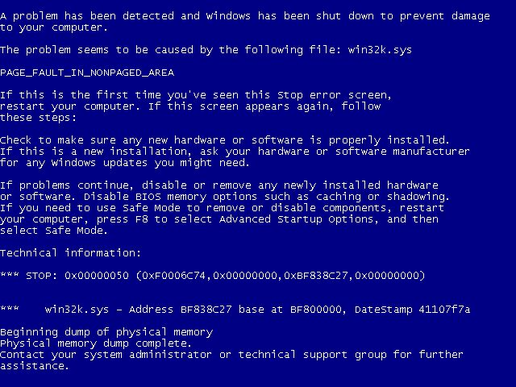

# 用户模式 APC 蓝屏分析报告

> 原文：[`www.pediy.com/kssd/pediy10/80421.html`](https://www.pediy.com/kssd/pediy10/80421.html)

关键词：`APC`，蓝屏，`QueueUserAPC`，`ZwQueueApcThread`，漏洞

曾在看雪上看到一篇 [【】Ring3 下把 Windows XP SP2 弄蓝了……](http://bbs.pediy.com/showthread.php?p=517457) 的帖子。

出于好奇，改了段 `QueueUserAPC` 的 Delphi 的代码（见该贴的 5 楼），结果 SP3 下也蓝屏了：



也许是太简单了，苦等不见高手回复。正好在学漏洞分析这门课，就拿这个问题来练手 。

最后分析发现，其实这个蓝屏原因很简单 `QueueUserAPC` 的调用上范了初级错误，`APC` 插 `csrss` 后执行出错，导致 `csrss` 被 `OS` 中止掉了。

虽然简单，不过重要的是分析过程，所以在这里记录一下。分析中难免有错，高手飘过...

---

由于出问题的 `API` 是 `QueueUserAPC`，于是尝试着用 `OllyDbg` 跟入检查原因。可以看到，`QueueUserAPC` 实际是通过调用 `ntdll!ZwQueueApcThread` 实现的。不过 `ZwQueueApcThread` 没办法进一步跟进去：

```
7C92E23D  >  B8 B4000000      MOV EAX,0B4             ; ZwQueueApcThread
7C92E242    BA 0003FE7F      MOV EDX,7FFE0300
7C92E247    FF12            CALL DWORD PTR DS:[EDX] ; ntdll.KiFastSystemCall
7C92E249    C2 1400         RETN 14
SS:
0012FF30   7C834174  返回到 kernel32.7C834174 来自 ntdll.ZwQueueApcThread

7C92EB8B  >  8BD4           MOV EDX,ESP             ; ntdll.KiFastSystemCall
7C92EB8D    0F34           SYSENTER
```

`SYSENTER` 之后进入 `Ring0`，`OD` 是拿它没办法的。

好在实际测试发现，并不是 `SYSENTER` 进入后就马上蓝屏，也就是说出问题的地方并不是 `ntdll.KiFastSystemCall` 中。

由于不会 `SoftICE`，所以没法进一步跟踪，看来只能从 `DUMP` 文件入手。

在“启动和故障恢复”选项卡中，选择核心内存转储方式（图 2），然后运行引起蓝屏的程序，让 Windows 输出蓝屏时的内存 `DUMP`：



这样，蓝屏后就会将高端内存输出到 `C:\WINDOWS\MEMORY.DMP` 中。用 `WinDBG` 打开 `DMP` 文件，`!analyze -v` 进行分析（详细分析方法见二楼），发现该蓝屏的产生是系统关键进程 `CSRSS` 被意外终止所导致的。据此可以初步断定，由于 `ZwQueueApcThread` 插入 `APC` 队列使 `csrss.exe` 被终止，而不是最早插入 `APC` 的 `SYSTEM` 和 `SMSS.EXE` 这两个进程。

看来不了解 `APC` 的原理是无法继续分析了，我们先来看看什么是 `APC`。`APC` 即异步过程调用，是（[Asynchronous Procedure Call](http://msdn.microsoft.com/en-us/library/ms681951\(VS.85\).aspx)）的缩写。这里直接引用《谈谈对 `APC` 的一点理解》中的原话：

> 1) `APCs` 允许用户程序和系统元件在一个进程的地址空间内某个线程的上下文中执行代码。
>
> 2) `I/O` 管理器使用 `APCs` 来完成一个线程发起的异步的 `I/O` 操作。
>
> 3) 使用 `APC` 可以得到或者设置一个线程的上下文和挂起线程的执行。

在 `NT` 中，有两种类型的 `APCs`：用户模式和内核模式。……用户模式的 `APCs` 需要目标线程处在 `Alertable` 等待状态才能被成功的调度执行。对于用户模式下，可以调用 `SleepEx`、`WaitForSingleObjectEx` 等 `API` 使目标线程处于 `Alertable` 等待状态，从而让用户模式 `APCs` 执行。当一个用户模式 `APC` 被投递到一个线程，调用上面的等待函数，如果返回等待状态 `STATUS_USER_APC`，在返回用户模式时，内核转去控制 `APC` 例程，当 `APC` 例程完成后，再继续线程的执行。

简单来说，`APC` 通过 `Alertable I/O` 提供更有效的异步通知形式，当 `IO` 请求完成后，一旦线程进入可告警状态（`Alertable`），我们在 `APC` 队列中设置的回调函数将会执行，此时我们将获得目标线程的控制权直至返回。

`APC` 在 Windows 系统中应用相当广泛，实际上 `TerminateThread` 就是利用 `APC` 实现的。使用 `TerminateThread` 可以在任何时候结束指定线程。查阅微软支持库 `Q254956`（[`support.microsoft.com/kb/254956/en-us/`](http://support.microsoft.com/kb/254956/en-us/)）可知，调用 `TerminateThread` 会在目标进程中产生一个 `APC` 队列，然后强制所有线程进入等待状态，用于执行 `APC` 队列中的 `ExitThread` 函数，从而结束目标进程。这是一种典型的 `APC` 应用，由于使用 `APC` 来执行退出进程操作，这就导致了被 `TerminateThread` 结束的线程不能回到自身的清理函数中，这也是 `APC` 的一个特性。

`APC` 方式执行的回调函数，实际上是中断目标进程转入指定回调程序执行。这样的好处在于不会有新的线程产生，而且可以控制目标线程的执行流程。返回目标进程领空也比较简单，由于 `APC` 调用前已经把返回地址压入堆栈中，只需适时的执行一条 `ret` 指令便可以返回，而无需像挂钩子函数或者远程线程中，执行繁琐的清理操作。

这么一来就清楚了。一旦我们劫持 `csrss.exe` 中的某个线程，让他去执行一些非法操作，于是 `csrss.exe` 就壮烈牺牲了。

有人说了，将 `CallBack` 地址赋值 `LoadLibraryA` 也会引起蓝屏？首先我要说的是，表 1 中那段 `APC` 代码实际是错的，光调用一个 `QueueUserAPC` 函数就错了两个参数，也正是因为写得有问题才引起的目标程序访问违规：

> [完整代码点这里](http://bbs.pediy.com/showthread.php?p=517457#post517457)

```delphi
pStrDll := PAnsiChar(dllName);

QueueUserAPC(@LoadLibraryA, hThread, DWORD(pStrDll));
```

由 Delphi 的调用规范可知，参数 1（`@LoadLibraryA`）是取 `LoadLibraryA` 的地址。然而，这里取得的并非 `LoadLibraryA` 的真正地址，而是一个 `JMP` 指令（不清楚的可以用 `OD` 跟踪一下程序中的 `API` 调用）。正确方法应该是通过 `GetProcAddress` 取得 `LoadLibraryA` 函数入口，这样才能继续。当然，参数 3（`DWORD(pStrDll)`）是另一个错误所在，将 `pStrDll` 这个 `DLL` 名字指针强制转成 `DWORD` 型是没有错误，问题在于这个 `pStrDll` 所指内容是在本地进程中的，要是在其他进程里访问这个地址，内容肯定不一样。

是不是很熟悉，`QueueUserAPC` 这个 `API` 调用其实和 `CreateRemoteThread` 很像，只不过其根本不同在于 `CreateRemoteThread` 要创建新的线程用于执行我们的目标代码，而 `QueueUserAPC` 不用。

---

另外说说网上一些关于 `APC` 注入的误区。`APC` 注入参数 1 不一定非要是 `LoadLibraryA`，其他 `API` 也是可行的（网上教程都用 `LoadLibrary` 是因为载入 `DLL` 实现起来比较简单而且通用）。`APC` 的可以帮助我们执行指定位置的任意代码，只要把 `QueueUserAPC` 参数 1 的指针指向要执行的 `ShellCode`，然后等待系统处理这个用户模式 `APC` 就行了。

当然，搬网上某些 `APC` 注入教程的原话，“有时你等得花儿都谢了 `APC` 还没有执行”。确实如此，只有当目标线程调用了 `SleepEx`、`WaitForSingleObjectEx`、`WaitForMultipleObjectsEx` 等 `API` 时，用户模式 `APC` 才能执行，这也是大多数线程插入 `APC` 后没有反应的原因。就目前来看，公认的方法是通过暴力注入 `explorer.exe` 的所有线程来达到目标效果。实际 `explorer` 中，通常都会有这样两个线程等着你去插入：

```
ntdll!RtlQueueWorkItem+0x2b5
ntdll!RtlDowncaseUnicodeString+0x75
```

这两个进程可以通过 `Sysinternals` 的 [Process Explorer](http://technet.microsoft.com/zh-cn/sysinternals/bb896653\(en-us\).aspx) 的线程列表进行查看，他们会不断的进入 `Alertable` 等待状态，所以可以顺利执行 `ShellCode`。



这是注入 `CSRSS` 并且 `LoadLibraryA` 一个显示对话框的 `DLL` 引起的蓝屏截图，相关代码见此楼附件：



同样的使用 `WinDbg` 分析，可以得到如下信息：

```
*********************************************************************
*                                                                   *
*                       Bugcheck Analysis                           *
*                                                                   *
*********************************************************************

Use !analyze -v to get detailed debugging information.

BugCheck 50, {f0006c74, 0, bf838c27, 0}
Probably caused by : memory_corruption
Followup: memory_corruption

---------------

kd> !analyze -v

*********************************************************************
*                                                                   *
*                       Bugcheck Analysis                           *
*                                                                   *
*********************************************************************

PAGE_FAULT_IN_NONPAGED_AREA (50)

Invalid system memory was referenced.  This cannot be protected by try-except,
it must be protected by a Probe.  Typically the address is just plain bad or it
is pointing at freed memory.

Arguments:

Arg1: f0006c74, memory referenced.
Arg2: 00000000, value 0 = read operation, 1 = write operation.
Arg3: bf838c27, If non-zero, the instruction address which referenced the bad memory address.
Arg4: 00000000, (reserved)

Debugging Details:

---------------

READ_ADDRESS:  f0006c74
FAULTING_IP:
win32k!NtUserGetDCEx+2c
bf838c27 8b7108          mov     esi,dword ptr [ecx+8]

MM_INTERNAL_CODE:  0
DEBUG_FLR_IMAGE_TIMESTAMP:  0
FAULTING_MODULE: bf800000 win32k
DEFAULT_BUCKET_ID:  CODE_CORRUPTION
BUGCHECK_STR:  0x50
PROCESS_NAME:  csrss.exe
TRAP_FRAME:  f9c7ccd8 -- (.trap 0xfffffffff9c7ccd8)
ErrCode = 00000000
eax=e14254c0 ebx=bf838c46 ecx=f0006c6c edx=0055ee64 esi=0055ee70 edi=f9c7cd64
eip=bf838c27 esp=f9c7cd4c ebp=f9c7cd50 iopl=0     vif nv up ei pl zr na pe nc
cs=0008  ss=0010  ds=0023  es=0023  fs=0030  gs=0000             efl=00090246

win32k!NtUserGetDCEx+0x2c:
0008:bf838c27 8b7108          mov     esi,dword ptr [ecx+8] ds:0023:f0006c74=????????

Resetting default scope

LAST_CONTROL_TRANSFER:  from 805256fb to 805349ae

STACK_TEXT:

f9c7cc74 805256fb 00000050 f0006c74 00000000 nt!KeBugCheckEx+0x1b
f9c7ccc0 804e2ff1 00000000 f0006c74 00000000 nt!MmAccessFault+0x6f5
f9c7ccc0 bf838c27 00000000 f0006c74 00000000 nt!KiTrap0E+0xcc
f9c7cd50 804e006b 00000000 00000000 00000003 win32k!NtUserGetDCEx+0x2c
```


```
f9c7cd50 7c92eb94 00000000 00000000 00000003 nt!KiFastCallEntry+0xf8

0055ee58 77d1f229 77d3b22a 00000000 00000000 ntdll!KiFastSystemCallRet

0055f110 77d3b12b 0055f26c 0055f340 0174fb14 USER32!NtUserGetDCEx+0xc

0055f260 77d65fdf 0055f26c 00000028 00000000 USER32!MessageBoxWorker+0x2ba

0055f2b8 77d50574 00000000 0174a1ac 0174a1a8 USER32!MessageBoxTimeoutW+0x7a

0055f2d8 77d6615b 00000000 0174a1ac 0174a1a8 USER32!MessageBoxExW+0x1b

0055f2f4 0174a19f 00000000 0174a1ac 0174a1a8 USER32!MessageBoxW+0x45

WARNING: Stack unwind information not available. Following frames may be wrong.

0055f350 7c9211a7 01740000 00000001 00000000 32+0xa19f

0055f370 7c93cbab 0174b158 01740000 00000001 ntdll!LdrpCallInitRoutine+0x14

0055f478 7c936178 00000000 c0150008 00000000 ntdll!LdrpRunInitializeRoutines+0x344

0055f724 7c9362da 00000000 00163910 0055fa18 ntdll!LdrpLoadDll+0x3e5

0055f9cc 7c801bb9 00163910 0055fa18 0055f9f8 ntdll!LdrLoadDll+0x230

0055fa34 7c801d6e 7ffdcc00 00000000 00000000 KERNEL32!LoadLibraryExW+0x18e

0055fa48 7c801da4 016e0000 00000000 00000000 KERNEL32!LoadLibraryExA+0x1f

0055fa64 7c8341cc 016e0000 0055fac0 00000000 KERNEL32!LoadLibraryA+0x94

0055faac 7c92eac7 7c801d77 016e0000 00000000 KERNEL32!BaseDispatchAPC+0x50

0055fff4 00000000 00000000 000000c8 0000012a ntdll!KiUserApcDispatcher+0x7

STACK_COMMAND: kb
MODULE_NAME: memory_corruption
IMAGE_NAME: memory_corruption
FOLLOWUP_NAME: memory_corruption
MEMORY_CORRUPTOR: LARGE
FAILURE_BUCKET_ID: MEMORY_CORRUPTION_LARGE
BUCKET_ID: MEMORY_CORRUPTION_LARGE
Followup: memory_corruption
```

---------

```
kd> lmvm win32k
```

```
start    end        module name
bf800000 bf9c0200   win32k     (pdb symbols)          D:\Program Files\Symbols\win32k.pdb\D48935A134F249CDA985C45051FBF0462\win32k.pdb

    Loaded symbol image file: win32k.sys
    Image path: \SystemRoot\System32\win32k.sys
    Image name: win32k.sys
    Timestamp:        Wed Aug 04 14:17:30 2004 (41107F7A)
    CheckSum:         001C663B
    ImageSize:        001C0200
    File version:     5.1.2600.2180
    Product version:  5.1.2600.2180
    File flags:       0 (Mask 3F)
    File OS:          40004 NT Win32
    File type:        3.7 Driver
    File date:        00000000.00000000
    Translations:     0804.04b0
    CompanyName:      Microsoft Corporation
    ProductName:      Microsoft(R) Windows(R) Operating System
    InternalName:     win32k.sys
    OriginalFilename: win32k.sys
    ProductVersion:   5.1.2600.2180
    FileVersion:      5.1.2600.2180 (xpsp_sp2_rtm.040803-2158)
    FileDescription:  Multi-User Win32 Driver
    LegalCopyright:   (C) Microsoft Corporation. All rights reserved.
```

可见这个 BSOD 是由于内存访问违规引起的。由于 `win32k.sys` 中的这条指令，读取了 `0xf0006c74` 的内容，而 `0xf0006c74` 不在内存中，于是引起了蓝屏。

```
0008:bf838c27  8b7108    mov esi,dword ptr [ecx+8]     ; ds:0023:f0006c74=????????
```

回想这个蓝屏发生的原因，由于 `LoadLibrary` 了一个 `cmdShell` 到 `csrss.exe` 的第二个线程中，结果就出现了这个蓝屏。查看蓝屏前的堆栈，可以看到这样三行：

```
0055fa34 7c801d6e 7ffdcc00 00000000 00000000 KERNEL32!LoadLibraryExW+0x18e
0055fa48 7c801da4 016e0000 00000000 00000000 KERNEL32!LoadLibraryExA+0x1f
0055fa64 7c8341cc 016e0000 0055fac0 00000000 KERNEL32!LoadLibraryA+0x94
```

这说明了 `LoadLibraryA` 确实被执行了。也就是说如果我们写一段 `ShellCode` 到 `CSRSS` 中，就可以利用 `CSRSS` 的权限作我们想做的事情。至于注入 `CSRSS` 所需要的权限，例如管理员、`SeDebugPrivilege` 等，参见其他注入教程中关于 `OpenThread` 和 `OpenProcess` 的部分。

---------------------------------------------------------------------------------------

**附件 `APC_src.rar` 说明**：

`APC 注入_D2009\AnyAPC_Boom.rar` 里面是 `APC` 注入的主程序，用法见源码目录下的 `readme.txt`

`注射用 DLL\多线程 cmdshell\s32.dll` 改成 `32.dll` 丢到 `Windows` 安装目录中，注入后监听 `3820` 端口，可以 `Telnet` 试

相关的程序源码都在里面，自己看吧。另外，建议先扫一遍毒再运行

上传的附件

|  | `APC_src.rar` `[解压密码：pediy]` |
| :--- | :--- |
