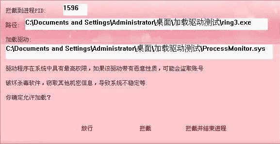
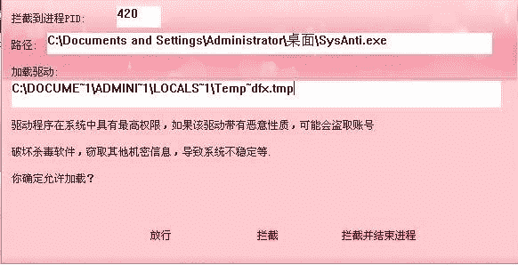

# 总结一把，较为精确判断 SCM 加载

> 原文：[`www.pediy.com/kssd/pediy12/135988.html`](https://www.pediy.com/kssd/pediy12/135988.html)

最近做点东西，算作是对自己半年来学习驱动的一点检验，很多代码来自于大牛们的众多作品，由于业余，很多地方处理的不好，蓝屏，死机。。。。

之前还是浮躁了，逆向烂的一塌糊涂，曾经还把 `360` 的驱动丢进 `IDA`，按个 `Ctrl+F5`，然后就对着代码狂翻十几分钟，啥都看不出来~~~~

最纠结的是现在搞得 `Release` 修改界面都会导致 `PAGE_FAULT_IN_NONPAGED_AREA` 错误，定位到我的驱动的 `GoOrNot` 函数。。。。。我用的 `SkinSE` 库，郁闷得~~~~~~~

本文算是个前期总结吧

## 基于 SSDT Hook

记录两点，尤其是第二点，费了很多时间：

1. 拦截远程线程创建
2. 拦截 `SCM` 方式加载驱动（较为精确判断真实的加载驱动意图者）

希望第二点能给和我一样水平的一点帮助，能够更准确的判断 `SCM` 方式加载驱动

### 1、拦截远程线程创建

`黑防 2009.03` 期上有一篇文章《`SSDT Hook` 拦截远程线程的创建》（文 `灰狐` `iCoodle`）

文中本来已经见得比较详细了，我在实践中遇到了一些问题

#### （1）进行拦截的艰难抉择

想要得到创建的线程 `ID`，必须要先执行原始的 `ZwCreateThread` 函数，才能得到各项参数

所以我实际上也没有进行拦截，只是记录了相关线程参数，以供后期处理

#### （2）文中有一个缺陷，就是创建进程也会导致 ZwCreateThread 被调用，他没有处理，于是判断被创建线程的进程是否已经存在线程成了一个问题

#### （3）得到进程信息

```c
NTSTATUS HookZwCreateThread(
    OUT PHANDLE ThreadHandle,
    IN ACCESS_MASK DesiredAccess,
    IN POBJECT_ATTRIBUTES ObjectAttributes,
    IN HANDLE ProcessHandle,
    OUT PCLIENT_ID ClientId,
    IN PCONTEXT ThreadContext,
    IN PVOID InitialTeb,
    IN BOOLEAN CreateSuspended
)
{
    ........................
    //--------------------------------------------------------//
    ULONG lRet;
    PROCESS_BASIC_INFORMATION* pbi;               //获取被创建线程的进程 ID
    PVOID pBuffer;
    PROCESSINFOCLASS ProcessBasicInformation=0;

    //根据 IDA 反汇编的内核文件，当获取进程信息时，枚举类型 enum PROCESSINFOCLASS (standard)，ProcessBasicInformation = 0
    //声明 PROCESSINFOCLASS ProcessBasicInformation=0;用来指明第三个参数类型为 ProcessBasicInformation

    uPid.Buffer=(PWSTR)ExAllocatePool(NonPagedPool,256);
    uPid.MaximumLength=256;
    uTid.Buffer=(PWSTR)ExAllocatePool(NonPagedPool,256);
    uTid.MaximumLength=256;

    //------------------------------------------------------------//
    pBuffer=ExAllocatePool(NonPagedPool,sizeof(PROCESS_BASIC_INFORMATION));

    ZwQueryInformationProcess(ProcessHandle,ProcessBasicInformation,pBuffer,sizeof(PROCESS_BASIC_INFORMATION),&lRet);

    pbi=(PROCESS_BASIC_INFORMATION*)pBuffer;

    //DbgPrint("%d 进程里有线程创建",pbi->UniqueProcessId);

    //上面得到的是被创建线程的进程 PID
    //为了得到相关的线程信息，我还想当然的认为应该也有对应的
    //THREAD_BASIC_INFORMATION 结构与之对应，也应该有 ZwQueryInformationThread 与之对应，结果比较郁闷
}
```

后来参照了一些代码，正好有输出线程信息和判断功能

`By:冰龙 2009.10.1`

```c
NTSTATUS ZhuZwCreateThread(OUT PHANDLE ThreadHandle,
                           IN ACCESS_MASK DesiredAccess,
                           IN POBJECT_ATTRIBUTES ObjectAttributes,
                           IN HANDLE ProcessHandle,
                           OUT PCLIENT_ID ClientId,
                           IN PCONTEXT ThreadContext,
                           IN PVOID UserStack,
                           IN BOOLEAN CreateSuspended)
{
    NTSTATUS Status;
    PVOID loaddll=0;

    Status=ObReferenceObjectByHandle(ProcessHandle,(ACCESS_MASK)PROCESS_ALL_ACCESS,NULL,KernelMode,&loaddll,NULL);

    if (NT_SUCCESS(Status))
    {
        if (IoGetCurrentProcess()!=loaddll)
        {
            if(!FindThread((PEPROCESS)loaddll))
            {
                wwe= PsGetProcessImageFileName(loaddll);
                wwp= PsGetProcessImageFileName(IoGetCurrentProcess());
                DbgPrint("进程%s 要注入线程到进程%s 中\n",wwp,wwe);
                return STATUS_ACCESS_DENIED;
            }
        }
        ObDereferenceObject((PVOID)loaddll);
    }

    Status=OldZwCreateThread(ThreadHandle,DesiredAccess,ObjectAttributes,ProcessHandle,ClientId,ThreadContext,UserStack,CreateSuspended);
    return Status;
}
```

`DbgPrint("进程%s 要注入线程到进程%s 中\n",wwp,wwe);`

`return STATUS_ACCESS_DENIED;`

`ObDereferenceObject((PVOID)loaddll);`

`Status=OldZwCreateThread(ThreadHandle,DesiredAccess,ObjectAttributes,ProcessHandle,ClientId,ThreadContext,UserStack,CreateSuspended);`

`return Status;`

这个 `ClientId` 结构让我郁闷了好久，很多地方都用到

后来发现 `ntoskrnl.exe` 里面有

```
00000000 CLIENT_ID       struc ; (sizeof=0x8, standard type)
00000000 UniqueProcess   dd  ?                             ; offset
00000004 UniqueThread    dd  ?                             ; offset
00000008 CLIENT_ID       ends
```

没有找到 `FindThread` 函数，只能自己实现了，由于底层编程功底不行，一开始是在用户态通过创建快照遍历来判断，结果不行，后来乱翻《`Windows 内核情景分析》》，发现一个地方，在 `EPROCESS` 结构里有一个参数 `ActiveThreads`，可以达到目的，此处用的硬编码

```c
#define ActiveThreads 0x1a0       //活动线程数，硬编码 WIN XP SP3
```

实现函数

```c
BOOL FindThread(PEPROCESS Process)//是否已经存在线程
{
    UINT * num;
    num=(UINT)Process+ActiveThreads;
    if(*num == 0)
        return 0;
    else
        return 1;
}
```

判断远程线程创建就到这

### 2、拦截 SCM 方式加载驱动并精确判断加载进程(除去 services.exe)（此处略过 ZwSetSystemInformation）

应该说，很多人都做过 `SSDT Hook ZwLoadDriver` 拦截驱动的加载。但是很多个人防火墙，一些主动防御软件都不能准确判断 `SCM` 方式加载驱动的进程，只提示 `services.exe`，`360` 做得很好，膜拜一把。

郁闷，最新的源代码删了~~~~~~，只能重写

#### （1）基础不牢，当初还以为是进程创建 services.exe 来加载，结果发现其父进程是 winlogon.exe

`~~~~`

后来查资料说是 `RPC` 方式通知 `services.exe` 进程,忘了哪位大牛了

原话：

这些大部分都是通过 `NdrClientCall` 来发送 `RPC` 请求给 `Services.exe` 实现的

`RPC` 通讯在各个平台上依赖的 `API` 各不相同，基本上

- `win2000`: `NtFsControlFile`
- `xp,2003`: `NtRequestWaitReplyPort`
- `vista,2008,win7`: `NtAlpcSendWaitReceivePort`

于是狂搜 `NtRequestWaitReplyPort` 的资料，终于在 `DebugMan` 上看到有人发帖，得到一个结论：

判断 `RequestMessage->MessageData` 的数据

可惜基本不太会 `WinDbg`

`DbgPrint("数据大小:%d,地址%x",RequestMessage->ActualMessageLength,RequestMessage->MessageData);`

得到的 `14f090` 貌似是地址，但 `WinDbg` 看不到。。。

在内存查看窗口输入 `0014f090` 提示“无法检索信息, `Win32` error 0n30: 系统无法从指定的设备上读取”。

#### （2）后来发帖求助，得到 鹿剑 的分析文档

在他的文档的截图里，`WinDbg` 是多么的好用，我也发现了 `DebugMan` 上的结论跟他的截图里面一样：

- `41021F00` = `StatService`
- `41021C00` = `OpenService`
- `41021800` = `CreateService`

#### （3）最后无奈，乱搜了一番，得到这么一段代码

```c
ptr=(ULONG *)(pLpcMessage->MessageData);
for (i=0; i<pLpcMessage->ActualMessageLength/sizeof(ULONG); i++)
{
    MyPrintf("%x ", ptr[i]);
}
```

心中大喜，之前也曾想过类似的方式，不过写的不行。于是采用此法，得到的 `StartService` 数据

`1 1F0241`，即 `41201f10` 跟 `41021F00` 有点不一样（不考虑正反），跑了一番，发现可以

判断思路：

根据 `ZwRequestWaitReplyPort` 得到最后 `StartService` 的进程，记录到变量中，在 `ZwLoadDriver` 中进行判断，如果是 `services.exe` 进程，则将变量中的信息替换掉 `ZwLoadDriver` 中的进程信息，返回到应用层，其它进程不进行处理，直接发往应用层

有人采用 `ZwRequestWaitReplyPort` 里面的数据直接进行拦截，可能不太好弄

`HookZwLoadDriver`：

```c
if(strstr(aProcessName,"services.exe"))
{
    strcpy(aProcessName,LastCalled_Path);
    PId=LastCalled_Pid;
}
else
{
    PId=PsGetCurrentProcessId();
}
```

`HookZwRequestWaitReplyPort`:

```c
//---------------------------------------------------------------------//
NTSTATUS HookZwRequestWaitReplyPort(HANDLE PortHandle, PLPCMESSAGE RequestMessage, PLPCMESSAGE ReplyMessage)
{
    if(TurnOnProMon==1)
    {
        ULONG *ptr;
        ULONG i;
        ULONG uactLength;
        PLPCP_PORT_OBJECT  LPCProt;
        PCHAR aProcessName=ExAllocatePool(NonPagedPool,256);
        PUNICODE_STRING pustr;//LPC 设备名
        PUNICODE_STRING uRealName=ExAllocatePool(NonPagedPool,1024);//字符串".\\RPC Control\\ntsvcs"
        ANSI_STRING aPustr={0};//LPC 设备名
        UNICODE_STRING uProcessPath={0};//进程路径
        ANSI_STRING aProcessPath={0};//进程路径
        HANDLE PId;//进程 PID
        PCWSTR ProcessName=ExAllocatePool(NonPagedPool,256);//进程名
        pustr = ExAllocatePool(NonPagedPool,1024+4);//LPC 设备名
        RtlInitUnicodeString(uRealName,L"\\RPC Control\\ntsvcs");
        ObReferenceObjectByHandle(PortHandle,(ACCESS_MASK)PROCESS_ALL_ACCESS,NULL,KernelMode,(PVOID *)&LPCProt,NULL);//获取对象
        ObQueryNameString(LPCProt->ConnectionPort,pustr,512,&uactLength);
        RtlUnicodeStringToAnsiString(&aPustr,pustr,TRUE);
```


```c
//--------------------------------------------------------------------------
// 进程信息

PId = PsGetCurrentProcessId();

ProcessName = GetCurrentProcessFileName(); // 获得当前进程完整路径

RtlInitUnicodeString(&uProcessPath, ProcessName);
RtlUnicodeStringToAnsiString(&aProcessPath, &uProcessPath, TRUE);
strcpy(aProcessName, aProcessPath.Buffer);

if (!(RtlCompareUnicodeString(pustr, uRealName, TRUE)))
{
    {
        ptr = (ULONG *)(RequestMessage->MessageData);

        for (i = 0; i < RequestMessage->ActualMessageLength / sizeof(ULONG); i++)
        {
            DbgPrint("%x ", ptr[i]); // 输出数据
        }
        // if(ptr[0]==0x01&&ptr[1]==0x1f0241) // 有点问题

        if (ptr[1] == 0x1f0241)
        {
            DbgPrint("进程%s 开启服务", aProcessName); // 输出数据
            strcpy(LastCalled_Path, aProcessName);
            LastCalled_Pid = PId;
        }
    }
}

return RealZwRequestWaitReplyPort(PortHandle, RequestMessage, ReplyMessage);

}

else
    return RealZwRequestWaitReplyPort(PortHandle, RequestMessage, ReplyMessage);
}
```

结果：




