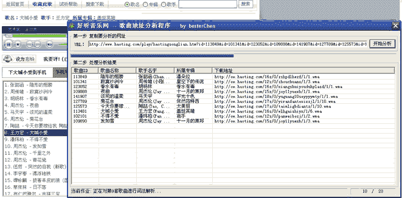

# 好听音乐网 -- 歌曲下载分析流程及程序的编写

> 原文：[`www.pediy.com/kssd/pediy10/92286.html`](https://www.pediy.com/kssd/pediy10/92286.html)

难得我母亲要我给她下音乐听，她在好听音乐网上听到一首，我就要百度好久才能找到播放的是哪首，好长时间才下了仅仅的几首。

记得以前迅雷可以直接分析出下载地址来的，可是现在不知怎么的，迅雷的版本高了，功能却变得弱智了。

没有办法就只有自己找找规律分析一下了，下面记录我的分析过程，贴出来纪念下：

先看下网址的规律：

多个歌曲连播的 URL 地址形式：

> `http://www.haoting.com/play/htsonglian1.htm?id=123907&id=357857`

其中 `id=` 后面的数字就是歌曲的 ID。

单首歌曲播放的 URL 形式：

> `http://www.haoting.com/htmusic/357857ht.htm`

其中的数字就是歌曲的 ID。

查看其源文件，得到如下内容：

```html
<SCRIPT language="JavaScript" src="/js/lianbohy.js"></SCRIPT>
```

打开这个文件，查看其代码，仔细分析得到有用信息如下：

```javascript
function digui(musicids, length)
{
    if (idindex < length)
    {
        idvalue = musicids[idindex];
        s = document.createElement("script");
        s.type = "text/javascript";
        s.src = "http://haoting.com/musicjs/" + musicids[idindex] + ".js"; // 这个是关键。
        document.getElementsByTagName("head")[0].appendChild(s);
    }
}
```

由于到这里两种网址中歌曲的 ID 已经都取到了，只要访问如下格式的 URL：

> `http://haoting.com/musicjs/歌曲的ID.js`

比如：

> `http://haoting.com/musicjs/357857.js`

就可以下载到如下内容的 JS 文件：

```javascript
var url_357857="/21z/0/dianxiao2yyyyqx090620/1/0897053676a18e5e_1.wma"; // 下载地址
var music_357857="相爱后动物感伤(CD Version) - 阿密特(张惠妹)";    // 这个是歌曲名
var singer_357857="最新单曲";          // 这个是歌手名
var nclassid_357857=5538;
var specialid_357857="abb60fe6d6c77f45";
var specialName_357857="最新单曲合辑 NO.48";       // 这个是专辑名
```

我们知道这个音乐在网站上的相对地址了，怎么才能知道它完整的地址呢？

继续分析 `lianbohy.js` 中的代码，找到如下信息：

```javascript
// 播放歌曲
function play(str, obj)
{
    ........
    var STAND_STR = "/19z/",
        STAND_STR2 = "/20z/",
        STAND_STR3 = "/21z/",
        STAND_STR4 = "/22z/";
    if (url.indexOf(STAND_STR) == -1 && url.indexOf(STAND_STR2) == -1 && url.indexOf(STAND_STR3) == -1 && url.indexOf(STAND_STR4) == -1)
        ht = "http://ow.haoting.com";
    else
        ht = "http://wma.haoting.com";

    if (window.navigator.userAgent.indexOf("MSIE") == -1)
    {
        installPlayer(ht + url);
    }
    else
    {
        haotingplay.url = ht + url;
        haotingplay.controls.play();
        showTLab();
    }
    .......
}
```

嘿嘿，明白了吧，如果看不懂这些代码，就把它跟我们找到的地址一起对比下：

```javascript
STAND_STR3 = "/21z/",
ht = "http://wma.haoting.com";
haotingplay.url = ht + url;
```

再看下相对地址：

```javascript
var url_357857="/21z/0/dianxiao2yyyyqx090620/1/0897053676a18e5e_1.wma";
```

根据上面的文件我们可以提取出很多的信息，其中下载地址如下：

> `http://wma.haoting.com/21z/0/dianxiao2yyyyqx090620/1/0897053676a18e5e_1.wma`

分析完毕，下面开始写个小程序，让它自动完成我上面的分析过程并显示结果：

首先需要用程序来分解上面的网址，从中提取出里面的歌曲 ID：

```c
/******************************************************************************
// 函数名称:    AnalyseXUrl
// 参数列表:
//             1、 pUrl      : 要分析的网址。
//             2、 desMusicID:    用来存放歌曲 ID 的缓冲区。
//             3、 desBufLen :    URL 中存在歌曲 ID 的数量。
// 函数功能:
//                 从给定的网址中分离出歌曲的 ID。
// 返回值  :
//                 获取成功返回 TRUE, 否则是 FALSE。
******************************************************************************/
BOOL WINAPI AnalyseXUrl(PCHAR pUrl, PDWORD desMusicID, PDWORD desBufLen)
{
    bool bStart = false;
    char tmpID[10] = {0};

    int UrlLen = lstrlen(pUrl);
    if (0 < UrlLen)
    {
        if (NULL != strstr(pUrl, "haoting.com/htmusic/\0") && NULL != strstr(pUrl, ".htm\0"))
        {
            //http://www.haoting.com/htmusic/357857ht.htm
            for (int i = 0, x = 0; i<lstrlen(pUrl); i++)
            {
                if (pUrl[i] >= '0' && pUrl[i] <= '9')
                {
                    tmpID[x] = pUrl[i];
                    x++;
                }
            }
            sscanf(tmpID, "%d", desMusicID);
            *desBufLen = 1;
            return TRUE;
        }
        else if (NULL != strstr(pUrl, ".htm?id=\0"))
        {
            *desBufLen = 0;
            //http://www.haoting.com/play/htsonglian1.htm?id=123907&id=357857
            for (int i = 0, x = 0; i<lstrlen(pUrl); i++)
            {
                if (i>=0 && pUrl[i-1] == '=')
                {
                    bStart = true;
                    x = 0;
                }

                if (pUrl[i] == '&')
                {
                    bStart = false;
                    sscanf(tmpID, "%d", desMusicID);
                    *desBufLen += 1;
                    desMusicID++;
                    RtlZeroMemory(tmpID, 10);
                }

                if (bStart)
                {
                    tmpID[x] = pUrl[i];
                    x++;
                }
            }
            sscanf(tmpID, "%d", desMusicID);
            *desBufLen += 1;
            return TRUE;
        }
        else
        {
            return FALSE;
        }
    }
    else
    {
        return FALSE;
    }
}
```

OK，成功得到 ID 我们就可以构造一个网址，得到 ID 对应歌曲的信息：


# `GetXCode`
## 函数说明
- **函数名称**:`GetXCode`
- **参数列表**:
    1. `nMusicID`: 指定歌曲的 ID
    2. `desCode`: 用来存放 HTML 代码的缓冲区
- **函数功能**: 获取指定 URL 中的 HTML 代码。
- **返回值**: 返回获取的代码的字节数。

```c
int WINAPI GetXCode(int nMusicID, PCHAR desCode)
{
    char szMusicID[10] = {0};
    BOOL bRead*** = FALSE;
    char MusicXCodeBuf[1024] = {0}; 
    DWORD dwBytesRead = 0; 
    char pUrl[128]    = "http://haoting.com/musicjs/\0";    //"http://haoting.com/musicjs/"+musicids[idindex]+".js"
    sprintf(szMusicID, "%d", nMusicID);

    lstrcat(pUrl, szMusicID);
    lstrcat(pUrl, ".js\0");

    HINTERNET hNet = ::InternetOpen("Wonderful Songs", //当 HTTP 协议使用时，这个参数随意赋值 
        PRE_CONFIG_INTERNET_ACCESS, //访问类型指示 Win32 网络函数使用登记信息去发现一个服务器。 
        NULL, 
        INTERNET_INVALID_PORT_NUMBER, //使用 INTERNET_INVALID_PORT_NUMBER 相当于提供却省的端口数。 
        0 //标志去指示使用返回句句柄的将来的 Internet 函数将"不"为回调函数发送状态信息 
        ) ; 
 
    HINTERNET hUrlFile = ::InternetOpenUrl(hNet,    //从 InternetOpen 返回的句柄 
        pUrl,    //需要打开的 URL ,我们要打开哪个网址就可以填到这里
        NULL,    //用来向服务器传送额外的信息,一般为 NULL 
        0,        //用来向服务器传送额外的信息,一般为 0 
        INTERNET_FLAG_RELOAD, //InternetOpenUrl 行为的标志 
        0) ;    //信息将不会被送到状态回调函数 

    bRead*** = ::InternetReadFile(hUrlFile,        //InternetOpenUrl 返回的句柄 
        MusicXCodeBuf,            //保留数据的缓冲区,也就是存放网页的内容拉
        sizeof(MusicXCodeBuf), 
        &dwBytesRead);    //指向包含读入缓冲区字节数的变量的指针; 

    if (!bRead***)
    {
        lstrcpy(desCode, "连接超时\0");
    }
    else
    {
        lstrcpy(desCode, MusicXCodeBuf);
    }


    ::InternetCloseHandle(hUrlFile); 
    ::InternetCloseHandle(hNet); 

    return lstrlen(desCode);
}
```

# `AnalyseXCode`
## 函数说明
- **函数名称**:`AnalyseXCode`
- **参数列表**:
    1. `nMusicID`: 歌曲 ID。
    2. `XCode`: HTML 代码。
- **函数功能**: 从 JS 代码中分离歌曲的关键信息到结构体中。
- **返回值**: 返回 `SONG_STRU` 结构，其中存放的歌曲的信息。
- **参数的格式**:
    ```js
    var url_357857="/21z/0/dianxiao2yyyyqx090620/1/0897053676a18e5e_1.wma";
    var music_357857="相爱后动物感伤(CD Version) - 阿密特(张惠妹)";
    var singer_357857="最新单曲";
    var nclassid_357857=5538;
    var specialid_357857="abb60fe6d6c77f45";
    var specialName_357857="最新单曲合辑 NO.48";
    ```

```c
SONG_STRU WINAPI AnalyseXCode(int nMusicID, PCHAR XCode)
{
    bool        bStart = false;
    char        *pdest;
    char        tmpStr[128]    = {0};
    char        szMusicID[10] = {0};
    
    SONG_STRU    struMusicInfo ;

    struMusicInfo.id            =    nMusicID;
    struMusicInfo.MusicName        =    new char[128];
    struMusicInfo.Singer        =    new char[128];
    struMusicInfo.specialName    =    new char[128];
    struMusicInfo.Url            =    new char[128];
        
    if (XCode != NULL)
    {
        //解析下载地址
        pdest  = strstr(XCode, "url_\0");
        if (NULL != pdest)
        {
            for (int i = pdest - XCode + 1, x = 0; i<lstrlen(XCode); i++)
            {
                if (i>=0 && XCode[i-2] == '=')
                {
                    bStart = true;
                    x = 0;
                }
                
                if (XCode[i+1] == ';')
                {
                    bStart = false;

                    if(strstr(tmpStr, "/19z/\0")==NULL && strstr(tmpStr, "/20z/\0")==NULL && \
                        strstr(tmpStr, "/21z/\0")==NULL && strstr(tmpStr, "/22z/\0")==NULL)   
                    {
                        lstrcpy(struMusicInfo.Url, "http://ow.haoting.com");
                    }
                    else 
                    {
                        lstrcpy(struMusicInfo.Url, "http://wma.haoting.com");
                    }
                    
                    lstrcat(struMusicInfo.Url, tmpStr);
                    RtlZeroMemory(tmpStr, 128);
                    break;
                }
                
                if (bStart)
                {
                    tmpStr[x] = XCode[i];
                    x++;
                }
            }
        }

        //解析歌曲名字
        pdest  = strstr(XCode, "music_\0");
        if (NULL != pdest)
        {
            for (int i = pdest - XCode + 1, x = 0; i<lstrlen(XCode); i++)
            {
                if (i>=0 && XCode[i-2] == '=')
                {
                    bStart = true;
                    x = 0;
                }
                
                if (XCode[i+1] == ';')
                {
                    bStart = false;
                    lstrcpy(struMusicInfo.MusicName, tmpStr);
                    RtlZeroMemory(tmpStr, 128);
                    break;
                }
                
                if (bStart)
                {
                    tmpStr[x] = XCode[i];
                    x++;
                }
            }
        }

        //解析歌手名字
        pdest  = strstr(XCode, "singer_\0");
        if (NULL != pdest)
        {
            for (int i = pdest - XCode + 1, x = 0; i<lstrlen(XCode); i++)
            {
                if (i>=0 && XCode[i-2] == '=')
                {
                    bStart = true;
                    x = 0;
                }
                
                if (XCode[i+1] == ';')
                {
                    bStart = false;
                    lstrcpy(struMusicInfo.Singer, tmpStr);
                    RtlZeroMemory(tmpStr, 128);
                    break;
                }
                
                if (bStart)
                {
                    tmpStr[x] = XCode[i];
                    x++;
                }
            }
        }

        //解析专辑名字
        pdest  = strstr(XCode, "specialName_\0");
        if (NULL != pdest)
        {
            for (int i = pdest - XCode + 1, x = 0; i<lstrlen(XCode); i++)
            {
                if (i>=0 && XCode[i-2] == '=')
                {
                    bStart = true;
                    x = 0;
                }
                
                if (XCode[i+1] == ';')
                {
                    bStart = false;
                    lstrcpy(struMusicInfo.specialName, tmpStr);
                    RtlZeroMemory(tmpStr, 128);
                    break;
                }
                
                if (bStart)
                {
                    tmpStr[x] = XCode[i];
                    x++;
                }
            }
        }
    }

    return    struMusicInfo;
}
```

然后将它得到的信息显示到程序的界面的就可以了，由于直接显示在分析的时候，会造成界面的暂时性假死，所以我单独抛了个线程来完成分析的工作，界面只负责显示，然后在分析的时候加上等待时间，以减少对网络和电脑资源的消耗。

效果如下图：



当然，如果大家有兴趣，可以写个程序，通过对 ID 的遍历来实现歌曲搜索、下载等功能，不过可能会比较消耗网络资源我就不写了，嘿嘿！

## 上传的附件

| 图片 | 文件 |
| :--- | :--- |
|  | [GetDownloadUrlPlg[EXE].rar](92286/646955/27843.rar) |
|  | [GetDownloadUrlPlg[SRC].rar](92286/646955/27844.rar) |
