# 【有码】键盘过滤中关于 IOAPIC 重定位表的学习笔记

> 原文：[`www.pediy.com/kssd/pediy12/135230.html`](https://www.pediy.com/kssd/pediy12/135230.html)

**技术原理：**

`IOAPIC` 是可以用于多个核心 CPU 的新型中断控制器，可以通过编程来对其控制，可以理解为可编程硬件。根据《寒江独钓》的说明，目前不管是单核还是双核都拥有 `IOAPIC` 机制。

对于 `IOAPIC` 的简单处理过程，我的理解如下（如果有错误，请路过的大牛一定要指正啊！！）：

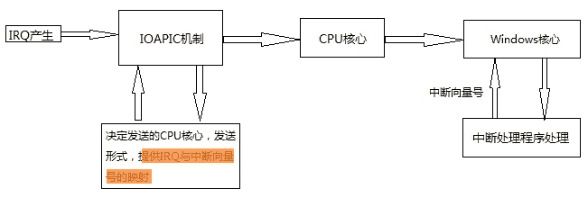

其中，上面用黄色笔做了标记的就是这个技术的核心。

因为硬中断 `IRQ` 最终都会交给中断处理程序进行，而 `Windows` 会根据中断向量号来转移到相应的中断处理程序。因此，就必然存在 `IRQ` 与中断向量号的映射关系。其实，`Windows` 在初始化系统服务的时候就在 `IOAPIC` 中描述好这种映射关系了，注意我在上面画的图中，橙色标注的部分。

所以，整个技术的核心就修改在 `IOAPIC` 中，已经填写好的中断向量号。这样也就要求我们事先应该在 `IDT` 中插入一个中断门。

**如何访问 IOAPIC：**

`IOAPIC` 是通过读写其一系列的寄存器来实现编程控制的。根据《寒江独钓》提供的关于 `IOAPIC` 的 `Intel` 手册资料来看，要访问 `IOAPIC`，不能直接使用它的内部寄存器，而是要通过 2 个内存映射寄存器来访问一个是 `IOREGSEL`，一个是 `IOWIN`。其中 `Intel` 手册的说明如下：

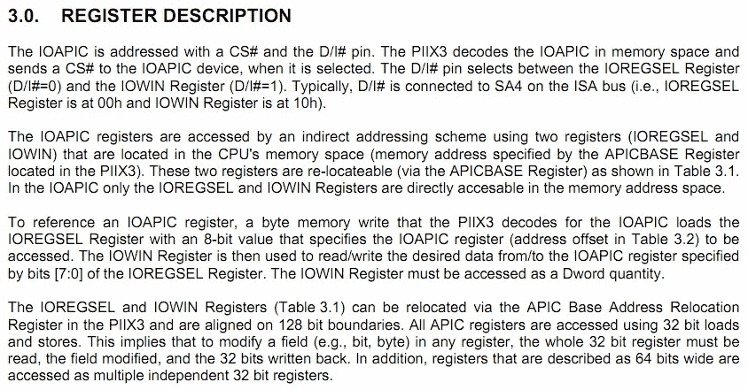

这两个内存映射寄存器的描述如下：

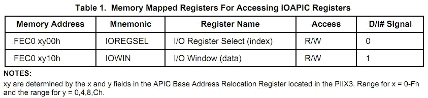

按照手册的说明是寄存器，但实际上是两个物理内存地址，而且是制定了格式的了，就是 `FEC0XY00H` 和 `FEC0XY10H`，其中 `X`, `Y` 是自定义值，也指定了取值范围，就是 `X = 0-FH`，`Y = 0，4，8，CH`。根据《寒江独钓》里的说明，`Windows` 已经规定了，`IOREGSEL`：`FEC00000H`；`IOWIN`：`FEC00010H`。

因为这里谈的都是真正的物理地址，是不能够直接访问的，在 `Windows` 下访问则需要对物理地址进行一个映射（实际上就是添加一个页表项来描述这个映射关系），在 `wdk` 中提供了一个这样的映射函数：

```c
PVOID
MmMapIoSpace(
  IN PHYSICAL_ADDRESS  PhysicalAddress,
  IN SIZE_T  NumberOfBytes,
  IN MEMORY_CACHING_TYPE  CacheType
);
```

经过映射后，我们就可以对其进行操作了。

**首先是 IOREGSEL 映射寄存器。**这个寄存器的作用是：让你指定要访问哪一个 `IOAPIC` 的内部寄存器。可以指定的内部寄存器有：

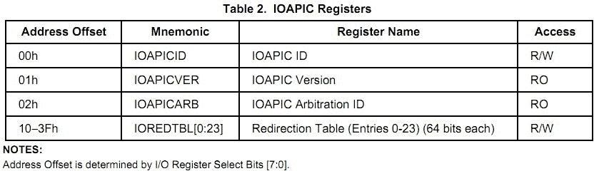

**IOREGSEL 映射寄存器的描述符如下：**

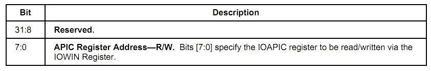

可以看出只有低 8 位是有效位（在编程时候要注意的）。这里根据 `Intel` 手册的说明是，指定的是内部寄存器对应的地址偏移，为了方便理解，我们可以理解为编号，就是指定每个寄存器对应的编号。

**第二个是 IOWIN 映射寄存器。**这个寄存器的作用的作用是：显示 `IOREGSEL` 指定的内部寄存器的内容，你可以读取或修改 `IOWIN` 这个映射寄存器的值，然后映射机制会修改真正的 `IOAPIC` 内部寄存器的值。

**IOAPIC 的各内部寄存器对应的描述如下（一下资料均来自 intel 手册）：**

**IOAPICVERIOAPIC VERSION REGISTER：**

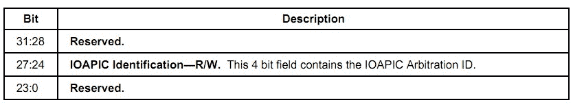

**IOAPICVERIOAPIC VERSION REGISTER：**

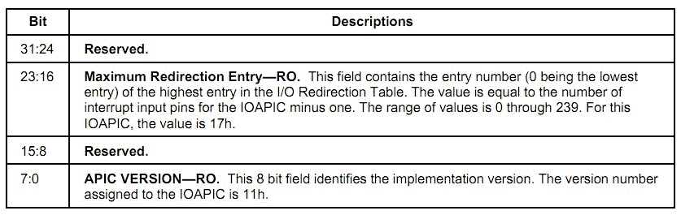

**IOAPICARBIOAPIC ARBITRATION REGISTER：**


**IOREDTBL[23:0]I/O REDIRECTION TABLE REGISTERS：**

这就是重定向表，每个 `IRQ` 与中断向量号的映射关系就记录在里面的 0～7 这个位段，这个表是一个数组，24 项，也就说明了为什么在《寒江独钓》中说是有 24 个可编程的 `IRQ`。

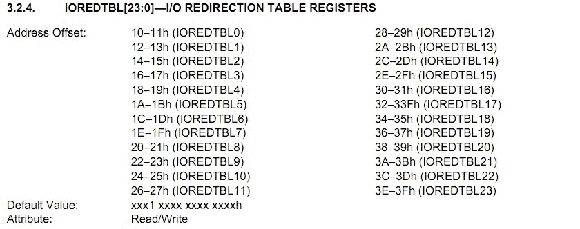

每个 `IRQ` 描述项都是 8 个字节，64 位，描述如下（其实无必要，只是作为资料）：

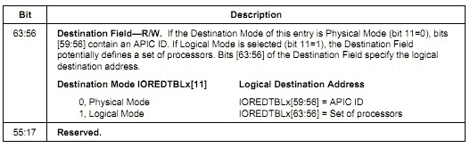

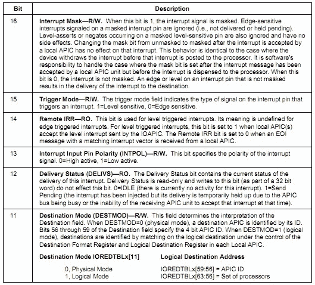

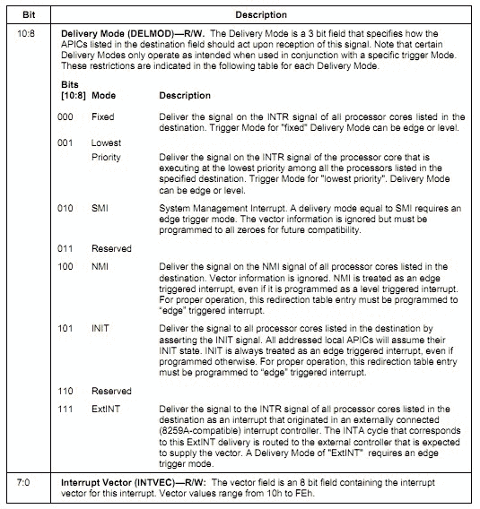

**所以，我们要做的就是将 0~7 这个位段修改成我们的预先插入的中断处理的向量号。**

参考了上面资料后就开始编程：

**一些数据结构的定义：**

```c
#define IOAPIC_REGSEL_PHYSICAL_ADDRESS  0xfec00000
#define IOAPIC_WIN_PHYSICAL_ADDRESS  \\
  IOAPIC_REGSEL_PHYSICAL_ADDRESS + 0x10
//根据中断描述表来定义个中断门的结构
typedef struct _INTGATE
{
  USHORT  OffsetLow;
  USHORT  Selector;
  UCHAR  Reserved;        //这个与是保留值,需要设置成 NULL
  UCHAR  Attributes;
  USHORT  OffsetHigh;
}INTGATE,*PINTGATE;
```

**首先在 IDT 中插入一个中断处理（插入一个中断门），并返回一个所在的中断向量号：**

```c
NTSTATUS
InsertNewInterruptRoutine(PVOID pNewRoutine,PULONG pulInterruptVectorNumber)
{
  NTSTATUS ReturnStatus;
  ULONG ulInterruptVectorNumber;
  PVOID pInterruptTableAddress;
  PINTGATE pstNewIntGate;
  //检测参数的合法性
  if(!MmIsAddressValid(pNewRoutine))
    return STATUS_INVALID_PARAMETER;
  //获取 idt 表的地址
  ReturnStatus = GetIdtServiceTableAddress(&pInterruptTableAddress);
  if(!NT_SUCCESS(ReturnStatus))
    return ReturnStatus;
  //枚举 idt 表
  for(ulInterruptVectorNumber=1;ulInterruptVectorNumber<INT_VECTOR_MAX_COUNT+1;ulInterruptVectorNumber++)
  {
    //判断中断门是否已经存在
    if(!IsInterruptVectorExisted(pInterruptTableAddress,ulInterruptVectorNumber))
      break;
  }
  if(ulInterruptVectorNumber > INT_VECTOR_MAX_COUNT)
    return STATUS_UNSUCCESSFUL;
  //保存中断向量号
  *pulInterruptVectorNumber = ulInterruptVectorNumber;
  //填写中断门结构
  pstNewIntGate = &((PINTGATE)pInterruptTableAddress)[ulInterruptVectorNumber];
  pstNewIntGate->Reserved = NULL;
  pstNewIntGate->Selector = 8;      //在内核中的段选择子
  pstNewIntGate->Attributes = 0x80 | 0x08 | 0x06;
  pstNewIntGate->OffsetLow = (USHORT)pNewRoutine;
  pstNewIntGate->OffsetHigh = (USHORT)((ULONG)pNewRoutine >> sizeof(USHORT)*8);
  return STATUS_SUCCESS;
}

BOOLEAN
IsInterruptVectorExisted(PVOID pIdtAddress,ULONG ulInterruptVectorNumber)
{
  PINTGATE pstIntGate;
  //检测 idt 地址是否有效
  if(!MmIsAddressValid(pIdtAddress))
    return STATUS_INVALID_PARAMETER;
  pstIntGate = &((PINTGATE)pIdtAddress)[ulInterruptVectorNumber];
  //判断中断门的 P 位，也就是判断该调用们是否有效
  if(pstIntGate->Attributes & 0x80)
    return TRUE;
  return FALSE;
}

//获取 IDT 表的地址
NTSTATUS
GetIdtServiceTableAddress(PVOID pIdtServiceTableAddressPointer)
{
  USHORT wSelectorAndOffset[3];
  ULONG ulUshortSize;
  ulUshortSize = sizeof(USHORT);
  __asm
  {
    pushad;
    pushfd;
    sidt [wSelectorAndOffset];
    lea esi,dword ptr [wSelectorAndOffset];
    add esi,[ulUshortSize];                 //将指针移到段内偏移值上
    mov ebx,[pIdtServiceTableAddressPointer];
    mov eax,dword ptr [esi];
    mov dword ptr [ebx],eax;
    popfd;
    popad;
  }
  if(!(*(PULONG)pIdtServiceTableAddressPointer))      //如果获取失败的话，就返回不成功
    return STATUS_UNSUCCESSFUL;
  return STATUS_SUCCESS;
}
```

**然后就是修改 IOAPIC 的重定位表：**

```c
NTSTATUS
ChangeInterruptVectorNumber(ULONG ulIrqVectorNumber,ULONG ulNewNumber,PULONG pulPerviousNumber)
{
  PHYSICAL_ADDRESS TempPhysicalAddress;
  PUCHAR  pIoRegSelAddress;
  PULONG  pIoWinAddress;
  //检查指针地址是否合法
  if(!MmIsAddressValid(pulPerviousNumber))
    return STATUS_INVALID_PARAMETER;
  RtlZeroMemory(&TempPhysicalAddress,sizeof(TempPhysicalAddress));
  TempPhysicalAddress.LowPart = IOAPIC_REGSEL_PHYSICAL_ADDRESS;
  pIoRegSelAddress = (PUCHAR)MmMapIoSpace(TempPhysicalAddress,0x10+sizeof(ULONG),MmNonCached);
  //如果映射失败的话，就返回
  if(!MmIsAddressValid(pIoRegSelAddress))
    return STATUS_UNSUCCESSFUL
  pIoWinAddress = (PULONG)(pIoRegSelAddress + 0x10);        //IOWIN 的映射地址
  //指定获取 IRQ1 的项，参考 intel 手册
  *pIoRegSelAddress = 0x10 + (UCHAR)ulIrqVectorNumber * sizeof(UCHAR)*2;
  //保存原来的向量号
  __asm
  {
    mov eax,[pIoWinAddress];
    movzx eax,byte ptr [eax];
    push eax;
    mov eax,[pulPerviousNumber];
    pop dword ptr [eax];
  }
  //设置新的中断向量号
  __asm
  {
    mov eax,[pIoWinAddress];
    mov ecx,[ulNewNumber];
    mov byte ptr [eax],cl;
  }
  //解除地址映射
  MmUnmapIoSpace(pIoRegSelAddress,0x10+sizeof(ULONG));
  return STATUS_SUCCESS;
}
```

**编写一个总的调用函数：**

```c
NTSTATUS
HookIOAPIC(
  ULONG ulIrqVectorNumber,
  PVOID pNewRoutine,
  PULONG pulNewInterruptVectorNumber,
  PULONG pulPerviousVectorNumber
  )
{
  NTSTATUS ReturnStatus;
  ReturnStatus = InsertNewInterruptRoutine(pNewRoutine,pulNewInterruptVectorNumber);
  if(NT_SUCCESS(ReturnStatus))
  {
    ReturnStatus = ChangeInterruptVectorNumber(ulIrqVectorNumber,*pulNewInterruptVectorNumber,pulPerviousVectorNumber);
    if(!NT_SUCCESS(ReturnStatus)) DeleteInterruptRoutine(*pulNewInterruptVectorNumber);
  }
  return ReturnStatus;
}
```

**编写一个动态卸载时候的 UNHOOK 函数：**


```c
NTSTATUS
UnHookIOAPIC(ULONG ulIrqVectorNumber, ULONG ulCurrentInterruptVectorNumber, ULONG ulOldInterruptVectorNumber)
{
  NTSTATUS ReturnStatus;
  ULONG ulTempNumber;
  ReturnStatus = ChangeInterruptVectorNumber(ulIrqVectorNumber, ulOldInterruptVectorNumber, &ulTempNumber);
  if(NT_SUCCESS(ReturnStatus))
  {
    ReturnStatus = DeleteInterruptRoutine(ulCurrentInterruptVectorNumber);
  }
  return ReturnStatus;
}

NTSTATUS                 //删除中断门
DeleteInterruptRoutine(ULONG ulInterruptVectorNumber)
{
  NTSTATUS ReturnStatus;
  PVOID pInterruptTableAddress;
  PINTGATE pstIntGate;
  //获取 idt 表的地址
  ReturnStatus = GetIdtServiceTableAddress(&pInterruptTableAddress);
  if(!NT_SUCCESS(ReturnStatus))
    return ReturnStatus;
  pstIntGate = & ((PINTGATE)pInterruptTableAddress)[ulInterruptVectorNumber];
  if(!MmIsAddressValid(pstIntGate))
    return STATUS_INVALID_PARAMETER;
  RtlZeroMemory(pstIntGate, sizeof(INTGATE));
  pstIntGate->Selector = 8;
  return STATUS_SUCCESS;
}
```

写一点东西不容易啊，筋疲力尽了，希望对大家有那么一丁点的帮助！！

这么巧，我也在做这方面的工作，不过增加中断部分用的 `IoConnectInterrupt`，还要考虑 `X64` 的部分。另外附 `Intel` 和 `AMD` 的芯片资料吧

`AMD` 的传不上去。。。

给个名字大家去找吧：`AMD-8111 HyperTransport I/O Hub`

上传的附件

|  | `Intel 82093AA.pdf` |
| :--- | :--- |
