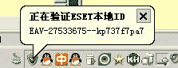
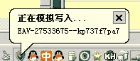

# Eset_Nohacks_AUTOID V4.1 - ESET ID 自动获取填写工具(适用全部版本)

> 原文：[`www.pediy.com/kssd/pediy11/117161.html`](https://www.pediy.com/kssd/pediy11/117161.html)

## 简介

`ESET NOD32` 是世界排名第三的杀毒软件，其以轻快巧著称。

- **下载地址**: [http://www.skycn.com/soft/37962.html](http://www.skycn.com/soft/37962.html)

这个小工具的作用是自动从网上 `ESET ID` 发布页获取最新 `ID`，然后用 `ID` 到官方进行验证，验证可用就写入本地注册表来修改 `ESET` 的 `ID` 信息。

本程序涉及了 `wininet` 函数库，`AOGO` 的正则表达式的使用，托盘气泡提示，配置文件的读取等等，希望对大家有所帮助!

另外程序可能存在各种 `BUG`，欢迎测试告知，谢谢！

本程序先验证电脑里的 `ID`，无效就自动读取网上 `ID` 发布页下载 `ID`，验证后就写入到注册表，如果写入失败就模拟键盘输入。

## V4.1 更新

1. 直接读取网络配置页，外置 `N` 条线路，再不用担心 `ID` 发布页失效了；
2. 优化代码，其他细节修改；
3. 暂时不支持自我排除和有效期检测；






## 代码


```
;>>>>>>>>>>>>>>>>>>>>>>>>>>>>>>>>>>>>>>>>>>>>>>>>>>>>>>>>>>>>>>>>>>>>
;  Programmed by nohacks, nohacks@163.com
;  Website: http://hi.baidu.com/nohacks
;          Win32 ASM is Masm
;>>>>>>>>>>>>>>>>>>>>>>>>>>>>>>>>>>>>>>>>>>>>>>>>>>>>>>>>>>>>>>>>>>>>
; 版本信息
;    Eset\_Nohacks\_AUTOID V4.1 - ESET ID 自动获取填写工具(适用全部版本)   
;     
;                      2010 年 3 月  1 日
;>>>>>>>>>>>>>>>>>>>>>>>>>>>>>>>>>>>>>>>>>>>>>>>>>>>>>>>>>>>>>>>>>>>>

.386
.model flat, stdcall  ;32 bit memory model
option casemap :none  ;case sensitive


include ESET\_AUTOID.inc


;#########################################################################
.code

start:
  invoke GetModuleHandle,NULL
  mov hInstance,eax
  invoke InitCommonControls    
  invoke  GetPrivateProfileString,addr Section,addr keyname,addr myecho,addr iecho ,size iecho ,addr ininame
  ;invoke lstrlen, addr iecho         
  ;invoke CharUpperBuff,addr iecho ,eax      
  invoke lstrcmpi,addr iecho,CTEXT("1") ; 2,1,0 == 1,0,-1
   
  mov @echo,eax
 
  ;invoke  debugbox,CTEXT("status"),@echo
 

  invoke DialogBoxParam,hInstance,IDD\_DIALOG1,NULL,addr DlgProc,NULL
  invoke ExitProcess,0


DlgProc proc hWin:HWND,uMsg:UINT,wParam:WPARAM,lParam:LPARAM
LOCAL @lpType,@lpcdData
LOCAL hOpen,hOpenUrl,@pMemory
LOCAL dwSize,status
LOCAL @lpUser\[20\]:BYTE
LOCAL @lpPass\[20\]:BYTE
LOCAL @Pass\[20\]:BYTE
LOCAL  @TEMP\[260\]:BYTE
LOCAL @InstallDir \[256\]:BYTE
LOCAL @buffer \[260\]:BYTE
LOCAL  temp

 push hWin
 pop Winhwnd 
 mov eax,uMsg
 .if eax==WM\_INITDIALOG      
     
    .if  @echo !=-1
     invoke LoadIcon,hInstance,1   
     mov hwnd,eax
     mov note.cbSize,sizeof mNOTIFYICONDATA 
     push hWin
     pop note.hwnd 
     mov note.uID,IDI\_TRAY 
     mov note.uFlags,NIF\_ICON+NIF\_MESSAGE+NIF\_TIP 
     mov note.uCallbackMessage,WM\_SHELLNOTIFY 
     push  hwnd
     pop note.hIcon
     
     invoke lstrcpy,addr note.szTip,CTEXT("ESET NOD32 ID 自动升级工具")
     invoke Shell\_NotifyIcon,NIM\_ADD,addr note 
   

    .endif
     

      ; 开始读注册表
       invoke   RegOpenKeyEx,HKEY\_LOCAL\_MACHINE, addr  RegEset30,\\       
                             NULL, KEY\_ALL\_ACCESS,ADDR @hKey           
        
       .if  eax != ERROR\_SUCCESS 
           
            
            invoke   RegOpenKeyEx,HKEY\_LOCAL\_MACHINE, addr  RegEset27,\\
        
                                 NULL, KEY\_ALL\_ACCESS,ADDR @hKey
       
        .if  eax != ERROR\_SUCCESS
          
          invoke MessageBox,NULL,CTEXT("本机没有安装 ESET NOD32 "),CTEXT("提示"),MB\_ICONERROR+MB\_OK
           
          jmp exit
            


        .endif
          
          
            


        ;读取 ESET 本地用户名
        invoke  RtlZeroMemory ,addr @lpUser,sizeof @lpUser
        invoke  RegQueryValueEx,@hKey,CTEXT("username"), 0,ADDR @lpType,NULL,addr @lpcdData
        invoke  RegQueryValueEx,@hKey,CTEXT("username"), 0,ADDR @lpType,ADDR @lpUser,addr @lpcdData
           
        
        .if @lpcdData < 12
        
           jmp IdNull
           
        
        .endif             
        
        ;读取 ESET 本地密码
        invoke  RtlZeroMemory ,addr @lpPass,sizeof @lpPass
        invoke  RegQueryValueEx,@hKey,CTEXT("password"), 0,ADDR @lpType,NULL,addr @lpcdData         
        invoke  RegQueryValueEx,@hKey,CTEXT("password"),0,ADDR @lpType,ADDR @lpPass,addr @lpcdData   
     
        .if @lpcdData < 10
         
          jmp IdNull
           
        
        .endif           
        
        ;解密
        invoke  RtlZeroMemory ,addr @Pass,11
        invoke DeCode,addr @lpPass,addr @Pass
        invoke wsprintf,addr @TEMP,addr UserPass ,addr @lpUser,addr @lpPass
           
        ;输出提示
        invoke   \_ProcTaskQiPao,hWin,0,WM\_NOTIFYICON ,hwnd,ADDR @TEMP,CTEXT("正在验证 ESET 本地 ID")
           
        ;联网验证 ID
        invoke TestID ,addr @lpUser,addr @lpPass
         
        ;invoke debugbox,CTEXT("status"),eax
         
           
        
        .if eax
           
           invoke   \_ProcTaskQiPao,hWin,0,WM\_NOTIFYICON ,hwnd,ADDR @TEMP,CTEXT("本机 ESET ID 有效!") 
           invoke Sleep,500         
           jmp exit 
            
        .elseif eax==-1
               
           invoke   \_ProcTaskQiPao,Winhwnd,0,WM\_NOTIFYICON ,hwnd,ADDR @TEMP,CTEXT("连接官网时发生错误，请检查网络!")
           invoke Sleep,500
           jmp  exit     
            
           
        .else
           
         IdNull: 
       

           invoke \_ProcTaskQiPao,hWin,0,WM\_NOTIFYICON ,hwnd,CTEXT("http://hi.baidu.com/..."),CTEXT("本机 ESET ID 无效,读取数据中...")
           
           invoke Sleep,100
           ;获取有效 ID
           invoke  RtlZeroMemory ,addr @lpUser,sizeof @lpUser
           invoke  RtlZeroMemory ,addr @lpPass,sizeof @lpPass
           
           invoke GetAllEsetid ,addr myurl,addr Express,addr @lpUser,addr @lpPass,10
           
           
           .if eax==TRUE
           
               invoke wsprintf,addr @TEMP,addr  UserPass ,addr @lpUser,addr @lpPass
               
               
               ;写到注册表用户名
           
                 invoke lstrlen, addr @lpUser   
                 invoke  RegSetValueEx,@hKey,CTEXT("username"),0,REG\_SZ,addr @lpUser,eax
                 
                 .if eax==ERROR\_SUCCESS
                   
                   
                   
                 ;加密写入密码
                 invoke EnCode,addr @lpPass,addr @Pass
                 invoke  RegSetValueEx,@hKey,CTEXT("password"), 0,REG\_BINARY,addr @Pass , 20
                   
                   
                 
                 invoke wsprintf,addr @TEMP,addr  UserPass ,addr @lpUser,addr @lpPass
                 ;输出成功提示    
                 invoke   \_ProcTaskQiPao,Winhwnd,0,WM\_NOTIFYICON ,hwnd,ADDR @TEMP,CTEXT("有效 ID 已存入电脑!")
                 invoke Sleep,100           


                 jmp exit
                 
                 .else
                   
                   
                   
                 ; 读注册表安装目录
                 invoke   RegOpenKeyEx,HKEY\_LOCAL\_MACHINE, addr  InstallDir,\\       
                             NULL, KEY\_ALL\_ACCESS,ADDR @hKey           
            
                 
                 ;读取 ESET 安装目录
                 invoke RtlZeroMemory ,addr @InstallDir,sizeof @InstallDir
                 invoke  RegQueryValueEx,@hKey,CTEXT("InstallDir"), 0,ADDR @lpType,NULL,addr @lpcdData
                 invoke  RegQueryValueEx,@hKey,CTEXT("InstallDir"), 0,ADDR @lpType,ADDR @InstallDir,addr @lpcdData
                 
                 invoke wsprintf,addr @buffer ,addr  egui ,addr @InstallDir
                 
                 invoke WinExec,addr @buffer ,SW\_SHOW
                 
                
                 invoke   \_ProcTaskQiPao,Winhwnd,0,WM\_NOTIFYICON ,hwnd,ADDR @TEMP,CTEXT("正在模拟写入...")
                 invoke Sleep,500 
            
                 ;发送 CTRL+U
                 invoke   keybd\_event,VK\_CONTROL, 0, 0 ,0
                invoke  keybd\_event,VK\_U,0, 0 ,0
                 invoke    keybd\_event,VK\_U, 0,KEYEVENTF\_KEYUP,0
                 invoke   keybd\_event,VK\_CONTROL, 0,  KEYEVENTF\_KEYUP,0
                 
                 
               


                ;拷贝用户名到剪贴板  
                invoke  SetClipboardText ,addr @lpUser
                invoke Sleep,100 
                   
                ;发送 CTRL+V
                 invoke   keybd\_event,VK\_CONTROL, 0, 0 ,0
                 invoke  keybd\_event,VK\_V,0, 0 ,0
                 invoke    keybd\_event,VK\_V, 0,  KEYEVENTF\_KEYUP,0
                 invoke   keybd\_event,VK\_CONTROL, 0,  KEYEVENTF\_KEYUP,0
                 
                 invoke Sleep,100 
            
                 ;  发送 TAB
                 invoke   keybd\_event,VK\_TAB, 0, 0 ,0
                 invoke   keybd\_event,VK\_TAB, 0,  KEYEVENTF\_KEYUP,0
                 
                 
                 ;//拷贝密码到剪贴板  
                 
                 ; invoke debugbox,addr @lpPass,0
                 
                 ;jmp exit  
                 
                 invoke  SetClipboardText,addr @lpPass
                 invoke Sleep,100 
                 
                 
                 ;//发送 CTRL+V
                 invoke   keybd\_event,VK\_CONTROL, 0, 0 ,0
                 invoke  keybd\_event,VK\_V,0, 0 ,0
                 invoke    keybd\_event,VK\_V, 0,  KEYEVENTF\_KEYUP,0
                 invoke   keybd\_event,VK\_CONTROL, 0,  KEYEVENTF\_KEYUP,0    
                 
                 invoke Sleep,100 
            
                 ;// 发送回车键
                 
                 
                 invoke keybd\_event,VK\_RETURN, 0,0 ,0
                 invoke keybd\_event,VK\_RETURN, 0,  KEYEVENTF\_KEYUP,0
                 
                 invoke Sleep,200
                 
                 ;//发送 ALT+空格键+H
                 
                 invoke   keybd\_event,VK\_MENU, 0, 0 ,0
                 invoke  keybd\_event,VK\_SPACE,0, 0 ,0
                 invoke  keybd\_event,VK\_H,0, 0 ,0
                 
                 invoke    keybd\_event,VK\_H, 0,  KEYEVENTF\_KEYUP,0
                 invoke   keybd\_event,VK\_SPACE, 0,  KEYEVENTF\_KEYUP,0    
                invoke   keybd\_event,VK\_MENU, 0,  KEYEVENTF\_KEYUP,0 
                 
                 
             invoke   \_ProcTaskQiPao,Winhwnd,0,WM\_NOTIFYICON ,hwnd,ADDR @TEMP,CTEXT("写入完毕!")
             invoke Sleep,500     
             jmp exit   
             .endif
               
               
           
           .else
               invoke   \_ProcTaskQiPao,Winhwnd,0,WM\_NOTIFYICON ,hwnd,ADDR @TEMP,CTEXT("获取 ID 错误，请检查网络!")
               invoke Sleep,500     
               jmp exit            
           .endif           
           
       
        .endif             


  .elseif eax==WM\_COMMAND         
  
  .elseif eax==WM\_CLOSE            
   
   exit:
    
          .if @hKey
           
             invoke RegCloseKey,@hKey
             
          .endif
           
          invoke Shell\_NotifyIcon,NIM\_DELETE,addr note
     invoke EndDialog,hWin,0     
  .else                      
    
     mov    eax,FALSE
     ret
  .endif                     
  
  mov    eax,TRUE
  ret

DlgProc endp


end start

 
```


停止更新，请支持国产软件，比如微点，金山，360 等！

源码下载：（`Radasm`+`MASM`）

`ESET_AUTOID.rar`
