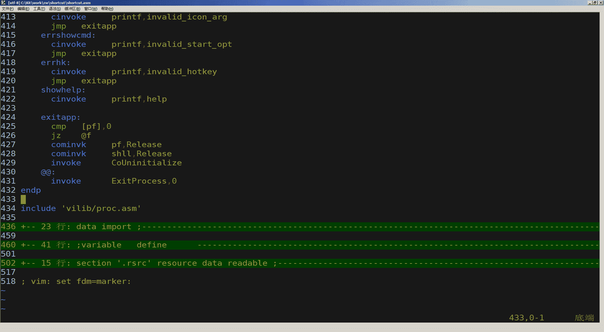

# 汇编源码：`shortcut`，命令行创建快捷方式 (FASM Source)

> 原文：[`www.pediy.com/kssd/pediy11/115426.html`](https://www.pediy.com/kssd/pediy11/115426.html)

## 简介

`shortcut` 是一个用于通过命令行创建快捷方式的工具。

原文地址：[`hi.baidu.com/bywei/blog/item/...52fddd4cf.html`](http://hi.baidu.com/bywei/blog/item/e8587d09bcdff6a52fddd4cf.html)

### 用法

**命令行参数格式**：
1. 要生成的快捷方式的文件名（包括路径）
2. 目标文件或文件夹
3. 传递的参数
4. 图标文件
5. 图标索引
6. 启动方式
7. 快捷键
8. 描述

命令行参数按上述顺序传入。可以只提供第 1、2 项；也可以将第 3、4、5、6、7、8 项中的某一项用 `""` 留空。但如果存在第 4 项，必须指定第 5 项。

*   **启动方式**：指启动时窗口的显示方式，有 `常规`、`最大化`、`最小化` 三种状态。
*   **快捷键**：可以定义任意一个键，比如 `Alt` 键、`A` 键。注意，这样的快捷键会使得该键的输入被系统外壳程序拦截，所以应该定义如 `Ctrl+Alt+F1` (即 `CA|112`) 这样的组合快捷按键。
    *   快捷键的定义格式为 `功能按键|十进制的虚拟键值`，例如 `C|116` (即 `Ctrl+F5`)。
    *   记得用引号引起来，否则 `|` 会被识别为管道命令。
    *   也可以是一个十进制的虚拟键值，如 `112` (即 `F1`)。
*   **描述**：第 8 项"描述"中如果包含空格，应该用引号引起来。
*   **通用规则**：其它项有空格做同样的处理。另外需要注意的是，这些参数项中使用了中文字符，也应该用引号引起来。

### 例子

`shortcut $quicklaunch\demo.lnk c:`
在快速启动栏（开始键右边）创建一个 `C` 盘的快捷方式。

`shortcut $desktop\demo c: "" "C:\windows\explorer.exe" 5 nor "ca|8" demo`
在桌面创建一个 `C` 盘的快捷方式，用 `C:\windows\explorer.exe` 文件中索引为 `5` 的图标，启动方式为常规，快捷键为 `Ctrl+Alt+Backspace`，描述为 `demo`。

使用 `shortcut <name> sho` 这样的参数显示真实的 `<name>`，如 `shortcut $desktop sho` 显示当前电脑的桌面的路径。

---

## Shortcut: Create a shortcut for Windows shell

**Usage**:
`shortcut .lnk_file target_file [parameters] [icon_file icon_index][start_options] [hotkey] [description]`

**Examples**:
`shortcut $quicklaunch\demo.lnk c:`

`shortcut $desktop\demo c: "" "c:\windows\explorer.exe" 5 nor "ca|8" demo`

**Following variable can be used in shortcut file name**:
`$desktop` `$quicklaunch` `$sendto` `$startmenu` `$smprograms` `$templates`

`start_options` should be one of: `nor` `max` `min`

`hotkey` use `"[modifier flags|]Virtual-Key Codes"` format. `modifier flags` can be a combination of `c`(CONTROL key), `a`(ALT key), `s`(SHIFT key), `e`(Extended key), and `codes` is decimal system.

For more help, visit `hi.baidu.com/bywei`

## 源码

```asm
  1 ;
  2 ; coded by vinoca
  3 ; site: hi.baidu.com/bywei
  4
  5 format PE console
  6 entry start
  7
  8   VERSION   equ '1.0.0.2'
  9
 10 include 'win32ax.inc'
 11
 12 +--102 行: ;sturct and const define ;
114
115 proc start
116 locals
117   rarg            rd 1
118   sho_opt_flag    rb 1
119 endl
120       invoke      GetCommandLine
121       mov   [rarg],eax
122       call  argc
123       cmp   eax,1
124       jle   showhelp
125       cmp   eax,2
126       je    errarg
127       cmp   eax,9
128       ja    errarg
129       mov   ebx,eax
130       invoke      CoInitialize,NULL
131       invoke      CoCreateInstance,CLSID_ShellLink,NULL,CLSCTX_INPROC_SERVER,IID_IShellLink,shll
132       test  eax,eax
133       jnz   exitapp
134       cominvk     shll,QueryInterface,IID_IPersistFile,pf
135       test  eax,eax
136       jnz   exitapp
137       stdcall     argv,[rarg],2,buff1
138       cmp   dword[eax],'sho'
139       jne   @f
140       mov   [sho_opt_flag],1
141       jmp   .end_sethk
142      @@:
143       mov   esi,eax
144       cominvk     shll,SetPath,eax
145       test  eax,eax
146       jnz   errtar
147       invoke      lstrlen,esi
148       mov   ecx,esi
149       add   esi,eax
150      @@:
151       dec   esi
152       mov   al,[esi]
153       test  al,al
154       jz    @f
155       cmp   al,'\'
156       jnz   @b
157       mov   byte[esi],0
158       cominvk     shll,SetWorkingDirectory,ecx
159       test  eax,eax
160       jnz   errtar
161      @@:
162       cmp   ebx,7
163       jl    .end_showcmd
164       stdcall     argv,[rarg],6,buff1
165       cmp   byte[eax],0
166       jz    .end_showcmd
167       mov   esi,eax
168       push  eax
169       xor   ecx,ecx
170      @@:
171       mov   al,[esi]
172       inc   esi
173       inc   ecx
174       test  al,al
175       jnz    @b
176       cmp   ecx,4
177       jne   errshowcmd
178       pop   esi
179       and   dword[esi],not 00202020h
180       mov   eax,[esi]
181       .if     eax='NOR'
182         mov eax,1
183       .elseif eax='MAX'
184         mov eax,3
185       .elseif eax='MIN'
186         mov eax,7
187       .else
188         jmp errshowcmd
189       .endif
190       cominvk     shll,SetShowCmd,eax
191       test  eax,eax
192       jnz   errshowcmd
193      .end_showcmd:
194       cmp   ebx,8
195       jl    .end_sethk
196       stdcall     argv,[rarg],7,buff1
197       cmp  byte[eax],0
198       jz    .end_sethk
199       mov   esi,eax
200       mov   edx,eax
201       push  esi
202       xor   edi,edi
203      @@:
204       mov   al,[esi]
205       inc   esi
206       inc   edi
207       test  al,al
208       jz    @f
209       cmp   al,'|'
210       jne   @b
211      @@:
212       xor   ecx,ecx
213       pop   esi
214       cmp   al,'|'
215       jne   .no_bar
216      @@:
217       dec   edi
218       test  edi,edi
219       jz    @f
220       mov   al,[esi]
221       inc   esi
222       and   al,not 20h
223       .if al='A'
224         add ecx,4
225       .elseif al='C'
226         add ecx,2
227       .elseif al='E'
228         add ecx,8
229       .elseif al='S'
230         add ecx,1
231       .else
232         pop eax
233         jmp errhk
234       .endif
235       jmp   @b
236      @@:
237       mov   edx,ecx
238       inc   esi
239      .no_bar:
240       push  ebx
241       call      ascii_to_dword
242       pop   ebx
243       xor   eax,eax
244       mov   eax,edx
245       shl   ax,8
246       mov   al,cl
247       cominvk     shll,SetHotkey,eax
248       test  eax,eax
249       jnz   errhk
250
251      .end_sethk:
252      @@:
253       cmp   ebx,5
254       je    errarg
255       cmp   ebx,6
256       jl    @f
257       stdcall     argv,[rarg],4,buff1
258       add   eax,260
259       stdcall     argv,[rarg],5,eax
260       mov   esi,eax
261       push  ebx
262       call  ascii_to_dword
263       pop   ebx
264       cominvk     shll,SetIconLocation,buff1,ecx
265       test  eax,eax
266       jnz   errico
267      @@:
268       cmp   ebx,4
269       jl    @f
270       stdcall     argv,[rarg],3,buff1
271       test  al,al
272       jz    @f
273       cominvk     shll,SetArguments,eax
274      @@:
275       cmp   ebx,9
276       jl    @f
277       stdcall     argv,[rarg],8,buff1
278       cominvk     shll,SetDescription,eax
279      @@:
280       stdcall     argv,[rarg],1,buff1
281       mov   esi,eax
282       mov   ecx,eax
283       cld
284      @@:
285       mov   al,[esi]
286       inc   esi
287       test  al,al
288       jz    .no_var
289       cmp   al,'$'
290       jne   @b
291       push  esi
292      @@:
293       .if byte[esi]=0
294         mov [sho_opt_flag],2
295         jmp @f
296       .endif
297       and   byte[esi],not 20h
298       inc   esi
299       cmp   byte[esi],'\ '
300       jne   @b
301       mov   byte[esi],0
302      @@:
303       pop   eax
304       inc   esi
305       push  esi
306       mov   esi,eax
307       mov   edx,esi
308       mov   ebx,str_compare
309       mov   edi,upper_desktop
310       call  ebx
311       jne   @f
312       mov   eax,CSIDL_DESKTOP
313       jmp   .get_sys_var
314      @@:
315       mov   esi,edx
316       mov   edi,upper_quicklaunch
317       call  ebx
318       jne   @f
319       mov   eax,CSIDL_APPDATA
320       jmp   .get_sys_var
321      @@:
322       mov   esi,edx
323       mov   edi,upper_sendto
324       call  ebx
```


```
325       jne   @f  
326       mov   eax,CSIDL_SENDTO  
327       jmp   .get_sys_var  
328     @@:  
329       mov   esi,edx  
330       mov   edi,upper_startmenu  
331       call  ebx  
332       jne   @f  
333       mov   eax,CSIDL_STARTMENU  
334       jmp   .get_sys_var  
335     @@:  
336       mov   esi,edx  
337       mov   edi,upper_smprograms  
338       call  ebx  
339       jne   @f  
340       mov   eax,CSIDL_PROGRAMS  
341       jmp   .get_sys_var  
342     @@:  
343       mov   esi,edx  
344       mov   edi,upper_templates  
345       call  ebx  
346       jne   @f  
347       mov   eax,CSIDL_TEMPLATES  
348       jmp   .get_sys_var  
349     @@:  
350       pop   eax  
351       stdcall     argv,[rarg],1,buff1  
352       mov   ecx,eax  
353       jmp   .no_var  
354  
355     .get_sys_var:  
356       mov   ebx,eax  
357       mov   edi,buff_dword  
358       invoke      SHGetMalloc,edi  
359       invoke      SHGetSpecialFolderLocation,0,ebx,edi  
360       mov   esi,buff1  
361       add   esi,MAX_PATH  
362       invoke      SHGetPathFromIDList,dword[edi],esi  
363       cmp   ebx,CSIDL_APPDATA  
364       jne   @f  
365       invoke      lstrcat,esi,quick_launch  
366     @@:  
367       pop   edi  
368       cmp   [sho_opt_flag],2  
369       je    show_realname  
370       mov   byte[edi-1],'\'  
371       dec   edi  
372       invoke      lstrcat,esi,edi  
373       mov   ecx,esi  
374     .no_var:  
375       mov   esi,ecx  
376     @@:  
377       mov   al,[esi]  
378       inc   esi  
379       test  al,al  
380       jnz   @b  
381       mov   eax,[esi-5]  
382       and   eax,not 20202000h  
383       cmp   eax,'.LNK'  
384       je    @f  
385       mov   dword[esi-1],'.lnk'  
386       mov   byte[esi+3],0  
387     @@:  
388       mov   esi,ecx  
389       cmp   [sho_opt_flag],1  
390       je    show_realname  
391       mov   ebx,buff1  
392       add   ebx,512  
393       invoke      MultiByteToWideChar,CP_ACP,0,ecx,-1,ebx,MAX_PATH  
394       cominvk     pf,Save,ebx,TRUE  
395       test  eax,eax  
396       jnz   errsou  
397       jmp   exitapp  
398  
399     show_realname:  
400       cinvoke     printf,esi  
401       jmp   exitapp  
402  
403     errarg:  
404       cinvoke     printf,invalid_arg  
405       jmp   exitapp  
406     errsou:  
407       cinvoke     printf,invalid_shortcut_name  
408       jmp   exitapp  
409     errtar:  
410       cinvoke     printf,invalid_target_name  
411       jmp   exitapp  
412     errico:  
413       cinvoke     printf,invalid_icon_arg  
414       jmp   exitapp  
415     errshowcmd:  
416       cinvoke     printf,invalid_start_opt  
417       jmp   exitapp  
418     errhk:  
419       cinvoke     printf,invalid_hotkey  
420       jmp   exitapp  
421     showhelp:  
422       cinvoke     printf,help  
423  
424     exitapp:  
425       cmp   [pf],0  
426       jz    @f  
427       cominvk     pf,Release  
428       cominvk     shll,Release  
429       invoke      CoUninitialize  
430     @@:  
431       invoke      ExitProcess,0  
432 endp  
433  
434 include 'vilib/proc.asm'  
435  
436 +-- 23 行: data import ;  
459         
460 +-- 41 行: ;variable   define       
501  
502 +-- 15 行: section '.rsrc' resource data readable ;  
517  
518 ; vim: set fdm=marker:  
```

也就只能这么发了，用 `VIM` 打开效果好一些。



下载源码及可执行文件：

`shortcut.zip`
