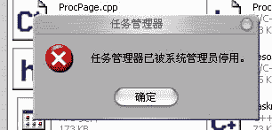

# 操作系统二之任务管理器(主程序部分)

> 原文：[`www.pediy.com/kssd/pediy10/58411.html`](https://www.pediy.com/kssd/pediy10/58411.html)

本想一次写完的,可是我发现那是个比较困难的事,我对两个函数做了说明,就觉得打字都手疼了,要是这样下去,真的是个慢长的工程.实际这一篇我觉得实际没什么的,很简单的,就像前面的一篇一样!大家一看会懂的,有的时候,这些简单的东西也很好玩的,大家就和我一体玩玩吧~~~~~~~~  

这里是之二了，我以后会连续将 RING3 系统程序的分析发出来，大家多多鼓励我啊！因为看汇编是件头疼的事！我今天就说这个最常用的工具 `taskmgr`,我来给大家从头介绍！  

## 第一部分 主程序部分  

提到主程序部分我们必须提到入口点的问题，MS 在 RING3 中定义的入口点基本上都是：  

```
//--------------------------------------------------------------------------------------  

int _stdcall ModuleEntry(void)  

{  

  ……  

}  

//---------------------------------------------------------------------------------------  
```

MS 对入口点都是自己写的，这点让我有点羡慕，到现在，我依然没有写过从入口初始化到 `WinMain` 或 `main` 的代码来！而在这里 `taskmgr` 分别是先设置类信息：  

```
SetPriorityClass(GetCurrentProcess(), HIGH_PRIORITY_CLASS);  
```

然后利用 `_initterm` 函数对 runtime 和 c++相关初始化加载，这个和我们的普通 C++程序走的过程是完全一样的，我们对这个函数不熟悉，我就把它的声明罗列了出来。  

```
//----------------------------------------------------  

函数声明为：  

_initterm(_PVFV *begin,_PVFV *end);  

//----------------------------------------------------  
```

再下面就是对命令行的处理了，再熟悉不过了，一个 `GetStartupInfo` 函数后我们看到了主函数的调用：  

```
//---------------------------------------------------  

    i = _tWinMain(GetModuleHandle(NULL), NULL, pszCmdLine,  
                   si.dwFlags & STARTF_USESHOWWINDOW ? si.wShowWindow : SW_SHOWDEFAULT);  
```

主函数的声明为：  

```
int APIENTRY _tWinMain(HINSTANCE hInstance,  
                      HINSTANCE hPrevInstance,  
                      LPTSTR    lpCmdLine,  
                      int       nCmdShow)  

//---------------------------------------------------  
```

下面我们到了主函数了，还是随我往下看吧！会发现很多秘密的呵呵！  

```
//----------------------------------------------------  

  //加载函数:  

  LoadFunc();  

//----------------------------------------------------  
```

对于这个函数很多人没见过吧！在我没把它写进去的时候，实际我也没见过，太枯燥的代码，开个玩笑，让心情好点，可以再继续看下去~~~实际这个函数就是我写的哈哈！  

```
//----------------------------------------------------  

void LoadFunc(void)  

{  

  (FARPROC &)EndTask                       =GetProcAddress(GetModuleHandle(TEXT("User32.dll")),"EndTask");  

  (FARPROC &)NtQuerySystemInformation      =GetProcAddress(GetModuleHandle(TEXT("ntdll.dll")),"NtQuerySystemInformation");  

  (FARPROC &)RtlLargeIntegerToChar        =GetProcAddress(GetModuleHandle(TEXT("ntdll.dll")),"RtlLargeIntegerToChar");  

  (FARPROC &)RtlAnsiStringToUnicodeString  =GetProcAddress(GetModuleHandle(TEXT("ntdll.dll")),"RtlAnsiStringToUnicodeString");  

  (FARPROC &)RtlUnicodeStringToInteger     =GetProcAddress(GetModuleHandle(TEXT("ntdll.dll")),"RtlUnicodeStringToInteger");  

  (FARPROC &)RtlInitUnicodeString          =GetProcAddress(GetModuleHandle(TEXT("ntdll.dll")),"RtlInitUnicodeString");  

  (FARPROC &)NtClose                      =GetProcAddress(GetModuleHandle(TEXT("ntdll.dll")),"NtClose");  

  (FARPROC &)NtOpenThread                 =GetProcAddress(GetModuleHandle(TEXT("ntdll.dll")),"NtOpenThread");  

  (FARPROC &)NtQueryInformationToken      =GetProcAddress(GetModuleHandle(TEXT("ntdll.dll")),"NtQueryInformationToken");  

  (FARPROC &)RtlTimeToElapsedTimeFields   =GetProcAddress(GetModuleHandle(TEXT("ntdll.dll")),"RtlTimeToElapsedTimeFields");  

  (FARPROC &)RunFileDlg                   =GetProcAddress(GetModuleHandle(TEXT("shell32.dll")),(LPCSTR)61);//"RunFileDlg");  

  //(FARPROC &)GetSiteSidFromToken          =GetProcAddress(GetModuleHandle(TEXT(".\\advapi32.dll")),"GetSiteSidFromToken");  

  (FARPROC &)fpnIsHungAppWindow           =GetProcAddress(GetModuleHandle(TEXT("User32.dll")),"IsHungAppWindow");  

}  

//----------------------------------------------------  
```

看到上面的初始化我就要说明两点，其它的函数我会在相关的地方说明，这里初始化的都几乎都是未公开的函数。一个是 `LoadLibrary` 和 `GetModuleHandle` 的区别，我想大家用过的清楚，那我就说给菜鸟们吧！`GetModuleHandle` 只对已经加载的 DLL 起作用，它是获取当前程序中模块 DLL 的基地址，而 `LoadLibrary` 是先把 DLL 加载到内存，然后返回基地址，我们必须用 `FreeLibrary` 来把它释放了，这里我推荐用 `GetModuleHandle`，在调用当前程序没有的模块时就要用 `LoadLibrary` 了，至于为什么要在这里用 `GetModuleHandle` 大家自己想想了，别等我什么都说哦！要学会多思考，菜鸟才能飞起来！哎！我什么时候才能飞起来~~~~~~~~~~~55。另外一个是 `GetProcAddress` 的使用，大家都知道只有一种方法，有天我看汇编代码的时候发现它还可以调用 DLL 的导出函数的序号来获取函数地址。后来去了 MSDN 发现，真能这样调用，如果都知道了，那就是我多余了呵呵~~~~  

```
//---------------------------------------------------  

(FARPROC &)RunFileDlg                   =GetProcAddress(GetModuleHandle(TEXT("shell32.dll")),(LPCSTR)61);//"RunFileDlg");  

//这个函数在 WIN2000 中是管用的，而到了我的 XP 系统发现已经不管用了，后来查看发现，竟然没了"RunFileDlg"。或许是我系统问题，或许是 MS 调整了。反正现在我只有用序号来调用它了，获取它的序号很容易，我是反汇编获得呵呵~~  

//---------------------------------------------------  
```

下面我们到了，需要说明的是这个 API 返回的是随即分配的消息，并不是固定的哦！  

```
//-------------------------------------------------------  

  //注册窗口消息:  

  g_msgTaskbarCreated = RegisterWindowMessage(TEXT("TaskbarCreated"));  

  //初始化临界区:  

      InitializeCriticalSection(&g_CSTrayThread);  

  //开启互斥:  

    g_hStartupMutex = CreateMutex(NULL, TRUE, cszStartupMutex);  

    if (g_hStartupMutex && GetLastError() == ERROR_ALREADY_EXISTS)  

    {  

        WaitForSingleObject(g_hStartupMutex, FINDME_TIMEOUT);  

    }  

  //由于开起了互斥我们只能运行一个任务管理器，如果有兴趣可以改改，多开几个，但是那样好象就没什么意思了。这里的 API 都很熟悉吧！我就不罗列声明了。  

//-------------------------------------------------------  
```

而 MS 在调用的时候蹦出了如下的代码：  

```
//-------------------------------------------------------  

winsta.dll 导出的：  

gpfnWinStationGetProcessSid = ( pfnWinStationGetProcessSid )GetProcAddress(hWinstaDLL, "WinStationGetProcessSid");  

gpfnWinStationTerminateProcess = ( pfnWinStationTerminateProcess )GetProcAddress(hWinstaDLL, "WinStationTerminateProcess");  

utildll.dll  

gpfnCachedGetUserFromSid = ( pfnCachedGetUserFromSid )GetProcAddress(hUtilDll, "CachedGetUserFromSid");  

他们的声明为，大家先根据字面意思猜吧，我看看后面也许会简要说明一下：  

BOOLEAN WINAPI WinStationGetProcessSid(  
  HANDLE hServer,  
  DWORD ProcessId ,  
  FILETIME ProcessStartTime ,  
  PBYTE pProcessUserSid ,  
  PDWORD dwSidSize );  

void WINAPI CachedGetUserFromSid(  
  PSID pSid ,  
  PWCHAR pUserName ,  
  PULONG cbUserName );  

BOOLEAN WINAPI WinStationTerminateProcess(  
  HANDLE hServer,  
  ULONG ProcessId,  
  ULONG ExitCode);  

//-------------------------------------------------------  
```

下面的内容就是分析当前系统中是否有任务管理在运行，如果有就把它置顶。  

```
//--------------------------------------------------------  

HWND hwndOld = FindWindow(WC_DIALOG, szTitle);  

GetWindowThreadProcessId(hwndOld, &dwPid);  

AllowSetForegroundWindow(dwPid);  

//--------------------------------------------------------  
```

下面一段代码我把它贴完整点：  

```
//---------------------------------------------------------  

    //获取注册表设置:  

  if (RegOpenKeyEx (HKEY_CURRENT_USER,  
                    TEXT("Software\\Microsoft\\Windows\\CurrentVersion\\Policies\\System"),  
                    0, KEY_READ, &hKeyPolicy) == ERROR_SUCCESS)  

    {//看到上面的注册项吗？不知道大家遇到过么？我反正遇到过，实际对于我们普通用户来讲，是完全没必要屏蔽掉任务管理器的，所以我想我一会要把这里做一下处理，免的那个病毒啊什么，把它改了，我不就是看不到任务管理器了。  

        dwSize = sizeof(dwData);  

        RegQueryValueEx (hKeyPolicy, TEXT("DisableTaskMgr"), NULL,  
                        &dwType, (LPBYTE) &dwData, &dwSize);  

        RegCloseKey (hKeyPolicy);  

        if (dwData)  

        {  

            TCHAR szTitle[25];  

            TCHAR szMessage[200];  

    //下面是显示一个对话框，告诉你想用程序，请找管理员~~~~~~~郁闷！！！  

            LoadString (hInstance, IDS_TASKMGR, szTitle, ARRAYSIZE(szTitle));  

            LoadString (hInstance, IDS_TASKMGRDISABLED , szMessage, ARRAYSIZE(szMessage));  

            MessageBox (NULL, szMessage, szTitle, MB_OK | MB_ICONSTOP);  

            retval = FALSE;  

            goto cleanup;  

        }  

    }  

//---------------------------------------------------------  
```

在下面就是用 `InitCommonControls()` 初始化控件。然后注册窗口再就到下面：  

```
//---------------------------------------------------------  

  //创建工作线程:  

    g_hTrayThread = CreateThread(NULL, 0, (LPTHREAD_START_ROUTINE)TrayThreadMessageLoop, NULL, 0, &g_idTrayThread);  

//加载属性页：  

    g_pPages[0] = new CTaskPage;  

……  

    // 加载资源  

    if (FALSE == LoadGlobalResources())  

    {  

        retval = FALSE;  

        goto cleanup;  

    }  
```


//后面介绍

```c
if (0 == InitPerfInfo())
{
    retval = FALSE;
    goto cleanup;
}
```

//创建窗口

```c
g_hMainWnd = CreateDialog(hInstance,
                          MAKEINTRESOURCE(IDD_MAINWND),
                          NULL,
                          MainWindowProc);
```

//显示窗口

```c
SetWindowPos(g_hMainWnd, NULL,
             g_Options.m_rcWindow.left,
             g_Options.m_rcWindow.top,
             cx,
             cy,
             SWP_NOZORDER);
MyShowWindow(g_hMainWnd, nCmdShow);
```

--------------------------------------------------------

下面是消息循环和恢复现场~~这里算是主函数基本上结束了~~~~~，MY GOD！两个函数写这么多，如果真要这么一步步分析下去，不死人了~~~~我以后会把主要的重点的东西贴出来给大家，源代码我已经放出来了，详细点的大家根据代码自己研究了，我不说了，打字都打的心烦起来了。

--------------------------------------------------------------------------------

研究成果的实践

--------------------------------------------------------------------------------

我们研究了不应用不就白研究了嘛！！不管木马还是病毒都要对付任务管理器，所以任务管理器实际蛮可怜的，我今天就把我的任务管理器整理一下，这样我不怕病毒感染了呵呵~~~~

我们首先为了让任务管理能够正常显示，我们要把注册表中的那一项跳掉，其次是我们把入口做处理，最起码我们知道我们的任务管理器是否被感染了。

好我们开始手动来做我们的要求：

### 第一、注册表项的处理

我现在的任务管理是如图这样，我们都知道这个是 `MS` 给保留的功能我们就把它处理掉。



--------------------------------------------------------------------------------

```asm
//OD 载入：
01005944 > $  E8 1EC70000   call    01012067
01005949   .^ E9 0AFFFFFF   jmp     01005858
0100594E      CC            int3
//下面不就是我们的入口代码的第一个函数吗？？
01005860  |.  56            push    esi
01005861  |.  57            push    edi
01005862  |.  68 80000000   push    80                      ; /Priority = HIGH_PRIORITY_CLASS
01005867  |.  FF15 14110001 call    dword ptr [<&KERNEL32.GetCurrent>; |[GetCurrentProcess
0100586D  |.  50            push    eax                     ; |hProcess
0100586E  |.  FF15 18110001 call    dword ptr [<&KERNEL32.SetPriorit>; \\SetPriorityClass
01005922  |> \\6A 0A         push    0A
01005924  |.  58            pop     eax
01005925  |>  50            push    eax                     ; /Arg4
01005926  |.  56            push    esi                     ; |Arg3
01005927  |.  6A 00         push    0                       ; |Arg2 = 00000000
01005929  |.  6A 00         push    0                       ; |/pModule = NULL
0100592B  |.  FF15 24110001 call    dword ptr [<&KERNEL32.GetModuleH>; |\\GetModuleHandleW
01005931  |.  50            push    eax                     ; |Arg1 = 01000000
//从这里进去，就是到了 WinMain 函数了
01005932  |.  E8 57FAFFFF   call    0100538E                ; \\taskmgrX.0100538E
//看来 XP 和 2000 没什么太多的变化！
010053A9  |.  68 4C1B0001   push    01001B4C                ; /MsgName = "TaskbarCreated"
010053AE  |.  8945 FC       mov     dword ptr [ebp-4], eax  ; |
010053B1  |.  89B5 28FCFFFF mov     dword ptr [ebp-3D8], esi ; |
010053B7  |.  8935 285E0101 mov     dword ptr [1015E28], esi ; |
010053BD  |.  89BD 2CFCFFFF mov     dword ptr [ebp-3D4], edi ; |
010053C3  |.  899D 20FCFFFF mov     dword ptr [ebp-3E0], ebx ; |
010053C9  |.  FF15 A0120001 call    dword ptr [<&USER32.RegisterWind>; \\RegisterWindowMessageW
//下面这个也是没变的
//HANDLE g_hStartupMutex = NULL; //互斥句柄
//const TCHAR cszStartupMutex[] = TEXT("NTShell Taskman Startup Mutex"); //互斥标识
//上面的是 C 定义，我们要处理掉，想想如果要是有个病毒或木马有个这样的标识，那么我们的任务管理器是不是就不出来了~~~~，一会再处理它！下个 F2 断点记下地方。
010053CF  |.  68 C0140001   push    010014C0                ; /MutexName = "NTShell Taskman Startup Mutex"
010053D4  |.  57            push    edi                     ; |InitialOwner => TRUE
010053D5  |.  53            push    ebx                     ; |pSecurity => NULL
010053D6  |.  A3 105E0101   mov     dword ptr [1015E10], eax ; |
010053DB  |.  FF15 2C110001 call    dword ptr [<&KERNEL32.CreateMute>; \\CreateMutexW
//如果我们的任务管理，是一直这个名字，那么病毒或木马不就很容易找到我们的任务管理的窗口吗？
//一会把它改了。
01005437  |> \\68 04010000   push    104                     ; /Count = 104 (260.)
0100543C  |.  8D85 30FCFFFF lea     eax, dword ptr [ebp-3D0] ; |
01005442  |.  50            push    eax                     ; |Buffer
01005443  |.  68 13270000   push    2713                    ; |RsrcID = STRING "Windows 任务管理器"
01005448  |.  56            push    esi                     ; |hInst
01005449  |.  8B35 BC130001 mov     esi, dword ptr [<&USER32.LoadStr>; |USER32.LoadStringW
0100544F  |.  FFD6          call    esi                     ; \\LoadStringW
//我们到这里，发现了我们要改的地方，也就是那个保留的设置。
010054BF  |> \\8D85 24FCFFFF lea     eax, dword ptr [ebp-3DC]
010054C5  |.  50            push    eax                     ; /pHandle
010054C6  |.  68 19000200   push    20019                   ; |Access = KEY_READ
010054CB  |.  53            push    ebx                     ; |Reserved
010054CC  |.  68 D81A0001   push    01001AD8                ; |Subkey = "Software\\Microsoft\\Windows\\CurrentVersion\\Policies\\System"
010054D1  |.  68 01000080   push    80000001                ; |hKey = HKEY_CURRENT_USER
010054D6  |.  FF15 08100001 call    dword ptr [<&ADVAPI32.RegOpenKey>; \\RegOpenKeyExW
//下面是检查~~~是否为 0 如果为 9 就正常运行，如果不是就弹出图中的对话框
01005521  |.  399D 20FCFFFF cmp     dword ptr [ebp-3E0], ebx
01005527  |.  74 4B         je      short 01005574      //这里我们修改为 JMP，无论值是多少都给我正常运行~~实际这样做不好，最好把[EBP-3E0]的值改了，我们已经知道了它的工作机制，对后面的影响实际没什么，我们就可以这样跳了。熟悉的任务管理器就出现了呵呵~~~~~~~~
```

`CTRL-ALT-DEL`，怎么还是如图啊，呵呵！~~~是我修改的不是系统中的，等我修改好就把它放进系统目录去，这样我就再也不怕病毒欺负它了，无论怎么改我按这三个键都会照常蹦出来哈哈~~~

--------------------------------------------------------------------------------

### 二、互斥修改

--------------------------------------------------------------------------------

//这个简单了，我们把我们的互斥标识改进去就可以了
//再次 `OD` 我们到这里了。

```asm
010053CF  |.  68 C0140001   push    010014C0                ; /MutexName = "NTShell Taskman Startup Mutex"
010053D4  |.  57            push    edi                     ; |InitialOwner => TRUE
010053D5  |.  53            push    ebx                     ; |pSecurity => NULL
010053D6  |.  A3 105E0101   mov     dword ptr [1015E10], eax ; |
010053DB  |.  FF15 2C110001 call    dword ptr [<&KERNEL32.CreateMute>; \\CreateMutexW
```

//改成什么呢？？就改:`"<* NTShell Taskman Startup *>\"`
//这里改的时候要注意了，这里的字符是 `UN` 不是 `A` 的哦！

### 三、窗口标题的修改

--------------------------------------------------------------------------------

我们可以用 `exescope` 来修改，也可以用其它的由于它的标题在 `string table` 中，我们方便点不拿 `OD` 做了，我这里拿 `exescope` 来修改。修改为“`10003,^\_^Windows 任务管理器^\_^`”

### 四、入口修改

如果碰到像熊猫那样的破性的病毒怎么办呢！！至少我们要知道我们的任务管理器是否被感染~~

为了方便加代码~~，我们必须把入口点改掉！

----------------------------------------------------------------------------------

偏移地址：`00005944`

基地址 ：`01000000`

如果我一直这样加汇编来实现，会让程序的稳定变的差点，系统嘛！稳定很重要的！我还是写个 `DLL` 来保护我的任务管理吧！我实在是不想再修改手动加代码了~~太麻烦了！我又懒~~~~

在这期间我们可以修改 `OEP`，也可以修改入口代码总之就是让病毒没办法破就是了，我写了个简单的 `DLL`，把入口代码改了，也就是说，只要病毒改了入口代码~~我都会发现！，

我把我的保护 `DLL` 代码贴一下，简单但是实用，我没有把它做的很难，因为够用就可以了。

----------------------------------------------------------------------------------

```c
void Init()
{
  //我们是要做为模块加进去的所以我们事先就能知道我们的程序基地址:
  //获取 Taskmgr 的基地址:
  hModule =::GetModuleHandle(NULL);
  DWORD dwBaseAddr=(LONG)hModule;
  m_pData =(PDWORD)dwBaseAddr;
  _dosHeader =(PIMAGE_DOS_HEADER)m_pData;
    _ntHeader  =(PIMAGE_NT_HEADERS)((LONG)_dosHeader+(LONG)_dosHeader->e_lfanew);
  //检测入口点,
  if(_ntHeader->OptionalHeader.AddressOfEntryPoint!=0x00005944){
    TCHAR   tcCaption[MAX_PATH]={0};
```


`wsprintf(tcCaption,TEXT("\[OEP 被更改为 0x%08X\]我难过~~~！"),_ntHeader->OptionalHeader.AddressOfEntryPoint);`

`if(MessageBox(NULL,TEXT("小湔雪，我已经被人修改了，如果运行会有麻烦的，点取消吧！"),`

`tcCaption,MB_YESNO|MB_ICONSTOP)!=IDYES)`

```
{
  ::ExitProcess(0);
}
```

`};`

`//恢复入口点代码:`

`memcpy((PBYTE)(_ntHeader->OptionalHeader.ImageBase+0x00005944),&uiData1[0],15);`

```
}
```

`//----------------------------------------------------------------------------------------`

大家还可以做的更难点，比如对代码进行处理！动态修复等等，看大家自己的了~~~~~~~~~~~~

吃饭去了哈哈！！！
